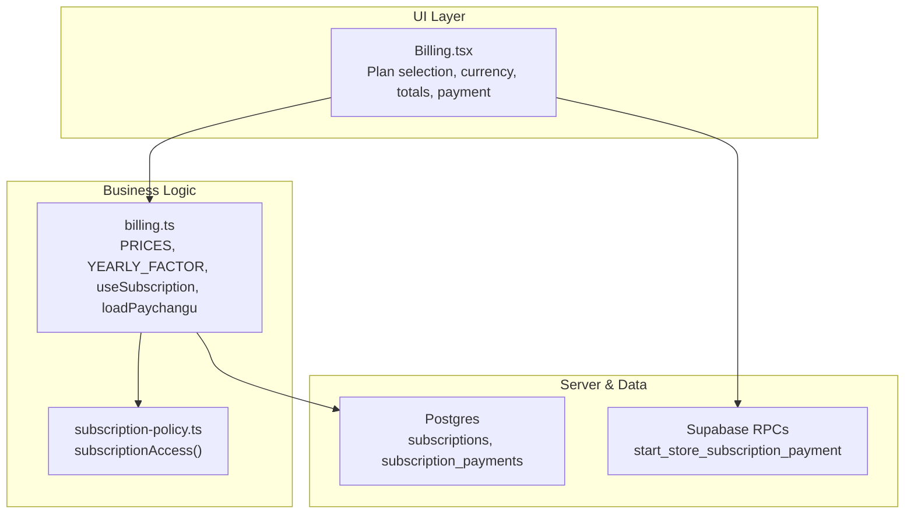
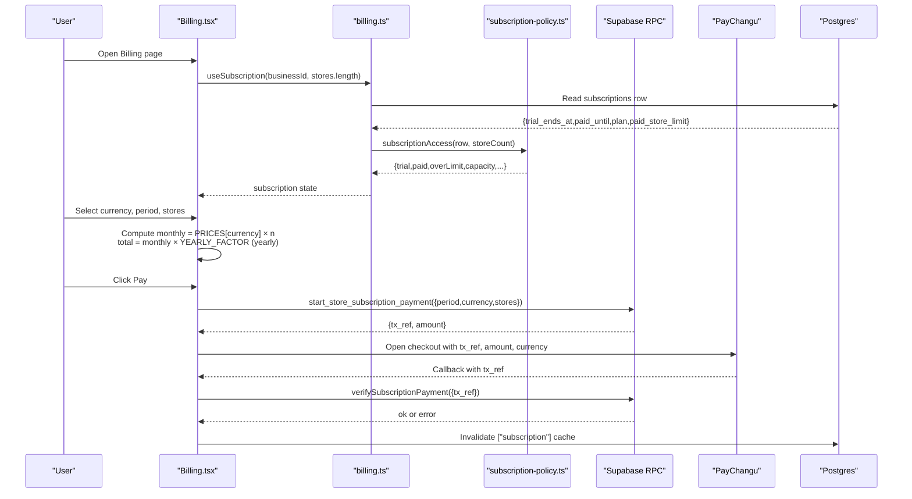
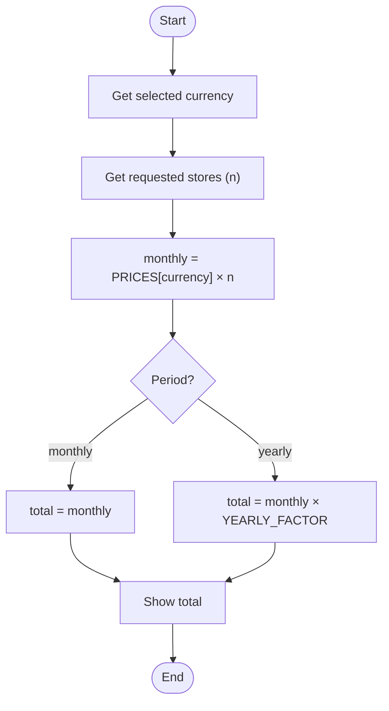
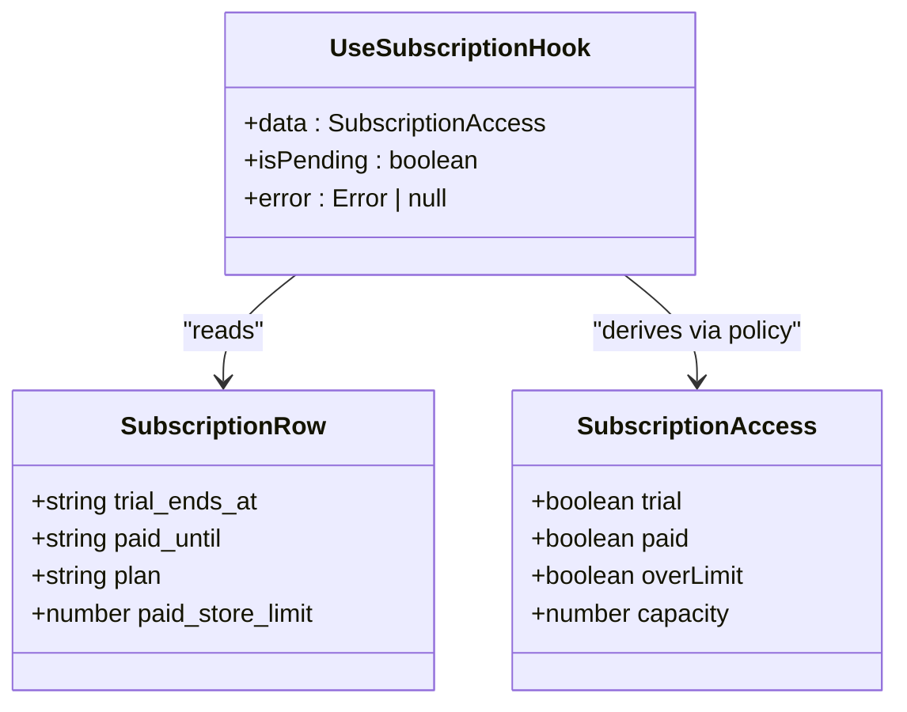
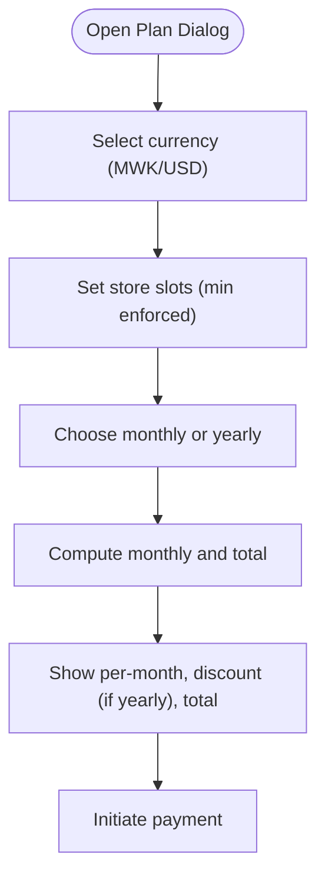
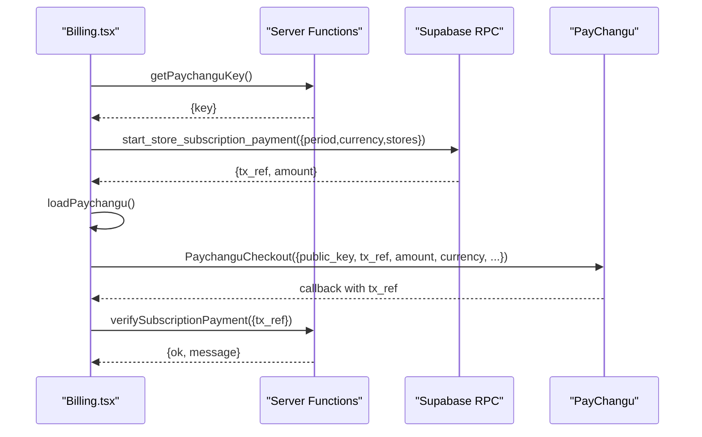
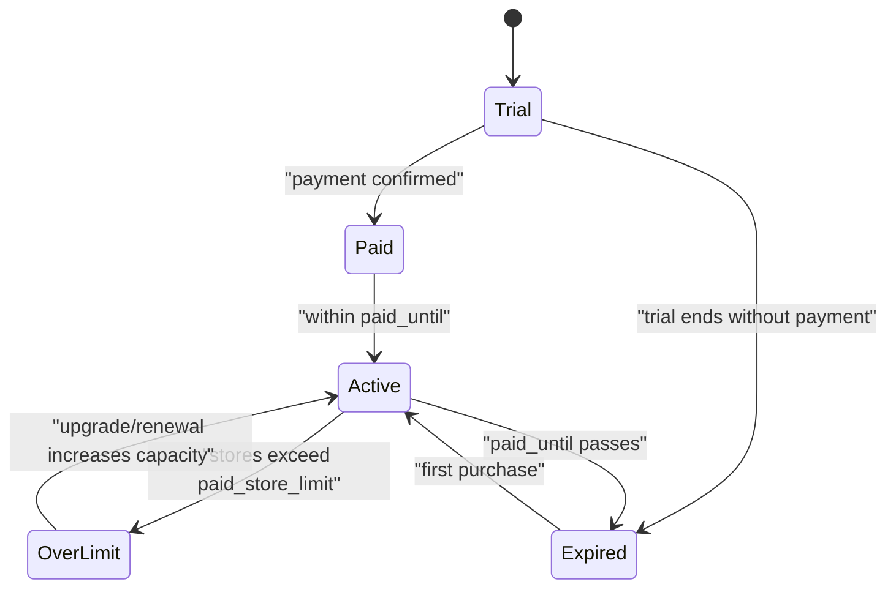
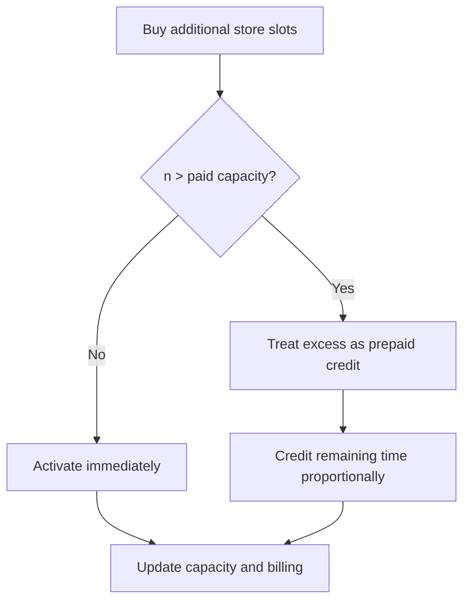
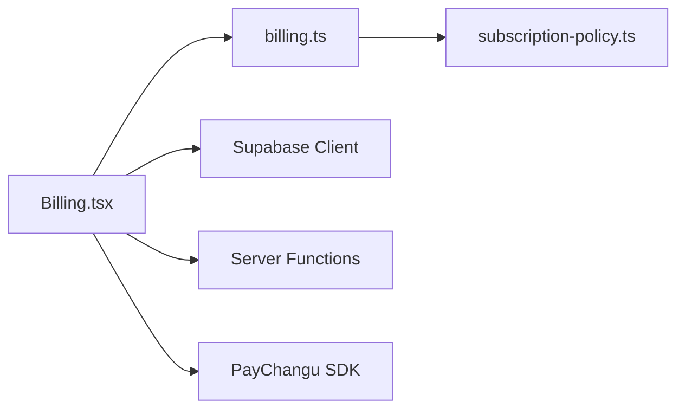

# Subscription Plans & Pricing

<cite>
**Referenced Files in This Document**
- [billing.ts](file://src/lib/billing.ts)
- [subscription-policy.ts](file://src/lib/subscription-policy.ts)
- [Billing.tsx](file://src/components/pos/Billing.tsx)
- [AGENTS.md](file://AGENTS.md)
- [roadmap.md](file://roadmap.md)
</cite>

## Table of Contents
1. [Introduction](#introduction)
2. [Project Structure](#project-structure)
3. [Core Components](#core-components)
4. [Architecture Overview](#architecture-overview)
5. [Detailed Component Analysis](#detailed-component-analysis)
6. [Dependency Analysis](#dependency-analysis)
7. [Performance Considerations](#performance-considerations)
8. [Troubleshooting Guide](#troubleshooting-guide)
9. [Conclusion](#conclusion)

## Introduction
This document explains the subscription plan system for multi-store retail operations. It covers:
- Multi-tier pricing with monthly and yearly billing cycles
- Per-store pricing model and store capacity limits
- The PRICES configuration object and YEARLY_FACTOR discount calculation
- Currency support for MWK and USD
- How plans are displayed and selected in the UI
- Trial period handling, over-limit enforcement, upgrades, renewals, and prepaid credit behavior

## Project Structure
The subscription system is implemented across a small set of focused modules:
- `src/lib/billing.ts` defines pricing constants, payment provider loading, and the subscription data hook
- `src/lib/subscription-policy.ts` defines the subscription access policy used to derive trial, paid, and over-limit states
- `src/components/pos/Billing.tsx` renders the billing page, plan selection dialog, currency selector, and payment flow
- `AGENTS.md` documents server-side enforcement rules for paid store capacity and expiry
- `roadmap.md` records verification status for paid store enforcement and billing presentation

**Diagram sources**
- [Billing.tsx:8-10](file://src/components/pos/Billing.tsx#L8-L10)
- [billing.ts:7-38](file://src/lib/billing.ts#L7-L38)
- [subscription-policy.ts:1-2](file://src/lib/subscription-policy.ts#L1-L2)

**Section sources**
- [billing.ts:7-38](file://src/lib/billing.ts#L7-L38)
- [Billing.tsx:8-10](file://src/components/pos/Billing.tsx#L8-L10)
- [AGENTS.md:1-3](file://AGENTS.md#L1-L3)
- [roadmap.md:1-8](file://roadmap.md#L1-L8)

## Core Components
- PRICES: Base per-store monthly price by currency (MWK and USD)
- YEARLY_FACTOR: Annual multiplier that applies a discount compared to 12 monthly payments
- useSubscription: React Query hook fetching subscription state and deriving access flags
- Billing UI: Plan selection dialog, currency toggle, store slot input, total calculation, and payment initiation
- Payment integration: PayChangu checkout via dynamic script loader and server RPC

Key responsibilities:
- Pricing and discount math live in `billing.ts`
- Access derivation (trial/paid/overLimit/capacity) lives in `subscription-policy.ts` and is consumed by `useSubscription`
- UI orchestration and user interactions live in `Billing.tsx`

**Section sources**
- [billing.ts:7-38](file://src/lib/billing.ts#L7-L38)
- [Billing.tsx:54-73](file://src/components/pos/Billing.tsx#L54-L73)

## Architecture Overview
The subscription flow combines client-side calculations with server-enforced policies:

**Diagram sources**
- [Billing.tsx:74-139](file://src/components/pos/Billing.tsx#L74-L139)
- [billing.ts:10-38](file://src/lib/billing.ts#L10-L38)
- [subscription-policy.ts:1-2](file://src/lib/subscription-policy.ts#L1-L2)

## Detailed Component Analysis

### Pricing Configuration and Discount Calculation
- PRICES defines base monthly cost per store for each supported currency:
  - MWK: local currency rate
  - USD: international currency rate
- YEARLY_FACTOR computes the annual multiplier to apply a discount relative to 12 months
- Monthly total: PRICES[currency] × number of stores
- Yearly total: monthly × YEARLY_FACTOR

**Diagram sources**
- [billing.ts:7-8](file://src/lib/billing.ts#L7-L8)
- [Billing.tsx:71-72](file://src/components/pos/Billing.tsx#L71-L72)
- [Billing.tsx:494-494](file://src/components/pos/Billing.tsx#L494-L494)

**Section sources**
- [billing.ts:7-8](file://src/lib/billing.ts#L7-L8)
- [Billing.tsx:71-72](file://src/components/pos/Billing.tsx#L71-L72)
- [Billing.tsx:494-494](file://src/components/pos/Billing.tsx#L494-L494)

### Subscription State and Capacity Management
- useSubscription fetches the active subscription row and derives:
  - trial: whether still within trial window
  - paid: whether a confirmed payment exists
  - overLimit: whether current store count exceeds paid capacity
  - capacity: effective paid store limit
- The UI shows usage percentage and highlights over-limit state
- Minimum store slots in the plan dialog are enforced based on existing stores and paid capacity

**Diagram sources**
- [billing.ts:10-38](file://src/lib/billing.ts#L10-L38)
- [subscription-policy.ts:1-2](file://src/lib/subscription-policy.ts#L1-L2)

**Section sources**
- [billing.ts:10-38](file://src/lib/billing.ts#L10-L38)
- [Billing.tsx:58-70](file://src/components/pos/Billing.tsx#L58-L70)
- [Billing.tsx:159-169](file://src/components/pos/Billing.tsx#L159-L169)

### UI: Plan Selection Dialog and Pricing Display
- Currency selector toggles between MWK and USD
- Store slots input enforces a minimum based on current stores and paid capacity
- Two plan options: monthly and yearly; yearly displays a discount badge
- Totals breakdown:
  - Per-month line: PRICES[currency] × stores
  - Yearly discount line: difference between 12 × monthly and yearly total
  - Final total: monthly or yearly total depending on selected period

**Diagram sources**
- [Billing.tsx:439-565](file://src/components/pos/Billing.tsx#L439-L565)
- [Billing.tsx:44-47](file://src/components/pos/Billing.tsx#L44-L47)
- [Billing.tsx:71-72](file://src/components/pos/Billing.tsx#L71-L72)

**Section sources**
- [Billing.tsx:439-565](file://src/components/pos/Billing.tsx#L439-L565)
- [Billing.tsx:44-47](file://src/components/pos/Billing.tsx#L44-L47)

### Payment Flow and Provider Integration
- On payment:
  - Fetch a public key from the server
  - Create a subscription payment session via RPC with period, currency, and store count
  - Load PayChangu dynamically and open checkout with transaction reference, amount, currency, and metadata
  - On callback, verify payment via server function and refresh subscription cache

**Diagram sources**
- [Billing.tsx:94-139](file://src/components/pos/Billing.tsx#L94-L139)
- [billing.ts:41-55](file://src/lib/billing.ts#L41-L55)

**Section sources**
- [Billing.tsx:94-139](file://src/components/pos/Billing.tsx#L94-L139)
- [billing.ts:41-55](file://src/lib/billing.ts#L41-L55)

### Trial Period Handling
- Trial state is derived from the subscription row’s trial end date
- When trial is active but not paid, the UI indicates free trial status and shows trial end date
- Once trial ends without payment, the system transitions to expired or over-limit states depending on capacity

**Diagram sources**
- [billing.ts:21-30](file://src/lib/billing.ts#L21-L30)
- [Billing.tsx:141-165](file://src/components/pos/Billing.tsx#L141-L165)

**Section sources**
- [billing.ts:21-30](file://src/lib/billing.ts#L21-L30)
- [Billing.tsx:141-165](file://src/components/pos/Billing.tsx#L141-L165)

### Upgrades, Renewals, and Prepaid Credit
- Renewals extend the paid period; upgrades increase paid store capacity
- If a business purchases more store slots than its current paid capacity, the extra slots act as prepaid credit
- The plan dialog notes prepaid credit when buying beyond existing capacity
- Server-side rules ensure proportional crediting when paid capacity changes and prevent unpaid store creation

**Diagram sources**
- [Billing.tsx:487-490](file://src/components/pos/Billing.tsx#L487-L490)
- [AGENTS.md:1-3](file://AGENTS.md#L1-L3)

**Section sources**
- [Billing.tsx:487-490](file://src/components/pos/Billing.tsx#L487-L490)
- [AGENTS.md:1-3](file://AGENTS.md#L1-L3)

### Examples and Scenarios

- Example configurations:
  - MWK monthly: base price per store in MWK multiplied by number of stores
  - USD monthly: base price per store in USD multiplied by number of stores
  - Yearly: monthly total multiplied by YEARLY_FACTOR, showing a discount badge

- Pricing scenarios:
  - Single store, monthly: display per-store monthly price and total equals monthly
  - Multiple stores, yearly: show per-store monthly subtotal, yearly discount line, and discounted total
  - Upgrade scenario: increasing store slots beyond current capacity triggers prepaid credit messaging

- Over-limit enforcement:
  - UI shows over-limit status and progress bar color change
  - Server-side SQL enforces paid store capacity and expiry; clients cannot create unpaid stores

**Section sources**
- [billing.ts:7-8](file://src/lib/billing.ts#L7-L8)
- [Billing.tsx:71-72](file://src/components/pos/Billing.tsx#L71-L72)
- [Billing.tsx:494-494](file://src/components/pos/Billing.tsx#L494-L494)
- [Billing.tsx:159-169](file://src/components/pos/Billing.tsx#L159-L169)
- [AGENTS.md:1-3](file://AGENTS.md#L1-L3)

## Dependency Analysis
- UI depends on:
  - `PRICES`, `YEARLY_FACTOR`, `loadPaychangu`, `useSubscription` from `billing.ts`
  - i18n keys for labels and messages
  - Supabase client for queries and auth
  - Server functions for payment key retrieval and verification
- `billing.ts` depends on:
  - `subscription-policy.ts` for access derivation
  - Supabase client for reading subscription rows
- Server-side enforcement is documented in project rules

**Diagram sources**
- [Billing.tsx:8-10](file://src/components/pos/Billing.tsx#L8-L10)
- [billing.ts:1-5](file://src/lib/billing.ts#L1-L5)
- [billing.ts:41-55](file://src/lib/billing.ts#L41-L55)

**Section sources**
- [Billing.tsx:8-10](file://src/components/pos/Billing.tsx#L8-L10)
- [billing.ts:1-5](file://src/lib/billing.ts#L1-L5)

## Performance Considerations
- Subscription query uses staleTime and refetchInterval to avoid frequent database hits while keeping UI reasonably fresh
- Payment history query has a longer staleTime since it is append-only and invalidated by subscription updates
- Dynamic loading of PayChangu script avoids blocking initial page load

[No sources needed since this section provides general guidance]

## Troubleshooting Guide
Common issues and resolutions:
- Payment not configured:
  - Symptom: error indicating payment provider not configured
  - Resolution: ensure server returns a valid PayChangu public key before opening checkout
- PayChangu SDK failed to load:
  - Symptom: error indicating PayChangu could not be loaded
  - Resolution: check network connectivity and script loading; retry after ensuring the script URL is reachable
- Payment verification fails:
  - Symptom: toast error after callback
  - Resolution: inspect server verification response and transaction reference; ensure correct callback URL and return URL
- Over-limit state persists:
  - Symptom: UI shows over-limit even after payment
  - Resolution: confirm payment activation updated subscription row; invalidate subscription cache and re-check

**Section sources**
- [Billing.tsx:107-114](file://src/components/pos/Billing.tsx#L107-L114)
- [billing.ts:41-55](file://src/lib/billing.ts#L41-L55)
- [Billing.tsx:74-80](file://src/components/pos/Billing.tsx#L74-L80)

## Conclusion
The subscription system combines clear per-store pricing with flexible billing cycles and robust capacity management. Clients compute totals using PRICES and YEARLY_FACTOR, while server-side policies enforce trial, paid, and over-limit states. The UI provides an intuitive plan selection experience with currency support for MWK and USD, transparent discount application, and integrated payment via PayChangu. Upgrades and renewals are handled with prepaid credit logic to protect existing value, and over-limit enforcement ensures compliance with paid capacity.

[No sources needed since this section summarizes without analyzing specific files]