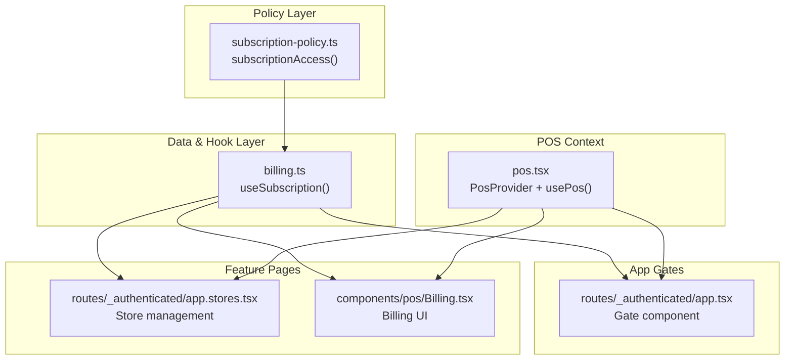
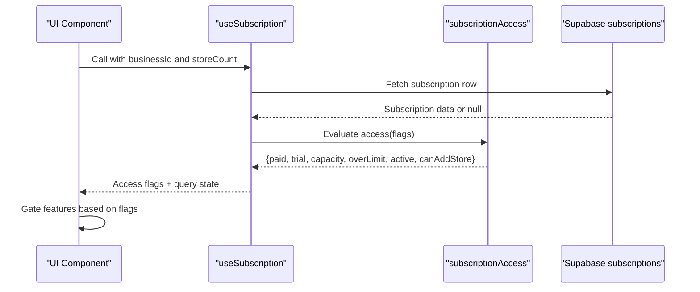
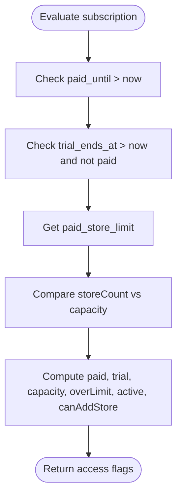
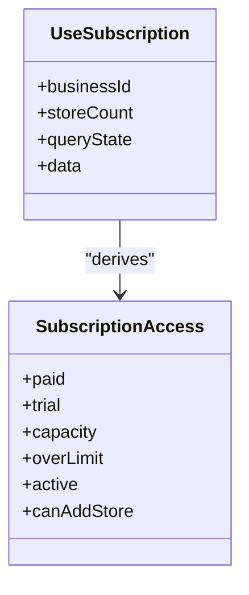
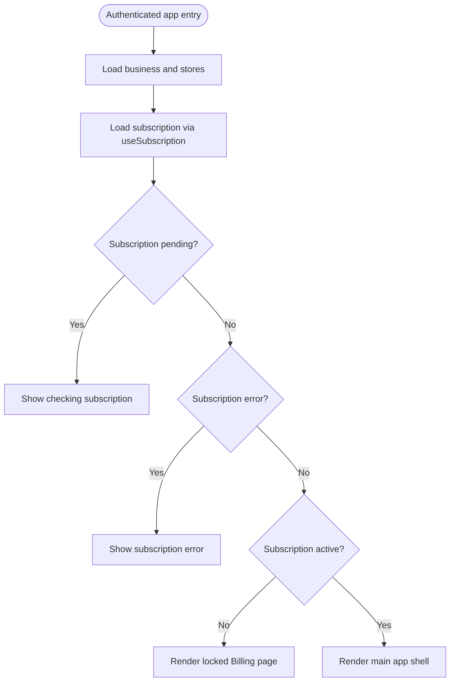
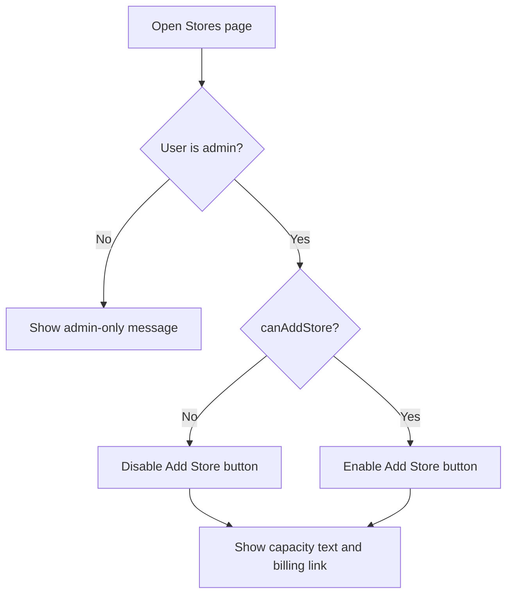
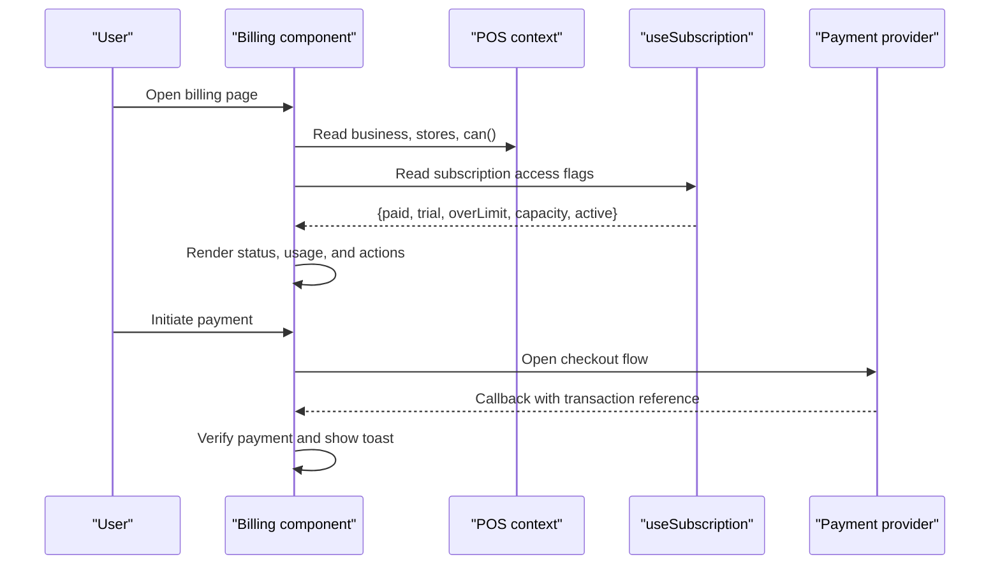
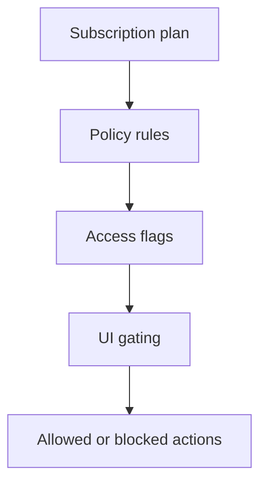
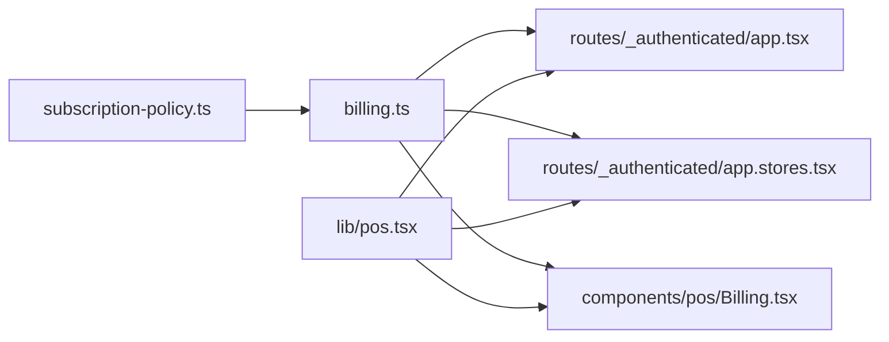

# Subscription Policy Enforcement

<cite>
**Referenced Files in This Document**
- [subscription-policy.ts](file://src/lib/subscription-policy.ts)
- [billing.ts](file://src/lib/billing.ts)
- [pos.tsx](file://src/lib/pos.tsx)
- [app.tsx](file://src/routes/_authenticated/app.tsx)
- [app.stores.tsx](file://src/routes/_authenticated/app.stores.tsx)
- [Billing.tsx](file://src/components/pos/Billing.tsx)
</cite>

## Table of Contents
1. [Introduction](#introduction)
2. [Project Structure](#project-structure)
3. [Core Components](#core-components)
4. [Architecture Overview](#architecture-overview)
5. [Detailed Component Analysis](#detailed-component-analysis)
6. [Dependency Analysis](#dependency-analysis)
7. [Performance Considerations](#performance-considerations)
8. [Troubleshooting Guide](#troubleshooting-guide)
9. [Conclusion](#conclusion)

## Introduction
This document explains how subscription policy enforcement and feature gating work in the application. It covers:
- How subscription status controls access to the main workspace, store creation, and billing actions.
- How store capacity limits are evaluated and enforced.
- The `useSubscription` hook and its underlying policy validation logic.
- Over-limit detection and automatic feature disabling.
- Integration with the POS context for role-based permission checking.
- Real-time evaluation, user notifications, trial handling, and expiration behavior.

The goal is to make it clear how a business’s subscription tier maps to available features, and how the UI reacts when policies change.

## Project Structure
The subscription system spans a small set of focused modules:
- A pure policy evaluator that turns raw subscription data into access flags.
- A React Query-backed hook that loads subscription data and derives access.
- The POS context that provides role-based permissions and business/store state.
- Route-level gates that block or allow access to the main app shell.
- Feature-specific pages that disable actions based on subscription limits.
- The billing page that displays status, usage, and payment flows.

**Diagram sources**
- [subscription-policy.ts:8-22](file://src/lib/subscription-policy.ts#L8-L22)
- [billing.ts:10-39](file://src/lib/billing.ts#L10-L39)
- [pos.tsx:115-388](file://src/lib/pos.tsx#L115-L388)
- [app.tsx:95-129](file://src/routes/_authenticated/app.tsx#L95-L129)
- [app.stores.tsx:53-91](file://src/routes/_authenticated/app.stores.tsx#L53-L91)
- [Billing.tsx:54-170](file://src/components/pos/Billing.tsx#L54-L170)

**Section sources**
- [subscription-policy.ts:1-23](file://src/lib/subscription-policy.ts#L1-L23)
- [billing.ts:1-55](file://src/lib/billing.ts#L1-L55)
- [pos.tsx:1-448](file://src/lib/pos.tsx#L1-L448)
- [app.tsx:95-129](file://src/routes/_authenticated/app.tsx#L95-L129)
- [app.stores.tsx:53-110](file://src/routes/_authenticated/app.stores.tsx#L53-L110)
- [Billing.tsx:54-170](file://src/components/pos/Billing.tsx#L54-L170)

## Core Components
### Subscription Policy Evaluator
The core policy function evaluates whether a subscription is active, whether the account is over its store capacity, and whether new stores can be added. It returns:
- Whether the plan is paid and currently valid.
- Whether the account is in an active trial.
- The paid store capacity.
- Whether the current store count exceeds the paid limit.
- Whether the overall subscription is considered active.
- Whether a new store can be added.

This function is pure and deterministic, making it easy to test and reuse across the UI.

**Section sources**
- [subscription-policy.ts:1-23](file://src/lib/subscription-policy.ts#L1-L23)

### Subscription Hook
The `useSubscription` hook:
- Loads the subscription row for the current business using React Query.
- Caches the result with a long stale time and periodic refetch interval.
- Derives access flags by passing the cached subscription plus the live store count into the policy evaluator.
- Returns both query state and the derived access object.

This design separates network concerns from policy logic and avoids unnecessary refetches when the store list changes.

**Section sources**
- [billing.ts:10-39](file://src/lib/billing.ts#L10-L39)
- [subscription-policy.ts:8-22](file://src/lib/subscription-policy.ts#L8-L22)

### POS Context and Permission Checking
The POS context provides:
- Business and store state.
- Staff session state and locking.
- RPC helpers for server calls.
- A `can(...roles)` helper that checks whether the current staff member has one of the allowed roles.

Role-based permission checking is used throughout the UI to gate administrative and billing actions.

**Section sources**
- [pos.tsx:55-84](file://src/lib/pos.tsx#L55-L84)
- [pos.tsx:115-388](file://src/lib/pos.tsx#L115-L388)

## Architecture Overview
The subscription flow combines three layers:
1. Data loading: `useSubscription` fetches subscription data.
2. Policy evaluation: `subscriptionAccess` computes access flags.
3. UI gating: routes and components react to `active`, `overLimit`, and `canAddStore`.

**Diagram sources**
- [billing.ts:10-39](file://src/lib/billing.ts#L10-L39)
- [subscription-policy.ts:8-22](file://src/lib/subscription-policy.ts#L8-L22)

## Detailed Component Analysis

### Subscription Policy Logic
The policy logic determines:
- Paid status: true when `paid_until` exists and is in the future.
- Trial status: true when there is a subscription but it is not paid and the trial end date is still in the future.
- Capacity: taken from `paid_store_limit`, defaulting to zero if missing.
- Over-limit: true only when paid and the store count exceeds capacity.
- Active: true for trials, or for paid accounts that are not over the limit.
- Can add store: true for trials, or for paid accounts where the store count is below capacity.

**Diagram sources**
- [subscription-policy.ts:8-22](file://src/lib/subscription-policy.ts#L8-L22)

**Section sources**
- [subscription-policy.ts:1-23](file://src/lib/subscription-policy.ts#L1-L23)

### useSubscription Hook Behavior
Key behaviors:
- Cache key includes only the business ID, not the store count. This prevents refetches when the store list hydrates or changes.
- Store count is passed into `subscriptionAccess` purely for local derivation.
- Query uses a five-minute stale time and ten-minute refetch interval, suitable for a billing banner that does not need instant refresh.
- Errors from the subscription query surface through standard React Query error states.

**Diagram sources**
- [billing.ts:10-39](file://src/lib/billing.ts#L10-L39)
- [subscription-policy.ts:8-22](file://src/lib/subscription-policy.ts#L8-L22)

**Section sources**
- [billing.ts:10-39](file://src/lib/billing.ts#L10-L39)

### App-Level Subscription Gate
The authenticated app layout wraps the application in the POS provider and then renders a gate component. The gate:
- Waits for business data.
- Shows setup or PIN pad screens when needed.
- Displays a loading state while subscription data is pending.
- Shows an error screen when subscription fetching fails.
- Renders the locked billing view when the subscription is inactive.
- Renders the normal app shell when the subscription is active.

**Diagram sources**
- [app.tsx:95-129](file://src/routes/_authenticated/app.tsx#L95-L129)

**Section sources**
- [app.tsx:95-129](file://src/routes/_authenticated/app.tsx#L95-L129)

### Store Management and Capacity Limits
The stores page enforces subscription limits at the UI level:
- Only administrators can open the store management interface.
- The “add store” button is disabled when `canAddStore` is false.
- When over the limit, the page shows capacity information and links to billing.
- The page displays either free-trial messaging or a capacity line showing used versus allowed stores.

**Diagram sources**
- [app.stores.tsx:53-91](file://src/routes/_authenticated/app.stores.tsx#L53-L91)

**Section sources**
- [app.stores.tsx:53-110](file://src/routes/_authenticated/app.stores.tsx#L53-L110)

### Billing Page and User Notifications
The billing page integrates subscription state, payment flows, and user notifications:
- It reads subscription data and displays status labels such as active, expired, trial, or over limit.
- It shows a usage progress bar based on store count versus capacity.
- It restricts payment-related actions to users with admin or manager roles.
- It handles payment initiation, callback verification, and invoice history.
- It surfaces toast notifications for success and failure cases.

**Diagram sources**
- [Billing.tsx:54-170](file://src/components/pos/Billing.tsx#L54-L170)
- [Billing.tsx:94-139](file://src/components/pos/Billing.tsx#L94-L139)
- [Billing.tsx:141-170](file://src/components/pos/Billing.tsx#L141-L170)

**Section sources**
- [Billing.tsx:54-170](file://src/components/pos/Billing.tsx#L54-L170)
- [Billing.tsx:94-139](file://src/components/pos/Billing.tsx#L94-L139)
- [Billing.tsx:141-170](file://src/components/pos/Billing.tsx#L141-L170)

### Conceptual Overview
At a high level, subscription policy enforcement works like this:
- The backend supplies subscription metadata including trial dates, paid expiration, plan type, and store capacity.
- The frontend evaluates whether the subscription is active and whether the business is over its store limit.
- The UI disables restricted features when policies are violated.
- Role-based permissions control who can perform sensitive actions like upgrading plans or managing stores.
- Users receive feedback through status badges, progress bars, disabled buttons, and toast messages.

[No sources needed since this diagram shows conceptual workflow, not actual code structure]

## Dependency Analysis
The following diagram shows how the subscription system depends on each other:

**Diagram sources**
- [subscription-policy.ts:8-22](file://src/lib/subscription-policy.ts#L8-L22)
- [billing.ts:10-39](file://src/lib/billing.ts#L10-L39)
- [app.tsx:95-129](file://src/routes/_authenticated/app.tsx#L95-L129)
- [app.stores.tsx:53-91](file://src/routes/_authenticated/app.stores.tsx#L53-L91)
- [Billing.tsx:54-170](file://src/components/pos/Billing.tsx#L54-L170)
- [pos.tsx:115-388](file://src/lib/pos.tsx#L115-L388)

**Section sources**
- [subscription-policy.ts:1-23](file://src/lib/subscription-policy.ts#L1-L23)
- [billing.ts:1-55](file://src/lib/billing.ts#L1-L55)
- [pos.tsx:1-448](file://src/lib/pos.tsx#L1-L448)
- [app.tsx:95-129](file://src/routes/_authenticated/app.tsx#L95-L129)
- [app.stores.tsx:53-110](file://src/routes/_authenticated/app.stores.tsx#L53-L110)
- [Billing.tsx:54-170](file://src/components/pos/Billing.tsx#L54-L170)

## Performance Considerations
- Subscription queries are cached with a five-minute stale time and a ten-minute refetch interval. This reduces database load while keeping the billing banner reasonably fresh.
- Store count is intentionally excluded from the React Query cache key so that adding or removing stores does not trigger a full subscription refetch.
- Policy evaluation is pure and runs locally, avoiding extra network calls when store counts change.
- The billing page caches invoice history separately with a longer stale time because payment logs are append-only.

These choices keep the UI responsive during store management and billing interactions.

[No sources needed since this section provides general guidance]

## Troubleshooting Guide
Common issues and their likely causes:

- **Subscription check shows loading:** The app is waiting for business and subscription data. If it persists, verify the business exists and the subscription query is enabled.
- **Subscription error screen appears:** The subscription query failed. Retry the query or check network and authentication state.
- **Main app is locked:** The subscription is inactive. This happens when the trial has ended and no paid period is active, or when the account is over the store limit.
- **Add Store button is disabled:** Either the user is not an administrator, or `canAddStore` is false due to trial or capacity restrictions.
- **Billing actions are unavailable:** Payment-related actions require admin or manager roles.
- **Over-limit status shown:** The paid store count exceeds `paid_store_limit`. The UI will highlight over-limit status and may redirect to billing.

Error masking in the POS context also ensures that raw database policy errors are converted into user-friendly messages, preventing internal SQL details from leaking into the UI.

**Section sources**
- [app.tsx:107-129](file://src/routes/_authenticated/app.tsx#L107-L129)
- [app.stores.tsx:53-91](file://src/routes/_authenticated/app.stores.tsx#L53-L91)
- [Billing.tsx:159-170](file://src/components/pos/Billing.tsx#L159-L170)
- [pos.tsx:93-104](file://src/lib/pos.tsx#L93-L104)

## Conclusion
Subscription policy enforcement in this application is built around a simple, testable policy function and a clean separation between data loading and UI gating. The `useSubscription` hook centralizes subscription fetching and exposes derived access flags. The app gate blocks the main workspace when the subscription is inactive, while feature pages like store management disable restricted actions based on capacity and role. The billing page provides real-time status, usage visualization, and payment workflows, with clear user notifications. Together, these pieces ensure that subscription tiers directly control feature availability, store capacity, and access control.

[No sources needed since this section summarizes without analyzing specific files]