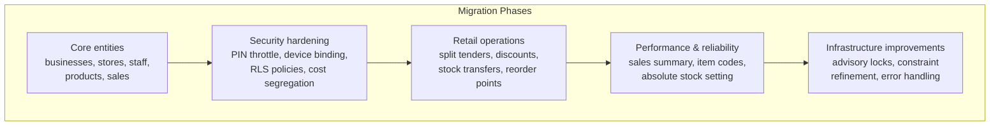
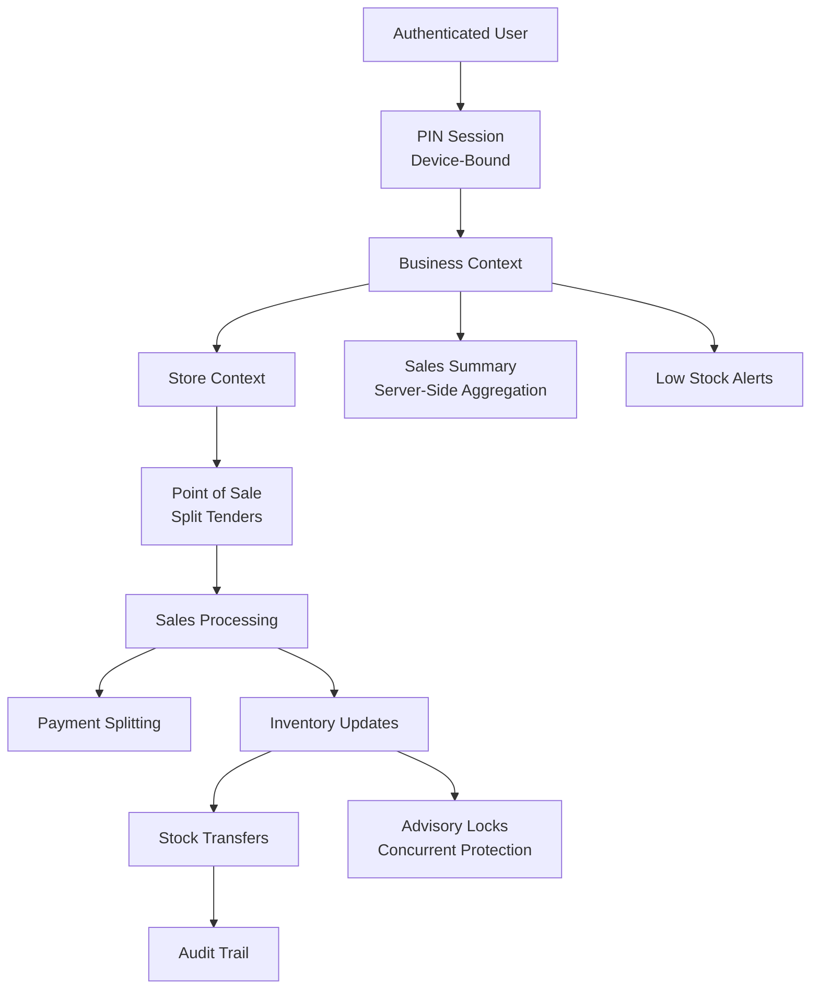
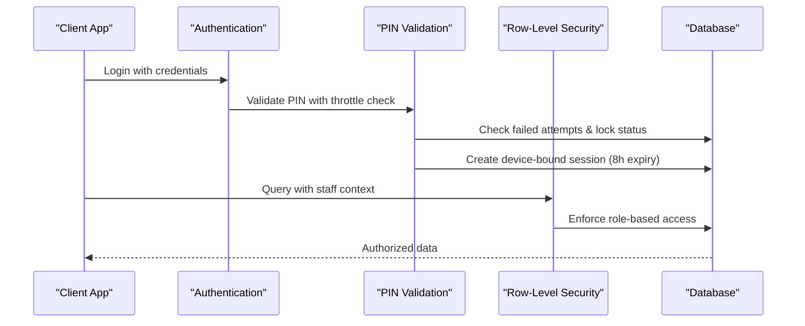
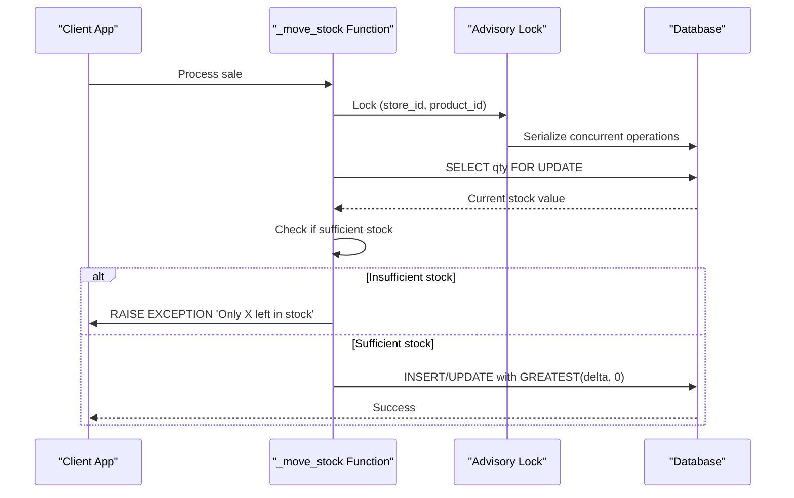
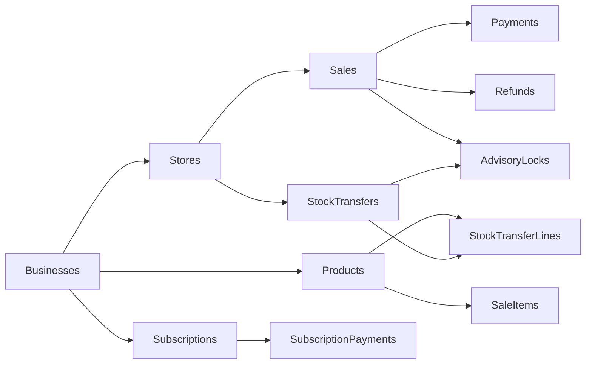

# Database Schema Design

<cite>
**Referenced Files in This Document**
- [20261007084733_2ed95314-f75e-4843-977b-23f9e6359a48.sql](file://supabase/migrations/20261007084733_2ed95314-f75e-4843-977b-23f9e6359a48.sql)
- [20261007084754_5d0a930d-b659-4a08-882c-317f7898dbc7.sql](file://supabase/migrations/20261007084754_5d0a930d-b659-4a08-882c-317f7898dbc7.sql)
- [20261007092354_1daf7bc8-d22a-46ae-a571-1e6c509ed166.sql](file://supabase/migrations/20261007092354_1daf7bc8-d22a-46ae-a571-1e6c509ed166.sql)
- [20261007092411_31369b2b-1f20-4f76-9d27-2079e197c10f.sql](file://supabase/migrations/20261007092411_31369b2b-1f20-4f76-9d27-2079e197c10f.sql)
- [20261007094440_7f9e1944-d2b6-4ff8-922f-9a15d298e414.sql](file://supabase/migrations/20261007094440_7f9e1944-d2b6-4ff8-922f-9a15d298e414.sql)
- [20261007100137_bfc24679-0e49-446b-b715-df35c6e8c994.sql](file://supabase/migrations/20261007100137_bfc24679-0e49-446b-b715-df35c6e8c994.sql)
- [20261007100154_8732619d-7649-41d2-8a27-f70876506db1.sql](file://supabase/migrations/20261007100154_8732619d-7649-41d2-8a27-f70876506db1.sql)
- [20261007101232_afb8cd47-dc5e-4816-83f7-1b530d9194b9.sql](file://supabase/migrations/20261007101232_afb8cd47-dc5e-4816-83f7-1b530d9194b9.sql)
- [20261007101247_9e99c53e-cc56-4e02-b439-ace84c09bacf.sql](file://supabase/migrations/20261007101247_9e99c53e-cc56-4e02-b439-ace84c09bacf.sql)
- [20261007101503_838baf20-162a-45c9-97a2-a1928381f341.sql](file://supabase/migrations/20261007101503_838baf20-162a-45c9-97a2-a1928381f341.sql)
- [20261007102244_c10153f5-18b7-409c-8196-3337d3f296c4.sql](file://supabase/migrations/20261007102244_c10153f5-18b7-409c-8196-3337d3f296c4.sql)
- [20261007102303_4260d56f-8e50-4ca0-add6-16990ca353ab.sql](file://supabase/migrations/20261007102303_4260d56f-8e50-4ca0-add6-16990ca353ab.sql)
- [20261007115041_3e857134-c53a-47c9-a33f-3db16cc13962.sql](file://supabase/migrations/20261007115041_3e857134-c53a-47c9-a33f-3db16cc13962.sql)
- [20261007115238_6662954d-34a5-4c8e-b71e-7f98b51895af.sql](file://supabase/migrations/20261007115238_6662954d-34a5-4c8e-b71e-7f98b51895af.sql)
- [20261007182146_48413f83-16ba-421f-b269-777201b5e8b1.sql](file://supabase/migrations/20261007182146_48413f83-16ba-421f-b269-777201b5e8b1.sql)
- [20261007183338_b2173994-433e-4727-8c60-bf0d6a8a7aca.sql](file://supabase/migrations/20261007183338_b2173994-433e-4727-8c60-bf0d6a8a7aca.sql)
- [20261008090000_security_hardening.sql](file://supabase/migrations/20261008090000_security_hardening.sql)
- [20261009192705_c04f3a80-e05e-498f-ab87-694d79f3fe3f.sql](file://supabase/migrations/20261009192705_c04f3a80-e05e-498f-ab87-694d79f3fe3f.sql)
- [20261009193153_97dc4c9b-c64d-4f55-9cfe-e17b97fb71ec.sql](file://supabase/migrations/20261009193153_97dc4c9b-c64d-4f55-9cfe-e17b97fb71ec.sql)
- [20261009210500_retail_operations.sql](file://supabase/migrations/20261009210500_retail_operations.sql)
- [20261011090000_sales_summary.sql](file://supabase/migrations/20261011090000_sales_summary.sql)
- [20261011100000_item_codes.sql](file://supabase/migrations/20261011100000_item_codes.sql)
- [20261011110000_drop_legacy_save_product_overload.sql](file://supabase/migrations/20261011110000_drop_legacy_save_product_overload.sql)
- [20261011120000_fix_x_alias_collision.sql](file://supabase/migrations/20261011120000_fix_x_alias_collision.sql)
- [20261011130000_stock_absolute_set.sql](file://supabase/migrations/20261011130000_stock_absolute_set.sql)
- [20261011221117_drop_store_stock_bounds_enforce_in_sql.sql](file://supabase/migrations/20261011221117_drop_store_stock_bounds_enforce_in_sql.sql)
- [20261011221132_move_stock_floor_guard.sql](file://supabase/migrations/20261011221132_move_stock_floor_guard.sql)
</cite>

## Update Summary
**Changes Made**
- Enhanced security hardening with PIN brute-force protection and device-bound sessions
- Implemented comprehensive Row-Level Security policies with role-based access control
- Added split tender support and manual discount functionality with manager PIN override
- Introduced store-to-store stock transfers with in-transit ledger tracking
- Added product reorder points and low-stock monitoring capabilities
- Enhanced item code generation with unique SKU management
- Improved sales summary reporting with server-side aggregation
- Added absolute stock quantity setting with proper locking mechanisms
- **Updated**: Removed restrictive `store_stock_bounds` constraint and moved stock floor guard to SQL logic with advisory locks
- **Updated**: Enhanced data integrity through CHECK constraints and proper error handling
- Comprehensive performance optimization with strategic indexing

## Table of Contents
1. Introduction
2. Project Structure
3. Core Components
4. Architecture Overview
5. Detailed Component Analysis
6. Dependency Analysis
7. Performance Considerations
8. Troubleshooting Guide
9. Conclusion

## Introduction
This document describes the enhanced database schema for a retail point-of-sale system with comprehensive security hardening, multi-tenancy patterns, and advanced retail operations. The system now includes sophisticated authentication with PIN-based staff sessions, granular Row-Level Security policies, split tender payment processing, manual discount controls, inter-store stock transfers, and robust inventory management with reorder point monitoring. All data access is secured through strict RPC boundaries with server-side validation and business logic enforcement.

The latest infrastructure improvements include enhanced stock management with advisory locks, improved error handling for concurrent operations, and refined constraint strategies that provide better user experience while maintaining data integrity.

## Project Structure
The database has evolved through 27+ timestamped SQL migrations under the Supabase migrations directory, progressing from basic retail operations to a hardened, enterprise-grade system. The evolution includes core entity creation, security hardening phases, retail operation enhancements, performance optimizations, and recent infrastructure improvements for better concurrency handling.

**Diagram sources**
- [20261007084733_2ed95314-f75e-4843-977b-23f9e6359a48.sql:1-133](file://supabase/migrations/20261007084733_2ed95314-f75e-4843-977b-23f9e6359a48.sql#L1-L133)
- [20261008090000_security_hardening.sql:1-760](file://supabase/migrations/20261008090000_security_hardening.sql#L1-L760)
- [20261009210500_retail_operations.sql:1-556](file://supabase/migrations/20261009210500_retail_operations.sql#L1-L556)
- [20261011090000_sales_summary.sql:1-72](file://supabase/migrations/20261011090000_sales_summary.sql#L1-L72)
- [20261011221117_drop_store_stock_bounds_enforce_in_sql.sql:1-13](file://supabase/migrations/20261011221117_drop_store_stock_bounds_enforce_in_sql.sql#L1-L13)

**Section sources**
- [20261007084733_2ed95314-f75e-4843-977b-23f9e6359a48.sql:1-133](file://supabase/migrations/20261007084733_2ed95314-f75e-4843-977b-23f9e6359a48.sql#L1-L133)
- [20261008090000_security_hardening.sql:1-760](file://supabase/migrations/20261008090000_security_hardening.sql#L1-L760)

## Core Components
The enhanced system now includes sophisticated security and operational components:

### Security & Authentication
- **PIN Throttle System**: Prevents brute-force attacks with per-business, per-device lockout after failed attempts
- **Device-Bound Sessions**: Staff sessions are bound to specific devices with 8-hour expiration
- **Role-Based Access Control**: Granular permissions based on staff roles (admin, manager, cashier)
- **Cost Data Segregation**: Buying costs moved to restricted tables accessible only by managers/admins

### Retail Operations
- **Split Tender Support**: Multiple payment methods per transaction (cash, card, mobile)
- **Manual Discounts**: Per-item discounts with cashier limits (10%) requiring manager PIN override
- **Stock Transfers**: Inter-store inventory movement with in-transit tracking and audit trail
- **Reorder Points**: Product-level minimum stock levels with low-stock monitoring

### Enhanced Inventory Management
- **Absolute Stock Setting**: Secure stock quantity updates with proper locking to prevent race conditions
- **Item Code Generation**: Unique, scannable product identifiers with case-insensitive matching
- **Low Stock Monitoring**: Real-time alerts for products at or below reorder points
- **Advisory Locking**: Concurrent stock operations serialized per store-product pair to prevent race conditions

**Section sources**
- [20261008090000_security_hardening.sql:27-40](file://supabase/migrations/20261008090000_security_hardening.sql#L27-L40)
- [20261009210500_retail_operations.sql:22-47](file://supabase/migrations/20261009210500_retail_operations.sql#L22-L47)
- [20261011100000_item_codes.sql:18-39](file://supabase/migrations/20261011100000_item_codes.sql#L18-L39)
- [20261011221132_move_stock_floor_guard.sql:21-24](file://supabase/migrations/20261011221132_move_stock_floor_guard.sql#L21-L24)

## Architecture Overview
The architecture enforces strict security boundaries with comprehensive Row-Level Security and role-based access control. All write operations must go through SECURITY DEFINER functions that validate inputs and enforce business rules.

**Diagram sources**
- [20261008090000_security_hardening.sql:68-77](file://supabase/migrations/20261008090000_security_hardening.sql#L68-L77)
- [20261009210500_retail_operations.sql:108-287](file://supabase/migrations/20261009210500_retail_operations.sql#L108-L287)
- [20261011090000_sales_summary.sql:14-52](file://supabase/migrations/20261011090000_sales_summary.sql#L14-L52)
- [20261011221132_move_stock_floor_guard.sql:21-24](file://supabase/migrations/20261011221132_move_stock_floor_guard.sql#L21-L24)

## Detailed Component Analysis

### Enhanced Security Architecture

#### PIN Brute-Force Protection
The system implements sophisticated PIN attack prevention:
- Per-business, per-device failure tracking with automatic lockout
- Progressive lockout periods (15 minutes after 5 failed attempts)
- Device-specific session binding prevents token sharing
- Automatic cleanup of expired sessions and throttle records

#### Role-Based Row-Level Security
Granular access control ensures data isolation:
- Cashiers: Basic sales and stock operations
- Managers: Full inventory, expenses, and transfer management  
- Admins: Complete system access including subscription management
- Cost data restricted to managers and admins only

**Diagram sources**
- [20261008090000_security_hardening.sql:219-256](file://supabase/migrations/20261008090000_security_hardening.sql#L219-L256)
- [20261008090000_security_hardening.sql:259-270](file://supabase/migrations/20261008090000_security_hardening.sql#L259-L270)

**Section sources**
- [20261008090000_security_hardening.sql:27-40](file://supabase/migrations/20261008090000_security_hardening.sql#L27-L40)
- [20261008090000_security_hardening.sql:68-168](file://supabase/migrations/20261008090000_security_hardening.sql#L68-L168)

### Advanced Retail Operations

#### Split Tender Processing
Enhanced checkout supports multiple payment methods:
- Up to 10 different payment methods per transaction
- Automatic change calculation for overpayments
- Proper allocation across payment types
- Manager PIN required for discounts exceeding 10%

#### Stock Transfer Management
Complete inter-store inventory workflow:
- Dispatch creates negative stock at source with audit trail
- Receive adds positive stock at destination
- Cancel reverses both movements
- Status tracking (in_transit, received, cancelled)

#### Reorder Point System
Proactive inventory management:
- Product-level minimum stock thresholds
- Low-stock query returns items needing attention
- Shortfall calculation for planning purposes

**Section sources**
- [20261009210500_retail_operations.sql:108-287](file://supabase/migrations/20261009210500_retail_operations.sql#L108-L287)
- [20261009210500_retail_operations.sql:411-491](file://supabase/migrations/20261009210500_retail_operations.sql#L411-L491)
- [20261009210500_retail_operations.sql:505-527](file://supabase/migrations/20261009210500_retail_operations.sql#L505-L527)

### Enhanced Data Integrity

#### Absolute Stock Quantity Setting
Secure stock updates prevent race conditions:
- Server-side delta calculation eliminates client manipulation
- Advisory locks prevent concurrent modifications
- Clear error messages instead of constraint violations
- Proper audit trail for all stock changes

#### Item Code Management
Unique, scannable product identifiers:
- Auto-generated codes with collision avoidance
- Case-insensitive matching for scanner compatibility
- Backfill of existing products with generated codes
- Unique constraints ensure one code per product

#### Updated Stock Floor Guard Implementation
**New** The stock floor guard has been moved from database constraints to SQL logic with proper locking mechanisms:

- **Advisory Locking**: Uses `pg_advisory_xact_lock` to serialize concurrent operations on the same store-product pair
- **Row-Level Locking**: `FOR UPDATE` clauses ensure reads see the exact values that writes will use
- **Explicit Error Handling**: User-friendly error messages replace cryptic constraint violations
- **Belt-and-Suspenders Approach**: `GREATEST(qty + delta, 0)` ensures zero balance even if races slip past guards
- **Constraint Refinement**: Only upper bound constraint remains (`qty <= 100000000`), removing restrictive lower bound

**Diagram sources**
- [20261011221132_move_stock_floor_guard.sql:21-37](file://supabase/migrations/20261011221132_move_stock_floor_guard.sql#L21-L37)
- [20261011221117_drop_store_stock_bounds_enforce_in_sql.sql:1-13](file://supabase/migrations/20261011221117_drop_store_stock_bounds_enforce_in_sql.sql#L1-L13)

**Section sources**
- [20261011130000_stock_absolute_set.sql:37-62](file://supabase/migrations/20261011130000_stock_absolute_set.sql#L37-L62)
- [20261011100000_item_codes.sql:18-39](file://supabase/migrations/20261011100000_item_codes.sql#L18-L39)
- [20261011221132_move_stock_floor_guard.sql:1-42](file://supabase/migrations/20261011221132_move_stock_floor_guard.sql#L1-L42)
- [20261011221117_drop_store_stock_bounds_enforce_in_sql.sql:1-13](file://supabase/migrations/20261011221117_drop_store_stock_bounds_enforce_in_sql.sql#L1-L13)

### Performance Optimizations

#### Sales Summary Aggregation
Server-side KPI calculation:
- Single-pass aggregate over full date range
- Exact totals regardless of list pagination
- Separate refund aggregation for accuracy
- Reduced client-side computation overhead

#### Strategic Indexing
Comprehensive index coverage:
- Composite indexes for common query patterns
- Partial indexes for filtered data
- Performance optimization for reporting queries

#### Advisory Lock Optimization
Enhanced concurrency control:
- Fine-grained locking per store-product pair
- Minimal lock contention across different products
- Transaction-scoped advisory locks for safety
- Elimination of table-level locking overhead

**Section sources**
- [20261011090000_sales_summary.sql:14-52](file://supabase/migrations/20261011090000_sales_summary.sql#L14-L52)
- [20261009192705_c04f3a80-e05e-498f-ab87-694d79f3fe3f.sql:1-23](file://supabase/migrations/20261009192705_c04f3a80-e05e-498f-ab87-694d79f3fe3f.sql#L1-L23)
- [20261011221132_move_stock_floor_guard.sql:21-24](file://supabase/migrations/20261011221132_move_stock_floor_guard.sql#L21-L24)

## Dependency Analysis
The enhanced schema maintains clear hierarchical dependencies while adding new operational relationships:

**Diagram sources**
- [20261007084733_2ed95314-f75e-4843-977b-23f9e6359a48.sql:3-100](file://supabase/migrations/20261007084733_2ed95314-f75e-4843-977b-23f9e6359a48.sql#L3-L100)
- [20261009210500_retail_operations.sql:22-47](file://supabase/migrations/20261009210500_retail_operations.sql#L22-L47)
- [20261011221132_move_stock_floor_guard.sql:21-24](file://supabase/migrations/20261011221132_move_stock_floor_guard.sql#L21-L24)

**Section sources**
- [20261007084733_2ed95314-f75e-4843-977b-23f9e6359a48.sql:3-100](file://supabase/migrations/20261007084733_2ed95314-f75e-4843-977b-23f9e6359a48.sql#L3-L100)
- [20261009210500_retail_operations.sql:22-47](file://supabase/migrations/20261009210500_retail_operations.sql#L22-L47)

## Performance Considerations
The enhanced system includes several performance optimizations:

### Database Indexing Strategy
- **Composite indexes** for common filter combinations (business_id + created_at)
- **Partial indexes** for filtered datasets (where sku IS NOT NULL)
- **Specialized indexes** for high-frequency operations (sale_items.sale_id, payments.sale_id)

### Function Optimization
- **Server-side aggregation** for sales summaries reduces client load
- **Advisory locks** prevent race conditions without table-level locking
- **Efficient JSON processing** for complex cart and tender operations

### Security Performance
- **Session caching** reduces repeated authentication overhead
- **Optimized RLS policies** minimize row scanning
- **Batch operations** where possible to reduce round trips

### Concurrency Optimization
- **Fine-grained advisory locks** minimize contention between unrelated operations
- **Transaction-scoped locks** ensure consistency without long-term blocking
- **Optimized lock ordering** prevents deadlocks in multi-product transactions

## Troubleshooting Guide

### Security-Related Issues
- **"Locked: enter your PIN again"**: Invalid or expired staff session; re-authenticate via unlock_with_pin
- **"Too many wrong PIN attempts"**: Account temporarily locked due to failed attempts; wait for lockout period
- **"Your role (...) is not allowed to do this"**: Insufficient role permissions; verify staff role assignment

### Operational Issues
- **"Not enough stock for: [items]"**: Insufficient inventory; check stock levels or adjust order quantities
- **"That discount needs a manager PIN"**: Discount exceeds 10% limit; obtain manager authorization
- **"Unknown source/destination store"**: Invalid store references; verify store IDs and business context

### Data Integrity Issues
- **"Quantity must be between 0 and 100,000,000"**: Invalid stock quantity input
- **"Only [X] left in stock for [item]"**: Attempting to remove more stock than available
- **"Another item already uses the code [code]"**: Duplicate product identifier conflict
- **"Race condition detected"**: Concurrent stock operations; retry the operation

### Updated Error Messages
**New** The enhanced stock management provides clearer error messages:
- **"Only X left in stock for [item name]"**: Specific item shortage with current stock level
- **"Enter an adjustment amount between 1 and 1,000,000"**: Clear bounds for manual adjustments
- **"Quantity can have at most 2 decimal places"**: Precision validation for stock quantities

**Section sources**
- [20261008090000_security_hardening.sql:219-256](file://supabase/migrations/20261008090000_security_hardening.sql#L219-L256)
- [20261009210500_retail_operations.sql:172-185](file://supabase/migrations/20261009210500_retail_operations.sql#L172-L185)
- [20261011130000_stock_absolute_set.sql:99-102](file://supabase/migrations/20261011130000_stock_absolute_set.sql#L99-L102)
- [20261011221132_move_stock_floor_guard.sql:30-32](file://supabase/migrations/20261011221132_move_stock_floor_guard.sql#L30-L32)

## Conclusion
The enhanced database schema represents a mature, enterprise-grade retail platform with comprehensive security hardening, sophisticated operational capabilities, and robust data integrity measures. The system successfully balances security requirements with operational flexibility, providing cashiers with streamlined workflows while maintaining strict controls over sensitive operations. The migration strategy demonstrates careful evolution from basic retail operations to a fully hardened system with advanced features like split tenders, stock transfers, and proactive inventory management.

Key achievements include:
- **Military-grade security** with PIN brute-force protection and device-bound sessions
- **Operational sophistication** supporting complex retail scenarios like split payments and inter-store transfers
- **Data integrity assurance** through proper locking mechanisms and comprehensive validation
- **Performance optimization** ensuring responsive user experience even with large datasets
- **Scalable architecture** supporting multi-tenant operations with granular access controls
- **Enhanced concurrency control** with advisory locks and refined constraint strategies

The latest infrastructure improvements demonstrate a commitment to both technical excellence and user experience, replacing cryptic database errors with meaningful business messages while maintaining the highest standards of data integrity and security. By following the documented constraints, functions, and policies, developers can build reliable features that align with the intended business workflows while benefiting from the robust concurrency handling and error management systems.