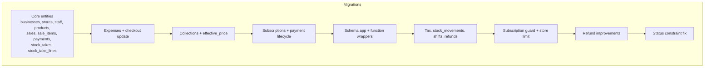
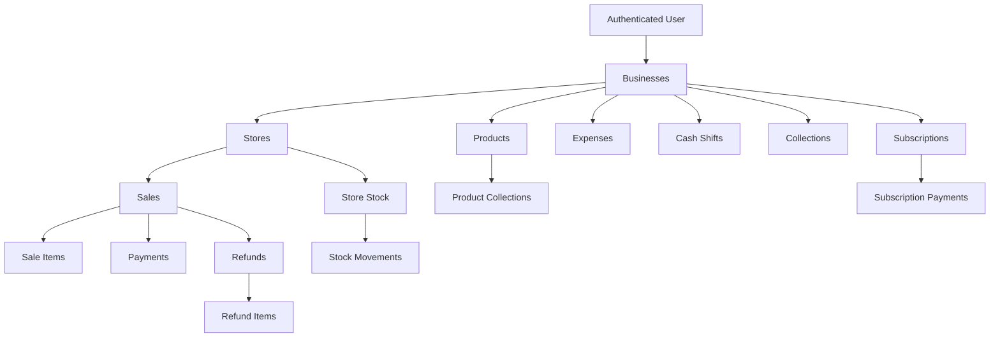
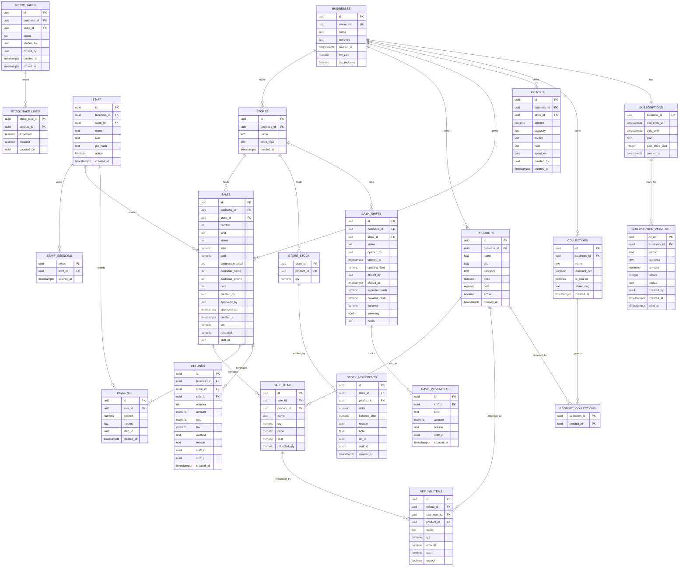
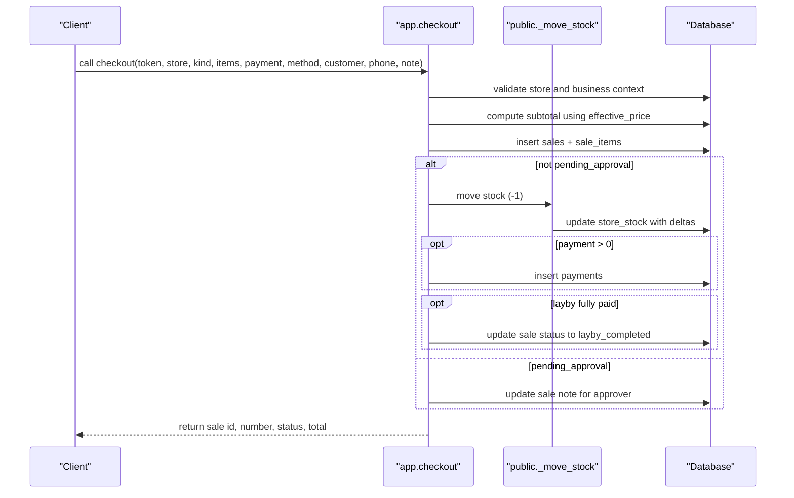
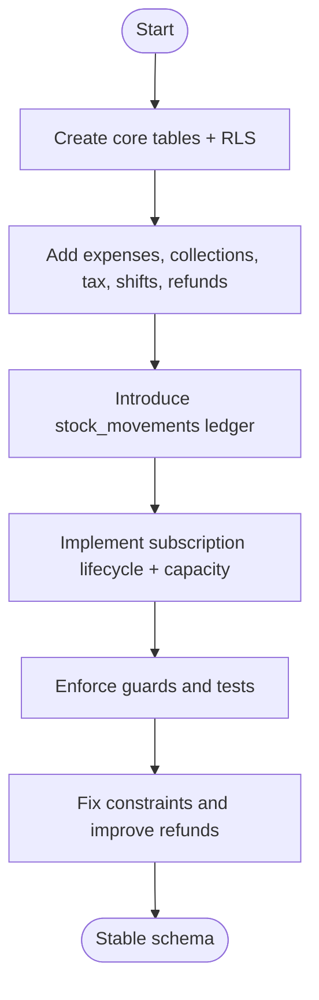
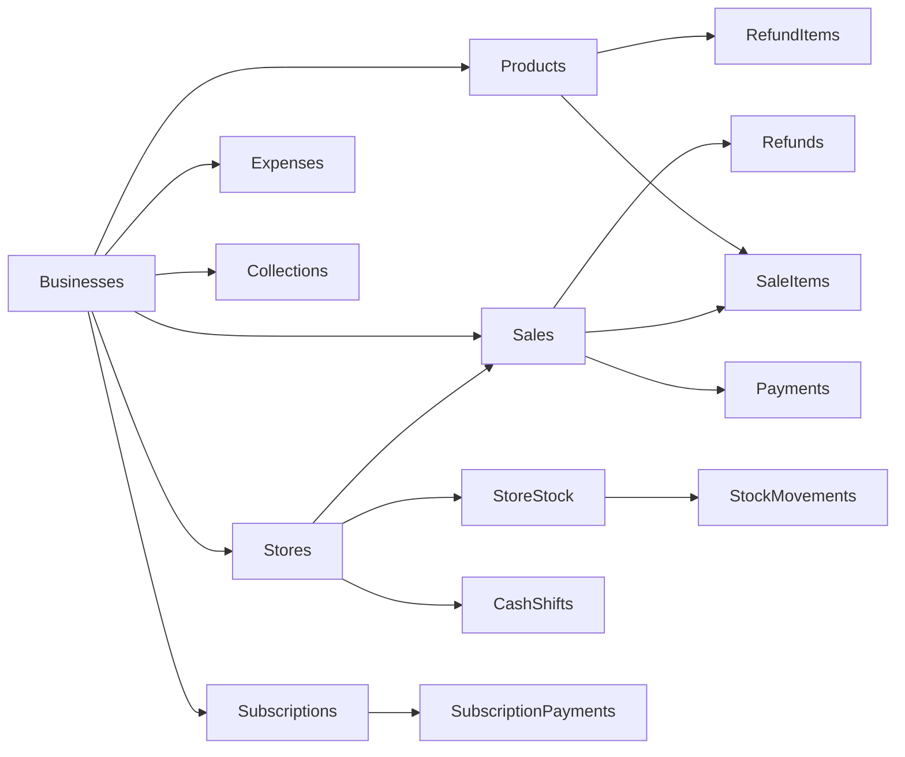

# Database Schema Design

<cite>
**Referenced Files in This Document**
- [20261007084733_2ed95314-f75e-4843-977b-23f9e6359a48.sql](file://supabase/migrations/20261007084733_2ed95314-f75e-4843-977b-23f9e6359a48.sql)
- [20261007092354_1daf7bc8-d22a-46ae-a571-1e6c509ed166.sql](file://supabase/migrations/20261007092354_1daf7bc8-d22a-46ae-a571-1e6c509ed166.sql)
- [20261007092411_31369b2b-1f20-4f76-9d27-2079e197c10f.sql](file://supabase/migrations/20261007092411_31369b2b-1f20-4f76-9d27-2079e197c10f.sql)
- [20261007094440_7f9e1944-d2b6-4ff8-922f-9a15d298e414.sql](file://supabase/migrations/20261007094440_7f9e1944-d2b6-4ff8-922f-9a15d298e414.sql)
- [20261007100137_bfc24679-0e49-446b-b715-df35c6e8c994.sql](file://supabase/migrations/20261007100137_bfc24679-0e49-446b-b715-df35c6e8c994.sql)
- [20261007100154_8732619d-7649-41d2-8a27-f70876506db1.sql](file://supabase/migrations/20261007100154_8732619d-7649-41d2-8a27-f70876506db1.sql)
- [20261007101232_afb8cd47-dc5e-4816-83f7-1b530d9194b9.sql](file://supabase/migrations/20261007101232_afb8cd47-dc5e-4816-83f7-1b530d9194b9.sql)
- [20261007101503_838baf20-16ba-4269-777201b5e8b1.sql](file://supabase/migrations/20261007101503_838baf20-16ba-4269-777201b5e8b1.sql)
- [20261007102244_c10153f5-18b7-409c-8196-3337d3f296c4.sql](file://supabase/migrations/20261007102244_c10153f5-18b7-409c-8196-3337d3f296c4.sql)
- [20261007102303_4260d56f-8e50-4ca0-add6-16990ca353ab.sql](file://supabase/migrations/20261007102303_4260d56f-8e50-4ca0-add6-16990ca353ab.sql)
- [20261007115041_3e857134-c53a-47c9-a33f-3db16cc13962.sql](file://supabase/migrations/20261007115041_3e857134-c53a-47c9-a33f-3db16cc13962.sql)
- [20261007115238_6662954d-34a5-4c8e-b71e-7f98b51895af.sql](file://supabase/migrations/20261007115238_6662954d-34a5-4c8e-b71e-7f98b51895af.sql)
- [20261007182146_48413f83-16ba-4269-777201b5e8b1.sql](file://supabase/migrations/20261007182146_48413f83-16ba-4269-777201b5e8b1.sql)
- [20261007183338_b2173994-433e-4727-8c60-bf0d6a8a7aca.sql](file://supabase/migrations/20261007183338_b2173994-433e-4727-8c60-bf0d6a8a7aca.sql)
</cite>

## Table of Contents
1. Introduction
2. Project Structure
3. Core Components
4. Architecture Overview
5. Detailed Component Analysis
6. Dependency Analysis
7. Performance Considerations
8. Troubleshooting Guide
9. Conclusion

## Introduction
This document describes the database schema for a retail point-of-sale system. It covers entities for businesses, stores, staff, products, sales, payments, stock management, expenses, collections, cash shifts, refunds, and subscriptions. It explains primary and foreign key relationships, constraints, indexes, stored functions, Row-Level Security (RLS) policies, and migration strategy. It also provides conceptual diagrams and common query patterns to help both technical and non-technical readers understand the data model and its evolution.

## Project Structure
The database is defined through a series of timestamped SQL migrations under the Supabase migrations directory. Each file adds or modifies tables, functions, policies, and indexes. The earliest migration creates core entities and RLS; later migrations add features such as expenses, collections, tax settings, stock movement ledger, cash shifts, refunds, and subscription billing with capacity limits.

**Diagram sources**
- [20261007084733_2ed95314-f75e-4843-977b-23f9e6359a48.sql:1-133](file://supabase/migrations/20261007084733_2ed95314-f75e-4843-977b-23f9e6359a48.sql#L1-L133)
- [20261007092354_1daf7bc8-d22a-46ae-a571-1e6c509ed166.sql:1-77](file://supabase/migrations/20261007092354_1daf7bc8-d22a-46ae-a571-1e6c509ed166.sql#L1-L77)
- [20261007094440_7f9e1944-d2b6-4ff8-922f-9a15d298e414.sql:1-96](file://supabase/migrations/20261007094440_7f9e1944-d2b6-4ff8-922f-9a15d298e414.sql#L1-L96)
- [20261007100137_bfc24679-0e49-446b-b715-df35c6e8c994.sql:1-63](file://supabase/migrations/20261007100137_bfc24679-0e49-446b-b715-df35c6e8c994.sql#L1-L63)
- [20261007101503_838baf20-16ba-4269-777201b5e8b1.sql:1-36](file://supabase/migrations/20261007101503_838baf20-16ba-4269-777201b5e8b1.sql#L1-L36)
- [20261007102244_c10153f5-18b7-409c-8196-3337d3f296c4.sql:1-397](file://supabase/migrations/20261007102244_c10153f5-18b7-409c-8196-3337d3f296c4.sql#L1-L397)
- [20261007115041_3e857134-c53a-47c9-a33f-3db16cc13962.sql:1-83](file://supabase/migrations/20261007115041_3e857134-c53a-47c9-a33f-3db16cc13962.sql#L1-L83)
- [20261007182146_48413f83-16ba-4269-777201b5e8b1.sql:1-48](file://supabase/migrations/20261007182146_48413f83-16ba-4269-777201b5e8b1.sql#L1-L48)
- [20261007183338_b2173994-433e-4727-8c60-bf0d6a8a7aca.sql:1-2](file://supabase/migrations/20261007183338_b2173994-433e-4727-8c60-bf0d6a8a7aca.sql#L1-L2)

**Section sources**
- [20261007084733_2ed95314-f75e-4843-977b-23f9e6359a48.sql:1-133](file://supabase/migrations/20261007084733_2ed95314-f75e-4843-977b-23f9e6359a48.sql#L1-L133)

## Core Components
This section summarizes the main entities and their roles:
- Businesses: top-level tenant owned by an authenticated user.
- Stores: locations belonging to a business; can be direct or approval-based.
- Staff: employees tied to a business and optionally assigned to a store; includes PIN-secured sessions.
- Products: catalog items with pricing and cost.
- Sales and Sale Items: transactions with status workflows (completed, pending_approval, layby variants, refund states).
- Payments: monetary receipts linked to sales.
- Stock Management: current inventory per store and an immutable movement ledger.
- Expenses: operational costs per store.
- Collections: product groupings with discounts and optional sharing.
- Cash Shifts and Movements: daily till operations and cash flow tracking.
- Refunds and Refund Items: returns linked to sales with restocking options.
- Subscriptions and Subscription Payments: billing lifecycle and capacity control.

Key integrity mechanisms include:
- Primary keys on all tables.
- Foreign keys enforcing referential integrity with cascade or set-null semantics.
- Check constraints for enumerated fields (store_type, role, kind, status, etc.).
- Unique constraints where applicable (e.g., one open shift per store).
- Indexes for performance on frequently filtered columns.

**Section sources**
- [20261007084733_2ed95314-f75e-4843-977b-23f9e6359a48.sql:3-100](file://supabase/migrations/20261007084733_2ed95314-f75e-4843-977b-23f9e6359a48.sql#L3-L100)
- [20261007102244_c10153f5-18b7-409c-8196-3337d3f296c4.sql:119-192](file://supabase/migrations/20261007102244_c10153f5-18b7-409c-8196-3337d3f296c4.sql#L119-L192)
- [20261007100137_bfc24679-0e49-446b-b715-df35c6e8c994.sql:1-28](file://supabase/migrations/20261007100137_bfc24679-0e49-446b-b715-df35c6e8c994.sql#L1-L28)

## Architecture Overview
The database enforces multi-tenancy via business_id and uses Row-Level Security policies to restrict access to rows belonging to the current business. Functions encapsulate complex business logic and validate inputs, while triggers and helper functions maintain auditability and consistency (for example, stock movements are logged automatically when inventory changes).

**Diagram sources**
- [20261007084733_2ed95314-f75e-4843-977b-23f9e6359a48.sql:3-100](file://supabase/migrations/20261007084733_2ed95314-f75e-4843-977b-23f9e6359a48.sql#L3-L100)
- [20261007092354_1daf7bc8-d22a-46ae-a571-1e6c509ed166.sql:4-15](file://supabase/migrations/20261007092354_1daf7bc8-d22a-46ae-a571-1e6c509ed166.sql#L4-L15)
- [20261007094440_7f9e1944-d2b6-4ff8-922f-9a15d298e414.sql:1-19](file://supabase/migrations/20261007094440_7f9e1944-d2b6-4ff8-922f-9a15d298e414.sql#L1-L19)
- [20261007102244_c10153f5-18b7-409c-8196-3337d3f296c4.sql:119-192](file://supabase/migrations/20261007102244_c10153f5-18b7-409c-8196-3337d3f296c4.sql#L119-L192)
- [20261007100137_bfc24679-0e49-446b-b715-df35c6e8c994.sql:1-28](file://supabase/migrations/20261007100137_bfc24679-0e49-446b-b715-df35c6e8c994.sql#L1-L28)

## Detailed Component Analysis

### Entities and Relationships
- Businesses: primary key id; owner_id references auth.users; unique per owner.
- Stores: business_id FK to businesses; store_type check constraint.
- Staff: business_id FK to businesses; optional store_id FK to stores; role check constraint; active flag.
- Staff Sessions: token PK; staff_id FK to staff; expiration.
- Products: business_id FK to businesses; price/cost numeric; active flag.
- Store Stock: composite PK (store_id, product_id); qty numeric.
- Sales: business_id FK to businesses; store_id FK to stores; kind/status checks; created_by/approved_by staff references.
- Sale Items: sale_id FK to sales; product_id FK to products; name/qty/price/cost/refunded_qty.
- Payments: sale_id FK to sales; method default; staff_id reference.
- Stock Takes/Lines: stateful process to reconcile inventory; lines keyed by (stock_take_id, product_id).
- Expenses: business_id/store_id FKs; amount/category/source/date.
- Collections/Product Collections: many-to-many between products and collections; discount_pct; share_slug unique.
- Stock Movements: immutable ledger of inventory changes; index on (store_id, product_id, created_at DESC).
- Cash Shifts/Cash Movements: one open shift per store enforced by partial unique index; movements track cash in/out.
- Refunds/Refund Items: link back to sales and sale items; support partial refunds and optional restocking.
- Subscriptions/Subscription Payments: per-business plan, trial/paid periods, currency, period, amount, stores capacity; lifecycle functions.

**Diagram sources**
- [20261007084733_2ed95314-f75e-4843-977b-23f9e6359a48.sql:3-100](file://supabase/migrations/20261007084733_2ed95314-f75e-4843-977b-23f9e6359a48.sql#L3-L100)
- [20261007092354_1daf7bc8-d22a-46ae-a571-1e6c509ed166.sql:4-15](file://supabase/migrations/20261007092354_1daf7bc8-d22a-46ae-a571-1e6c509ed166.sql#L4-L15)
- [20261007094440_7f9e1944-d2b6-4ff8-922f-9a15d298e414.sql:1-19](file://supabase/migrations/20261007094440_7f9e1944-d2b6-4ff8-922f-9a15d298e414.sql#L1-L19)
- [20261007102244_c10153f5-18b7-409c-8196-3337d3f296c4.sql:119-192](file://supabase/migrations/20261007102244_c10153f5-18b7-409c-8196-3337d3f296c4.sql#L119-L192)
- [20261007100137_bfc24679-0e49-446b-b715-df35c6e8c994.sql:1-28](file://supabase/migrations/20261007100137_bfc24679-0e49-446b-b715-df35c6e8c994.sql#L1-L28)

**Section sources**
- [20261007084733_2ed95314-f75e-4843-977b-23f9e6359a48.sql:3-100](file://supabase/migrations/20261007084733_2ed95314-f75e-4843-977b-23f9e6359a48.sql#L3-L100)
- [20261007102244_c10153f5-18b7-409c-8196-3337d3f296c4.sql:119-192](file://supabase/migrations/20261007102244_c10153f5-18b7-409c-8196-3337d3f296c4.sql#L119-L192)
- [20261007100137_bfc24679-0e49-446b-b715-df35c6e8c994.sql:1-28](file://supabase/migrations/20261007100137_bfc24679-0e49-446b-b715-df35c6e8c994.sql#L1-L28)

### Data Integrity Constraints and Indexes
- Enumerated constraints:
  - store_type in ('direct','approval')
  - role in ('admin','manager','cashier')
  - kind in ('sale','layby')
  - status in multiple values including completed, pending_approval, rejected, layby_open, layby_completed, layby_cancelled, partially_refunded, refunded
  - expense source in ('till','bank','mobile')
  - cash movement kind in ('in','out')
  - stock adjustment reasons enumerated
- Referential integrity:
  - All child tables reference parent entities via FKs with appropriate ON DELETE behavior (cascade or set null).
- Uniqueness:
  - One open shift per store via partial unique index.
  - Share slug uniqueness for shared collections.
- Indexes:
  - Stock movements indexed by (store_id, product_id, created_at DESC) for efficient queries.

**Section sources**
- [20261007084733_2ed95314-f75e-4843-977b-23f9e6359a48.sql:10-100](file://supabase/migrations/20261007084733_2ed95314-f75e-4843-977b-23f9e6359a48.sql#L10-L100)
- [20261007092354_1daf7bc8-d22a-46ae-a571-1e6c509ed166.sql:21-34](file://supabase/migrations/20261007092354_1daf7bc8-d22a-46ae-a571-1e6c509ed166.sql#L21-L34)
- [20261007102244_c10153f5-18b7-409c-8196-3337d3f296c4.sql:119-154](file://supabase/migrations/20261007102244_c10153f5-18b7-409c-8196-3337d3f296c4.sql#L119-L154)
- [20261007183338_b2173994-433e-4727-8c60-bf0d6a8a7aca.sql:1-2](file://supabase/migrations/20261007183338_b2173994-433e-4727-8c60-bf0d6a8a7aca.sql#L1-L2)

### Stored Procedures and Functions
Key functions enforce business rules and orchestrate multi-step operations:
- Authentication and session:
  - require_staff_nosub: validates staff session and allowed roles.
  - unlock_with_pin: issues a session token after PIN verification.
  - lock_session: invalidates a session token.
- Setup and configuration:
  - setup_business: initializes business, store, and admin staff.
  - save_staff/save_store/save_product: CRUD with role checks and validation.
  - adjust_stock_reason: adjusts inventory with reason tagging.
- Sales and approvals:
  - checkout: computes totals (with effective pricing), inserts sale(sale items), moves stock, records payments, handles layby and approval flows.
  - review_invoice: approves/rejects pending invoices and updates stock/payments accordingly.
  - layby_pay/cancel_layby: manage layby lifecycle.
- Inventory and stock takes:
  - start_stock_take/count_stock/close_stock_take: orchestrate physical counts and apply adjustments.
  - _move_stock: internal helper to adjust store_stock based on sale items.
- Expenses:
  - record_expense/delete_expense: create/remove expenses with validations.
- Collections:
  - save_collection/delete_collection/set_collection_products/set_product_collections: manage product-grouping and discounts.
  - effective_price: calculates discounted price based on collections.
  - get_shared_collection: exposes shared catalog data.
- Tax and shifts:
  - save_tax_settings: sets business tax rate and inclusivity.
  - open_shift/cash_move/get_shift_summary/close_shift: manage cash shifts and summaries.
  - shift_summary: aggregates cash inflows/outflows and expected cash.
- Refunds:
  - process_refund: validates sale state, processes item returns, updates refunded quantities, optionally restocks inventory, and adjusts sale totals/tax.
- Subscriptions:
  - on_business_created: ensures a subscription row exists per business.
  - start_subscription_payment/start_store_subscription_payment: compute amounts and create pending payments.
  - complete_subscription_payment: validates and finalizes payments, updates paid_until and store capacity.
  - subscription_active: evaluates trial/paid status and store capacity.

**Diagram sources**
- [20261007102244_c10153f5-18b7-409c-8196-3337d3f296c4.sql:329-366](file://supabase/migrations/20261007102244_c10153f5-18b7-409c-8196-3337d3f296c4.sql#L329-L366)
- [20261007102244_c10153f5-18b7-409c-8196-3337d3f296c4.sql:70-80](file://supabase/migrations/20261007102244_c10153f5-18b7-409c-8196-3337d3f296c4.sql#L70-L80)

**Section sources**
- [20261007084733_2ed95314-f75e-4843-977b-23f9e6359a48.sql:118-379](file://supabase/migrations/20261007084733_2ed95314-f75e-4843-977b-23f9e6359a48.sql#L118-L379)
- [20261007092354_1daf7bc8-d22a-46ae-a571-1e6c509ed166.sql:21-77](file://supabase/migrations/20261007092354_1daf7bc8-d22a-46ae-a571-1e6c509ed166.sql#L21-L77)
- [20261007094440_7f9e1944-d2b6-4ff8-922f-9a15d298e414.sql:32-138](file://supabase/migrations/20261007094440_7f9e1944-d2b6-4ff8-922f-9a15d298e414.sql#L32-L138)
- [20261007102244_c10153f5-18b7-409c-8196-3337d3f296c4.sql:29-116](file://supabase/migrations/20261007102244_c10153f5-18b7-409c-8196-3337d3f296c4.sql#L29-L116)
- [20261007102244_c10153f5-18b7-409c-8196-3337d3f296c4.sql:195-397](file://supabase/migrations/20261007102244_c10153f5-18b7-409c-8196-3337d3f296c4.sql#L195-L397)
- [20261007100137_bfc24679-0e49-446b-b715-df35c6e8c994.sql:32-63](file://supabase/migrations/20261007100137_bfc24679-0e49-446b-b715-df35c6e8c994.sql#L32-L63)
- [20261007115041_3e857134-c53a-47c9-a33f-3db16cc13962.sql:1-83](file://supabase/migrations/20261007115041_3e857134-c53a-47c9-a33f-3db16cc13962.sql#L1-L83)

### Row-Level Security Policies
RLS is enabled across core tables to ensure users only access data belonging to their business:
- my_business_id resolves the current user’s business.
- Policies:
  - own business: select on businesses if owner matches.
  - own stores/products/sales/payments/stock/expenses/collections/shifts/refunds: select restricted by business_id or related entity’s business_id.
  - no direct access: blocks direct access to staff_sessions from authenticated users.

Functions that perform writes use require_staff to verify session validity and role permissions before executing business logic.

**Section sources**
- [20261007084733_2ed95314-f75e-4843-977b-23f9e6359a48.sql:106-133](file://supabase/migrations/20261007084733_2ed95314-f75e-4843-977b-23f9e6359a48.sql#L106-L133)
- [20261007101503_838baf20-16ba-4269-777201b5e8b1.sql:34-36](file://supabase/migrations/20261007101503_838baf20-16ba-4269-777201b5e8b1.sql#L34-L36)
- [20261007102244_c10153f5-18b7-409c-8196-3337d3f296c4.sql:23-27](file://supabase/migrations/20261007102244_c10153f5-18b7-409c-8196-3337d3f296c4.sql#L23-L27)
- [20261007102244_c10153f5-18b7-409c-8196-3337d3f296c4.sql:136-154](file://supabase/migrations/20261007102244_c10153f5-18b7-409c-8196-3337d3f296c4.sql#L136-L154)
- [20261007102244_c10153f5-18b7-409c-8196-3337d3f296c4.sql:172-192](file://supabase/migrations/20261007102244_c10153f5-18b7-409c-8196-3337d3f296c4.sql#L172-L192)

### Migration Strategy and Versioning
- Timestamped SQL files provide ordered, incremental schema changes.
- Early migrations establish core entities and RLS; subsequent migrations add features like expenses, collections, tax, stock ledger, shifts, refunds, and subscription billing.
- Function wrappers in schema app centralize security-sensitive logic; public functions act as thin invokers.
- Guard migrations test and enforce subscription and store-capacity constraints.
- Backfills and constraint fixes ensure data consistency over time.

**Diagram sources**
- [20261007084733_2ed95314-f75e-4843-977b-23f9e6359a48.sql:1-133](file://supabase/migrations/20261007084733_2ed95314-f75e-4843-977b-23f9e6359a48.sql#L1-L133)
- [20261007102244_c10153f5-18b7-409c-8196-3337d3f296c4.sql:1-116](file://supabase/migrations/20261007102244_c10153f5-18b7-409c-8196-3337d3f296c4.sql#L1-L116)
- [20261007100137_bfc24679-0e49-446b-b715-df35c6e8c994.sql:1-63](file://supabase/migrations/20261007100137_bfc24679-0e49-446b-b715-df35c6e8c994.sql#L1-L63)
- [20261007115041_3e857134-c53a-47c9-a33f-3db16cc13962.sql:1-83](file://supabase/migrations/20261007115041_3e857134-c53a-47c9-a33f-3db16cc13962.sql#L1-L83)
- [20261007182146_48413f83-16ba-4269-777201b5e8b1.sql:1-48](file://supabase/migrations/20261007182146_48413f83-16ba-4269-777201b5e8b1.sql#L1-L48)
- [20261007183338_b2173994-433e-4727-8c60-bf0d6a8a7aca.sql:1-2](file://supabase/migrations/20261007183338_b2173994-433e-4727-8c60-bf0d6a8a7aca.sql#L1-L2)

**Section sources**
- [20261007084733_2ed95314-f75e-4843-977b-23f9e6359a48.sql:1-133](file://supabase/migrations/20261007084733_2ed95314-f75e-4843-977b-23f9e6359a48.sql#L1-L133)
- [20261007102244_c10153f5-18b7-409c-8196-3337d3f296c4.sql:1-116](file://supabase/migrations/20261007102244_c10153f5-18b7-409c-8196-3337d3f296c4.sql#L1-L116)
- [20261007100137_bfc24679-0e49-446b-b715-df35c6e8c994.sql:1-63](file://supabase/migrations/20261007100137_bfc24679-0e49-446b-b715-df35c6e8c994.sql#L1-L63)
- [20261007115041_3e857134-c53a-47c9-a33f-3db16cc13962.sql:1-83](file://supabase/migrations/20261007115041_3e857134-c53a-47c9-a33f-3db16cc13962.sql#L1-L83)
- [20261007182146_48413f83-16ba-4269-777201b5e8b1.sql:1-48](file://supabase/migrations/20261007182146_48413f83-16ba-4269-777201b5e8b1.sql#L1-L48)
- [20261007183338_b2173994-433e-4727-8c60-bf0d6a8a7aca.sql:1-2](file://supabase/migrations/20261007183338_b2173994-433e-4727-8c60-bf0d6a8a7aca.sql#L1-L2)

### Data Validation Rules at Database Level
- Enumerated fields via CHECK constraints ensure valid values for store_type, role, kind, status, expense source, cash movement kind, and stock adjustment reasons.
- Numeric ranges validated within functions (e.g., tax rate 0–50%, discount 0–100%).
- Required fields enforced by NOT NULL constraints and function-level checks (e.g., cart must not be empty, quantities must be positive).
- Business rule enforcement in functions (e.g., cannot refund more than sold, cannot exceed sale total, cannot operate outside open shift).

**Section sources**
- [20261007084733_2ed95314-f75e-4843-977b-23f9e6359a48.sql:10-100](file://supabase/migrations/20261007084733_2ed95314-f75e-4843-977b-23f9e6359a48.sql#L10-L100)
- [20261007092354_1daf7bc8-d22a-46ae-a571-1e6c509ed166.sql:21-34](file://supabase/migrations/20261007092354_1daf7bc8-d22a-46ae-a571-1e6c509ed166.sql#L21-L34)
- [20261007094440_7f9e1944-d2b6-4ff8-922f-9a15d298e414.sql:40-55](file://supabase/migrations/20261007094440_7f9e1944-d2b6-4ff8-922f-9a15d298e414.sql#L40-L55)
- [20261007102244_c10153f5-18b7-409c-8196-3337d3f296c4.sql:319-326](file://supabase/migrations/20261007102244_c10153f5-18b7-409c-8196-3337d3f296c4.sql#L319-L326)
- [20261007182146_48413f83-16ba-4269-777201b5e8b1.sql:1-48](file://supabase/migrations/20261007182146_48413f83-16ba-4269-777201b5e8b1.sql#L1-L48)

### Common Queries and Access Patterns
Conceptual examples (no code content):
- List all active products for a business: filter products by business_id and active flag.
- Get store inventory levels: join store_stock with products and stores.
- Retrieve sales for a store within a date range: filter sales by store_id and created_at.
- View stock movement history: query stock_movements by store_id/product_id ordered by created_at.
- Compute shift summary: call shift_summary function for a given shift to aggregate cash flows.
- Process a refund: call process_refund with sale and item list; function updates sale and stock accordingly.
- Manage collections: use save_collection and set_collection_products to group products and apply discounts.
- Subscription lifecycle: start_subscription_payment to create a pending payment; complete_subscription_payment to activate plan and capacity.

[No sources needed since this section provides general guidance]

## Dependency Analysis
The schema exhibits clear hierarchical dependencies:
- Businesses anchor all other entities via business_id.
- Stores and Products are first-class entities used across Sales, Stock, Expenses, and Shifts.
- Sales drive downstream entities: Sale Items, Payments, Refunds, and Stock Movements.
- Subscriptions gate access and capacity for stores and operations.

**Diagram sources**
- [20261007084733_2ed95314-f75e-4843-977b-23f9e6359a48.sql:3-100](file://supabase/migrations/20261007084733_2ed95314-f75e-4843-977b-23f9e6359a48.sql#L3-L100)
- [20261007102244_c10153f5-18b7-409c-8196-3337d3f296c4.sql:119-192](file://supabase/migrations/20261007102244_c10153f5-18b7-409c-8196-3337d3f296c4.sql#L119-L192)
- [20261007100137_bfc24679-0e49-446b-b715-df35c6e8c994.sql:1-28](file://supabase/migrations/20261007100137_bfc24679-0e49-446b-b715-df35c6e8c994.sql#L1-L28)

**Section sources**
- [20261007084733_2ed95314-f75e-4843-977b-23f9e6359a48.sql:3-100](file://supabase/migrations/20261007084733_2ed95314-f75e-4843-977b-23f9e6359a48.sql#L3-L100)
- [20261007102244_c10153f5-18b7-409c-8196-3337d3f296c4.sql:119-192](file://supabase/migrations/20261007102244_c10153f5-18b7-409c-8196-3337d3f296c4.sql#L119-L192)
- [20261007100137_bfc24679-0e49-446b-b715-df35c6e8c994.sql:1-28](file://supabase/migrations/20261007100137_bfc24679-0e49-446b-b715-df35c6e8c994.sql#L1-L28)

## Performance Considerations
- Use indexes on high-cardinality filters:
  - stock_movements(store_id, product_id, created_at DESC) supports fast inventory history queries.
  - Partial unique index on cash_shifts(store_id) WHERE status = 'open' prevents concurrent open shifts efficiently.
- Prefer function-driven operations:
  - checkout, process_refund, and close_stock_take encapsulate multi-table updates, reducing client-side complexity and ensuring consistent state transitions.
- Avoid scanning large tables without filters:
  - Always filter by business_id or store_id in application queries.
- Leverage JSONB judiciously:
  - shift_summary returns aggregated metrics; avoid repeated heavy aggregation in client code.

[No sources needed since this section provides general guidance]

## Troubleshooting Guide
Common issues and resolutions:
- “Locked: enter your PIN again”: indicates invalid or expired staff session; re-authenticate via unlock_with_pin.
- “Your role (...) is not allowed to do this”: insufficient role; ensure the staff role matches required permissions.
- “Unknown store/product”: verify IDs belong to the current business; functions enforce business context.
- “Cart is empty” / “Invalid items”: ensure items array is non-empty and product_ids exist in the business catalog.
- “Only completed sales can be refunded”: confirm sale status allows refunds; partially_refunded may be allowed depending on implementation.
- “All paid store slots are in use” / “Subscription inactive or store limit exceeded”: renew subscription or reduce store count; check subscription_active and paid_store_limit.
- “Enter an amount” / “Quantities must be above zero”: validate input parameters before calling functions.

**Section sources**
- [20261007084733_2ed95314-f75e-4843-977b-23f9e6359a48.sql:134-144](file://supabase/migrations/20261007084733_2ed95314-f75e-4843-977b-23f9e6359a48.sql#L134-L144)
- [20261007102244_c10153f5-18b7-409c-8196-3337d3f296c4.sql:329-366](file://supabase/migrations/20261007102244_c10153f5-18b7-409c-8196-3337d3f296c4.sql#L329-L366)
- [20261007115041_3e857134-c53a-47c9-a33f-3db16cc13962.sql:1-14](file://supabase/migrations/20261007115041_3e857134-c53a-47c9-a33f-3db16cc13962.sql#L1-L14)

## Conclusion
The database schema implements a robust, multi-tenant retail platform with strong data integrity, comprehensive business logic encapsulated in functions, and secure access via Row-Level Security. The migration strategy ensures controlled evolution, while the stock movement ledger and cash shift accounting provide operational transparency. Subscription controls and capacity limits protect service boundaries. By following the documented constraints, functions, and policies, developers can build reliable features that align with the intended business workflows.

[No sources needed since this section summarizes without analyzing specific files]