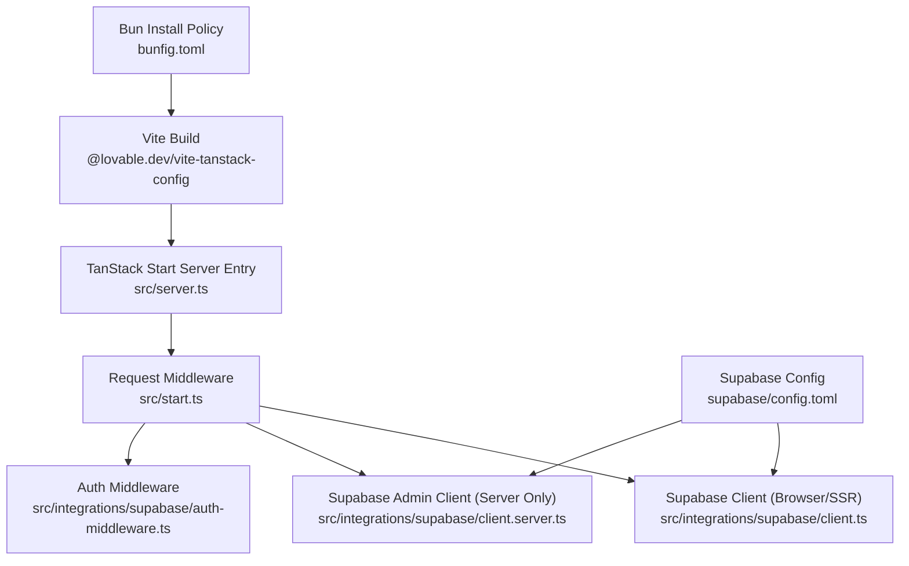
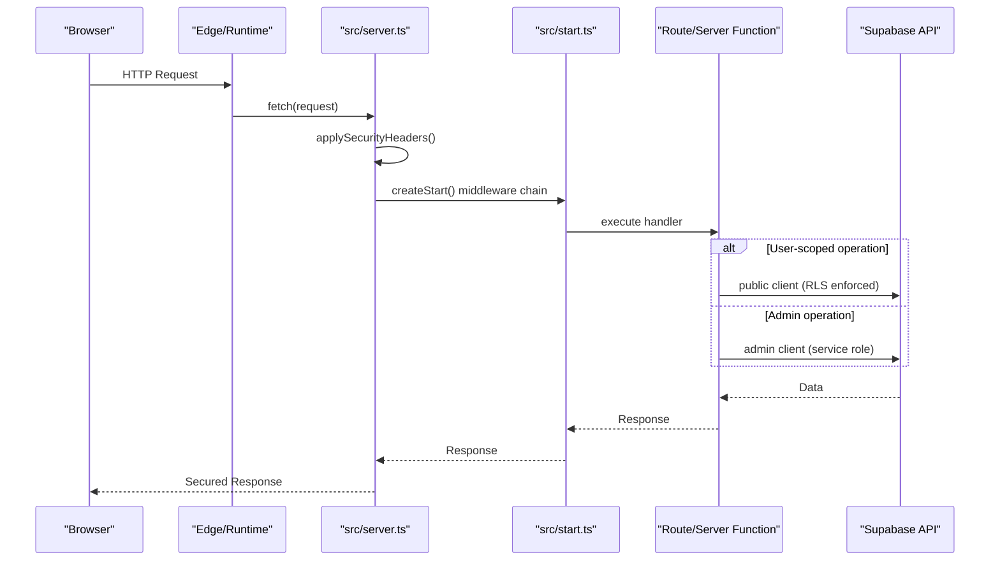
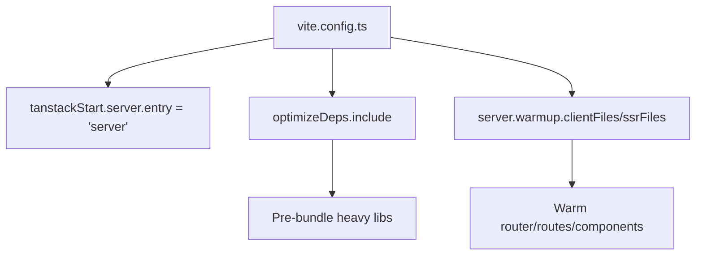
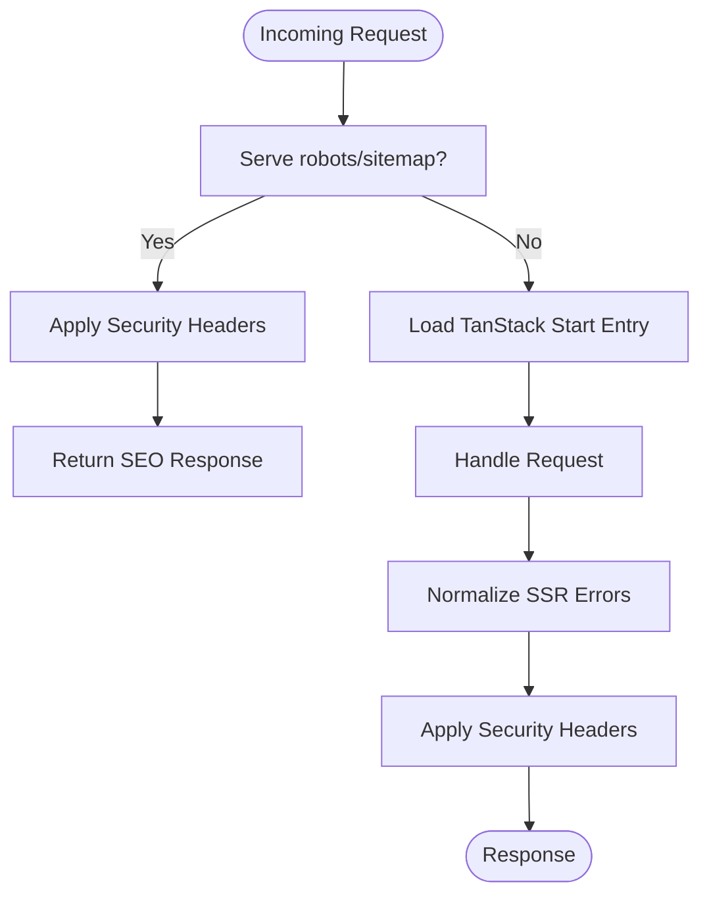
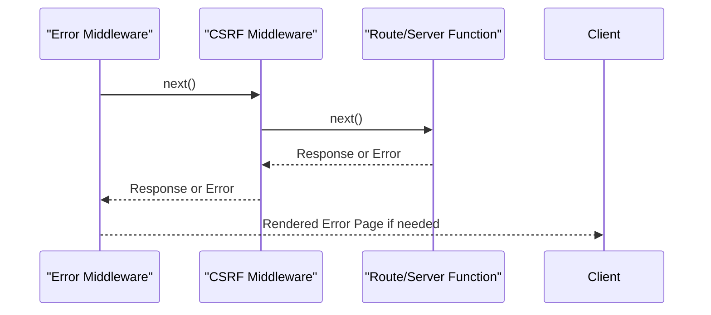
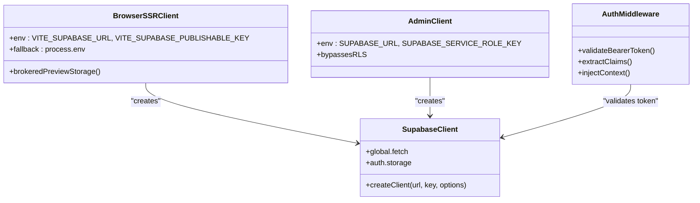
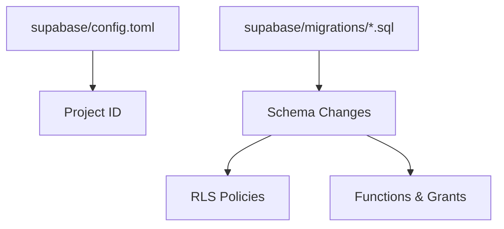
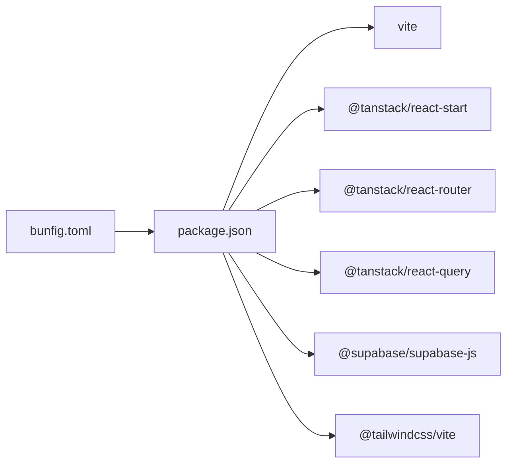

# Deployment & Configuration

<cite>
**Referenced Files in This Document**
- [vite.config.ts](file://vite.config.ts)
- [package.json](file://package.json)
- [bunfig.toml](file://bunfig.toml)
- [src/server.ts](file://src/server.ts)
- [src/start.ts](file://src/start.ts)
- [src/integrations/supabase/client.ts](file://src/integrations/supabase/client.ts)
- [src/integrations/supabase/client.server.ts](file://src/integrations/supabase/client.server.ts)
- [src/integrations/supabase/auth-middleware.ts](file://src/integrations/supabase/auth-middleware.ts)
- [supabase/config.toml](file://supabase/config.toml)
</cite>

## Table of Contents
1. [Introduction](#introduction)
2. [Project Structure](#project-structure)
3. [Core Components](#core-components)
4. [Architecture Overview](#architecture-overview)
5. [Detailed Component Analysis](#detailed-component-analysis)
6. [Dependency Analysis](#dependency-analysis)
7. [Performance Considerations](#performance-considerations)
8. [Troubleshooting Guide](#troubleshooting-guide)
9. [Conclusion](#conclusion)

## Introduction
This document explains how to build, configure, and deploy the application with Vite and TanStack Start, using Bun for dependency management and runtime optimizations. It covers environment variables for development, staging, and production; Supabase project setup including migrations and security policies; containerization options; CI/CD pipelines; monitoring and logging; performance optimization techniques; and troubleshooting common deployment issues.

## Project Structure
The repository is a TanStack Start + Vite application with Supabase integration:
- Build tooling: Vite via @lovable.dev/vite-tanstack-config
- Runtime entry: src/server.ts (SSR wrapper), src/start.ts (TanStack Start bootstrap)
- Supabase clients: client.ts (browser/SSR), client.server.ts (server-only service role), auth-middleware.ts (server-side auth validation)
- Supabase config: supabase/config.toml (project ID)
- Dependency manager: Bun (lockfile and install policy)

**Diagram sources**
- [vite.config.ts:9-14](file://vite.config.ts#L9-L14)
- [src/server.ts:135-153](file://src/server.ts#L135-L153)
- [src/start.ts:20-29](file://src/start.ts#L20-L29)
- [src/integrations/supabase/client.ts:57-84](file://src/integrations/supabase/client.ts#L57-L84)
- [src/integrations/supabase/client.server.ts:35-59](file://src/integrations/supabase/client.server.ts#L35-L59)
- [src/integrations/supabase/auth-middleware.ts:34-105](file://src/integrations/supabase/auth-middleware.ts#L34-L105)
- [bunfig.toml:1-8](file://bunfig.toml#L1-L8)
- [supabase/config.toml:1-1](file://supabase/config.toml#L1-L1)

**Section sources**
- [vite.config.ts:1-42](file://vite.config.ts#L1-L42)
- [package.json:6-15](file://package.json#L6-L15)
- [bunfig.toml:1-8](file://bunfig.toml#L1-L8)
- [src/server.ts:1-154](file://src/server.ts#L1-L154)
- [src/start.ts:1-30](file://src/start.ts#L1-L30)
- [src/integrations/supabase/client.ts:1-96](file://src/integrations/supabase/client.ts#L1-L96)
- [src/integrations/supabase/client.server.ts:1-73](file://src/integrations/supabase/client.server.ts#L1-L73)
- [src/integrations/supabase/auth-middleware.ts:1-106](file://src/integrations/supabase/auth-middleware.ts#L1-L106)
- [supabase/config.toml:1-1](file://supabase/config.toml#L1-L1)

## Core Components
- Build configuration: Vite via @lovable.dev/vite-tanstack-config, with custom server entry and dependency pre-bundling.
- Runtime entry: SSR wrapper in src/server.ts that applies security headers, SEO files, and error normalization.
- TanStack Start bootstrap: src/start.ts adds error and CSRF middleware.
- Supabase integrations:
  - Browser/SSR client: src/integrations/supabase/client.ts
  - Server-only admin client: src/integrations/supabase/client.server.ts
  - Auth middleware: src/integrations/supabase/auth-middleware.ts
- Dependency management: Bun lockfile and minimum release age policy.

**Section sources**
- [vite.config.ts:9-40](file://vite.config.ts#L9-L40)
- [src/server.ts:21-68](file://src/server.ts#L21-L68)
- [src/start.ts:5-29](file://src/start.ts#L5-L29)
- [src/integrations/supabase/client.ts:57-84](file://src/integrations/supabase/client.ts#L57-L84)
- [src/integrations/supabase/client.server.ts:35-59](file://src/integrations/supabase/client.server.ts#L35-L59)
- [src/integrations/supabase/auth-middleware.ts:34-105](file://src/integrations/supabase/auth-middleware.ts#L34-L105)
- [bunfig.toml:1-8](file://bunfig.toml#L1-L8)

## Architecture Overview
The request lifecycle:
1. Vite/Nitro builds the app with TanStack Start and uses src/server.ts as the server entry.
2. Requests enter the SSR wrapper, which serves SEO files, applies security headers, and forwards to TanStack Start.
3. TanStack Start runs error and CSRF middleware before route handlers.
4. Route handlers call Supabase clients:
   - Public client for user-scoped operations (RLS enforced).
   - Admin client for privileged server-side operations (RLS bypassed).
   - Auth middleware validates tokens for protected server functions.

**Diagram sources**
- [vite.config.ts:9-14](file://vite.config.ts#L9-L14)
- [src/server.ts:135-153](file://src/server.ts#L135-L153)
- [src/start.ts:20-29](file://src/start.ts#L20-L29)
- [src/integrations/supabase/client.ts:57-84](file://src/integrations/supabase/client.ts#L57-L84)
- [src/integrations/supabase/client.server.ts:35-59](file://src/integrations/supabase/client.server.ts#L35-L59)

## Detailed Component Analysis

### Build Configuration (Vite + TanStack Start)
- Server entry redirection: The build uses src/server.ts as the server entry point for Nitro/Vite.
- Dependency pre-bundling: Critical libraries are included in optimizeDeps to avoid mid-session reloads.
- Dev server warmup: Router, routes, and components are pre-transformed to reduce first-request latency.

**Diagram sources**
- [vite.config.ts:9-14](file://vite.config.ts#L9-L14)
- [vite.config.ts:15-27](file://vite.config.ts#L15-L27)
- [vite.config.ts:28-39](file://vite.config.ts#L28-L39)

**Section sources**
- [vite.config.ts:1-42](file://vite.config.ts#L1-L42)

### Runtime Entry and Security Headers (src/server.ts)
- Applies Content-Security-Policy, X-Frame-Options, Referrer-Policy, Permissions-Policy, and HSTS when served over HTTPS.
- Serves /robots.txt and /sitemap.xml with correct absolute origins.
- Normalizes h3-swallowed SSR errors into HTML error pages and logs captured errors.

**Diagram sources**
- [src/server.ts:21-68](file://src/server.ts#L21-L68)
- [src/server.ts:103-133](file://src/server.ts#L103-L133)
- [src/server.ts:70-94](file://src/server.ts#L70-L94)
- [src/server.ts:135-153](file://src/server.ts#L135-L153)

**Section sources**
- [src/server.ts:1-154](file://src/server.ts#L1-L154)

### TanStack Start Bootstrap (src/start.ts)
- Adds global error middleware to render HTML error pages on unhandled exceptions.
- Adds CSRF protection for server functions.

**Diagram sources**
- [src/start.ts:5-18](file://src/start.ts#L5-L18)
- [src/start.ts:20-29](file://src/start.ts#L20-L29)

**Section sources**
- [src/start.ts:1-30](file://src/start.ts#L1-L30)

### Supabase Integration and Environment Variables
- Client (browser/SSR): Reads VITE_SUPABASE_URL and VITE_SUPABASE_PUBLISHABLE_KEY at build time, falls back to process.env for SSR. Uses brokered preview storage for sessions.
- Admin client (server only): Requires SUPABASE_URL and SUPABASE_SERVICE_ROLE_KEY. Intended for trusted server-side operations that bypass RLS.
- Auth middleware: Validates Bearer tokens, extracts claims, and injects context for protected server functions.

**Diagram sources**
- [src/integrations/supabase/client.ts:57-84](file://src/integrations/supabase/client.ts#L57-L84)
- [src/integrations/supabase/client.server.ts:35-59](file://src/integrations/supabase/client.server.ts#L35-L59)
- [src/integrations/supabase/auth-middleware.ts:34-105](file://src/integrations/supabase/auth-middleware.ts#L34-L105)

**Section sources**
- [src/integrations/supabase/client.ts:1-96](file://src/integrations/supabase/client.ts#L1-L96)
- [src/integrations/supabase/client.server.ts:1-73](file://src/integrations/supabase/client.server.ts#L1-L73)
- [src/integrations/supabase/auth-middleware.ts:1-106](file://src/integrations/supabase/auth-middleware.ts#L1-L106)

### Supabase Project Setup and Migrations
- Project ID is configured in supabase/config.toml.
- Database schema evolves through SQL migrations under supabase/migrations/.
- Security policies should be defined in SQL migrations (e.g., Row Level Security policies, function grants).

**Diagram sources**
- [supabase/config.toml:1-1](file://supabase/config.toml#L1-L1)

**Section sources**
- [supabase/config.toml:1-1](file://supabase/config.toml#L1-L1)

### Containerization Options
- The application exports a standard Web Fetch API-compatible server entry (src/server.ts), making it suitable for edge runtimes and containers.
- Recommended approaches:
  - Node.js container: Use a lightweight Node image, install dependencies with Bun, then run the built server.
  - Bun runtime container: Use a Bun-based image to leverage fast installs and runtime performance.
  - Edge platforms: Deploy to Cloudflare Workers, Vercel Edge, or Supabase Edge Functions where supported by the build target.

[No sources needed since this section provides general guidance]

### CI/CD Pipeline Configuration Examples
- Typical steps:
  - Install dependencies with Bun (uses bun.lock).
  - Run tests with Vitest.
  - Build with Vite (production mode).
  - Lint and format checks.
  - Push artifacts to a registry or deploy directly to the platform.
- Example pipeline outline:
  - Job: install -> test -> build -> deploy
  - Secrets: SUPABASE_URL, SUPABASE_PUBLISHABLE_KEY, SUPABASE_SERVICE_ROLE_KEY
  - Artifacts: dist output from vite build

[No sources needed since this section provides general guidance]

### Monitoring and Logging
- Server-side errors:
  - Global error middleware renders HTML error pages and logs errors.
  - SSR error normalization captures swallowed errors and logs them.
- Recommendations:
  - Forward console.error to your logging provider.
  - Capture request IDs and correlate with backend logs.
  - Monitor CSP violations and blocked resources via browser devtools and CDN logs.

**Section sources**
- [src/start.ts:5-18](file://src/start.ts#L5-L18)
- [src/server.ts:70-94](file://src/server.ts#L70-L94)

### Performance Optimization Techniques
- Code splitting:
  - TanStack Start routes are split by default; ensure lazy loading for heavy modules.
- Asset optimization:
  - Tailwind CSS via @tailwindcss/vite optimizes styles.
  - Pre-bundle heavy libraries via optimizeDeps.include to avoid mid-session reloads.
- Caching strategies:
  - Static assets: rely on Vite’s hashed filenames and CDN caching.
  - SEO files: cache robots.txt and sitemap.xml for 1 hour.
  - Supabase client: use query caching via React Query where applicable.

**Section sources**
- [vite.config.ts:15-27](file://vite.config.ts#L15-L27)
- [src/server.ts:103-133](file://src/server.ts#L103-L133)
- [package.json:52-77](file://package.json#L52-L77)

## Dependency Analysis
Key runtime and build-time dependencies relevant to deployment:
- Vite and TanStack Start plugins for SSR and routing.
- Supabase JS client for database and auth.
- Bun for dependency installation and lockfile integrity.

**Diagram sources**
- [package.json:19-79](file://package.json#L19-L79)
- [package.json:81-104](file://package.json#L81-L104)
- [bunfig.toml:1-8](file://bunfig.toml#L1-L8)

**Section sources**
- [package.json:1-106](file://package.json#L1-L106)
- [bunfig.toml:1-8](file://bunfig.toml#L1-L8)

## Performance Considerations
- Pre-bundle critical dependencies to prevent mid-session reloads during navigation.
- Warm up the dev server to transform router and route modules ahead of time.
- Minimize bundle size by avoiding unnecessary imports and leveraging code splitting.
- Use CDN caching for static assets and SEO files.
- Prefer server-side data fetching with Supabase to reduce client payload.

[No sources needed since this section provides general guidance]

## Troubleshooting Guide
Common deployment issues and resolutions:
- Missing Supabase environment variables:
  - Symptoms: Runtime errors indicating missing SUPABASE_URL, SUPABASE_PUBLISHABLE_KEY, or SUPABASE_SERVICE_ROLE_KEY.
  - Resolution: Ensure all required variables are set in your deployment environment.
- Token validation failures:
  - Symptoms: Unauthorized errors due to invalid or malformed Bearer tokens.
  - Resolution: Verify token format and ensure Authorization header is correctly passed.
- CSP blocking resources:
  - Symptoms: Blocked scripts, fonts, or images due to strict CSP.
  - Resolution: Adjust CSP directives in src/server.ts to allow necessary origins and inline resources.
- SSR errors not surfaced:
  - Symptoms: Generic 500 responses without details.
  - Resolution: Check normalized SSR error handling and logs; ensure error middleware is active.

**Section sources**
- [src/integrations/supabase/client.ts:64-72](file://src/integrations/supabase/client.ts#L64-L72)
- [src/integrations/supabase/client.server.ts:39-47](file://src/integrations/supabase/client.server.ts#L39-L47)
- [src/integrations/supabase/auth-middleware.ts:55-95](file://src/integrations/supabase/auth-middleware.ts#L55-L95)
- [src/server.ts:21-68](file://src/server.ts#L21-L68)
- [src/server.ts:70-94](file://src/server.ts#L70-L94)

## Conclusion
This guide outlined the build and runtime configuration for deploying the application with Vite and TanStack Start, integrating Supabase securely across environments, and optimizing performance. By following the environment variable requirements, applying security headers, and leveraging Bun’s fast dependency management, you can achieve reliable deployments across cloud platforms. Use the provided diagrams and references to troubleshoot issues and refine your CI/CD pipelines for automated, secure, and performant releases.