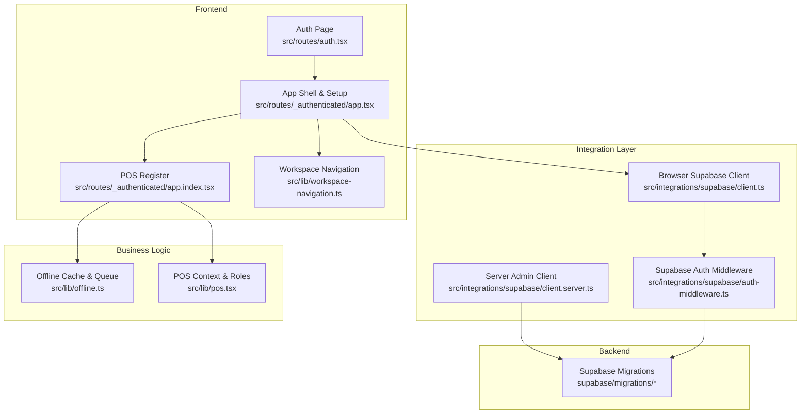
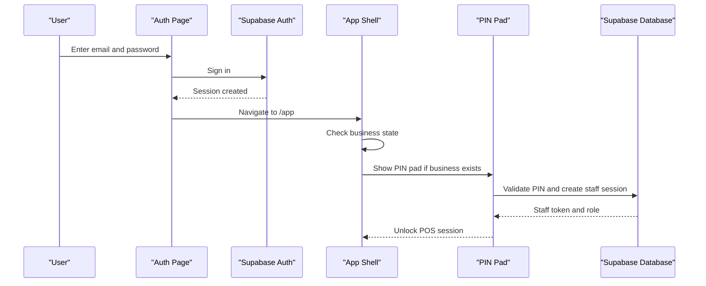
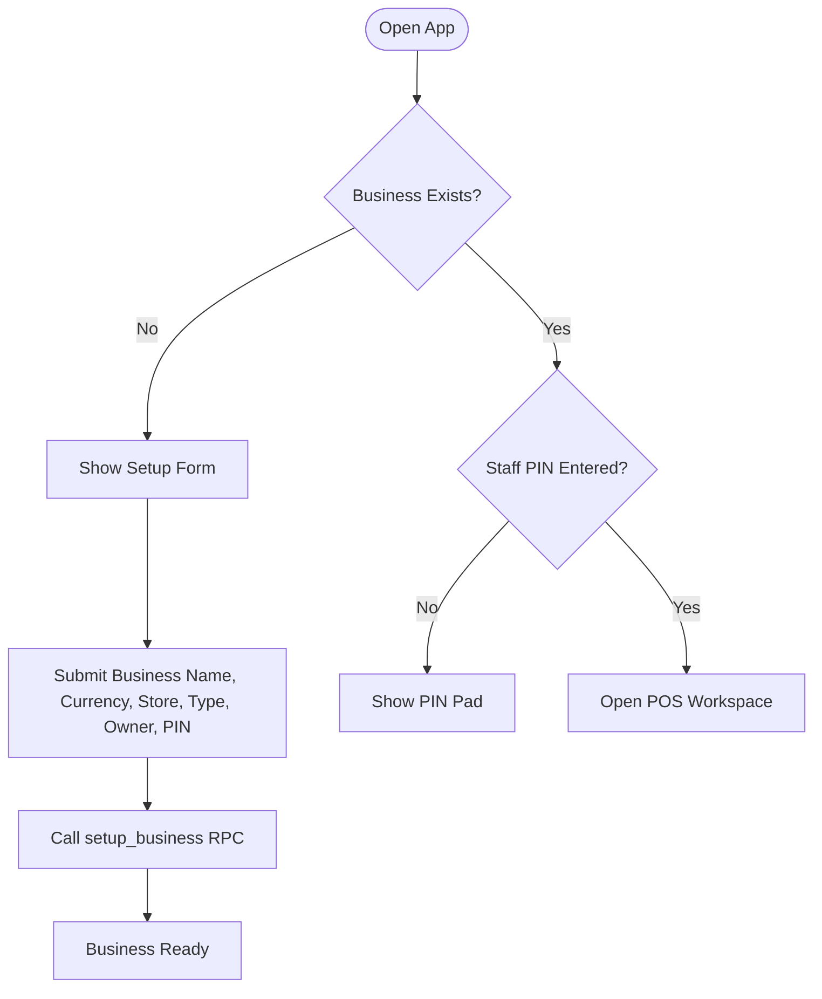
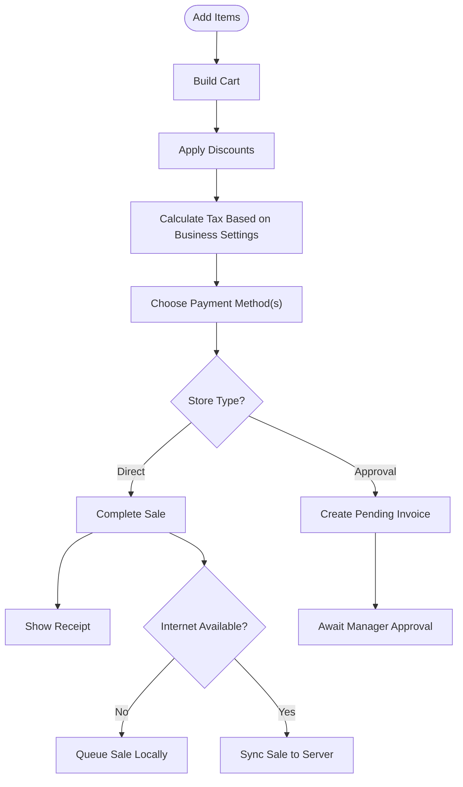
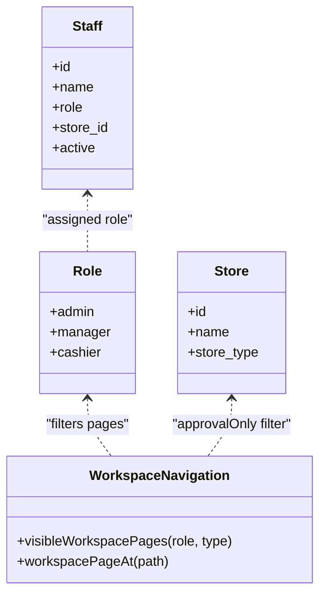
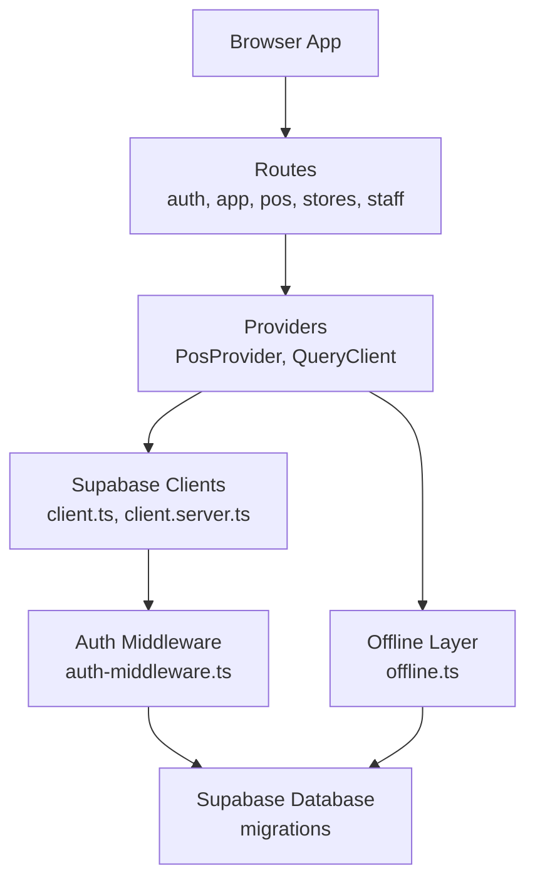
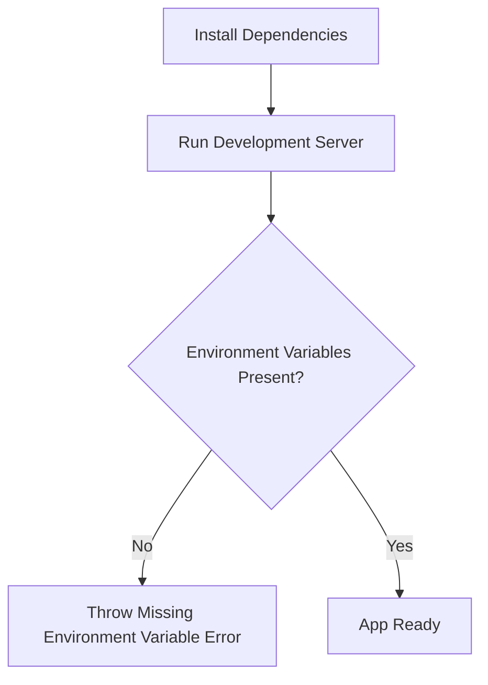
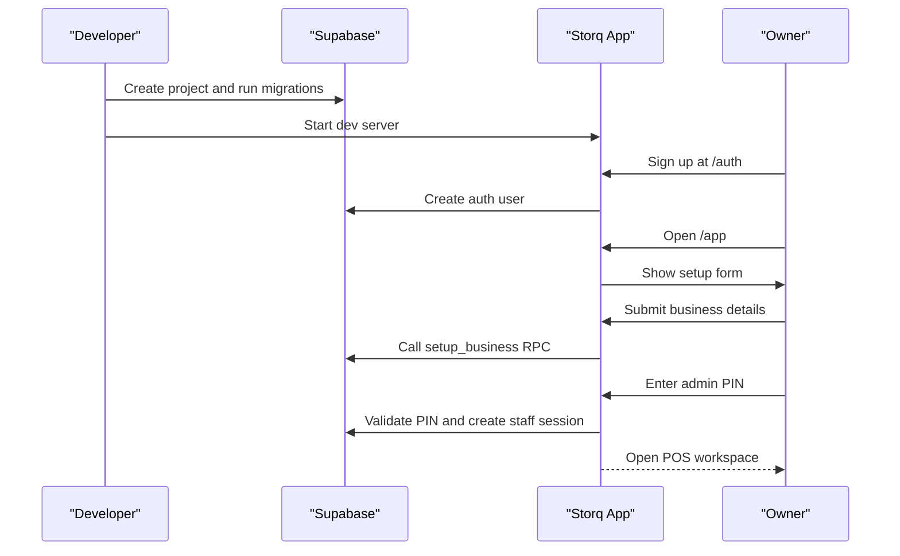
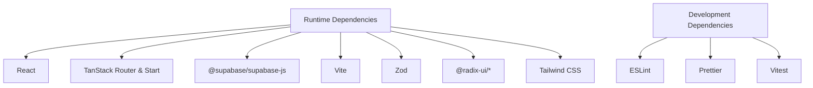

# Getting Started

<cite>
**Referenced Files in This Document**
- [README.md](file://README.md)
- [package.json](file://package.json)
- [src/integrations/supabase/client.ts](file://src/integrations/supabase/client.ts)
- [src/integrations/supabase/client.server.ts](file://src/integrations/supabase/client.server.ts)
- [src/integrations/supabase/auth-middleware.ts](file://src/integrations/supabase/auth-middleware.ts)
- [src/routes/auth.tsx](file://src/routes/auth.tsx)
- [src/routes/_authenticated/app.tsx](file://src/routes/_authenticated/app.tsx)
- [src/routes/_authenticated/app.index.tsx](file://src/routes/_authenticated/app.index.tsx)
- [src/lib/offline.ts](file://src/lib/offline.ts)
- [src/lib/pos.tsx](file://src/lib/pos.tsx)
- [src/lib/workspace-navigation.ts](file://src/lib/workspace-navigation.ts)
- [supabase/migrations/20261008090000_security_hardening.sql](file://supabase/migrations/20261008090000_security_hardening.sql)
</cite>

## Table of Contents
1. [Introduction](#introduction)
2. [Project Structure](#project-structure)
3. [Core Components](#core-components)
4. [Architecture Overview](#architecture-overview)
5. [Detailed Component Analysis](#detailed-component-analysis)
6. [Dependency Analysis](#dependency-analysis)
7. [Performance Considerations](#performance-considerations)
8. [Troubleshooting Guide](#troubleshooting-guide)
9. [Conclusion](#conclusion)

## Introduction
Storq is a retail point-of-sale application designed for African markets. It supports multi-store operations, offline sales, and PIN-based staff authentication. A single email and password can be used across devices, while each staff member unlocks their POS session with a four-digit PIN. The system supports two store models:
- Direct sale stores: cashiers complete sales immediately.
- Approval-based stores: cashiers create invoices that must be approved by a manager before completion.

The project was generated with Lovable and uses React, TanStack Start, Supabase, Vite, and TypeScript.

**Section sources**
- [README.md:1-26](file://README.md#L1-L26)

## Project Structure
At a high level, the repository separates frontend routes, shared UI components, business logic, Supabase integration, and database migrations:
- `src/routes`: Application pages such as authentication, the main app shell, POS register, stores, and staff management.
- `src/components/ui` and `src/components/pos`: Reusable UI primitives and POS-specific dialogs.
- `src/lib`: Business utilities including offline caching, billing, products, receipts, and the POS context.
- `src/integrations/supabase`: Client initialization, server-side admin client, and auth middleware.
- `supabase/migrations`: Database schema, security policies, and RPC functions.

**Diagram sources**
- [src/routes/auth.tsx:1-266](file://src/routes/auth.tsx#L1-L266)
- [src/routes/_authenticated/app.tsx:73-129](file://src/routes/_authenticated/app.tsx#L73-L129)
- [src/routes/_authenticated/app.index.tsx:71-85](file://src/routes/_authenticated/app.index.tsx#L71-L85)
- [src/lib/workspace-navigation.ts:1-151](file://src/lib/workspace-navigation.ts#L1-L151)
- [src/integrations/supabase/client.ts:1-95](file://src/integrations/supabase/client.ts#L1-L95)
- [src/integrations/supabase/client.server.ts:1-72](file://src/integrations/supabase/client.server.ts#L1-L72)
- [src/integrations/supabase/auth-middleware.ts:1-105](file://src/integrations/supabase/auth-middleware.ts#L1-L105)
- [src/lib/offline.ts:1-77](file://src/lib/offline.ts#L1-L77)
- [src/lib/pos.tsx:407-447](file://src/lib/pos.tsx#L407-L447)

**Section sources**
- [package.json:1-106](file://package.json#L1-L106)
- [src/lib/workspace-navigation.ts:1-151](file://src/lib/workspace-navigation.ts#L1-L151)

## Core Components
This section explains the key pieces you will interact with when getting started.

### Authentication and PIN Unlock
- Users sign in with an email and password through the `/auth` page.
- After signing in, the app checks whether a business exists. If not, it shows the setup form.
- Once a business exists, the user enters a four-digit PIN to unlock their staff session.
- PIN validation includes throttling and device binding to prevent brute-force attempts.

**Diagram sources**
- [src/routes/auth.tsx:45-107](file://src/routes/auth.tsx#L45-L107)
- [src/routes/_authenticated/app.tsx:95-129](file://src/routes/_authenticated/app.tsx#L95-L129)
- [src/routes/_authenticated/app.tsx:269-281](file://src/routes/_authenticated/app.tsx#L269-L281)
- [supabase/migrations/20261008090000_security_hardening.sql:218-256](file://supabase/migrations/20261008090000_security_hardening.sql#L218-L256)

**Section sources**
- [src/routes/auth.tsx:1-266](file://src/routes/auth.tsx#L1-L266)
- [src/routes/_authenticated/app.tsx:95-129](file://src/routes/_authenticated/app.tsx#L95-L129)
- [supabase/migrations/20261008090000_security_hardening.sql:218-292](file://supabase/migrations/20261008090000_security_hardening.sql#L218-L292)

### Business Setup
When no business exists, the app presents a setup form where you define:
- Business name
- Currency
- First store name
- Store type: direct or approval
- Owner name
- Admin PIN (four digits)

After submission, the app calls the `setup_business` RPC to create the business, first store, and owner staff record.

**Diagram sources**
- [src/routes/_authenticated/app.tsx:153-267](file://src/routes/_authenticated/app.tsx#L153-L267)

**Section sources**
- [src/routes/_authenticated/app.tsx:153-267](file://src/routes/_authenticated/app.tsx#L153-L267)

### POS Register and Sales
The POS register is the main workspace for ringing up sales. Key behaviors:
- Search or scan barcodes to add items.
- Apply per-line discounts.
- Calculate tax based on business settings.
- Support split payments and multiple tender methods.
- In approval stores, sales become pending invoices awaiting approval.
- Offline sales are queued locally and synced later.

**Diagram sources**
- [src/routes/_authenticated/app.index.tsx:111-355](file://src/routes/_authenticated/app.index.tsx#L111-L355)
- [src/lib/offline.ts:1-77](file://src/lib/offline.ts#L1-L77)

**Section sources**
- [src/routes/_authenticated/app.index.tsx:71-598](file://src/routes/_authenticated/app.index.tsx#L71-L598)
- [src/lib/offline.ts:1-77](file://src/lib/offline.ts#L1-L77)

### Stores and Staff Management
- Only admins can manage stores and staff.
- Store types include direct and approval modes.
- Staff roles include admin, manager/approver, and cashier.
- Navigation visibility depends on role and store type.

**Diagram sources**
- [src/lib/workspace-navigation.ts:1-151](file://src/lib/workspace-navigation.ts#L1-L151)
- [src/lib/pos.tsx:443-447](file://src/lib/pos.tsx#L443-L447)

**Section sources**
- [src/lib/workspace-navigation.ts:1-151](file://src/lib/workspace-navigation.ts#L1-L151)
- [src/lib/pos.tsx:443-447](file://src/lib/pos.tsx#L443-L447)

## Architecture Overview
Storq follows a modern React + TanStack Start architecture:
- Frontend routes handle authentication, setup, and POS workflows.
- Supabase clients provide authenticated and admin access.
- Offline caching persists reference data and queues sales when offline.
- Database migrations enforce security, roles, sessions, and business rules.

**Diagram sources**
- [src/routes/auth.tsx:1-266](file://src/routes/auth.tsx#L1-L266)
- [src/routes/_authenticated/app.tsx:73-129](file://src/routes/_authenticated/app.tsx#L73-L129)
- [src/integrations/supabase/client.ts:1-95](file://src/integrations/supabase/client.ts#L1-L95)
- [src/integrations/supabase/client.server.ts:1-72](file://src/integrations/supabase/client.server.ts#L1-L72)
- [src/integrations/supabase/auth-middleware.ts:1-105](file://src/integrations/supabase/auth-middleware.ts#L1-L105)
- [src/lib/offline.ts:1-77](file://src/lib/offline.ts#L1-L77)

## Detailed Component Analysis

### Installation and Development Server
Prerequisites:
- Node.js and npm.
- A Supabase project with environment variables configured.

Steps:
1. Clone the repository.
2. Install dependencies using npm.
3. Run the development server.

Environment variables required:
- `SUPABASE_URL`
- `SUPABASE_PUBLISHABLE_KEY`
- `SUPABASE_SERVICE_ROLE_KEY`

These variables are validated by the Supabase client modules. If missing, the app logs an error and throws during initialization.

**Diagram sources**
- [README.md:16-26](file://README.md#L16-L26)
- [package.json:6-14](file://package.json#L6-L14)
- [src/integrations/supabase/client.ts:57-72](file://src/integrations/supabase/client.ts#L57-L72)
- [src/integrations/supabase/client.server.ts:35-47](file://src/integrations/supabase/client.server.ts#L35-L47)

**Section sources**
- [README.md:16-26](file://README.md#L16-L26)
- [package.json:6-14](file://package.json#L6-L14)
- [src/integrations/supabase/client.ts:57-72](file://src/integrations/supabase/client.ts#L57-L72)
- [src/integrations/supabase/client.server.ts:35-47](file://src/integrations/supabase/client.server.ts#L35-L47)

### First-Time Configuration
1. Set up Supabase:
   - Create a Supabase project.
   - Configure environment variables: `SUPABASE_URL`, `SUPABASE_PUBLISHABLE_KEY`, `SUPABASE_SERVICE_ROLE_KEY`.
   - Run migrations so the database schema, RLS policies, and RPC functions exist.

2. Start the app and sign up:
   - Go to `/auth`.
   - Create your account with email and password.

3. Register your business:
   - After signing in, the app detects no business and shows the setup form.
   - Fill in business name, currency, first store name, store type, owner name, and admin PIN.
   - Submit to create the business and initial store.

4. Unlock your staff session:
   - Enter your four-digit PIN to unlock the POS.

**Diagram sources**
- [src/routes/auth.tsx:45-107](file://src/routes/auth.tsx#L45-L107)
- [src/routes/_authenticated/app.tsx:153-267](file://src/routes/_authenticated/app.tsx#L153-L267)
- [supabase/migrations/20261008090000_security_hardening.sql:218-256](file://supabase/migrations/20261008090000_security_hardening.sql#L218-L256)

**Section sources**
- [src/routes/auth.tsx:1-266](file://src/routes/auth.tsx#L1-L266)
- [src/routes/_authenticated/app.tsx:153-267](file://src/routes/_authenticated/app.tsx#L153-L267)

### Basic Usage Examples

#### Create Your First Store
- Log in as admin.
- Navigate to Locations under Settings.
- Add a new store with a name and choose direct or approval mode.
- If your subscription limits are reached, the app prevents adding more stores.

**Section sources**
- [src/lib/workspace-navigation.ts:106-122](file://src/lib/workspace-navigation.ts#L106-L122)
- [src/routes/_authenticated/app.stores.tsx:28-70](file://src/routes/_authenticated/app.stores.tsx#L28-L70)

#### Add Staff Members
- Log in as admin.
- Navigate to Staff under Settings.
- Add a new staff member with a name, role, optional store assignment, and a four-digit PIN.
- Active staff members can sign in and unlock their POS session with their PIN.

**Section sources**
- [src/routes/_authenticated/app.staff.tsx:66-101](file://src/routes/_authenticated/app.staff.tsx#L66-L101)
- [supabase/migrations/20261008090000_security_hardening.sql:218-256](file://supabase/migrations/20261008090000_security_hardening.sql#L218-L256)

#### Process a Sale
- Open the POS register.
- Search or scan an item to add it to the cart.
- Apply discounts if needed.
- Choose payment method(s).
- For direct stores, complete the sale and view the receipt.
- For approval stores, submit the invoice for manager approval.
- If offline, the sale is queued locally and synced when connectivity returns.

**Section sources**
- [src/routes/_authenticated/app.index.tsx:111-355](file://src/routes/_authenticated/app.index.tsx#L111-L355)
- [src/lib/offline.ts:1-77](file://src/lib/offline.ts#L1-L77)

## Dependency Analysis
Key runtime dependencies:
- React and React DOM for UI rendering.
- TanStack Router and Start for routing and server integration.
- Supabase JS client for authentication and database access.
- Vite for development and build tooling.
- Zod for validation.
- Radix UI primitives and Tailwind CSS for styling.

Development dependencies include ESLint, Prettier, Vitest, and testing libraries.

**Diagram sources**
- [package.json:19-80](file://package.json#L19-L80)
- [package.json:81-104](file://package.json#L81-L104)

**Section sources**
- [package.json:1-106](file://package.json#L1-L106)

## Performance Considerations
- The POS register avoids loading stock tiles until the user searches or opens a category, improving responsiveness.
- Reference data such as business, stores, products, collections, stock, and staff names are cached locally for instant startup.
- Offline sales are queued and retried, reducing friction in low-connectivity environments.
- Subscription checks gate advanced features like adding additional stores.

[No sources needed since this section provides general guidance]

## Troubleshooting Guide

### Missing Supabase Environment Variables
Symptoms:
- App fails to initialize.
- Console logs indicate missing `SUPABASE_URL`, `SUPABASE_PUBLISHABLE_KEY`, or `SUPABASE_SERVICE_ROLE_KEY`.

Resolution:
- Ensure all three variables are set in your environment.
- Verify the values match your Supabase project configuration.

**Section sources**
- [src/integrations/supabase/client.ts:57-72](file://src/integrations/supabase/client.ts#L57-L72)
- [src/integrations/supabase/client.server.ts:35-47](file://src/integrations/supabase/client.server.ts#L35-L47)

### Unauthorized or Invalid Token Errors
Symptoms:
- Server-side requests fail with unauthorized errors.
- Middleware rejects requests without valid tokens.

Resolution:
- Confirm Supabase auth is configured and the publishable key is correct.
- Ensure requests include proper headers; the middleware injects API keys automatically.

**Section sources**
- [src/integrations/supabase/auth-middleware.ts:34-105](file://src/integrations/supabase/auth-middleware.ts#L34-L105)

### Wrong PIN or Locked Device
Symptoms:
- PIN entry fails repeatedly.
- App reports too many wrong attempts and suggests waiting.

Resolution:
- Wait for the lockout window to expire.
- Use the correct four-digit PIN assigned to the staff member.
- If locked out, sign out and sign back in to reset local state.

**Section sources**
- [supabase/migrations/20261008090000_security_hardening.sql:218-256](file://supabase/migrations/20261008090000_security_hardening.sql#L218-L256)

### No Store Selected in POS
Symptoms:
- POS register shows a message prompting you to add a store first.

Resolution:
- Add a store via the Locations page as an admin.
- Select the desired store from the store picker in the POS header.

**Section sources**
- [src/routes/_authenticated/app.index.tsx:357-357](file://src/routes/_authenticated/app.index.tsx#L357-L357)

### Offline Sales Not Syncing
Symptoms:
- Sales appear queued locally.
- Sync banner shows failed or pending entries.

Resolution:
- Restore internet connectivity.
- Use the sync button to retry queued sales.
- Discard failed entries only after confirming they are not needed.

**Section sources**
- [src/lib/offline.ts:1-77](file://src/lib/offline.ts#L1-L77)
- [src/lib/pos.tsx:407-447](file://src/lib/pos.tsx#L407-L447)

## Conclusion
You now have the essentials to install Storq, configure Supabase, register your business, and start using the POS. The system supports multi-store operations, offline sales, and secure PIN-based staff sessions. As you grow, use the Stores and Staff pages to expand capacity, and rely on the approval workflow for controlled invoicing in approval-based stores.

[No sources needed since this section summarizes without analyzing specific files]