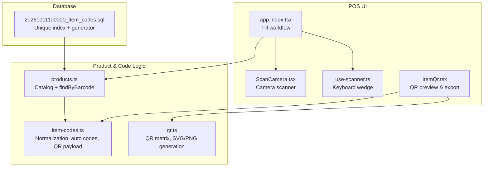
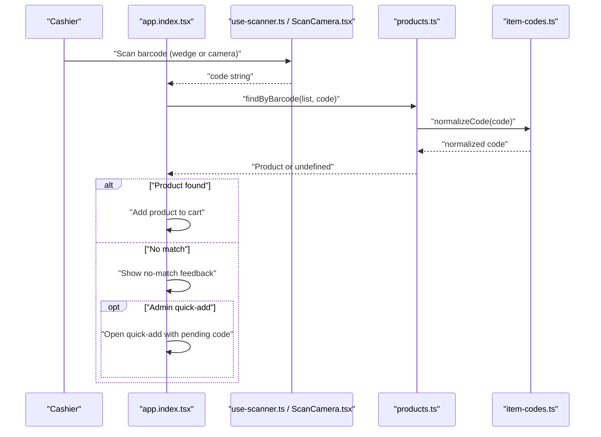
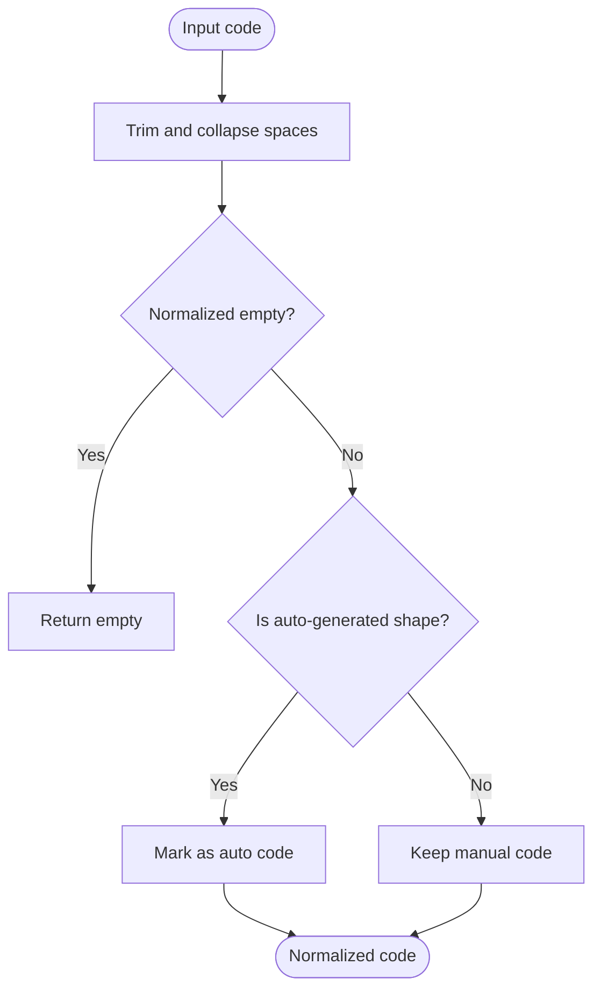
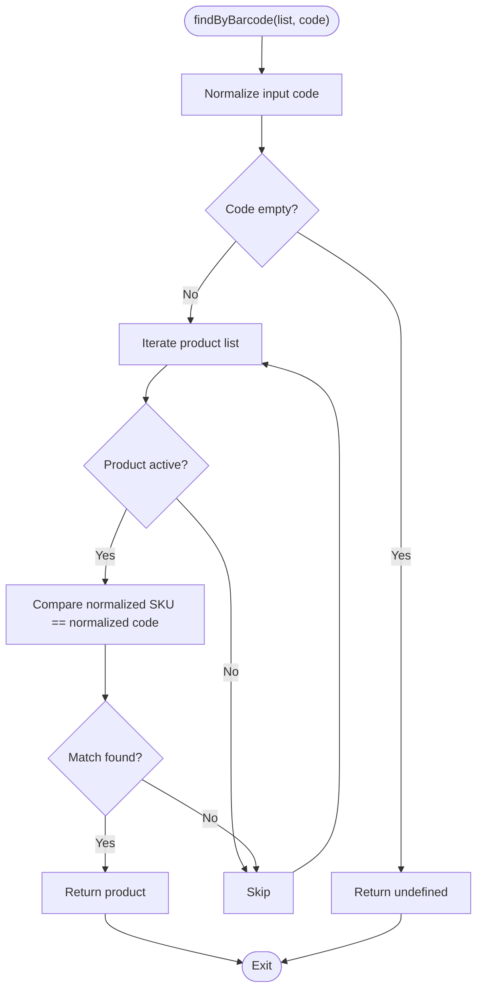
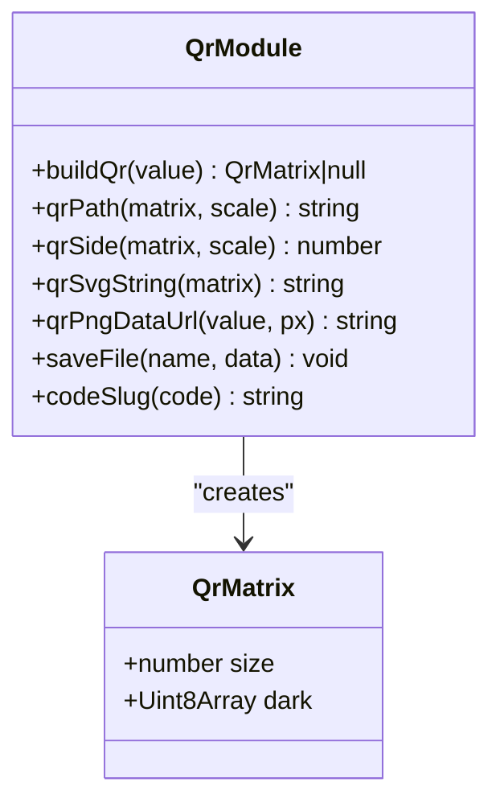
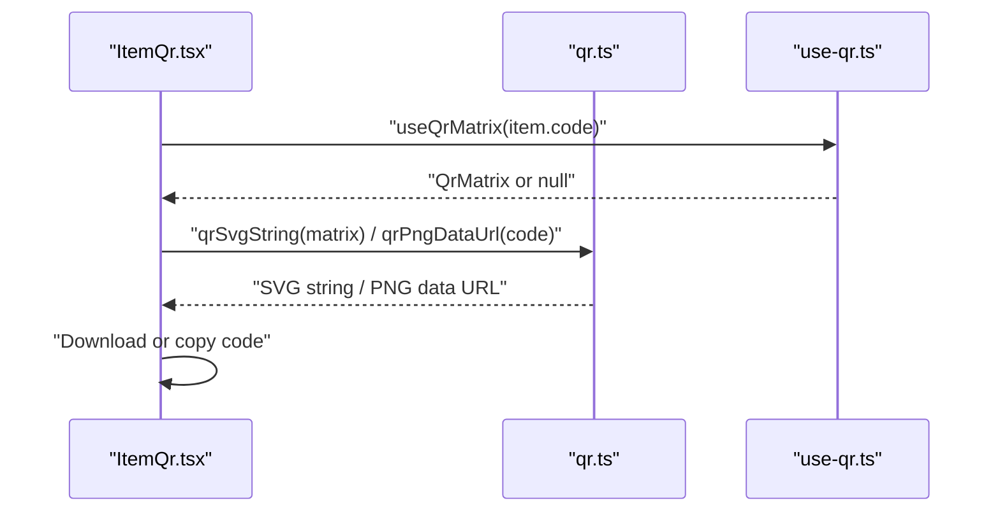
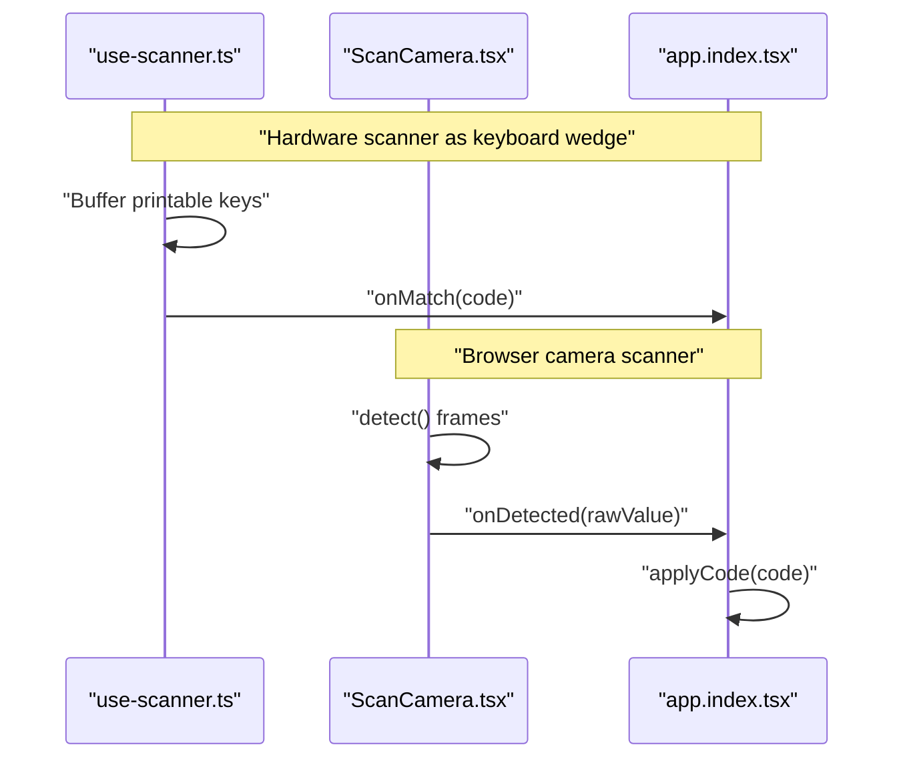
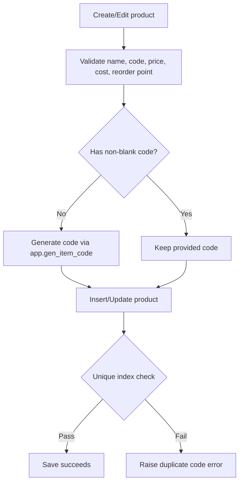
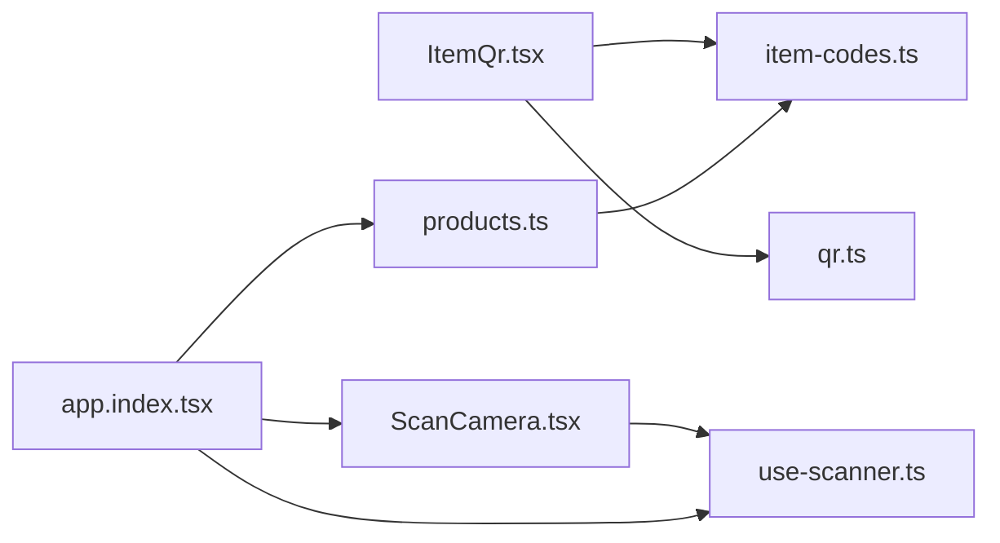

# Barcode Integration & Item Codes

<cite>
**Referenced Files in This Document**
- [item-codes.ts](file://src/lib/item-codes.ts)
- [products.ts](file://src/lib/products.ts)
- [qr.ts](file://src/lib/qr.ts)
- [ItemQr.tsx](file://src/components/pos/ItemQr.tsx)
- [use-scanner.ts](file://src/components/pos/use-scanner.ts)
- [ScanCamera.tsx](file://src/components/pos/ScanCamera.tsx)
- [app.index.tsx](file://src/routes/_authenticated/app.index.tsx)
- [20261011100000_item_codes.sql](file://supabase/migrations/20261011100000_item_codes.sql)
- [item-codes.test.ts](file://src/lib/item-codes.test.ts)
- [qr.test.ts](file://src/lib/qr.test.ts)
</cite>

## Table of Contents
1. [Introduction](#introduction)
2. [Project Structure](#project-structure)
3. [Core Components](#core-components)
4. [Architecture Overview](#architecture-overview)
5. [Detailed Component Analysis](#detailed-component-analysis)
6. [Dependency Analysis](#dependency-analysis)
7. [Performance Considerations](#performance-considerations)
8. [Troubleshooting Guide](#troubleshooting-guide)
9. [Conclusion](#conclusion)

## Introduction
This document explains how the POS system identifies products using barcodes and item codes. The design treats a single product code as the universal identifier: it is the SKU, the barcode value, and the QR payload. Barcodes can arrive through three channels:
- A hardware scanner acting as a keyboard wedge.
- A camera-based scan using the browser BarcodeDetector API.
- Manual typing or copying of an item code.

The system normalizes codes to make matching robust against spaces, case differences, and trailing whitespace. `findByBarcode` performs fast, offline lookup against the cached product catalog so scanning feels instant during sales. QR codes are generated from the same normalized code, ensuring that printed labels and scanned input resolve to the same product.

## Project Structure
Barcode integration spans UI components, hooks, library utilities, and database migrations:

**Diagram sources**
- [app.index.tsx:222-248](file://src/routes/_authenticated/app.index.tsx#L222-L248)
- [ScanCamera.tsx:57-139](file://src/components/pos/ScanCamera.tsx#L57-L139)
- [use-scanner.ts:31-83](file://src/components/pos/use-scanner.ts#L31-L83)
- [ItemQr.tsx:63-135](file://src/components/pos/ItemQr.tsx#L63-L135)
- [products.ts:22-64](file://src/lib/products.ts#L22-L64)
- [item-codes.ts:21-83](file://src/lib/item-codes.ts#L21-L83)
- [qr.ts:35-95](file://src/lib/qr.ts#L35-L95)
- [20261011100000_item_codes.sql:71-76](file://supabase/migrations/20261011100000_item_codes.sql#L71-L76)

**Section sources**
- [app.index.tsx:17-27](file://src/routes/_authenticated/app.index.tsx#L17-L27)
- [products.ts:19-64](file://src/lib/products.ts#L19-L64)
- [item-codes.ts:1-13](file://src/lib/item-codes.ts#L1-L13)

## Core Components
- **Item code normalization**: Trims whitespace, collapses internal space runs, and supports both manual and generated codes. It ensures that what a user types, what a scanner emits, and what a QR carries are comparable.
- **Product catalog and lookup**: Loads active products into memory for fast scanning. `findByBarcode` matches normalized codes against this catalog without network calls.
- **QR generation**: Builds a deterministic QR matrix from the normalized code and exports it as SVG or PNG for labels.
- **Scanner inputs**: Supports keyboard-wedge scanners and camera scanning with clear error handling.

**Section sources**
- [item-codes.ts:21-24](file://src/lib/item-codes.ts#L21-L24)
- [products.ts:54-64](file://src/lib/products.ts#L54-L64)
- [qr.ts:35-45](file://src/lib/qr.ts#L35-L45)
- [use-scanner.ts:24-30](file://src/components/pos/use-scanner.ts#L24-L30)
- [ScanCamera.tsx:51-56](file://src/components/pos/ScanCamera.tsx#L51-L56)

## Architecture Overview
The POS integrates barcode input at the till screen. Scanned or typed codes flow through normalization and then into `findByBarcode`, which returns an active product if found. If not found, the till shows feedback and optionally opens quick-add for admins.

**Diagram sources**
- [app.index.tsx:222-248](file://src/routes/_authenticated/app.index.tsx#L222-L248)
- [products.ts:54-64](file://src/lib/products.ts#L54-L64)
- [item-codes.ts:21-24](file://src/lib/item-codes.ts#L21-L24)
- [use-scanner.ts:31-83](file://src/components/pos/use-scanner.ts#L31-L83)
- [ScanCamera.tsx:110-129](file://src/components/pos/ScanCamera.tsx#L110-L129)

## Detailed Component Analysis

### Item Code Normalization and Lifecycle
The item code is the single source of truth for a product’s identity. Normalization trims leading/trailing whitespace and collapses repeated spaces so pasted or typed values match reliably. Generated codes use a prefix and an unambiguous character set to avoid misreading when handwritten or read aloud.

Key behaviors:
- `normalizeCode` removes extra spaces and trims.
- `isAutoCode` detects codes generated by the system.
- `suggestCode` avoids collisions with existing codes.
- `findCodeClash` finds duplicates case-insensitively while ignoring blank codes.
- `qrPayload` encodes the normalized code into QR images.

**Diagram sources**
- [item-codes.ts:21-29](file://src/lib/item-codes.ts#L21-L29)
- [item-codes.ts:46-58](file://src/lib/item-codes.ts#L46-L58)
- [item-codes.ts:65-74](file://src/lib/item-codes.ts#L65-L74)
- [item-codes.ts:76-83](file://src/lib/item-codes.ts#L76-L83)

**Section sources**
- [item-codes.ts:1-13](file://src/lib/item-codes.ts#L1-L13)
- [item-codes.ts:21-24](file://src/lib/item-codes.ts#L21-L24)
- [item-codes.ts:26-29](file://src/lib/item-codes.ts#L26-L29)
- [item-codes.ts:46-58](file://src/lib/item-codes.ts#L46-L58)
- [item-codes.ts:65-74](file://src/lib/item-codes.ts#L65-L74)
- [item-codes.ts:76-83](file://src/lib/item-codes.ts#L76-L83)
- [item-codes.test.ts:19-26](file://src/lib/item-codes.test.ts#L19-L26)
- [item-codes.test.ts:28-51](file://src/lib/item-codes.test.ts#L28-L51)
- [item-codes.test.ts:53-62](file://src/lib/item-codes.test.ts#L53-L62)
- [item-codes.test.ts:64-79](file://src/lib/item-codes.test.ts#L64-L79)
- [item-codes.test.ts:81-86](file://src/lib/item-codes.test.ts#L81-L86)
- [item-codes.test.ts:88-94](file://src/lib/item-codes.test.ts#L88-L94)

### Product Lookup via `findByBarcode`
`findByBarcode` is the core function for quick product identification during sales. It:
- Normalizes the incoming code.
- Rejects empty codes.
- Searches the in-memory product list.
- Matches only active products.
- Compares normalized SKUs exactly after lowercasing.

**Diagram sources**
- [products.ts:54-64](file://src/lib/products.ts#L54-L64)

**Section sources**
- [products.ts:19-22](file://src/lib/products.ts#L19-L22)
- [products.ts:54-64](file://src/lib/products.ts#L54-L64)

### QR Code Generation for Products
QR codes carry the normalized item code. The module builds a deterministic matrix and renders it as SVG or PNG. It uses a quiet zone and error correction level suitable for labels.

Key responsibilities:
- `buildQr` creates a matrix from a trimmed value.
- `qrPath` draws merged horizontal runs with quiet-zone offsets.
- `qrSvgString` produces a standalone black-on-white SVG.
- `qrPngDataUrl` generates a downloadable PNG.
- `codeSlug` creates file-safe names from codes.

**Diagram sources**
- [qr.ts:8-16](file://src/lib/qr.ts#L8-L16)
- [qr.ts:35-45](file://src/lib/qr.ts#L35-L45)
- [qr.ts:51-69](file://src/lib/qr.ts#L51-L69)
- [qr.ts:71-95](file://src/lib/qr.ts#L71-L95)
- [qr.ts:97-116](file://src/lib/qr.ts#L97-L116)

**Section sources**
- [qr.ts:1-7](file://src/lib/qr.ts#L1-L7)
- [qr.ts:35-45](file://src/lib/qr.ts#L35-L45)
- [qr.ts:51-69](file://src/lib/qr.ts#L51-L69)
- [qr.ts:71-95](file://src/lib/qr.ts#L71-L95)
- [qr.ts:97-116](file://src/lib/qr.ts#L97-L116)
- [qr.test.ts:38-77](file://src/lib/qr.test.ts#L38-L77)
- [qr.test.ts:79-88](file://src/lib/qr.test.ts#L79-L88)
- [qr.test.ts:91-98](file://src/lib/qr.test.ts#L91-L98)

### QR Preview and Export in the POS
The item QR component displays the QR image, copies the code, and exports PNG/SVG files. It uses the shared QR utilities and i18n messages.

**Diagram sources**
- [ItemQr.tsx:63-135](file://src/components/pos/ItemQr.tsx#L63-L135)
- [qr.ts:71-95](file://src/lib/qr.ts#L71-L95)

**Section sources**
- [ItemQr.tsx:28-55](file://src/components/pos/ItemQr.tsx#L28-L55)
- [ItemQr.tsx:63-135](file://src/components/pos/ItemQr.tsx#L63-L135)
- [ItemQr.tsx:141-181](file://src/components/pos/ItemQr.tsx#L141-L181)

### Scanner Input Handling and Camera Integration
Two input paths feed the till:
- Keyboard wedge: buffers rapid keystrokes and triggers on Enter/Tab or early resolution for long bursts.
- Camera: uses BarcodeDetector to detect supported formats and passes the raw value to the till.

**Diagram sources**
- [use-scanner.ts:31-83](file://src/components/pos/use-scanner.ts#L31-L83)
- [ScanCamera.tsx:75-139](file://src/components/pos/ScanCamera.tsx#L75-L139)
- [app.index.tsx:222-248](file://src/routes/_authenticated/app.index.tsx#L222-L248)

**Section sources**
- [use-scanner.ts:3-7](file://src/components/pos/use-scanner.ts#L3-L7)
- [use-scanner.ts:8-13](file://src/components/pos/use-scanner.ts#L8-L13)
- [use-scanner.ts:15-22](file://src/components/pos/use-scanner.ts#L15-L22)
- [use-scanner.ts:31-83](file://src/components/pos/use-scanner.ts#L31-L83)
- [ScanCamera.tsx:15-21](file://src/components/pos/ScanCamera.tsx#L15-L21)
- [ScanCamera.tsx:39-49](file://src/components/pos/ScanCamera.tsx#L39-L49)
- [ScanCamera.tsx:57-139](file://src/components/pos/ScanCamera.tsx#L57-L139)

### Database Constraints and Auto-Generated Codes
The migration enforces one unique item code per business, case-insensitively. It also provides a server-side generator and ensures new items get a code even if left blank.

Highlights:
- Unique index on `(business_id, lower(btrim(sku)))`.
- Generator function producing unambiguous codes.
- Backfilling missing codes and resolving duplicates.
- Validation rules for manual codes.

**Diagram sources**
- [20261011100000_item_codes.sql:18-39](file://supabase/migrations/20261011100000_item_codes.sql#L18-L39)
- [20261011100000_item_codes.sql:41-69](file://supabase/migrations/20261011100000_item_codes.sql#L41-L69)
- [20261011100000_item_codes.sql:71-76](file://supabase/migrations/20261011100000_item_codes.sql#L71-L76)
- [20261011100000_item_codes.sql:78-127](file://supabase/migrations/20261011100000_item_codes.sql#L78-L127)

**Section sources**
- [20261011100000_item_codes.sql:1-11](file://supabase/migrations/20261011100000_item_codes.sql#L1-L11)
- [20261011100000_item_codes.sql:18-39](file://supabase/migrations/20261011100000_item_codes.sql#L18-L39)
- [20261011100000_item_codes.sql:41-69](file://supabase/migrations/20261011100000_item_codes.sql#L41-L69)
- [20261011100000_item_codes.sql:71-76](file://supabase/migrations/20261011100000_item_codes.sql#L71-L76)
- [20261011100000_item_codes.sql:78-127](file://supabase/migrations/20261011100000_item_codes.sql#L78-L127)

## Dependency Analysis
The following diagram maps runtime dependencies between modules involved in barcode processing:

**Diagram sources**
- [app.index.tsx:17-27](file://src/routes/_authenticated/app.index.tsx#L17-L27)
- [app.index.tsx:61-63](file://src/routes/_authenticated/app.index.tsx#L61-L63)
- [products.ts:1-4](file://src/lib/products.ts#L1-L4)
- [ItemQr.tsx:15-24](file://src/components/pos/ItemQr.tsx#L15-L24)
- [ScanCamera.tsx:5](file://src/components/pos/ScanCamera.tsx#L5)

**Section sources**
- [app.index.tsx:17-27](file://src/routes/_authenticated/app.index.tsx#L17-L27)
- [products.ts:1-4](file://src/lib/products.ts#L1-L4)
- [ItemQr.tsx:15-24](file://src/components/pos/ItemQr.tsx#L15-L24)
- [ScanCamera.tsx:5](file://src/components/pos/ScanCamera.tsx#L5)

## Performance Considerations
- **Offline catalog lookup**: `findByBarcode` operates on an in-memory product list, avoiding network latency during scans.
- **Lazy QR loading**: The QR library is dynamically imported so screens without QRs do not pay its bundle cost.
- **Deterministic QR output**: The same code always produces the same matrix, preventing mismatches between preview and label.
- **Efficient path drawing**: QR paths merge horizontal runs and apply a fixed quiet zone, reducing SVG complexity.

[No sources needed since this section provides general guidance]

## Troubleshooting Guide

### Common Issues and Resolutions
- **Scanner does not trigger**:
  - Ensure the scanner emits printable characters followed by Enter or Tab.
  - Verify the hook is enabled and not blocked by focused text fields.
  - Check that the code length meets minimum thresholds or timing conditions.

- **Camera scan fails**:
  - Confirm the browser supports BarcodeDetector and media devices.
  - Allow camera permissions and ensure the rear camera is available.
  - Supported formats include EAN-13, EAN-8, UPC-A, UPC-E, Code 128, Code 39, ITF, and QR Code.

- **No product found after scanning**:
  - Confirm the product is active.
  - Verify the stored SKU matches the scanned code after normalization.
  - Check for duplicate or conflicting codes; the server enforces uniqueness per business.

- **QR does not scan correctly**:
  - Ensure the QR contains the normalized code.
  - Print or display the QR with sufficient contrast and quiet zone.
  - Avoid themed backgrounds that reduce contrast.

- **Duplicate code errors**:
  - The server raises a clear error when two items share the same normalized code.
  - Replace duplicates with generated codes or adjust manual codes.

**Section sources**
- [use-scanner.ts:3-7](file://src/components/pos/use-scanner.ts#L3-L7)
- [use-scanner.ts:31-83](file://src/components/pos/use-scanner.ts#L31-L83)
- [ScanCamera.tsx:15-21](file://src/components/pos/ScanCamera.tsx#L15-L21)
- [ScanCamera.tsx:39-49](file://src/components/pos/ScanCamera.tsx#L39-L49)
- [ScanCamera.tsx:106-108](file://src/components/pos/ScanCamera.tsx#L106-L108)
- [ScanCamera.tsx:121-127](file://src/components/pos/ScanCamera.tsx#L121-L127)
- [products.ts:54-64](file://src/lib/products.ts#L54-L64)
- [20261011100000_item_codes.sql:71-76](file://supabase/migrations/20261011100000_item_codes.sql#L71-L76)
- [20261011100000_item_codes.sql:106-121](file://supabase/migrations/20261011100000_item_codes.sql#L106-L121)

## Conclusion
The system treats one normalized item code as the universal identifier across SKUs, barcodes, and QR payloads. Hardware scanners and camera scans converge on the same lookup path, and `findByBarcode` provides fast, reliable product identification during sales. QR generation ensures labels remain consistent with digital previews. Database constraints prevent duplicates and guarantee that every product has a scannable code. With proper setup and troubleshooting, barcode workflows integrate smoothly into the POS experience.

[No sources needed since this section summarizes without analyzing specific files]