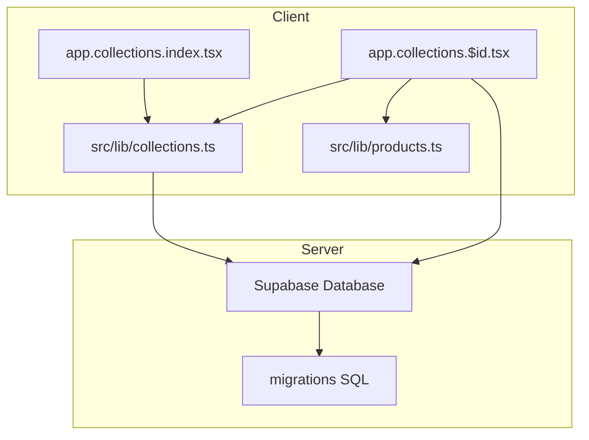
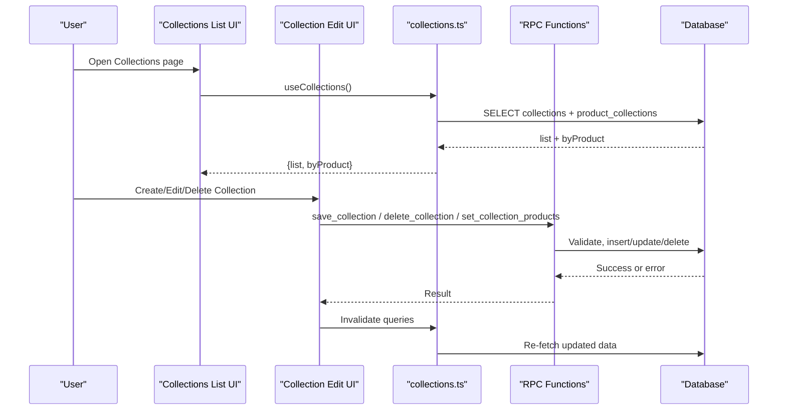
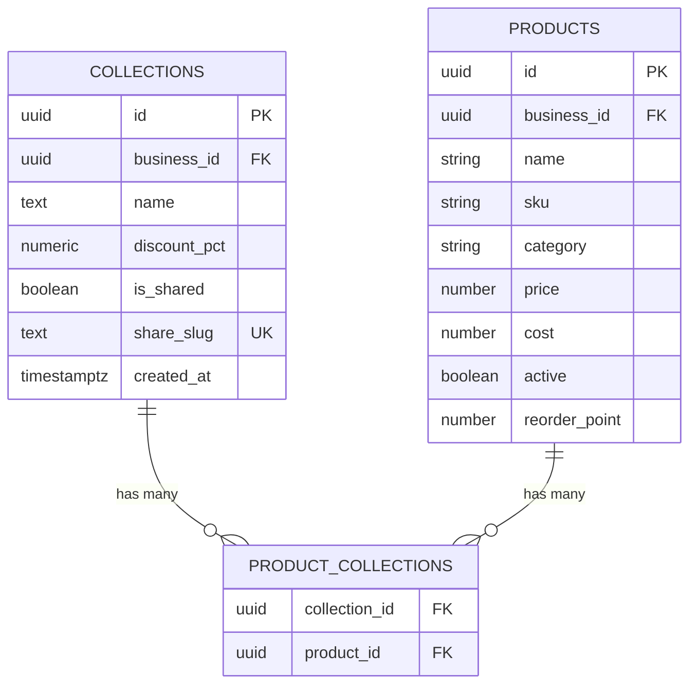
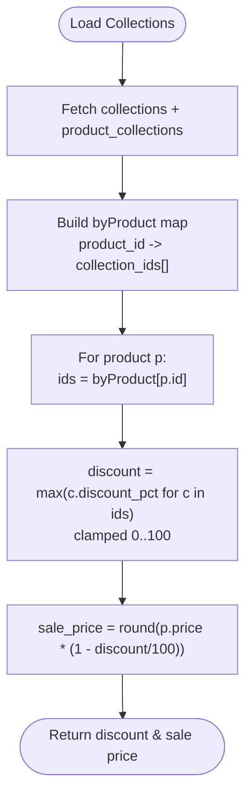
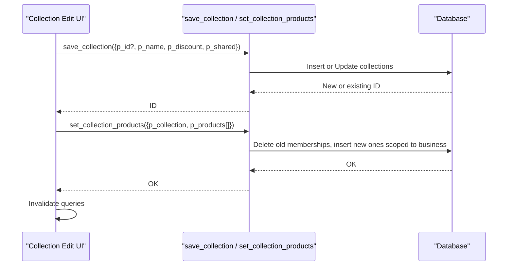
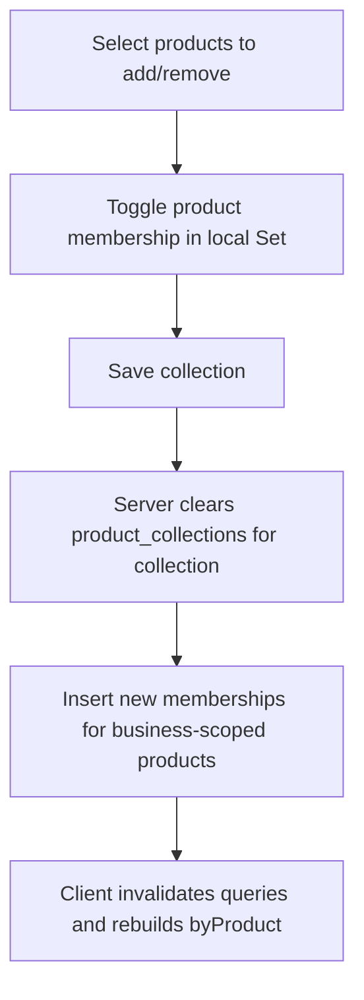
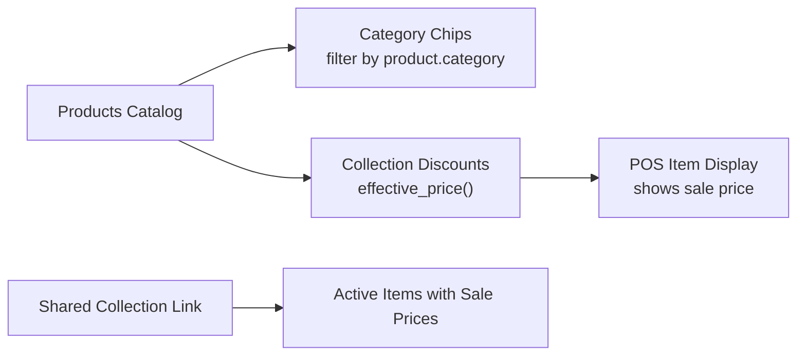
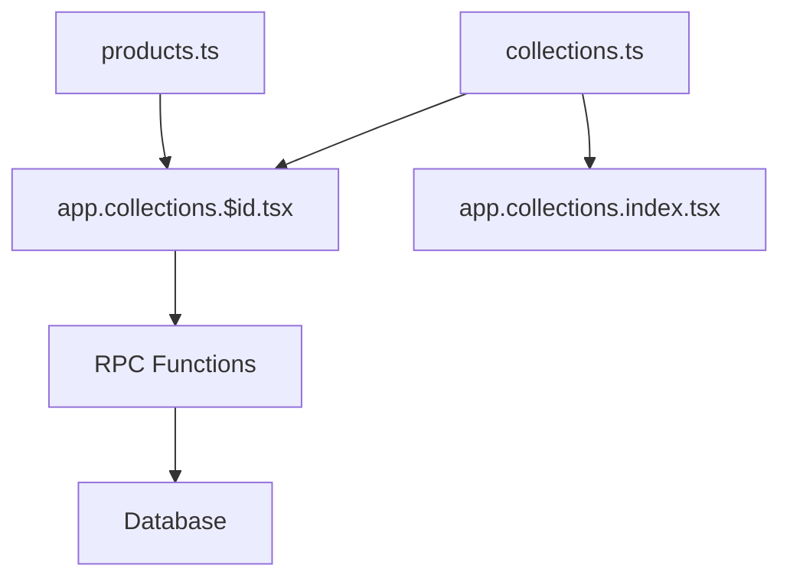

# Collections & Categories

<cite>
**Referenced Files in This Document**
- [collections.ts](file://src/lib/collections.ts)
- [app.collections.index.tsx](file://src/routes/_authenticated/app.collections.index.tsx)
- [app.collections.$id.tsx](file://src/routes/_authenticated/app.collections.$id.tsx)
- [products.ts](file://src/lib/products.ts)
- [20261007094440_7f9e1944-d2b6-4ff8-922f-9a15d298e414.sql](file://supabase/migrations/20261007094440_7f9e1944-d2b6-4ff8-922f-9a15d298e414.sql)
- [types.ts](file://src/integrations/supabase/types.ts)
</cite>

## Table of Contents
1. [Introduction](#introduction)
2. [Project Structure](#project-structure)
3. [Core Components](#core-components)
4. [Architecture Overview](#architecture-overview)
5. [Detailed Component Analysis](#detailed-component-analysis)
6. [Dependency Analysis](#dependency-analysis)
7. [Performance Considerations](#performance-considerations)
8. [Troubleshooting Guide](#troubleshooting-guide)
9. [Conclusion](#conclusion)

## Introduction
This document explains the collections and categories system that organizes products into logical groupings for navigation, reporting, and pricing. It covers:
- How collections differ from product categories.
- The data model for collections and their relationship to products.
- Creating, editing, and deleting collections.
- Assigning products to collections.
- Using collections for filtering and discount calculation.
- Business rules, constraints, and how collections affect product discovery in the POS interface.

Collections are primarily used to group products and optionally apply a collection-wide discount. Product categories remain a simple text field on each product and are used mainly for basic catalog organization and POS category chips.

## Project Structure
The collections feature spans client-side logic, UI routes, and server-side database functions:
- Client library: `src/lib/collections.ts` defines the collection type, fetches collections and membership, and computes discounts.
- Routes:
  - `src/routes/_authenticated/app.collections.index.tsx` lists collections and provides sharing actions.
  - `src/routes/_authenticated/app.collections.$id.tsx` creates, edits, deletes collections, and manages product membership.
- Database schema and functions: `supabase/migrations/...sql` define tables, relationships, RLS policies, and RPC functions for saving, deleting, and assigning collections.
- Product model: `src/lib/products.ts` defines the product type including the legacy `category` field.
- Generated types: `src/integrations/supabase/types.ts` reflect the database schema and relationships.

**Diagram sources**
- [collections.ts:1-56](file://src/lib/collections.ts#L1-L56)
- [app.collections.index.tsx:1-106](file://src/routes/_authenticated/app.collections.index.tsx#L1-L106)
- [app.collections.$id.tsx:1-256](file://src/routes/_authenticated/app.collections.$id.tsx#L1-L256)
- [products.ts:1-107](file://src/lib/products.ts#L1-L107)
- [20261007094440_7f9e1944-d2b6-4ff8-922f-9a15d298e414.sql:1-138](file://supabase/migrations/20261007094440_7f9e1944-d2b6-4ff8-922f-9a15d298e414.sql#L1-L138)

**Section sources**
- [collections.ts:1-56](file://src/lib/collections.ts#L1-L56)
- [app.collections.index.tsx:1-106](file://src/routes/_authenticated/app.collections.index.tsx#L1-L106)
- [app.collections.$id.tsx:1-256](file://src/routes/_authenticated/app.collections.$id.tsx#L1-L256)
- [products.ts:1-107](file://src/lib/products.ts#L1-L107)
- [20261007094440_7f9e1944-d2b6-4ff8-922f-9a15d298e414.sql:1-138](file://supabase/migrations/20261007094440_7f9e1944-d2b6-4ff8-922f-9a15d298e414.sql#L1-L138)

## Core Components
- Collection data model:
  - Identifier, name, discount percentage, shared flag, share slug, and timestamps.
  - Membership is stored in a many-to-many table linking products to collections.
- Client hooks and helpers:
  - Fetches collections and builds a by-product index mapping product IDs to collection IDs.
  - Computes the effective discount per product as the maximum discount among its collections.
  - Provides sale price computation and share URL generation.
- UI screens:
  - Lists collections with item counts and discount badges.
  - Allows creating/editing/deleting collections and managing product membership.
  - Supports sharing collections via a public link when enabled.
- Server functions:
  - Save, delete, and set collection products.
  - Effective price function applying the best collection discount.
  - Shared collection retrieval for public links.

Key responsibilities:
- Data fetching and caching: `useCollections` uses React Query with a long stale time to keep pricing stable between edits.
- Validation and authorization: Server functions enforce admin/manager roles and business scoping.
- Pricing rule: The highest discount among all collections assigned to a product wins.

**Section sources**
- [collections.ts:6-56](file://src/lib/collections.ts#L6-L56)
- [app.collections.index.tsx:30-106](file://src/routes/_authenticated/app.collections.index.tsx#L30-L106)
- [app.collections.$id.tsx:35-256](file://src/routes/_authenticated/app.collections.$id.tsx#L35-L256)
- [20261007094440_7f9e1944-d2b6-4ff8-922f-9a15d298e414.sql:32-96](file://supabase/migrations/20261007094440_7f9e1944-d2b6-4ff8-922f-9a15d298e414.sql#L32-L96)

## Architecture Overview
Collections are managed through a client-server architecture:
- The client loads collections and product-collection memberships.
- The client composes a by-product index to quickly determine which collections apply to each product.
- Discounts are computed client-side using the same rule as the server: the maximum discount among applicable collections.
- Mutations go through server RPC functions that validate roles, scope to the current business, and update the database.

**Diagram sources**
- [app.collections.index.tsx:30-106](file://src/routes/_authenticated/app.collections.index.tsx#L30-L106)
- [app.collections.$id.tsx:92-121](file://src/routes/_authenticated/app.collections.$id.tsx#L92-L121)
- [collections.ts:15-56](file://src/lib/collections.ts#L15-L56)
- [20261007094440_7f9e1944-d2b6-4ff8-922f-9a15d298e414.sql:40-96](file://supabase/migrations/20261007094440_7f9e1944-d2b6-4ff8-922f-9a15d298e414.sql#L40-L96)

## Detailed Component Analysis

### Data Model and Relationships
Collections and products are related through a many-to-many relationship:
- `collections`: stores collection metadata including discount and sharing settings.
- `product_collections`: maps products to collections with a composite primary key.
- Row-level security ensures users can only access collections belonging to their business.

**Diagram sources**
- [20261007094440_7f9e1944-d2b6-4ff8-922f-9a15d298e414.sql:1-30](file://supabase/migrations/20261007094440_7f9e1944-d2b6-4ff8-922f-9a15d298e414.sql#L1-L30)
- [types.ts:351-400](file://src/integrations/supabase/types.ts#L351-L400)

**Section sources**
- [20261007094440_7f9e1944-d2b6-4ff8-922f-9a15d298e414.sql:1-30](file://supabase/migrations/20261007094440_7f9e1944-d2b6-4ff8-922f-9a15d298e414.sql#L1-L30)
- [types.ts:351-400](file://src/integrations/supabase/types.ts#L351-L400)

### Client-Side Collection Logic
The client library:
- Loads collections and product-collection mappings concurrently.
- Builds a by-product index for fast lookup of applicable collection IDs.
- Computes the discount for a product as the maximum discount among its collections, clamped to 0–100%.
- Calculates sale price based on the discount.
- Generates share URLs for shared collections.

**Diagram sources**
- [collections.ts:15-56](file://src/lib/collections.ts#L15-L56)

**Section sources**
- [collections.ts:15-56](file://src/lib/collections.ts#L15-L56)

### Creating, Editing, and Deleting Collections
The edit/create screen:
- Validates user role (admin/manager).
- Populates form fields from existing collection data.
- Manages selected products via a Set for efficient toggling.
- Saves collection details and product membership via RPC calls.
- Invalidates queries to refresh cached data.
- Supports deletion with confirmation.

**Diagram sources**
- [app.collections.$id.tsx:92-121](file://src/routes/_authenticated/app.collections.$id.tsx#L92-L121)
- [20261007094440_7f9e1944-d2b6-4ff8-922f-9a15d298e414.sql:40-74](file://supabase/migrations/20261007094440_7f9e1944-d2b6-4ff8-922f-9a15d298e414.sql#L40-L74)

**Section sources**
- [app.collections.$id.tsx:35-121](file://src/routes/_authenticated/app.collections.$id.tsx#L35-L121)
- [20261007094440_7f9e1944-d2b6-4ff8-922f-9a15d298e414.sql:40-74](file://supabase/migrations/20261007094440_7f9e1944-d2b6-4ff8-922f-9a15d298e414.sql#L40-L74)

### Assigning Products to Collections
Assignment workflow:
- Users select products to include in a collection via the “Add Items” panel.
- Selected products are tracked in a Set for O(1) toggles.
- On save, the server clears existing memberships for the collection and inserts only those products that belong to the current business.
- The client recomputes the by-product index after invalidation.

**Diagram sources**
- [app.collections.$id.tsx:67-121](file://src/routes/_authenticated/app.collections.$id.tsx#L67-L121)
- [20261007094440_7f9e1944-d2b6-4ff8-922f-9a15d298e414.sql:65-74](file://supabase/migrations/20261007094440_7f9e1944-d2b6-4ff8-922f-9a15d298e414.sql#L65-L74)

**Section sources**
- [app.collections.$id.tsx:67-121](file://src/routes/_authenticated/app.collections.$id.tsx#L67-L121)
- [20261007094440_7f9e1944-d2b6-4ff8-922f-9a15d298e414.sql:65-74](file://supabase/migrations/20261007094440_7f9e1944-d2b6-4ff8-922f-9a15d298e414.sql#L65-L74)

### Filtering and Discovery in the POS Interface
- Category-based filtering: The POS displays category chips derived from product categories. Clicking a chip filters the catalog to that category.
- Collection-based filtering: Collections do not provide dedicated filter chips in the POS; instead, they influence pricing. A product’s sale price reflects the best collection discount.
- Shared collections: When enabled, a collection can be shared via a public link that returns active items with calculated sale prices.

**Diagram sources**
- [app.index.tsx:407-443](file://src/routes/_authenticated/app.index.tsx#L407-L443)
- [20261007094440_7f9e1944-d2b6-4ff8-922f-9a15d298e414.sql:32-38](file://supabase/migrations/20261007094440_7f9e1944-d2b6-4ff8-922f-9a15d298e414.sql#L32-L38)
- [20261007094440_7f9e1944-d2b6-4ff8-922f-9a15d298e414.sql:87-96](file://supabase/migrations/20261007094440_7f9e1944-d2b6-4ff8-922f-9a15d298e414.sql#L87-L96)

**Section sources**
- [app.index.tsx:407-443](file://src/routes/_authenticated/app.index.tsx#L407-L443)
- [20261007094440_7f9e1944-d2b6-4ff8-922f-9a15d298e414.sql:32-38](file://supabase/migrations/20261007094440_7f9e1944-d2b6-4ff8-922f-9a15d298e414.sql#L32-L38)
- [20261007094440_7f9e1944-d2b6-4ff8-922f-9a15d298e414.sql:87-96](file://supabase/migrations/20261007094440_7f9e1944-d2b6-4ff8-922f-9a15d298e414.sql#L87-L96)

### Business Rules and Constraints
- Role requirements: Saving, deleting, and setting collection products require admin or manager roles.
- Name validation: Collection names cannot be empty.
- Discount range: Discounts must be between 0% and 100%.
- Business scoping: All operations are scoped to the authenticated staff’s business.
- Membership scoping: Only products belonging to the current business can be added to a collection.
- Best discount rule: If a product belongs to multiple collections, the highest discount applies.
- Shared collections: Public links return only active items and calculate sale prices using the effective price function.

**Section sources**
- [20261007094440_7f9e1944-d2b6-4ff8-922f-9a15d298e414.sql:40-96](file://supabase/migrations/20261007094440_7f9e1944-d2b6-4ff8-922f-9a15d298e414.sql#L40-L96)
- [collections.ts:42-56](file://src/lib/collections.ts#L42-L56)

### Categories vs Collections
- Product category:
  - Stored as a nullable text field on products.
  - Used for simple categorization and POS category chips.
  - Not hierarchical; no explicit hierarchy structure exists.
- Collections:
  - Separate entities with optional discounts and sharing.
  - Many-to-many relationship with products.
  - Influence pricing via the best discount rule.
  - Support public sharing via slugs.

Migration behavior:
- Existing product categories were migrated into collections and mapped to product_collections during setup.

**Section sources**
- [products.ts:8-17](file://src/lib/products.ts#L8-L17)
- [20261007094440_7f9e1944-d2b6-4ff8-922f-9a15d298e414.sql:26-30](file://supabase/migrations/20261007094440_7f9e1944-d2b6-4ff8-922f-9a15d298e414.sql#L26-L30)

## Dependency Analysis
Collections depend on:
- Product catalog for membership selection and display.
- Database functions for safe mutations and pricing calculations.
- React Query for caching and invalidation.

**Diagram sources**
- [products.ts:1-107](file://src/lib/products.ts#L1-L107)
- [collections.ts:1-56](file://src/lib/collections.ts#L1-L56)
- [app.collections.$id.tsx:1-256](file://src/routes/_authenticated/app.collections.$id.tsx#L1-L256)
- [20261007094440_7f9e1944-d2b6-4ff8-922f-9a15d298e414.sql:40-96](file://supabase/migrations/20261007094440_7f9e1944-d2b6-4ff8-922f-9a15d298e414.sql#L40-L96)

**Section sources**
- [products.ts:1-107](file://src/lib/products.ts#L1-L107)
- [collections.ts:1-56](file://src/lib/collections.ts#L1-L56)
- [app.collections.$id.tsx:1-256](file://src/routes/_authenticated/app.collections.$id.tsx#L1-L256)
- [20261007094440_7f9e1944-d2b6-4ff8-922f-9a15d298e414.sql:40-96](file://supabase/migrations/20261007094440_7f9e1944-d2b6-4ff8-922f-9a15d298e414.sql#L40-L96)

## Performance Considerations
- Long-lived catalog: The product catalog is cached for 30 minutes to avoid frequent network calls during POS usage.
- Collections cache: Collections have a longer stale time to keep pricing stable between edits.
- Deferred search: The collection edit screen defers search input to maintain responsiveness while filtering large catalogs.
- Indexes: Database indexes exist on product_collections.product_id and collections.business_id to optimize lookups.

[No sources needed since this section provides general guidance]

## Troubleshooting Guide
Common issues and resolutions:
- Cannot save or delete a collection:
  - Ensure the user has admin or manager permissions.
  - Verify the collection belongs to the current business.
- Discount errors:
  - Confirm the discount is between 0 and 100.
  - Check that the collection name is not empty.
- Products not appearing in a collection:
  - Ensure the product belongs to the current business.
  - After saving, invalidate queries to refresh the by-product index.
- Shared link shows no items:
  - Confirm the collection is marked as shared.
  - Ensure the product is active.

**Section sources**
- [app.collections.$id.tsx:92-121](file://src/routes/_authenticated/app.collections.$id.tsx#L92-L121)
- [20261007094440_7f9e1944-d2b6-4ff8-922f-9a15d298e414.sql:40-96](file://supabase/migrations/20261007094440_7f9e1944-d2b6-4ff8-922f-9a15d298e414.sql#L40-L96)

## Conclusion
Collections provide a flexible way to group products and apply discounts, complementing the simpler product category system. They support creation, editing, deletion, and assignment of products, with strong business scoping and role-based controls. While categories drive basic POS filtering via chips, collections primarily impact pricing and can be shared publicly. The system balances performance through caching and deferred interactions while enforcing consistent business rules on the server.

[No sources needed since this section summarizes without analyzing specific files]