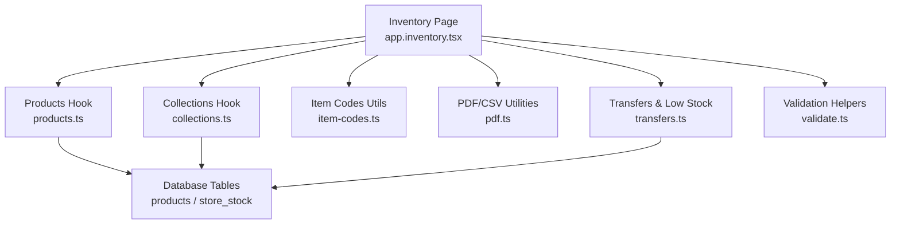
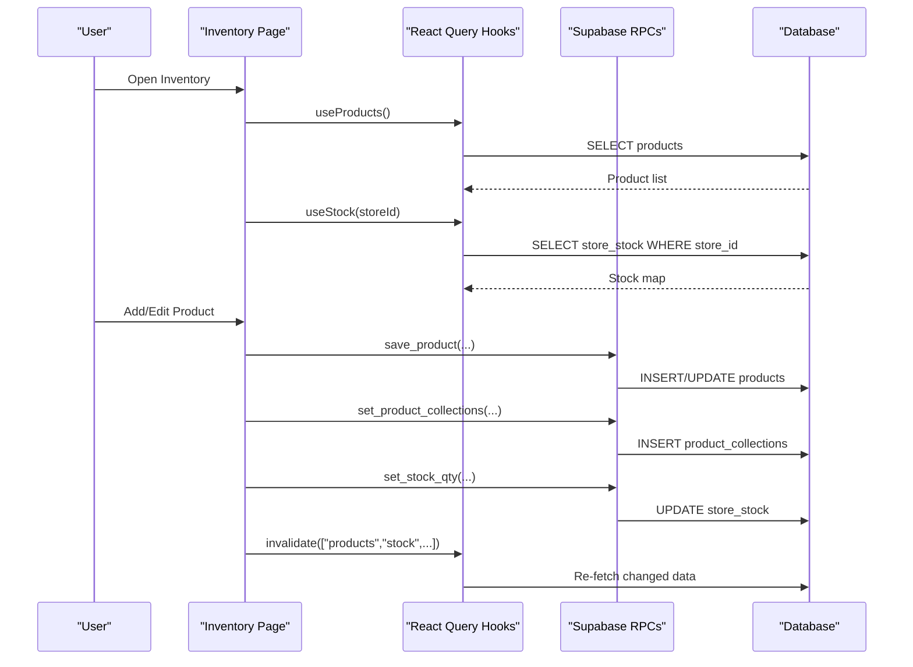
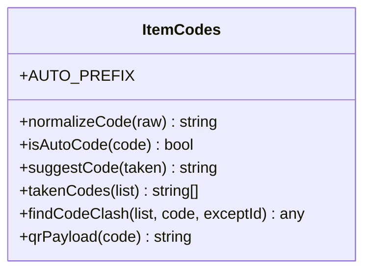
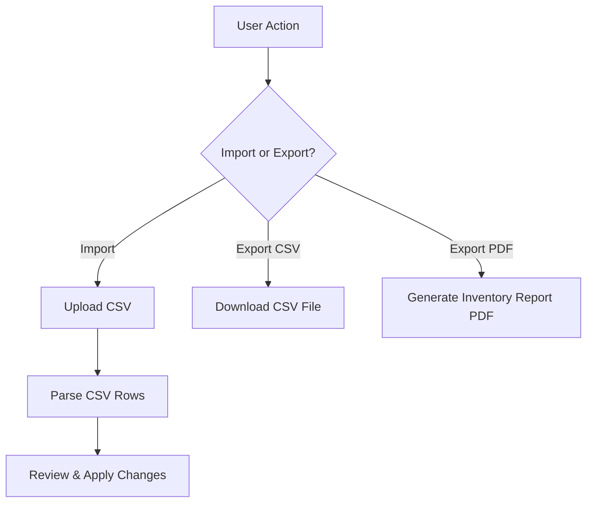
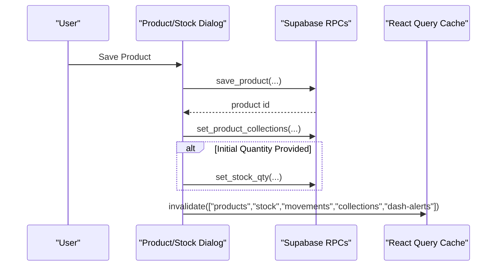
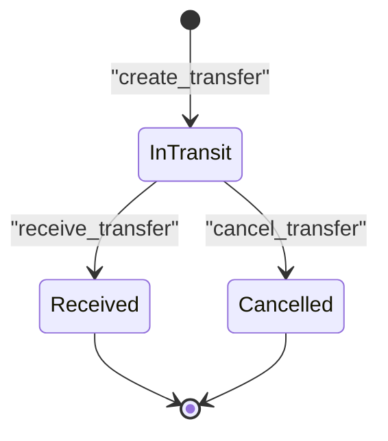
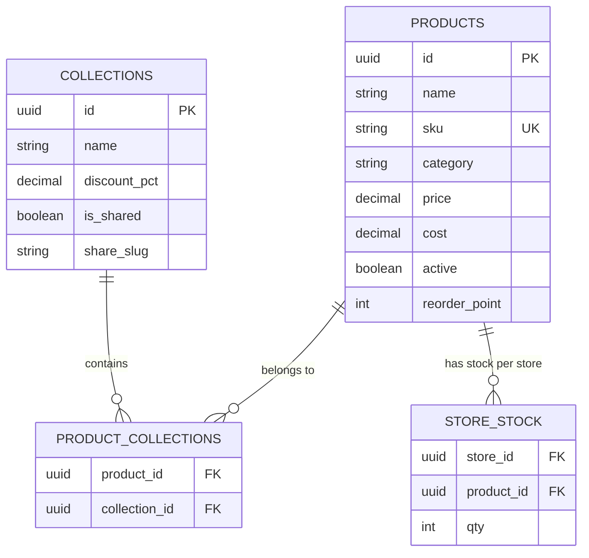
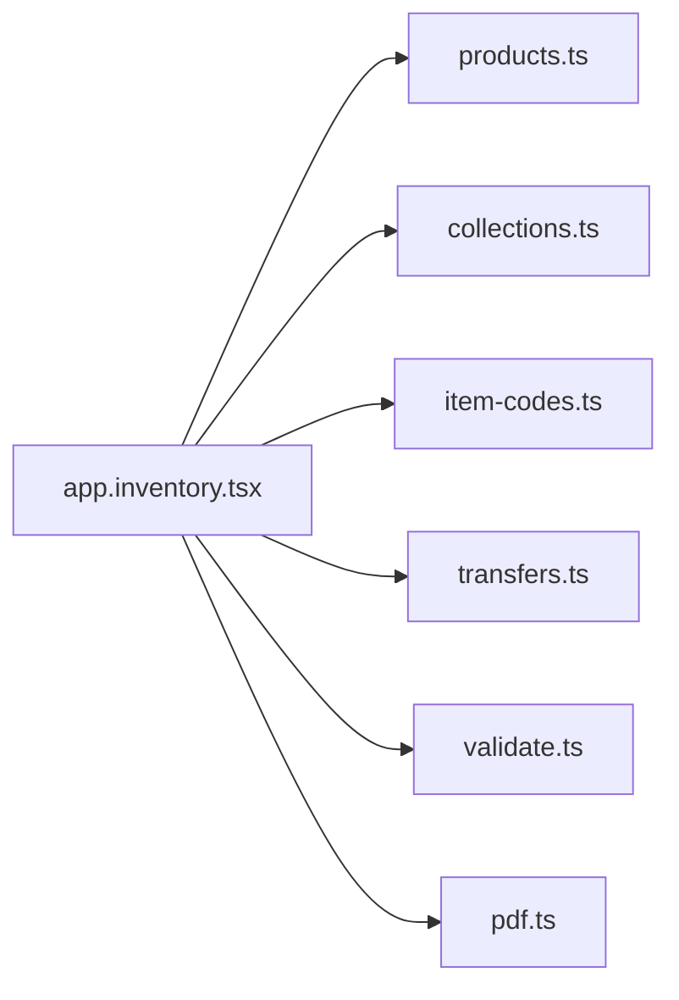

# Inventory Management

<cite>
**Referenced Files in This Document**
- [app.inventory.tsx](file://src/routes/_authenticated/app.inventory.tsx)
- [products.ts](file://src/lib/products.ts)
- [collections.ts](file://src/lib/collections.ts)
- [item-codes.ts](file://src/lib/item-codes.ts)
- [transfers.ts](file://src/lib/transfers.ts)
- [pdf.ts](file://src/lib/pdf.ts)
- [validate.ts](file://src/lib/validate.ts)
</cite>

## Table of Contents
1. [Introduction](#introduction)
2. [Project Structure](#project-structure)
3. [Core Components](#core-components)
4. [Architecture Overview](#architecture-overview)
5. [Detailed Component Analysis](#detailed-component-analysis)
6. [Dependency Analysis](#dependency-analysis)
7. [Performance Considerations](#performance-considerations)
8. [Troubleshooting Guide](#troubleshooting-guide)
9. [Conclusion](#conclusion)

## Introduction
This document explains the inventory management system for a multi-store point-of-sale application. It covers how products are organized into categories and collections, how stock is tracked per store with near real-time updates, how barcode integration works for both manual entry and scanner input, how item codes are generated and managed, and how bulk import/export supports product data management. It also includes examples for adding products, updating stock levels, generating inventory reports, allocating inventory across stores, and transferring stock between locations.

## Project Structure
The inventory feature spans an authenticated route that renders the inventory UI and several library modules that provide data access, code handling, collection membership, and transfer operations:

- `src/routes/_authenticated/app.inventory.tsx` — Inventory page UI, filtering, pagination, dialogs, CSV import/export, label printing, and stock adjustments.
- `src/lib/products.ts` — Product catalog query hook, barcode lookup helper, and per-store stock query hook.
- `src/lib/collections.ts` — Collection definitions, product-to-collection mapping, discount calculation helpers.
- `src/lib/item-codes.ts` — Code normalization, auto-code generation, clash detection, and QR payload formatting.
- `src/lib/transfers.ts` — Transfer listing, low-stock queries, and mutations for dispatching/receiving/canceling transfers.
- `src/lib/pdf.ts` — CSV/PDF utilities used by export and label sheet generation.
- `src/lib/validate.ts` — Validation helpers used by forms (SKU validation, amount limits).

**Diagram sources**
- [app.inventory.tsx:1-100](file://src/routes/_authenticated/app.inventory.tsx#L1-L100)
- [products.ts:1-107](file://src/lib/products.ts#L1-L107)
- [collections.ts:1-56](file://src/lib/collections.ts#L1-L56)
- [item-codes.ts:1-84](file://src/lib/item-codes.ts#L1-L84)
- [transfers.ts:1-140](file://src/lib/transfers.ts#L1-L140)
- [pdf.ts:1-200](file://src/lib/pdf.ts#L1-L200)
- [validate.ts:1-200](file://src/lib/validate.ts#L1-L200)

**Section sources**
- [app.inventory.tsx:1-100](file://src/routes/_authenticated/app.inventory.tsx#L1-L100)
- [products.ts:1-107](file://src/lib/products.ts#L1-L107)
- [collections.ts:1-56](file://src/lib/collections.ts#L1-L56)
- [item-codes.ts:1-84](file://src/lib/item-codes.ts#L1-L84)
- [transfers.ts:1-140](file://src/lib/transfers.ts#L1-L140)

## Core Components
- Product Catalog
  - Products are fetched via a long-lived cached query. Buying costs are loaded only when needed by admin/manager roles.
  - SKU is the single identifier used for search, scanning, and QR payloads.
- Collections
  - Products can belong to multiple collections; the best discount among them applies at sale time.
  - The UI shows collection membership and allows grouping inventory value by collection.
- Stock Tracking
  - Per-store stock is read from a store-scoped table and exposed as a map of product ID to quantity.
  - Live mode refreshes periodically on the till to reflect changes made elsewhere.
- Item Codes
  - Auto-generated codes use a safe alphabet and prefix. Normalization ensures consistent matching.
  - Clash detection prevents duplicate SKUs across the catalog.
- Transfers and Low Stock
  - Low-stock items are surfaced per store using a server-side query.
  - Transfers move stock between stores with status tracking and audit fields.

**Section sources**
- [products.ts:1-107](file://src/lib/products.ts#L1-L107)
- [collections.ts:1-56](file://src/lib/collections.ts#L1-L56)
- [item-codes.ts:1-84](file://src/lib/item-codes.ts#L1-L84)
- [transfers.ts:1-140](file://src/lib/transfers.ts#L1-L140)

## Architecture Overview
The inventory system combines a React-based UI with TanStack Query-backed hooks and Supabase database tables. Data flows from the UI through hooks to the database, with explicit cache invalidation after writes.

**Diagram sources**
- [app.inventory.tsx:698-769](file://src/routes/_authenticated/app.inventory.tsx#L698-L769)
- [products.ts:22-53](file://src/lib/products.ts#L22-L53)
- [products.ts:82-106](file://src/lib/products.ts#L82-L106)

## Detailed Component Analysis

### Product Catalog Organization with Categories and Collections
- Products include optional category and SKU fields. The UI displays name, SKU, cost, price, active state, reorder point, and current stock.
- Collections group products and can apply discounts. The inventory view computes inventory value split by collection, distributing value evenly when an item belongs to multiple collections.
- The collections hook loads both collection metadata and product-to-collection mappings, enabling fast lookups in the UI.

Key behaviors:
- Filtering by collection and searching by name/SKU/collection names.
- Displaying collection badges next to each product row.
- Computing total retail and cost values for inventory reporting.

**Section sources**
- [app.inventory.tsx:110-213](file://src/routes/_authenticated/app.inventory.tsx#L110-L213)
- [collections.ts:15-39](file://src/lib/collections.ts#L15-L39)
- [collections.ts:42-53](file://src/lib/collections.ts#L42-L53)

### Barcode Integration: Manual Entry and Scanner Input
- SKU is the canonical item code. It is normalized (trimmed, space-collapsed, case-insensitive) everywhere it is compared.
- The inventory page integrates a hardware scanner wedge: when idle, scanned codes jump to the matching product or pre-fill a new item dialog if unknown.
- The till uses an exact match against the cached product catalog for fast resolution.

**Diagram sources**
- [app.inventory.tsx:140-157](file://src/routes/_authenticated/app.inventory.tsx#L140-L157)
- [products.ts:54-64](file://src/lib/products.ts#L54-L64)
- [item-codes.ts:21-24](file://src/lib/item-codes.ts#L21-L24)

**Section sources**
- [app.inventory.tsx:140-157](file://src/routes/_authenticated/app.inventory.tsx#L140-L157)
- [products.ts:54-64](file://src/lib/products.ts#L54-L64)
- [item-codes.ts:21-24](file://src/lib/item-codes.ts#L21-L24)

### Item Code Generation and Management
- Auto-generated codes use a safe base-32 alphabet with a fixed prefix to avoid ambiguity.
- The UI suggests non-clashing codes and validates SKUs before saving.
- QR payloads contain the normalized code so scanners and cameras resolve consistently.

**Diagram sources**
- [item-codes.ts:15-83](file://src/lib/item-codes.ts#L15-L83)

**Section sources**
- [item-codes.ts:15-83](file://src/lib/item-codes.ts#L15-L83)
- [app.inventory.tsx:698-769](file://src/routes/_authenticated/app.inventory.tsx#L698-L769)

### Bulk Import/Export Capabilities
- CSV Import
  - Users can upload a CSV file; the UI parses it and presents rows for review before applying changes.
- CSV Export
  - Exports include name, SKU, cost, price, quantity, collections, and active state.
- PDF Inventory Report
  - Generates a landscape report with KPIs (items, units, cost value, retail value) and a detailed table including collections and stock value.

**Diagram sources**
- [app.inventory.tsx:273-368](file://src/routes/_authenticated/app.inventory.tsx#L273-L368)
- [pdf.ts:1-200](file://src/lib/pdf.ts#L1-L200)

**Section sources**
- [app.inventory.tsx:273-368](file://src/routes/_authenticated/app.inventory.tsx#L273-L368)
- [pdf.ts:1-200](file://src/lib/pdf.ts#L1-L200)

### Adding Products and Updating Stock Levels
- Adding a Product
  - The product dialog collects name, SKU, selling price, buying cost, initial quantity, reorder point, and active flag.
  - On save, it calls an RPC to create/update the product, assigns collections, and optionally sets absolute stock for the current store.
- Updating Stock
  - The stock adjustment dialog sends an absolute quantity update with a reason and note.
  - After successful mutation, the UI invalidates relevant caches to refresh stock, movements, and alerts.

**Diagram sources**
- [app.inventory.tsx:698-769](file://src/routes/_authenticated/app.inventory.tsx#L698-L769)

**Section sources**
- [app.inventory.tsx:698-769](file://src/routes/_authenticated/app.inventory.tsx#L698-L769)
- [validate.ts:1-200](file://src/lib/validate.ts#L1-L200)

### Multi-Store Inventory Allocation and Transfer Processes
- Low Stock Alerts
  - The inventory page highlights items at or below their reorder point per store.
- Transfers
  - Transfers are listed per store and support statuses: in transit, received, cancelled.
  - Mutations dispatch, receive, or cancel transfers and invalidate related caches (transfers, stock, low-stock, dash-alerts, movements).

**Diagram sources**
- [transfers.ts:51-89](file://src/lib/transfers.ts#L51-L89)
- [transfers.ts:117-139](file://src/lib/transfers.ts#L117-L139)

**Section sources**
- [transfers.ts:51-89](file://src/lib/transfers.ts#L51-L89)
- [transfers.ts:92-115](file://src/lib/transfers.ts#L92-L115)
- [transfers.ts:117-139](file://src/lib/transfers.ts#L117-L139)

### Relationship Between Products, Collections, and Stock Levels Across Stores
- Products are independent of stores; they define identity, pricing, and catalog metadata.
- Collections group products and influence pricing/discounts but do not change stock counts.
- Stock is per store: the same product can have different quantities at different locations.
- The inventory UI aggregates stock per store and shows collection membership alongside stock and valuation.

**Diagram sources**
- [products.ts:8-17](file://src/lib/products.ts#L8-L17)
- [collections.ts:6-13](file://src/lib/collections.ts#L6-L13)
- [collections.ts:22-38](file://src/lib/collections.ts#L22-L38)
- [products.ts:94-104](file://src/lib/products.ts#L94-L104)

**Section sources**
- [products.ts:8-17](file://src/lib/products.ts#L8-L17)
- [collections.ts:6-13](file://src/lib/collections.ts#L6-L13)
- [collections.ts:22-38](file://src/lib/collections.ts#L22-L38)
- [products.ts:94-104](file://src/lib/products.ts#L94-L104)

## Dependency Analysis
The inventory page depends on several libraries:

**Diagram sources**
- [app.inventory.tsx:1-75](file://src/routes/_authenticated/app.inventory.tsx#L1-L75)
- [products.ts:1-107](file://src/lib/products.ts#L1-L107)
- [collections.ts:1-56](file://src/lib/collections.ts#L1-L56)
- [item-codes.ts:1-84](file://src/lib/item-codes.ts#L1-L84)
- [transfers.ts:1-140](file://src/lib/transfers.ts#L1-L140)
- [pdf.ts:1-200](file://src/lib/pdf.ts#L1-L200)
- [validate.ts:1-200](file://src/lib/validate.ts#L1-L200)

**Section sources**
- [app.inventory.tsx:1-75](file://src/routes/_authenticated/app.inventory.tsx#L1-L75)

## Performance Considerations
- Cached Catalog
  - The product catalog is cached for 30 minutes to keep scanning and search responsive without constant network calls.
- Selective Cost Loading
  - Buying costs are only fetched when screens explicitly request them and the user has permission, reducing payload size.
- Stock Polling
  - Stock queries can poll every 30 seconds in live mode (e.g., on the till) to reflect changes made elsewhere.
- Efficient Filtering and Sorting
  - Filtering, sorting, and totals are memoized and computed over cached data to avoid re-scanning on unrelated updates.
- Pagination
  - Large catalogs paginate rows to keep the UI responsive.

[No sources needed since this section provides general guidance]

## Troubleshooting Guide
- Duplicate SKU Errors
  - If a saved SKU clashes with an existing product, the UI detects the conflict client-side and shows an error message. Ensure the SKU is unique across the catalog.
- Invalid Amounts
  - Selling price, buying cost, quantity, and reorder point are validated with minimum/maximum bounds. Correct inputs to pass validation.
- Missing Barcode Match
  - If scanning does not resolve a product, verify that the SKU is present and normalized correctly. Check that the product is active.
- Stock Not Updating
  - After edits, ensure cache invalidation occurs for products, stock, movements, collections, and dash-alerts. Verify that the correct store context is active.
- CSV Import Issues
  - Validate CSV headers and data types. Use the provided template to ensure compatibility. Review parsed rows before applying changes.

**Section sources**
- [app.inventory.tsx:698-769](file://src/routes/_authenticated/app.inventory.tsx#L698-L769)
- [validate.ts:1-200](file://src/lib/validate.ts#L1-L200)

## Conclusion
The inventory management system provides a robust foundation for managing products, organizing them into collections, tracking stock per store, integrating barcodes, generating and validating item codes, and performing bulk import/export. It supports multi-store allocation and transfers with clear status tracking and low-stock alerts. By leveraging cached queries, precise validation, and explicit cache invalidation, the system remains performant and reliable across devices and roles.

[No sources needed since this section summarizes without analyzing specific files]