# Inventory Management

<cite>
**Referenced Files in This Document**
- [app.inventory.tsx](file://src/routes/_authenticated/app.inventory.tsx)
- [products.ts](file://src/lib/products.ts)
- [collections.ts](file://src/lib/collections.ts)
- [item-codes.ts](file://src/lib/item-codes.ts)
- [transfers.ts](file://src/lib/transfers.ts)
- [pdf.ts](file://src/lib/pdf.ts)
- [validate.ts](file://src/lib/validate.ts)
- [paging.ts](file://src/lib/paging.ts)
- [20261017174810_cost_below_price_validation.sql](file://supabase/migrations/20261017174810_cost_below_price_validation.sql)
- [20261011221132_move_stock_floor_guard.sql](file://supabase/migrations/20261011221132_move_stock_floor_guard.sql)
- [20261011221117_drop_store_stock_bounds_enforce_in_sql.sql](file://supabase/migrations/20261011221117_drop_store_stock_bounds_enforce_in_sql.sql)
</cite>

## Update Summary
**Changes Made**
- Added comprehensive below-cost sales detection with client-side and server-side validation
- Enhanced database constraints ensuring product costs cannot exceed prices
- Improved stock floor enforcement with better error handling and user-friendly messages
- Updated validation logic to prevent negative profit scenarios across all entry points
- Enhanced error messaging for concurrent stock operations and race conditions

## Table of Contents
1. [Introduction](#introduction)
2. [Project Structure](#project-structure)
3. [Core Components](#core-components)
4. [Architecture Overview](#architecture-overview)
5. [Detailed Component Analysis](#detailed-component-analysis)
6. [Enhanced Validation System](#enhanced-validation-system)
7. [Below-Cost Sales Detection](#below-cost-sales-detection)
8. [Stock Floor Enforcement](#stock-floor-enforcement)
9. [Advanced Filtering System](#advanced-filtering-system)
10. [Pagination Controls](#pagination-controls)
11. [Export Functionality](#export-functionality)
12. [Search Integration](#search-integration)
13. [Responsive Design Improvements](#responsive-design-improvements)
14. [Dependency Analysis](#dependency-analysis)
15. [Performance Considerations](#performance-considerations)
16. [Troubleshooting Guide](#troubleshooting-guide)
17. [Conclusion](#conclusion)

## Introduction
This document explains the inventory management system for a multi-store point-of-sale application. It covers how products are organized into categories and collections, how stock is tracked per store with near real-time updates, how barcode integration works for both manual entry and scanner input, how item codes are generated and managed, and how bulk import/export supports product data management. The system now features enhanced validation with below-cost sales detection, improved database constraints ensuring product costs cannot exceed prices, and better error handling for stock floor enforcement. The interface includes advanced filtering, pagination controls, comprehensive export capabilities, integrated search functionality, and responsive design improvements across collections, inventory, transfers, and stock take screens.

## Project Structure
The inventory feature spans an authenticated route that renders the inventory UI and several library modules that provide data access, code handling, collection membership, transfer operations, and pagination utilities:

- `src/routes/_authenticated/app.inventory.tsx` — Inventory page UI with advanced filtering, pagination, dialogs, CSV import/export, label printing, stock adjustments, and enhanced validation.
- `src/lib/products.ts` — Product catalog query hook, barcode lookup helper, and per-store stock query hook.
- `src/lib/collections.ts` — Collection definitions, product-to-collection mapping, discount calculation helpers.
- `src/lib/item-codes.ts` — Code normalization, auto-code generation, clash detection, and QR payload formatting.
- `src/lib/transfers.ts` — Transfer listing, low-stock queries, and mutations for dispatching/receiving/canceling transfers.
- `src/lib/pdf.ts` — CSV/PDF utilities used by export and label sheet generation.
- `src/lib/validate.ts` — Validation helpers used by forms (SKU validation, amount limits).
- `src/lib/paging.ts` — Pagination utility for consistent list paging across screens.

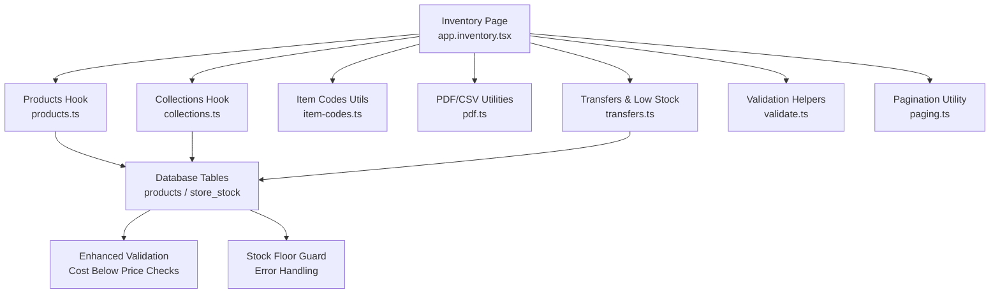

**Diagram sources**
- [app.inventory.tsx:1-100](file://src/routes/_authenticated/app.inventory.tsx#L1-L100)
- [products.ts:1-107](file://src/lib/products.ts#L1-L107)
- [collections.ts:1-56](file://src/lib/collections.ts#L1-L56)
- [item-codes.ts:1-84](file://src/lib/item-codes.ts#L1-L84)
- [transfers.ts:1-140](file://src/lib/transfers.ts#L1-L140)
- [pdf.ts:1-412](file://src/lib/pdf.ts#L1-L412)
- [validate.ts:1-147](file://src/lib/validate.ts#L1-L147)
- [paging.ts:1-17](file://src/lib/paging.ts#L1-L17)

**Section sources**
- [app.inventory.tsx:1-100](file://src/routes/_authenticated/app.inventory.tsx#L1-L100)
- [products.ts:1-107](file://src/lib/products.ts#L1-L107)
- [collections.ts:1-56](file://src/lib/collections.ts#L1-L56)
- [item-codes.ts:1-84](file://src/lib/item-codes.ts#L1-L84)
- [transfers.ts:1-140](file://src/lib/transfers.ts#L1-L140)
- [paging.ts:1-17](file://src/lib/paging.ts#L1-L17)

## Core Components
- Product Catalog
  - Products are fetched via a long-lived cached query. Buying costs are loaded only when needed by admin/manager roles.
  - SKU is the single identifier used for search, scanning, and QR payloads.
  - **Updated**: Enhanced validation prevents products from being created with costs that meet or exceed selling prices.
- Collections
  - Products can belong to multiple collections; the best discount among them applies at sale time.
  - The UI shows collection membership and allows grouping inventory value by collection.
- Stock Tracking
  - Per-store stock is read from a store-scoped table and exposed as a map of product ID to quantity.
  - Live mode refreshes periodically on the till to reflect changes made elsewhere.
  - **Updated**: Improved stock floor enforcement with better error handling for concurrent operations.
- Item Codes
  - Auto-generated codes use a safe alphabet and prefix. Normalization ensures consistent matching.
  - Clash detection prevents duplicate SKUs across the catalog.
- Transfers and Low Stock
  - Low-stock items are surfaced per store using a server-side query.
  - Transfers move stock between stores with status tracking and audit fields.

**Section sources**
- [products.ts:1-107](file://src/lib/products.ts#L1-L107)
- [collections.ts:1-56](file://src/lib/collections.ts#L1-L56)
- [item-codes.ts:1-84](file://src/lib/item-codes.ts#L1-L84)
- [transfers.ts:1-140](file://src/lib/transfers.ts#L1-L140)

## Architecture Overview
The inventory system combines a React-based UI with TanStack Query-backed hooks and Supabase database tables. Data flows from the UI through hooks to the database, with explicit cache invalidation after writes. Enhanced validation layers ensure data integrity at both client and server levels.

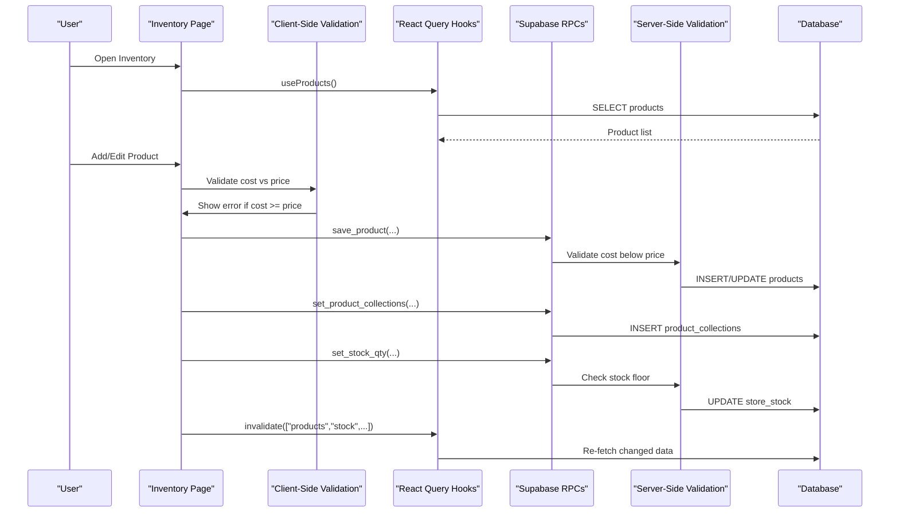

**Diagram sources**
- [app.inventory.tsx:698-769](file://src/routes/_authenticated/app.inventory.tsx#L698-L769)
- [products.ts:22-53](file://src/lib/products.ts#L22-L53)
- [products.ts:82-106](file://src/lib/products.ts#L82-L106)
- [20261017174810_cost_below_price_validation.sql:18-22](file://supabase/migrations/20261017174810_cost_below_price_validation.sql#L18-L22)

## Detailed Component Analysis

### Product Catalog Organization with Categories and Collections
- Products include optional category and SKU fields. The UI displays name, SKU, cost, price, active state, reorder point, and current stock.
- Collections group products and can apply discounts. The inventory view computes inventory value split by collection, distributing value evenly when an item belongs to multiple collections.
- The collections hook loads both collection metadata and product-to-collection mappings, enabling fast lookups in the UI.

Key behaviors:
- Filtering by collection and searching by name/SKU/collection names.
- Displaying collection badges next to each product row.
- Computing total retail and cost values for inventory reporting.
- **Updated**: Enhanced validation prevents products with costs meeting or exceeding selling prices.

**Section sources**
- [app.inventory.tsx:110-213](file://src/routes/_authenticated/app.inventory.tsx#L110-L213)
- [collections.ts:15-39](file://src/lib/collections.ts#L15-L39)
- [collections.ts:42-53](file://src/lib/collections.ts#L42-L53)

### Barcode Integration: Manual Entry and Scanner Input
- SKU is the canonical item code. It is normalized (trimmed, space-collapsed, case-insensitive) everywhere it is compared.
- The inventory page integrates a hardware scanner wedge: when idle, scanned codes jump to the matching product or pre-fill a new item dialog if unknown.
- The till uses an exact match against the cached product catalog for fast resolution.

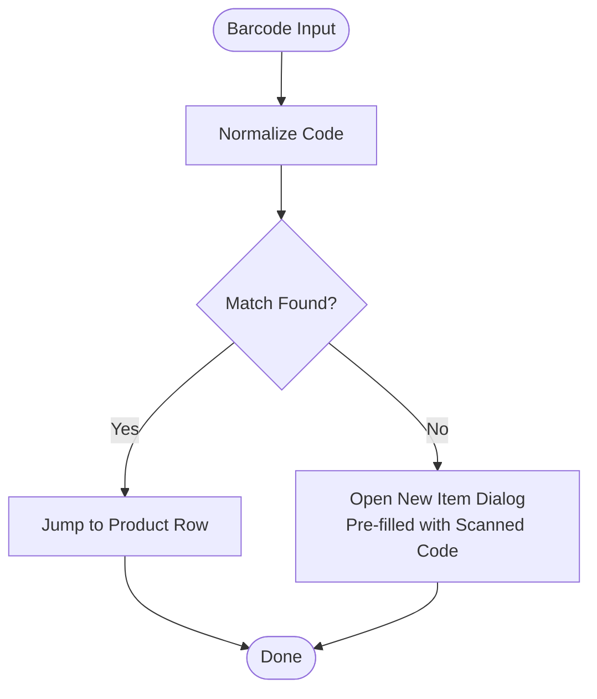

**Diagram sources**
- [app.inventory.tsx:140-157](file://src/routes/_authenticated/app.inventory.tsx#L140-L157)
- [products.ts:54-64](file://src/lib/products.ts#L54-L64)
- [item-codes.ts:21-24](file://src/lib/item-codes.ts#L21-L24)

**Section sources**
- [app.inventory.tsx:140-157](file://src/routes/_authenticated/app.inventory.tsx#L140-L157)
- [products.ts:54-64](file://src/lib/products.ts#L54-L64)
- [item-codes.ts:21-24](file://src/lib/item-codes.ts#L21-L24)

### Item Code Generation and Management
- Auto-generated codes use a safe base-32 alphabet with a fixed prefix to avoid ambiguity.
- The UI suggests non-clashing codes and validates SKUs before saving.
- QR payloads contain the normalized code so scanners and cameras resolve consistently.

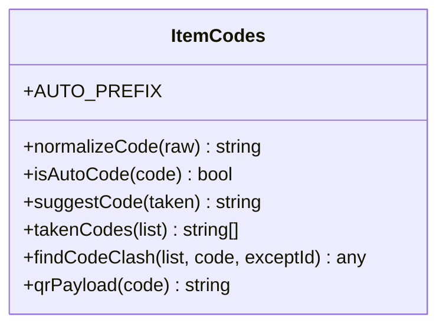

**Diagram sources**
- [item-codes.ts:15-83](file://src/lib/item-codes.ts#L15-L83)

**Section sources**
- [item-codes.ts:15-83](file://src/lib/item-codes.ts#L15-L83)
- [app.inventory.tsx:698-769](file://src/routes/_authenticated/app.inventory.tsx#L698-L769)

### Bulk Import/Export Capabilities
- CSV Import
  - Users can upload a CSV file; the UI parses it and presents rows for review before applying changes.
- CSV Export
  - Exports include name, SKU, cost, price, quantity, collections, and active state.
- PDF Inventory Report
  - Generates a landscape report with KPIs (items, units, cost value, retail value) and a detailed table including collections and stock value.

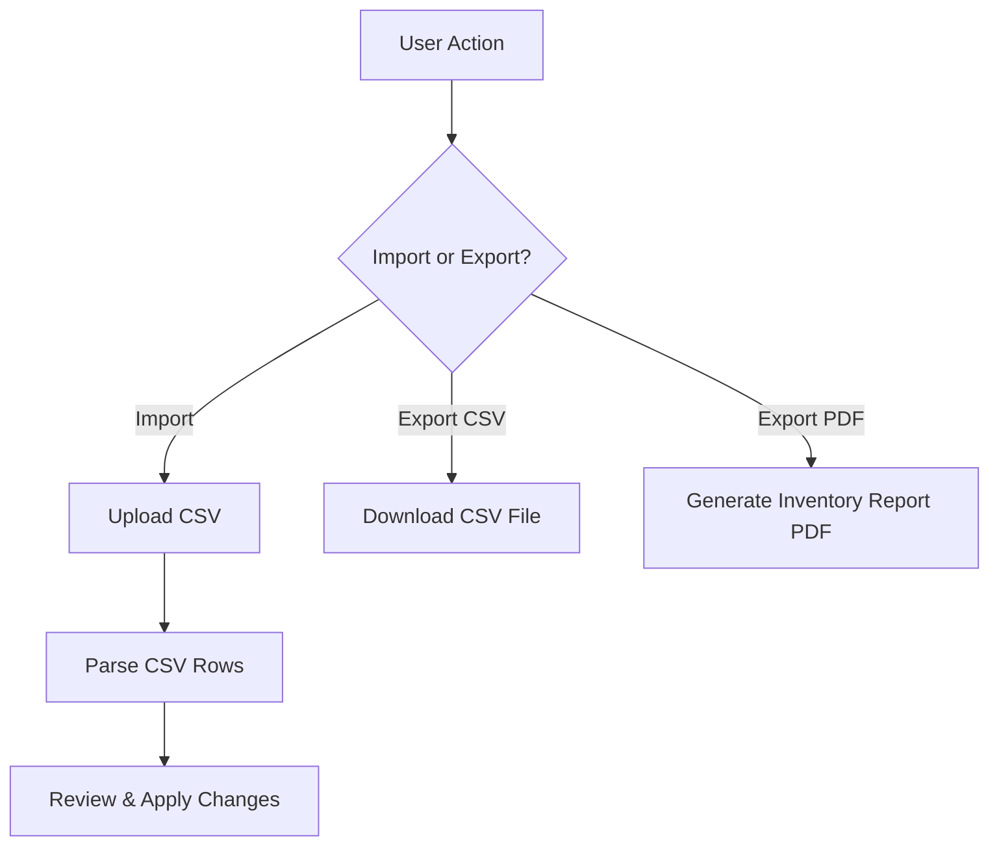

**Diagram sources**
- [app.inventory.tsx:273-368](file://src/routes/_authenticated/app.inventory.tsx#L273-L368)
- [pdf.ts:1-412](file://src/lib/pdf.ts#L1-L412)

**Section sources**
- [app.inventory.tsx:273-368](file://src/routes/_authenticated/app.inventory.tsx#L273-L368)
- [pdf.ts:1-412](file://src/lib/pdf.ts#L1-L412)

### Adding Products and Updating Stock Levels
- Adding a Product
  - The product dialog collects name, SKU, selling price, buying cost, initial quantity, reorder point, and active flag.
  - **Updated**: Enhanced validation checks that buying cost is below selling price both client-side and server-side.
  - On save, it calls an RPC to create/update the product, assigns collections, and optionally sets absolute stock for the current store.
- Updating Stock
  - The stock adjustment dialog sends an absolute quantity update with a reason and note.
  - **Updated**: Improved stock floor enforcement prevents negative quantities with user-friendly error messages.
  - After successful mutation, the UI invalidates relevant caches to refresh stock, movements, and alerts.

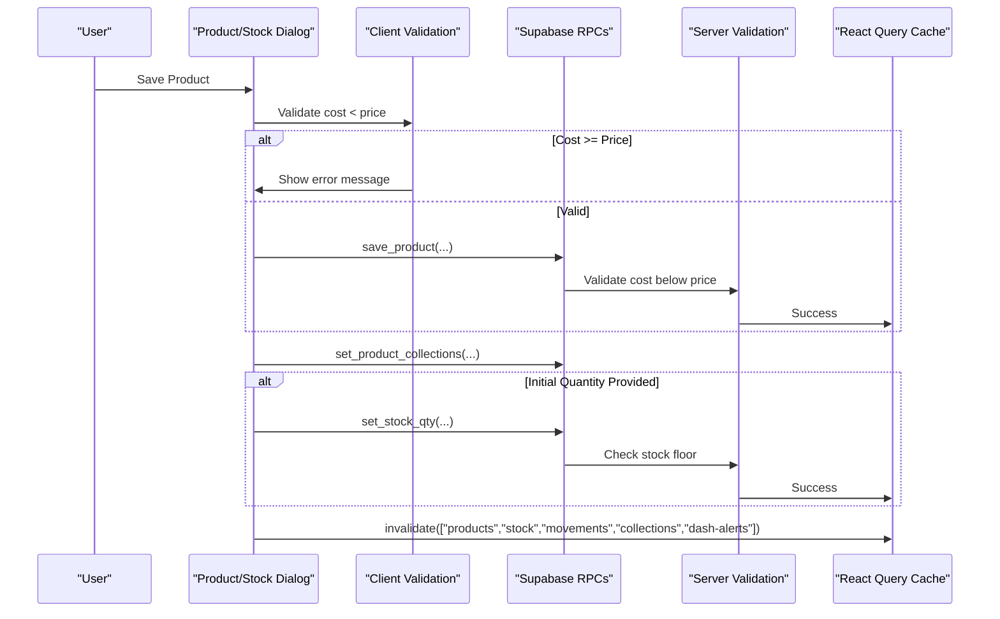

**Diagram sources**
- [app.inventory.tsx:720-796](file://src/routes/_authenticated/app.inventory.tsx#L720-L796)
- [20261017174810_cost_below_price_validation.sql:18-22](file://supabase/migrations/20261017174810_cost_below_price_validation.sql#L18-L22)

**Section sources**
- [app.inventory.tsx:720-796](file://src/routes/_authenticated/app.inventory.tsx#L720-L796)
- [validate.ts:1-147](file://src/lib/validate.ts#L1-L147)

### Multi-Store Inventory Allocation and Transfer Processes
- Low Stock Alerts
  - The inventory page highlights items at or below their reorder point per store.
- Transfers
  - Transfers are listed per store and support statuses: in transit, received, cancelled.
  - Mutations dispatch, receive, or cancel transfers and invalidate related caches (transfers, stock, low-stock, dash-alerts, movements).

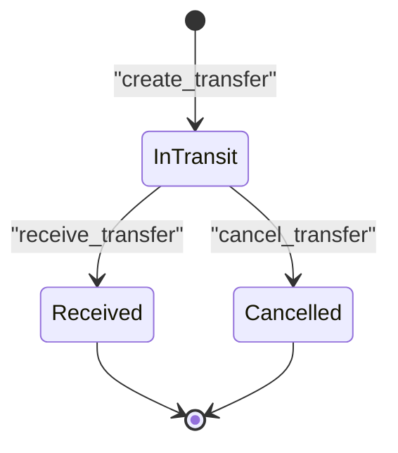

**Diagram sources**
- [transfers.ts:51-89](file://src/lib/transfers.ts#L51-L89)
- [transfers.ts:117-139](file://src/lib/transfers.ts#L117-L139)

**Section sources**
- [transfers.ts:51-89](file://src/lib/transfers.ts#L51-L89)
- [transfers.ts:92-115](file://src/lib/transfers.ts#L92-L115)
- [transfers.ts:117-139](file://src/lib/transfers.ts#L117-L139)

### Relationship Between Products, Collections, and Stock Levels Across Stores
- Products are independent of stores; they define identity, pricing, and catalog metadata.
- Collections group products and influence pricing/discounts but do not change stock counts.
- Stock is per store: the same product can have different quantities at different locations.
- The inventory UI aggregates stock per store and shows collection membership alongside stock and valuation.

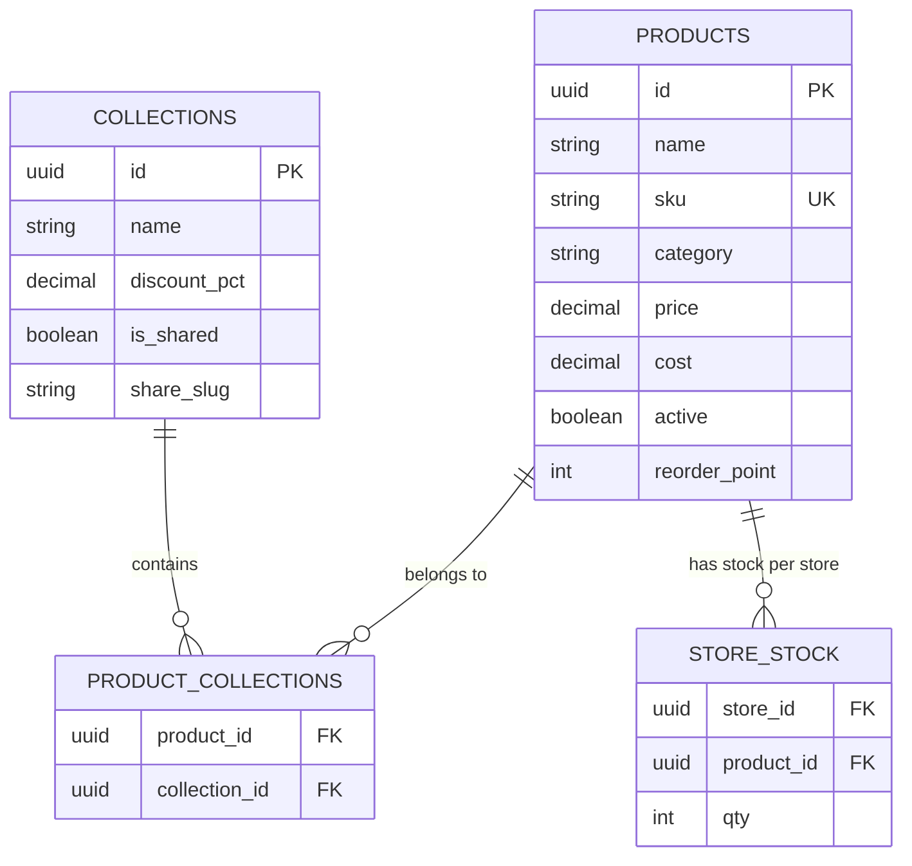

**Diagram sources**
- [products.ts:8-17](file://src/lib/products.ts#L8-L17)
- [collections.ts:6-13](file://src/lib/collections.ts#L6-L13)
- [collections.ts:22-38](file://src/lib/collections.ts#L22-L38)
- [products.ts:94-104](file://src/lib/products.ts#L94-L104)

**Section sources**
- [products.ts:8-17](file://src/lib/products.ts#L8-L17)
- [collections.ts:6-13](file://src/lib/collections.ts#L6-L13)
- [collections.ts:22-38](file://src/lib/collections.ts#L22-L38)
- [products.ts:94-104](file://src/lib/products.ts#L94-L104)

## Enhanced Validation System

The inventory system now implements comprehensive validation across multiple layers to ensure data integrity and prevent business logic violations:

### Validation Layers
- **Client-Side Validation**: Immediate feedback for users with readable error messages
- **Server-Side Validation**: Database-level constraints and RPC validation
- **Business Logic Validation**: Prevention of negative profit scenarios and stock violations

### Key Validation Rules
- Product costs must be below selling prices (when cost is set)
- Stock quantities cannot go negative during concurrent operations
- All monetary values must be within acceptable bounds
- SKU formats must conform to expected patterns

```mermaid
flowchart TD
Input["User Input"] --> ClientValidate["Client-Side Validation"]
ClientValidate --> BusinessRules["Business Rule Checks"]
BusinessRules --> ServerValidate["Server-Side Validation"]
ServerValidate --> DatabaseConstraints["Database Constraints"]
DatabaseConstraints --> Success["Data Saved"]
ClientValidate --> Error["Show User-Friendly Error"]
BusinessRules --> Error
ServerValidate --> Error
```

**Diagram sources**
- [app.inventory.tsx:720-749](file://src/routes/_authenticated/app.inventory.tsx#L720-L749)
- [20261017174810_cost_below_price_validation.sql:18-22](file://supabase/migrations/20261017174810_cost_below_price_validation.sql#L18-L22)

**Section sources**
- [app.inventory.tsx:720-749](file://src/routes/_authenticated/app.inventory.tsx#L720-L749)
- [validate.ts:98-116](file://src/lib/validate.ts#L98-L116)

## Below-Cost Sales Detection

The system now includes robust below-cost sales detection to prevent products from being sold at a loss:

### Implementation Details
- **Client-Side Detection**: Real-time validation in the product form prevents saving products where cost meets or exceeds price
- **Server-Side Enforcement**: Database function validation ensures no product can be created or updated with problematic cost-price relationships
- **Error Messaging**: User-friendly messages explain why the operation failed and guide users to correct the issue

### Validation Logic
- When a product's buying cost is greater than zero and meets or exceeds its selling price, the system rejects the operation
- The validation occurs both in the UI before submission and in the database function as a final safeguard
- Error messages clearly indicate that "Buying cost must be below the selling price"

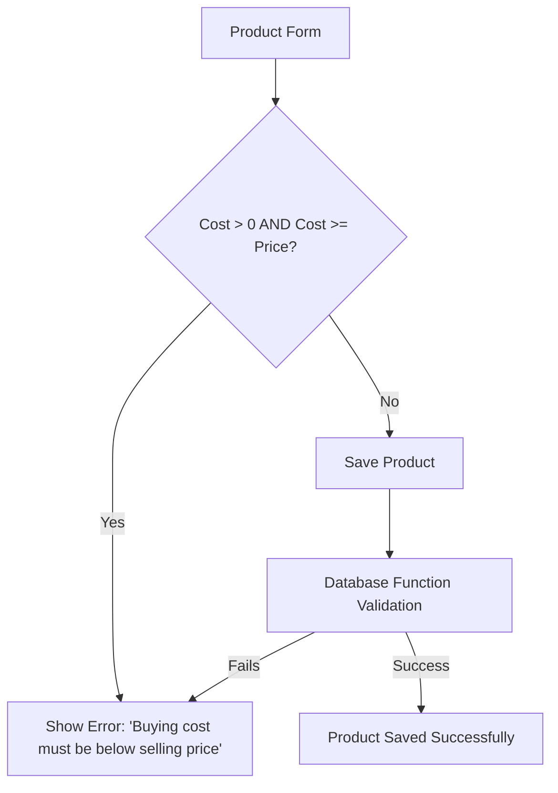

**Diagram sources**
- [app.inventory.tsx:733-737](file://src/routes/_authenticated/app.inventory.tsx#L733-L737)
- [20261017174810_cost_below_price_validation.sql:18-22](file://supabase/migrations/20261017174810_cost_below_price_validation.sql#L18-L22)

**Section sources**
- [app.inventory.tsx:733-737](file://src/routes/_authenticated/app.inventory.tsx#L733-L737)
- [20261017174810_cost_below_price_validation.sql:18-22](file://supabase/migrations/20261017174810_cost_below_price_validation.sql#L18-L22)

## Stock Floor Enforcement

The stock floor enforcement system has been significantly improved to handle concurrent operations and provide better error handling:

### Enhanced Stock Protection
- **Advisory Locking**: Uses PostgreSQL advisory locks to serialize concurrent stock operations on the same product/store combination
- **Row-Level Locking**: Employs FOR UPDATE clauses to ensure atomic reads and writes
- **Floor Enforcement**: Guarantees stock quantities never go negative, even under concurrent access
- **User-Friendly Errors**: Provides clear error messages instead of cryptic constraint violations

### Race Condition Handling
- **Concurrent Sale Protection**: Prevents multiple simultaneous sales from depleting the same stock below zero
- **Graceful Degradation**: Uses GREATEST(qty + delta, 0) to ensure minimum zero balance
- **Clear Error Messages**: Tells users exactly which item has insufficient stock rather than showing generic errors

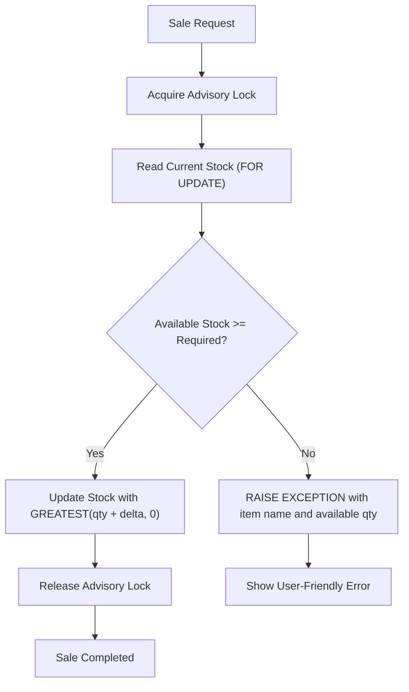

**Diagram sources**
- [20261011221132_move_stock_floor_guard.sql:21-37](file://supabase/migrations/20261011221132_move_stock_floor_guard.sql#L21-L37)

**Section sources**
- [20261011221132_move_stock_floor_guard.sql:1-42](file://supabase/migrations/20261011221132_move_stock_floor_guard.sql#L1-L42)
- [20261011221117_drop_store_stock_bounds_enforce_in_sql.sql:1-12](file://supabase/migrations/20261011221117_drop_store_stock_bounds_enforce_in_sql.sql#L1-L12)

### Advanced Filtering System

The inventory interface provides a comprehensive filtering system that allows users to narrow down product lists efficiently:

### Filter Types
- **Low Stock Filter**: Toggle to show only products at or below their reorder point
- **Collection Filter**: Filter products by specific collections with a radio button interface
- **Sort Options**: Sort by name, price, or stock levels

### Implementation Details
- Filters are implemented using React state management with debounced search
- Active filter count is displayed in a badge on the filter button
- Filter combinations are supported (e.g., low stock + specific collection)
- All filters reset pagination to page 0 for consistent user experience

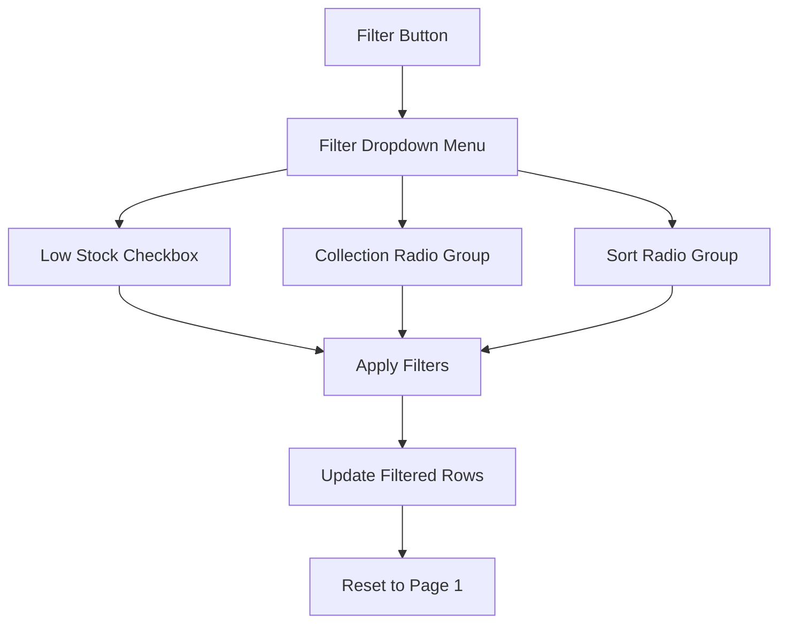

**Diagram sources**
- [app.inventory.tsx:368-435](file://src/routes/_authenticated/app.inventory.tsx#L368-L435)

**Section sources**
- [app.inventory.tsx:154-158](file://src/routes/_authenticated/app.inventory.tsx#L154-L158)
- [app.inventory.tsx:187-209](file://src/routes/_authenticated/app.inventory.tsx#L187-L209)
- [app.inventory.tsx:368-435](file://src/routes/_authenticated/app.inventory.tsx#L368-L435)

## Pagination Controls

The inventory system implements robust pagination controls to handle large product catalogs efficiently:

### Pagination Features
- **Fixed Page Size**: 10 items per page for optimal mobile and desktop viewing
- **Smart Page Clamping**: Automatically adjusts page numbers when filters reduce result count
- **Visual Indicators**: Shows total items, current page, and navigation controls
- **Responsive Layout**: Adapts to different screen sizes while maintaining usability

### Technical Implementation
- Uses the `pageSlice` utility function for consistent pagination logic
- Integrates with the `Pager` component for visual navigation
- Maintains pagination state independently from filter state
- Provides smooth transitions when filters change result counts

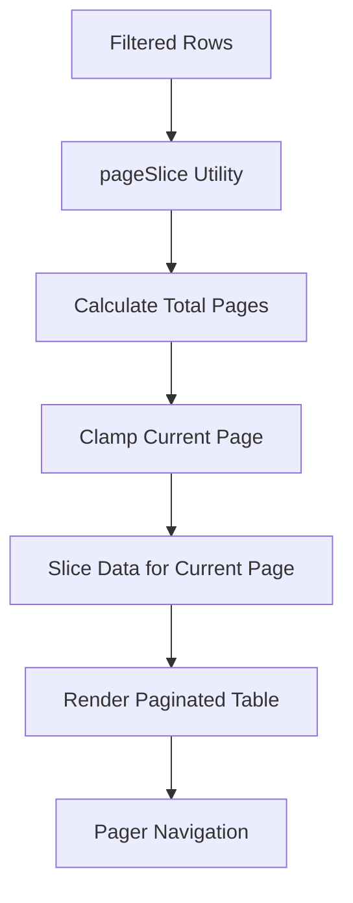

**Diagram sources**
- [app.inventory.tsx:315-316](file://src/routes/_authenticated/app.inventory.tsx#L315-L316)
- [paging.ts:1-17](file://src/lib/paging.ts#L1-L17)

**Section sources**
- [app.inventory.tsx:315-316](file://src/routes/_authenticated/app.inventory.tsx#L315-L316)
- [app.inventory.tsx:655](file://src/routes/_authenticated/app.inventory.tsx#L655)
- [paging.ts:1-17](file://src/lib/paging.ts#L1-L17)

## Export Functionality

The inventory system provides comprehensive export capabilities for both CSV and PDF formats:

### CSV Export Features
- **Complete Data Export**: Exports all product information including name, SKU, cost, price, quantity, collections, and active status
- **Template Download**: Provides a downloadable CSV template for bulk imports
- **Flexible Import**: Supports various column name variations for compatibility

### PDF Report Generation
- **Professional Layout**: Generates branded PDF reports with business headers and footers
- **KPI Dashboard**: Includes key performance indicators (items count, units, cost value, retail value)
- **Detailed Tables**: Comprehensive product listings with collection memberships and stock valuations
- **Multi-page Support**: Automatically handles large datasets across multiple pages

### Label Printing
- **QR Code Labels**: Generates printable labels with QR codes for each product
- **Batch Processing**: Supports printing multiple copies of labels for different products
- **Responsive Layout**: Optimized label layout for standard label printers

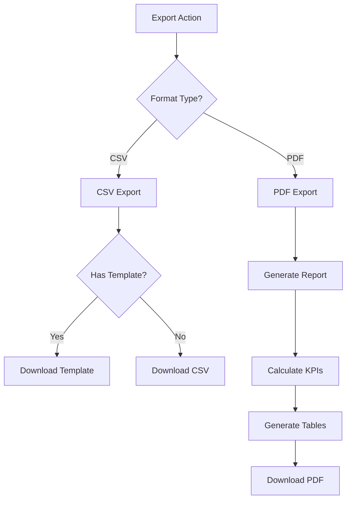

**Diagram sources**
- [app.inventory.tsx:252-314](file://src/routes/_authenticated/app.inventory.tsx#L252-L314)
- [pdf.ts:51-266](file://src/lib/pdf.ts#L51-L266)

**Section sources**
- [app.inventory.tsx:252-314](file://src/routes/_authenticated/app.inventory.tsx#L252-L314)
- [app.inventory.tsx:443-462](file://src/routes/_authenticated/app.inventory.tsx#L443-L462)
- [pdf.ts:51-266](file://src/lib/pdf.ts#L51-L266)
- [pdf.ts:332-411](file://src/lib/pdf.ts#L332-L411)

## Search Integration

The inventory system features advanced search capabilities with debounced input handling:

### Search Features
- **Debounced Input**: Prevents excessive filtering during rapid typing
- **Multi-field Search**: Searches across product names, SKUs, and collection names
- **Case-Insensitive**: Handles mixed-case searches seamlessly
- **Real-time Results**: Updates results as users type with minimal performance impact

### Implementation Details
- Uses `useDebouncedValue` hook for efficient search performance
- Integrates with existing filter system for combined search and filtering
- Maintains search state independently from other filters
- Provides visual feedback during search operations

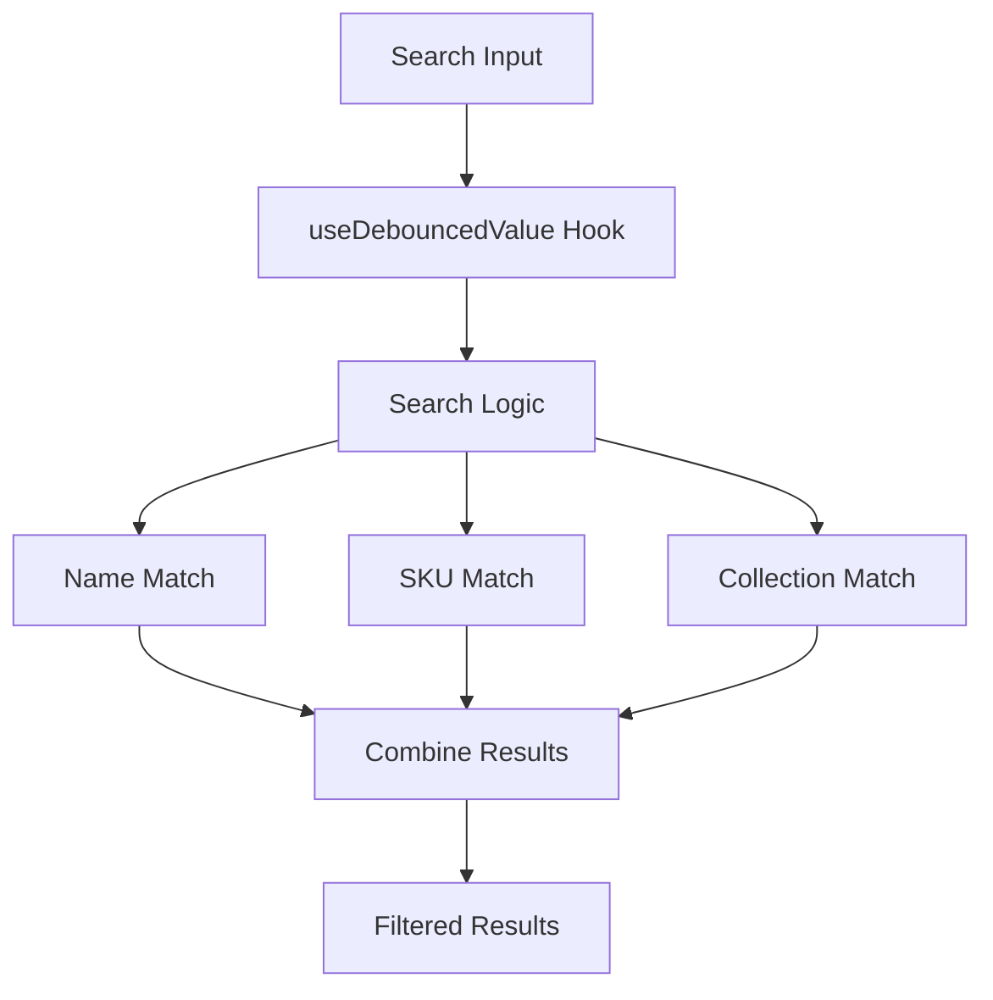

**Diagram sources**
- [app.inventory.tsx:154-187](file://src/routes/_authenticated/app.inventory.tsx#L154-L187)
- [app.inventory.tsx:187-209](file://src/routes/_authenticated/app.inventory.tsx#L187-L209)

**Section sources**
- [app.inventory.tsx:154-187](file://src/routes/_authenticated/app.inventory.tsx#L154-L187)
- [app.inventory.tsx:353-367](file://src/routes/_authenticated/app.inventory.tsx#L353-L367)
- [app.inventory.tsx:187-209](file://src/routes/_authenticated/app.inventory.tsx#L187-L209)

## Responsive Design Improvements

The inventory interface has been enhanced with responsive design principles for optimal user experience across devices:

### Responsive Features
- **Mobile-First Layout**: Optimized for touch interactions on smaller screens
- **Adaptive Grid Systems**: Uses CSS grid with responsive breakpoints
- **Touch-Friendly Controls**: Larger tap targets and improved spacing for mobile devices
- **Collapsible Interfaces**: Hidden elements on small screens to maximize content visibility

### Key Responsive Elements
- **Flexible Header**: Adapts search bar and action buttons based on screen width
- **Responsive Tables**: Horizontal scrolling for wide tables on mobile devices
- **Adaptive Cards**: Grid layout adjusts from single column on mobile to multi-column on desktop
- **Scalable Typography**: Font sizes and spacing adjust for readability across devices

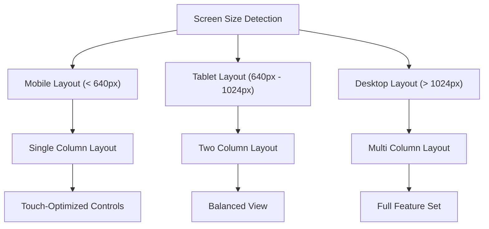

**Diagram sources**
- [app.inventory.tsx:324-476](file://src/routes/_authenticated/app.inventory.tsx#L324-L476)
- [app.inventory.tsx:492-520](file://src/routes/_authenticated/app.inventory.tsx#L492-L520)

**Section sources**
- [app.inventory.tsx:324-476](file://src/routes/_authenticated/app.inventory.tsx#L324-L476)
- [app.inventory.tsx:492-520](file://src/routes/_authenticated/app.inventory.tsx#L492-L520)

## Dependency Analysis
The inventory page depends on several libraries:

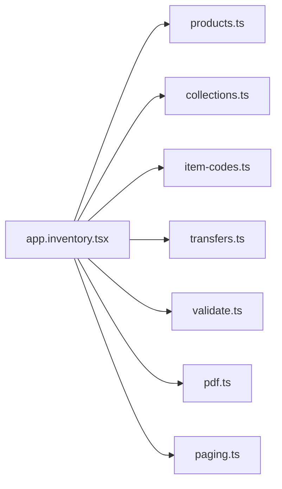

**Diagram sources**
- [app.inventory.tsx:1-89](file://src/routes/_authenticated/app.inventory.tsx#L1-L89)
- [products.ts:1-107](file://src/lib/products.ts#L1-L107)
- [collections.ts:1-56](file://src/lib/collections.ts#L1-L56)
- [item-codes.ts:1-84](file://src/lib/item-codes.ts#L1-L84)
- [transfers.ts:1-140](file://src/lib/transfers.ts#L1-L140)
- [pdf.ts:1-412](file://src/lib/pdf.ts#L1-L412)
- [validate.ts:1-147](file://src/lib/validate.ts#L1-L147)
- [paging.ts:1-17](file://src/lib/paging.ts#L1-L17)

**Section sources**
- [app.inventory.tsx:1-89](file://src/routes/_authenticated/app.inventory.tsx#L1-L89)

## Performance Considerations
- Cached Catalog
  - The product catalog is cached for 30 minutes to keep scanning and search responsive without constant network calls.
- Selective Cost Loading
  - Buying costs are only fetched when screens explicitly request them and the user has permission, reducing payload size.
- Stock Polling
  - Stock queries can poll every 30 seconds in live mode (e.g., on the till) to reflect changes made elsewhere.
- Efficient Filtering and Sorting
  - Filtering, sorting, and totals are memoized and computed over cached data to avoid re-scanning on unrelated updates.
- Pagination
  - Large catalogs paginate rows to keep the UI responsive.
- Debounced Search
  - Search input is debounced to prevent excessive filtering operations during rapid typing.
- **Updated**: Enhanced validation reduces unnecessary server calls by catching errors client-side first.

## Troubleshooting Guide
- Duplicate SKU Errors
  - If a saved SKU clashes with an existing product, the UI detects the conflict client-side and shows an error message. Ensure the SKU is unique across the catalog.
- Invalid Amounts
  - Selling price, buying cost, quantity, and reorder point are validated with minimum/maximum bounds. Correct inputs to pass validation.
- **Updated**: Below-Cost Product Errors
  - If you see "Buying cost must be below the selling price," check that the product's buying cost is less than its selling price. Products with costs meeting or exceeding prices are rejected to prevent negative profit scenarios.
- **Updated**: Stock Floor Errors
  - If you encounter stock-related errors, check that sufficient inventory exists before attempting sales. The system now provides clear error messages indicating which item has insufficient stock.
- Missing Barcode Match
  - If scanning does not resolve a product, verify that the SKU is present and normalized correctly. Check that the product is active.
- Stock Not Updating
  - After edits, ensure cache invalidation occurs for products, stock, movements, collections, and dash-alerts. Verify that the correct store context is active.
- CSV Import Issues
  - Validate CSV headers and data types. Use the provided template to ensure compatibility. Review parsed rows before applying changes.
- Filter Performance
  - If filters seem slow, check that the debounced search is working properly and that filters are being applied efficiently.
- Pagination Issues
  - If pagination appears broken, verify that the pageSlice utility is correctly clamping page numbers and that filter changes reset pagination appropriately.

**Section sources**
- [app.inventory.tsx:720-796](file://src/routes/_authenticated/app.inventory.tsx#L720-L796)
- [validate.ts:1-147](file://src/lib/validate.ts#L1-L147)
- [20261017174810_cost_below_price_validation.sql:18-22](file://supabase/migrations/20261017174810_cost_below_price_validation.sql#L18-L22)
- [20261011221132_move_stock_floor_guard.sql:30-32](file://supabase/migrations/20261011221132_move_stock_floor_guard.sql#L30-L32)

## Conclusion
The inventory management system provides a robust foundation for managing products, organizing them into collections, tracking stock per store, integrating barcodes, generating and validating item codes, and performing bulk import/export. The enhanced validation system now includes comprehensive below-cost sales detection with both client-side and server-side safeguards, improved database constraints ensuring product costs cannot exceed prices, and better error handling for stock floor enforcement. The interface includes advanced filtering capabilities, responsive pagination controls, comprehensive export functionality, integrated search with debounced input, and responsive design improvements across all screens. By leveraging cached queries, precise validation, explicit cache invalidation, modern UI patterns, and enhanced business rule enforcement, the system remains performant and reliable across devices and roles while providing an intuitive user experience for inventory management tasks.