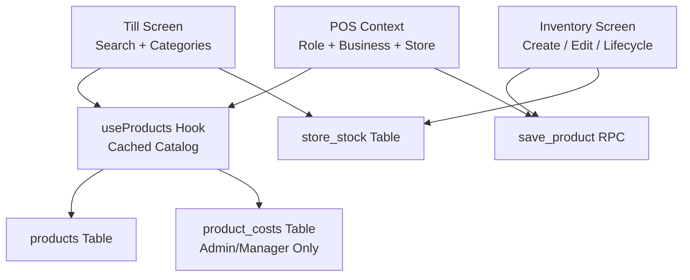
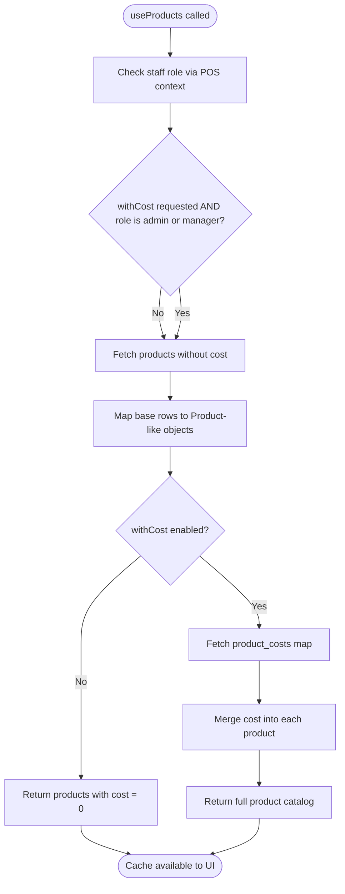
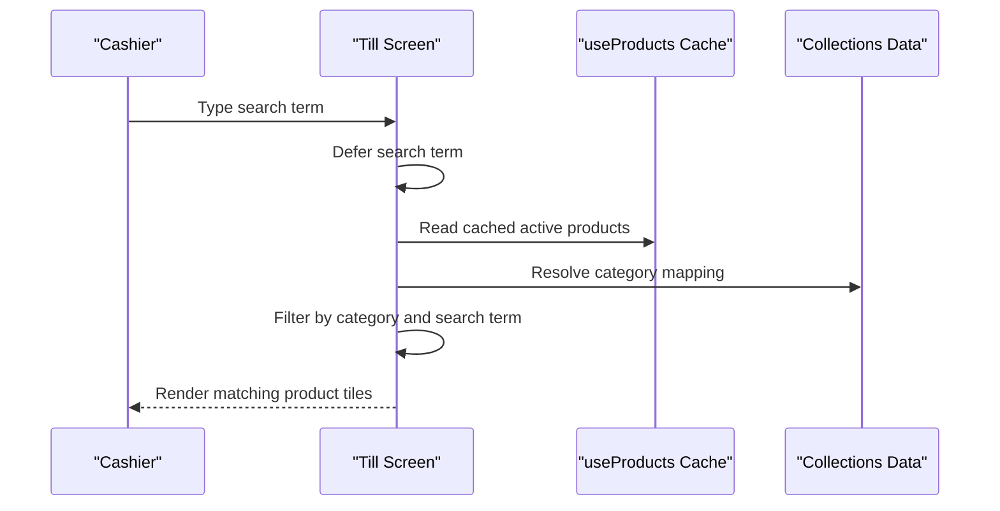
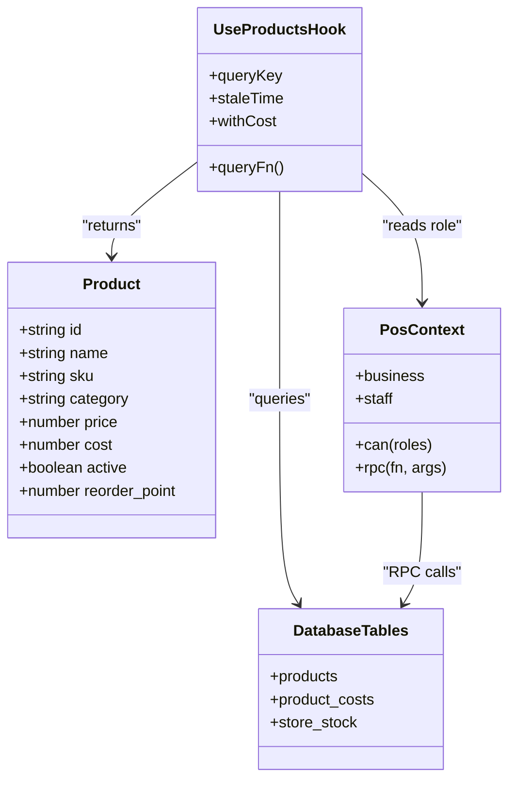
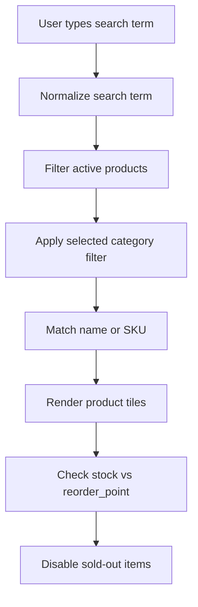
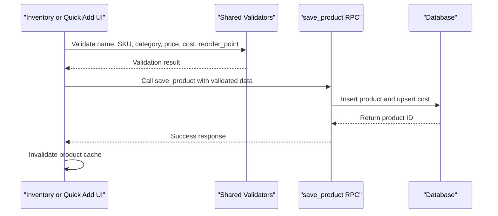
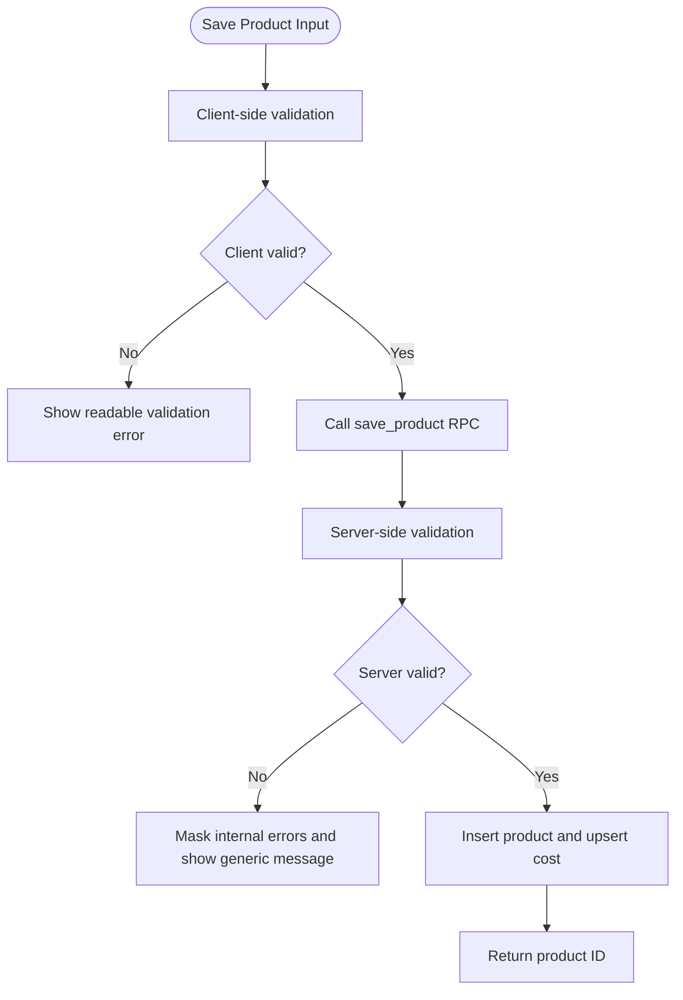
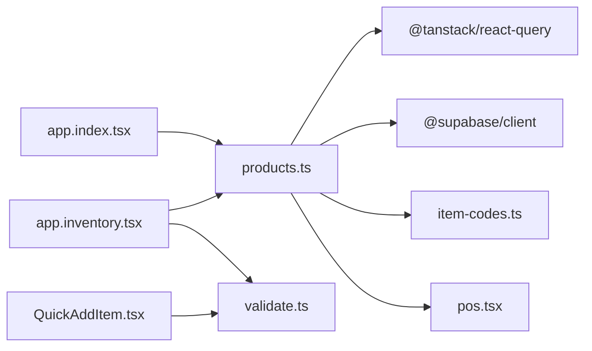

# Product Catalog Management

<cite>
**Referenced Files in This Document**
- [products.ts](file://src/lib/products.ts)
- [pos.tsx](file://src/lib/pos.tsx)
- [app.index.tsx](file://src/routes/_authenticated/app.index.tsx)
- [app.inventory.tsx](file://src/routes/_authenticated/app.inventory.tsx)
- [QuickAddItem.tsx](file://src/components/pos/QuickAddItem.tsx)
- [validate.ts](file://src/lib/validate.ts)
- [20261009210500_retail_operations.sql](file://supabase/migrations/20261009210500_retail_operations.sql)
- [20261011100000_item_codes.sql](file://supabase/migrations/20261011100000_item_codes.sql)
- [types.ts](file://src/integrations/supabase/types.ts)
</cite>

## Table of Contents
1. [Introduction](#introduction)
2. [Project Structure](#project-structure)
3. [Core Components](#core-components)
4. [Architecture Overview](#architecture-overview)
5. [Detailed Component Analysis](#detailed-component-analysis)
6. [Dependency Analysis](#dependency-analysis)
7. [Performance Considerations](#performance-considerations)
8. [Troubleshooting Guide](#troubleshooting-guide)
9. [Conclusion](#conclusion)

## Introduction
This document explains the product catalog management system used by the retail application. It covers the product data model, the `useProducts` hook for fetching and caching products, optional cost visibility based on user roles, product search and category organization, lifecycle management through active/inactive status, validation rules, and the relationship between products and their associated buying costs.

The system is designed for a point-of-sale environment where fast scanning and searching are critical. The client keeps a cached product catalog so barcode lookups do not wait on the network, while buying costs are only fetched when screens explicitly need them and only for users with sufficient permissions.

## Project Structure
Product-related logic spans several layers:

- **Client-side data model and hooks:** The product type, product list cache, barcode lookup, and stock query live in the product library.
- **Role and session context:** The POS provider supplies business, store, staff role, and permission checks.
- **User interfaces:** The till screen uses the product catalog for search and category browsing; the inventory screen manages product creation, editing, and lifecycle.
- **Server-side persistence and validation:** Supabase migrations define the product schema, constraints, RPCs, and row-level security behavior.



**Diagram sources**
- [products.ts:8-53](file://src/lib/products.ts#L8-L53)
- [app.index.tsx:137-160](file://src/routes/_authenticated/app.index.tsx#L137-L160)
- [app.inventory.tsx:115-193](file://src/routes/_authenticated/app.inventory.tsx#L115-L193)
- [20261009210500_retail_operations.sql:61-93](file://supabase/migrations/20261009210500_retail_operations.sql#L61-L93)
- [types.ts:369-400](file://src/integrations/supabase/types.ts#L369-L400)

**Section sources**
- [products.ts:1-107](file://src/lib/products.ts#L1-L107)
- [app.index.tsx:134-160](file://src/routes/_authenticated/app.index.tsx#L134-L160)
- [app.inventory.tsx:115-193](file://src/routes/_authenticated/app.inventory.tsx#L115-L193)
- [20261009210500_retail_operations.sql:61-93](file://supabase/migrations/20261009210500_retail_operations.sql#L61-L93)

## Core Components
### Product Data Model
The product model represents an item in the catalog with fields that support selling, identification, categorization, pricing, purchasing, availability, and inventory planning.

| Field | Type | Purpose | Constraints / Notes |
|---|---|---|---|
| `id` | string | Unique product identifier | Primary key in the database |
| `name` | string | Display name of the product | Required; validated length and character restrictions |
| `sku` | string or null | Barcode, SKU, or QR payload | Optional; normalized and unique per business |
| `category` | string or null | Human-readable category label | Optional; length-limited |
| `price` | number | Selling price | Non-negative; bounded by server constraint |
| `cost` | number | Buying cost | Stored separately; visible only to admin/manager |
| `active` | boolean | Product lifecycle flag | Default active on create; controls sales and search visibility |
| `reorder_point` | number or null | Low-stock threshold | Optional; non-negative and bounded |

The TypeScript model exposes these fields to the UI, while the database stores the core product record and a separate cost record.

**Section sources**
- [products.ts:8-17](file://src/lib/products.ts#L8-L17)
- [types.ts:392-400](file://src/integrations/supabase/types.ts#L392-L400)
- [20261009210500_retail_operations.sql:9-12](file://supabase/migrations/20261009210500_retail_operations.sql#L9-L12)

### useProducts Hook
The `useProducts` hook provides a long-lived, cached product catalog optimized for the till. It fetches basic product fields from the `products` table and optionally merges buying costs from the `product_costs` table.

Key behaviors:
- **Caching:** Uses React Query with a stale time so scanning and search operate against local memory rather than repeatedly hitting the network.
- **Role-based cost visibility:** Costs are only fetched when the caller requests them and the current staff role is admin or manager. Cashier users receive a cost value of zero because they cannot read the gated cost table.
- **Query key isolation:** The query key includes the business ID and whether costs are requested, so different screens can safely share the same base catalog while keeping cost data separate.
- **Ordering:** Products are returned ordered by name for predictable UI rendering.



**Diagram sources**
- [products.ts:19-53](file://src/lib/products.ts#L19-L53)
- [pos.tsx:36-70](file://src/lib/pos.tsx#L36-L70)

**Section sources**
- [products.ts:19-53](file://src/lib/products.ts#L19-L53)
- [pos.tsx:36-70](file://src/lib/pos.tsx#L36-L70)

### Product Search and Category Organization
The till screen filters the cached product list by:
- Active status
- Selected category
- Search term matched against product name and normalized SKU

The search is deferred so the input remains responsive while the filtered list updates. Categories are rendered as chips, and selecting a category narrows results to products assigned to that collection.



**Diagram sources**
- [app.index.tsx:137-160](file://src/routes/_authenticated/app.index.tsx#L137-L160)
- [products.ts:19-53](file://src/lib/products.ts#L19-L53)

**Section sources**
- [app.index.tsx:137-160](file://src/routes/_authenticated/app.index.tsx#L137-L160)

### Barcode Lookup
The `findByBarcode` function performs exact matching against the cached product list using normalized codes. Normalization trims whitespace, collapses spaces, and lowercases values so minor formatting differences do not break scans.

Only active products are considered, ensuring inactive items cannot be sold even if their code matches.

**Section sources**
- [products.ts:54-64](file://src/lib/products.ts#L54-L64)

### Stock Awareness
The product model includes `reorder_point`, which drives low-stock indicators in the till. If stock is zero, the product tile is disabled; if stock is at or below the reorder point, it is visually marked as low.

The stock data is fetched separately and merged into the UI state, allowing the catalog to remain lean while still showing real-time availability.

**Section sources**
- [app.index.tsx:457-467](file://src/routes/_authenticated/app.index.tsx#L457-L467)
- [products.ts:82-106](file://src/lib/products.ts#L82-L106)

## Architecture Overview
The product catalog architecture separates concerns across client caching, role-based access control, and server-side validation.



**Diagram sources**
- [products.ts:8-53](file://src/lib/products.ts#L8-L53)
- [pos.tsx:36-70](file://src/lib/pos.tsx#L36-L70)
- [types.ts:369-400](file://src/integrations/supabase/types.ts#L369-L400)

## Detailed Component Analysis

### Product Data Model and Relationships
The product model is the central entity for catalog operations. Its relationships include:

- **One-to-one cost relationship:** Each product has one associated cost record. The cost table is gated so only admin and manager roles can read it.
- **Many-to-many collection membership:** Products belong to collections (categories), enabling filtering and reporting.
- **Store stock linkage:** Inventory quantities are tracked per store and product, driving low-stock alerts and sales validation.

```mermaid
erDiagram
PRODUCTS {
uuid id PK
uuid business_id FK
string name
string sku UK
string category
numeric price
boolean active
numeric reorder_point
timestamp created_at
}
PRODUCT_COSTS {
uuid product_id PK FK
numeric cost
}
STORE_STOCK {
uuid store_id FK
uuid product_id FK
numeric qty
}
COLLECTIONS {
uuid id PK
string name
}
PRODUCT_COLLECTIONS {
uuid product_id FK
uuid collection_id FK
}
PRODUCTS ||--o| PRODUCT_COSTS : "has cost"
PRODUCTS ||--o{ STORE_STOCK : "stocked in stores"
PRODUCTS ||--o{ PRODUCT_COLLECTIONS : "belongs to collections"
COLLECTIONS ||--o{ PRODUCT_COLLECTIONS : "contains products"
```

**Diagram sources**
- [types.ts:351-400](file://src/integrations/supabase/types.ts#L351-L400)
- [20261009210500_retail_operations.sql:9-12](file://supabase/migrations/20261009210500_retail_operations.sql#L9-L12)

**Section sources**
- [types.ts:351-400](file://src/integrations/supabase/types.ts#L351-L400)
- [20261009210500_retail_operations.sql:9-12](file://supabase/migrations/20261009210500_retail_operations.sql#L9-L12)

### useProducts Hook Implementation
The hook encapsulates:
- Role-aware cost fetching
- Long-lived React Query cache
- Lean base catalog plus optional cost merge
- Error propagation from the database client

It is intended to be consumed by screens that need the product catalog, especially the till and inventory views.

**Section sources**
- [products.ts:19-53](file://src/lib/products.ts#L19-L53)

### Product Search Flow
The till search flow normalizes input, filters active products, applies category selection, and renders tiles with stock awareness.



**Diagram sources**
- [app.index.tsx:137-160](file://src/routes/_authenticated/app.index.tsx#L137-L160)
- [app.index.tsx:457-467](file://src/routes/_authenticated/app.index.tsx#L457-L467)

**Section sources**
- [app.index.tsx:137-160](file://src/routes/_authenticated/app.index.tsx#L137-L160)
- [app.index.tsx:457-467](file://src/routes/_authenticated/app.index.tsx#L457-L467)

### Adding New Products
New products are created through the `save_product` RPC. The server validates inputs and inserts a product record, then upserts the associated cost.

Typical workflow:
1. Client collects product details.
2. Client validates input using shared validators.
3. Client calls `save_product` with token, name, SKU, category, price, cost, active status, and reorder point.
4. Server validates business rules and persists the product.
5. Client invalidates relevant caches so the new product appears immediately.



**Diagram sources**
- [20261009210500_retail_operations.sql:61-93](file://supabase/migrations/20261009210500_retail_operations.sql#L61-L93)
- [validate.ts:9-25](file://src/lib/validate.ts#L9-L25)
- [QuickAddItem.tsx:70-78](file://src/components/pos/QuickAddItem.tsx#L70-L78)

**Section sources**
- [20261009210500_retail_operations.sql:61-93](file://supabase/migrations/20261009210500_retail_operations.sql#L61-L93)
- [validate.ts:9-25](file://src/lib/validate.ts#L9-L25)
- [QuickAddItem.tsx:70-78](file://src/components/pos/QuickAddItem.tsx#L70-L78)

### Updating Product Information
Updates follow the same RPC path as creation. The server locates the product by ID within the current business, updates mutable fields, and ensures the cost record stays synchronized.

Important update behavior:
- Name, SKU, category, price, active status, and reorder point are updated.
- Empty strings are converted to null for optional text fields.
- Cost is upserted alongside the product update.

**Section sources**
- [20261009210500_retail_operations.sql:80-92](file://supabase/migrations/20261009210500_retail_operations.sql#L80-L92)
- [app.inventory.tsx:700-730](file://src/routes/_authenticated/app.inventory.tsx#L700-L730)

### Managing Product Lifecycle: Active and Inactive
The `active` field controls whether a product can be sold and included in normal catalog browsing. The default is active when creating a new product unless explicitly set otherwise.

Lifecycle effects:
- Active products appear in search results and can be added to the cart.
- Inactive products are excluded from the till’s active list.
- Transfers and checkout validate that referenced products are active.

**Section sources**
- [app.index.tsx:141](file://src/routes/_authenticated/app.index.tsx#L141)
- [20261009210500_retail_operations.sql:80-88](file://supabase/migrations/20261009210500_retail_operations.sql#L80-L88)

### Relationship Between Products and Costs
Buying costs are stored in a separate `product_costs` table. The client:
- Reads base product data from `products`.
- Optionally reads `product_costs` when `withCost` is true and the user has admin or manager permissions.
- Merges costs into the product model so the UI can display profit margins or inventory value.

If a product has no cost row, the merged cost defaults to zero.

**Section sources**
- [products.ts:6-17](file://src/lib/products.ts#L6-L17)
- [products.ts:31-50](file://src/lib/products.ts#L31-L50)
- [types.ts:369-390](file://src/integrations/supabase/types.ts#L369-L390)

### Role-Based Access Controls Affecting Cost Visibility
The POS context exposes a `can` helper that checks the current staff role. `useProducts` uses this helper to decide whether to fetch costs.

Roles:
- **Admin:** Can see and manage costs.
- **Manager:** Can see and manage costs.
- **Cashier:** Cannot see costs; cost is shown as zero.

This design prevents sensitive buying information from leaking to cashiers while still allowing them to sell products normally.

**Section sources**
- [pos.tsx:36-70](file://src/lib/pos.tsx#L36-L70)
- [products.ts:22-24](file://src/lib/products.ts#L22-L24)

### Product Validation Rules and Business Constraints
Validation occurs in two layers:

1. **Client-side validation:** Shared validators enforce length limits, safe characters, numeric bounds, and format rules before sending data to the server.
2. **Server-side validation:** The `save_product` RPC enforces stricter business rules and returns clear error messages for invalid input.

Key rules:
- Product name is required, trimmed, limited in length, and restricted to safe characters.
- SKU is optional but must match allowed characters and length when provided.
- Category is optional and length-limited.
- Price must be non-negative and within a large upper bound.
- Cost is optional but bounded when provided.
- Reorder point is optional but bounded when provided.
- SKU uniqueness is enforced per business, with auto-generated codes when none is supplied during creation.



**Diagram sources**
- [validate.ts:9-25](file://src/lib/validate.ts#L9-L25)
- [validate.ts:98-122](file://src/lib/validate.ts#L98-L122)
- [20261009210500_retail_operations.sql:61-93](file://supabase/migrations/20261009210500_retail_operations.sql#L61-L93)
- [20261011100000_item_codes.sql:95-126](file://supabase/migrations/20261011100000_item_codes.sql#L95-L126)

**Section sources**
- [validate.ts:9-25](file://src/lib/validate.ts#L9-L25)
- [validate.ts:98-122](file://src/lib/validate.ts#L98-L122)
- [20261009210500_retail_operations.sql:61-93](file://supabase/migrations/20261009210500_retail_operations.sql#L61-L93)
- [20261011100000_item_codes.sql:95-126](file://supabase/migrations/20261011100000_item_codes.sql#L95-L126)

## Dependency Analysis
The product system depends on several modules:

- **React Query:** Provides caching, stale-time behavior, and refetch capabilities.
- **Supabase client:** Executes queries and RPCs against the database.
- **POS context:** Supplies business, store, staff role, and permission checks.
- **Item code utilities:** Normalize SKUs for reliable barcode matching.
- **Collections module:** Maps products to categories.
- **Offline and cache invalidation:** Ensures catalog and stock data stay consistent across devices and sessions.



**Diagram sources**
- [products.ts:1-4](file://src/lib/products.ts#L1-L4)
- [app.index.tsx:137-160](file://src/routes/_authenticated/app.index.tsx#L137-L160)
- [app.inventory.tsx:115-193](file://src/routes/_authenticated/app.inventory.tsx#L115-L193)
- [QuickAddItem.tsx:70-78](file://src/components/pos/QuickAddItem.tsx#L70-L78)

**Section sources**
- [products.ts:1-4](file://src/lib/products.ts#L1-L4)
- [app.index.tsx:137-160](file://src/routes/_authenticated/app.index.tsx#L137-L160)
- [app.inventory.tsx:115-193](file://src/routes/_authenticated/app.inventory.tsx#L115-L193)
- [QuickAddItem.tsx:70-78](file://src/components/pos/QuickAddItem.tsx#L70-L78)

## Performance Considerations
- **Long-lived catalog cache:** The product list is cached for 30 minutes, reducing network calls and making scanning/search instantaneous.
- **Optional cost fetching:** Costs are only loaded when needed and only for authorized roles, avoiding unnecessary overhead for cashiers.
- **Deferred search:** The till defers search computation so typing remains responsive.
- **Stock polling for live environments:** Stock data can be polled periodically in live mode to keep quantity badges accurate across tills and imports.
- **Lean column selection:** The base product query selects only necessary columns, minimizing payload size.

[No sources needed since this section provides general guidance]

## Troubleshooting Guide
Common issues and how to diagnose them:

- **Products not appearing in search:**
  - Verify the product is active.
  - Confirm the search term matches either the name or normalized SKU.
  - Check that the product belongs to the selected category.

- **Costs missing for admin/manager:**
  - Ensure the user role is admin or manager.
  - Confirm the `withCost` option is passed to `useProducts`.
  - Verify the `product_costs` table contains a row for the product.

- **Barcode scan not resolving:**
  - Check that the SKU is normalized and active.
  - Confirm the scanned code matches the stored SKU after normalization.

- **Validation errors on save:**
  - Review client-side validator output for length, format, and safety checks.
  - Inspect server error messages; internal SQL errors are masked to generic UI messages.

- **Low-stock indicators incorrect:**
  - Confirm `reorder_point` is set.
  - Verify store stock quantities are up to date.
  - Check whether live stock polling is enabled for the screen.

**Section sources**
- [products.ts:54-64](file://src/lib/products.ts#L54-L64)
- [products.ts:19-53](file://src/lib/products.ts#L19-L53)
- [validate.ts:9-25](file://src/lib/validate.ts#L9-L25)
- [pos.tsx:88-104](file://src/lib/pos.tsx#L88-L104)

## Conclusion
The product catalog management system balances performance, security, and usability. The product model captures essential retail attributes, while `useProducts` provides a fast, cached catalog suitable for point-of-sale workflows. Role-based cost visibility protects sensitive buying information, and robust validation ensures data integrity both on the client and server. Categories, search, and lifecycle flags make the catalog easy to browse and maintain, and the separation of product records from cost records supports clean permission boundaries and scalable inventory accounting.

[No sources needed since this section summarizes without analyzing specific files]