# Stock Tracking & Inventory Levels

<cite>
**Referenced Files in This Document**
- [20261007084733_2ed95314-f75e-4843-977b-23f9e6359a48.sql](file://supabase/migrations/20261007084733_2ed95314-f75e-4843-977b-23f9e6359a48.sql)
- [20261007102244_c10153f5-18b7-409c-8196-9d27-f70876506db1.sql](file://supabase/migrations/20261007102244_c10153f5-18b7-409c-8196-9d27-f70876506db1.sql)
- [20261009210500_retail_operations.sql](file://supabase/migrations/20261009210500_retail_operations.sql)
- [20261011130000_stock_absolute_set.sql](file://supabase/migrations/20261011130000_stock_absolute_set.sql)
- [products.ts](file://src/lib/products.ts)
- [transfers.ts](file://src/lib/transfers.ts)
- [app.inventory.tsx](file://src/routes/_authenticated/app.inventory.tsx)
- [app.stocktake.tsx](file://src/routes/_authenticated/app.stocktake.tsx)
- [app.stocktake_.$id.tsx](file://src/routes/_authenticated/app.stocktake_.$id.tsx)
- [app.dashboard.tsx](file://src/routes/_authenticated/app.dashboard.tsx)
</cite>

## Update Summary
**Changes Made**
- Updated stock take workflow section to reflect the new two-view architecture
- Added detailed documentation for the list page with filtering and pagination
- Added comprehensive coverage of the detail page with inventory counting and variance tracking
- Updated diagrams to show the new navigation flow between list and detail views
- Enhanced stock take procedures section with advanced filtering options and role-based features

## Table of Contents
1. [Introduction](#introduction)
2. [Project Structure](#project-structure)
3. [Core Components](#core-components)
4. [Architecture Overview](#architecture-overview)
5. [Detailed Component Analysis](#detailed-component-analysis)
6. [Dependency Analysis](#dependency-analysis)
7. [Performance Considerations](#performance-considerations)
8. [Troubleshooting Guide](#troubleshooting-guide)
9. [Conclusion](#conclusion)

## Introduction
This document explains how stock tracking and inventory levels work in the application. It covers the `store_stock` table, real-time stock retrieval with the `useStock` hook, manual adjustments, automatic deductions from sales, stock take procedures, low-stock notifications, reorder points, and reconciliation processes. The goal is to make stock management clear for both technical and non-technical users.

## Project Structure
Stock-related functionality spans database migrations, client hooks, and UI routes:

- Database layer defines store-level stock, movement ledger, validation, and RPCs.
- Client layer provides product catalog, stock map, low-stock alerts, and stock take workflows.
- UI routes expose inventory management, stock taking (now split into list and detail views), and dashboard alerts.

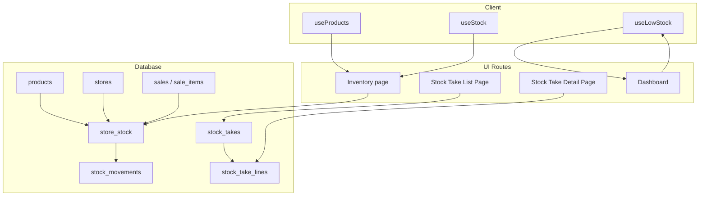

**Diagram sources**
- [20261007084733_2ed95314-f75e-4843-977b-23f9e6359a48.sql:43-48](file://supabase/migrations/20261007084733_2ed95314-f75e-4843-977b-23f9e6359a48.sql#L43-L48)
- [20261007084733_2ed95314-f75e-4843-977b-23f9e6359a48.sql:83-100](file://supabase/migrations/20261007084733_2ed95314-f75e-4843-977b-23f9e6359a48.sql#L83-L100)
- [products.ts:82-106](file://src/lib/products.ts#L82-L106)
- [transfers.ts:92-115](file://src/lib/transfers.ts#L92-L115)
- [app.inventory.tsx:110-185](file://src/routes/_authenticated/app.inventory.tsx#L110-L185)
- [app.stocktake.tsx:34-109](file://src/routes/_authenticated/app.stocktake.tsx#L34-L109)
- [app.stocktake_.$id.tsx:28-45](file://src/routes/_authenticated/app.stocktake_.$id.tsx#L28-L45)
- [app.dashboard.tsx:262-301](file://src/routes/_authenticated/app.dashboard.tsx#L262-L301)

**Section sources**
- [20261007084733_2ed95314-f75e-4843-977b-23f9e6359a48.sql:43-48](file://supabase/migrations/20261007084733_2ed95314-f75e-4843-977b-23f9e6359a48.sql#L43-L48)
- [products.ts:82-106](file://src/lib/products.ts#L82-L106)
- [app.inventory.tsx:110-185](file://src/routes/_authenticated/app.inventory.tsx#L110-L185)

## Core Components
- `store_stock`: Per-store per-product quantity storage.
- `stock_movements`: Immutable audit trail of every stock change.
- `stock_takes` and `stock_take_lines`: Stock take session management with line-by-line counting.
- `useStock`: React Query hook that fetches current stock quantities for a store, with optional live polling for POS environments.
- Manual adjustment RPCs: Safe, validated server functions for adding/removing stock with reasons and notes.
- Sales-driven stock deduction: Automatic stock reduction on completed sales, with concurrency-safe checks.
- Stock take workflow: Two-view system - list page for session management and detail page for inventory counting.
- Low-stock and reorder point alerts: Product-level thresholds surfaced in dashboards and inventory views.

**Section sources**
- [20261007084733_2ed95314-f75e-4843-977b-23f9e6359a48.sql:43-48](file://supabase/migrations/20261007084733_2ed95314-f75e-4843-977b-23f9e6359a48.sql#L43-L48)
- [20261007084733_2ed95314-f75e-4843-977b-23f9e6359a48.sql:83-100](file://supabase/migrations/20261007084733_2ed95314-f75e-4843-977b-23f9e6359a48.sql#L83-L100)
- [20261007102244_c10153f5-18b7-409c-8196-9d27-f70876506db1.sql:10-27](file://supabase/migrations/20261007102244_c10153f5-18b7-409c-8196-9d27-f70876506db1.sql#L10-L27)
- [products.ts:82-106](file://src/lib/products.ts#L82-L106)
- [20261011130000_stock_absolute_set.sql:32-62](file://supabase/migrations/20261011130000_stock_absolute_set.sql#L32-L62)
- [20261011130000_stock_absolute_set.sql:75-107](file://supabase/migrations/20261011130000_stock_absolute_set.sql#L75-L107)
- [20261007084733_2ed95314-f75e-4843-977b-23f9e6359a48.sql:339-375](file://supabase/migrations/20261007084733_2ed95314-f75e-4843-977b-23f9e6359a48.sql#L339-L375)
- [20261009210500_retail_operations.sql:9-12](file://supabase/migrations/20261009210500_retail_operations.sql#L9-L12)
- [transfers.ts:92-115](file://src/lib/transfers.ts#L92-L115)

## Architecture Overview
Stock changes are always traceable. Every update to `store_stock` triggers a ledger entry in `stock_movements`. Sales automatically deduct stock; manual adjustments and stock takes explicitly set or adjust quantities. Clients read stock via `useStock`, and low-stock alerts use a dedicated RPC.

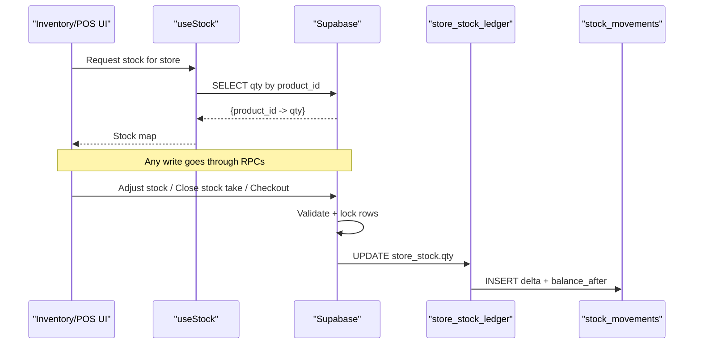

**Diagram sources**
- [products.ts:82-106](file://src/lib/products.ts#L82-L106)
- [20261007102244_c10153f5-18b7-409c-8196-9d27-f70876506db1.sql:29-46](file://supabase/migrations/20261007102244_c10153f5-18b7-409c-8196-9d27-f70876506db1.sql#L29-L46)
- [20261011130000_stock_absolute_set.sql:32-62](file://supabase/migrations/20261011130000_stock_absolute_set.sql#L32-L62)

## Detailed Component Analysis

### Store Stock Data Model
The core stock model stores one row per store and product combination.

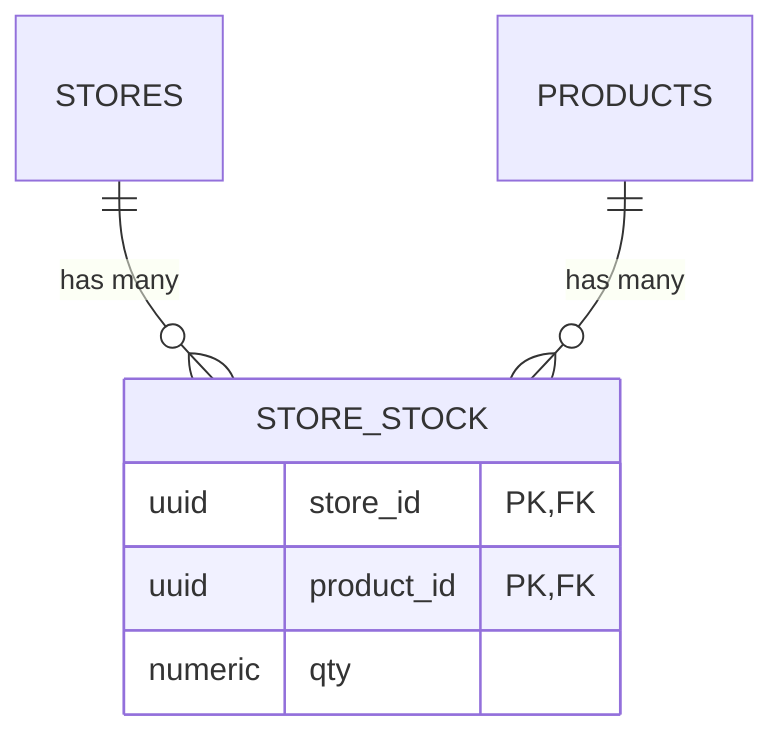

Key properties:
- Primary key: `(store_id, product_id)`
- Quantity: `qty` (numeric)
- Referenced by sales and stock movements

**Diagram sources**
- [20261007084733_2ed95314-f75e-4843-977b-23f9e6359a48.sql:43-48](file://supabase/migrations/20261007084733_2ed95314-f75e-4843-977b-23f9e6359a48.sql#L43-L48)

**Section sources**
- [20261007084733_2ed95314-f75e-4843-977b-23f9e6359a48.sql:43-48](file://supabase/migrations/20261007084733_2ed95314-f75e-4843-977b-23f9e6359a48.sql#L43-L48)

### Real-Time Stock Retrieval with `useStock`
The `useStock` hook returns a map of `product_id -> qty` for a given store. It uses React Query caching with a stale time and supports optional live polling for POS environments where other devices may change stock concurrently.

Behavior highlights:
- Fetches only `product_id` and `qty` for the selected store.
- Caches results for 60 seconds by default.
- Enables periodic refetching when `live: true` (every 30 seconds).
- Disables background refetching to avoid unnecessary network usage.

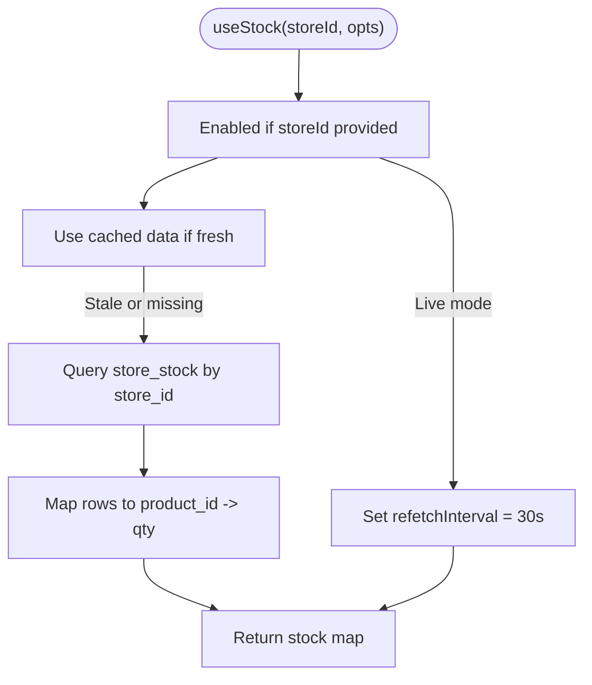

**Diagram sources**
- [products.ts:82-106](file://src/lib/products.ts#L82-L106)

**Section sources**
- [products.ts:82-106](file://src/lib/products.ts#L82-L106)

### Stock Adjustment Workflows

#### Manual Adjustments
Manual adjustments go through validated RPCs that enforce business rules and reason codes. There are two primary paths:
- Absolute setting: `set_stock_qty` sets an exact target quantity, computing the delta safely under a row lock.
- Delta-based adjustment: `adjust_stock_reason` applies a signed delta with strict bounds and reason validation.

Both paths:
- Require admin or manager role.
- Validate store and product ownership.
- Enforce allowed reasons and note length.
- Record a ledger entry via the trigger.

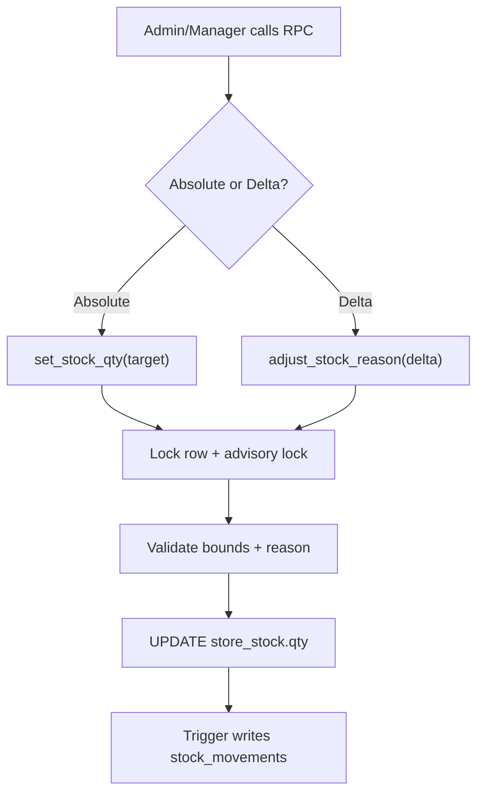

**Diagram sources**
- [20261011130000_stock_absolute_set.sql:32-62](file://supabase/migrations/20261011130000_stock_absolute_set.sql#L32-L62)
- [20261011130000_stock_absolute_set.sql:110-136](file://supabase/migrations/20261011130000_stock_absolute_set.sql#L110-L136)
- [20261007102244_c10153f5-18b7-409c-8196-9d27-f70876506db1.sql:29-46](file://supabase/migrations/20261007102244_c10153f5-18b7-409c-8196-9d27-f70876506db1.sql#L29-L46)

**Section sources**
- [20261011130000_stock_absolute_set.sql:32-62](file://supabase/migrations/20261011130000_stock_absolute_set.sql#L32-L62)
- [20261011130000_stock_absolute_set.sql:110-136](file://supabase/migrations/20261011130000_stock_absolute_set.sql#L110-L136)
- [20261007102244_c10153f5-18b7-409c-8196-9d27-f70876506db1.sql:29-46](file://supabase/migrations/20261007102244_c10153f5-18b7-409c-8196-9d27-f70876506db1.sql#L29-L46)

#### Automatic Deductions from Sales
Completed sales reduce stock automatically. The system:
- Groups sale items by product.
- Locks each affected stock row.
- Checks available quantity before deducting.
- Raises a user-friendly error if insufficient stock.
- Records the movement with reason `sale` or `sale_reversal`.

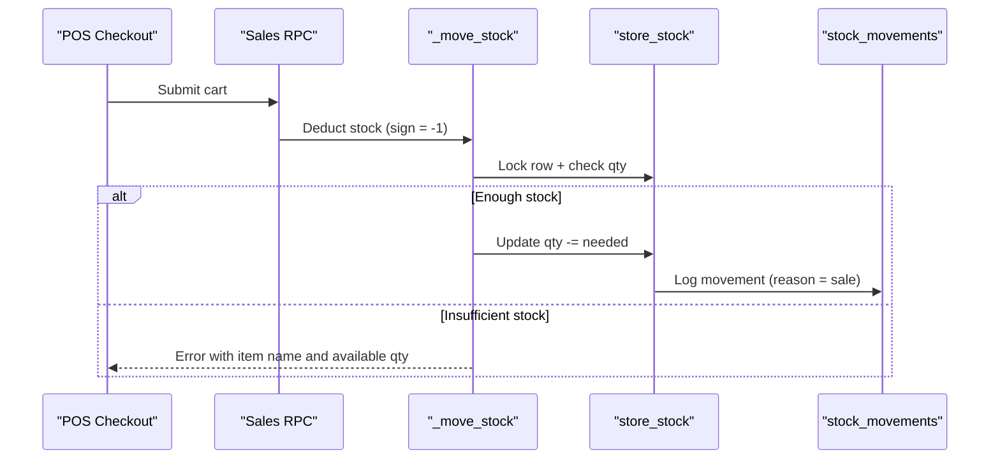

**Diagram sources**
- [20261011130000_stock_absolute_set.sql:75-107](file://supabase/migrations/20261011130000_stock_absolute_set.sql#L75-L107)
- [20261007102244_c10153f5-18b7-409c-8196-9d27-f70876506db1.sql:29-46](file://supabase/migrations/20261007102244_c10153f5-18b7-409c-8196-9d27-f70876506db1.sql#L29-L46)

**Section sources**
- [20261011130000_stock_absolute_set.sql:75-107](file://supabase/migrations/20261011130000_stock_absolute_set.sql#L75-L107)

#### Stock Take Procedures
Stock takes now use a two-view architecture for improved usability and collaboration:

**List View (`app.stocktake.tsx`)**:
- Displays all stock take sessions with status filtering (all/open/closed)
- Shows session metadata including start/close times and responsible staff
- Provides quick access to resume open sessions or start new ones
- Implements pagination for large numbers of sessions
- Supports filtering by status with visual indicators

**Detail View (`app.stocktake_.$id.tsx`)**:
- Comprehensive inventory counting interface with real-time updates
- Advanced filtering options: all items, items with differences, uncounted items
- Live team counting with 15-second polling during active sessions
- Variance tracking showing expected vs counted quantities
- Role-based features: managers see system quantities and variances, cashiers count blind
- Search functionality with debounced input for large inventories
- Progress tracking with summary cards showing total items, counted items, and net variance

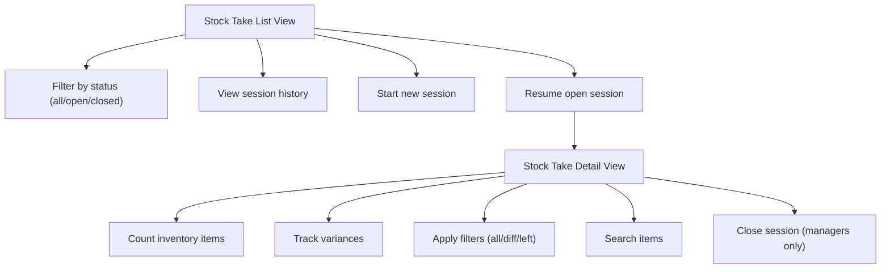

**Diagram sources**
- [app.stocktake.tsx:34-109](file://src/routes/_authenticated/app.stocktake.tsx#L34-L109)
- [app.stocktake_.$id.tsx:28-45](file://src/routes/_authenticated/app.stocktake_.$id.tsx#L28-L45)
- [app.stocktake_.$id.tsx:112-131](file://src/routes/_authenticated/app.stocktake_.$id.tsx#L112-L131)

**Updated** The stock take workflow has been restructured from a single-page application into two distinct views with enhanced functionality.

**Section sources**
- [app.stocktake.tsx:34-109](file://src/routes/_authenticated/app.stocktake.tsx#L34-L109)
- [app.stocktake_.$id.tsx:28-45](file://src/routes/_authenticated/app.stocktake_.$id.tsx#L28-L45)
- [app.stocktake_.$id.tsx:112-131](file://src/routes/_authenticated/app.stocktake_.$id.tsx#L112-L131)
- [20261007084733_2ed95314-f75e-4843-977b-23f9e6359a48.sql:339-375](file://supabase/migrations/20261007084733_2ed95314-f75e-4843-977b-23f9e6359a48.sql#L339-L375)
- [20261007102244_c10153f5-18b7-409c-8196-9d27-f70876506db1.sql:102-116](file://supabase/migrations/20261007102244_c10153f5-18b7-409c-8196-9d27-f70876506db1.sql#L102-L116)

### Checking Stock Levels
In the inventory page:
- Products are listed with their current stock.
- Low stock badges appear when stock is at or below the product's reorder point.
- Users can sort by stock level and filter by low stock.

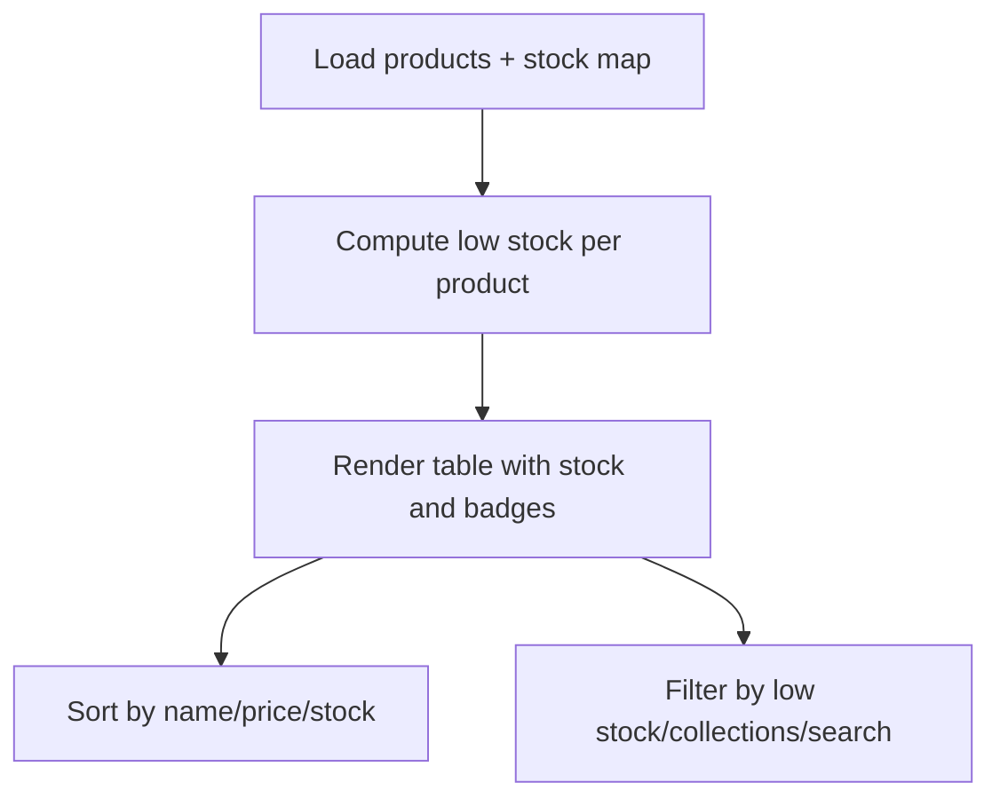

**Diagram sources**
- [app.inventory.tsx:110-185](file://src/routes/_authenticated/app.inventory.tsx#L110-L185)
- [app.inventory.tsx:524-582](file://src/routes/_authenticated/app.inventory.tsx#L524-L582)

**Section sources**
- [app.inventory.tsx:110-185](file://src/routes/_authenticated/app.inventory.tsx#L110-L185)
- [app.inventory.tsx:524-582](file://src/routes/_authenticated/app.inventory.tsx#L524-L582)

### Handling Low Stock Scenarios
Low-stock detection uses product-level reorder points:
- Products have a `reorder_point` field.
- The low-stock RPC returns products at or below their reorder point.
- Dashboard displays actionable alerts for items needing reorder.

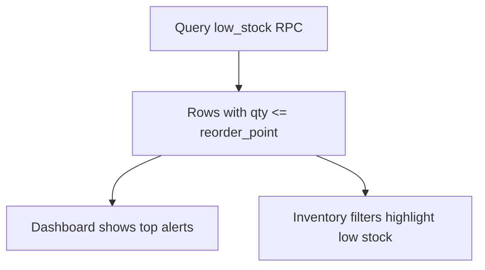

**Diagram sources**
- [20261009210500_retail_operations.sql:9-12](file://supabase/migrations/20261009210500_retail_operations.sql#L9-L12)
- [transfers.ts:92-115](file://src/lib/transfers.ts#L92-L115)
- [app.dashboard.tsx:262-301](file://src/routes/_authenticated/app.dashboard.tsx#L262-L301)

**Section sources**
- [20261009210500_retail_operations.sql:9-12](file://supabase/migrations/20261009210500_retail_operations.sql#L9-L12)
- [transfers.ts:92-115](file://src/lib/transfers.ts#L92-L115)
- [app.dashboard.tsx:262-301](file://src/routes/_authenticated/app.dashboard.tsx#L262-L301)

### Relationship Between Products and Stock Across Stores
- Each product exists once per business but has separate stock entries per store.
- The same product can have different quantities across multiple stores.
- Sales affect stock only at the selling store.
- Transfers move stock between stores and are tracked separately.

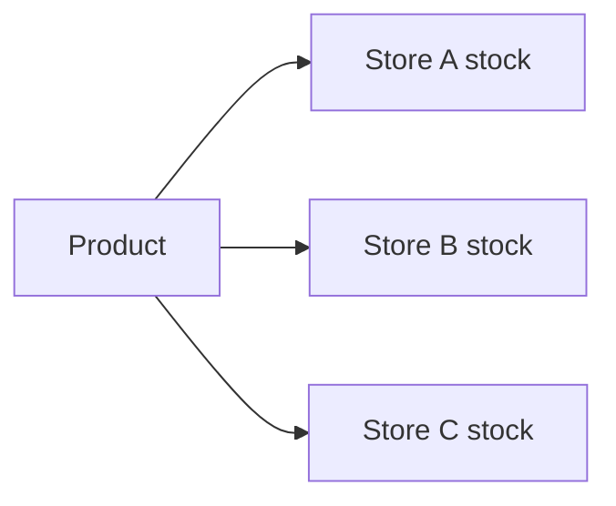

**Diagram sources**
- [20261007084733_2ed95314-f75e-4843-977b-23f9e6359a48.sql:32-48](file://supabase/migrations/20261007084733_2ed95314-f75e-4843-977b-23f9e6359a48.sql#L32-L48)

**Section sources**
- [20261007084733_2ed95314-f75e-4843-977b-23f9e6359a48.sql:32-48](file://supabase/migrations/20261007084733_2ed95314-f75e-4843-977b-23f9e6359a48.sql#L32-L48)

### Stock Validation Rules
Validation ensures data integrity and safe operations:
- Allowed reasons for adjustments are strictly enumerated.
- Quantities must be non-negative and within defined ranges.
- Notes are limited in length.
- Concurrency is handled with advisory locks and row-level locks.
- Sales cannot deduct more than available stock; errors include item names.

Examples:
- Absolute quantity setting validates range and decimal precision.
- Delta adjustments validate sign and magnitude.
- Sales pre-check prevents negative balances.

**Section sources**
- [20261011130000_stock_absolute_set.sql:32-62](file://supabase/migrations/20261011130000_stock_absolute_set.sql#L32-L62)
- [20261011130000_stock_absolute_set.sql:110-136](file://supabase/migrations/20261011130000_stock_absolute_set.sql#L110-L136)
- [20261011130000_stock_absolute_set.sql:75-107](file://supabase/migrations/20261011130000_stock_absolute_set.sql#L75-L107)

### Reorder Point Notifications
Reorder points are stored per product and used to surface low-stock alerts:
- Dashboard lists items at or below reorder point.
- Inventory view highlights low stock with badges.
- Low-stock query joins products and store stock to compute shortfall.

**Section sources**
- [20261009210500_retail_operations.sql:9-12](file://supabase/migrations/20261009210500_retail_operations.sql#L9-L12)
- [app.dashboard.tsx:262-301](file://src/routes/_authenticated/app.dashboard.tsx#L262-L301)
- [app.inventory.tsx:524-582](file://src/routes/_authenticated/app.inventory.tsx#L524-L582)
- [transfers.ts:92-115](file://src/lib/transfers.ts#L92-L115)

### Inventory Reconciliation Processes
Reconciliation happens primarily through stock takes with the new two-view architecture:

**List View Features**:
- Session management with status filtering
- Quick access to resume or start new stock takes
- Historical tracking of completed sessions

**Detail View Features**:
- Real-time collaborative counting with 15-second polling
- Advanced filtering: all items, items with differences, uncounted items
- Variance tracking with color-coded indicators
- Role-based visibility: managers see full details, cashiers count blind
- Search functionality for large inventories
- Progress tracking with summary statistics

Additionally, CSV imports and item edits use absolute quantity setting to ensure correctness even when concurrent changes occur.

**Section sources**
- [app.stocktake.tsx:34-109](file://src/routes/_authenticated/app.stocktake.tsx#L34-L109)
- [app.stocktake_.$id.tsx:28-45](file://src/routes/_authenticated/app.stocktake_.$id.tsx#L28-L45)
- [app.stocktake_.$id.tsx:112-131](file://src/routes/_authenticated/app.stocktake_.$id.tsx#L112-L131)
- [20261007084733_2ed95314-f75e-4843-977b-23f9e6359a48.sql:339-375](file://supabase/migrations/20261007084733_2ed95314-f75e-4843-977b-23f9e6359a48.sql#L339-L375)
- [20261007102244_c10153f5-18b7-409c-8196-9d27-f70876506db1.sql:102-116](file://supabase/migrations/20261007102244_c10153f5-18b7-409c-8196-9d27-f70876506db1.sql#L102-L116)
- [20261011130000_stock_absolute_set.sql:32-62](file://supabase/migrations/20261011130000_stock_absolute_set.sql#L32-L62)

## Dependency Analysis
Stock flows depend on several components:

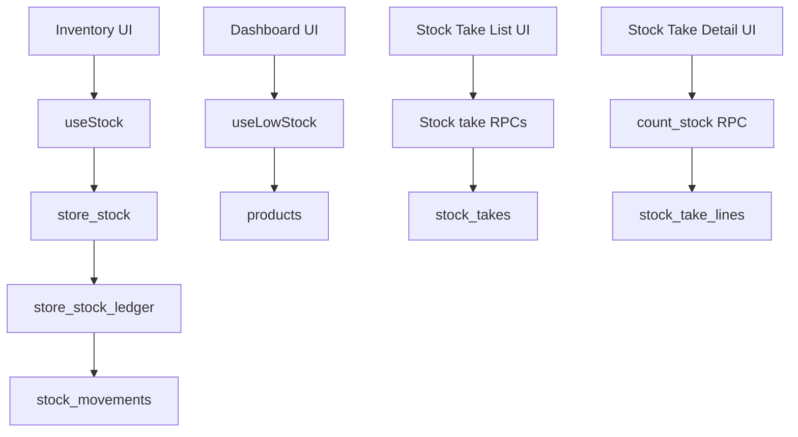

**Diagram sources**
- [products.ts:82-106](file://src/lib/products.ts#L82-L106)
- [transfers.ts:92-115](file://src/lib/transfers.ts#L92-L115)
- [app.stocktake.tsx:34-109](file://src/routes/_authenticated/app.stocktake.tsx#L34-L109)
- [app.stocktake_.$id.tsx:28-45](file://src/routes/_authenticated/app.stocktake_.$id.tsx#L28-L45)
- [20261007102244_c10153f5-18b7-409c-8196-9d27-f70876506db1.sql:29-46](file://supabase/migrations/20261007102244_c10153f5-18b7-409c-8196-9d27-f70876506db1.sql#L29-L46)

**Section sources**
- [products.ts:82-106](file://src/lib/products.ts#L82-L106)
- [transfers.ts:92-115](file://src/lib/transfers.ts#L92-L115)
- [app.stocktake.tsx:34-109](file://src/routes/_authenticated/app.stocktake.tsx#L34-L109)
- [app.stocktake_.$id.tsx:28-45](file://src/routes/_authenticated/app.stocktake_.$id.tsx#L28-L45)
- [20261007102244_c10153f5-18b7-409c-8196-9d27-f70876506db1.sql:29-46](file://supabase/migrations/20261007102244_c10153f5-18b7-409c-8196-9d27-f70876506db1.sql#L29-L46)

## Performance Considerations
- `useStock` caches stock maps for 60 seconds to reduce network load.
- Live polling is enabled only in POS contexts to keep badges accurate across tills.
- Background refetching is disabled to avoid unnecessary traffic.
- Inventory list computations are memoized and paginated for responsiveness.
- Stock take lines are polled at a moderate interval (15 seconds) during active counting.
- Stock take list queries use longer stale times (5 minutes) since sessions change infrequently.
- Debounced search in stock take detail view reduces filtering overhead.

## Troubleshooting Guide
Common issues and resolutions:
- Negative stock attempts: Adjustments and sales validate against current locked rows and raise clear errors.
- Stale stock display: Enable live polling in POS screens or refresh the cache after external changes.
- Low stock not showing: Ensure reorder points are set and the low-stock RPC is called.
- Stock take discrepancies: Verify counted values and close the stock take to reconcile.
- Stock take session not appearing: Check permissions and ensure the session belongs to your business.
- Counting not updating: Verify the session is still open and you have appropriate permissions.

**Section sources**
- [20261011130000_stock_absolute_set.sql:75-107](file://supabase/migrations/20261011130000_stock_absolute_set.sql#L75-L107)
- [products.ts:82-106](file://src/lib/products.ts#L82-L106)
- [20261009210500_retail_operations.sql:9-12](file://supabase/migrations/20261009210500_retail_operations.sql#L9-L12)
- [app.stocktake.tsx:151-169](file://src/routes/_authenticated/app.stocktake.tsx#L151-L169)
- [app.stocktake_.$id.tsx:133-159](file://src/routes/_authenticated/app.stocktake_.$id.tsx#L133-L159)

## Conclusion
Stock tracking in this system is built around a robust, auditable design:
- `store_stock` holds per-store quantities.
- All changes are recorded in `stock_movements`.
- `useStock` provides efficient, optionally live stock access.
- Manual adjustments and sales are validated and concurrency-safe.
- Stock takes now feature a two-view architecture with enhanced collaboration capabilities.
- Reorder points power actionable low-stock alerts.

The restructured stock take system improves usability with dedicated list and detail views, advanced filtering options, real-time collaboration features, and role-based functionality that supports both managers and cashiers working together on inventory reconciliation.

This architecture ensures accuracy, traceability, and usability across single and multi-store environments while providing a modern, responsive user experience.