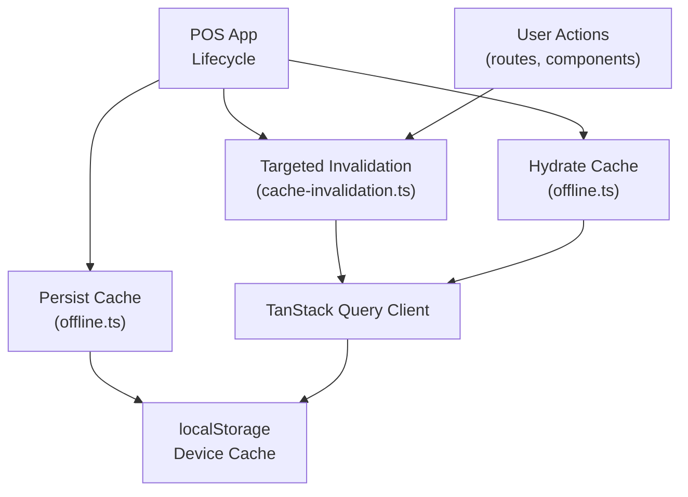
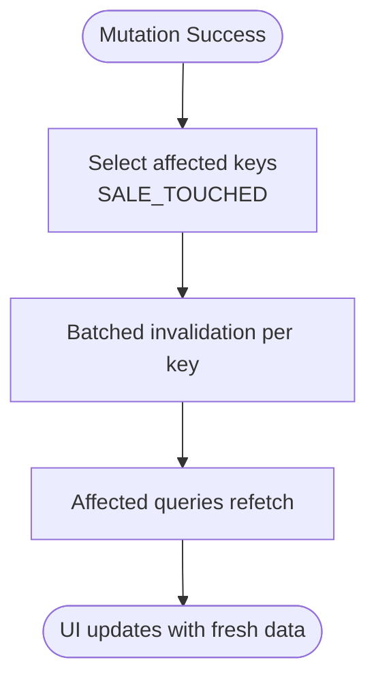
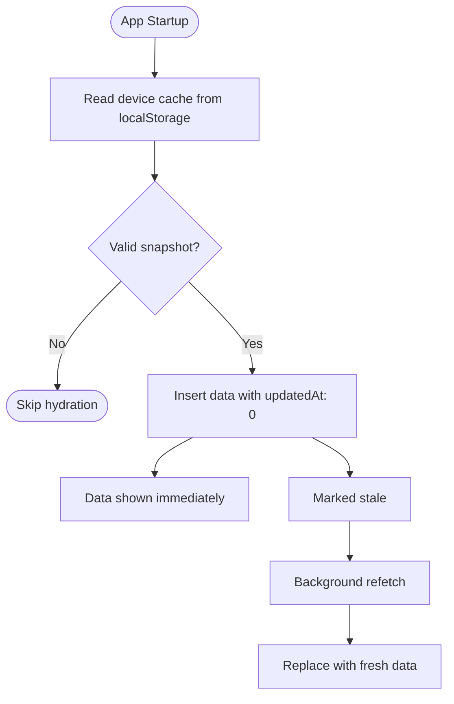
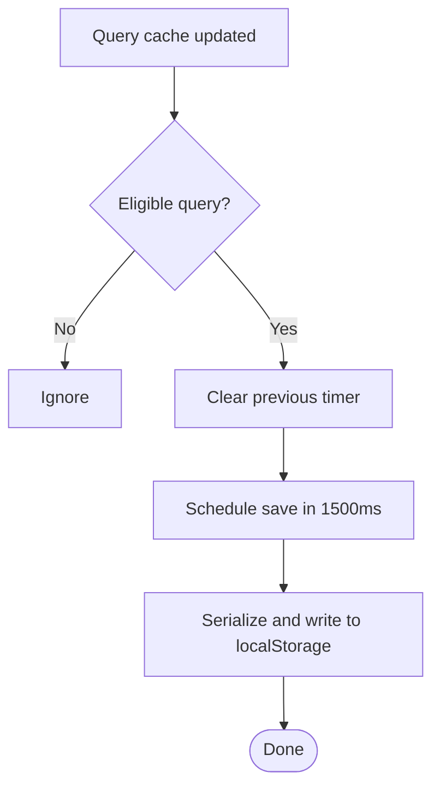
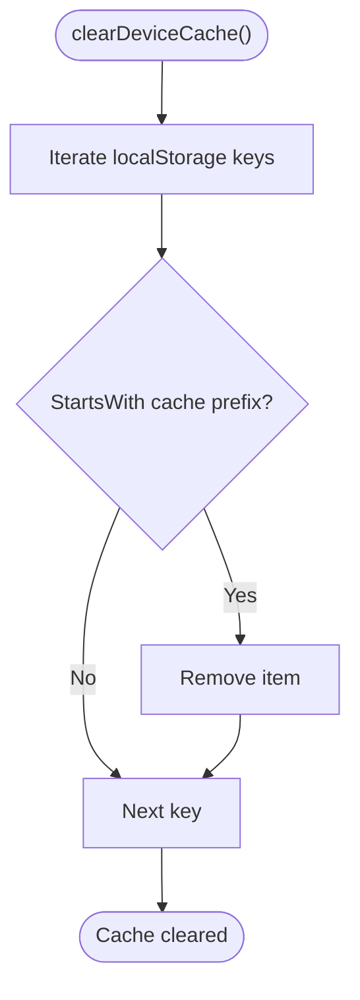
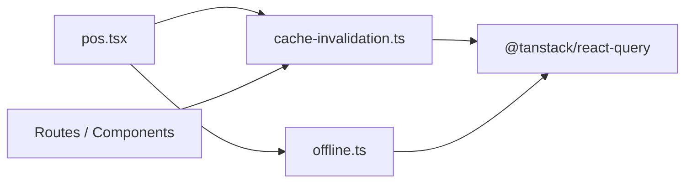

# Cache Invalidation & Refresh Policies

<cite>
**Referenced Files in This Document**   
- [cache-invalidation.ts](file://src/lib/cache-invalidation.ts)
- [offline.ts](file://src/lib/offline.ts)
- [pos.tsx](file://src/lib/pos.tsx)
- [__root.tsx](file://src/routes/__root.tsx)
- [app.index.tsx](file://src/routes/_authenticated/app.index.tsx)
- [QuickAddItem.tsx](file://src/components/pos/QuickAddItem.tsx)
</cite>

## Table of Contents
1. [Introduction](#introduction)
2. [Project Structure](#project-structure)
3. [Core Components](#core-components)
4. [Architecture Overview](#architecture-overview)
5. [Detailed Component Analysis](#detailed-component-analysis)
6. [Dependency Analysis](#dependency-analysis)
7. [Performance Considerations](#performance-considerations)
8. [Troubleshooting Guide](#troubleshooting-guide)
9. [Conclusion](#conclusion)

## Introduction
This document explains the cache invalidation policies and refresh mechanisms used by the application. It focuses on:
- How query key filtering determines which cached data is refreshed after writes.
- The background refresh strategy where `updatedAt: 0` marks data as stale but immediately available.
- The debounced persistence mechanism with a 1500ms delay that optimizes write operations to local storage.
- Examples for manually clearing the device cache and monitoring cache health.

The implementation centers around TanStack Query’s `QueryClient`, a small cache invalidation helper, and an offline persistence layer that bridges browser storage with the in-memory query cache.

## Project Structure
The cache-related logic lives primarily under `src/lib`:
- `cache-invalidation.ts` defines the set of query keys affected by sales or stock changes and provides a batching helper.
- `offline.ts` hydrates the cache from localStorage, persists eligible queries with debouncing, and exposes a manual clear function.
- `pos.tsx` wires hydration and persistence into the POS lifecycle and triggers targeted invalidation after successful syncs.
- Route and component files call the invalidation helper after user actions.



**Diagram sources**
- [pos.tsx:240-250](file://src/lib/pos.tsx#L240-L250)
- [offline.ts:15-55](file://src/lib/offline.ts#L15-L55)
- [cache-invalidation.ts:11-26](file://src/lib/cache-invalidation.ts#L11-L26)

**Section sources**
- [cache-invalidation.ts:1-26](file://src/lib/cache-invalidation.ts#L1-L26)
- [offline.ts:1-92](file://src/lib/offline.ts#L1-L92)
- [pos.tsx:240-250](file://src/lib/pos.tsx#L240-L250)

## Core Components
- **Targeted invalidation policy**: Instead of wiping the entire cache, only query keys related to money or stock movements are invalidated. This avoids unnecessary refetches of unrelated data such as catalogs or subscription details.
- **Background refresh with `updatedAt: 0`**: Hydrated data is inserted into the query cache with `updatedAt: 0`. This makes it immediately visible while marking it stale so TanStack Query refreshes it in the background without blocking UI startup.
- **Debounced persistence**: On every eligible query update, a 1500ms timer delays writing to localStorage. Rapid updates are coalesced into a single save, reducing I/O overhead.
- **Manual cache management**: A dedicated function clears all device-scoped cache entries stored under a specific prefix.

**Section sources**
- [cache-invalidation.ts:3-26](file://src/lib/cache-invalidation.ts#L3-L26)
- [offline.ts:15-60](file://src/lib/offline.ts#L15-L60)

## Architecture Overview
The system combines three layers:
1. **UI and routes** trigger mutations (e.g., completing a sale).
2. **Cache invalidation** selectively refreshes only the affected query keys.
3. **Offline persistence** keeps a snapshot of reference data in localStorage, hydrates it at startup, and debounces subsequent saves.

```mermaid
sequenceDiagram
participant UI as "UI / Routes"
participant QC as "QueryClient"
participant INV as "invalidateKeys"
participant OFF as "offline.ts"
participant LS as "localStorage"
UI->>QC : Mutation completes
QC-->>UI : Success
UI->>INV : invalidateKeys(qc, SALE_TOUCHED)
INV->>QC : invalidateQueries({ queryKey })
Note over QC : Affected queries refetch in background
OFF->>QC : subscribe(query cache events)
QC-->>OFF : updated event
OFF->>OFF : debounce(1500ms)
OFF->>LS : persist eligible queries
```

**Diagram sources**
- [cache-invalidation.ts:23-26](file://src/lib/cache-invalidation.ts#L23-L26)
- [offline.ts:46-55](file://src/lib/offline.ts#L46-L55)

## Detailed Component Analysis

### Targeted Query Key Filtering
The application maintains a curated list of query keys that must be refreshed when any money or stock movement occurs. These include sales lists, summaries, details, cost maps, stock, movements, shift summary, and dashboard alerts. When a mutation succeeds, the code calls the invalidation helper with this list. TanStack Query batches these invalidations efficiently, ensuring only relevant queries refetch.



**Diagram sources**
- [cache-invalidation.ts:11-26](file://src/lib/cache-invalidation.ts#L11-L26)

**Section sources**
- [cache-invalidation.ts:3-26](file://src/lib/cache-invalidation.ts#L3-L26)
- [app.index.tsx:320-325](file://src/routes/_authenticated/app.index.tsx#L320-L325)
- [QuickAddItem.tsx:78-85](file://src/components/pos/QuickAddItem.tsx#L78-L85)

### Background Refresh Strategy with `updatedAt: 0`
When the app starts, it hydrates the in-memory query cache from localStorage. For each persisted entry, if the query is not already present, it inserts the data with `updatedAt: 0`. This has two effects:
- The UI can render immediately using the hydrated data.
- TanStack Query treats the data as stale, triggering a background refresh to fetch the latest version.



**Diagram sources**
- [offline.ts:15-27](file://src/lib/offline.ts#L15-L27)

**Section sources**
- [offline.ts:15-27](file://src/lib/offline.ts#L15-L27)

### Debounced Persistence Mechanism
Persistence subscribes to query cache updates. For eligible queries (reference data that is safe to store), it schedules a save after 1500ms. If more updates arrive within that window, the timer resets, coalescing multiple writes into one. This reduces localStorage pressure and improves responsiveness during rapid edits.



**Diagram sources**
- [offline.ts:29-55](file://src/lib/offline.ts#L29-L55)

**Section sources**
- [offline.ts:29-55](file://src/lib/offline.ts#L29-L55)

### Manual Cache Clearing
To clear the device-local cache, the application exposes a function that removes all localStorage entries prefixed with the cache namespace. This is useful for troubleshooting or resetting stale state.



**Diagram sources**
- [offline.ts:57-60](file://src/lib/offline.ts#L57-L60)

**Section sources**
- [offline.ts:57-60](file://src/lib/offline.ts#L57-L60)
- [__root.tsx:120-126](file://src/routes/__root.tsx#L120-L126)

### Integration Points
- **POS lifecycle**: Hydration runs once at startup; persistence is enabled via a hook-like effect. After successful synchronization, targeted invalidation refreshes only the affected queries.
- **Route/component actions**: Various routes and components call the invalidation helper after mutations to keep caches consistent.

```mermaid
sequenceDiagram
participant Root as "__root.tsx"
participant POS as "pos.tsx"
participant OFF as "offline.ts"
participant INV as "cache-invalidation.ts"
Root->>POS : Initialize
POS->>OFF : hydrateCache(qc, userId)
POS->>OFF : persistCache(qc, userId)
POS->>INV : invalidateKeys(qc, SALE_TOUCHED)
```

**Diagram sources**
- [pos.tsx:240-250](file://src/lib/pos.tsx#L240-L250)
- [pos.tsx:330-340](file://src/lib/pos.tsx#L330-L340)
- [cache-invalidation.ts:23-26](file://src/lib/cache-invalidation.ts#L23-L26)

**Section sources**
- [pos.tsx:240-250](file://src/lib/pos.tsx#L240-L250)
- [pos.tsx:330-340](file://src/lib/pos.tsx#L330-L340)

## Dependency Analysis
The following diagram shows how modules depend on each other for cache behavior:



**Diagram sources**
- [cache-invalidation.ts:1-26](file://src/lib/cache-invalidation.ts#L1-L26)
- [offline.ts:1-92](file://src/lib/offline.ts#L1-L92)
- [pos.tsx:240-250](file://src/lib/pos.tsx#L240-L250)

**Section sources**
- [cache-invalidation.ts:1-26](file://src/lib/cache-invalidation.ts#L1-L26)
- [offline.ts:1-92](file://src/lib/offline.ts#L1-L92)
- [pos.tsx:240-250](file://src/lib/pos.tsx#L240-L250)

## Performance Considerations
- **Selective invalidation** prevents unnecessary network requests by refreshing only the queries impacted by a mutation.
- **Immediate hydration** with `updatedAt: 0` improves perceived performance by rendering instantly while still ensuring eventual consistency through background refresh.
- **Debounced persistence** reduces frequent localStorage writes, minimizing I/O contention and improving UI responsiveness during rapid edits.
- **Eligibility filtering** ensures only safe, non-role-gated reference data is persisted, keeping the device cache small and secure.

[No sources needed since this section provides general guidance]

## Troubleshooting Guide
- **Stale data after edits**: Ensure mutations call the targeted invalidation helper with the appropriate keys. Verify that the affected queries use matching query keys.
- **Slow startup due to refetches**: Confirm hydration sets `updatedAt: 0` for persisted entries so they are immediately visible and then refreshed in the background.
- **Excessive localStorage writes**: Check that persistence is subscribed correctly and that the 1500ms debounce is active. Rapid updates should be coalesced.
- **Corrupted device cache**: Use the manual clear function to remove all device-scoped cache entries. Then restart the app to rehydrate cleanly.
- **Monitoring cache health**: Inspect the in-memory query cache to verify hydration occurred and that eligible queries are being persisted. You can also observe whether background refetches occur after hydration.

**Section sources**
- [offline.ts:15-60](file://src/lib/offline.ts#L15-L60)
- [cache-invalidation.ts:11-26](file://src/lib/cache-invalidation.ts#L11-L26)

## Conclusion
The cache strategy balances speed and accuracy:
- Immediate visibility via hydration with `updatedAt: 0`.
- Accurate data via targeted invalidation of only the affected queries.
- Efficient persistence via debounced writes to localStorage.
Together, these mechanisms provide a responsive, reliable experience even under intermittent connectivity and heavy edit loads.

[No sources needed since this section summarizes without analyzing specific files]