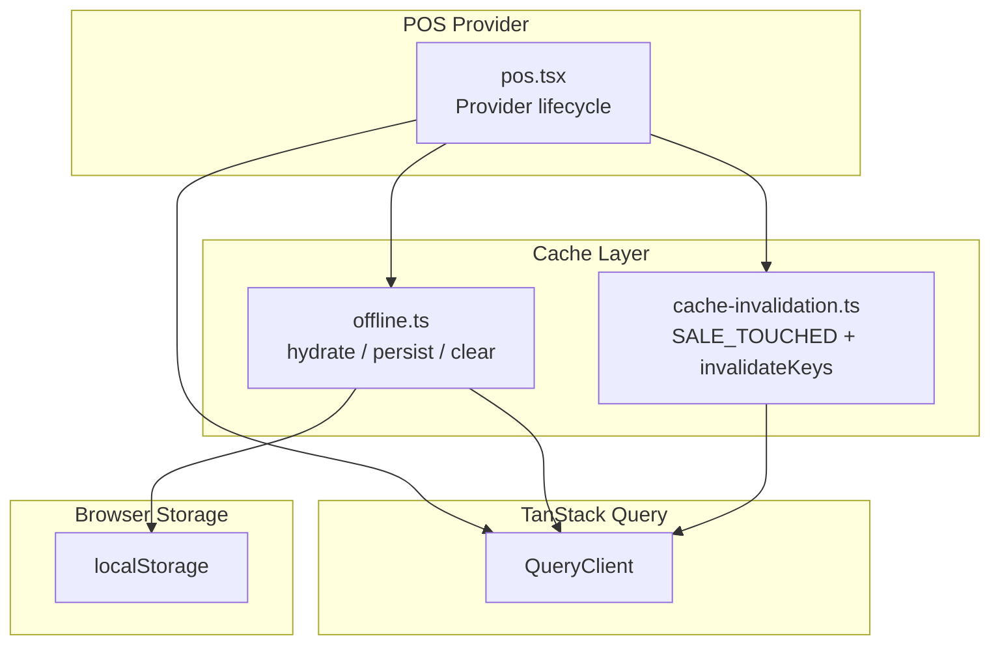
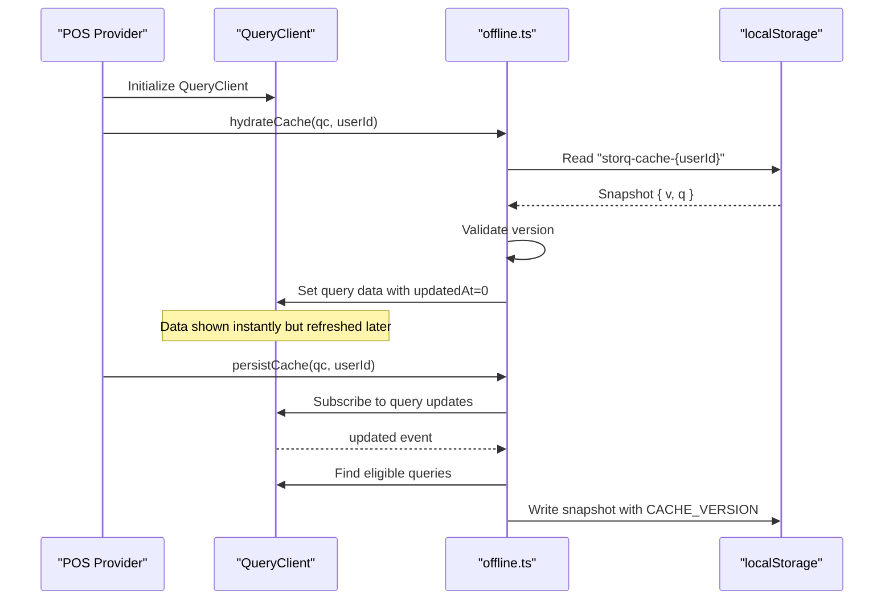
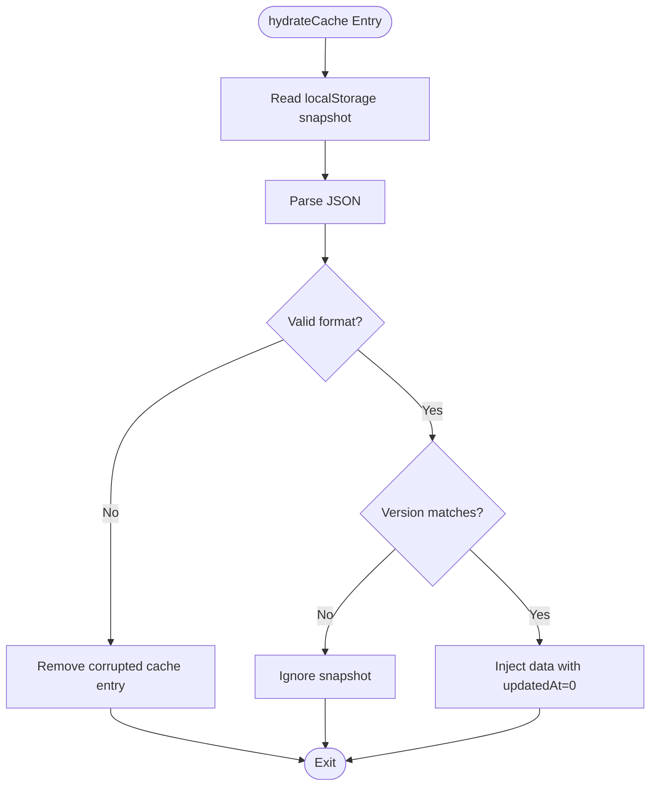
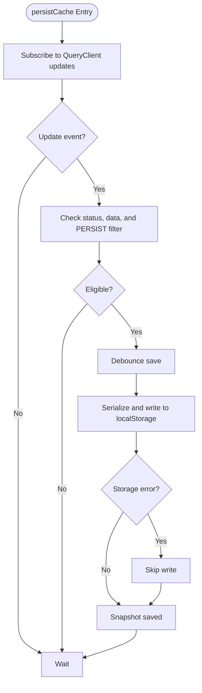
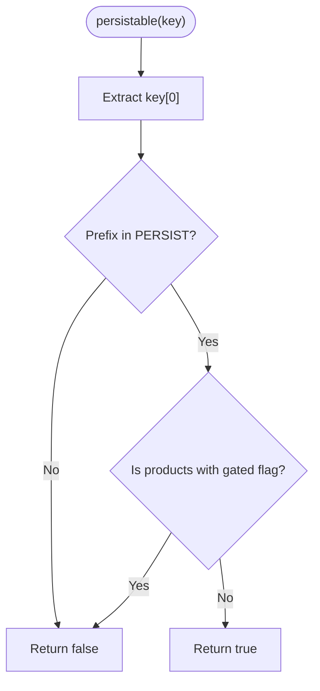
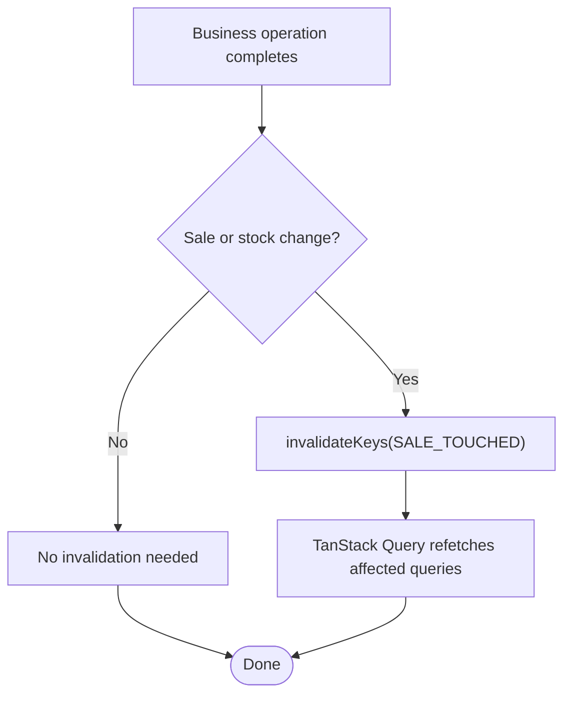
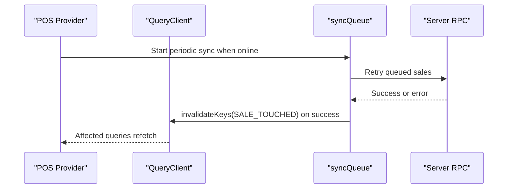
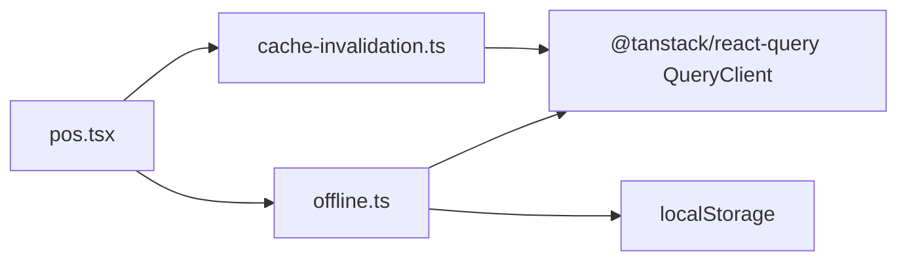

# Cache Management & Persistence

<cite>
**Referenced Files in This Document**
- [offline.ts](file://src/lib/offline.ts)
- [cache-invalidation.ts](file://src/lib/cache-invalidation.ts)
- [pos.tsx](file://src/lib/pos.tsx)
</cite>

## Table of Contents
1. [Introduction](#introduction)
2. [Project Structure](#project-structure)
3. [Core Components](#core-components)
4. [Architecture Overview](#architecture-overview)
5. [Detailed Component Analysis](#detailed-component-analysis)
6. [Dependency Analysis](#dependency-analysis)
7. [Performance Considerations](#performance-considerations)
8. [Troubleshooting Guide](#troubleshooting-guide)
9. [Conclusion](#conclusion)

## Introduction
This document explains the cache management and persistence layer used by the point-of-sale application. It covers how reference data is persisted to local storage, how it is restored on startup, which data types are allowed to be cached, how cache invalidation works, and how background synchronization keeps the UI consistent after offline sales.

The system is built around TanStack Query’s `QueryClient` and uses browser `localStorage` as a device-local snapshot for fast app startup. It also includes a targeted invalidation strategy so that business operations only refresh the queries they affect.

## Project Structure
The cache-related logic lives in three files:

- `src/lib/offline.ts`: Local persistence, cache hydration, versioning, filtering, and manual clearing utilities.
- `src/lib/cache-invalidation.ts`: A curated list of query keys affected by sales and stock changes, plus an invalidation helper.
- `src/lib/pos.tsx`: The POS provider that wires cache hydration on startup, starts cache persistence, handles offline checkout, and triggers invalidation after successful sync.

**Diagram sources**
- [pos.tsx:115-247](file://src/lib/pos.tsx#L115-L247)
- [offline.ts:15-60](file://src/lib/offline.ts#L15-L60)
- [cache-invalidation.ts:11-26](file://src/lib/cache-invalidation.ts#L11-L26)

**Section sources**
- [offline.ts:1-92](file://src/lib/offline.ts#L1-L92)
- [cache-invalidation.ts:1-27](file://src/lib/cache-invalidation.ts#L1-L27)
- [pos.tsx:115-247](file://src/lib/pos.tsx#L115-L247)

## Core Components

### Offline Cache Module (`offline.ts`)
This module provides:

- **Cache versioning**: A numeric `CACHE_VERSION` ensures old snapshots are not applied when the schema or caching rules change.
- **Hydration**: `hydrateCache` reads a user-scoped snapshot from `localStorage`, validates its version, and injects cached data into TanStack Query with `updatedAt: 0`. This makes data appear instantly while still being treated as stale so it refreshes in the background.
- **Persistence**: `persistCache` subscribes to TanStack Query updates, filters eligible queries, and writes a compressed snapshot back to `localStorage` with debounced saves.
- **Filtering**: Only a controlled set of query prefixes can be persisted through the `PERSIST` set.
- **Manual clearing**: `clearDeviceCache` removes all cache entries under the cache prefix.
- **Offline queue helpers**: Utilities for loading, saving, and detecting network errors related to queued sales.

Key responsibilities:
- Safe JSON parsing and corruption recovery.
- Version-gated cache restoration.
- Debounced persistence to avoid excessive writes.
- Graceful handling of full storage.

**Section sources**
- [offline.ts:5-13](file://src/lib/offline.ts#L5-L13)
- [offline.ts:15-27](file://src/lib/offline.ts#L15-L27)
- [offline.ts:29-55](file://src/lib/offline.ts#L29-L55)
- [offline.ts:57-60](file://src/lib/offline.ts#L57-L60)
- [offline.ts:71-92](file://src/lib/offline.ts#L71-L92)

### Cache Invalidation Module (`cache-invalidation.ts`)
This module defines:

- `SALE_TOUCHED`: A fixed list of query key prefixes that should be invalidated after any sale or stock movement.
- `invalidateKeys`: A helper that invalidates each key individually so TanStack Query can batch and optimize refetches.

This approach avoids global cache invalidation during normal business operations, preventing unnecessary re-fetches of unrelated data such as catalogs or subscription state.

**Section sources**
- [cache-invalidation.ts:3-10](file://src/lib/cache-invalidation.ts#L3-L10)
- [cache-invalidation.ts:11-21](file://src/lib/cache-invalidation.ts#L11-L21)
- [cache-invalidation.ts:23-26](file://src/lib/cache-invalidation.ts#L23-L26)

### POS Provider Integration (`pos.tsx`)
The POS provider integrates cache behavior into the application lifecycle:

- On initialization, it hydrates the cache using the current user ID.
- It starts persistence via a React effect tied to the `QueryClient` and user ID.
- It exposes a `refresh` function that performs a full cache invalidation.
- After successfully syncing offline sales, it invalidates only the relevant query keys.

It also manages staff sessions, store selection, online status, and the offline sales queue.

**Section sources**
- [pos.tsx:115-147](file://src/lib/pos.tsx#L115-L147)
- [pos.tsx:186-192](file://src/lib/pos.tsx#L186-L192)
- [pos.tsx:242-247](file://src/lib/pos.tsx#L242-L247)
- [pos.tsx:309-345](file://src/lib/pos.tsx#L309-L345)
- [pos.tsx:366-388](file://src/lib/pos.tsx#L366-L388)

## Architecture Overview

**Diagram sources**
- [pos.tsx:242-247](file://src/lib/pos.tsx#L242-L247)
- [offline.ts:15-55](file://src/lib/offline.ts#L15-L55)

## Detailed Component Analysis

### Cache Versioning Strategy
The cache stores a version number alongside the serialized query data. On hydration, the stored version is compared against the current `CACHE_VERSION`. If they differ, the snapshot is ignored. This prevents incompatible cached data from being applied after code or schema changes.

**Diagram sources**
- [offline.ts:15-27](file://src/lib/offline.ts#L15-L27)

**Section sources**
- [offline.ts:5-7](file://src/lib/offline.ts#L5-L7)
- [offline.ts:15-27](file://src/lib/offline.ts#L15-L27)

### Hydrate Cache Function
`hydrateCache` restores cached data safely:

1. Reads the user-scoped cache entry.
2. Parses and validates the structure.
3. Rejects snapshots with mismatched versions.
4. Injects data into TanStack Query with `updatedAt: 0`.
5. Catches parse errors and removes the corrupted cache entry.

Using `updatedAt: 0` means the UI shows cached data immediately, but TanStack Query treats it as stale and will refresh it in the background.

**Section sources**
- [offline.ts:15-27](file://src/lib/offline.ts#L15-L27)

### Persist Cache Function
`persistCache` maintains cache consistency:

1. Subscribes to TanStack Query update events.
2. Filters updates to only include successful queries with data.
3. Applies the `persistable` filter based on the `PERSIST` set.
4. Debounces writes with a short timeout to reduce storage churn.
5. Writes a snapshot including the current `CACHE_VERSION`.
6. Handles storage quota failures gracefully without breaking the app.

**Diagram sources**
- [offline.ts:29-55](file://src/lib/offline.ts#L29-L55)

**Section sources**
- [offline.ts:29-55](file://src/lib/offline.ts#L29-L55)

### PERSIST Set and Query Key Filtering
The `PERSIST` set defines which query prefixes may be cached:

- `business`
- `stores`
- `products`
- `collections`
- `stock`
- `staff-names`

The `persistable` function enforces two rules:

1. The first element of the query key must match one of the allowed prefixes.
2. Product queries with a specific flag indicating role-gated pricing are excluded.

This design ensures only safe, broadly readable reference data is persisted. Role-gated data such as buying costs or reports is intentionally excluded because different staff roles have different permissions.

**Diagram sources**
- [offline.ts:9-13](file://src/lib/offline.ts#L9-L13)

**Section sources**
- [offline.ts:9-13](file://src/lib/offline.ts#L9-L13)

### Cache Invalidation Policies
The application uses targeted invalidation rather than global cache resets for most business operations:

- `SALE_TOUCHED` lists query keys affected by sales and stock movements.
- `invalidateKeys` invalidates each key separately, allowing TanStack Query to batch refetches efficiently.
- Full cache invalidation is reserved for security-sensitive events like lock/unlock and authentication changes.

**Diagram sources**
- [cache-invalidation.ts:3-10](file://src/lib/cache-invalidation.ts#L3-L10)
- [cache-invalidation.ts:11-26](file://src/lib/cache-invalidation.ts#L11-L26)

**Section sources**
- [cache-invalidation.ts:3-26](file://src/lib/cache-invalidation.ts#L3-L26)
- [pos.tsx:309-345](file://src/lib/pos.tsx#L309-L345)

### Background Refresh Mechanisms
Background refresh happens in two main ways:

1. **Hydration-driven refresh**: Cached data is injected with `updatedAt: 0`, making it visible immediately but stale. TanStack Query then refetches it in the background.
2. **Offline sales sync**: When the device is online and a staff session exists, queued sales are retried periodically. After successful sync, only the relevant query keys are invalidated.

**Diagram sources**
- [pos.tsx:309-345](file://src/lib/pos.tsx#L309-L345)
- [cache-invalidation.ts:11-26](file://src/lib/cache-invalidation.ts#L11-L26)

**Section sources**
- [pos.tsx:242-247](file://src/lib/pos.tsx#L242-L247)
- [pos.tsx:309-345](file://src/lib/pos.tsx#L309-L345)

### Examples of Usage Patterns

#### Cache Initialization
On provider mount, the app calls `hydrateCache` to restore the last known reference data snapshot. This enables instant rendering of catalog and stock information before the network request completes.

**Section sources**
- [pos.tsx:242-247](file://src/lib/pos.tsx#L242-L247)
- [offline.ts:15-27](file://src/lib/offline.ts#L15-L27)

#### Manual Cache Clearing
Call `clearDeviceCache` to remove all cache entries under the cache prefix. This is useful for troubleshooting or forcing a fresh data load.

**Section sources**
- [offline.ts:57-60](file://src/lib/offline.ts#L57-L60)

#### Monitoring Cache Health
Recommended approaches:

- Inspect `localStorage` keys starting with the cache prefix to verify snapshots exist.
- Use the provider’s `refresh` function to force a full cache invalidation and observe refetch behavior.
- Monitor the offline banner and queued sale status to detect sync issues.
- Check whether cached queries are being hydrated and subsequently refreshed by observing TanStack Query state in development tools.

**Section sources**
- [pos.tsx:366-388](file://src/lib/pos.tsx#L366-L388)
- [offline.ts:57-60](file://src/lib/offline.ts#L57-L60)

## Dependency Analysis

**Diagram sources**
- [pos.tsx:11-23](file://src/lib/pos.tsx#L11-L23)
- [offline.ts:3-3](file://src/lib/offline.ts#L3-L3)
- [cache-invalidation.ts:1-1](file://src/lib/cache-invalidation.ts#L1-L1)

**Section sources**
- [pos.tsx:11-23](file://src/lib/pos.tsx#L11-L23)
- [offline.ts:1-3](file://src/lib/offline.ts#L1-L3)
- [cache-invalidation.ts:1-1](file://src/lib/cache-invalidation.ts#L1-L1)

## Performance Considerations

- **Debounced persistence**: Cache writes are throttled to reduce frequent `localStorage` operations.
- **Selective persistence**: Only whitelisted query prefixes are saved, limiting snapshot size.
- **Targeted invalidation**: Business operations invalidate only affected queries instead of resetting the entire cache.
- **Instant start**: Hydration with `updatedAt: 0` improves perceived performance by showing cached data immediately while refreshing in the background.
- **Graceful storage failures**: If `localStorage` is full, persistence is skipped without crashing the app.

Recommendations:
- Keep the `PERSIST` set minimal and focused on read-only reference data.
- Avoid persisting large or frequently changing datasets.
- Monitor snapshot size and adjust caching strategy if storage quotas become a concern.
- Use targeted invalidation for most mutations; reserve full invalidation for security-sensitive transitions.

## Troubleshooting Guide

### Corrupted Cache Recovery
If the cached snapshot cannot be parsed, `hydrateCache` removes the corrupted entry. This prevents broken data from affecting the app.

Actions:
- Clear the device cache using `clearDeviceCache`.
- Restart the app to allow a fresh hydration and background refresh.

**Section sources**
- [offline.ts:15-27](file://src/lib/offline.ts#L15-L27)
- [offline.ts:57-60](file://src/lib/offline.ts#L57-L60)

### Storage Quota Exceeded
When `localStorage.setItem` fails due to storage limits, the persistence function catches the error and skips the write. The app continues working online.

Actions:
- Clear unused cache entries.
- Reduce the amount of cached data by narrowing the `PERSIST` set.
- Verify that only necessary queries are being persisted.

**Section sources**
- [offline.ts:29-55](file://src/lib/offline.ts#L29-L55)

### Stale or Incompatible Cache
If cached data becomes incompatible after an update, the version check prevents hydration.

Actions:
- Clear the cache to force a fresh load.
- Ensure `CACHE_VERSION` is incremented when cache schema or filtering rules change.

**Section sources**
- [offline.ts:5-7](file://src/lib/offline.ts#L5-L7)
- [offline.ts:15-27](file://src/lib/offline.ts#L15-L27)

### Offline Sales Not Syncing
Queued sales are retried periodically when the device is online and a valid staff session exists. Network errors or locked sessions stop further retries until conditions improve.

Actions:
- Unlock the POS session.
- Confirm network connectivity.
- Use the provided retry controls in the offline banner.
- Check for masked RPC errors and resolve underlying permission or server issues.

**Section sources**
- [pos.tsx:309-345](file://src/lib/pos.tsx#L309-L345)
- [offline.ts:83-84](file://src/lib/offline.ts#L83-L84)

## Conclusion
The cache management system balances speed, safety, and correctness. It persists a small, controlled set of reference data to enable instant startup, applies strict versioning to prevent incompatible cache usage, and relies on TanStack Query for background refresh and invalidation. Targeted invalidation minimizes unnecessary network traffic, while graceful error handling ensures the app remains usable even when storage or network conditions are poor. For long-term reliability, keep the `PERSIST` set conservative, increment cache versions when schemas change, and prefer targeted invalidation over global resets.