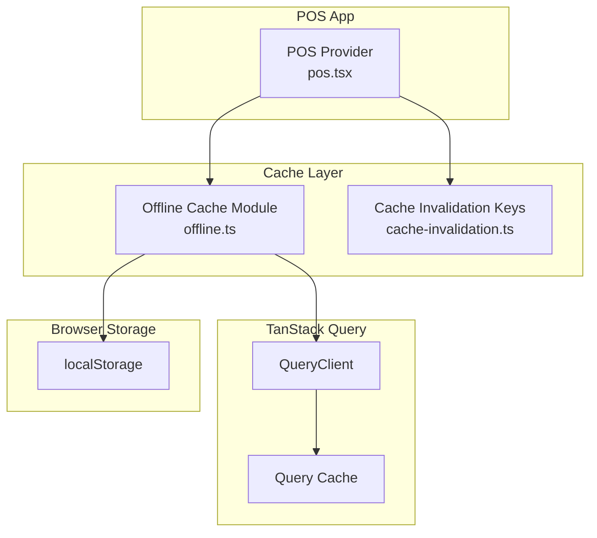
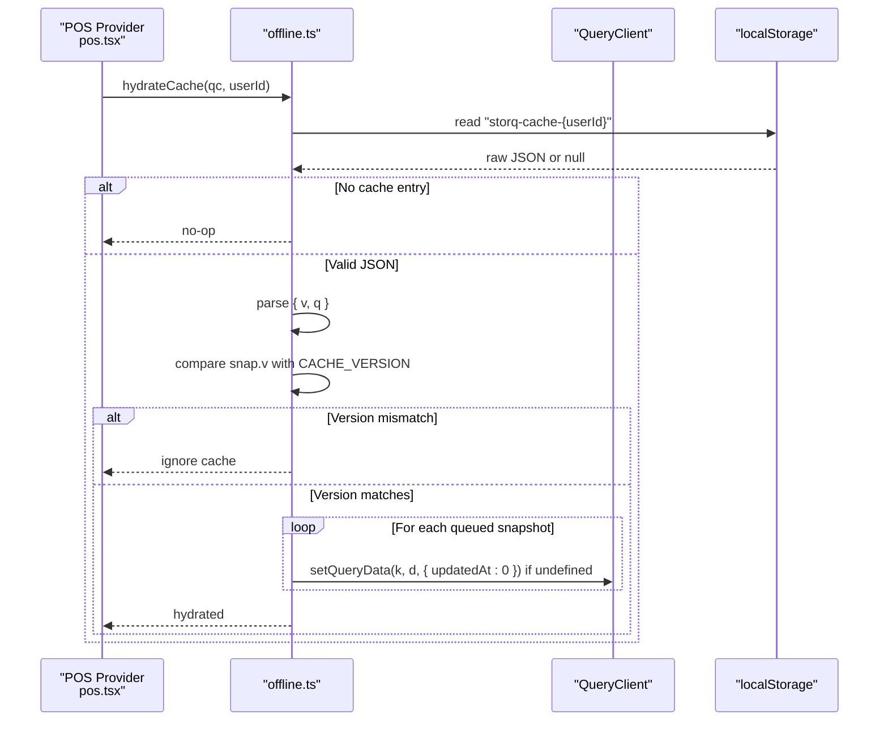
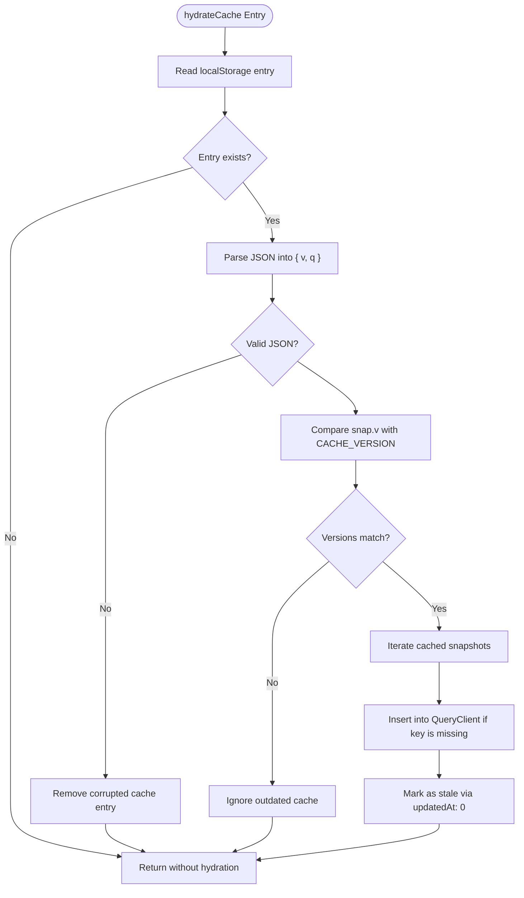
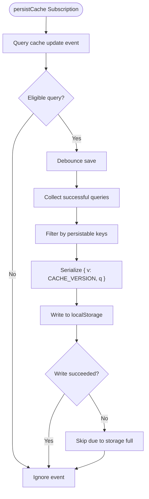
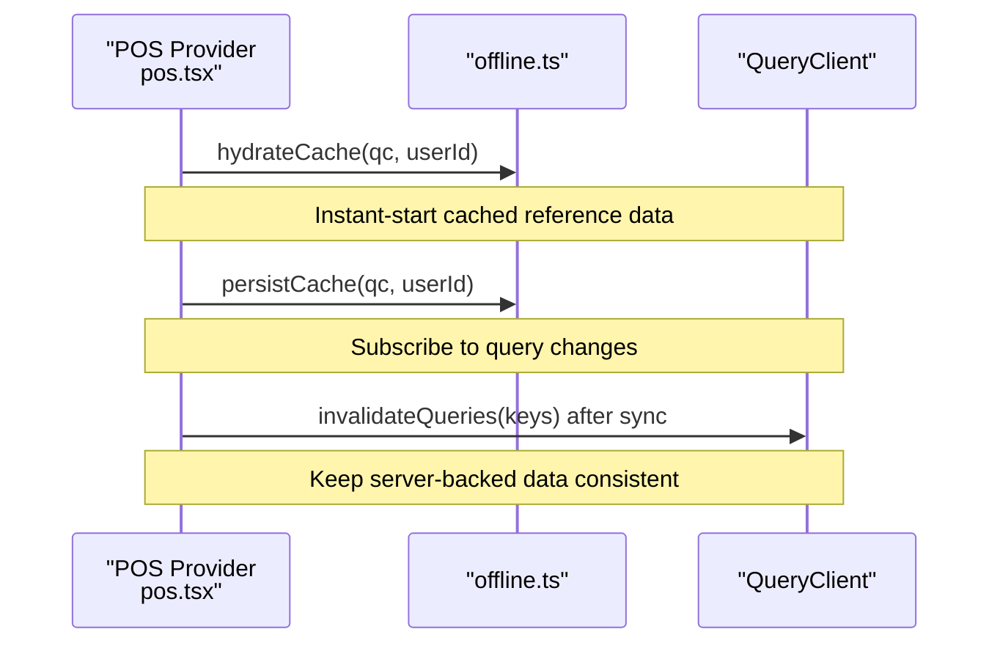
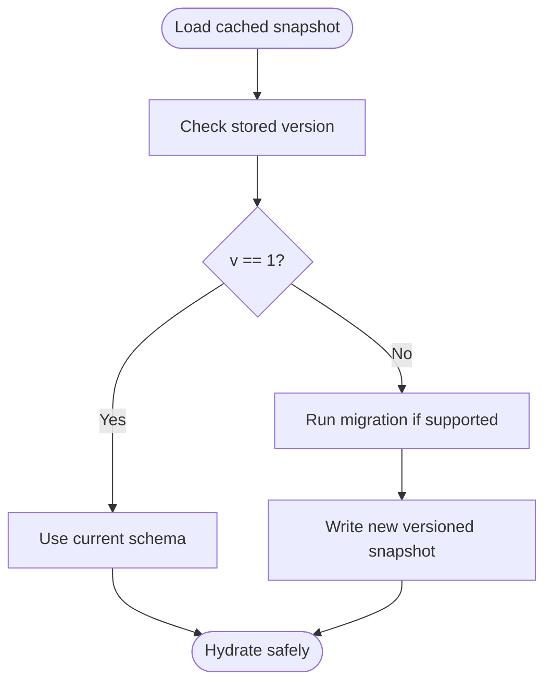
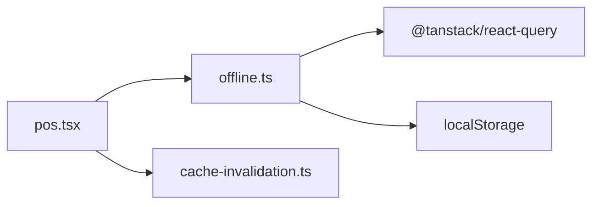

# Cache Versioning & Compatibility

<cite>
**Referenced Files in This Document**
- [offline.ts](file://src/lib/offline.ts)
- [pos.tsx](file://src/lib/pos.tsx)
- [cache-invalidation.ts](file://src/lib/cache-invalidation.ts)
</cite>

## Table of Contents
1. [Introduction](#introduction)
2. [Project Structure](#project-structure)
3. [Core Components](#core-components)
4. [Architecture Overview](#architecture-overview)
5. [Detailed Component Analysis](#detailed-component-analysis)
6. [Dependency Analysis](#dependency-analysis)
7. [Performance Considerations](#performance-considerations)
8. [Troubleshooting Guide](#troubleshooting-guide)
9. [Conclusion](#conclusion)

## Introduction
This document explains the cache versioning and compatibility system used by the point-of-sale application to keep device-local cached data safe across application updates. The key mechanism is a single `CACHE_VERSION` constant that is written into every persisted snapshot and checked during hydration. If the stored version does not match the running application’s expected version, the old cache is ignored so incompatible or outdated data cannot corrupt the current state.

The hydrate function loads only reference data that is safe for instant display and marks it as stale so the app refreshes it from the server in the background. Corrupted or unreadable cache entries are automatically removed to prevent repeated failures.

## Project Structure
The cache versioning logic lives in a small, focused module:

- `src/lib/offline.ts`: Defines the cache format, version constant, hydration, persistence, and queue helpers.
- `src/lib/pos.tsx`: Initializes hydration on app start and subscribes to cache changes for persistence.
- `src/lib/cache-invalidation.ts`: Defines which query keys should be invalidated after sales-related writes; this complements the offline cache by keeping server-backed queries consistent.

**Diagram sources**
- [pos.tsx:115-247](file://src/lib/pos.tsx#L115-L247)
- [offline.ts:15-55](file://src/lib/offline.ts#L15-L55)
- [cache-invalidation.ts:1-27](file://src/lib/cache-invalidation.ts#L1-L27)

**Section sources**
- [offline.ts:1-92](file://src/lib/offline.ts#L1-L92)
- [pos.tsx:115-247](file://src/lib/pos.tsx#L115-L247)
- [cache-invalidation.ts:1-27](file://src/lib/cache-invalidation.ts#L1-L27)

## Core Components
- `CACHE_VERSION`: A numeric compatibility marker stored with every cached snapshot. It ensures that only snapshots created by an application version expecting the same schema are accepted.
- `hydrateCache(qc, userId)`: Loads the user’s cached snapshot from `localStorage`, validates the version, and inserts eligible rows into TanStack Query with an immediate but stale presentation.
- `persistCache(qc, userId)`: Subscribes to query cache updates and periodically serializes eligible query results back to `localStorage`.
- `clearDeviceCache()`: Removes all device-local cache entries for the current environment.
- Queue helpers (`loadQueue`, `saveQueue`, `isNetworkError`, `newRef`): Support offline sales persistence and retry behavior.

**Section sources**
- [offline.ts:5-27](file://src/lib/offline.ts#L5-L27)
- [offline.ts:29-60](file://src/lib/offline.ts#L29-L60)
- [offline.ts:71-92](file://src/lib/offline.ts#L71-L92)

## Architecture Overview
The cache system integrates three layers:

1. **Application layer**: The POS provider initializes hydration when the app starts and enables persistence through a subscription to query cache events.
2. **Cache layer**: The offline module reads/writes a structured JSON object containing a version field and a list of query snapshots. It also manages the offline sales queue.
3. **Storage layer**: Browser `localStorage` holds per-user cache snapshots and queue entries.

**Diagram sources**
- [pos.tsx:242-247](file://src/lib/pos.tsx#L242-L247)
- [offline.ts:15-27](file://src/lib/offline.ts#L15-L27)

## Detailed Component Analysis

### Cache Versioning and Data Compatibility
The cache snapshot has two main fields:

| Field | Meaning | Behavior |
|---|---|---|
| `v` | Schema compatibility version | Must equal `CACHE_VERSION` for the snapshot to be accepted |
| `q` | Array of cached query snapshots | Each entry contains a query key and its data |

When the application updates, changing the cache schema requires incrementing `CACHE_VERSION`. On next load, any older snapshot will fail the version check and be ignored. This prevents incompatible data from being loaded into the active state.

**Diagram sources**
- [offline.ts:15-27](file://src/lib/offline.ts#L15-L27)

**Section sources**
- [offline.ts:5-27](file://src/lib/offline.ts#L5-L27)

### Hydration Safety Mechanisms
Hydration is intentionally defensive:

- **Missing cache**: If no cache entry exists, hydration returns immediately without error.
- **Invalid JSON**: Parsing errors trigger removal of the corrupted cache entry so future loads do not repeatedly fail.
- **Version mismatch**: Snapshots with a different `v` value are silently ignored.
- **Selective insertion**: Only query keys that are currently absent are inserted, avoiding overwriting fresh in-memory data.
- **Stale presentation**: Cached data is marked with `updatedAt: 0`, meaning it can be shown instantly but is treated as stale and refreshed in the background.

These rules ensure that corrupted, malformed, or incompatible cache data never pollutes the running application state.

**Section sources**
- [offline.ts:15-27](file://src/lib/offline.ts#L15-L27)

### Persistence Strategy
Persistence captures successful query results for a controlled set of reference data:

- Only queries with status `success` and defined data are persisted.
- Only whitelisted query keys are persisted, such as business, stores, products, collections, stock, and staff names.
- Product data with specific flags is excluded to avoid persisting sensitive or expensive-to-recompute data.
- Persistence is debounced after query updates to reduce write frequency.
- Storage failures are caught and ignored because the app remains functional online.

**Diagram sources**
- [offline.ts:29-55](file://src/lib/offline.ts#L29-L55)

**Section sources**
- [offline.ts:29-55](file://src/lib/offline.ts#L29-L55)

### Integration with the POS Provider
The POS provider calls hydration once at startup and enables persistence for the lifetime of the component tree:

- Hydration runs only in the browser environment.
- Hydration occurs before normal query execution so the UI can show last-known reference data immediately.
- Persistence is enabled through a React effect that subscribes to query cache changes.
- After successful offline sale syncs, targeted query invalidation is applied using shared invalidation keys.

**Diagram sources**
- [pos.tsx:242-247](file://src/lib/pos.tsx#L242-L247)
- [pos.tsx:336-337](file://src/lib/pos.tsx#L336-L337)
- [cache-invalidation.ts:11-26](file://src/lib/cache-invalidation.ts#L11-L26)

**Section sources**
- [pos.tsx:242-247](file://src/lib/pos.tsx#L242-L247)
- [pos.tsx:336-337](file://src/lib/pos.tsx#L336-L337)
- [cache-invalidation.ts:1-27](file://src/lib/cache-invalidation.ts#L1-L27)

### Version Migration Strategies
Because `CACHE_VERSION` is a single integer, migration strategy should be simple and explicit:

1. **Schema-compatible change**: If the new version still accepts the old shape, keep `CACHE_VERSION` unchanged.
2. **Breaking schema change**: Increment `CACHE_VERSION` so existing snapshots are rejected.
3. **Migration helper**: If needed, add a dedicated migration step between hydration and persistence that transforms old snapshots into the new format before writing them back.
4. **Safe default**: Always treat version mismatches as “ignore cache,” never as “auto-migrate.” Auto-migration risks loading partially transformed or unsafe data.
5. **Testing**: Add tests for:
   - Missing cache
   - Corrupted cache
   - Old version cache
   - New version cache
   - Empty valid cache
   - Large cache near storage limits

Example migration flow concept:

[No sources needed since this diagram shows conceptual workflow, not actual code structure]

### Safety Mechanisms That Prevent Incompatible Data
- **Version gate**: `snap.v !== CACHE_VERSION` causes hydration to return without inserting data.
- **Try/catch around parsing**: Corrupted JSON triggers removal of the entire cache entry.
- **Conditional insertion**: Only missing query keys are populated, preventing accidental overwrite of fresh data.
- **Stale flag**: Cached data is presented immediately but marked stale so the network layer refreshes it.
- **Whitelisted persistence**: Only safe, role-neutral reference data is persisted.
- **Storage failure tolerance**: Persist failures are swallowed so the app continues working online.

**Section sources**
- [offline.ts:15-27](file://src/lib/offline.ts#L15-L27)
- [offline.ts:29-55](file://src/lib/offline.ts#L29-L55)

## Dependency Analysis
The cache versioning system has minimal external dependencies:

- TanStack Query provides the in-memory query client and cache.
- Browser `localStorage` provides durable device storage.
- The POS provider orchestrates hydration and persistence lifecycle.
- Cache invalidation keys coordinate server-backed query freshness after offline operations.

**Diagram sources**
- [pos.tsx:11-23](file://src/lib/pos.tsx#L11-L23)
- [offline.ts:3-3](file://src/lib/offline.ts#L3-L3)
- [cache-invalidation.ts:1-1](file://src/lib/cache-invalidation.ts#L1-L1)

**Section sources**
- [pos.tsx:11-23](file://src/lib/pos.tsx#L11-L23)
- [offline.ts:1-92](file://src/lib/offline.ts#L1-L92)
- [cache-invalidation.ts:1-27](file://src/lib/cache-invalidation.ts#L1-L27)

## Performance Considerations
- Hydration is lightweight: it reads one `localStorage` entry and optionally inserts a small number of query entries.
- Persistence is debounced to avoid excessive writes after rapid query updates.
- Only successful, whitelisted queries are persisted, reducing payload size.
- Marking cached data as stale avoids blocking the UI while allowing background refresh.
- Storage-full errors are ignored so performance degradation does not break core functionality.

[No sources needed since this section provides general guidance]

## Troubleshooting Guide
Common issues and their likely causes:

| Symptom | Likely Cause | Resolution |
|---|---|---|
| Cached data disappears after an app update | `CACHE_VERSION` was incremented | This is expected; the app will reload fresh data from the server |
| Cache is ignored even though it looks valid | Stored `v` does not match `CACHE_VERSION` | Update the cache schema and increment `CACHE_VERSION` if necessary |
| Repeated hydration failures | Corrupted or malformed `localStorage` entry | The cache entry is automatically removed; clear device cache if needed |
| UI shows stale catalog data briefly | Cached data is intentionally marked stale | Allow background refresh; verify network connectivity |
| Cache not persisting | Storage quota exceeded or unsupported environment | Check browser storage limits; app remains functional online |
| Sales not syncing | Network error or locked session | Retry later; unlock session if required |

Operational helpers:

- `clearDeviceCache()`: Clears all device-local cache entries.
- `loadQueue(userId)` / `saveQueue(userId, q)`: Manage offline sales queue.
- `isNetworkError(message)`: Detects network-related failures.
- `newRef()`: Generates unique references for queued sales.

**Section sources**
- [offline.ts:57-92](file://src/lib/offline.ts#L57-L92)

## Conclusion
The cache versioning system uses a simple but robust design: a single `CACHE_VERSION` constant gates hydration, ensuring that only compatible snapshots are accepted. Hydration is defensive against missing, corrupted, and outdated data, while persistence is selective and resilient. Together with targeted cache invalidation, this approach keeps the POS interface fast and reliable while protecting application state from incompatible or stale local data.

[No sources needed since this section summarizes without analyzing specific files]