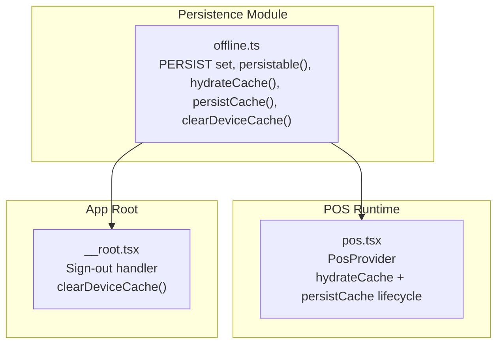
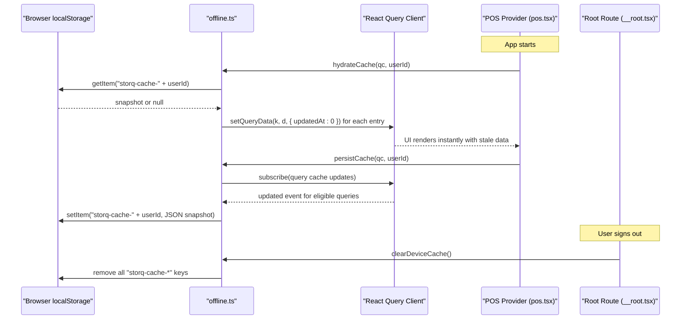
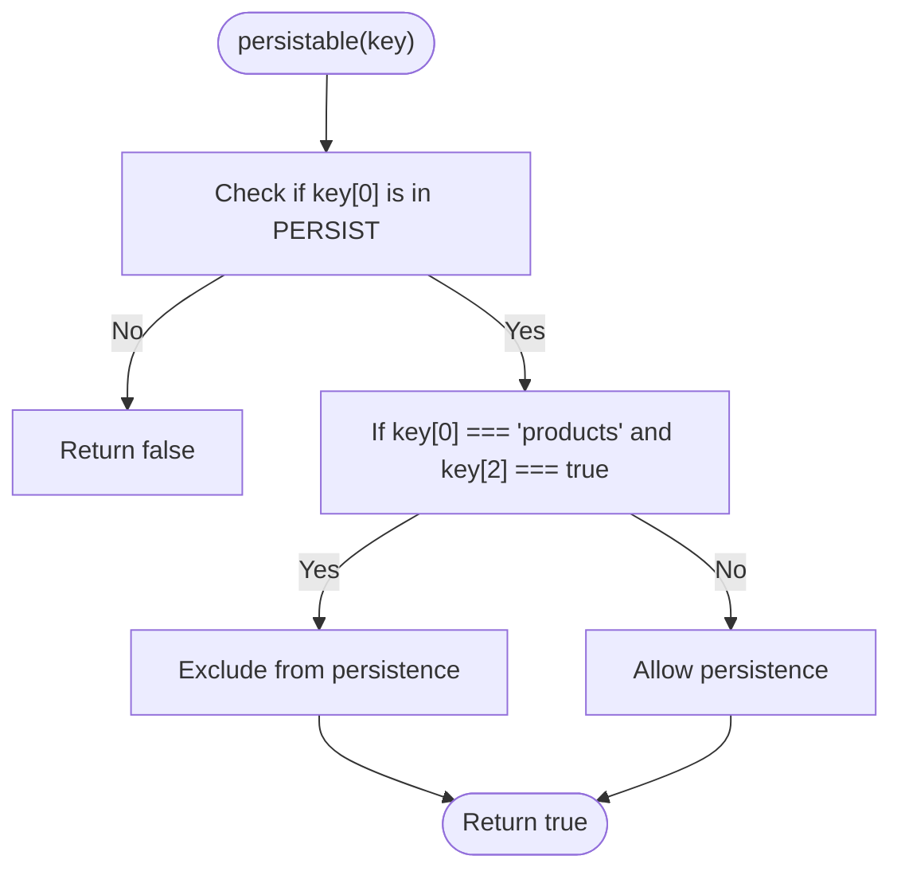
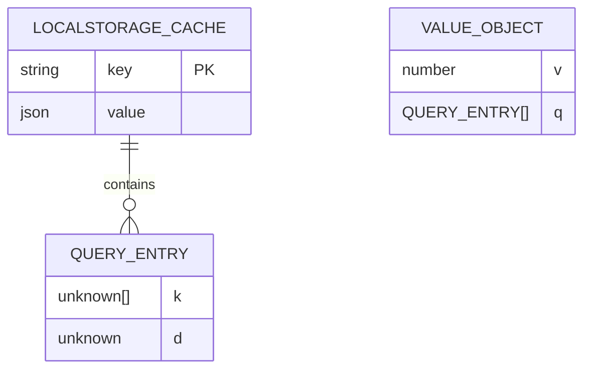
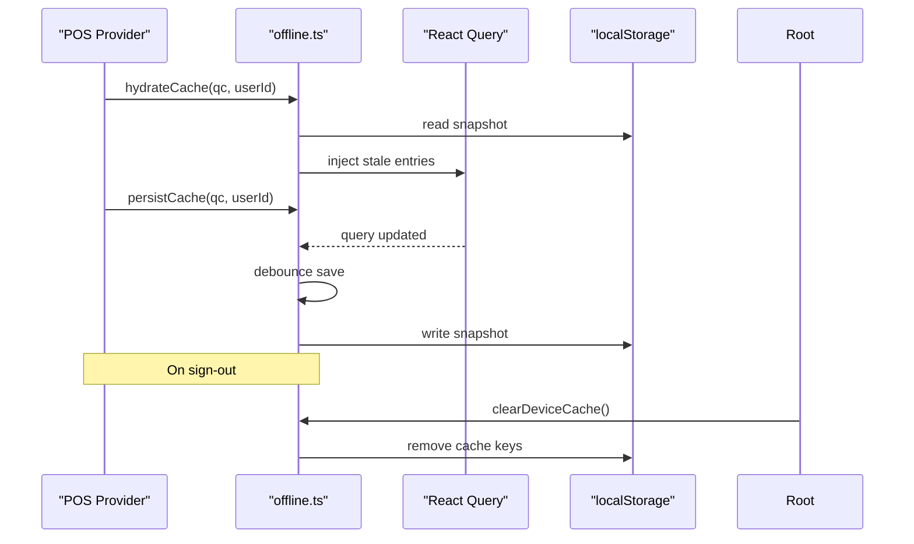
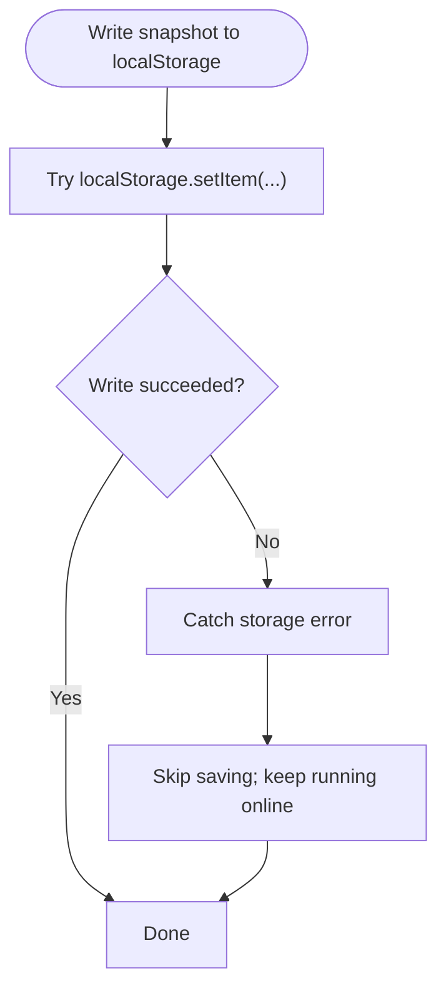
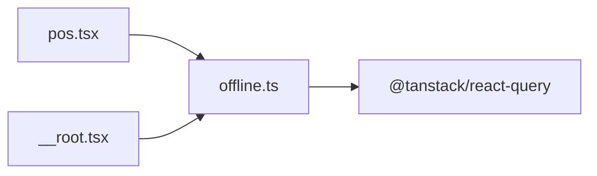

# Persistence Strategy & Data Selection

<cite>
**Referenced Files in This Document**
- [offline.ts](file://src/lib/offline.ts)
- [pos.tsx](file://src/lib/pos.tsx)
- [__root.tsx](file://src/routes/__root.tsx)
</cite>

## Table of Contents
1. [Introduction](#introduction)
2. [Project Structure](#project-structure)
3. [Core Components](#core-components)
4. [Architecture Overview](#architecture-overview)
5. [Detailed Component Analysis](#detailed-component-analysis)
6. [Dependency Analysis](#dependency-analysis)
7. [Performance Considerations](#performance-considerations)
8. [Troubleshooting Guide](#troubleshooting-guide)
9. [Conclusion](#conclusion)

## Introduction
This document explains the cache persistence strategy used by the point-of-sale application to make tills open quickly and continue working when the network is unavailable. The strategy persists a small, role-safe snapshot of reference data into browser `localStorage`, then hydrates React Query with that snapshot on startup. It also documents which data types are eligible for caching, why certain product queries are excluded, how the storage format works, and how the app handles storage quota exceeded errors.

The implementation is intentionally minimal: it does not implement its own cache engine; instead, it wraps React Query’s query cache and serializes only successful, selected entries into a versioned JSON object stored under a per-user key in `localStorage`.

## Project Structure
The persistence logic lives in one module and is wired into two places:
- The offline persistence module defines the eligibility rules, hydration, persistence, and cleanup helpers.
- The POS provider initializes hydration on first render and subscribes to query updates for persistence.
- The root route clears the device cache when the user signs out.

**Diagram sources**
- [offline.ts:1-92](file://src/lib/offline.ts#L1-L92)
- [pos.tsx:115-247](file://src/lib/pos.tsx#L115-L247)
- [__root.tsx:118-128](file://src/routes/__root.tsx#L118-L128)

**Section sources**
- [offline.ts:1-92](file://src/lib/offline.ts#L1-L92)
- [pos.tsx:115-247](file://src/lib/pos.tsx#L115-L247)
- [__root.tsx:118-128](file://src/routes/__root.tsx#L118-L128)

## Core Components
- PERSIST set: Defines the allowed query families for local caching.
- persistable function: Filters query keys based on the PERSIST set and excludes specific product queries.
- hydrateCache: Loads a previous snapshot from `localStorage` and injects it into React Query as stale but immediately visible data.
- persistCache: Subscribes to React Query updates and periodically serializes eligible queries into `localStorage`.
- clearDeviceCache: Removes all cached snapshots from `localStorage`, typically on sign-out.

These components together ensure:
- Fast initial UI by showing last-known catalog and stock data.
- Background refresh against the server after instant rendering.
- Safe exclusion of sensitive or expensive data from local storage.
- Graceful degradation when `localStorage` is full.

**Section sources**
- [offline.ts:9-13](file://src/lib/offline.ts#L9-L13)
- [offline.ts:15-27](file://src/lib/offline.ts#L15-L27)
- [offline.ts:29-55](file://src/lib/offline.ts#L29-L55)
- [offline.ts:57-60](file://src/lib/offline.ts#L57-L60)

## Architecture Overview
The persistence architecture is a thin layer over React Query:

**Diagram sources**
- [offline.ts:15-55](file://src/lib/offline.ts#L15-L55)
- [pos.tsx:242-247](file://src/lib/pos.tsx#L242-L247)
- [__root.tsx:118-128](file://src/routes/__root.tsx#L118-L128)

## Detailed Component Analysis

### Eligibility Rules: PERSIST Set and Business Rationale
The PERSIST set controls which query families may be persisted:
- business
- stores
- products
- collections
- stock
- staff-names

The comment explicitly states that only role-neutral reference data should be persisted. Buying costs and reports are excluded because they are role-gated and must not be cached locally.

Rationale for included types:
- business: Provides currency, tax settings, and identity needed before any other data loads.
- stores: Required to select a store and scope downstream queries.
- products: Needed for fast catalog lookup at the till.
- collections: Used to group and present products in the POS interface.
- stock: Enables immediate availability checks without waiting for a network round trip.
- staff-names: Supports quick display of staff-related references without exposing sensitive role data.

Excluded types:
- Role-gated data such as buying costs and reports are intentionally omitted to avoid leaking restricted information into device storage.

**Section sources**
- [offline.ts:9-13](file://src/lib/offline.ts#L9-L13)

### Persistable Function Logic and Product Query Exclusion
The `persistable` function applies two filters:
1. The first element of the query key must belong to the PERSIST set.
2. If the query family is `products` and the third element is `true`, the query is excluded.

This means:
- Only queries whose key starts with an allowed family name can be persisted.
- Some product queries are deliberately skipped. In this codebase, the third element of the key is used as a discriminator; when it equals `true`, the query is considered unsuitable for persistence.

Why exclude those product queries:
- They likely represent heavier, filtered, or computed product views that are too large or unnecessary for instant-start behavior.
- Excluding them reduces the size of the local snapshot and avoids persisting derived or expensive-to-recompute results.

**Diagram sources**
- [offline.ts:11-13](file://src/lib/offline.ts#L11-L13)

**Section sources**
- [offline.ts:11-13](file://src/lib/offline.ts#L11-L13)

### Storage Format and localStorage Usage Patterns
The cache is stored in `localStorage` under a per-user key:
- Key pattern: `"storq-cache-" + userId`
- Value: A JSON object containing:
  - `v`: Cache version number.
  - `q`: Array of serialized query entries, each with:
    - `k`: The original query key array.
    - `d`: The cached query data.

Usage patterns:
- Hydration reads the snapshot during app initialization and injects entries into React Query with `updatedAt: 0`, making them appear instantly while being treated as stale so background refresh occurs.
- Persistence collects all successful queries that pass the `persistable` filter and writes them back to `localStorage`.
- Cleanup removes all keys starting with the cache prefix, typically on sign-out.

**Diagram sources**
- [offline.ts:5-7](file://src/lib/offline.ts#L5-L7)
- [offline.ts:15-27](file://src/lib/offline.ts#L15-L27)
- [offline.ts:29-55](file://src/lib/offline.ts#L29-L55)
- [offline.ts:57-60](file://src/lib/offline.ts#L57-L60)

**Section sources**
- [offline.ts:5-7](file://src/lib/offline.ts#L5-L7)
- [offline.ts:15-27](file://src/lib/offline.ts#L15-L27)
- [offline.ts:29-55](file://src/lib/offline.ts#L29-L55)
- [offline.ts:57-60](file://src/lib/offline.ts#L57-L60)

### Lifecycle Integration: Hydration and Persistence
Hydration:
- Called once when the POS provider mounts.
- Reads the snapshot from `localStorage`.
- Skips invalid or version-mismatched snapshots.
- Injects eligible entries into React Query so the UI can render immediately.

Persistence:
- Subscribed to React Query update events.
- Debounced write using a timeout to avoid excessive disk writes.
- Only persists queries that are successful, have data, and pass `persistable`.

Sign-out cleanup:
- When the user signs out, the root route clears the entire device cache to prevent the next user from seeing the previous user’s cached reference data.

**Diagram sources**
- [pos.tsx:242-247](file://src/lib/pos.tsx#L242-L247)
- [offline.ts:15-55](file://src/lib/offline.ts#L15-L55)
- [__root.tsx:118-128](file://src/routes/__root.tsx#L118-L128)

**Section sources**
- [pos.tsx:242-247](file://src/lib/pos.tsx#L242-L247)
- [offline.ts:15-55](file://src/lib/offline.ts#L15-L55)
- [__root.tsx:118-128](file://src/routes/__root.tsx#L118-L128)

### Error Handling for Storage Quota Exceeded
When writing to `localStorage` fails due to storage being full, the persistence function catches the error and silently skips the write. The comment indicates that the app continues to work online even if the local cache cannot be saved.

Additional robustness measures:
- Hydration wraps parsing and injection in a try/catch block. If the stored snapshot is malformed, it is removed to prevent repeated failures.
- Sign-out triggers a full cache cleanup to avoid leaving corrupted or stale data behind.

**Diagram sources**
- [offline.ts:29-45](file://src/lib/offline.ts#L29-L45)
- [offline.ts:15-27](file://src/lib/offline.ts#L15-L27)

**Section sources**
- [offline.ts:29-45](file://src/lib/offline.ts#L29-L45)
- [offline.ts:15-27](file://src/lib/offline.ts#L15-L27)

## Dependency Analysis
The persistence module depends on React Query’s client API and is consumed by the POS provider and root route.

**Diagram sources**
- [offline.ts:1-3](file://src/lib/offline.ts#L1-L3)
- [pos.tsx:15-23](file://src/lib/pos.tsx#L15-L23)
- [__root.tsx:1-2](file://src/routes/__root.tsx#L1-L2)

**Section sources**
- [offline.ts:1-3](file://src/lib/offline.ts#L1-L3)
- [pos.tsx:15-23](file://src/lib/pos.tsx#L15-L23)
- [__root.tsx:1-2](file://src/routes/__root.tsx#L1-L2)

## Performance Considerations
- Instant start: Hydration injects cached data with `updatedAt: 0`, allowing the UI to render immediately while background refresh happens afterward.
- Debounced persistence: Updates are coalesced with a delay to reduce frequent disk writes.
- Selective persistence: Only successful, eligible queries are serialized, limiting payload size.
- Version gating: The snapshot includes a version field; mismatched versions are ignored, preventing incompatible cache formats from corrupting runtime state.

## Troubleshooting Guide
Common issues and their handling:
- Corrupted or outdated snapshot: Hydration parses the snapshot and removes it if parsing fails or the version does not match.
- Storage quota exceeded: Writes to `localStorage` are wrapped in try/catch; failures are ignored so the app remains usable online.
- Stale data after sign-out: The root route clears all cache keys on sign-out to prevent cross-user data leakage.

Recommended checks:
- Verify that the expected query families are being requested so they can be hydrated.
- Confirm that product queries with the excluded flag are not required for instant-start behavior.
- Inspect `localStorage` keys prefixed with the cache prefix to validate snapshot presence and structure.

**Section sources**
- [offline.ts:15-27](file://src/lib/offline.ts#L15-L27)
- [offline.ts:29-45](file://src/lib/offline.ts#L29-L45)
- [__root.tsx:118-128](file://src/routes/__root.tsx#L118-L128)

## Conclusion
The persistence strategy prioritizes fast, safe, and resilient POS operation. By limiting cached data to role-neutral reference types and excluding heavy or sensitive product queries, the app achieves quick initial renders while keeping local storage small and secure. Hydration provides an immediate UI, background refresh ensures freshness, and robust error handling guarantees continued operation even when `localStorage` is unavailable or full. Sign-out cleanup prevents data leakage between users on shared devices.