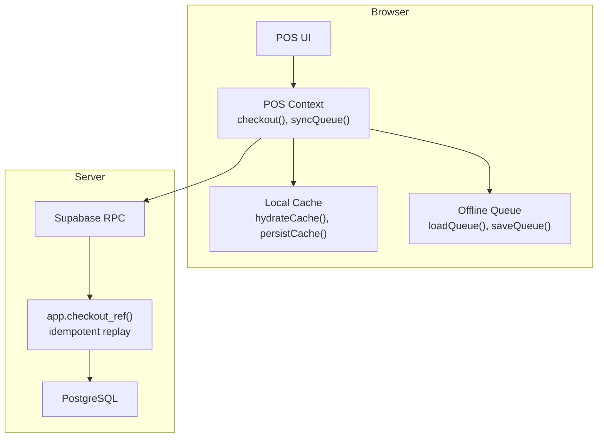
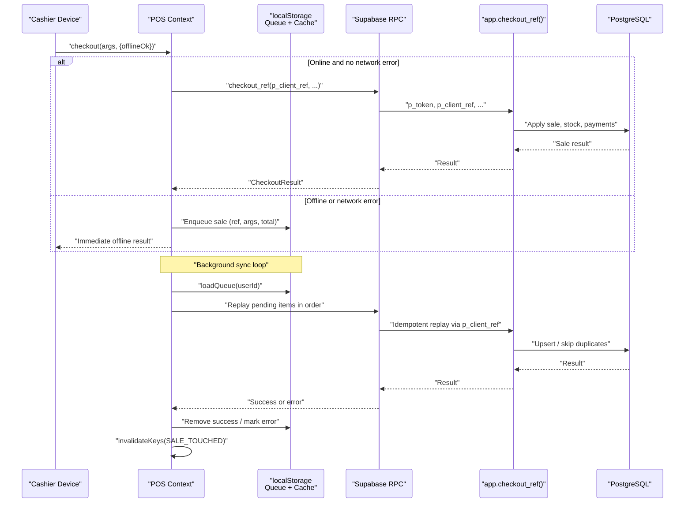
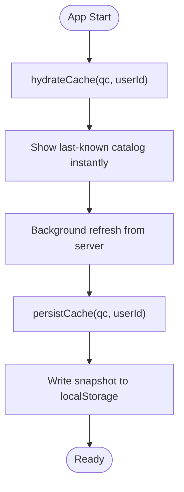
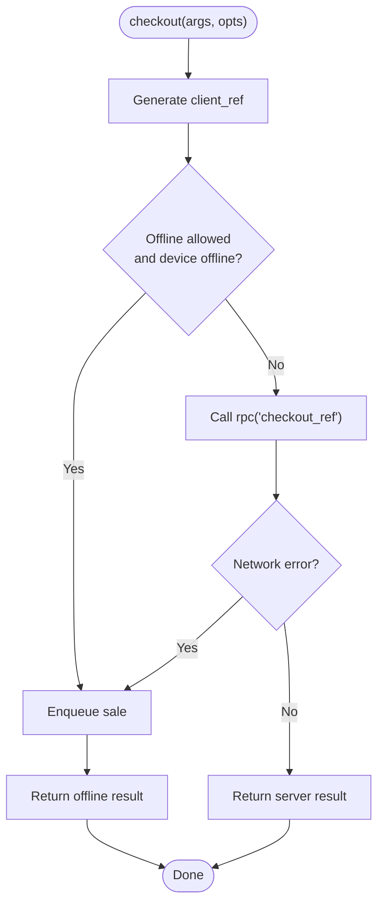
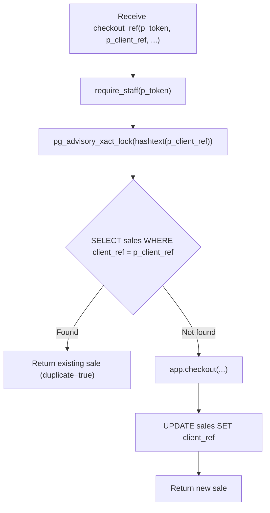
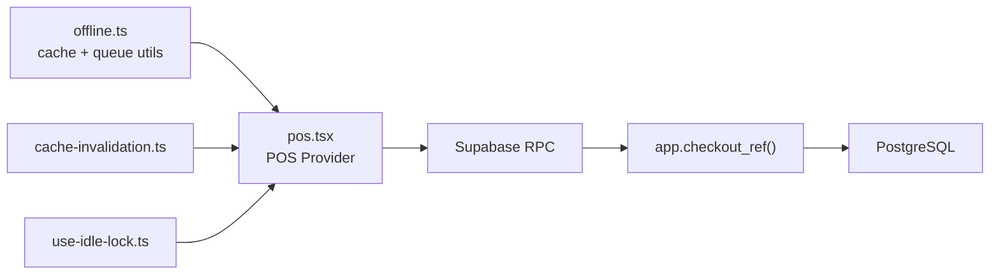

# Data Synchronization & Conflict Resolution

<cite>
**Referenced Files in This Document**
- [pos.tsx](file://src/lib/pos.tsx)
- [offline.ts](file://src/lib/offline.ts)
- [cache-invalidation.ts](file://src/lib/cache-invalidation.ts)
- [use-idle-lock.ts](file://src/components/pos/use-idle-lock.ts)
- [20261009193153_97dc4c5b-c659-4a08-882c-317f7898dbc7.sql](file://supabase/migrations/20261009193153_97dc4c5b-c659-4a08-882c-317f7898dbc7.sql)
- [20261009210500_retail_operations.sql](file://supabase/migrations/20261009210500_retail_operations.sql)
</cite>

## Table of Contents
1. [Introduction](#introduction)
2. [Project Structure](#project-structure)
3. [Core Components](#core-components)
4. [Architecture Overview](#architecture-overview)
5. [Detailed Component Analysis](#detailed-component-analysis)
6. [Dependency Analysis](#dependency-analysis)
7. [Performance Considerations](#performance-considerations)
8. [Troubleshooting Guide](#troubleshooting-guide)
9. [Conclusion](#conclusion)

## Introduction
This document explains how the application synchronizes local POS changes with the server, detects and resolves conflicts when multiple devices modify data concurrently, and guarantees transactional ordering for queued sales. It also provides guidance for monitoring sync progress, handling partial failures, implementing custom conflict resolution rules, and optimizing performance for large datasets and constrained bandwidth.

The system uses a browser-based offline queue for sales, an optimistic checkout path that falls back to local queuing on network failure, and a server-side idempotent replay mechanism keyed by client-generated references. Reference data is cached locally for instant startup, while business mutations are persisted as ordered queue entries until they can be applied on the server.

## Project Structure
The synchronization logic spans three main areas:
- Client-side state and UI: POS context, online/offline detection, queue persistence, and retry UI.
- Local cache and queue utilities: reference data hydration, safe localStorage operations, and error classification.
- Server-side functions: idempotent checkout replay, advisory locking, and stock/payment updates.

**Diagram sources**
- [pos.tsx:115-345](file://src/lib/pos.tsx#L115-L345)
- [offline.ts:15-92](file://src/lib/offline.ts#L15-L92)
- [20261009210500_retail_operations.sql:292-310](file://supabase/migrations/20261009210500_retail_operations.sql#L292-L310)

**Section sources**
- [pos.tsx:115-345](file://src/lib/pos.tsx#L115-L345)
- [offline.ts:15-92](file://src/lib/offline.ts#L15-L92)

## Core Components
- Offline queue and reference data cache: Persisted in localStorage under user-scoped keys. The cache stores read-only reference data for fast startup; the queue stores pending sales mutations.
- POS context: Provides authentication, store selection, money formatting, checkout orchestration, online/offline state, queue management, and automatic background syncing.
- Server checkout function: Idempotently applies a sale using a client-supplied reference, preventing duplicate bookings and ensuring consistent stock and payment updates.

Key responsibilities:
- Detect connectivity and persist queue changes atomically per update.
- Replay queued sales in order when online and authenticated.
- Mask sensitive server errors and expose actionable messages to users.
- Invalidate only affected queries after successful sync to avoid unnecessary refetches.

**Section sources**
- [offline.ts:1-92](file://src/lib/offline.ts#L1-L92)
- [pos.tsx:115-345](file://src/lib/pos.tsx#L115-L345)
- [cache-invalidation.ts:1-27](file://src/lib/cache-invalidation.ts#L1-L27)

## Architecture Overview
The synchronization flow combines optimistic UI with reliable server replay:

**Diagram sources**
- [pos.tsx:275-345](file://src/lib/pos.tsx#L275-L345)
- [20261009210500_retail_operations.sql:292-310](file://supabase/migrations/20261009210500_retail_operations.sql#L292-L310)

## Detailed Component Analysis

### Offline Queue and Local Persistence
Responsibilities:
- Store reference data snapshots for instant app start.
- Persist pending sales mutations with unique IDs, timestamps, totals, store context, and arguments.
- Provide helpers to load/save queues and classify network errors.

Behavior highlights:
- Cache versioning prevents incompatible reads.
- Only whitelisted query keys are persisted to avoid storing role-gated data.
- Queue entries include an optional error field for failed replays.
- Network error detection enables automatic fallback to offline mode during checkout.

**Diagram sources**
- [offline.ts:15-55](file://src/lib/offline.ts#L15-L55)

**Section sources**
- [offline.ts:1-92](file://src/lib/offline.ts#L1-L92)

### POS Context: Checkout Orchestration and Sync Loop
Responsibilities:
- Authenticate staff sessions and manage store context.
- Perform checkout either directly online or by enqueuing offline.
- Monitor online/offline events and automatically replay queued sales.
- Mask server errors and surface safe messages.
- Invalidate only relevant queries after successful sync.

Checkout behavior:
- If offline is allowed and the device is offline, enqueue immediately and return an optimistic offline result.
- If online but a network error occurs, enqueue instead of failing the user experience.
- On success, remove the item from the queue.
- On non-network errors, mark the item with a masked error and allow manual retry or discard.

Sync loop behavior:
- Runs once when conditions improve and then every 30 seconds while there are pending items.
- Stops early on transient network issues or session lock errors.
- Invalidates sales-related queries after any successful sync batch.

**Diagram sources**
- [pos.tsx:275-307](file://src/lib/pos.tsx#L275-L307)

**Section sources**
- [pos.tsx:115-345](file://src/lib/pos.tsx#L115-L345)
- [cache-invalidation.ts:1-27](file://src/lib/cache-invalidation.ts#L1-L27)

### Server-Side Idempotent Replay and Transaction Ordering
Responsibilities:
- Ensure each client reference is applied exactly once.
- Protect against concurrent modifications using advisory locks.
- Update sales, stock, and payments within a single transaction.

Conflict detection and resolution:
- Duplicate client reference: returns existing sale without reapplying.
- Advisory transaction lock: serializes concurrent replays for the same client reference.
- Business identity checks: rejects replay attempts across different businesses.

Transaction guarantees:
- All mutations occur inside one database transaction.
- Stock adjustments and payment records are committed together with the sale.

**Diagram sources**
- [20261009210500_retail_operations.sql:292-310](file://supabase/migrations/20261009210500_retail_operations.sql#L292-L310)

**Section sources**
- [20261009210500_retail_operations.sql:292-310](file://supabase/migrations/20261009210500_retail_operations.sql#L292-L310)

### Idle Locking and Safe Replay
Responsibilities:
- Auto-lock the till after inactivity to protect cashiers and data.
- Pause idle timer while a sync replay is running to prevent accidental lockouts mid-replay.

Behavior:
- Listens to pointer/key events to reset the idle timer.
- Defers locking if a background operation is paused.

**Section sources**
- [use-idle-lock.ts:1-40](file://src/components/pos/use-idle-lock.ts#L1-L40)
- [pos.tsx:347-364](file://src/lib/pos.tsx#L347-L364)

## Dependency Analysis
The following diagram shows runtime dependencies between components involved in synchronization:

**Diagram sources**
- [offline.ts:1-92](file://src/lib/offline.ts#L1-L92)
- [cache-invalidation.ts:1-27](file://src/lib/cache-invalidation.ts#L1-L27)
- [use-idle-lock.ts:1-40](file://src/components/pos/use-idle-lock.ts#L1-L40)
- [pos.tsx:115-345](file://src/lib/pos.tsx#L115-L345)
- [20261009210500_retail_operations.sql:292-310](file://supabase/migrations/20261009210500_retail_operations.sql#L292-L310)

**Section sources**
- [pos.tsx:115-345](file://src/lib/pos.tsx#L115-L345)
- [offline.ts:1-92](file://src/lib/offline.ts#L1-L92)
- [cache-invalidation.ts:1-27](file://src/lib/cache-invalidation.ts#L1-L27)
- [use-idle-lock.ts:1-40](file://src/components/pos/use-idle-lock.ts#L1-L40)
- [20261009210500_retail_operations.sql:292-310](file://supabase/migrations/20261009210500_retail_operations.sql#L292-L310)

## Performance Considerations
- Batch processing strategy:
  - The current implementation replays queued sales sequentially. For very large queues, consider batching N items per tick and pausing briefly between batches to reduce CPU and network pressure.
  - Introduce a configurable batch size and backoff when many items are pending.
- Bandwidth optimization:
  - Prefer lightweight RPC payloads. Avoid sending full cart objects on replay; send minimal identifiers and rely on server-side reconstruction where possible.
  - Compress JSON payloads at the transport layer if supported by your deployment.
- Cache efficiency:
  - Keep reference data caching scoped to whitelisted keys to minimize localStorage growth.
  - Use stale-time strategies for static data to reduce frequent refetches.
- Query invalidation:
  - Continue invalidating only affected query prefixes after successful sync to avoid full cache purges.
- Concurrency control:
  - Advisory transaction locks prevent duplicate application of the same client reference.
  - For multi-device conflicts beyond idempotency, apply server-side conflict detection (see next section).

[No sources needed since this section provides general guidance]

## Troubleshooting Guide
Common symptoms and resolutions:
- Sales remain in “waiting to sync”:
  - Verify the device is online and the staff session is unlocked.
  - Check for transient network errors; the sync loop retries every 30 seconds.
- Failed items show an error message:
  - Errors are masked to hide internal details. Retry the specific item or discard it if appropriate.
  - Session lock errors stop further replay; unlock the session and retry.
- Inventory or totals look inconsistent after sync:
  - Confirm that the server function completed successfully and that stock/payment updates were committed.
  - Re-fetch affected queries by triggering a refresh or waiting for automatic invalidation.

Operational tips:
- Use the built-in banner to monitor queue length, failed items, and manual retry/discard actions.
- Clear the local cache if reference data becomes corrupted; the app will rebuild it on next startup.
- Inspect the queue in developer tools to validate ordering and payload integrity.

**Section sources**
- [pos.tsx:389-433](file://src/lib/pos.tsx#L389-L433)
- [offline.ts:83-92](file://src/lib/offline.ts#L83-L92)

## Conclusion
The application achieves robust data synchronization through a combination of optimistic offline checkout, durable local queues, and idempotent server replay. Conflict detection relies on client reference uniqueness and advisory transaction locks to ensure atomicity and ordering. Users receive immediate feedback even when offline, and the system automatically reconciles changes when connectivity is restored. With targeted invalidation and careful scoping of local caches, the solution balances responsiveness with consistency. Future enhancements can introduce configurable batching, richer conflict resolution policies, and advanced monitoring hooks for enterprise-grade operations.