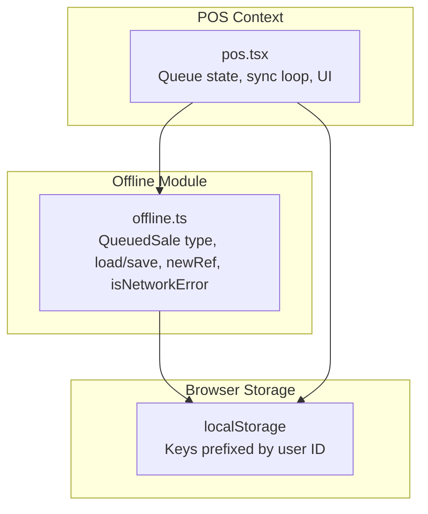
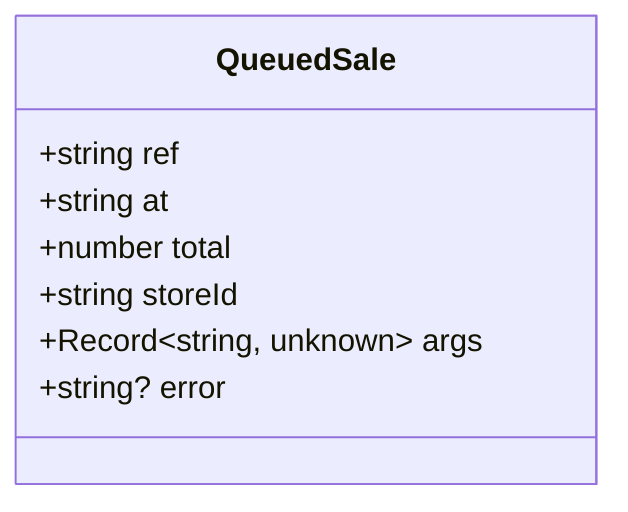
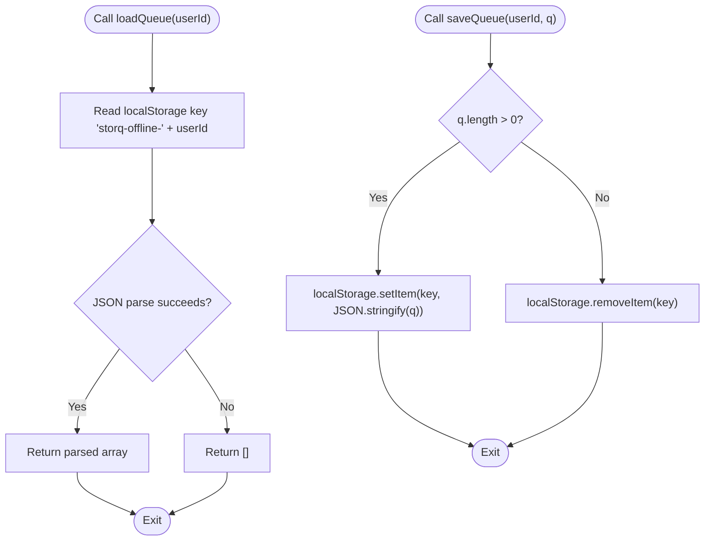
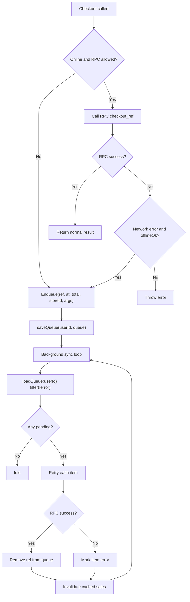
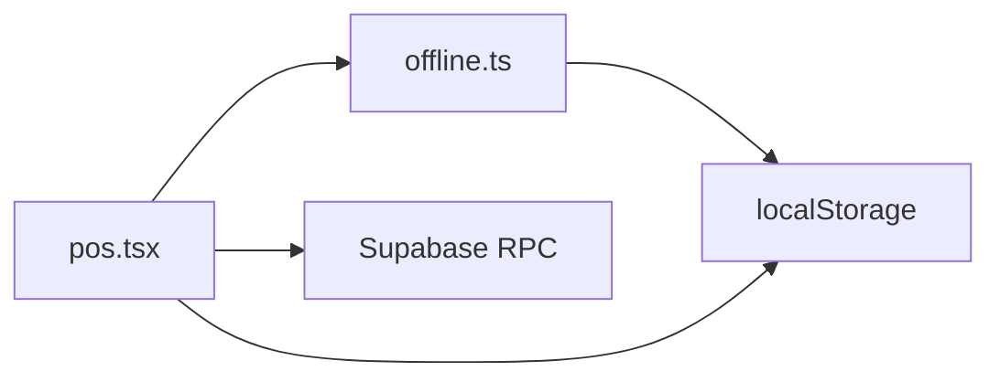

# Local Storage & Transaction Queue

<cite>
**Referenced Files in This Document**
- [offline.ts](file://src/lib/offline.ts)
- [pos.tsx](file://src/lib/pos.tsx)
</cite>

## Table of Contents
1. [Introduction](#introduction)
2. [Project Structure](#project-structure)
3. [Core Components](#core-components)
4. [Architecture Overview](#architecture-overview)
5. [Detailed Component Analysis](#detailed-component-analysis)
6. [Dependency Analysis](#dependency-analysis)
7. [Performance Considerations](#performance-considerations)
8. [Troubleshooting Guide](#troubleshooting-guide)
9. [Conclusion](#conclusion)

## Introduction
This document explains the local storage and transaction queue system that enables offline sales in the point-of-sale application. It covers how transactions are queued using browser localStorage with unique identifiers and timestamps, the structure of queued sale records, persistence functions for loading and saving the queue, and the full lifecycle from creation to synchronization. It also documents error tracking, retry mechanisms, recovery from corrupted data, storage limits, serialization behavior, and performance considerations for large volumes of transactions.

## Project Structure
The offline queue is implemented as a small, focused module responsible for:
- Generating unique reference IDs
- Persisting and retrieving the transaction queue from localStorage
- Detecting network-related errors
- Providing utilities for cache hydration and persistence (used alongside the queue)

The POS context orchestrates queue usage: it adds items to the queue when offline or when network calls fail, synchronizes pending items when online, and exposes UI controls for retrying or discarding failed entries.



**Diagram sources**
- [pos.tsx:249-345](file://src/lib/pos.tsx#L249-L345)
- [offline.ts:62-91](file://src/lib/offline.ts#L62-L91)

**Section sources**
- [offline.ts:1-91](file://src/lib/offline.ts#L1-L91)
- [pos.tsx:240-439](file://src/lib/pos.tsx#L240-L439)

## Core Components
- QueuedSale: The shape of each queued transaction, including its unique reference, timestamp, total amount, store association, serialized arguments, and optional error message.
- loadQueue(userId): Reads and parses the queue from localStorage; returns an empty array on parse failures.
- saveQueue(userId, queue): Serializes the queue to JSON and stores it under a user-scoped key; removes the key if the queue becomes empty.
- newRef(): Generates a UUID-like identifier for each queued transaction.
- isNetworkError(message): Determines whether an error indicates a transient network failure suitable for queuing.

These primitives are used by the POS context to manage the queue lifecycle and synchronization.

**Section sources**
- [offline.ts:62-91](file://src/lib/offline.ts#L62-L91)

## Architecture Overview
The system follows a simple, resilient pattern:
- When a checkout occurs while offline or when a network call fails with a network-related error, the transaction is enqueued locally.
- A background process periodically attempts to synchronize queued items when the device is online and staff is authenticated.
- Successful synchronizations remove the item from the queue; failures mark the item with an error so users can retry or discard it.
- The queue persists across page reloads via localStorage.

```mermaid
sequenceDiagram
participant User as "User"
participant POS as "POS Context"
participant OFF as "Offline Module"
participant LS as "localStorage"
participant RPC as "Server RPC"
User->>POS : Checkout(args, opts)
alt Offline or network error allowed
POS->>OFF : newRef()
OFF-->>POS : ref
POS->>LS : saveQueue(userId, enqueue(ref, at, total, storeId, args))
POS-->>User : Immediate result marked offline
else Online and allowed
POS->>RPC : checkout_ref(p_token, p_client_ref=ref, ...args)
RPC-->>POS : success or error
alt Network error and offlineOk
POS->>LS : saveQueue(userId, enqueue(...))
POS-->>User : Immediate result marked offline
else Success
POS-->>User : Normal result
end
end
Note over POS : Background sync loop
POS->>LS : loadQueue(userId)
LS-->>POS : Pending items
loop For each pending item
POS->>RPC : checkout_ref(p_token, p_client_ref, ...args)
alt Success
POS->>LS : saveQueue(userId, filter out ref)
else Error
POS->>LS : saveQueue(userId, mark item.error)
end
end
```

**Diagram sources**
- [pos.tsx:275-345](file://src/lib/pos.tsx#L275-L345)
- [offline.ts:71-84](file://src/lib/offline.ts#L71-L84)

## Detailed Component Analysis

### QueuedSale Interface
Each queued sale record contains:
- ref: Unique identifier generated per transaction.
- at: ISO timestamp indicating when the transaction was queued.
- total: Estimated total amount for the transaction.
- storeId: Store associated with the transaction.
- args: Serialized checkout arguments required to replay the transaction during sync.
- error: Optional error message set when a sync attempt fails.

This structure ensures that every queued item carries enough context to be retried later without loss of business information.



**Diagram sources**
- [offline.ts:62-69](file://src/lib/offline.ts#L62-L69)

**Section sources**
- [offline.ts:62-69](file://src/lib/offline.ts#L62-L69)

### Persistence Functions: loadQueue and saveQueue
- loadQueue(userId):
  - Reads the queue from localStorage using a user-scoped key.
  - Parses JSON safely; returns an empty array if parsing fails.
  - Provides corruption resilience by treating malformed data as an empty queue.
- saveQueue(userId, queue):
  - Serializes the queue to JSON and writes it to localStorage.
  - Removes the key if the queue is empty to avoid stale artifacts.



**Diagram sources**
- [offline.ts:71-81](file://src/lib/offline.ts#L71-L81)

**Section sources**
- [offline.ts:71-81](file://src/lib/offline.ts#L71-L81)

### Queue Lifecycle: Creation to Synchronization
- Creation:
  - When a checkout is initiated, a unique ref is generated.
  - If offline or a network error occurs (and offline mode is permitted), the transaction is enqueued with current timestamp, estimated total, store ID, and serialized arguments.
  - The UI immediately returns an “offline” result to keep the register responsive.
- Persistence:
  - The queue is persisted after every mutation through saveQueue.
- Synchronization:
  - A background effect watches online status and queue changes.
  - It loads pending items (excluding those already marked as errored).
  - It retries each item sequentially against the server RPC endpoint.
  - On success, the item is removed from the queue.
  - On failure, the item is marked with an error message.
  - After any successful sync, related data caches are invalidated to reflect updated sales.
- Retry and Discard:
  - Failed items display an error and offer retry or discard actions.
  - Retrying clears the error field and allows the next sync cycle to attempt again.



**Diagram sources**
- [pos.tsx:275-345](file://src/lib/pos.tsx#L275-L345)
- [offline.ts:83-91](file://src/lib/offline.ts#L83-L91)

**Section sources**
- [pos.tsx:275-345](file://src/lib/pos.tsx#L275-L345)
- [offline.ts:83-91](file://src/lib/offline.ts#L83-L91)

### Adding Transactions to the Queue
- The POS context generates a unique ref and constructs a queued sale entry with:
  - ref: from newRef()
  - at: current time in ISO format
  - total: estimated total passed into checkout options
  - storeId: derived from checkout arguments
  - args: original checkout arguments
- The entry is appended to the in-memory queue and persisted immediately.

**Section sources**
- [pos.tsx:275-307](file://src/lib/pos.tsx#L275-L307)
- [offline.ts:86-91](file://src/lib/offline.ts#L86-L91)

### Processing Queued Items
- The sync function:
  - Loads pending items excluding those already marked as errored.
  - Iterates through them and calls the server RPC with the stored arguments and client ref.
  - On success, removes the item from the queue and invalidates relevant caches.
  - On failure, marks the item with an error message.
- Sync runs:
  - Immediately when conditions allow (online, staff present, non-failed queue exists).
  - Periodically every 30 seconds while conditions remain valid.

**Section sources**
- [pos.tsx:309-345](file://src/lib/pos.tsx#L309-L345)

### Handling Queue Corruption Recovery
- loadQueue wraps JSON.parse in try/catch and returns an empty array on failure.
- This prevents a corrupted queue from blocking the app; the user can continue working, and the queue will rebuild on subsequent mutations.
- The same defensive approach applies to cache hydration, where malformed cache snapshots are discarded.

**Section sources**
- [offline.ts:71-77](file://src/lib/offline.ts#L71-L77)

### Error Tracking and Retry Mechanisms
- Network errors are detected using a regex-based helper that matches common fetch/network error messages.
- When a network error occurs during checkout and offline mode is permitted, the transaction is queued instead of failing the UI flow.
- During sync, network errors or lock-related errors stop further processing and mark the current item as errored.
- Users can retry individual failed items or discard them entirely.

**Section sources**
- [offline.ts:83-84](file://src/lib/offline.ts#L83-L84)
- [pos.tsx:303-338](file://src/lib/pos.tsx#L303-L338)
- [pos.tsx:410-429](file://src/lib/pos.tsx#L410-L429)

## Dependency Analysis
The following diagram shows how the POS context depends on the offline module and browser storage:



**Diagram sources**
- [pos.tsx:249-345](file://src/lib/pos.tsx#L249-L345)
- [offline.ts:71-91](file://src/lib/offline.ts#L71-L91)

**Section sources**
- [pos.tsx:249-345](file://src/lib/pos.tsx#L249-L345)
- [offline.ts:71-91](file://src/lib/offline.ts#L71-L91)

## Performance Considerations
- Serialization overhead: Each queue mutation serializes the entire queue to JSON. For very large queues, this can become costly. Consider batching updates or limiting queue size.
- Storage limits: Browser localStorage typically has a few megabytes per origin. Exceeding this limit causes write failures. The code gracefully handles storage-full scenarios for cache persistence; similar care should be applied to queue growth.
- Frequent writes: Every queue change triggers a synchronous localStorage write. Debouncing or throttling may reduce I/O pressure during rapid operations.
- Sync frequency: The 30-second polling interval balances responsiveness and server load. Adjust based on expected transaction volume and network reliability.
- Data size: Large args payloads increase JSON size and memory usage. Keep checkout arguments minimal and necessary for replay.
- Memory churn: Filtering and mapping the queue on each sync can create temporary arrays. For large queues, consider incremental updates or indexed structures keyed by ref.

[No sources needed since this section provides general guidance]

## Troubleshooting Guide
- Corrupted queue data:
  - Symptom: App starts but cannot read the queue.
  - Behavior: loadQueue returns an empty array; the app continues normally.
  - Resolution: Clear device cache or wait for a fresh queue build through new transactions.
- Storage full:
  - Symptom: Writes to localStorage fail.
  - Behavior: Cache persistence ignores storage errors; queue writes may fail similarly.
  - Resolution: Reduce cached data or clear device cache; ensure queue does not grow unbounded.
- Stuck sync:
  - Symptom: Pending items do not sync.
  - Causes: Not online, no staff token, or persistent network errors.
  - Resolution: Restore connectivity, unlock staff session, and trigger manual sync if available.
- Failed items:
  - Symptom: Items show error messages and require manual action.
  - Actions: Retry clears the error and requeues; discard removes the item permanently.
  - Guidance: Use retry for transient errors; use discard only when the transaction is intentionally abandoned.

**Section sources**
- [offline.ts:71-81](file://src/lib/offline.ts#L71-L81)
- [pos.tsx:309-345](file://src/lib/pos.tsx#L309-L345)
- [pos.tsx:410-429](file://src/lib/pos.tsx#L410-L429)

## Conclusion
The local storage and transaction queue system provides robust offline support for point-of-sale operations. By generating unique references, persisting structured sale records, and implementing resilient synchronization with error tracking and retry capabilities, the system ensures continuity even under poor network conditions. Proper attention to storage limits, serialization costs, and queue size will help maintain performance as transaction volumes grow.