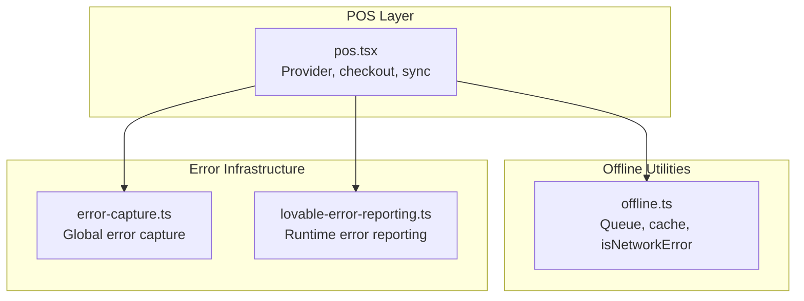
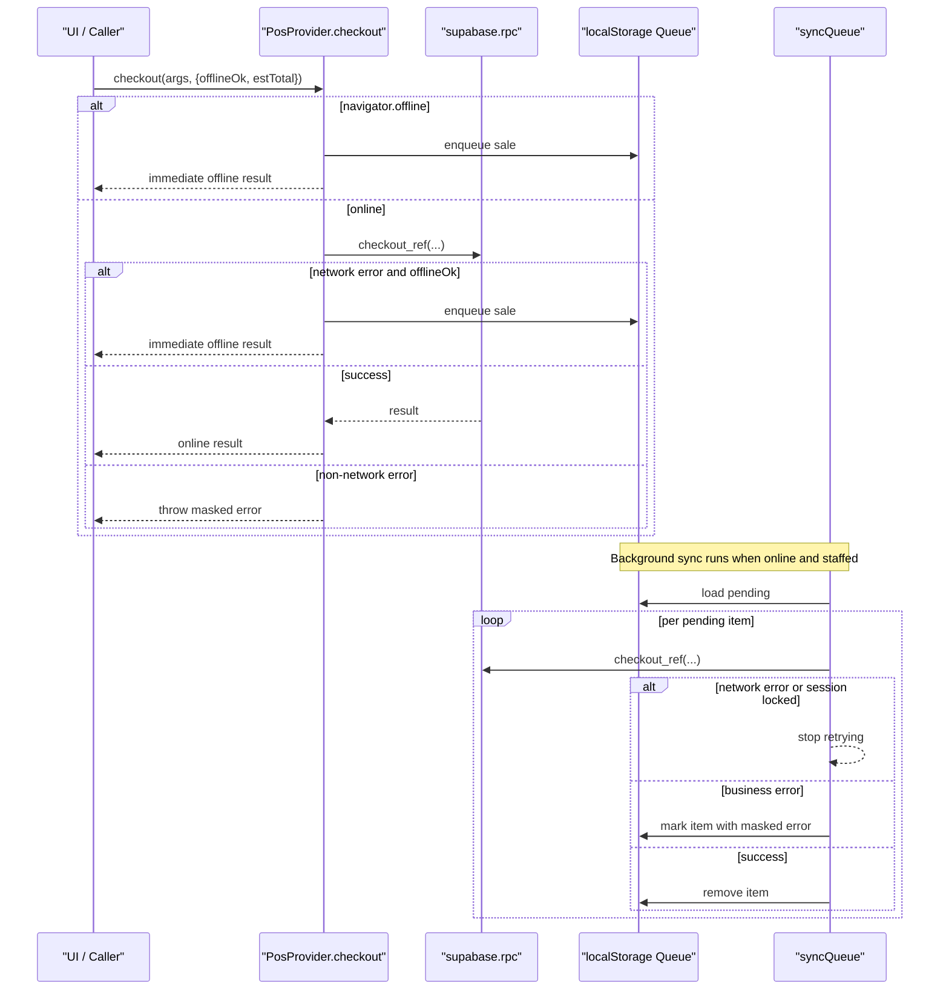
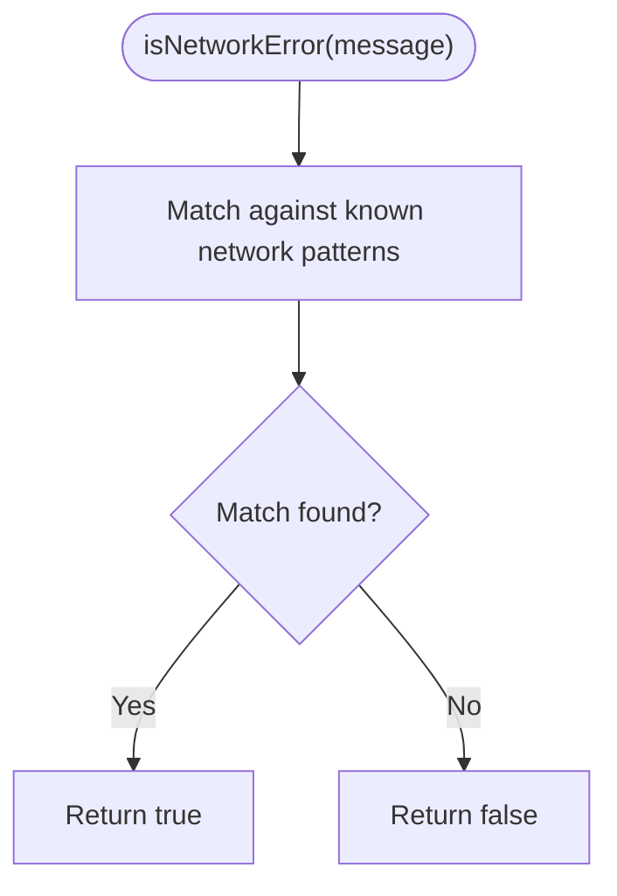
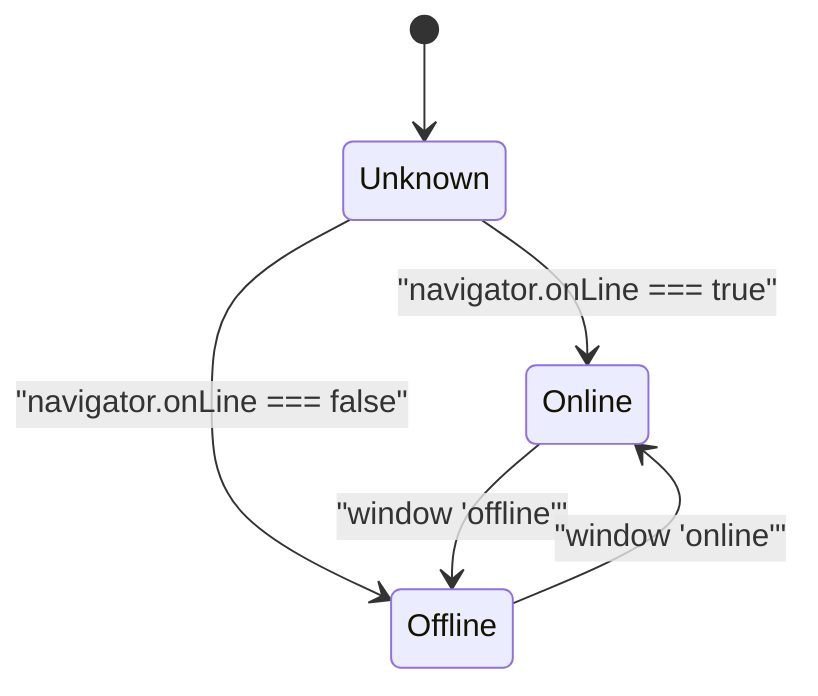
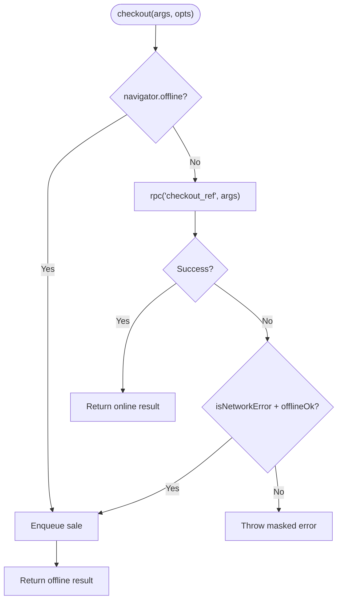
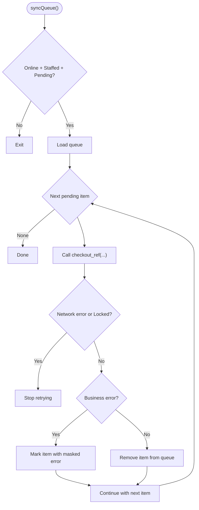
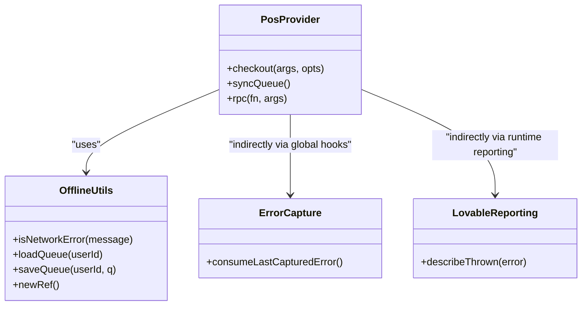
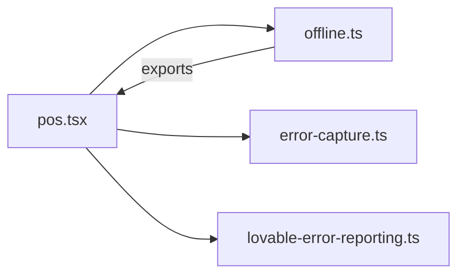

# Network Status & Error Handling

<cite>
**Referenced Files in This Document**
- [offline.ts](file://src/lib/offline.ts)
- [pos.tsx](file://src/lib/pos.tsx)
- [error-capture.ts](file://src/lib/error-capture.ts)
- [lovable-error-reporting.ts](file://src/lib/lovable-error-reporting.ts)
</cite>

## Table of Contents
1. [Introduction](#introduction)
2. [Project Structure](#project-structure)
3. [Core Components](#core-components)
4. [Architecture Overview](#architecture-overview)
5. [Detailed Component Analysis](#detailed-component-analysis)
6. [Dependency Analysis](#dependency-analysis)
7. [Performance Considerations](#performance-considerations)
8. [Troubleshooting Guide](#troubleshooting-guide)
9. [Conclusion](#conclusion)

## Introduction
This document explains how the application monitors network connectivity, handles offline mode, and processes network-related errors. It focuses on:
- The `isNetworkError` function used to detect connection failures.
- Online/offline status monitoring through browser events.
- Error propagation from network operations through the POS layer.
- The transaction queue for automatic retry and manual recovery.
- Practical guidance for custom error handlers, retry logic, user feedback, timeout handling, partial failures, and graceful degradation.

The implementation is centered around two files:
- `src/lib/offline.ts`: device-local persistence, queue helpers, network error detection, and reference data caching.
- `src/lib/pos.tsx`: POS context, checkout flow, online/offline state, queue synchronization, and user-facing status banner.

## Project Structure
The relevant parts of the codebase are organized by feature rather than strict layers:
- Offline utilities and queue persistence live under `src/lib/offline.ts`.
- POS business logic, including checkout and sync orchestration, lives under `src/lib/pos.tsx`.
- General error capture and reporting utilities live under `src/lib/error-capture.ts` and `src/lib/lovable-error-reporting.ts`.

**Diagram sources**
- [pos.tsx:1-23](file://src/lib/pos.tsx#L1-L23)
- [offline.ts:1-92](file://src/lib/offline.ts#L1-L92)
- [error-capture.ts:30-81](file://src/lib/error-capture.ts#L30-L81)
- [lovable-error-reporting.ts:44-70](file://src/lib/lovable-error-reporting.ts#L44-L70)

**Section sources**
- [pos.tsx:1-23](file://src/lib/pos.tsx#L1-L23)
- [offline.ts:1-92](file://src/lib/offline.ts#L1-L92)

## Core Components
- `isNetworkError(message: string)`: Detects whether an error message indicates a network failure or timeout.
- `QueuedSale`: Represents a sale that could not be sent immediately; it is persisted until successful sync.
- `PosProvider.checkout`: Attempts a server call; if offline or network error occurs (when allowed), it enqueues the sale locally.
- `syncQueue`: Periodically retries queued sales when online and authenticated.
- Online/offline state: Derived from `navigator.onLine` and window `online`/`offline` events.

Key responsibilities:
- Offline resilience: keep selling even without connectivity.
- Automatic retry: background sync when connectivity returns.
- User feedback: banner showing online/offline status, pending sync, failed items, retry/discard actions.
- Safe error masking: prevent internal database or policy messages from leaking into UI.

**Section sources**
- [offline.ts:62-91](file://src/lib/offline.ts#L62-L91)
- [pos.tsx:72-84](file://src/lib/pos.tsx#L72-L84)
- [pos.tsx:249-345](file://src/lib/pos.tsx#L249-L345)

## Architecture Overview
The offline-first POS architecture uses a small local queue and periodic sync:

**Diagram sources**
- [pos.tsx:275-338](file://src/lib/pos.tsx#L275-L338)
- [offline.ts:71-84](file://src/lib/offline.ts#L71-L84)

## Detailed Component Analysis

### Network Error Detection: `isNetworkError`
`isNetworkError` classifies an error as a network failure based on its message text. It matches common browser and runtime messages such as fetch failures, network errors, request failures, load failures, and timeouts.

Behavior:
- Input: error message string.
- Output: boolean indicating whether the error should be treated as a transient network issue.
- Used by:
  - `checkout`: to decide whether to fall back to offline queue.
  - `syncQueue`: to stop retrying on transient network issues or session lock.

Design notes:
- Simple regex-based classification keeps the logic fast and portable.
- It does not inspect error objects directly; callers pass the message string.
- Timeouts are included so long-running requests can be retried later.

**Diagram sources**
- [offline.ts:83-84](file://src/lib/offline.ts#L83-L84)

**Section sources**
- [offline.ts:83-84](file://src/lib/offline.ts#L83-L84)

### Online/Offline Monitoring
The POS provider tracks connectivity using:
- Initial state from `navigator.onLine`.
- Window event listeners for `online` and `offline`.
- A local `online` state used to control sync behavior and UI banners.

Effects:
- On mount, initialize `online` and load the persisted queue.
- Update `online` whenever the browser reports a change.
- Remove listeners on unmount to avoid leaks.

Integration points:
- `checkout` checks `navigator.onLine` before attempting a network call.
- `syncQueue` exits early if `navigator.onLine` is false.
- The effect watching `[online, staff, queue]` triggers periodic sync only when online and staffed.

**Diagram sources**
- [pos.tsx:249-263](file://src/lib/pos.tsx#L249-L263)

**Section sources**
- [pos.tsx:249-263](file://src/lib/pos.tsx#L249-L263)

### Checkout Flow and Offline Fallback
`checkout` implements a resilient path for direct-store transactions:
- If `offlineOk` is enabled and the browser is offline, it enqueues the sale and returns an immediate offline result.
- Otherwise, it calls the server via `rpc("checkout_ref", ...)`.
- If the call fails with a network error and `offlineOk` is enabled, it enqueues the sale and returns an offline result.
- Non-network errors are rethrown after being masked.

Result shape:
- Online success returns a full checkout result.
- Offline fallback returns a lightweight result marked as offline.

**Diagram sources**
- [pos.tsx:275-307](file://src/lib/pos.tsx#L275-L307)
- [offline.ts:83-84](file://src/lib/offline.ts#L83-L84)

**Section sources**
- [pos.tsx:275-307](file://src/lib/pos.tsx#L275-L307)

### Transaction Queue and Sync Logic
The queue persists pending sales in `localStorage` keyed by user ID. Each queued sale includes:
- Unique reference (`ref`).
- Timestamp (`at`).
- Estimated total (`total`).
- Store identifier (`storeId`).
- Original arguments (`args`).
- Optional error message (`error`) for failed sync attempts.

Sync behavior:
- `syncQueue` loads pending items, skipping those already marked as failed.
- It iterates through pending items sequentially.
- On network error or session lock, it stops further retries.
- On business errors, it marks the item with a masked error but continues processing remaining items.
- On success, it removes the item from the queue.
- After any successful sync, it invalidates cached queries related to sales.

Automatic retry:
- An effect watches `online`, `staff`, and `queue`.
- When online and staffed, it starts a 30-second interval to retry syncing.
- Manual trigger is exposed via `syncQueue`.

**Diagram sources**
- [pos.tsx:309-338](file://src/lib/pos.tsx#L309-L338)
- [offline.ts:71-81](file://src/lib/offline.ts#L71-L81)

**Section sources**
- [pos.tsx:309-338](file://src/lib/pos.tsx#L309-L338)
- [offline.ts:71-81](file://src/lib/offline.ts#L71-L81)

### Error Propagation and Masking
Error handling spans multiple layers:
- `maskRpcError`: Replaces sensitive backend messages (policy violations, SQL internals) with generic user-friendly messages.
- `rpc`: Wraps Supabase RPC calls and throws masked errors.
- `checkout`: Catches errors and decides between offline fallback and rethrowing.
- `syncQueue`: Marks failed items with masked errors instead of crashing the sync loop.
- Global error capture: `error-capture.ts` records global errors and unhandled promise rejections.
- Runtime reporting: `lovable-error-reporting.ts` serializes thrown values for reporting.

Important behaviors:
- Database-specific details never reach the UI.
- Session lock errors clear the local staff session.
- Network errors are treated as transient and eligible for retry or offline fallback.

**Diagram sources**
- [pos.tsx:93-104](file://src/lib/pos.tsx#L93-L104)
- [pos.tsx:220-228](file://src/lib/pos.tsx#L220-L228)
- [offline.ts:71-91](file://src/lib/offline.ts#L71-L91)
- [error-capture.ts:30-81](file://src/lib/error-capture.ts#L30-L81)
- [lovable-error-reporting.ts:44-70](file://src/lib/lovable-error-reporting.ts#L44-L70)

**Section sources**
- [pos.tsx:93-104](file://src/lib/pos.tsx#L93-L104)
- [pos.tsx:220-228](file://src/lib/pos.tsx#L220-L228)
- [error-capture.ts:30-81](file://src/lib/error-capture.ts#L30-L81)
- [lovable-error-reporting.ts:44-70](file://src/lib/lovable-error-reporting.ts#L44-L70)

### User Feedback and UI Integration
The POS provider renders a persistent banner that communicates:
- Current online/offline status.
- Number of pending items waiting to sync.
- Whether the user must unlock to sync.
- A manual “Sync now” button when online and staffed.
- Failed items with their masked error, plus “Retry” and “Discard” actions.

User actions:
- Retry: clears the error field for a specific item, allowing it to be retried by the background sync.
- Discard: removes the failed item from the queue after confirmation.

This design ensures users always understand what is happening with their sales while offline.

**Section sources**
- [pos.tsx:389-433](file://src/lib/pos.tsx#L389-L433)

## Dependency Analysis
The following diagram shows how the core modules depend on each other:

**Diagram sources**
- [pos.tsx:1-23](file://src/lib/pos.tsx#L1-L23)
- [offline.ts:1-92](file://src/lib/offline.ts#L1-L92)
- [error-capture.ts:30-81](file://src/lib/error-capture.ts#L30-L81)
- [lovable-error-reporting.ts:44-70](file://src/lib/lovable-error-reporting.ts#L44-L70)

**Section sources**
- [pos.tsx:1-23](file://src/lib/pos.tsx#L1-L23)
- [offline.ts:1-92](file://src/lib/offline.ts#L1-L92)

## Performance Considerations
- Queue persistence uses `localStorage`; reads/writes are synchronous and fast for small payloads.
- Sync loop runs every 30 seconds; this balances responsiveness with avoiding excessive network churn.
- `syncQueue` stops on transient network errors or session locks to prevent busy loops.
- Query invalidation happens only after successful syncs to minimize unnecessary refetches.
- Reference data cache hydration and persistence are debounced to reduce storage writes.

Recommendations:
- Keep queued payloads small; avoid storing large images or documents in `args`.
- Monitor localStorage usage; the cache persistence already ignores storage-full errors.
- Consider exponential backoff for future enhancements if network conditions are unstable.

[No sources needed since this section provides general guidance]

## Troubleshooting Guide
Common scenarios and remedies:

- Sales not syncing:
  - Ensure the device is online and the user is unlocked.
  - Check the banner for pending items and use “Sync now”.
  - Verify that no network errors are repeatedly blocking the sync loop.

- Repeated network errors:
  - `isNetworkError` treats timeouts and fetch failures as transient; the sync loop will stop on these and wait for connectivity.
  - Restore connectivity and allow the 30-second interval to retry automatically.

- Business errors during sync:
  - Items marked with a masked error remain in the queue.
  - Use “Retry” to clear the error and let the background sync attempt again.
  - Use “Discard” to remove the item if it is no longer valid.

- Session lock issues:
  - If the server reports a locked session, sync stops.
  - Unlock the POS to resume automatic sync.

- Global errors:
  - Errors captured globally are available via the error capture utility.
  - Runtime reporting serializes thrown values for diagnostics.

**Section sources**
- [pos.tsx:309-345](file://src/lib/pos.tsx#L309-L345)
- [error-capture.ts:30-81](file://src/lib/error-capture.ts#L30-L81)
- [lovable-error-reporting.ts:44-70](file://src/lib/lovable-error-reporting.ts#L44-L70)

## Conclusion
The application implements a robust offline-first POS experience:
- `isNetworkError` reliably identifies transient network issues.
- Browser events drive accurate online/offline state.
- `checkout` gracefully falls back to a local queue when offline or when network errors occur.
- `syncQueue` provides automatic retry with safe stopping conditions and masked error reporting.
- The UI clearly communicates status and offers manual controls for retry and discard.

For extending this system:
- Add custom error handlers at the `checkout` boundary to surface domain-specific feedback.
- Implement retry policies with backoff for flaky networks.
- Enhance timeout handling by distinguishing short timeouts from long-running operations.
- Integrate analytics to monitor offline rates and sync success metrics.

[No sources needed since this section summarizes without analyzing specific files]