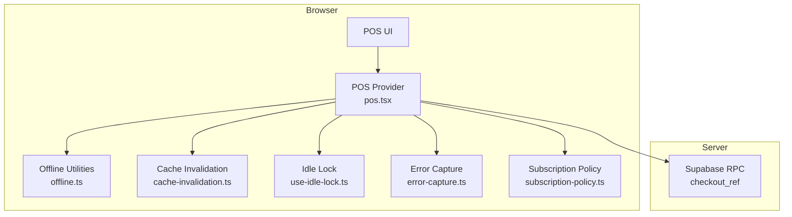
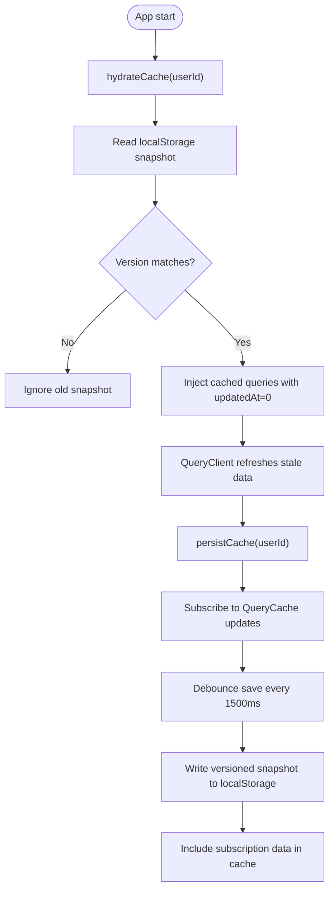
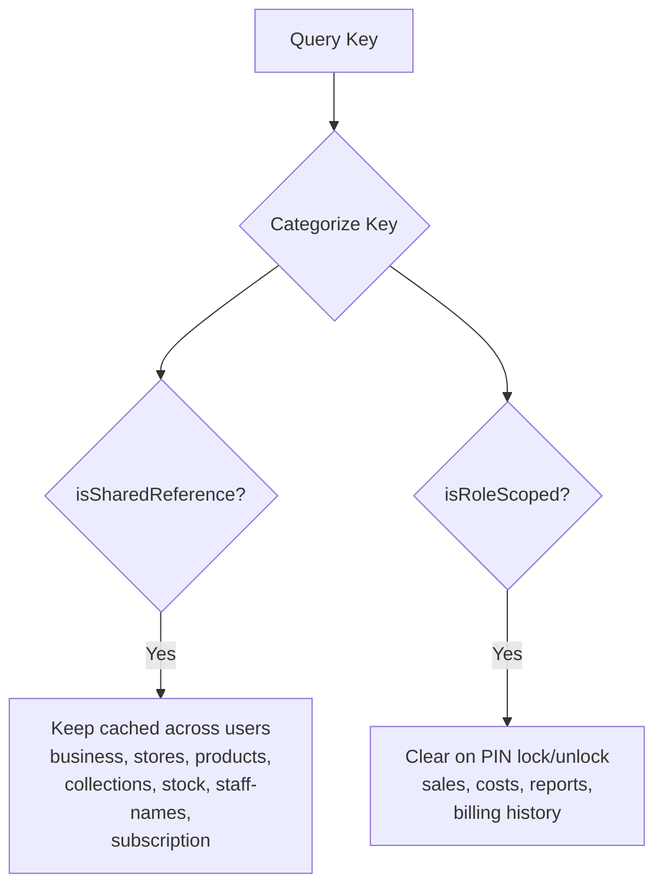
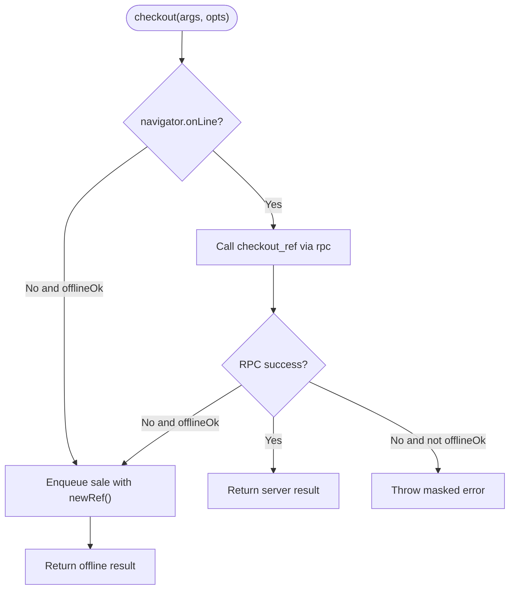
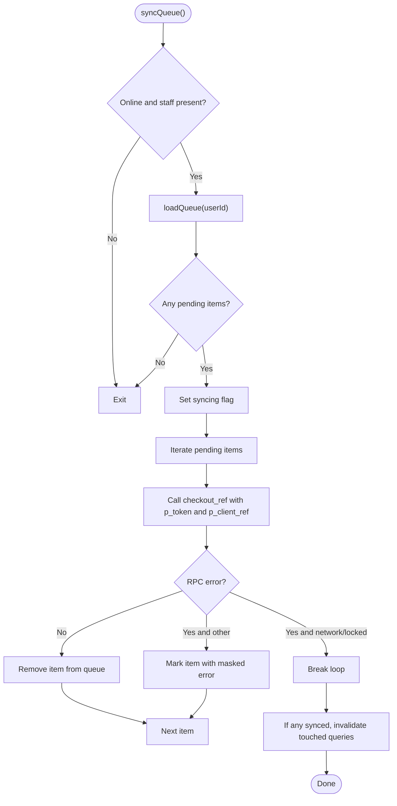
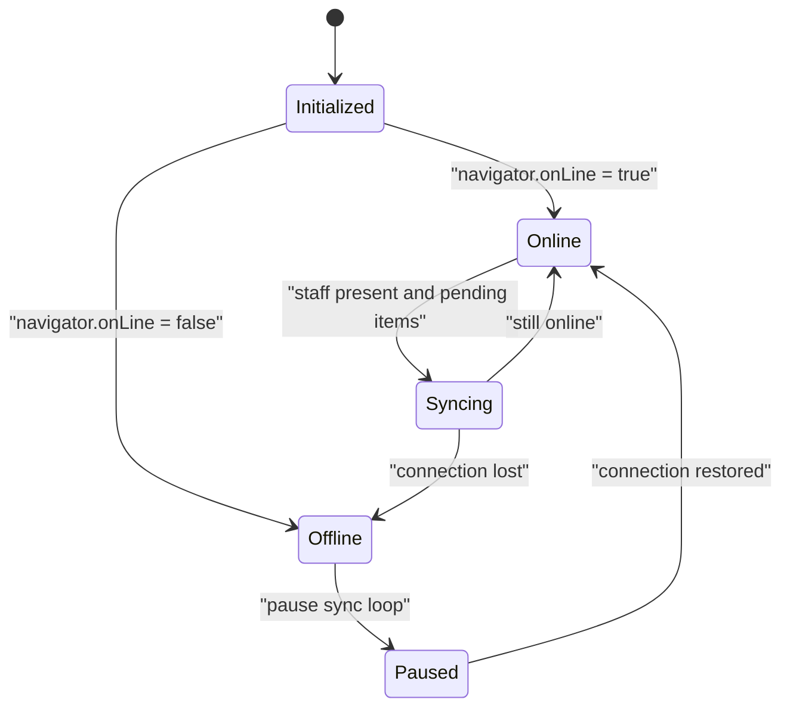
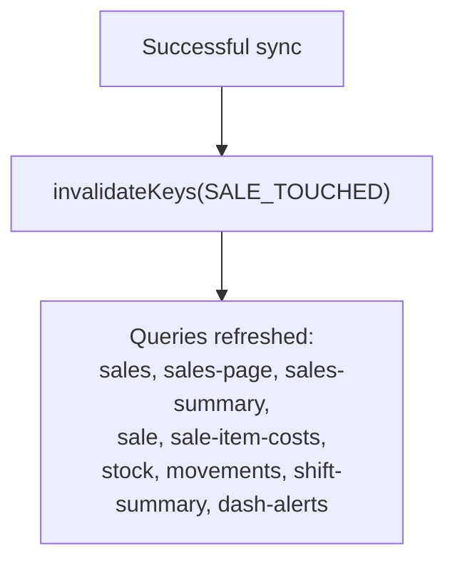
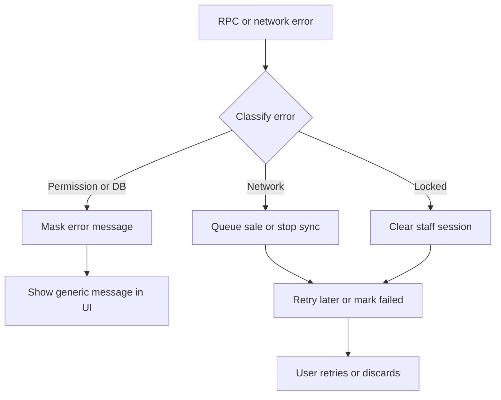
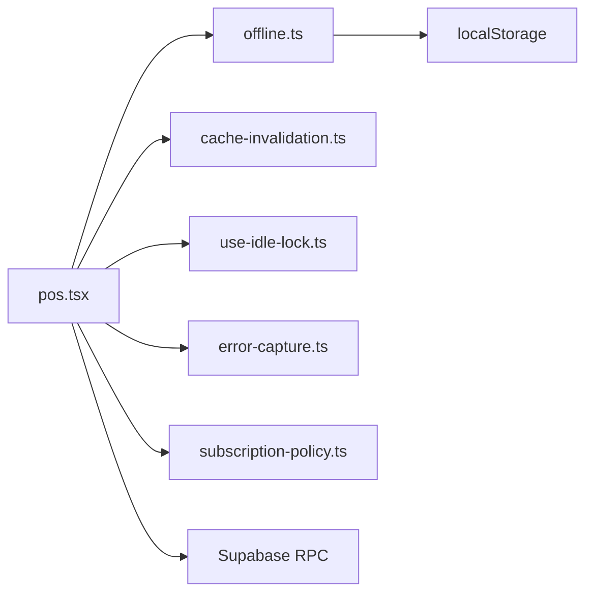

# Offline Capabilities

<cite>
**Referenced Files in This Document**
- [offline.ts](file://src/lib/offline.ts)
- [pos.tsx](file://src/lib/pos.tsx)
- [cache-invalidation.ts](file://src/lib/cache-invalidation.ts)
- [error-capture.ts](file://src/lib/error-capture.ts)
- [use-idle-lock.ts](file://src/components/pos/use-idle-lock.ts)
- [subscription-policy.ts](file://src/lib/subscription-policy.ts)
- [offline-scope.test.ts](file://src/lib/offline-scope.test.ts)
</cite>

## Update Summary
**Changes Made**
- Updated local cache layer section to reflect subscription data persistence
- Added new section documenting cache key categorization utilities
- Enhanced core components section with subscription caching details
- Updated architecture diagrams to include subscription data flow

## Table of Contents
1. [Introduction](#introduction)
2. [Project Structure](#project-structure)
3. [Core Components](#core-components)
4. [Architecture Overview](#architecture-overview)
5. [Detailed Component Analysis](#detailed-component-analysis)
6. [Dependency Analysis](#dependency-analysis)
7. [Performance Considerations](#performance-considerations)
8. [Troubleshooting Guide](#troubleshooting-guide)
9. [Conclusion](#conclusion)

## Introduction
This document explains the offline-first architecture that keeps the point-of-sale system fully usable without internet connectivity. It covers local cache persistence including subscription data, a transaction queue for sales made while offline, background synchronization when connectivity returns, network status monitoring, cache invalidation and consistency rules, conflict handling behavior, error handling strategies, and performance considerations for large datasets and memory management.

The implementation is browser-based: it uses `localStorage` for durable snapshots and queues, TanStack Query for in-memory caching, and Supabase RPC calls for server-side transactions.

## Project Structure
The offline capability spans three main areas:

- Local persistence utilities for cache and queue with subscription data support.
- The POS provider that orchestrates checkout, offline queuing, background sync, and UI feedback.
- Cache invalidation helpers that keep related data consistent after successful synchronization.



**Diagram sources**
- [pos.tsx:115-440](file://src/lib/pos.tsx#L115-L440)
- [offline.ts:1-110](file://src/lib/offline.ts#L1-L110)
- [cache-invalidation.ts:1-31](file://src/lib/cache-invalidation.ts#L1-L31)
- [use-idle-lock.ts:1-40](file://src/components/pos/use-idle-lock.ts#L1-L40)
- [error-capture.ts:1-81](file://src/lib/error-capture.ts#L1-L81)
- [subscription-policy.ts:1-22](file://src/lib/subscription-policy.ts#L1-L22)

**Section sources**
- [pos.tsx:115-440](file://src/lib/pos.tsx#L115-L440)
- [offline.ts:1-110](file://src/lib/offline.ts#L1-L110)
- [cache-invalidation.ts:1-31](file://src/lib/cache-invalidation.ts#L1-L31)

## Core Components
- **Local cache layer**: Persists reference data such as business configuration, stores, products, collections, stock, staff names, and **subscription entitlements** into `localStorage`. On startup, it hydrates the in-memory query cache so the register opens instantly, then refreshes stale data in the background. Subscription data is specifically cached to maintain access control even during PIN lock/unlock cycles.
- **Transaction queue**: Stores pending sales locally with unique client references. Sales are immediately marked completed on the device even when offline, ensuring uninterrupted till operations.
- **Background synchronizer**: When online and unlocked, it replays queued sales to the server, removes successfully synced items, marks failures, and invalidates affected queries.
- **Network monitor**: Subscribes to browser `online`/`offline` events to update state and trigger or pause synchronization.
- **Cache invalidation policy**: After successful sync, only relevant query keys are invalidated to avoid unnecessary refetching of unrelated data.
- **Cache key categorization utilities**: Provides explicit functions to determine whether query keys should be shared across users (`isSharedReference`) or scoped to specific roles (`isRoleScoped`).
- **Error masking and capture**: Server errors are sanitized before reaching the UI; general error capture preserves stack traces for debugging.

**Section sources**
- [offline.ts:1-110](file://src/lib/offline.ts#L1-L110)
- [pos.tsx:115-440](file://src/lib/pos.tsx#L115-L440)
- [cache-invalidation.ts:1-31](file://src/lib/cache-invalidation.ts#L1-L31)
- [error-capture.ts:1-81](file://src/lib/error-capture.ts#L1-L81)

## Architecture Overview
The offline-first flow ensures that users can complete sales regardless of connectivity. When online, sales go directly to the server. When offline or when a network error occurs, sales are queued locally. Background synchronization retries them later.

```mermaid
sequenceDiagram
participant Cashier as "Cashier"
participant UI as "POS UI"
participant Provider as "POS Provider"
participant Queue as "Local Queue<br/>localStorage"
participant Sync as "Sync Loop"
participant Server as "Supabase RPC"
Cashier->>UI : Complete sale
UI->>Provider : checkout(args, {offlineOk, estTotal})
alt Online and allowed
Provider->>Server : checkout_ref(p_client_ref, ...)
Server-->>Provider : success
Provider-->>UI : CheckoutResult
else Offline or network error
Provider->>Queue : enqueue({ref, args, total, storeId})
Provider-->>UI : Offline CheckoutResult
end
Note over Provider,Sync : Background sync starts when online and unlocked
Sync->>Queue : loadQueue()
loop Pending items
Sync->>Server : checkout_ref(p_token, p_client_ref, ...)
alt Success
Server-->>Sync : ok
Sync->>Queue : remove item
else Network or locked
Server-->>Sync : error
Sync->>Queue : mark item failed
break
end
end
Sync->>Provider : invalidate relevant queries
```

**Diagram sources**
- [pos.tsx:275-338](file://src/lib/pos.tsx#L275-L338)
- [offline.ts:62-110](file://src/lib/offline.ts#L62-L110)

## Detailed Component Analysis

### Local Cache Persistence with Subscription Support
The cache persists only safe, non-role-gated reference data needed for instant register startup, **including subscription entitlements**. It writes a versioned snapshot keyed by user ID. Hydration loads this snapshot into the query cache with an "instantly shown but stale" marker, causing background refresh. Persistence debounces saves to reduce `localStorage` writes.

Key behaviors:
- Only specific query types are persisted, including subscription data.
- Version checking prevents loading incompatible snapshots.
- Failed JSON parsing clears corrupted cache entries.
- Storage-full errors are ignored so the app continues working online.
- Subscription data remains cached across PIN lock/unlock cycles for seamless access control.



**Diagram sources**
- [offline.ts:15-73](file://src/lib/offline.ts#L15-L73)

**Section sources**
- [offline.ts:1-73](file://src/lib/offline.ts#L1-L73)

### Cache Key Categorization Utilities
The system provides explicit utility functions for categorizing cache keys based on their scope and sharing requirements:

- **`isSharedReference(key)`**: Returns true for query keys that should be shared across all users and persist through PIN lock/unlock cycles. This includes business data, stores, products, collections, stock, staff names, and subscription entitlements.
- **`isRoleScoped(key)`**: Returns true for query keys that are specific to individual users or roles and should be cleared when switching between staff sessions.

These utilities ensure proper cache isolation while maintaining performance by keeping shared reference data warm.



**Diagram sources**
- [offline.ts:20-31](file://src/lib/offline.ts#L20-L31)

**Section sources**
- [offline.ts:20-31](file://src/lib/offline.ts#L20-L31)
- [offline-scope.test.ts:1-15](file://src/lib/offline-scope.test.ts#L1-L15)

### Transaction Queue System
The queue buffers sales until the device is online and authenticated. Each queued sale has a stable client reference, timestamp, estimated total, store identifier, and original arguments. If a direct server call fails due to a network issue, the sale is enqueued instead of failing the user experience.

Important aspects:
- Immediate offline result allows the cashier to continue working.
- Queue changes are persisted atomically through a wrapper around state updates.
- Failed items carry masked error messages and can be retried or discarded by the user.



**Diagram sources**
- [pos.tsx:275-307](file://src/lib/pos.tsx#L275-L307)
- [offline.ts:89-110](file://src/lib/offline.ts#L89-L110)

**Section sources**
- [pos.tsx:249-307](file://src/lib/pos.tsx#L249-L307)
- [offline.ts:80-110](file://src/lib/offline.ts#L80-L110)

### Background Synchronization
Synchronization runs automatically when the device is online and a staff session is active. It processes pending queue items sequentially. A network error or a "locked" session stops further processing, marking the current item as failed. Successful items are removed from the queue. After any successful sync, relevant queries are invalidated.



**Diagram sources**
- [pos.tsx:309-338](file://src/lib/pos.tsx#L309-L338)
- [cache-invalidation.ts:27-30](file://src/lib/cache-invalidation.ts#L27-L30)

**Section sources**
- [pos.tsx:309-345](file://src/lib/pos.tsx#L309-L345)
- [cache-invalidation.ts:1-31](file://src/lib/cache-invalidation.ts#L1-L31)

### Network Status Monitoring
The POS provider listens to browser `online` and `offline` events. When online, it attempts to synchronize the queue immediately and sets up a periodic retry interval. When offline, synchronization pauses.



**Diagram sources**
- [pos.tsx:250-263](file://src/lib/pos.tsx#L250-L263)
- [pos.tsx:340-345](file://src/lib/pos.tsx#L340-L345)

**Section sources**
- [pos.tsx:250-263](file://src/lib/pos.tsx#L250-L263)
- [pos.tsx:340-345](file://src/lib/pos.tsx#L340-L345)

### Cache Invalidation and Data Consistency
After successful synchronization, only query keys related to money or stock movements are invalidated. This includes sales lists, summaries, individual sale details, stock levels, movements, shift summaries, and dashboard alerts. This targeted invalidation avoids re-fetching unrelated data like catalogs or subscription settings.



**Diagram sources**
- [cache-invalidation.ts:11-25](file://src/lib/cache-invalidation.ts#L11-L25)
- [pos.tsx:336-337](file://src/lib/pos.tsx#L336-L337)

**Section sources**
- [cache-invalidation.ts:1-31](file://src/lib/cache-invalidation.ts#L1-L31)
- [pos.tsx:336-337](file://src/lib/pos.tsx#L336-L337)

### Conflict Resolution Strategy
The current implementation does not implement explicit multi-device conflict resolution logic in the frontend. Instead, it relies on server-side transaction semantics and client-generated unique references:

- Each queued sale receives a unique client reference.
- During sync, the client sends the same reference to the server.
- If the server rejects a request because the session is locked, synchronization stops and the item is marked failed.
- Failed items are surfaced in the UI with options to retry or discard.

For robust multi-device conflict handling, consider adding server-side idempotency checks based on `p_client_ref`, conflict detection for concurrent stock or payment changes, and a merge strategy (for example, last-writer-wins with audit trails or manual reconciliation).

**Section sources**
- [pos.tsx:317-332](file://src/lib/pos.tsx#L317-L332)
- [offline.ts:89-110](file://src/lib/offline.ts#L89-L110)

### Error Handling and Data Recovery
Errors are handled at multiple layers:

- **RPC error masking**: Server errors containing SQL internals or permission details are replaced with generic user-facing messages.
- **Network error detection**: Network-related failures are recognized and used to decide whether to queue a sale or stop synchronization.
- **Session lock handling**: A "Locked" response clears the staff session and stops sync.
- **Global error capture**: Errors logged by the application are expanded and captured for debugging.

Recovery procedures include:
- Automatic retry when connectivity returns.
- Manual retry for failed queue items.
- Discarding failed items after confirmation.
- Clearing corrupted cache on hydration failure.



**Diagram sources**
- [pos.tsx:93-104](file://src/lib/pos.tsx#L93-L104)
- [pos.tsx:220-228](file://src/lib/pos.tsx#L220-L228)
- [pos.tsx:324-332](file://src/lib/pos.tsx#L324-L332)
- [offline.ts:101-110](file://src/lib/offline.ts#L101-L110)
- [error-capture.ts:18-32](file://src/lib/error-capture.ts#L18-L32)

**Section sources**
- [pos.tsx:93-104](file://src/lib/pos.tsx#L93-L104)
- [pos.tsx:220-228](file://src/lib/pos.tsx#L220-L228)
- [pos.tsx:324-332](file://src/lib/pos.tsx#L324-L332)
- [offline.ts:101-110](file://src/lib/offline.ts#L101-L110)
- [error-capture.ts:1-81](file://src/lib/error-capture.ts#L1-L81)

### Example Workflows

#### Implementing Offline Transaction Processing
To implement offline-safe transactions:

1. Generate a unique client reference for each transaction.
2. Attempt a direct server call if online.
3. If offline or a network error occurs and offline mode is allowed, enqueue the transaction locally.
4. Return an immediate offline result so the user experience remains smooth.
5. Persist queue mutations to `localStorage`.

Reference paths:
- [Checkout decision and enqueue logic:275-307](file://src/lib/pos.tsx#L275-L307)
- [Queue persistence helpers:89-99](file://src/lib/offline.ts#L89-L99)
- [Network error detection:101-110](file://src/lib/offline.ts#L101-L110)

#### Implementing Background Synchronization
To implement background synchronization:

1. Listen for `online` events.
2. When online and authenticated, load pending queue items.
3. Process items sequentially against the server.
4. Remove successful items and mark failed ones.
5. Invalidate relevant queries after successful sync.
6. Repeat periodically until the queue is empty or paused.

Reference paths:
- [Sync function and periodic retry:309-345](file://src/lib/pos.tsx#L309-L345)
- [Touched query keys:11-25](file://src/lib/cache-invalidation.ts#L11-L25)

#### Implementing Network Status Monitoring
To monitor network status:

1. Initialize state from `navigator.onLine`.
2. Subscribe to `online` and `offline` events.
3. Update UI state accordingly.
4. Trigger or pause synchronization based on connectivity.

Reference paths:
- [Event listeners and initial state:250-263](file://src/lib/pos.tsx#L250-L263)
- [Sync trigger effect:340-345](file://src/lib/pos.tsx#L340-L345)

## Dependency Analysis
The offline subsystem depends on several modules:

- `offline.ts` provides cache and queue primitives with subscription support.
- `pos.tsx` composes checkout, queue, sync, and UI state.
- `cache-invalidation.ts` defines which queries to refresh after sync.
- `use-idle-lock.ts` integrates with auto-lock behavior and pauses idle locking during sync.
- `error-capture.ts` supports broader error diagnostics.
- `subscription-policy.ts` provides subscription access logic.



**Diagram sources**
- [pos.tsx:1-26](file://src/lib/pos.tsx#L1-L26)
- [offline.ts:1-110](file://src/lib/offline.ts#L1-L110)
- [cache-invalidation.ts:1-31](file://src/lib/cache-invalidation.ts#L1-L31)
- [use-idle-lock.ts:1-40](file://src/components/pos/use-idle-lock.ts#L1-L40)
- [error-capture.ts:1-81](file://src/lib/error-capture.ts#L1-L81)
- [subscription-policy.ts:1-22](file://src/lib/subscription-policy.ts#L1-L22)

**Section sources**
- [pos.tsx:1-26](file://src/lib/pos.tsx#L1-L26)
- [offline.ts:1-110](file://src/lib/offline.ts#L1-L110)
- [cache-invalidation.ts:1-31](file://src/lib/cache-invalidation.ts#L1-L31)

## Performance Considerations
- **Instant startup**: Hydrating reference data from `localStorage` reduces perceived latency and allows the register to open quickly.
- **Debounced persistence**: Cache writes are throttled to avoid excessive `localStorage` operations.
- **Targeted invalidation**: Only relevant queries are invalidated after sync, reducing unnecessary network requests.
- **Selective persistence**: Only safe, non-sensitive reference data is persisted to minimize storage growth and privacy risks, including subscription entitlements.
- **Memory usage**: The queue grows with offline transactions; consider implementing queue size limits, archival, or cleanup policies for long offline periods.
- **Large datasets**: Reference data such as product catalogs should remain small enough for efficient serialization and hydration. Pagination or lazy loading may be needed for very large catalogs.
- **Storage capacity**: If `localStorage` becomes full, cache persistence silently fails; ensure critical operations still work online and provide a way to clear device cache.
- **Subscription caching**: Subscription data remains cached across PIN lock/unlock cycles to maintain seamless access control without repeated network requests.

[No sources needed since this section provides general guidance]

## Troubleshooting Guide

Common issues and resolutions:

- **Sales not syncing after reconnect**:
  - Verify the device is online and the staff session is unlocked.
  - Check the offline banner for waiting-to-sync count.
  - Manually trigger sync if available.

- **Failed queue items persist**:
  - Inspect the masked error message in the banner.
  - Use retry to attempt resubmission.
  - Discard only after confirming the transaction was already recorded elsewhere.

- **Session lock interrupts sync**:
  - A "Locked" response clears the staff session.
  - Re-authenticate using the PIN pad.
  - Retry synchronization after unlocking.

- **Corrupted cache prevents startup**:
  - Hydration ignores malformed snapshots.
  - Use the device cache clearing utility to reset cached data.

- **Subscription access issues**:
  - Subscription data is cached and persists across PIN lock/unlock cycles.
  - If subscription data appears stale, check network connectivity for refresh.
  - Clear device cache if subscription cache becomes corrupted.

- **Debugging errors**:
  - Global error capture expands and records error stacks.
  - Review captured errors for root causes.

**Section sources**
- [pos.tsx:389-433](file://src/lib/pos.tsx#L389-L433)
- [offline.ts:15-73](file://src/lib/offline.ts#L15-L73)
- [error-capture.ts:18-32](file://src/lib/error-capture.ts#L18-L32)

## Conclusion
The offline-first design ensures continuous retail operations by combining fast local cache hydration including subscription data, durable transaction queuing, automatic background synchronization, and careful cache invalidation. The enhanced cache key categorization utilities provide precise control over data sharing and scoping. While the current implementation prioritizes reliability and simplicity, future enhancements could strengthen multi-device conflict resolution, add idempotent server-side handling, and introduce queue lifecycle management for extended offline scenarios.

[No sources needed since this section summarizes without analyzing specific files]