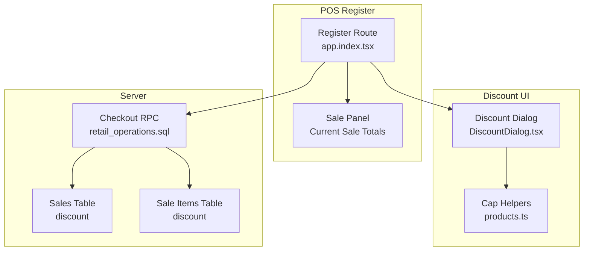
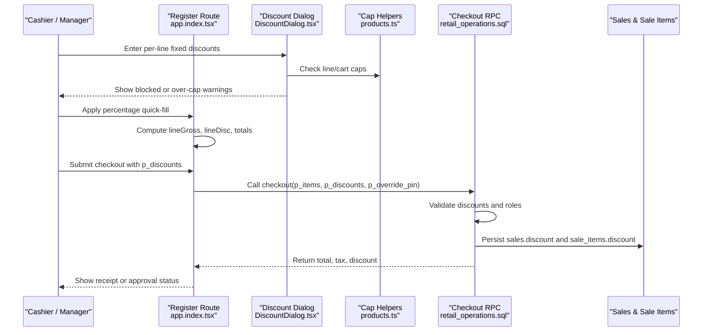
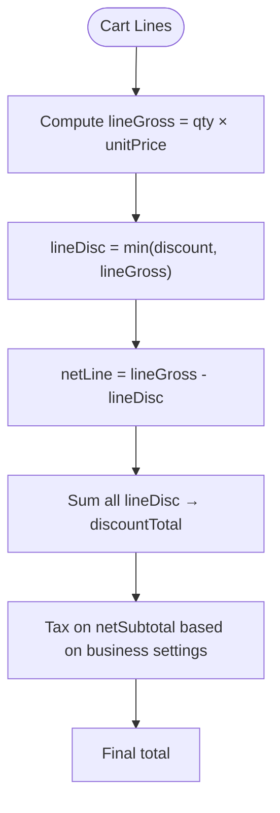
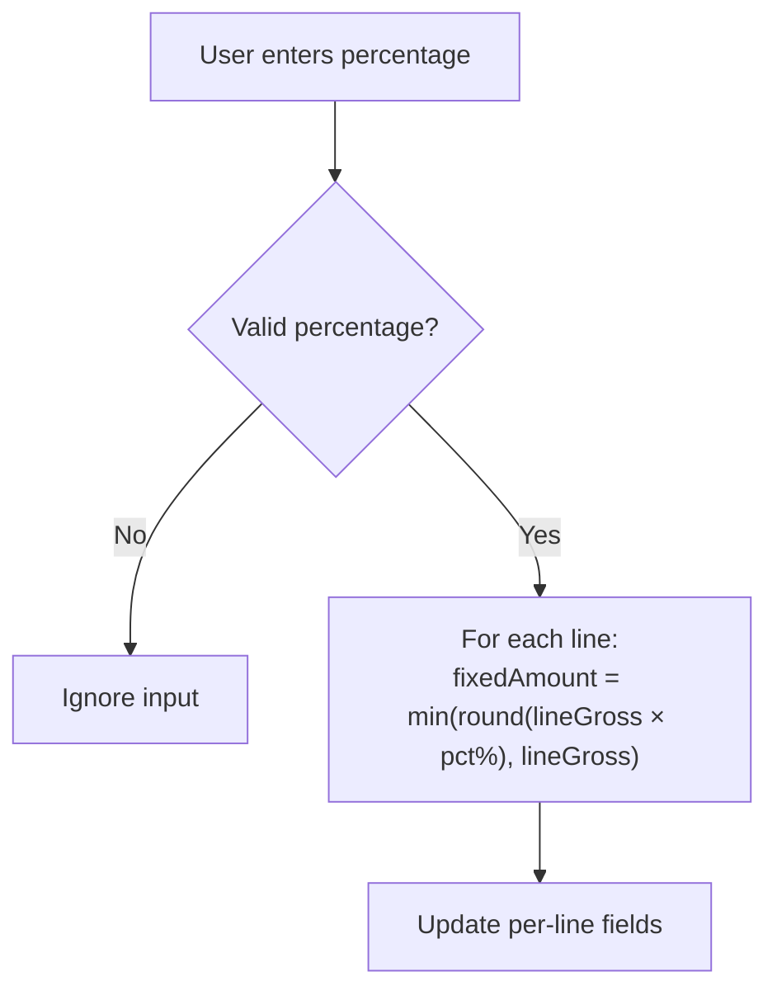
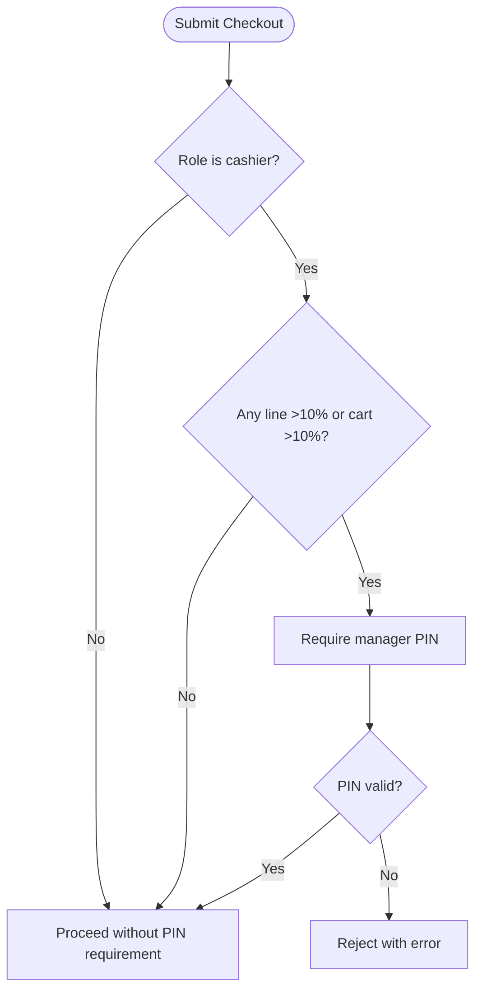
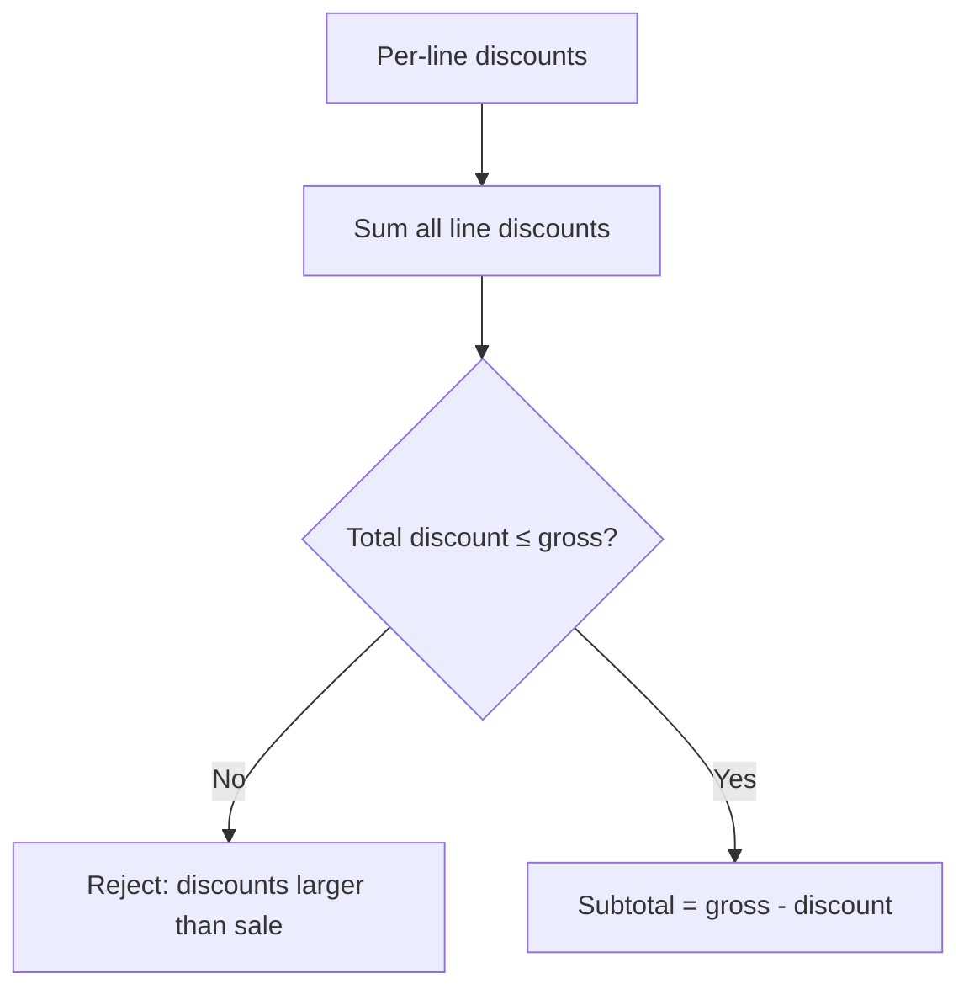
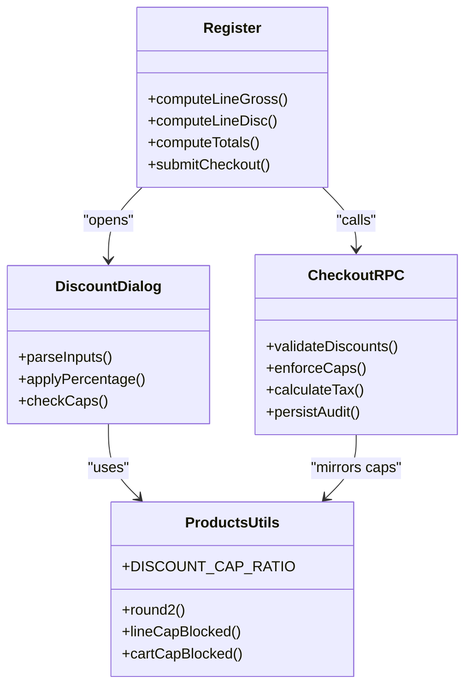
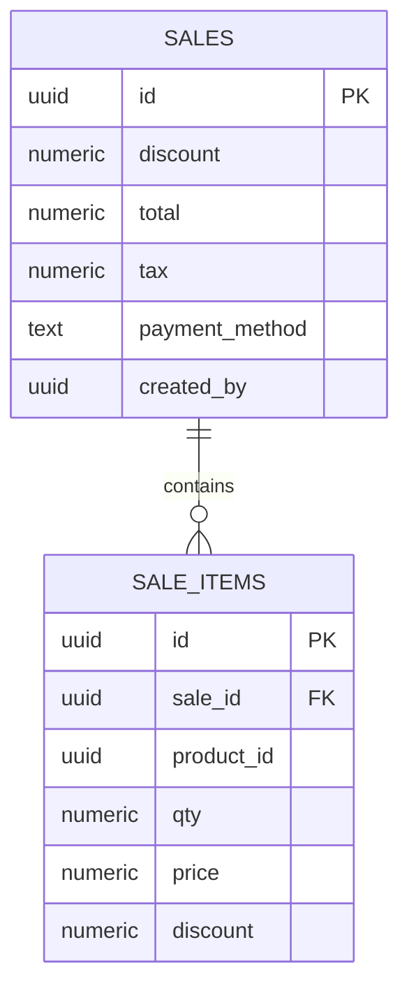
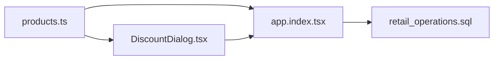

# Discount System

<cite>
**Referenced Files in This Document**
- [DiscountDialog.tsx](file://src/components/pos/DiscountDialog.tsx)
- [app.index.tsx](file://src/routes/_authenticated/app.index.tsx)
- [products.ts](file://src/lib/products.ts)
- [retail_operations.sql](file://supabase/migrations/20261009210500_retail_operations.sql)
</cite>

## Table of Contents
1. [Introduction](#introduction)
2. [Project Structure](#project-structure)
3. [Core Components](#core-components)
4. [Architecture Overview](#architecture-overview)
5. [Detailed Component Analysis](#detailed-component-analysis)
6. [Dependency Analysis](#dependency-analysis)
7. [Performance Considerations](#performance-considerations)
8. [Troubleshooting Guide](#troubleshooting-guide)
9. [Conclusion](#conclusion)

## Introduction
This document explains the discount system used by the point-of-sale register. It covers:
- Per-line discounts applied to individual items.
- Cart-level totals derived from per-line discounts.
- Role-based discount limits where cashiers are capped and managers can apply higher discounts.
- The discount calculation engine, including percentage quick-fill and fixed-amount discounts.
- Discount stacking rules and how discounts interact with tax and totals.
- Practical examples for applying and validating discounts.
- Audit trails for reporting and fraud prevention.
- The discount dialog interface and its validation rules.

The system uses a client-side UI for entering discounts and a server-side checkout function that enforces business rules, validates inputs, applies caps, and persists both cart-level and per-line discount data.

## Project Structure
The discount feature spans four main areas:
- POS register route: manages cart state, computes line totals, shows over-cap warnings, and submits checkout.
- Discount dialog: lets users enter per-line fixed amounts and apply a percentage across all lines.
- Product utilities: define the cashier discount cap ratio and helper functions for cap checks.
- Database migration: defines discount columns, validates discount input, enforces role-based caps, and records audit data.

**Diagram sources**
- [app.index.tsx:161-180](file://src/routes/_authenticated/app.index.tsx#L161-L180)
- [DiscountDialog.tsx:51-84](file://src/components/pos/DiscountDialog.tsx#L51-L84)
- [products.ts:66-80](file://src/lib/products.ts#L66-L80)
- [retail_operations.sql:108-186](file://supabase/migrations/20261009210500_retail_operations.sql#L108-L186)

**Section sources**
- [app.index.tsx:111-180](file://src/routes/_authenticated/app.index.tsx#L111-L180)
- [DiscountDialog.tsx:1-84](file://src/components/pos/DiscountDialog.tsx#L1-L84)
- [products.ts:66-80](file://src/lib/products.ts#L66-L80)
- [retail_operations.sql:108-186](file://supabase/migrations/20261009210500_retail_operations.sql#L108-L186)

## Core Components
- Per-line discount model: each cart line has an associated fixed discount amount keyed by product id.
- Cart-level discount total: the sum of all per-line discounts.
- Percentage quick-fill: applies a percentage to every line as a fixed amount.
- Cap enforcement: cashiers cannot exceed 10% on any single line or on the entire cart without manager PIN approval.
- Server validation: the checkout RPC validates discount shapes, product references, totals, and roles.
- Audit persistence: sales.discount and sale_items.discount store the final approved values.

Key responsibilities:
- UI layer: collects user-entered per-line discounts and percentage application.
- Validation layer: clamps per-line discounts to line gross and checks caps.
- Server layer: re-validates everything, enforces role-based caps, and writes audit data.

**Section sources**
- [DiscountDialog.tsx:29-84](file://src/components/pos/DiscountDialog.tsx#L29-L84)
- [app.index.tsx:161-180](file://src/routes/_authenticated/app.index.tsx#L161-L180)
- [retail_operations.sql:128-186](file://supabase/migrations/20261009210500_retail_operations.sql#L128-L186)

## Architecture Overview
The discount flow is split between the client and server:

**Diagram sources**
- [DiscountDialog.tsx:51-84](file://src/components/pos/DiscountDialog.tsx#L51-L84)
- [app.index.tsx:161-180](file://src/routes/_authenticated/app.index.tsx#L161-L180)
- [retail_operations.sql:108-186](file://supabase/migrations/20261009210500_retail_operations.sql#L108-L186)

## Detailed Component Analysis

### Per-Line Discounts and Cart-Level Totals
- Each cart line stores a fixed discount amount keyed by product id.
- The register computes:
  - Line gross: unit price multiplied by quantity.
  - Line discount: the smaller of the entered discount and line gross.
  - Net line: line gross minus line discount.
- Cart-level discount total is the sum of all line discounts.
- Tax is calculated on the net subtotal; total depends on whether tax is inclusive or exclusive.

**Diagram sources**
- [app.index.tsx:161-172](file://src/routes/_authenticated/app.index.tsx#L161-L172)

**Section sources**
- [app.index.tsx:161-172](file://src/routes/_authenticated/app.index.tsx#L161-L172)

### Percentage vs Fixed Amount Discounts
- Fixed amount discounts: entered per line in the discount dialog.
- Percentage quick-fill: converts a percentage into a fixed amount per line, capped at line gross.
- The dialog parses text inputs, rounds to two decimals, and clamps each line discount to its line gross.
- On apply, only positive discounts are sent to the parent component.

**Diagram sources**
- [DiscountDialog.tsx:66-77](file://src/components/pos/DiscountDialog.tsx#L66-L77)

**Section sources**
- [DiscountDialog.tsx:51-84](file://src/components/pos/DiscountDialog.tsx#L51-L84)

### Role-Based Discount Limits
- Cashiers are limited to 10% of a line’s gross and 10% of the cart’s gross.
- Managers and admins can bypass these caps.
- If a cashier exceeds either cap, checkout requires a manager PIN.
- The server verifies the PIN against active admin or manager staff records.

**Diagram sources**
- [retail_operations.sql:171-186](file://supabase/migrations/20261009210500_retail_operations.sql#L171-L186)

**Section sources**
- [products.ts:66-80](file://src/lib/products.ts#L66-L80)
- [app.index.tsx:174-180](file://src/routes/_authenticated/app.index.tsx#L174-L180)
- [retail_operations.sql:171-186](file://supabase/migrations/20261009210500_retail_operations.sql#L171-L186)

### Discount Stacking Rules
- There is no separate “cart-level” discount type beyond the sum of per-line discounts.
- The effective discount for a transaction is the sum of per-line discounts.
- Discounts are not stacked as additional percentages; they are fixed amounts per line.
- The server ensures the total discount does not exceed the gross sale value.

**Diagram sources**
- [retail_operations.sql:160-169](file://supabase/migrations/20261009210500_retail_operations.sql#L160-L169)

**Section sources**
- [retail_operations.sql:160-169](file://supabase/migrations/20261009210500_retail_operations.sql#L160-L169)

### Discount Calculation Engine
- Client side:
  - Parses per-line text inputs to numbers.
  - Rounds to two decimals.
  - Clamps each line discount to its line gross.
  - Computes cart gross, total discount, and over-cap flags.
- Server side:
  - Validates discount JSON structure and product ids.
  - Recomputes gross using effective product prices.
  - Sums discounts and validates bounds.
  - Applies tax logic based on business configuration.
  - Persists both sales.discount and sale_items.discount.

**Diagram sources**
- [app.index.tsx:161-180](file://src/routes/_authenticated/app.index.tsx#L161-L180)
- [DiscountDialog.tsx:51-84](file://src/components/pos/DiscountDialog.tsx#L51-L84)
- [products.ts:66-80](file://src/lib/products.ts#L66-L80)
- [retail_operations.sql:108-186](file://supabase/migrations/20261009210500_retail_operations.sql#L108-L186)

**Section sources**
- [app.index.tsx:161-180](file://src/routes/_authenticated/app.index.tsx#L161-L180)
- [DiscountDialog.tsx:51-84](file://src/components/pos/DiscountDialog.tsx#L51-L84)
- [products.ts:66-80](file://src/lib/products.ts#L66-L80)
- [retail_operations.sql:108-186](file://supabase/migrations/20261009210500_retail_operations.sql#L108-L186)

### Discount Dialog Interface and Validation Rules
- Displays per-line rows with name, quantity, unit price, and line gross.
- Allows fixed-amount entry per line.
- Provides a percentage quick-fill field to apply a percentage across all lines.
- Shows per-line block indicators when a cashier exceeds the line cap.
- Shows a cart-wide warning when the total discount exceeds the cashier cap.
- Disables apply if no positive discount exists.

Validation rules enforced in the dialog:
- Percentage must be finite, greater than zero, and at most 100.
- Per-line discount is clamped to line gross.
- Over-cap detection uses the same 10% rule as the server.

**Section sources**
- [DiscountDialog.tsx:29-84](file://src/components/pos/DiscountDialog.tsx#L29-L84)
- [DiscountDialog.tsx:86-184](file://src/components/pos/DiscountDialog.tsx#L86-L184)

### Practical Examples

#### Example 1: Small Per-Line Discount Within Caps
- Scenario: A cashier applies a small fixed discount to one item.
- Steps:
  - Open discount dialog.
  - Enter a fixed amount less than 10% of the line gross.
  - Confirm no over-cap warning.
  - Submit checkout without manager PIN.
- Expected result:
  - Line discount recorded.
  - Sales.discount equals sum of line discounts.
  - No PIN required.

#### Example 2: Percentage Quick-Fill
- Scenario: A manager wants to apply 15% across all lines.
- Steps:
  - Open discount dialog.
  - Enter 15 in the percentage field.
  - Apply to all lines.
  - Since manager, over-cap is allowed.
- Expected result:
  - Each line gets a fixed amount equal to 15% of line gross, capped at line gross.
  - Sales.discount equals sum of those fixed amounts.

#### Example 3: Cashier Exceeding Caps Requires Manager PIN
- Scenario: A cashier tries to apply a discount exceeding 10% of a line or the cart.
- Steps:
  - Open discount dialog.
  - Enter a discount that triggers over-cap.
  - Try to submit checkout.
  - System prompts for manager PIN.
  - Server verifies PIN against active admin/manager staff.
- Expected result:
  - If PIN is invalid or missing, checkout fails with an error.
  - If PIN is valid, discount is approved and persisted.

**Section sources**
- [app.index.tsx:174-180](file://src/routes/_authenticated/app.index.tsx#L174-L180)
- [retail_operations.sql:171-186](file://supabase/migrations/20261009210500_retail_operations.sql#L171-L186)

### Discount Audit Trails for Reporting and Fraud Prevention
- Sales table:
  - sales.discount stores the total discount for the transaction.
- Sale items table:
  - sale_items.discount stores the per-line discount for each item.
- These fields provide an immutable record for reporting, reconciliation, and fraud analysis.
- The checkout RPC also validates discount shapes and product references, preventing malformed or unauthorized discount submissions.

**Diagram sources**
- [retail_operations.sql:14-20](file://supabase/migrations/20261009210500_retail_operations.sql#L14-L20)
- [retail_operations.sql:245-266](file://supabase/migrations/20261009210500_retail_operations.sql#L245-L266)

**Section sources**
- [retail_operations.sql:14-20](file://supabase/migrations/20261009210500_retail_operations.sql#L14-L20)
- [retail_operations.sql:245-266](file://supabase/migrations/20261009210500_retail_operations.sql#L245-L266)

## Dependency Analysis
- The register route imports cap helpers and uses them to compute over-cap flags.
- The discount dialog imports cap helpers and mirrors server-side behavior for UX feedback.
- The checkout RPC performs authoritative validation and persists audit data.
- The products utility centralizes the discount cap ratio and rounding logic.

**Diagram sources**
- [products.ts:66-80](file://src/lib/products.ts#L66-L80)
- [app.index.tsx:17-24](file://src/routes/_authenticated/app.index.tsx#L17-L24)
- [DiscountDialog.tsx:21-23](file://src/components/pos/DiscountDialog.tsx#L21-L23)
- [retail_operations.sql:108-186](file://supabase/migrations/20261009210500_retail_operations.sql#L108-L186)

**Section sources**
- [products.ts:66-80](file://src/lib/products.ts#L66-L80)
- [app.index.tsx:17-24](file://src/routes/_authenticated/app.index.tsx#L17-L24)
- [DiscountDialog.tsx:21-23](file://src/components/pos/DiscountDialog.tsx#L21-L23)
- [retail_operations.sql:108-186](file://supabase/migrations/20261009210500_retail_operations.sql#L108-L186)

## Performance Considerations
- Client-side rounding and clamping reduce unnecessary server calls and keep the UI responsive.
- Cap checks are computed locally to provide immediate feedback.
- The server recomputes gross and discounts using effective product prices to ensure consistency.
- Avoid sending excessive tender or discount entries; the server enforces maximum counts.

[No sources needed since this section provides general guidance]

## Troubleshooting Guide
Common issues and resolutions:
- Discount rejected because it exceeds the sale gross:
  - Ensure the sum of per-line discounts does not exceed the gross total.
- Cashier discount requires manager PIN:
  - Provide a valid manager PIN when any line or cart discount exceeds 10%.
- Bad discount shape or product id:
  - Ensure discounts are provided as a list of objects with valid product ids and numeric amounts.
- Duplicate cart lines before discounting:
  - Merge duplicate product lines in the cart before submitting discounts.

**Section sources**
- [retail_operations.sql:128-186](file://supabase/migrations/20261009210500_retail_operations.sql#L128-L186)

## Conclusion
The discount system combines a clear per-line discount model with robust server-side validation. Cashiers are protected by a 10% cap on individual lines and the entire cart, while managers can override via a secure PIN. Discounts are stored at both the sale and line levels, enabling accurate reporting and fraud prevention. The discount dialog offers a practical interface for fixed amounts and percentage quick-fill, with real-time cap feedback aligned to server rules.

[No sources needed since this section summarizes without analyzing specific files]