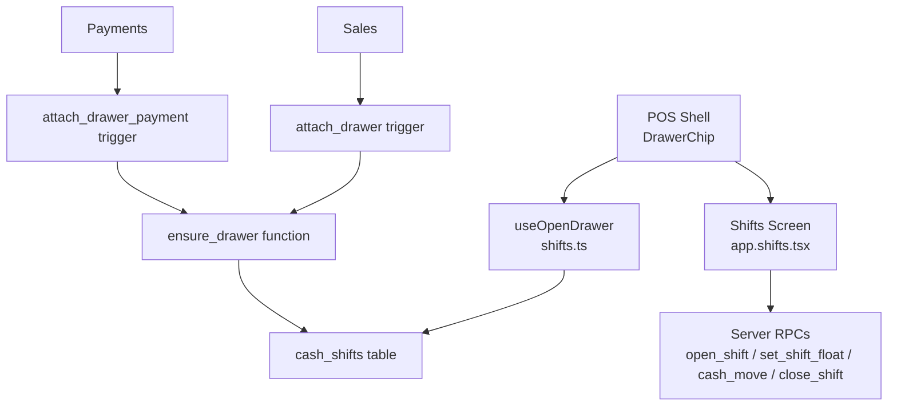
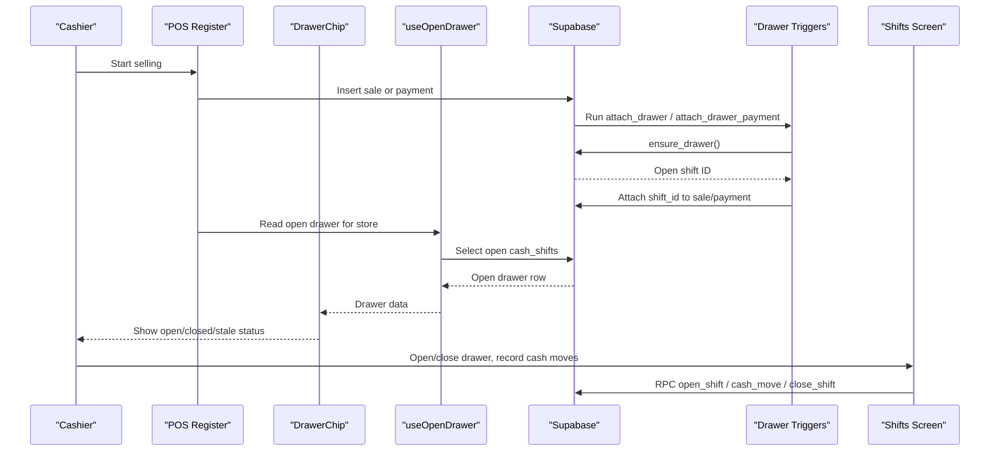
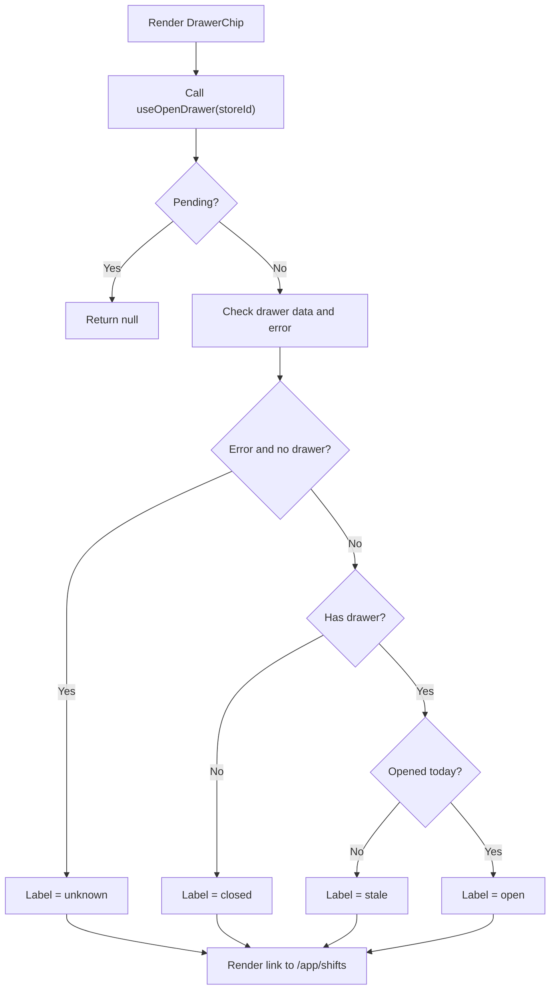
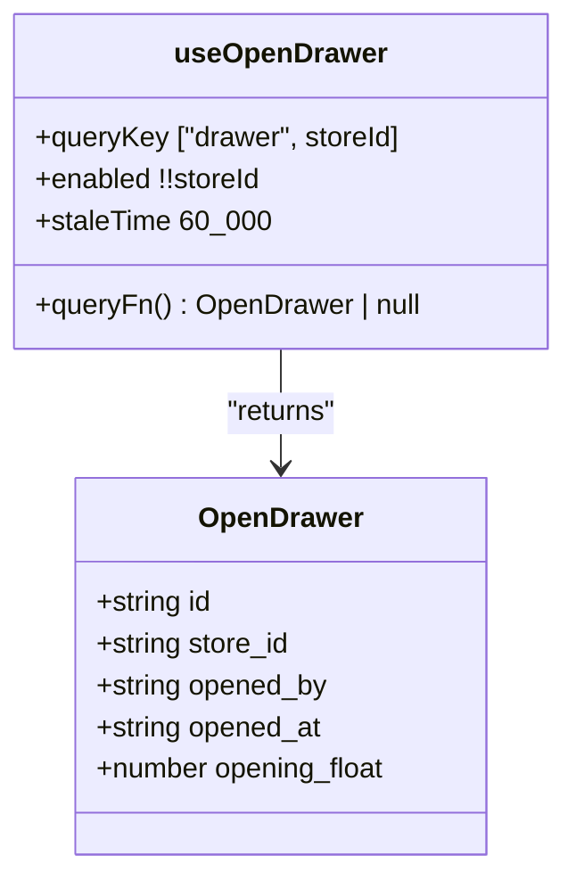
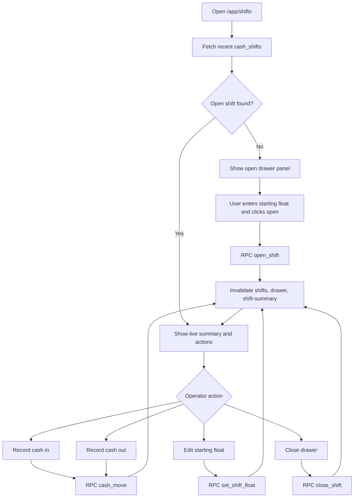
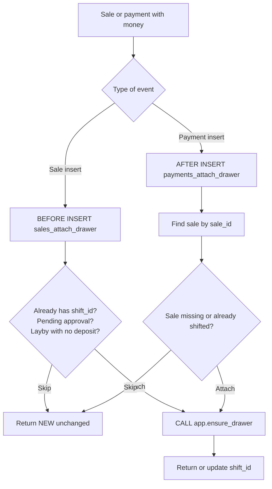
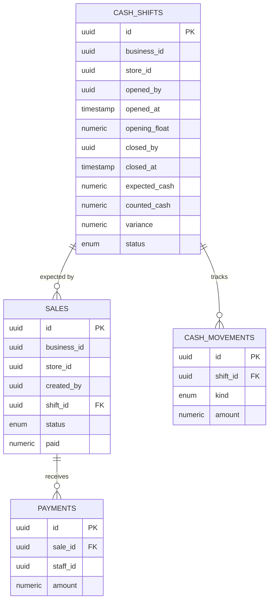
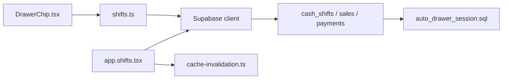

# Drawer Automation System

<cite>
**Referenced Files in This Document**   
- [README.md](file://README.md)
- [DrawerChip.tsx](file://src/components/pos/DrawerChip.tsx)
- [shifts.ts](file://src/lib/shifts.ts)
- [app.shifts.tsx](file://src/routes/_authenticated/app.shifts.tsx)
- [20261017165825_auto_drawer_session.sql](file://supabase/migrations/20261017165825_auto_drawer_session.sql)
- [types.ts](file://src/integrations/supabase/types.ts)
- [cache-invalidation.ts](file://src/lib/cache-invalidation.ts)
</cite>

## Table of Contents
1. [Introduction](#introduction)
2. [Project Structure](#project-structure)
3. [Core Components](#core-components)
4. [Architecture Overview](#architecture-overview)
5. [Detailed Component Analysis](#detailed-component-analysis)
6. [Dependency Analysis](#dependency-analysis)
7. [Performance Considerations](#performance-considerations)
8. [Troubleshooting Guide](#troubleshooting-guide)
9. [Conclusion](#conclusion)

## Introduction
This document explains the drawer automation system used by the POS application. The system automatically associates cash movements with a store’s open cash shift, so operators do not need to remember to open the drawer manually for every sale. The drawer is tied to a PIN session and the current store: when money enters or leaves the till, the server ensures an open `cash_shifts` row exists and attaches it to sales, payments, refunds, and related cash movements.

The user interface shows whether the drawer is closed, open, stale (opened on another day), or unknown due to offline state. Operators can still manually open, adjust starting float, record cash in/out, and close the drawer with a counted total.

**Section sources**
- [README.md:1-26](file://README.md#L1-L26)

## Project Structure
The drawer automation spans UI components, client-side hooks, route screens, and database triggers:

- **UI indicator**: `DrawerChip.tsx` displays drawer status in the POS shell.
- **Client query hook**: `shifts.ts` reads the currently open drawer for a store.
- **Shift management screen**: `app.shifts.tsx` handles opening, closing, float editing, cash movement recording, and Z-report viewing.
- **Database automation**: `20261017165825_auto_drawer_session.sql` contains functions and triggers that auto-open and attach shifts.
- **Type definitions**: `types.ts` includes generated types for `cash_shifts`, `sales`, `payments`, and related tables.
- **Cache invalidation**: `cache-invalidation.ts` documents why drawer-related queries are refreshed after mutations.

**Diagram sources**
- [DrawerChip.tsx:1-62](file://src/components/pos/DrawerChip.tsx#L1-L62)
- [shifts.ts:1-36](file://src/lib/shifts.ts#L1-L36)
- [app.shifts.tsx:1-600](file://src/routes/_authenticated/app.shifts.tsx#L1-L600)
- [20261017165825_auto_drawer_session.sql:1-106](file://supabase/migrations/20261017165825_auto_drawer_session.sql#L1-L106)

**Section sources**
- [DrawerChip.tsx:1-62](file://src/components/pos/DrawerChip.tsx#L1-L62)
- [shifts.ts:1-36](file://src/lib/shifts.ts#L1-L36)
- [app.shifts.tsx:1-600](file://src/routes/_authenticated/app.shifts.tsx#L1-L600)
- [20261017165825_auto_drawer_session.sql:1-106](file://supabase/migrations/20261017165825_auto_drawer_session.sql#L1-L106)
- [types.ts:54-92](file://src/integrations/supabase/types.ts#L54-L92)

## Core Components
- **Drawer chip**: A small header control showing drawer status and linking to the shift screen. It uses `useOpenDrawer` and renders different labels and colors depending on whether the drawer is closed, open, stale, or unknown.
- **Open drawer query**: `useOpenDrawer` fetches the single open `cash_shifts` row for the selected store. It is intentionally read-only because the server opens the drawer automatically.
- **Shift screen**: Provides manual controls for opening a drawer with a starting float, editing the float, recording cash in/out, closing the drawer with a counted amount, and reviewing past shifts and Z-reports.
- **Database automation**: Functions and triggers ensure that any real money movement creates or reuses an open drawer for the correct store and staff member.

**Section sources**
- [DrawerChip.tsx:7-61](file://src/components/pos/DrawerChip.tsx#L7-L61)
- [shifts.ts:4-35](file://src/lib/shifts.ts#L4-L35)
- [app.shifts.tsx:62-245](file://src/routes/_authenticated/app.shifts.tsx#L62-L245)
- [20261017165825_auto_drawer_session.sql:17-106](file://supabase/migrations/20261017165825_auto_drawer_session.sql#L17-L106)

## Architecture Overview
The drawer automation follows a clear separation between presentation, client data access, and server-side guarantees:

**Diagram sources**
- [DrawerChip.tsx:15-61](file://src/components/pos/DrawerChip.tsx#L15-L61)
- [shifts.ts:18-35](file://src/lib/shifts.ts#L18-L35)
- [app.shifts.tsx:98-107](file://src/routes/_authenticated/app.shifts.tsx#L98-L107)
- [app.shifts.tsx:307-358](file://src/routes/_authenticated/app.shifts.tsx#L307-L358)
- [app.shifts.tsx:409-475](file://src/routes/_authenticated/app.shifts.tsx#L409-L475)
- [20261017165825_auto_drawer_session.sql:21-78](file://supabase/migrations/20261017165825_auto_drawer_session.sql#L21-L78)

## Detailed Component Analysis

### Drawer Chip UI
The drawer chip is a compact status indicator. It:
- Reads the open drawer through `useOpenDrawer`.
- Treats pending loads as no display.
- Detects stale drawers when the open drawer was opened on a previous day.
- Shows “unknown” when the query fails but no drawer data is available, avoiding false claims about drawer state.
- Links to `/app/shifts` for reconciliation.

**Diagram sources**
- [DrawerChip.tsx:15-61](file://src/components/pos/DrawerChip.tsx#L15-L61)

**Section sources**
- [DrawerChip.tsx:7-61](file://src/components/pos/DrawerChip.tsx#L7-L61)

### Open Drawer Query Hook
`useOpenDrawer` is a simple read hook:
- It requires a store ID.
- It caches results for one minute.
- It queries `cash_shifts` for the single open row for the store.
- It returns either an `OpenDrawer` object or `null`.

**Diagram sources**
- [shifts.ts:4-35](file://src/lib/shifts.ts#L4-L35)

**Section sources**
- [shifts.ts:4-35](file://src/lib/shifts.ts#L4-L35)

### Shift Management Screen
The shift screen is the operator-facing control panel for drawer lifecycle management. Key responsibilities:
- List recent shifts for the store.
- Show the live expected cash total using a polled summary RPC.
- Allow opening a drawer with a starting float.
- Allow editing the starting float while the drawer is open.
- Record cash in and cash out with amounts and reasons.
- Close the drawer by entering the counted cash.
- Display variance and allow downloading a PDF Z-report.

**Diagram sources**
- [app.shifts.tsx:62-245](file://src/routes/_authenticated/app.shifts.tsx#L62-L245)
- [app.shifts.tsx:307-358](file://src/routes/_authenticated/app.shifts.tsx#L307-L358)
- [app.shifts.tsx:360-407](file://src/routes/_authenticated/app.shifts.tsx#L360-L407)
- [app.shifts.tsx:409-475](file://src/routes/_authenticated/app.shifts.tsx#L409-L475)

**Section sources**
- [app.shifts.tsx:17-31](file://src/routes/_authenticated/app.shifts.tsx#L17-L31)
- [app.shifts.tsx:62-245](file://src/routes/_authenticated/app.shifts.tsx#L62-L245)
- [app.shifts.tsx:307-475](file://src/routes/_authenticated/app.shifts.tsx#L307-L475)

### Database Automation: Auto-Opening and Attaching Shifts
The migration defines the core automation logic:

- `app.ensure_drawer`: Ensures exactly one open drawer per store. If none exists, it inserts one with zero float and the current staff member. It is race-safe using conflict handling.
- `app.attach_drawer`: Runs before inserting a sale. It skips non-cash flows such as pending approval invoices or layby entries without deposits, otherwise it ensures and attaches a drawer.
- `app.attach_drawer_payment`: Runs after inserting a payment. If the sale has no drawer yet, it opens one for the person holding the cash and updates the sale.
- `app.set_shift_float`: Allows authorized users to correct the starting float while the drawer is open, with business and store checks.

**Diagram sources**
- [20261017165825_auto_drawer_session.sql:21-78](file://supabase/migrations/20261017165825_auto_drawer_session.sql#L21-L78)

**Section sources**
- [20261017165825_auto_drawer_session.sql:17-106](file://supabase/migrations/20261017165825_auto_drawer_session.sql#L17-L106)

### Data Model Relationships
The drawer automation relies on several tables and relationships:

- `cash_shifts`: Represents an open or closed drawer session for a store.
- `sales`: Can carry `shift_id`; triggers attach it automatically for cash-bearing sales.
- `payments`: Can also influence drawer attachment when they represent real cash against a sale without a drawer.
- `cash_movements` and related refund tables reference `cash_shifts` for reconciliation.

**Diagram sources**
- [types.ts:54-92](file://src/integrations/supabase/types.ts#L54-L92)
- [types.ts:511-565](file://src/integrations/supabase/types.ts#L511-L565)
- [types.ts:673-719](file://src/integrations/supabase/types.ts#L673-L719)

**Section sources**
- [types.ts:54-92](file://src/integrations/supabase/types.ts#L54-L92)
- [types.ts:511-565](file://src/integrations/supabase/types.ts#L511-L565)
- [types.ts:673-719](file://src/integrations/supabase/types.ts#L673-L719)

## Dependency Analysis
The drawer automation depends on both frontend state and backend guarantees:

**Diagram sources**
- [DrawerChip.tsx:1-62](file://src/components/pos/DrawerChip.tsx#L1-L62)
- [shifts.ts:1-36](file://src/lib/shifts.ts#L1-L36)
- [app.shifts.tsx:1-600](file://src/routes/_authenticated/app.shifts.tsx#L1-L600)
- [cache-invalidation.ts:19-19](file://src/lib/cache-invalidation.ts#L19-L19)
- [20261017165825_auto_drawer_session.sql:1-106](file://supabase/migrations/20261017165825_auto_drawer_session.sql#L1-L106)

**Section sources**
- [DrawerChip.tsx:1-62](file://src/components/pos/DrawerChip.tsx#L1-L62)
- [shifts.ts:1-36](file://src/lib/shifts.ts#L1-L36)
- [app.shifts.tsx:1-600](file://src/routes/_authenticated/app.shifts.tsx#L1-L600)
- [cache-invalidation.ts:19-19](file://src/lib/cache-invalidation.ts#L19-L19)
- [20261017165825_auto_drawer_session.sql:1-106](file://supabase/migrations/20261017165825_auto_drawer_session.sql#L1-L106)

## Performance Considerations
- **Drawer query caching**: `useOpenDrawer` uses a 60-second stale time, reducing repeated network calls for drawer state.
- **Live shift summary polling**: The shift screen polls the live summary every 30 seconds when a drawer is open, keeping expected cash figures fresh without heavy client computation.
- **Race-safe drawer creation**: The database function prevents duplicate open drawers per store and lets concurrent operations converge on the same drawer instead of failing.
- **Selective drawer attachment**: Non-cash events like pending approval invoices or layby entries without deposits avoid unnecessary drawer creation.

[No sources needed since this section provides general guidance]

## Troubleshooting Guide
Common issues and their likely causes:

- **Drawer chip shows unknown**: The query failed and no drawer data is present. This usually means offline mode or a transient network error. The chip avoids claiming the drawer is closed when state is unknown.
- **Drawer shows stale**: An open drawer was opened on a previous day. The UI warns that yesterday’s cash may be included in today’s expected amount.
- **Drawer never opens automatically**: Verify that the relevant database migration is applied and that the sale or payment path actually involves real money. Approval invoices and layby entries without deposits intentionally skip automatic drawer attachment.
- **Expected cash does not match physical cash**: Check the starting float. The drawer opens with zero float, so if notes were already in the till, the operator should edit the starting float while the drawer is open.
- **Cannot edit starting float**: Only the drawer opener or an admin/manager can edit it, and only for the correct store.

**Section sources**
- [DrawerChip.tsx:23-37](file://src/components/pos/DrawerChip.tsx#L23-L37)
- [app.shifts.tsx:109-115](file://src/routes/_authenticated/app.shifts.tsx#L109-L115)
- [20261017165825_auto_drawer_session.sql:42-50](file://supabase/migrations/20261017165825_auto_drawer_session.sql#L42-L50)
- [20261017165825_auto_drawer_session.sql:84-98](file://supabase/migrations/20261017165825_auto_drawer_session.sql#L84-L98)

## Conclusion
The drawer automation system removes the risk of forgetting to open a cash drawer by tying drawer state to actual money movements. The UI remains transparent about drawer status, while the database layer guarantees consistent association of sales and payments with the correct shift. Manual controls remain available for opening, adjusting starting float, recording cash movements, and closing the drawer with reconciliation.

[No sources needed since this section summarizes without analyzing specific files]