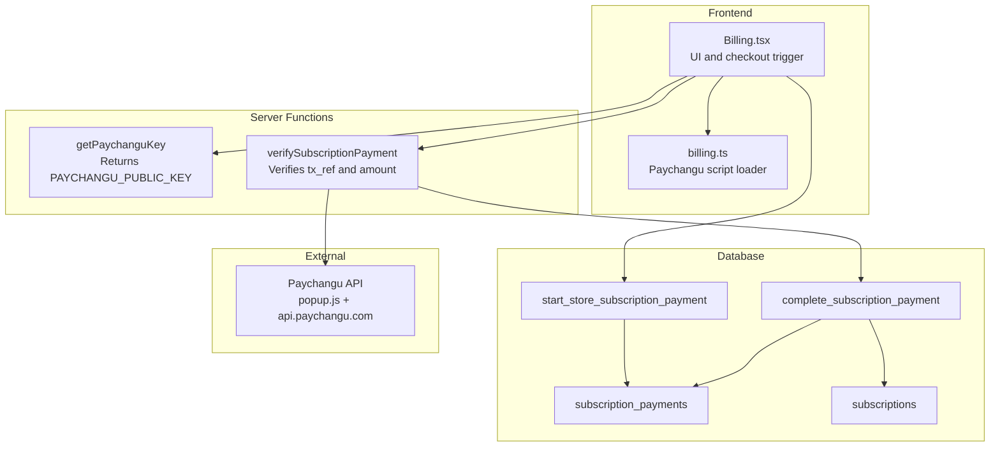
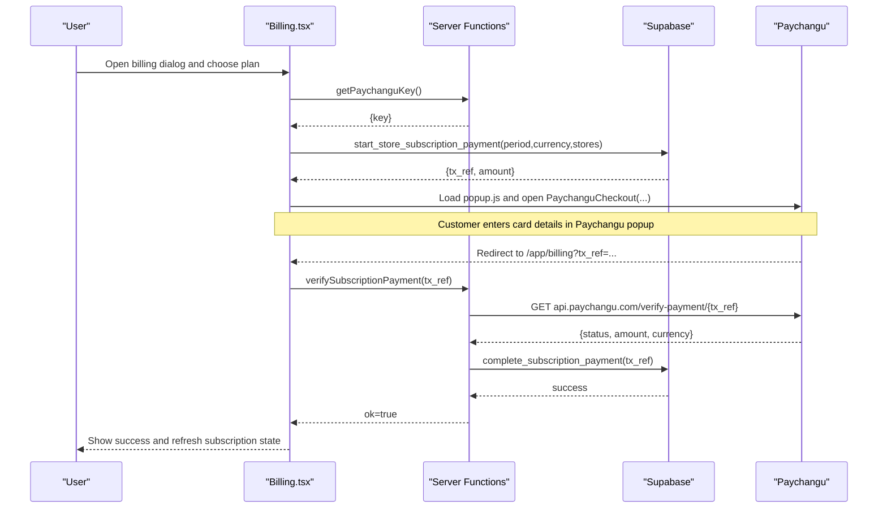
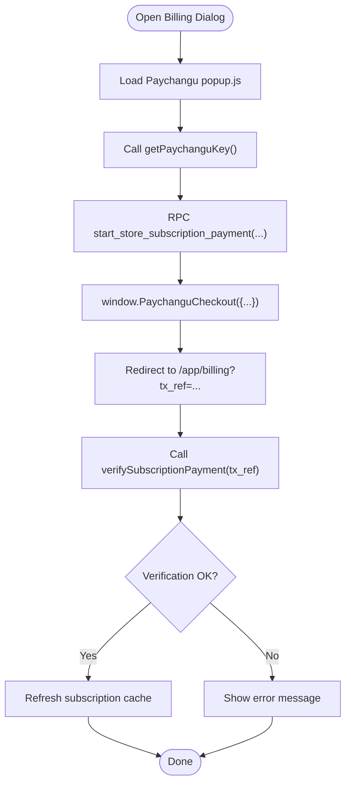
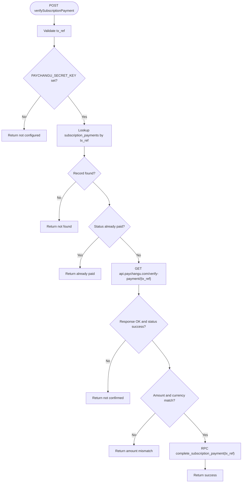
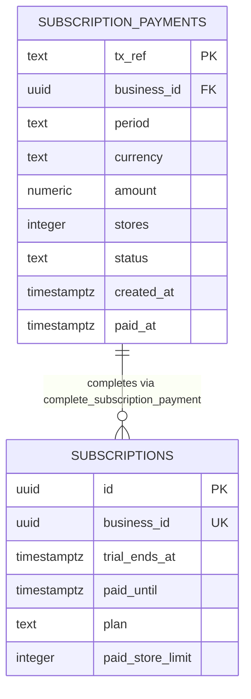
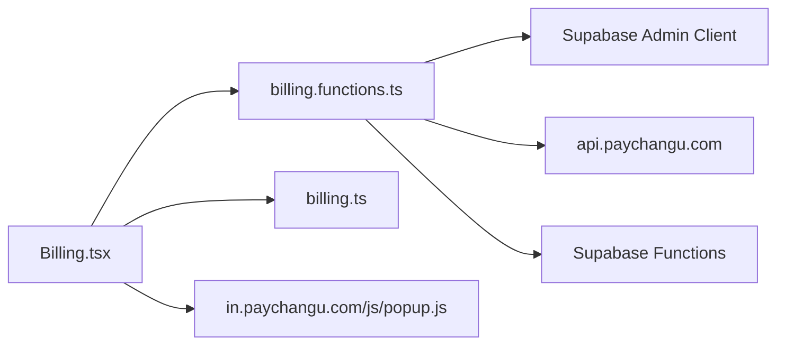

# Card Payments

<cite>
**Referenced Files in This Document**
- [Billing.tsx](file://src/components/pos/Billing.tsx)
- [billing.functions.ts](file://src/lib/billing.functions.ts)
- [billing.ts](file://src/lib/billing.ts)
- [20261007100137_bfc24679-...sql](file://supabase/migrations/20261007100137_bfc24679-ef5e-4843-977b-23f9e197c994.sql)
- [20261007115041_3e857134-...sql](file://supabase/migrations/20261007115041_3e857134-c53a-47c9-a33f-3db16cc13962.sql)
</cite>

## Table of Contents
1. [Introduction](#introduction)
2. [Project Structure](#project-structure)
3. [Core Components](#core-components)
4. [Architecture Overview](#architecture-overview)
5. [Detailed Component Analysis](#detailed-component-analysis)
6. [Dependency Analysis](#dependency-analysis)
7. [Performance Considerations](#performance-considerations)
8. [Security and PCI Compliance](#security-and-pci-compliance)
9. [Troubleshooting Guide](#troubleshooting-guide)
10. [Conclusion](#conclusion)

## Introduction
This document explains how card payments are processed through the Paychangu integration for subscription billing. It covers the end-to-end flow from payment initiation in the application, gateway communication with Paychangu, transaction reference handling, callback verification, and final state updates. It also documents security considerations relevant to card data handling and PCI compliance requirements.

The implementation uses a client-side checkout popup provided by Paychangu, server-side functions for secure key retrieval and payment verification, and Supabase database functions to safely activate subscriptions after successful payment confirmation.

## Project Structure
The card payment feature is implemented across three main areas:
- UI component that starts the Paychangu checkout and handles callbacks.
- Server functions that expose the public key and verify payment results.
- Database schema and functions that create pending payments and complete them securely.

**Diagram sources**
- [Billing.tsx:54-139](file://src/components/pos/Billing.tsx#L54-L139)
- [billing.ts:41-55](file://src/lib/billing.ts#L41-L55)
- [billing.functions.ts:4-53](file://src/lib/billing.functions.ts#L4-L53)
- [20261007100137_bfc24679-...sql:46-63](file://supabase/migrations/20261007100137_bfc24679-ef5e-4843-977b-23f9e197c994.sql#L46-L63)
- [20261007115041_3e857134-...sql:66-82](file://supabase/migrations/20261007115041_3e857134-c53a-47c9-a33f-3db16cc13962.sql#L66-L82)

**Section sources**
- [Billing.tsx:54-139](file://src/components/pos/Billing.tsx#L54-L139)
- [billing.ts:41-55](file://src/lib/billing.ts#L41-L55)
- [billing.functions.ts:4-53](file://src/lib/billing.functions.ts#L4-L53)

## Core Components
- Billing UI component: initiates checkout, loads Paychangu popup, sends customer and plan details, and processes return URL callbacks.
- Server functions:
  - getPaychanguKey: returns the public key from environment variables.
  - verifySubscriptionPayment: validates the transaction reference against Paychangu and marks the subscription active if verified.
- Database functions:
  - start_store_subscription_payment: creates a pending payment record and returns transaction reference and amount.
  - complete_subscription_payment: updates payment status and extends subscription validity.

**Section sources**
- [Billing.tsx:54-139](file://src/components/pos/Billing.tsx#L54-L139)
- [billing.functions.ts:4-53](file://src/lib/billing.functions.ts#L4-L53)
- [20261007100137_bfc24679-...sql:46-63](file://supabase/migrations/20261007100137_bfc24679-ef5e-4843-977b-23f9e197c994.sql#L46-L63)

## Architecture Overview
The card payment architecture follows a secure separation of concerns:
- The frontend never handles raw card data; it delegates to Paychangu’s popup.
- The backend exposes only safe operations: creating a pending payment and verifying an existing one.
- Payment completion is enforced via a database function restricted to service role execution.

**Diagram sources**
- [Billing.tsx:74-139](file://src/components/pos/Billing.tsx#L74-L139)
- [billing.functions.ts:10-53](file://src/lib/billing.functions.ts#L10-L53)
- [20261007100137_bfc24679-...sql:46-63](file://supabase/migrations/20261007100137_bfc24679-ef5e-4843-977b-23f9e197c994.sql#L46-L63)

## Detailed Component Analysis

### Billing UI Component
Responsibilities:
- Loads Paychangu’s popup script.
- Retrieves the public key from the server.
- Starts a subscription payment via RPC and opens the Paychangu checkout.
- Handles return URL callback by verifying the transaction reference.
- Displays subscription status, invoice history, and payment method information.

Key behaviors:
- Public key management: fetched via a server function to avoid exposing secrets.
- Transaction reference handling: created on the server and passed into the checkout payload.
- Callback processing: reads tx_ref from the URL, calls verification, and refreshes subscription state.

**Diagram sources**
- [Billing.tsx:74-139](file://src/components/pos/Billing.tsx#L74-L139)
- [billing.ts:41-55](file://src/lib/billing.ts#L41-L55)

**Section sources**
- [Billing.tsx:54-139](file://src/components/pos/Billing.tsx#L54-L139)

### Server Functions
- getPaychanguKey:
  - Returns the public key from environment variables.
  - Safe to call from the frontend because it does not expose secrets.
- verifySubscriptionPayment:
  - Validates input using a schema.
  - Checks configuration (secret key presence).
  - Looks up the pending payment by transaction reference.
  - Calls Paychangu’s verification endpoint with the secret key.
  - Verifies amount and currency match the recorded values.
  - Completes the subscription via a restricted database function.

**Diagram sources**
- [billing.functions.ts:10-53](file://src/lib/billing.functions.ts#L10-L53)

**Section sources**
- [billing.functions.ts:4-53](file://src/lib/billing.functions.ts#L4-L53)

### Database Schema and Functions
- start_store_subscription_payment:
  - Creates a pending payment record with business context, period, currency, amount, and store count.
  - Returns transaction reference and amount for the frontend.
- complete_subscription_payment:
  - Locks the payment row and prevents duplicate completion.
  - Updates payment status to paid and sets paid timestamp.
  - Extends subscription validity based on period and current expiration.

**Diagram sources**
- [20261007100137_bfc24679-...sql:46-63](file://supabase/migrations/20261007100137_bfc24679-ef5e-4843-977b-23f9e197c994.sql#L46-L63)
- [20261007115041_3e857134-...sql:66-82](file://supabase/migrations/20261007115041_3e857134-c53a-47c9-a33f-3db16cc13962.sql#L66-L82)

**Section sources**
- [20261007100137_bfc24679-...sql:46-63](file://supabase/migrations/20261007100137_bfc24679-ef5e-4843-977b-23f9e197c994.sql#L46-L63)
- [20261007115041_3e857134-...sql:66-82](file://supabase/migrations/20261007115041_3e857134-c53a-47c9-a33f-3db16cc13962.sql#L66-L82)

## Dependency Analysis
The payment flow depends on:
- Frontend components for user interaction and checkout triggering.
- Server functions for secure key access and verification.
- Database functions for atomic state transitions.
- External Paychangu services for card data capture and payment verification.

**Diagram sources**
- [Billing.tsx:54-139](file://src/components/pos/Billing.tsx#L54-L139)
- [billing.functions.ts:4-53](file://src/lib/billing.functions.ts#L4-L53)
- [billing.ts:41-55](file://src/lib/billing.ts#L41-L55)

**Section sources**
- [Billing.tsx:54-139](file://src/components/pos/Billing.tsx#L54-L139)
- [billing.functions.ts:4-53](file://src/lib/billing.functions.ts#L4-L53)
- [billing.ts:41-55](file://src/lib/billing.ts#L41-L55)

## Performance Considerations
- Script loading: Paychangu’s popup script is loaded once and cached via a promise to avoid repeated network requests.
- Query caching: Subscription state uses stale time and refetch intervals to reduce database load while keeping UI responsive.
- Verification efficiency: The verification function performs minimal checks before calling the external API and avoids redundant work when a payment is already marked paid.

[No sources needed since this section provides general guidance]

## Security and PCI Compliance
Important security properties:
- Card data is handled exclusively by Paychangu’s popup; the application never receives or stores raw card details.
- Secret keys remain server-side; only the public key is exposed to the client.
- Payment verification occurs on the server using the secret key and includes strict validation of amount and currency against stored records.
- Subscription activation is performed via a database function restricted to service role execution, preventing unauthorized clients from directly modifying subscription state.

PCI compliance considerations:
- Use Paychangu’s hosted checkout to ensure card data entry and transmission occur within their PCI-compliant environment.
- Do not log sensitive payloads such as amounts or transaction references beyond what is necessary for auditability.
- Ensure HTTPS for all endpoints and restrict access to server functions and database procedures.
- Implement rate limiting and monitoring around verification endpoints to prevent abuse.

**Section sources**
- [billing.functions.ts:10-53](file://src/lib/billing.functions.ts#L10-L53)
- [20261007100137_bfc24679-...sql:51-63](file://supabase/migrations/20261007100137_bfc24679-ef5e-4843-977b-23f9e197c994.sql#L51-L63)

## Troubleshooting Guide
Common issues and resolutions:
- Paychangu popup fails to open:
  - Cause: Missing public key or script load failure.
  - Resolution: Ensure PAYCHANGU_PUBLIC_KEY is configured and popup.js loads successfully.
- Payment not found:
  - Cause: Invalid or missing transaction reference.
  - Resolution: Confirm the tx_ref exists in subscription_payments and matches the callback URL.
- Payment not confirmed yet:
  - Cause: Paychangu verification returned non-success or failed response.
  - Resolution: Retry verification after a short delay; check Paychangu dashboard for payment status.
- Payment amount does not match:
  - Cause: Discrepancy between stored amount/currency and Paychangu response.
  - Resolution: Investigate pricing logic and ensure consistent currency and amount calculations.
- Could not activate subscription:
  - Cause: Database function error during completion.
  - Resolution: Check database permissions and function definitions; review logs for SQL errors.

**Section sources**
- [billing.functions.ts:10-53](file://src/lib/billing.functions.ts#L10-L53)
- [Billing.tsx:74-139](file://src/components/pos/Billing.tsx#L74-L139)

## Conclusion
The Paychangu card payment integration in this project follows a secure, server-enforced workflow:
- The frontend initiates checkout without handling card data.
- The server verifies transactions and enforces amount/currency consistency.
- Database functions provide atomic, protected state transitions for subscription activation.
This design minimizes PCI scope and reduces risk while providing a clear, auditable payment lifecycle.

[No sources needed since this section summarizes without analyzing specific files]