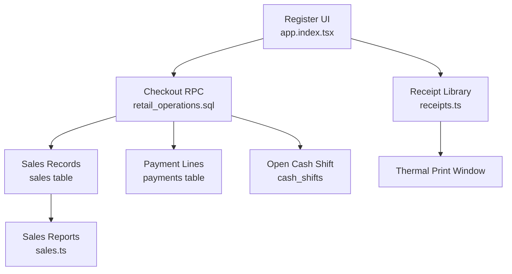
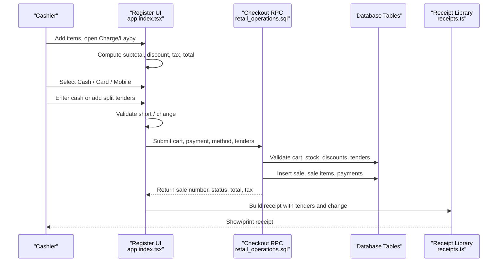
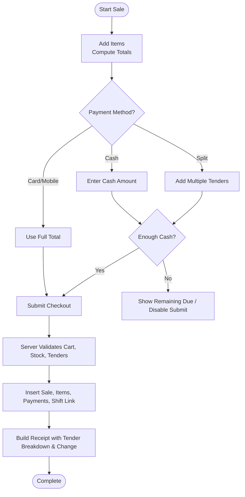
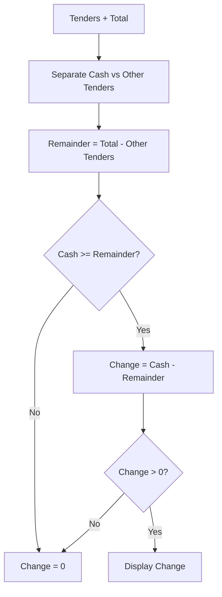
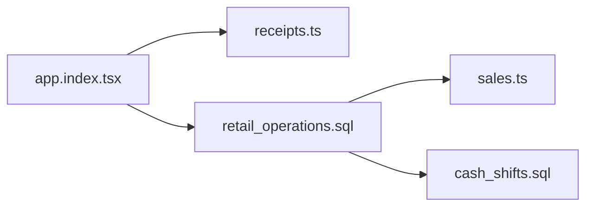
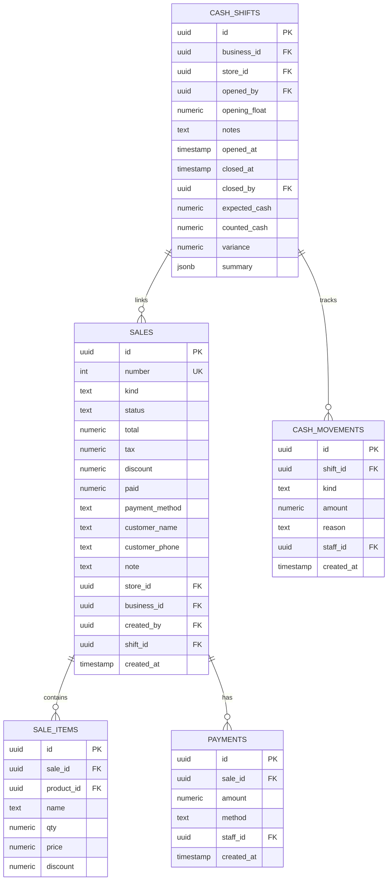

# Cash Payments

<cite>
**Referenced Files in This Document**   
- [app.index.tsx](file://src/routes/_authenticated/app.index.tsx)
- [receipts.ts](file://src/lib/receipts.ts)
- [sales.ts](file://src/lib/sales.ts)
- [retail_operations.sql](file://supabase/migrations/20261009210500_retail_operations.sql)
- [fix_x_alias_collision.sql](file://supabase/migrations/20261011120000_fix_x_alias_collision.sql)
- [cash_shifts.sql](file://supabase/migrations/20261007102244_c10153f5-18b7-409c-8196-3337d3f296c4.sql)
</cite>

## Table of Contents
1. [Introduction](#introduction)
2. [Project Structure](#project-structure)
3. [Core Components](#core-components)
4. [Architecture Overview](#architecture-overview)
5. [Detailed Component Analysis](#detailed-component-analysis)
6. [Dependency Analysis](#dependency-analysis)
7. [Performance Considerations](#performance-considerations)
8. [Troubleshooting Guide](#troubleshooting-guide)
9. [Conclusion](#conclusion)
10. [Appendices](#appendices)

## Introduction
This document explains how cash payments are processed in the POS system, from adding items to a cart through completing a sale, calculating change, and generating receipts. It also covers split-tender support, validation rules, error handling for insufficient or invalid amounts, security controls around cash handling, and audit-trail requirements such as staff attribution, shift linkage, payment records, and receipt data.

The implementation is split between:
- A React-based register UI that collects cart data, payment method, tendered amount, optional split tenders, and customer details.
- Server-side database functions that validate totals, stock, discounts, tenders, and persist sales, payment lines, and shift references.
- Receipt utilities that render plain-text and thermal-print HTML receipts with change and multi-tender breakdowns.

## Project Structure
Cash payment processing touches three main layers:

| Layer | Responsibility | Key Files |
|---|---|---|
| Register UI | Cart building, checkout dialog, cash input, split tenders, change preview, receipt display | `src/routes/_authenticated/app.index.tsx` |
| Receipt Rendering | Receipt model, text output, thermal HTML, print/download helpers | `src/lib/receipts.ts` |
| Data & Audit | Sale creation, tender validation, payment recording, shift linkage, reporting | `supabase/migrations/20261009210500_retail_operations.sql`, `supabase/migrations/20261011120000_fix_x_alias_collision.sql`, `supabase/migrations/20261007102244_c10153f5-18b7-409c-8196-3337d3f296c4.sql`, `src/lib/sales.ts` |

**Diagram sources**
- [app.index.tsx:273-355](file://src/routes/_authenticated/app.index.tsx#L273-L355)
- [retail_operations.sql:108-287](file://supabase/migrations/20261009210500_retail_operations.sql#L108-L287)
- [receipts.ts:84-241](file://src/lib/receipts.ts#L84-L241)
- [sales.ts:37-73](file://src/lib/sales.ts#L37-L73)

**Section sources**
- [app.index.tsx:111-355](file://src/routes/_authenticated/app.index.tsx#L111-L355)
- [receipts.ts:1-241](file://src/lib/receipts.ts#L1-L241)
- [retail_operations.sql:108-287](file://supabase/migrations/20261009210500_retail_operations.sql#L108-L287)
- [sales.ts:37-73](file://src/lib/sales.ts#L37-L73)

## Core Components
- **Register and checkout dialog**: Builds the cart, calculates totals including discount and tax, opens the checkout dialog, validates cash/tenders, computes change, calls the server checkout function, and builds a receipt object.
- **Change calculation**: Computes change only from the cash portion after non-cash tenders cover part of the total; returns zero for layby and approval invoices.
- **Split tendering**: Allows multiple tenders (cash, card, mobile). The UI shows remaining due and disables submission until all parts cover the total.
- **Receipt generation**: Produces both plain-text and thermal HTML receipts, including item lines, discount, VAT, total, payment method, individual tenders, paid amount, and change.
- **Server-side validation**: Enforces valid cart, product catalogue, discounts, store assignment, stock availability, tender methods and amounts, overpayment limits, and shift linkage.
- **Audit trail**: Records staff ID, store, business, sale number, status, totals, tax, discount, payment method, customer details, notes, open cash shift, and per-tender payment lines.

**Section sources**
- [app.index.tsx:103-109](file://src/routes/_authenticated/app.index.tsx#L103-L109)
- [app.index.tsx:780-1075](file://src/routes/_authenticated/app.index.tsx#L780-L1075)
- [receipts.ts:10-32](file://src/lib/receipts.ts#L10-L32)
- [receipts.ts:84-241](file://src/lib/receipts.ts#L84-L241)
- [retail_operations.sql:108-287](file://supabase/migrations/20261009210500_retail_operations.sql#L108-L287)

## Architecture Overview
The cash payment flow is a client-to-server transaction with strong server-side validation and persistent audit records.

**Diagram sources**
- [app.index.tsx:273-355](file://src/routes/_authenticated/app.index.tsx#L273-L355)
- [app.index.tsx:780-1075](file://src/routes/_authenticated/app.index.tsx#L780-L1075)
- [retail_operations.sql:108-287](file://supabase/migrations/20261009210500_retail_operations.sql#L108-L287)
- [receipts.ts:84-241](file://src/lib/receipts.ts#L84-L241)

## Detailed Component Analysis

### Cash Payment Workflow
The register handles cash sales through these steps:

1. **Cart assembly**: Items are added, quantities adjusted, line discounts applied, and totals computed using business tax settings.
2. **Checkout dialog**: The cashier selects a payment method. For cash or split tenders, the UI asks for the tendered amount(s).
3. **Validation**:
   - If splitting, the UI prevents submission while the sum of tenders is less than the total.
   - For single cash payments, the UI prevents submission when the entered cash is less than the total.
   - Change is calculated only for sales, not for layby or approval invoices.
4. **Submission**: The form sends cart items, payment amount, method, optional tenders, optional discounts, and optional manager PIN override to the checkout RPC.
5. **Server processing**: The RPC validates inputs, checks stock, computes totals, applies tenders, records the sale, writes payment lines, and links the open cash shift.
6. **Receipt**: On success, the UI builds a receipt object including tender breakdown and change, then opens the receipt modal for viewing, printing, or downloading.

**Diagram sources**
- [app.index.tsx:780-1075](file://src/routes/_authenticated/app.index.tsx#L780-L1075)
- [retail_operations.sql:108-287](file://supabase/migrations/20261009210500_retail_operations.sql#L108-L287)

**Section sources**
- [app.index.tsx:161-173](file://src/routes/_authenticated/app.index.tsx#L161-L173)
- [app.index.tsx:273-355](file://src/routes/_authenticated/app.index.tsx#L273-L355)
- [app.index.tsx:780-1075](file://src/routes/_authenticated/app.index.tsx#L780-L1075)

### Amount Validation and Error Handling
The UI and server enforce complementary validation rules:

| Area | Rule | Behavior |
|---|---|---|
| UI cash entry | Cash must be at least the total for single cash sales | Submit button disabled while short |
| UI split tenders | Sum of all tenders must cover the total | Remaining due shown; submit disabled while short |
| UI change preview | Change is computed only for sales | Layby and approval invoices show zero change |
| Server cart | Must be a non-empty array of valid product IDs and positive quantities | Raises an error if invalid |
| Server catalogue | All products must exist, belong to the business, and be active | Fails if any item is missing or inactive |
| Server stock | Non-approval sales check available stock before completion | Fails with item names that are short |
| Server tenders | Methods must be cash, card, or mobile; amounts must be positive numeric strings | Rejects unknown methods or malformed amounts |
| Server tender coverage | Completed sales require tenders to cover the total; non-completed sales cannot exceed the total | Raises an error otherwise |
| Server overpayment limit | Completed sales allow cash overpayment for change but reject tenders exceeding twice the total | Prevents extreme overpayments |
| Server shift linkage | Completed sales link to an open cash shift | Ensures cash accounting context |

Common errors include:
- Unknown or unsupported payment method.
- Bad tender format or negative amount.
- Tenders do not cover the total.
- Tenders exceed the invoice total.
- Cash tender far above the total.
- Missing or invalid cart items.
- Insufficient stock.
- Wrong manager PIN for large discounts.

**Section sources**
- [app.index.tsx:806-832](file://src/routes/_authenticated/app.index.tsx#L806-L832)
- [app.index.tsx:1054-1062](file://src/routes/_authenticated/app.index.tsx#L1054-L1062)
- [retail_operations.sql:117-186](file://supabase/migrations/20261009210500_retail_operations.sql#L117-L186)
- [retail_operations.sql:205-243](file://supabase/migrations/20261009210500_retail_operations.sql#L205-L243)
- [fix_x_alias_collision.sql:120-158](file://supabase/migrations/20261011120000_fix_x_alias_collision.sql#L120-L158)

### Change Calculation
Change is derived from the cash portion of the tender set:

- Only sales compute change; layby and approval invoices return zero.
- Non-cash tenders reduce the amount that cash must cover.
- The final change is the cash tender minus the uncovered remainder, floored at zero.
- The UI displays change in green when positive.
- The receipt includes a dedicated change row when applicable.

**Diagram sources**
- [app.index.tsx:103-109](file://src/routes/_authenticated/app.index.tsx#L103-L109)
- [app.index.tsx:829-832](file://src/routes/_authenticated/app.index.tsx#L829-L832)
- [receipts.ts:110-124](file://src/lib/receipts.ts#L110-L124)

**Section sources**
- [app.index.tsx:103-109](file://src/routes/_authenticated/app.index.tsx#L103-L109)
- [app.index.tsx:829-832](file://src/routes/_authenticated/app.index.tsx#L829-L832)
- [receipts.ts:110-124](file://src/lib/receipts.ts#L110-L124)

### Receipt Generation
Receipts are built from a structured receipt object containing:
- Business and store names.
- Sale or layby type and status.
- Cashier name.
- Date and invoice number.
- Item lines with quantity, unit price, and line total.
- Discount, subtotal, VAT rate and amount, and total.
- Payment method and individual tender breakdown.
- Paid amount and change.
- Optional customer name, phone, and note.

Two outputs are supported:
- Plain-text receipt suitable for SMS, WhatsApp, or file download.
- Thermal HTML optimized for 80mm printers, opened in a new window and auto-triggering print.

Security considerations in receipt rendering:
- Text values are escaped to prevent control characters and HTML/XML injection.
- Money formatting is passed into the receipt builder so amounts remain consistent with the store currency.

**Section sources**
- [receipts.ts:10-32](file://src/lib/receipts.ts#L10-L32)
- [receipts.ts:67-74](file://src/lib/receipts.ts#L67-L74)
- [receipts.ts:84-124](file://src/lib/receipts.ts#L84-L124)
- [receipts.ts:128-202](file://src/lib/receipts.ts#L128-L202)
- [receipts.ts:218-241](file://src/lib/receipts.ts#L218-L241)

### Practical Examples

#### Example 1: Straight Cash Sale
- Total: 1,250.00
- Method: Cash
- Tendered: 1,500.00
- Change: 250.00
- Receipt shows:
  - Method: Cash
  - Paid: 1,250.00
  - Change: 250.00

Implementation notes:
- The UI sets the primary tender to cash and the entered amount.
- Change is computed as cash minus the uncovered remainder.
- The server records one completed sale with payment method cash and links it to the open cash shift.

**Section sources**
- [app.index.tsx:806-832](file://src/routes/_authenticated/app.index.tsx#L806-L832)
- [app.index.tsx:326-348](file://src/routes/_authenticated/app.index.tsx#L326-L348)
- [retail_operations.sql:233-249](file://supabase/migrations/20261009210500_retail_operations.sql#L233-L249)

#### Example 2: Split Tender with Partial Cash
- Total: 3,000.00
- Tender 1: Card 1,800.00
- Tender 2: Cash 1,200.00
- Change: 0.00
- Receipt shows:
  - Method: Split
  - Tender rows for card and cash
  - Paid: 3,000.00
  - No change row

Implementation notes:
- The UI allows adding extra tenders and disables submission while the sum is less than the total.
- The server accepts multiple tenders, validates each method and amount, and ensures coverage.
- Payment lines are recorded per tender.

**Section sources**
- [app.index.tsx:952-997](file://src/routes/_authenticated/app.index.tsx#L952-L997)
- [app.index.tsx:1000-1013](file://src/routes/_authenticated/app.index.tsx#L1000-L1013)
- [retail_operations.sql:205-243](file://supabase/migrations/20261009210500_retail_operations.sql#L205-L243)

#### Example 3: Insufficient Cash
- Total: 750.00
- Method: Cash
- Tendered: 500.00
- Result: Submit button remains disabled; the UI shows remaining due.

Implementation notes:
- The UI prevents submission when cash is less than the total.
- The server would also reject incomplete coverage if submitted directly.

**Section sources**
- [app.index.tsx:1054-1062](file://src/routes/_authenticated/app.index.tsx#L1054-L1062)
- [retail_operations.sql:222-228](file://supabase/migrations/20261009210500_retail_operations.sql#L222-L228)

#### Example 4: Excessive Cash Overpayment
- Total: 1,000.00
- Tendered: 3,500.00
- Result: Server rejects the tender because it exceeds twice the total.

Implementation notes:
- The server enforces a maximum overpayment limit to protect against extreme cash errors.

**Section sources**
- [retail_operations.sql:222-228](file://supabase/migrations/20261009210500_retail_operations.sql#L222-L228)

### Security Considerations for Cash Handling
- **Staff authentication**: Checkout requires a valid staff token and role-based access.
- **Store assignment**: Cashiers can only operate on their assigned store.
- **Manager PIN protection**: Discounts beyond a cashier’s cap require a manager PIN; the server verifies the hashed PIN.
- **Tender validation**: Only allowed methods and positive numeric amounts are accepted.
- **Overpayment guardrails**: Completed sales allow cash overpayment for change but reject tenders exceeding twice the total.
- **Shift linkage**: Completed sales reference an open cash shift, tying revenue to a counted period.
- **Receipt sanitization**: Receipt text and HTML escape control characters and common HTML entities to avoid injection.
- **Immutable audit fields**: Sales and refunds record created_by, approved_by, approved_at, and shift_id where applicable.

**Section sources**
- [retail_operations.sql:116-149](file://supabase/migrations/20261009210500_retail_operations.sql#L116-L149)
- [retail_operations.sql:171-186](file://supabase/migrations/20261009210500_retail_operations.sql#L171-L186)
- [retail_operations.sql:205-243](file://supabase/migrations/20261009210500_retail_operations.sql#L205-L243)
- [receipts.ts:67-74](file://src/lib/receipts.ts#L67-L74)

### Audit Trail Requirements
Every cash sale contributes to the audit trail through:

| Record | Purpose |
|---|---|
| `sales` | Invoice number, kind, status, total, tax, discount, paid, payment method, customer details, notes, staff who created it, and linked shift |
| `sale_items` | Per-item name, quantity, net price, and discount |
| `payments` | Per-tender payment amount, method, and staff who completed the transaction |
| `cash_shifts` | Open/closed shift state, opening float, expected/counted cash, variance, and summary |
| `cash_movements` | Manual cash in/out events during a shift |
| `refunds` | Refund reason, amount, method, staff, and linked shift |

Reporting and export utilities read from the sales tables and can aggregate by method, store, date range, and pagination.

**Section sources**
- [retail_operations.sql:245-286](file://supabase/migrations/20261009210500_retail_operations.sql#L245-L286)
- [cash_shifts.sql:197-268](file://supabase/migrations/20261007102244_c10153f5-18b7-409c-8196-3337d3f296c4.sql#L197-L268)
- [sales.ts:37-73](file://src/lib/sales.ts#L37-L73)
- [sales.ts:126-148](file://src/lib/sales.ts#L126-L148)

## Dependency Analysis
The cash payment path depends on UI state, server RPCs, and database tables.

**Diagram sources**
- [app.index.tsx:273-355](file://src/routes/_authenticated/app.index.tsx#L273-L355)
- [receipts.ts:84-241](file://src/lib/receipts.ts#L84-L241)
- [retail_operations.sql:108-287](file://supabase/migrations/20261009210500_retail_operations.sql#L108-L287)
- [sales.ts:37-73](file://src/lib/sales.ts#L37-L73)
- [cash_shifts.sql:197-268](file://supabase/migrations/20261007102244_c10153f5-18b7-409c-8196-3337d3f296c4.sql#L197-L268)

**Section sources**
- [app.index.tsx:273-355](file://src/routes/_authenticated/app.index.tsx#L273-L355)
- [receipts.ts:84-241](file://src/lib/receipts.ts#L84-L241)
- [retail_operations.sql:108-287](file://supabase/migrations/20261009210500_retail_operations.sql#L108-L287)
- [sales.ts:37-73](file://src/lib/sales.ts#L37-L73)
- [cash_shifts.sql:197-268](file://supabase/migrations/20261007102244_c10153f5-18b7-409c-8196-3337d3f296c4.sql#L197-L268)

## Performance Considerations
- **Client-side totals**: Subtotal, discount, tax, and total are recomputed locally for responsiveness; the server recomputes authoritative totals.
- **Tender validation**: The UI provides immediate feedback on remaining due and change, reducing failed submissions.
- **Server-side aggregation**: Sales summaries and reports use SQL aggregation rather than loading full datasets for headline numbers.
- **Receipt rendering**: Receipt HTML is generated in memory and printed via a small popup window; plain-text receipts are downloaded as blobs.
- **Pagination and exports**: Sales lists paginate results, and exports fetch bounded ranges to avoid blocking normal browsing.

[No sources needed since this section provides general guidance]

## Troubleshooting Guide

| Symptom | Likely Cause | Resolution |
|---|---|---|
| Submit button stays disabled for cash | Entered cash is less than total | Enter exact or greater amount |
| Submit button stays disabled for split tenders | Sum of tenders is less than total | Add another tender or increase amounts |
| Server returns “Tenders do not cover the total” | Tender sum is below invoice total | Adjust tender amounts |
| Server returns “Tenders exceed the invoice total” | Non-completed sale has tender sum above total | Reduce tender amounts |
| Server returns “Cash tender is far above the total” | Completed sale tender sum exceeds twice the total | Reduce cash tender to a reasonable overpayment |
| Server returns “Unknown payment method” | Invalid method string | Use cash, card, or mobile |
| Server returns “A tender has an unknown method or a bad amount” | Malformed tender JSON | Ensure method is valid and amount is a positive numeric string |
| Server returns “Not enough stock” | Inventory insufficient for sale | Restock or remove items |
| Manager PIN required | Discount exceeds cashier cap | Provide correct manager PIN |
| Receipt shows wrong currency or formatting | Money formatter mismatch | Ensure receipt uses the store’s money function |
| Receipt contains unexpected characters | Unsafe input in notes or labels | Rely on built-in escaping; avoid raw control characters |

**Section sources**
- [app.index.tsx:1054-1062](file://src/routes/_authenticated/app.index.tsx#L1054-L1062)
- [retail_operations.sql:205-243](file://supabase/migrations/20261009210500_retail_operations.sql#L205-L243)
- [receipts.ts:67-74](file://src/lib/receipts.ts#L67-L74)

## Conclusion
Cash payments in this POS system combine responsive client-side validation with strict server-side enforcement. Cash transactions support exact payment, change calculation, and split tenders, while receipts provide clear breakdowns for auditing. Security controls include staff authentication, store scoping, manager PIN verification for discounts, tender validation, overpayment limits, and shift linkage. The resulting audit trail captures sales, items, payments, and shift context, enabling reliable cash reconciliation and reporting.

[No sources needed since this section summarizes without analyzing specific files]

## Appendices

### Appendix A: Cash Payment Data Model Summary

**Diagram sources**
- [retail_operations.sql:245-286](file://supabase/migrations/20261009210500_retail_operations.sql#L245-L286)
- [cash_shifts.sql:197-268](file://supabase/migrations/20261007102244_c10153f5-18b7-409c-8196-3337d3f296c4.sql#L197-L268)