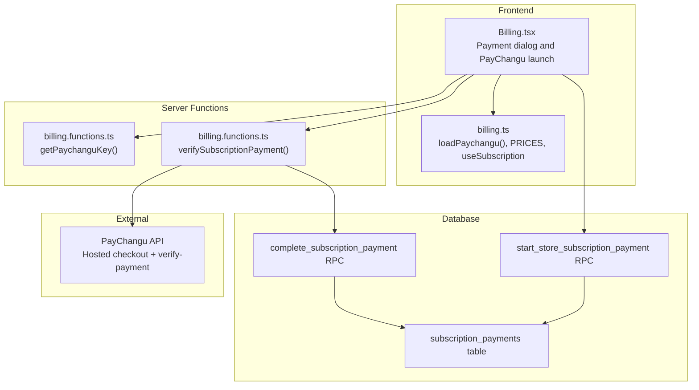
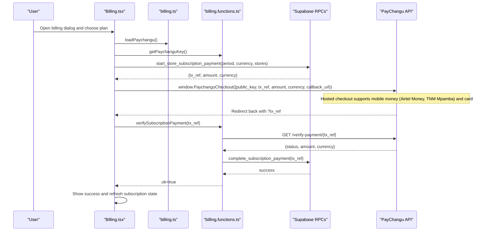
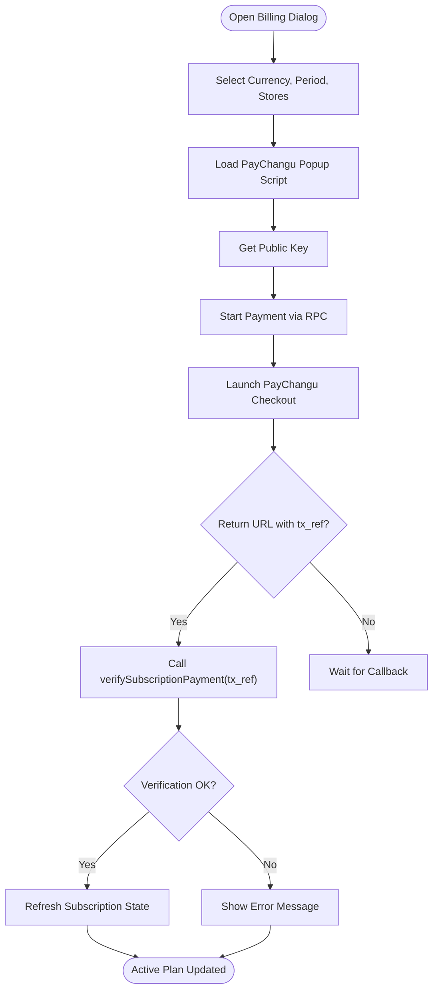
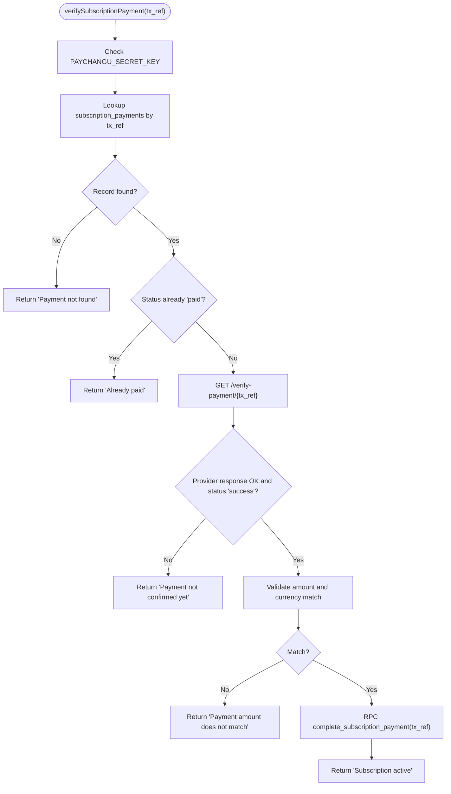
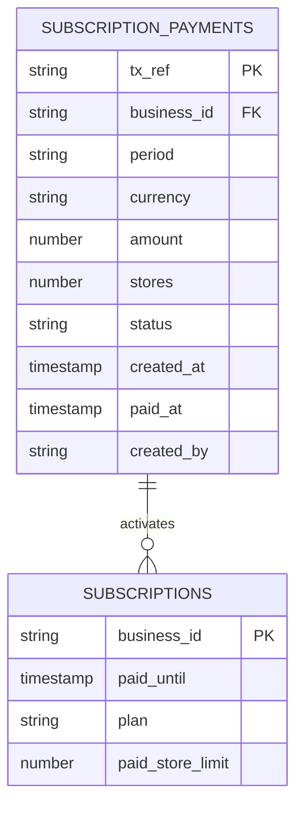
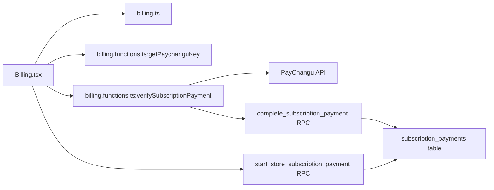

# Mobile Money Payments

<cite>
**Referenced Files in This Document**
- [Billing.tsx](file://src/components/pos/Billing.tsx)
- [billing.ts](file://src/lib/billing.ts)
- [billing.functions.ts](file://src/lib/billing.functions.ts)
- [en.ts](file://src/lib/i18n/en.ts)
- [20261007100137_bfc24679-0e49-446b-b715-df35c6e8c994.sql](file://supabase/migrations/20261007100137_bfc24679-0e49-446b-b715-df35c6e8c994.sql)
- [20261007115041_3e857134-c53a-47c9-a33f-3db16cc13962.sql](file://supabase/migrations/20261007115041_3e857134-c53a-47c9-a33f-3db16cc13962.sql)
- [types.ts](file://src/integrations/supabase/types.ts)
</cite>

## Table of Contents
1. [Introduction](#introduction)
2. [Project Structure](#project-structure)
3. [Core Components](#core-components)
4. [Architecture Overview](#architecture-overview)
5. [Detailed Component Analysis](#detailed-component-analysis)
6. [Dependency Analysis](#dependency-analysis)
7. [Performance Considerations](#performance-considerations)
8. [Troubleshooting Guide](#troubleshooting-guide)
9. [Conclusion](#conclusion)

## Introduction
This document explains how mobile money payments are processed through the PayChangu integration for subscription billing. It covers the end-to-end flow from provider selection to payment confirmation, including how the application integrates with PayChangu and how mobile money providers such as Airtel Money and TNM Mpamba are supported. It also documents data structures, server-side verification logic, error handling, and practical troubleshooting strategies.

The implementation uses a client-side checkout UI that opens PayChangu’s hosted payment interface. The backend creates a pending payment record, verifies the transaction with PayChangu, and then activates the subscription by updating database state.

## Project Structure
The mobile money payment feature spans frontend components, shared billing utilities, server functions, and Supabase migrations:

- Frontend UI: Billing dialog and payment initiation
- Shared billing utilities: Pricing constants, PayChangu script loader, and subscription query hook
- Server functions: PayChangu public key retrieval and payment verification
- Database schema: Subscription payment records and stored procedures for starting and completing payments
- Internationalization: User-facing strings mentioning mobile money providers

**Diagram sources**
- [Billing.tsx:94-139](file://src/components/pos/Billing.tsx#L94-L139)
- [billing.ts:41-55](file://src/lib/billing.ts#L41-L55)
- [billing.functions.ts:4-53](file://src/lib/billing.functions.ts#L4-L53)
- [20261007115041_3e857134-c53a-47c9-a33f-3db16cc13962.sql:37-50](file://supabase/migrations/20261007115041_3e857134-c53a-47c9-a33f-3db16cc13962.sql#L37-L50)
- [20261007100137_bfc24679-0e49-446b-b715-df35c6e8c994.sql:51-63](file://supabase/migrations/20261007100137_bfc24679-0e49-446b-b715-df35c6e8c994.sql#L51-L63)

**Section sources**
- [Billing.tsx:54-139](file://src/components/pos/Billing.tsx#L54-L139)
- [billing.ts:7-55](file://src/lib/billing.ts#L7-L55)
- [billing.functions.ts:4-53](file://src/lib/billing.functions.ts#L4-L53)
- [20261007115041_3e857134-c53a-47c9-a33f-3db16cc13962.sql:37-82](file://supabase/migrations/20261007115041_3e857134-c53a-47c9-a33f-3db16cc13962.sql#L37-L82)
- [20261007100137_bfc24679-0e49-446b-b715-df35c6e8c994.sql:46-63](file://supabase/migrations/20261007100137_bfc24679-0e49-446b-b715-df35c6e8c994.sql#L46-L63)

## Core Components
- Billing UI component: Presents plan options, currency selection, store slot configuration, and launches PayChangu checkout. It handles returning URLs with a transaction reference and triggers verification.
- Billing library: Provides pricing constants, a lazy loader for PayChangu’s popup script, and a subscription access hook used across the app.
- Server functions:
  - getPaychanguKey(): Returns the PayChangu public key from environment variables.
  - verifySubscriptionPayment(): Validates the transaction with PayChangu, checks amount and currency against the recorded pending payment, and activates the subscription via a secure RPC.
- Database layer:
  - start_store_subscription_payment RPC: Creates a pending payment record with validated parameters and returns a transaction reference and amount.
  - complete_subscription_payment RPC: Safely marks a payment paid and updates subscription validity and store capacity.

**Section sources**
- [Billing.tsx:54-139](file://src/components/pos/Billing.tsx#L54-L139)
- [billing.ts:7-55](file://src/lib/billing.ts#L7-L55)
- [billing.functions.ts:4-53](file://src/lib/billing.functions.ts#L4-L53)
- [20261007115041_3e857134-c53a-47c9-a33f-3db16cc13962.sql:37-50](file://supabase/migrations/20261007115041_3e857134-c53a-47c9-a33f-3db16cc13962.sql#L37-L50)
- [20261007100137_bfc24679-0e49-446b-b715-df35c6e8c994.sql:51-63](file://supabase/migrations/20261007100137_bfc24679-0e49-446b-b715-df35c6e8c994.sql#L51-L63)

## Architecture Overview
The mobile money payment architecture is centered around PayChangu’s hosted checkout. The application does not handle raw mobile money provider APIs directly; instead, it delegates provider selection and payment execution to PayChangu. The app ensures correctness by recording the intended payment details server-side and verifying them before activating the subscription.

**Diagram sources**
- [Billing.tsx:94-139](file://src/components/pos/Billing.tsx#L94-L139)
- [billing.ts:41-55](file://src/lib/billing.ts#L41-L55)
- [billing.functions.ts:4-53](file://src/lib/billing.functions.ts#L4-L53)
- [20261007115041_3e857134-c53a-47c9-a33f-3db16cc13962.sql:37-50](file://supabase/migrations/20261007115041_3e857134-c53a-47c9-a33f-3db16cc13962.sql#L37-L50)
- [20261007100137_bfc24679-0e49-446b-b715-df35c6e8c994.sql:51-63](file://supabase/migrations/20261007100137_bfc24679-0e49-446b-b715-df35c6e8c994.sql#L51-L63)

## Detailed Component Analysis

### Billing UI and Payment Initiation
The Billing component orchestrates the user experience:
- Displays current subscription status, usage progress, and last payment method.
- Lets users select currency (MWK or USD), period (monthly or yearly), and number of store slots.
- Loads PayChangu’s popup script lazily and opens the hosted checkout with the correct metadata.
- Handles return URL callbacks containing a transaction reference and triggers verification.

Key behaviors:
- Provider selection is delegated to PayChangu’s hosted UI. The UI presents “mobile money” and “card” options conceptually, while actual provider routing happens within PayChangu.
- The callback URL includes a transaction reference; the UI calls the verification server function once on mount if present.
- On success, the UI shows a toast and invalidates the subscription cache so the UI reflects the new active plan.

**Diagram sources**
- [Billing.tsx:74-92](file://src/components/pos/Billing.tsx#L74-L92)
- [Billing.tsx:94-139](file://src/components/pos/Billing.tsx#L94-L139)
- [billing.ts:41-55](file://src/lib/billing.ts#L41-L55)

**Section sources**
- [Billing.tsx:54-139](file://src/components/pos/Billing.tsx#L54-L139)
- [billing.ts:41-55](file://src/lib/billing.ts#L41-L55)

### Server-Side Payment Verification
The verification server function performs critical security checks:
- Ensures PayChangu secret key is configured.
- Looks up the pending payment by transaction reference.
- Calls PayChangu’s verify endpoint using the secret key.
- Confirms the provider-reported amount and currency match the recorded values.
- Activates the subscription only after successful verification by invoking the secure RPC.

Important safeguards:
- Amount and currency must match exactly.
- Idempotency is handled by checking existing “paid” status.
- Errors are surfaced as user-friendly messages without exposing sensitive internals.

**Diagram sources**
- [billing.functions.ts:10-53](file://src/lib/billing.functions.ts#L10-L53)
- [20261007100137_bfc24679-0e49-446b-b715-df35c6e8c994.sql:51-63](file://supabase/migrations/20261007100137_bfc24679-0e49-446b-b715-df35c6e8c994.sql#L51-L63)

**Section sources**
- [billing.functions.ts:10-53](file://src/lib/billing.functions.ts#L10-L53)

### Database Schema and Stored Procedures
The database layer enforces business rules and maintains auditability:

- subscription_payments table: Records each attempted subscription payment with fields like tx_ref, business_id, period, currency, amount, stores, status, created_at, and paid_at.
- start_store_subscription_payment RPC: Validates inputs (period, currency, store count), computes the total amount (including yearly discount), generates a unique transaction reference, inserts a pending payment, and returns payment details to the client.
- complete_subscription_payment RPC: Securely marks a payment as paid and updates the subscription’s paid_until date and plan. The latest migration calculates prorated duration based on remaining time and target store capacity.

Data model overview:

**Diagram sources**
- [types.ts:1055-1100](file://src/integrations/supabase/types.ts#L1055-L1100)
- [20261007100137_bfc24679-0e49-446b-b715-df35c6e8c994.sql:46-63](file://supabase/migrations/20261007100137_bfc24679-0e49-446b-b715-df35c6e8c994.sql#L46-L63)
- [20261007115041_3e857134-c53a-47c9-a33f-3db16cc13962.sql:65-82](file://supabase/migrations/20261007115041_3e857134-c53a-47c9-a33f-3db16cc13962.sql#L65-L82)

**Section sources**
- [types.ts:1055-1100](file://src/integrations/supabase/types.ts#L1055-L1100)
- [20261007100137_bfc24679-0e49-446b-b715-df35c6e8c994.sql:46-63](file://supabase/migrations/20261007100137_bfc24679-0e49-446b-b715-df35c6e8c994.sql#L46-L63)
- [20261007115041_3e857134-c53a-47c9-a33f-3db16cc13962.sql:37-82](file://supabase/migrations/20261007115041_3e857134-c53a-47c9-a33f-3db16cc13962.sql#L37-L82)

### Mobile Money Provider Integration
Mobile money providers are supported through PayChangu rather than direct integrations:
- The UI mentions “Airtel Money / TNM Mpamba” as available methods.
- The provider selection and phone number entry occur inside PayChangu’s hosted checkout.
- The application validates the final result server-side, ensuring the amount and currency match the expected values before activating the subscription.

Practical implications:
- No custom phone number validation is implemented in this codebase; validation is delegated to PayChangu.
- Provider-specific responses are abstracted away; the app relies on PayChangu’s unified verification response.

**Section sources**
- [en.ts:987-988](file://src/lib/i18n/en.ts#L987-L988)
- [en.ts:950](file://src/lib/i18n/en.ts#L950)
- [billing.functions.ts:23-43](file://src/lib/billing.functions.ts#L23-L43)

## Dependency Analysis
The following diagram maps runtime dependencies between modules involved in mobile money payments:

**Diagram sources**
- [Billing.tsx:94-139](file://src/components/pos/Billing.tsx#L94-L139)
- [billing.ts:41-55](file://src/lib/billing.ts#L41-L55)
- [billing.functions.ts:4-53](file://src/lib/billing.functions.ts#L4-L53)
- [20261007115041_3e857134-c53a-47c9-a33f-3db16cc13962.sql:37-50](file://supabase/migrations/20261007115041_3e857134-c53a-47c9-a33f-3db16cc13962.sql#L37-L50)
- [20261007100137_bfc24679-0e49-446b-b715-df35c6e8c994.sql:51-63](file://supabase/migrations/20261007100137_bfc24679-0e49-446b-b715-df35c6e8c994.sql#L51-L63)

**Section sources**
- [Billing.tsx:94-139](file://src/components/pos/Billing.tsx#L94-L139)
- [billing.functions.ts:4-53](file://src/lib/billing.functions.ts#L4-L53)

## Performance Considerations
- Lazy loading of PayChangu’s popup script avoids unnecessary network overhead until the user initiates payment.
- Subscription queries use caching and gentle polling intervals to reduce database load while keeping UI state reasonably fresh.
- Payment history queries are cached for longer durations since they are append-only logs.

Recommendations:
- Keep PayChangu script loading deferred to first interaction.
- Use optimistic UI updates where safe, but rely on server verification for financial state changes.
- Monitor network errors when loading external scripts and provide clear fallback messaging.

[No sources needed since this section provides general guidance]

## Troubleshooting Guide
Common issues and resolutions:

- PayChangu could not open:
  - Cause: Missing public key or failed script load.
  - Resolution: Ensure PAYCHANGU_PUBLIC_KEY is set and the popup script loads successfully. The UI surfaces an error message when the global checkout function is unavailable.

- Payments are not configured:
  - Cause: Missing PAYCHANGU_SECRET_KEY on the server.
  - Resolution: Configure the secret key to enable verification. Without it, verification returns a message indicating payments are not configured.

- Payment not found:
  - Cause: Transaction reference does not correspond to a pending payment.
  - Resolution: Confirm the tx_ref exists and is still pending. Re-initiate payment if necessary.

- Payment not confirmed yet:
  - Cause: PayChangu verification returned non-success or HTTP failure.
  - Resolution: Retry later; transient provider delays can occur. Log provider response for diagnostics.

- Payment amount does not match:
  - Cause: Provider-reported amount or currency differs from the recorded pending payment.
  - Resolution: Investigate plan calculation and currency selection. Do not activate the subscription unless amounts match exactly.

- Could not activate subscription:
  - Cause: RPC invocation failed during completion.
  - Resolution: Check database permissions and RPC definitions. Retry activation idempotently.

Operational tips:
- Inspect the subscription history to see pending vs paid records.
- Validate environment variables for both public and secret keys.
- Use the provided internationalized error messages to guide users while logging detailed diagnostics server-side.

**Section sources**
- [Billing.tsx:114-139](file://src/components/pos/Billing.tsx#L114-L139)
- [billing.functions.ts:12-53](file://src/lib/billing.functions.ts#L12-L53)

## Conclusion
The mobile money payment flow leverages PayChangu to abstract provider complexity while maintaining strict server-side verification. The application initiates payments securely, validates provider responses, and updates subscription state only after confirming exact amounts and currencies. By delegating provider selection and phone number handling to PayChangu, the system remains simple and robust. Proper configuration of environment variables and careful monitoring of verification outcomes ensure reliable processing of mobile money transactions.

[No sources needed since this section summarizes without analyzing specific files]