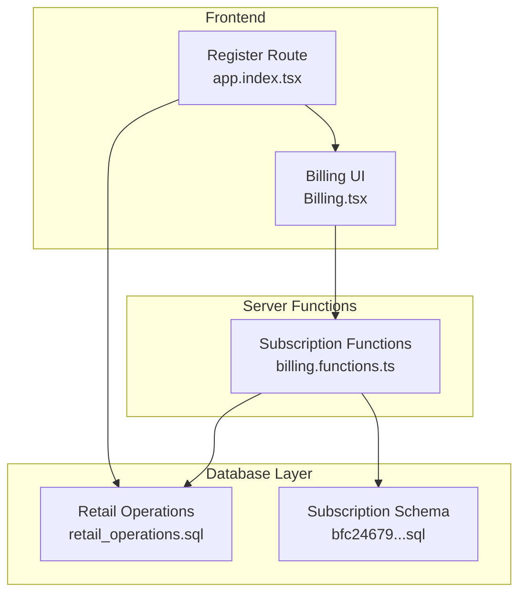
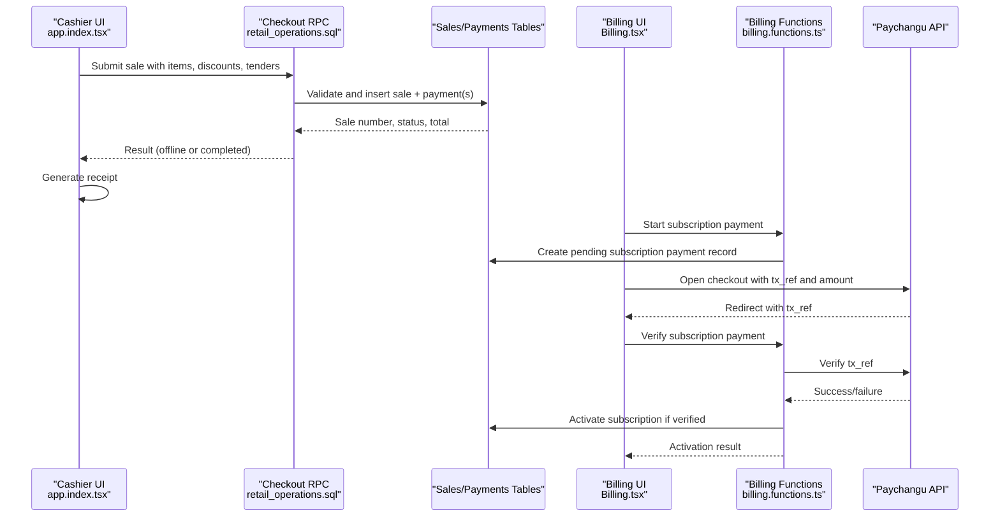
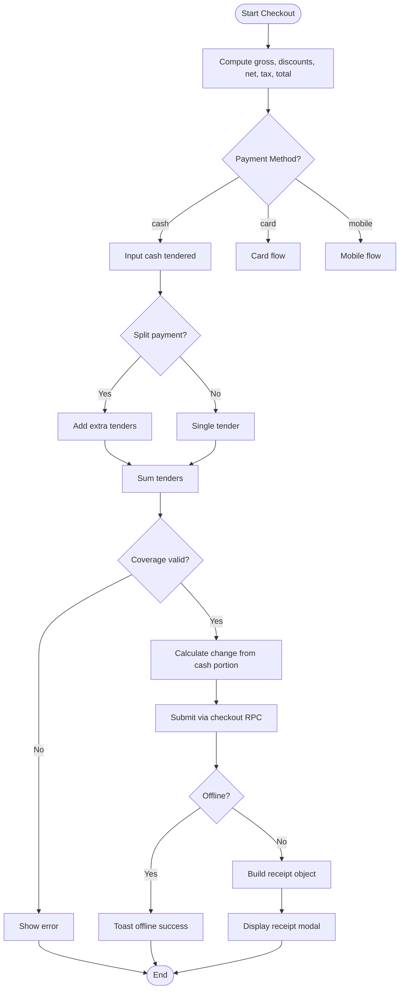
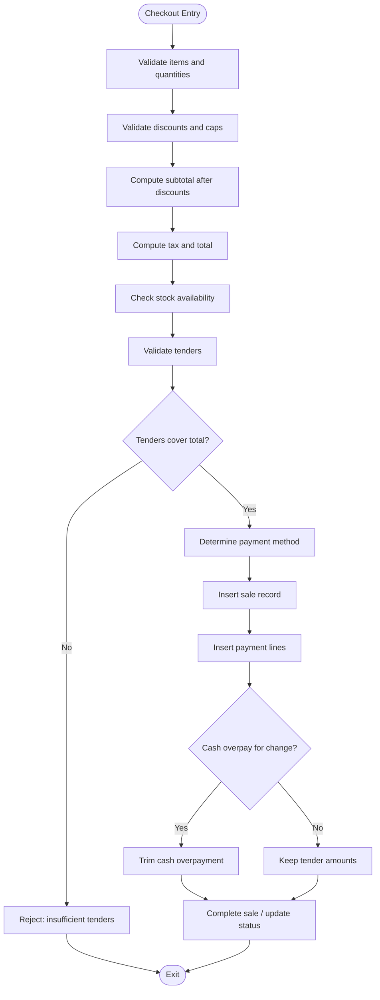
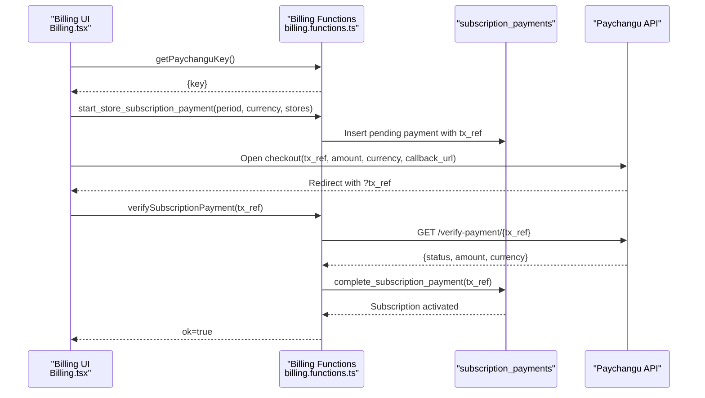
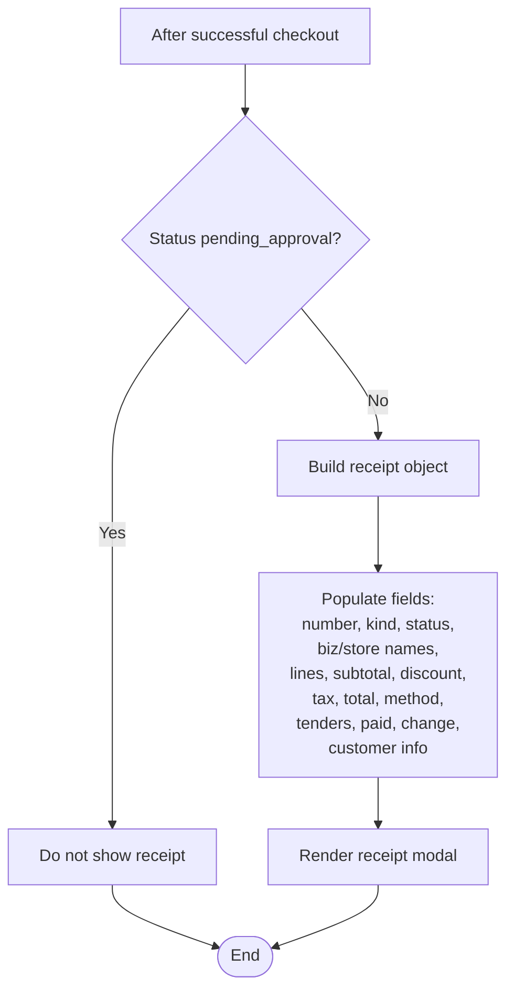
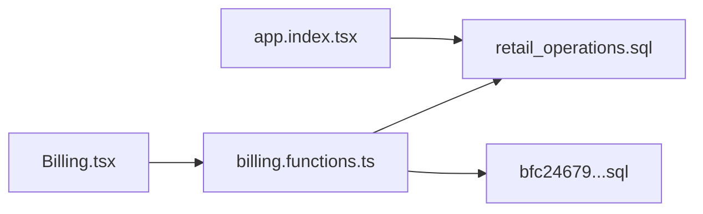

# Payment Processing

<cite>
**Referenced Files in This Document**
- [app.index.tsx](file://src/routes/_authenticated/app.index.tsx)
- [Billing.tsx](file://src/components/pos/Billing.tsx)
- [billing.functions.ts](file://src/lib/billing.functions.ts)
- [20261009210500_retail_operations.sql](file://supabase/migrations/20261009210500_retail_operations.sql)
- [20261007100137_bfc24679-0e49-446b-b715-df35c6e8c994.sql](file://supabase/migrations/20261007100137_bfc24679-0e49-446b-b715-df35c6e8c994.sql)
</cite>

## Table of Contents
1. [Introduction](#introduction)
2. [Project Structure](#project-structure)
3. [Core Components](#core-components)
4. [Architecture Overview](#architecture-overview)
5. [Detailed Component Analysis](#detailed-component-analysis)
6. [Dependency Analysis](#dependency-analysis)
7. [Performance Considerations](#performance-considerations)
8. [Troubleshooting Guide](#troubleshooting-guide)
9. [Security and PCI Compliance](#security-and-pci-compliance)
10. [Conclusion](#conclusion)

## Introduction
This document explains the payment processing system for point-of-sale transactions and subscription billing. It covers:
- Multiple payment methods: cash, card, and mobile payments.
- Split payment support across multiple tenders.
- Payment validation, amount calculation, and change handling.
- Integration with Paychangu for subscription billing and transaction verification.
- Practical scenarios including partial payments, split payments, and failure handling.
- Receipt generation and error handling.
- Security considerations and PCI compliance guidance.

## Project Structure
The payment logic is implemented across three main layers:
- Frontend POS checkout UI and receipt rendering.
- Server-side RPC functions that validate and persist sales and payments.
- Subscription billing integration with Paychangu through server functions and database migrations.

**Diagram sources**
- [app.index.tsx:273-355](file://src/routes/_authenticated/app.index.tsx#L273-L355)
- [Billing.tsx:94-139](file://src/components/pos/Billing.tsx#L94-L139)
- [billing.functions.ts:4-53](file://src/lib/billing.functions.ts#L4-L53)
- [20261009210500_retail_operations.sql:108-287](file://supabase/migrations/20261009210500_retail_operations.sql#L108-L287)
- [20261007100137_bfc24679-0e49-446b-b715-df35c6e8c994.sql:36-61](file://supabase/migrations/20261007100137_bfc24679-0e49-446b-b715-df35c6e8c994.sql#L36-L61)

**Section sources**
- [app.index.tsx:1-1126](file://src/routes/_authenticated/app.index.tsx#L1-L1126)
- [Billing.tsx:1-674](file://src/components/pos/Billing.tsx#L1-L674)
- [billing.functions.ts:1-54](file://src/lib/billing.functions.ts#L1-L54)
- [20261009210500_retail_operations.sql:1-556](file://supabase/migrations/20261009210500_retail_operations.sql#L1-L556)
- [20261007100137_bfc24679-0e49-446b-b715-df35c6e8c994.sql:1-63](file://supabase/migrations/20261007100137_bfc24679-0e49-446b-b715-df35c6e8c994.sql#L1-L63)

## Core Components
- POS Checkout Flow: Handles cart totals, discounts, tax, payment method selection, tender input, split payments, offline behavior, and receipt creation.
- Backend Checkout RPC: Validates inputs, computes totals, enforces discount caps and manager PIN rules, validates tenders, records sales and payments, and manages stock movement.
- Subscription Billing: Starts a Paychangu payment session, verifies completion, and activates the subscription by updating business plan dates.

Key responsibilities:
- Amount calculations are performed both on the frontend for UX and on the backend for authoritative totals.
- Tender validation ensures supported methods, positive amounts, coverage rules, and safe overpayment limits.
- Change is calculated only for cash portions beyond what other tenders cover.
- Receipts include line items, discounts, tax, total, payment method, tenders, paid amount, and change.

**Section sources**
- [app.index.tsx:103-109](file://src/routes/_authenticated/app.index.tsx#L103-L109)
- [app.index.tsx:273-355](file://src/routes/_authenticated/app.index.tsx#L273-L355)
- [20261009210500_retail_operations.sql:108-287](file://supabase/migrations/20261009210500_retail_operations.sql#L108-L287)
- [20261009210500_retail_operations.sql:322-402](file://supabase/migrations/20261009210500_retail_operations.sql#L322-L402)
- [billing.functions.ts:4-53](file://src/lib/billing.functions.ts#L4-L53)

## Architecture Overview
The payment architecture separates concerns between UI, server functions, and database procedures:

**Diagram sources**
- [app.index.tsx:273-355](file://src/routes/_authenticated/app.index.tsx#L273-L355)
- [20261009210500_retail_operations.sql:108-287](file://supabase/migrations/20261009210500_retail_operations.sql#L108-L287)
- [Billing.tsx:94-139](file://src/components/pos/Billing.tsx#L94-L139)
- [billing.functions.ts:4-53](file://src/lib/billing.functions.ts#L4-L53)

## Detailed Component Analysis

### POS Checkout and Payment Validation
The register route implements:
- Cart totals, per-line discounts, tax computation, and final total.
- Payment method selection among cash, card, and mobile.
- Tender rows for split payments; primary tender plus additional tenders.
- Change calculation limited to cash portion beyond non-cash coverage.
- Offline sale handling with toast notifications and local state reset.
- Receipt object construction including method, tenders, paid, and change.

**Diagram sources**
- [app.index.tsx:103-109](file://src/routes/_authenticated/app.index.tsx#L103-L109)
- [app.index.tsx:273-355](file://src/routes/_authenticated/app.index.tsx#L273-L355)
- [app.index.tsx:772-776](file://src/routes/_authenticated/app.index.tsx#L772-L776)

**Section sources**
- [app.index.tsx:103-109](file://src/routes/_authenticated/app.index.tsx#L103-L109)
- [app.index.tsx:273-355](file://src/routes/_authenticated/app.index.tsx#L273-L355)
- [app.index.tsx:772-776](file://src/routes/_authenticated/app.index.tsx#L772-L776)

### Backend Checkout RPC and Tender Rules
The retail operations migration defines the authoritative checkout function with:
- Input validation for items, discounts, customer info, notes, and payment method.
- Discount cap enforcement requiring manager PIN override when exceeded.
- Tax computation based on inclusive/exclusive settings.
- Tender validation: allowed methods, positive amounts, max count, coverage checks, and cash overpayment guard.
- Payment method resolution: single method, split, or default cash.
- Sales and payment insertion, including adjustment for cash overpayment to compute change.
- Stock movement and layby completion logic.

**Diagram sources**
- [20261009210500_retail_operations.sql:108-287](file://supabase/migrations/20261009210500_retail_operations.sql#L108-L287)

**Section sources**
- [20261009210500_retail_operations.sql:108-287](file://supabase/migrations/20261009210500_retail_operations.sql#L108-L287)
- [20261009210500_retail_operations.sql:322-402](file://supabase/migrations/20261009210500_retail_operations.sql#L322-L402)

### Paychangu Subscription Billing Integration
The billing UI and server functions implement:
- Retrieval of Paychangu public key.
- Starting a subscription payment via RPC, creating a pending record with tx_ref, amount, currency, and store count.
- Opening Paychangu checkout with callback and return URLs.
- Verifying payment completion by calling Paychangu’s verify endpoint and comparing amount/currency against stored values.
- Activating the subscription by marking the payment as paid and extending the subscription period.

**Diagram sources**
- [Billing.tsx:94-139](file://src/components/pos/Billing.tsx#L94-L139)
- [billing.functions.ts:4-53](file://src/lib/billing.functions.ts#L4-L53)
- [20261007100137_bfc24679-0e49-446b-b715-df35c6e8c994.sql:36-61](file://supabase/migrations/20261007100137_bfc24679-0e49-446b-b715-df35c6e8c994.sql#L36-L61)

**Section sources**
- [Billing.tsx:94-139](file://src/components/pos/Billing.tsx#L94-L139)
- [billing.functions.ts:4-53](file://src/lib/billing.functions.ts#L4-L53)
- [20261007100137_bfc24679-0e49-446b-b715-df35c6e8c994.sql:36-61](file://supabase/migrations/20261007100137_bfc24679-0e49-446b-b715-df35c6e8c994.sql#L36-L61)

### Receipt Generation
Receipts are constructed for completed sales and laybys, excluding approval invoices until they are finalized. The receipt includes:
- Business and store details.
- Line items with unit price, quantity, and totals.
- Discounts, tax rate, tax amount, and whether tax is inclusive.
- Total, payment method, tenders, paid amount, and change.
- Customer name, phone, and note.

**Diagram sources**
- [app.index.tsx:324-348](file://src/routes/_authenticated/app.index.tsx#L324-L348)

**Section sources**
- [app.index.tsx:324-348](file://src/routes/_authenticated/app.index.tsx#L324-L348)

## Dependency Analysis
The payment system depends on:
- Frontend components for user interaction and state management.
- Server functions for secure environment variable access and database RPC calls.
- Database functions for authoritative validation and persistence.

**Diagram sources**
- [app.index.tsx:273-355](file://src/routes/_authenticated/app.index.tsx#L273-L355)
- [Billing.tsx:94-139](file://src/components/pos/Billing.tsx#L94-L139)
- [billing.functions.ts:4-53](file://src/lib/billing.functions.ts#L4-L53)
- [20261009210500_retail_operations.sql:108-287](file://supabase/migrations/20261009210500_retail_operations.sql#L108-L287)
- [20261007100137_bfc24679-0e49-446b-b715-df35c6e8c994.sql:36-61](file://supabase/migrations/20261007100137_bfc24679-0e49-446b-b715-df35c6e8c994.sql#L36-L61)

**Section sources**
- [app.index.tsx:273-355](file://src/routes/_authenticated/app.index.tsx#L273-L355)
- [Billing.tsx:94-139](file://src/components/pos/Billing.tsx#L94-L139)
- [billing.functions.ts:4-53](file://src/lib/billing.functions.ts#L4-L53)
- [20261009210500_retail_operations.sql:108-287](file://supabase/migrations/20261009210500_retail_operations.sql#L108-L287)
- [20261007100137_bfc24679-0e49-446b-b715-df35c6e8c994.sql:36-61](file://supabase/migrations/20261007100137_bfc24679-0e49-446b-b715-df35c6e8c994.sql#L36-L61)

## Performance Considerations
- Frontend totals and change calculations are lightweight and recompute on render; memoization is used for catalog filtering to avoid unnecessary scans.
- Backend validation occurs within database functions, minimizing network round-trips and centralizing business rules.
- Receipt generation is deferred until after successful submission to avoid blocking checkout.
- Subscription history uses a long-lived query cache to reduce repeated fetches.

[No sources needed since this section provides general guidance]

## Troubleshooting Guide
Common issues and resolutions:
- Insufficient tenders: Ensure all tenders sum to at least the total for completed sales; otherwise the backend rejects the operation.
- Excessive cash overpayment: Cash tenders cannot exceed twice the total; adjust cash input accordingly.
- Unknown payment method: Only cash, card, and mobile are supported; correct the method before submitting.
- Manager PIN required: If discounts exceed cashier caps, provide a valid manager PIN to proceed.
- Paychangu verification failures: Confirm the secret key is configured and the amount/currency match the stored pending payment.
- Offline sales: When offline, the UI shows a success toast and does not generate a receipt; ensure connectivity to finalize online.

**Section sources**
- [20261009210500_retail_operations.sql:205-230](file://supabase/migrations/20261009210500_retail_operations.sql#L205-L230)
- [20261009210500_retail_operations.sql:171-186](file://supabase/migrations/20261009210500_retail_operations.sql#L171-L186)
- [billing.functions.ts:12-53](file://src/lib/billing.functions.ts#L12-L53)
- [app.index.tsx:309-318](file://src/routes/_authenticated/app.index.tsx#L309-L318)

## Security and PCI Compliance
Security measures and recommendations:
- Environment variables: Paychangu keys are accessed server-side; never expose secrets to the client.
- RPC protection: All write operations use SECURITY DEFINER functions and require staff authentication.
- Input validation: Strict JSON schema checks for items, discounts, and tenders prevent malformed data.
- Amount integrity: Subscription verification compares amount and currency against stored values before activation.
- PCI compliance: Avoid storing sensitive payment data locally; rely on Paychangu for payment processing and tokenization. Do not log raw PAN or CVV. Use HTTPS everywhere and restrict access to admin endpoints.

**Section sources**
- [billing.functions.ts:4-53](file://src/lib/billing.functions.ts#L4-L53)
- [20261009210500_retail_operations.sql:108-287](file://supabase/migrations/20261009210500_retail_operations.sql#L108-L287)
- [20261007100137_bfc24679-0e49-446b-b715-df35c6e8c994.sql:36-61](file://supabase/migrations/20261007100137_bfc24679-0e49-446b-b715-df35c6e8c994.sql#L36-L61)

## Conclusion
The payment processing system combines a responsive POS interface with robust backend validation and secure subscription billing. It supports cash, card, and mobile payments, including split payments and change handling. Paychangu integration ensures safe and verifiable subscription transactions. Following the documented validation rules, error handling strategies, and security practices will help maintain reliable and compliant payment operations.

[No sources needed since this section summarizes without analyzing specific files]