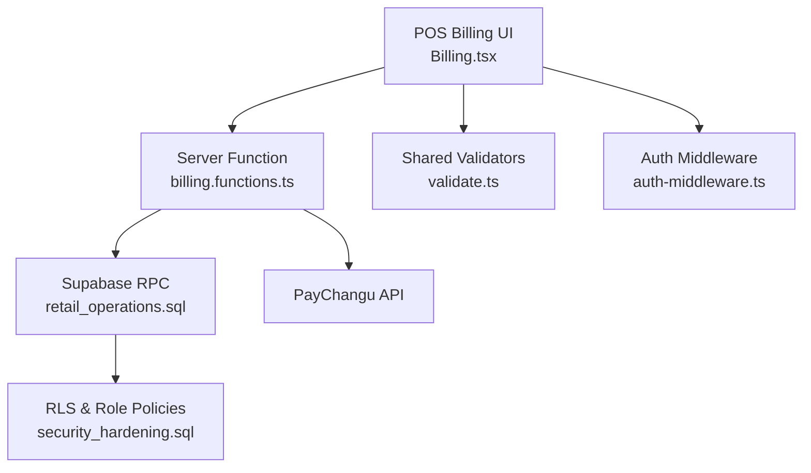
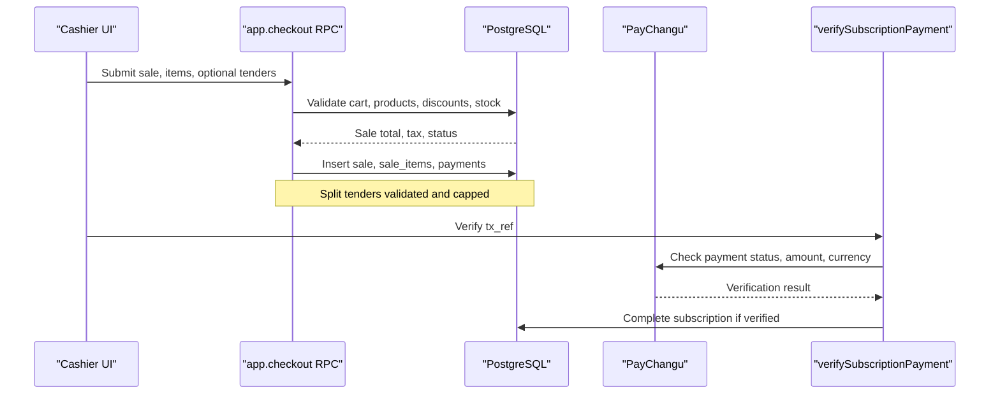
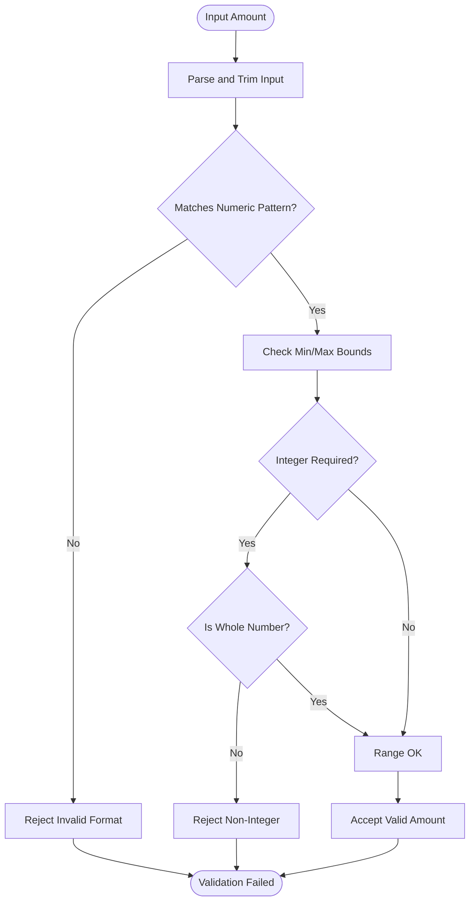
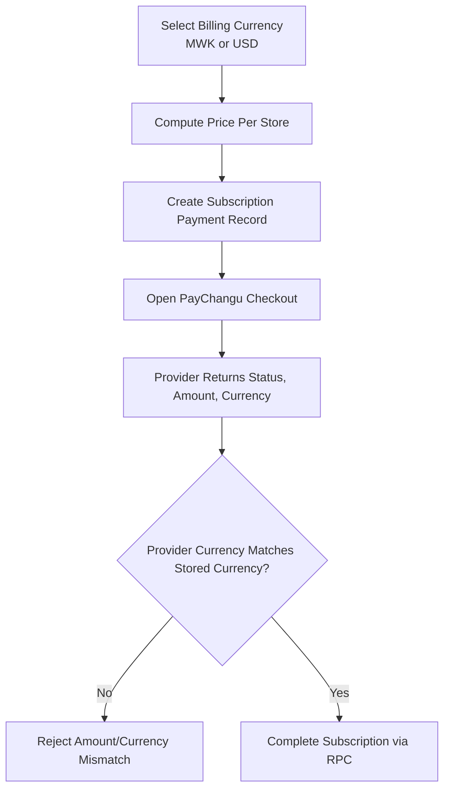
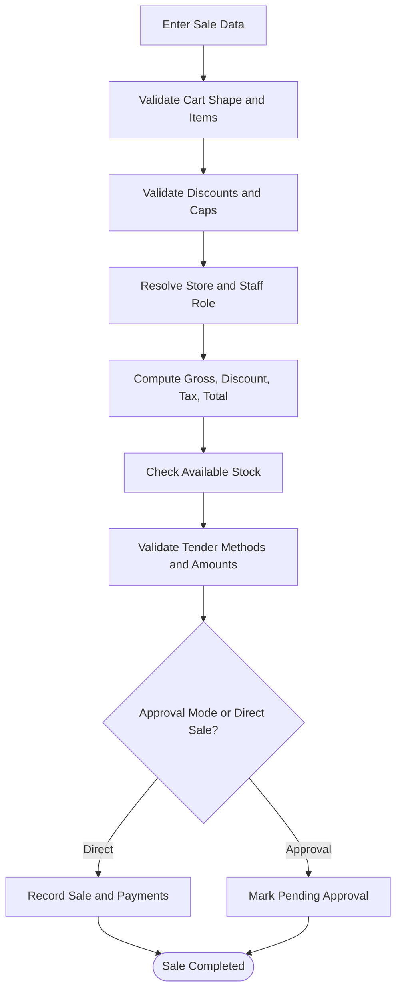
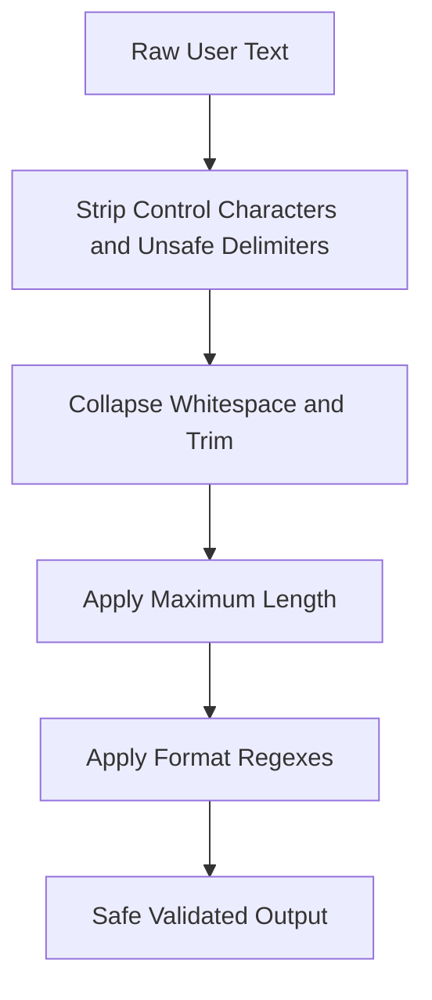
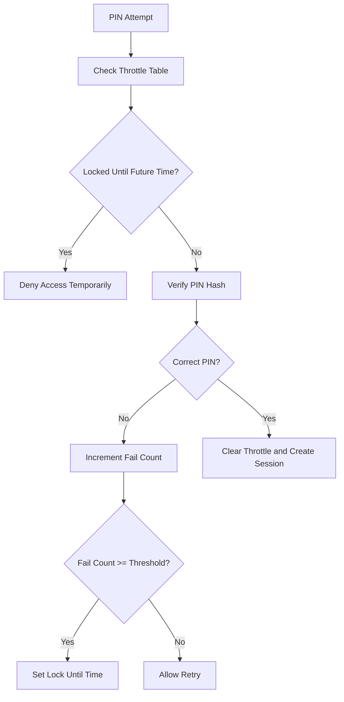
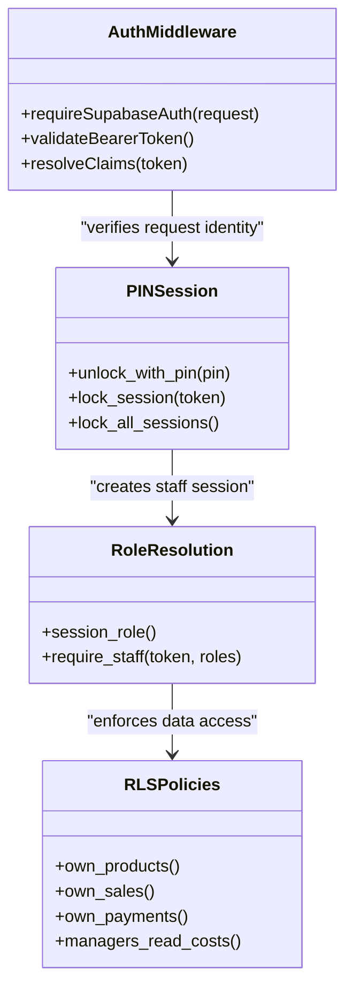
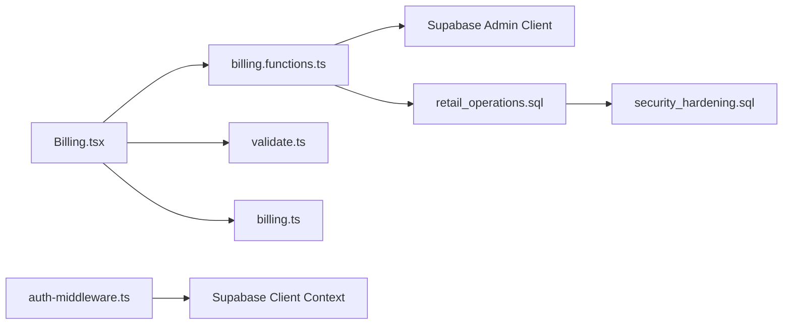

# Payment Validation & Security

<cite>
**Referenced Files in This Document**   
- [README.md](file://README.md)
- [auth-middleware.ts](file://src/integrations/supabase/auth-middleware.ts)
- [validate.ts](file://src/lib/validate.ts)
- [billing.functions.ts](file://src/lib/billing.functions.ts)
- [Billing.tsx](file://src/components/pos/Billing.tsx)
- [billing.ts](file://src/lib/billing.ts)
- [20261009210500_retail_operations.sql](file://supabase/migrations/20261009210500_retail_operations.sql)
- [20261008090000_security_hardening.sql](file://supabase/migrations/20261008090000_security_hardening.sql)
</cite>

## Table of Contents
1. [Introduction](#introduction)
2. [Project Structure](#project-structure)
3. [Core Components](#core-components)
4. [Architecture Overview](#architecture-overview)
5. [Detailed Component Analysis](#detailed-component-analysis)
6. [Dependency Analysis](#dependency-analysis)
7. [Performance Considerations](#performance-considerations)
8. [Troubleshooting Guide](#troubleshooting-guide)
9. [PCI Compliance and Secure Data Handling](#pci-compliance-and-secure-data-handling)
10. [Conclusion](#conclusion)

## Introduction
This document explains how the POS system validates payment amounts, enforces business rules, handles currency selection for billing, and secures payment-related operations. It focuses on:

- Payment amount validation at the UI, server function, and database layers.
- Currency handling for subscription billing and retail sales.
- Business rule enforcement such as discount caps, tender limits, stock checks, and approval workflows.
- Security measures including input sanitization, PIN throttling, role-based authorization, row-level security, and secure third-party payment verification.
- Practical examples showing how to validate amounts, convert or select currencies, and apply security checks.
- PCI compliance considerations based on the current architecture where card/mobile payments are handled by an external provider.

The project is a StockWise POS application that supports direct sales, layby, and approval-based stores, with staff roles and PIN-based sessions.

**Section sources**
- [README.md:1-26](file://README.md#L1-L26)

## Project Structure
Payment validation and security span several layers:

- **Frontend UI**: Billing page and POS components render payment options, calculate totals, and call server functions.
- **Server functions**: Validate inputs using Zod and call Supabase RPCs or external payment APIs.
- **Database layer**: SECURITY DEFINER RPCs enforce business rules, sanitize JSON inputs, validate money fields, and record payments safely.
- **Security policies**: Row-level security, role resolution, PIN throttling, and session binding protect data access.

**Diagram sources**
- [Billing.tsx:94-139](file://src/components/pos/Billing.tsx#L94-L139)
- [billing.functions.ts:10-53](file://src/lib/billing.functions.ts#L10-L53)
- [20261009210500_retail_operations.sql:108-287](file://supabase/migrations/20261009210500_retail_operations.sql#L108-L287)
- [20261008090000_security_hardening.sql:67-168](file://supabase/migrations/20261008090000_security_hardening.sql#L67-L168)
- [validate.ts:98-130](file://src/lib/validate.ts#L98-L130)
- [auth-middleware.ts:34-105](file://src/integrations/supabase/auth-middleware.ts#L34-L105)

**Section sources**
- [Billing.tsx:1-139](file://src/components/pos/Billing.tsx#L1-L139)
- [billing.functions.ts:1-54](file://src/lib/billing.functions.ts#L1-L54)
- [20261009210500_retail_operations.sql:108-287](file://supabase/migrations/20261009210500_retail_operations.sql#L108-L287)
- [20261008090000_security_hardening.sql:67-168](file://supabase/migrations/20261008090000_security_hardening.sql#L67-L168)
- [validate.ts:1-147](file://src/lib/validate.ts#L1-L147)
- [auth-middleware.ts:1-106](file://src/integrations/supabase/auth-middleware.ts#L1-L106)

## Core Components
The payment validation and security system is built around these core pieces:

| Component | Responsibility | Key Behaviors |
|---|---|---|
| Shared validators | Frontend input standards | Sanitize text, validate email, phone, PIN, SKU, currency, and numeric amounts against shared bounds. |
| Billing UI | Subscription payment flow | Select currency, compute price per store, start payment through PayChangu, verify transaction reference. |
| Billing server function | Safe payment verification | Validate transaction reference, check environment configuration, verify amount and currency with provider, complete subscription via RPC. |
| Retail RPCs | Checkout, tenders, discounts, approvals | Enforce cart shape, product existence, discount caps, stock availability, tender coverage, cash overpayment limits, and payment method validity. |
| Security hardening | Authorization and data protection | PIN throttling, device-bound sessions, role resolution, RLS policies, table write lockdown, and safe grants. |
| Auth middleware | Request authentication | Require Bearer token, validate JWT structure, resolve user claims, and attach Supabase client context. |

**Section sources**
- [validate.ts:1-147](file://src/lib/validate.ts#L1-L147)
- [Billing.tsx:54-139](file://src/components/pos/Billing.tsx#L54-L139)
- [billing.functions.ts:1-54](file://src/lib/billing.functions.ts#L1-L54)
- [20261009210500_retail_operations.sql:108-287](file://supabase/migrations/20261009210500_retail_operations.sql#L108-L287)
- [20261008090000_security_hardening.sql:26-77](file://supabase/migrations/20261008090000_security_hardening.sql#L26-L77)
- [auth-middleware.ts:34-105](file://src/integrations/supabase/auth-middleware.ts#L34-L105)

## Architecture Overview
The payment flow has two major paths:

1. **Retail checkout and tenders**: The POS calculates totals, validates items and discounts, enforces business rules, records split tenders, and writes payment rows only after successful validation.
2. **Subscription billing**: The UI selects currency and period, calls a server function to create a payment record, opens PayChangu, then verifies the provider’s response before activating the subscription.

**Diagram sources**
- [20261009210500_retail_operations.sql:108-287](file://supabase/migrations/20261009210500_retail_operations.sql#L108-L287)
- [billing.functions.ts:10-53](file://src/lib/billing.functions.ts#L10-L53)
- [Billing.tsx:94-139](file://src/components/pos/Billing.tsx#L94-L139)

## Detailed Component Analysis

### Payment Amount Validation
Payment amounts are validated at multiple layers to prevent invalid, unsafe, or inconsistent values.

- **Frontend validation**: `validateAmount` ensures values are numeric strings matching a strict pattern, within minimum and maximum bounds, and optionally integer-only. It uses shared limits such as `LIMITS.money`.
- **RPC validation**: Checkout and review invoice RPCs validate payment amounts, payment methods, and tender arrays. They reject unknown methods, negative values, zero amounts, and excessive tenders.
- **Database constraints**: Tables like `payments`, `sales`, and `subscription_payments` have CHECK constraints enforcing positive ranges and valid statuses.

**Diagram sources**
- [validate.ts:98-116](file://src/lib/validate.ts#L98-L116)
- [20261009210500_retail_operations.sql:148-149](file://supabase/migrations/20261009210500_retail_operations.sql#L148-L149)
- [20261009210500_retail_operations.sql:208-231](file://supabase/migrations/20261009210500_retail_operations.sql#L208-L231)
- [20261008090000_security_hardening.sql:195-212](file://supabase/migrations/20261008090000_security_hardening.sql#L195-L212)

**Section sources**
- [validate.ts:98-116](file://src/lib/validate.ts#L98-L116)
- [20261009210500_retail_operations.sql:148-149](file://supabase/migrations/20261009210500_retail_operations.sql#L148-L149)
- [20261009210500_retail_operations.sql:208-231](file://supabase/migrations/20261009210500_retail_operations.sql#L208-L231)
- [20261008090000_security_hardening.sql:195-212](file://supabase/migrations/20261008090000_security_hardening.sql#L195-L212)

### Currency Handling and Conversion
The system does not perform arbitrary exchange-rate conversion in the frontend. Instead, it uses explicit currency selection for billing and validates currency shapes.

- **Billing currency selection**: The Billing UI allows selecting between MWK and USD. Prices are multiplied by the number of stores and adjusted for yearly billing.
- **Provider currency validation**: The server function verifies that the provider’s returned currency matches the stored currency.
- **Business currency constraint**: The business table enforces a short currency field length.
- **Retail sales currency**: Sales do not carry a currency field in the analyzed checkout RPC; they use business-level tax and pricing logic.

**Diagram sources**
- [Billing.tsx:64-72](file://src/components/pos/Billing.tsx#L64-L72)
- [Billing.tsx:94-139](file://src/components/pos/Billing.tsx#L94-L139)
- [billing.functions.ts:37-43](file://src/lib/billing.functions.ts#L37-L43)
- [20261008090000_security_hardening.sql:171-172](file://supabase/migrations/20261008090000_security_hardening.sql#L171-L172)

**Section sources**
- [Billing.tsx:64-72](file://src/components/pos/Billing.tsx#L64-L72)
- [Billing.tsx:94-139](file://src/components/pos/Billing.tsx#L94-L139)
- [billing.functions.ts:37-43](file://src/lib/billing.functions.ts#L37-L43)
- [billing.ts:7-8](file://src/lib/billing.ts#L7-L8)
- [20261008090000_security_hardening.sql:171-172](file://supabase/migrations/20261008090000_security_hardening.sql#L171-L172)

### Business Rule Enforcement
Business rules ensure that sales, discounts, tenders, stock movements, and approvals are consistent and auditable.

Key enforced rules include:

- Cart must be a non-empty array of valid product IDs and quantities.
- Duplicate cart lines must be merged before discounting.
- Discounts cannot exceed gross totals and are capped for cashiers unless a manager PIN overrides them.
- Layby requires a customer name.
- Customer name and phone are sanitized and bounded.
- Payment methods are restricted to cash, card, or mobile.
- Tenders must cover the total for completed sales; cash overpayment for change is allowed but capped at twice the total.
- Approval-mode stores require a separate approval step before stock moves and final payment recording.
- Stock is checked before moving inventory.

**Diagram sources**
- [20261009210500_retail_operations.sql:117-186](file://supabase/migrations/20261009210500_retail_operations.sql#L117-L186)
- [20261009210500_retail_operations.sql:188-231](file://supabase/migrations/20261009210500_retail_operations.sql#L188-L231)
- [20261009210500_retail_operations.sql:245-287](file://supabase/migrations/20261009210500_retail_operations.sql#L245-L287)

**Section sources**
- [20261009210500_retail_operations.sql:117-186](file://supabase/migrations/20261009210500_retail_operations.sql#L117-L186)
- [20261009210500_retail_operations.sql:188-231](file://supabase/migrations/20261009210500_retail_operations.sql#L188-L231)
- [20261009210500_retail_operations.sql:245-287](file://supabase/migrations/20261009210500_retail_operations.sql#L245-L287)

### Security Measures

#### Input Sanitization
The shared validator module sanitizes text and enforces safe character sets:

- Control characters, HTML delimiters, and SQL comment prefixes are rejected.
- Email, phone, PIN, and SKU formats are validated with strict regular expressions.
- CSV export cells are prefixed to prevent formula injection when reopened in spreadsheets.

**Diagram sources**
- [validate.ts:27-41](file://src/lib/validate.ts#L27-L41)
- [validate.ts:64-96](file://src/lib/validate.ts#L64-L96)
- [validate.ts:137-146](file://src/lib/validate.ts#L137-L146)

**Section sources**
- [validate.ts:27-41](file://src/lib/validate.ts#L27-L41)
- [validate.ts:64-96](file://src/lib/validate.ts#L64-L96)
- [validate.ts:137-146](file://src/lib/validate.ts#L137-L146)

#### Rate Limiting and Fraud Detection
The system implements PIN brute-force protection and suspicious payment behavior guards:

- PIN attempts are tracked per business and per signed-in device.
- After repeated failures, the account is locked for a period.
- For retail sales, cash tenders overpaying beyond twice the total are rejected.
- Subscription payment verification compares provider amount and currency against stored values.

**Diagram sources**
- [20261008090000_security_hardening.sql:26-40](file://supabase/migrations/20261008090000_security_hardening.sql#L26-L40)
- [20261008090000_security_hardening.sql:218-256](file://supabase/migrations/20261008090000_security_hardening.sql#L218-L256)
- [20261009210500_retail_operations.sql:222-229](file://supabase/migrations/20261009210500_retail_operations.sql#L222-L229)
- [billing.functions.ts:37-43](file://src/lib/billing.functions.ts#L37-L43)

**Section sources**
- [20261008090000_security_hardening.sql:26-40](file://supabase/migrations/20261008090000_security_hardening.sql#L26-L40)
- [20261008090000_security_hardening.sql:218-256](file://supabase/migrations/20261008090000_security_hardening.sql#L218-L256)
- [20261009210500_retail_operations.sql:222-229](file://supabase/migrations/20261009210500_retail_operations.sql#L222-L229)
- [billing.functions.ts:37-43](file://src/lib/billing.functions.ts#L37-L43)

#### Authentication and Authorization Checks
Authorization is enforced through middleware, PIN sessions, and row-level security:

- The auth middleware requires a Bearer token, validates its structure, resolves claims, and attaches a Supabase client with the authenticated user ID.
- Staff unlock creates a device-bound session with expiration and binds it to the original authentication UID.
- Role resolution reads the active PIN session to determine whether a user is admin, manager, or cashier.
- RLS policies restrict access to business data and sensitive tables such as costs, refunds, and subscription payments.

**Diagram sources**
- [auth-middleware.ts:34-105](file://src/integrations/supabase/auth-middleware.ts#L34-L105)
- [20261008090000_security_hardening.sql:67-77](file://supabase/migrations/20261008090000_security_hardening.sql#L67-L77)
- [20261008090000_security_hardening.sql:218-291](file://supabase/migrations/20261008090000_security_hardening.sql#L218-L291)
- [20261008090000_security_hardening.sql:79-168](file://supabase/migrations/20261008090000_security_hardening.sql#L79-L168)

**Section sources**
- [auth-middleware.ts:34-105](file://src/integrations/supabase/auth-middleware.ts#L34-L105)
- [20261008090000_security_hardening.sql:67-77](file://supabase/migrations/20261008090000_security_hardening.sql#L67-L77)
- [20261008090000_security_hardening.sql:218-291](file://supabase/migrations/20261008090000_security_hardening.sql#L218-L291)
- [20261008090000_security_hardening.sql:79-168](file://supabase/migrations/20261008090000_security_hardening.sql#L79-L168)

### Practical Examples

#### Validating Payment Amounts
To validate a payment amount:

1. Use `validateAmount` with a label, optional minimum, maximum, integer flag, and required flag.
2. Display user-friendly error messages from the shared i18n helper.
3. Ensure the backend RPC also validates the same range and format.
4. Persist only after RPC success and database constraints pass.

Example references:
- [validate.ts:98-116](file://src/lib/validate.ts#L98-L116)
- [20261009210500_retail_operations.sql:148-149](file://supabase/migrations/20261009210500_retail_operations.sql#L148-L149)

#### Handling Currency Conversions
For subscription billing:

1. Let the user choose MWK or USD.
2. Compute monthly price per store and adjust for yearly billing.
3. Call the server function to create a payment record with the selected currency.
4. Open PayChangu with the exact amount and currency.
5. On callback, verify the provider’s amount and currency match the stored values.
6. Only activate the subscription after successful verification.

Example references:
- [Billing.tsx:64-72](file://src/components/pos/Billing.tsx#L64-L72)
- [Billing.tsx:94-139](file://src/components/pos/Billing.tsx#L94-L139)
- [billing.functions.ts:10-53](file://src/lib/billing.functions.ts#L10-L53)
- [billing.ts:7-8](file://src/lib/billing.ts#L7-L8)

#### Implementing Security Checks
For secure payment operations:

1. Require a Bearer token for protected routes.
2. Validate token structure and claims.
3. Unlock staff PINs through the secure RPC with throttling.
4. Restrict access to payment and cost data using RLS policies.
5. Sanitize all text inputs before sending to the database.
6. Validate JSON structures and money fields inside SECURITY DEFINER RPCs.

Example references:
- [auth-middleware.ts:34-105](file://src/integrations/supabase/auth-middleware.ts#L34-L105)
- [20261008090000_security_hardening.sql:218-291](file://supabase/migrations/20261008090000_security_hardening.sql#L218-L291)
- [20261008090000_security_hardening.sql:79-168](file://supabase/migrations/20261008090000_security_hardening.sql#L79-L168)
- [validate.ts:27-41](file://src/lib/validate.ts#L27-L41)
- [20261009210500_retail_operations.sql:117-186](file://supabase/migrations/20261009210500_retail_operations.sql#L117-L186)

## Dependency Analysis
The payment validation and security dependencies form a layered chain:

- UI depends on shared validators and billing utilities.
- Server functions depend on Zod validation and Supabase admin client.
- RPCs depend on staff authentication, business context, and RLS policies.
- Security policies depend on PIN sessions and role resolution.

**Diagram sources**
- [Billing.tsx:1-139](file://src/components/pos/Billing.tsx#L1-L139)
- [billing.functions.ts:1-54](file://src/lib/billing.functions.ts#L1-L54)
- [validate.ts:1-147](file://src/lib/validate.ts#L1-L147)
- [billing.ts:1-56](file://src/lib/billing.ts#L1-L56)
- [20261009210500_retail_operations.sql:108-287](file://supabase/migrations/20261009210500_retail_operations.sql#L108-L287)
- [20261008090000_security_hardening.sql:67-168](file://supabase/migrations/20261008090000_security_hardening.sql#L67-L168)
- [auth-middleware.ts:34-105](file://src/integrations/supabase/auth-middleware.ts#L34-L105)

**Section sources**
- [Billing.tsx:1-139](file://src/components/pos/Billing.tsx#L1-L139)
- [billing.functions.ts:1-54](file://src/lib/billing.functions.ts#L1-L54)
- [validate.ts:1-147](file://src/lib/validate.ts#L1-L147)
- [billing.ts:1-56](file://src/lib/billing.ts#L1-L56)
- [20261009210500_retail_operations.sql:108-287](file://supabase/migrations/20261009210500_retail_operations.sql#L108-L287)
- [20261008090000_security_hardening.sql:67-168](file://supabase/migrations/20261008090000_security_hardening.sql#L67-L168)
- [auth-middleware.ts:34-105](file://src/integrations/supabase/auth-middleware.ts#L34-L105)

## Performance Considerations
- **Frontend caching**: Subscription history uses a long stale time because it is append-only and invalidated when payments land.
- **Polling strategy**: Subscription queries poll gently rather than refetching on every mount.
- **Server-side validation**: Heavy validation happens in PostgreSQL RPCs, reducing round-trips and preventing malformed payloads from reaching business logic.
- **Tender processing**: Split tenders are validated and aggregated efficiently in SQL to avoid expensive client-side reconciliation.

[No sources needed since this section provides general guidance]

## Troubleshooting Guide
Common issues and their likely causes:

| Symptom | Likely Cause | Resolution |
|---|---|---|
| Payment amount rejected | Invalid numeric format or out-of-range value | Use `validateAmount` and ensure RPC accepts the same bounds. |
| Unknown payment method | Method not in allowed set | Use only cash, card, or mobile. |
| Tenders do not cover total | Split tender sum below invoice total | Add additional tenders or adjust primary payment. |
| Cash tender far above total | Overpayment exceeds twice the invoice total | Reduce cash tender or use split tenders more precisely. |
| PIN locked | Too many wrong PIN attempts | Wait for lock timeout or clear throttle via sign-out. |
| Subscription payment mismatch | Provider amount or currency differs from stored value | Recheck selected currency and amount before opening checkout. |
| Unauthorized request | Missing or invalid Bearer token | Ensure middleware receives a valid token and claims contain user ID. |

**Section sources**
- [validate.ts:98-116](file://src/lib/validate.ts#L98-L116)
- [20261009210500_retail_operations.sql:208-231](file://supabase/migrations/20261009210500_retail_operations.sql#L208-L231)
- [20261008090000_security_hardening.sql:218-256](file://supabase/migrations/20261008090000_security_hardening.sql#L218-L256)
- [billing.functions.ts:37-43](file://src/lib/billing.functions.ts#L37-L43)
- [auth-middleware.ts:55-95](file://src/integrations/supabase/auth-middleware.ts#L55-L95)

## PCI Compliance and Secure Data Handling
The current implementation follows a secure-by-design approach for payment data:

- **Card and mobile payments are handled externally**: The UI opens PayChangu checkout, and the server verifies the provider’s response without storing raw card details.
- **Amount and currency verification**: The server function compares the provider’s returned amount and currency against stored values before completing the subscription.
- **Environment secrets are isolated**: Public keys and secret keys are read from environment variables and not exposed to the client.
- **Database writes are guarded**: All writes go through SECURITY DEFINER RPCs with strict input validation and RLS policies.
- **Sensitive financial data is minimized**: The analyzed checkout RPC records payment method and amount but does not expose raw payment instrument data.

Recommended practices aligned with this codebase:

- Never collect or store raw card numbers, CVV, or full magnetic stripe data in the application.
- Always verify third-party payment responses server-side, including amount, currency, and transaction state.
- Keep payment provider credentials in environment variables and never log them.
- Use HTTPS and secure headers for all payment-related endpoints.
- Audit payment logs and retain only necessary metadata for reconciliation.
- Apply least privilege access to payment and subscription tables.

**Section sources**
- [billing.functions.ts:10-53](file://src/lib/billing.functions.ts#L10-L53)
- [Billing.tsx:94-139](file://src/components/pos/Billing.tsx#L94-L139)
- [20261009210500_retail_operations.sql:245-287](file://supabase/migrations/20261009210500_retail_operations.sql#L245-L287)
- [20261008090000_security_hardening.sql:743-759](file://supabase/migrations/20261008090000_security_hardening.sql#L743-L759)

## Conclusion
The POS system applies defense-in-depth for payment validation and security:

- Frontend validators provide immediate feedback and prevent unsafe input.
- Server functions add structured validation and secure provider verification.
- Database RPCs enforce business rules, tender limits, stock integrity, and role-based access.
- Security hardening protects against PIN brute force, unauthorized access, and data leakage.
- PCI-sensitive flows delegate card/mobile payment handling to an external provider while verifying critical fields server-side.

For future enhancements, consider adding rate limiting for payment provider calls, fraud scoring based on tender patterns, and clearer audit trails for high-value transactions. However, the existing architecture already establishes strong boundaries between UI, server, and database responsibilities.

[No sources needed since this section summarizes without analyzing specific files]