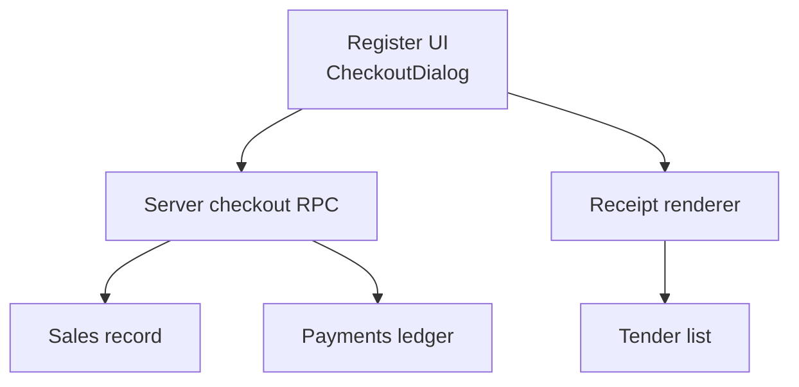
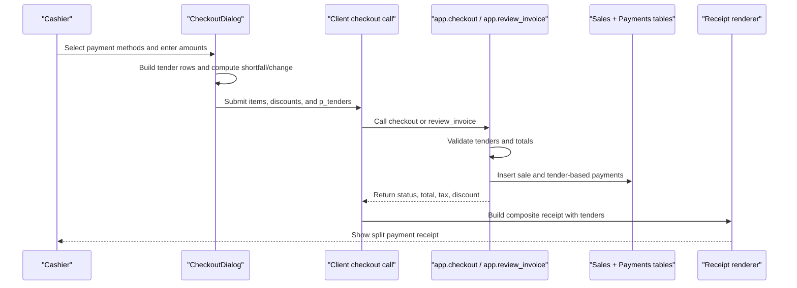
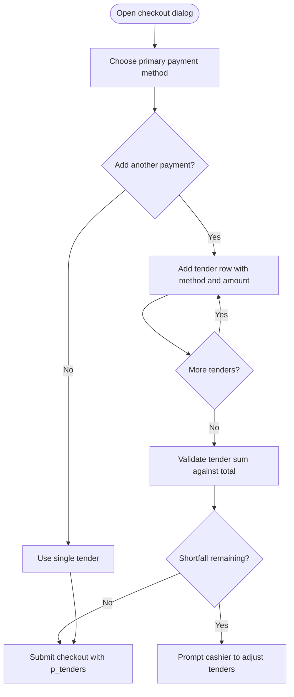
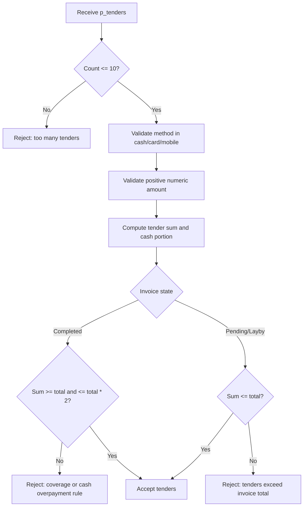
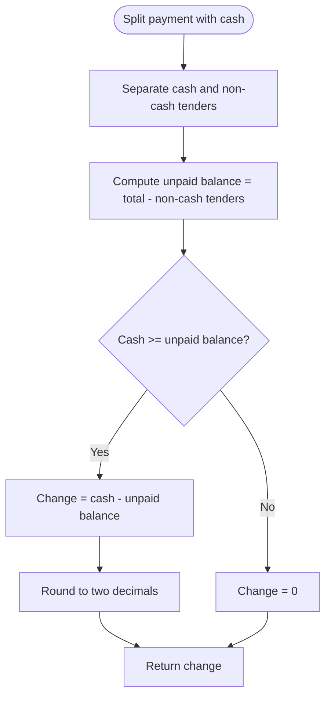
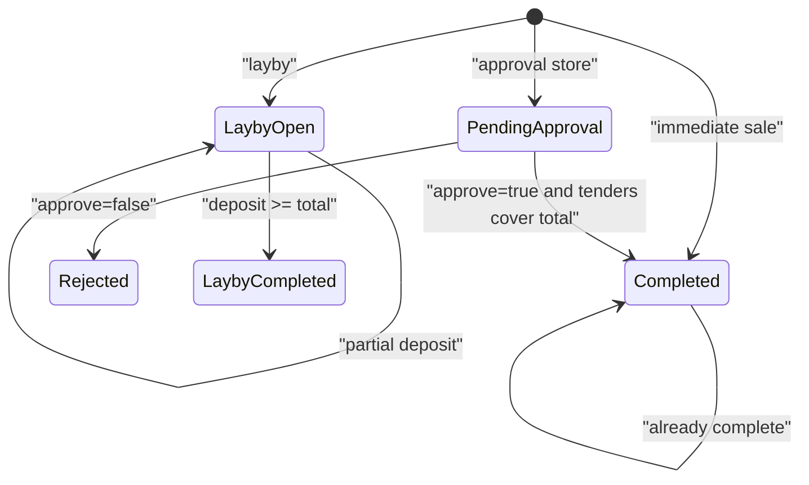
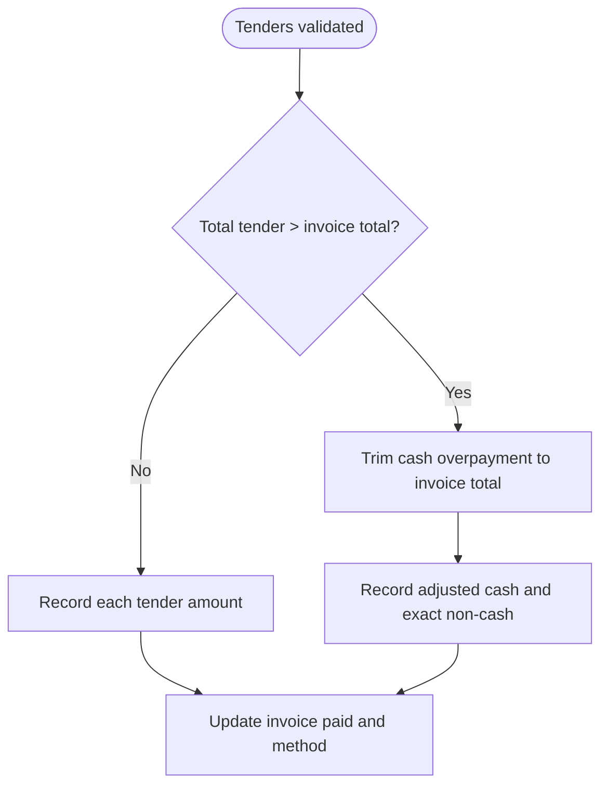
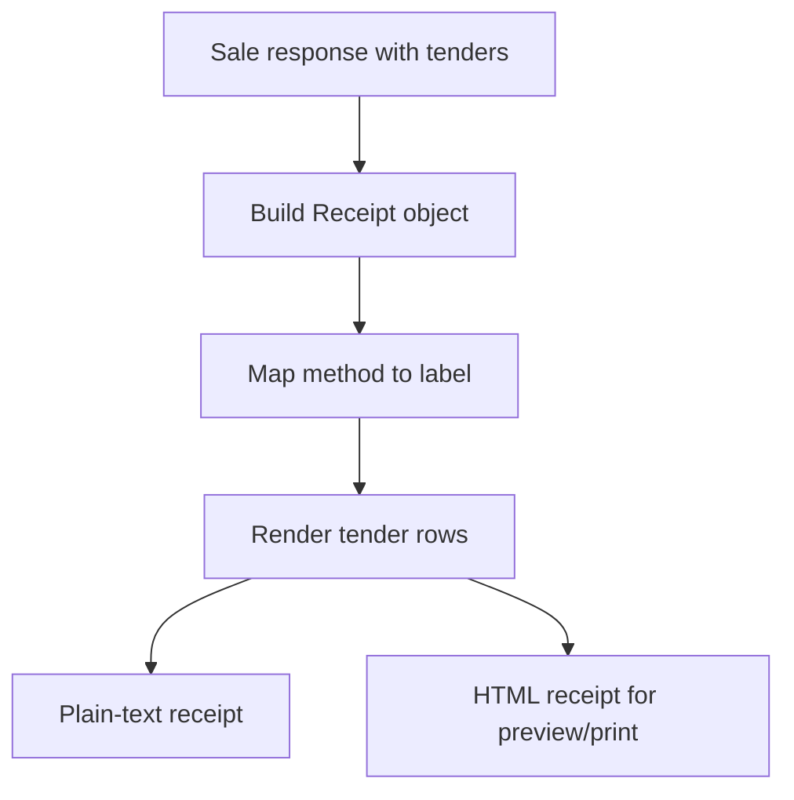
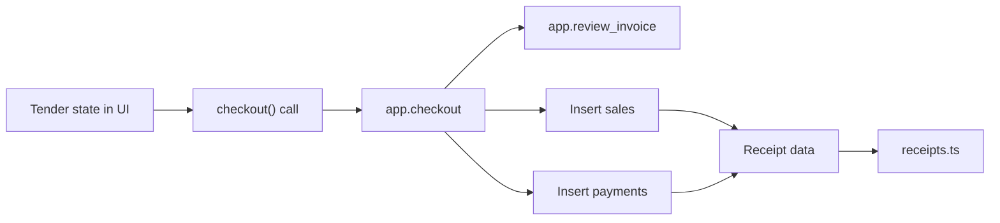

# Split Payments

<cite>
**Referenced Files in This Document**
- [app.index.tsx](file://src/routes/_authenticated/app.index.tsx)
- [receipts.ts](file://src/lib/receipts.ts)
- [20261009210500_retail_operations.sql](file://supabase/migrations/20261009210500_retail_operations.sql)
- [20261011120000_fix_x_alias_collision.sql](file://supabase/migrations/20261011120000_fix_x_alias_collision.sql)
</cite>

## Table of Contents
1. [Introduction](#introduction)
2. [Project Structure](#project-structure)
3. [Core Components](#core-components)
4. [Architecture Overview](#architecture-overview)
5. [Detailed Component Analysis](#detailed-component-analysis)
6. [Dependency Analysis](#dependency-analysis)
7. [Performance Considerations](#performance-considerations)
8. [Troubleshooting Guide](#troubleshooting-guide)
9. [Conclusion](#conclusion)

## Introduction
This document explains the split payment functionality that allows a single transaction to be paid with multiple payment methods. It covers how split payments are initiated, validated, allocated, and recorded; how partial payments work for layby transactions; how change is calculated when cash is involved; and how composite receipts display multiple tenders. It also documents validation rules, state transitions, edge cases such as failed or overpaid partial payments, and reconciliation between tendered amounts, recorded payments, and invoice totals.

Split payments are supported for:
- Immediate sales
- Layby deposits and completions
- Approval invoices that transition from pending approval to completed

The system supports three payment methods:
- Cash
- Card
- Mobile

A split payment occurs when more than one method is used for the same sale or invoice. The system records each tender separately while keeping a single invoice total.

## Project Structure
The split payment feature spans three layers:

| Layer | Responsibility | Relevant files |
|---|---|---|
| Register UI | Builds tender rows, computes shortfalls and change, submits checkout | [app.index.tsx](file://src/routes/_authenticated/app.index.tsx) |
| Receipt rendering | Displays method labels, individual tenders, paid amount, and change | [receipts.ts](file://src/lib/receipts.ts) |
| Server-side business logic | Validates tenders, enforces limits, sets payment method, inserts payment ledger entries | [20261009210500_retail_operations.sql](file://supabase/migrations/20261009210500_retail_operations.sql), [20261011120000_fix_x_alias_collision.sql](file://supabase/migrations/20261011120000_fix_x_alias_collision.sql) |

**Diagram sources**
- [app.index.tsx:273-355](file://src/routes/_authenticated/app.index.tsx#L273-L355)
- [20261009210500_retail_operations.sql:108-286](file://supabase/migrations/20261009210500_retail_operations.sql#L108-L286)
- [receipts.ts:84-125](file://src/lib/receipts.ts#L84-L125)

**Section sources**
- [app.index.tsx:91-109](file://src/routes/_authenticated/app.index.tsx#L91-L109)
- [receipts.ts:5-34](file://src/lib/receipts.ts#L5-L34)
- [20261009210500_retail_operations.sql:102-286](file://supabase/migrations/20261009210500_retail_operations.sql#L102-L286)

## Core Components
The split payment flow has four main responsibilities:

1. **Tender construction:** The register builds one or more tender rows, each with a method and an amount.
2. **Validation:** The server validates tender count, allowed methods, positive amounts, coverage of the total, and cash overpayment limits.
3. **State management:** The system determines whether the sale is completed, pending approval, or layby-open, and sets the invoice-level payment method to `split` when multiple methods are used.
4. **Payment recording:** Each tender becomes a separate payment ledger entry, with special handling for cash overpayments used to give change.

Key data structures:

| Concept | Meaning | Where it appears |
|---|---|---|
| `TenderRow` | One payment method plus its amount | [app.index.tsx:92](file://src/routes/_authenticated/app.index.tsx#L92) |
| `SaleForm.tenders` | Array of tender rows submitted by the UI | [app.index.tsx:96](file://src/routes/_authenticated/app.index.tsx#L96) |
| `p_tenders` | JSON array sent to the server | [20261009210500_retail_operations.sql:108-109](file://supabase/migrations/20261009210500_retail_operations.sql#L108-L109) |
| `ReceiptTender` | Raw tender shown on the receipt | [receipts.ts:7-8](file://src/lib/receipts.ts#L7-L8) |
| `payment_method = "split"` | Invoice-level indicator that multiple methods were used | [20261009210500_retail_operations.sql:241-243](file://supabase/migrations/20261009210500_retail_operations.sql#L241-L243) |

**Section sources**
- [app.index.tsx:91-109](file://src/routes/_authenticated/app.index.tsx#L91-L109)
- [receipts.ts:5-34](file://src/lib/receipts.ts#L5-L34)
- [20261009210500_retail_operations.sql:108-149](file://supabase/migrations/20261009210500_retail_operations.sql#L108-L149)

## Architecture Overview
The split payment workflow moves from the register UI through a secure server function into the database, then back to the UI for receipt generation.

**Diagram sources**
- [app.index.tsx:273-355](file://src/routes/_authenticated/app.index.tsx#L273-L355)
- [20261009210500_retail_operations.sql:108-286](file://supabase/migrations/20261009210500_retail_operations.sql#L108-L286)
- [receipts.ts:84-125](file://src/lib/receipts.ts#L84-L125)

## Detailed Component Analysis

### Tender Construction and Split Payment Initiation
The register supports a primary payment method and additional tender rows. When additional tenders exist, the transaction is treated as a split payment.

Important behaviors:
- A split is detected when there is more than one distinct tender method.
- The first tender row can represent the primary method, while extra rows add other methods.
- Zero-amount tenders are filtered out before submission.
- For non-split sales, the primary method handles the full amount; for split sales, the sum of all tender rows must cover the total.

**Diagram sources**
- [app.index.tsx:806-832](file://src/routes/_authenticated/app.index.tsx#L806-L832)
- [app.index.tsx:834-355](file://src/routes/_authenticated/app.index.tsx#L834-L355)

**Section sources**
- [app.index.tsx:806-832](file://src/routes/_authenticated/app.index.tsx#L806-L832)
- [app.index.tsx:834-355](file://src/routes/_authenticated/app.index.tsx#L834-L355)

### Validation Rules for Split Payments
The server enforces strict validation for split payments:

| Rule | Description | Behavior |
|---|---|---|
| Maximum tenders | A sale or invoice can have at most 10 tender rows | Raises an error if exceeded |
| Allowed methods | Only `cash`, `card`, and `mobile` are accepted | Rejects unknown methods |
| Positive amounts | Each tender amount must be a valid positive number | Rejects zero or invalid values |
| Coverage requirement | Tender sum must cover the invoice total | Rejects underpayment |
| Cash overpayment limit | Cash-heavy overpayment is limited to twice the total | Prevents unreasonable change scenarios |
| Non-completed invoices | Partial payments cannot exceed the invoice total | Enforced for pending approval and layby states |
| Distinct methods | Multiple methods trigger `payment_method = "split"` | Used for reporting and receipt labeling |

These rules apply to both immediate sales and approval invoice reviews.

**Diagram sources**
- [20261009210500_retail_operations.sql:205-231](file://supabase/migrations/20261009210500_retail_operations.sql#L205-L231)
- [20261009210500_retail_operations.sql:351-368](file://supabase/migrations/20261009210500_retail_operations.sql#L351-L368)
- [20261011120000_fix_x_alias_collision.sql:120-146](file://supabase/migrations/20261011120000_fix_x_alias_collision.sql#L120-L146)

**Section sources**
- [20261009210500_retail_operations.sql:205-231](file://supabase/migrations/20261009210500_retail_operations.sql#L205-L231)
- [20261009210500_retail_operations.sql:351-368](file://supabase/migrations/20261009210500_retail_operations.sql#L351-L368)
- [20261011120000_fix_x_alias_collision.sql:120-146](file://supabase/migrations/20261011120000_fix_x_alias_collision.sql#L120-L146)

### Amount Allocation and Change Calculation
For split payments involving cash, the system calculates change only from the cash portion after subtracting the non-cash tender contributions.

Rules:
- Change applies only to sales, not layby.
- Change equals cash tender minus the unpaid balance after other tenders.
- If the result is negative, change is zero.
- For completed sales, the server may treat cash as covering the full total for shift accounting even when other tenders contribute.

**Diagram sources**
- [app.index.tsx:103-109](file://src/routes/_authenticated/app.index.tsx#L103-L109)
- [20261009210500_retail_operations.sql:233-243](file://supabase/migrations/20261009210500_retail_operations.sql#L233-L243)

**Section sources**
- [app.index.tsx:103-109](file://src/routes/_authenticated/app.index.tsx#L103-L109)
- [20261009210500_retail_operations.sql:233-243](file://supabase/migrations/20261009210500_retail_operations.sql#L233-L243)

### State Management Across Split Payment Scenarios
Split payments interact with different invoice states:

| Scenario | Initial state | Completed state | Payment behavior |
|---|---|---|---|
| Immediate sale | `completed` | Remains `completed` | Full total is expected; cash overpayment allowed within limits for change |
| Layby deposit | `layby_open` | Becomes `layby_completed` when deposit equals total | Partial payments are allowed until total is reached |
| Approval invoice | `pending_approval` | Becomes `completed` after approval | Tenders must cover the invoice total; partial overpayment follows the same cash limit |

**Diagram sources**
- [20261009210500_retail_operations.sql:192-193](file://supabase/migrations/20261009210500_retail_operations.sql#L192-L193)
- [20261009210500_retail_operations.sql:284-285](file://supabase/migrations/20261009210500_retail_operations.sql#L284-L285)
- [20261009210500_retail_operations.sql:370-385](file://supabase/migrations/20261009210500_retail_operations.sql#L370-L385)

**Section sources**
- [20261009210500_retail_operations.sql:192-193](file://supabase/migrations/20261009210500_retail_operations.sql#L192-L193)
- [20261009210500_retail_operations.sql:284-285](file://supabase/migrations/20261009210500_retail_operations.sql#L284-L285)
- [20261009210500_retail_operations.sql:370-385](file://supabase/migrations/20261009210500_retail_operations.sql#L370-L385)

### Payment Ledger Recording and Reconciliation
Each tender becomes a separate payment record. When cash is overpaid to provide change, the system adjusts the cash payment so the total recorded payments do not exceed the invoice total.

Key behaviors:
- Multiple tenders produce multiple payment rows.
- Cash overpayment is trimmed when necessary to match the invoice total.
- Non-cash tenders are recorded as entered unless they are part of an overpayment adjustment.
- The invoice-level `paid` field reflects either the full total for completed sales or the actual tender sum for partial or pending states.

**Diagram sources**
- [20261009210500_retail_operations.sql:268-285](file://supabase/migrations/20261009210500_retail_operations.sql#L268-L285)
- [20261009210500_retail_operations.sql:387-399](file://supabase/migrations/20261009210500_retail_operations.sql#L387-L399)
- [20261011120000_fix_x_alias_collision.sql:183-199](file://supabase/migrations/20261011120000_fix_x_alias_collision.sql#L183-L199)

**Section sources**
- [20261009210500_retail_operations.sql:268-285](file://supabase/migrations/20261009210500_retail_operations.sql#L268-L285)
- [20261009210500_retail_operations.sql:387-399](file://supabase/migrations/20261009210500_retail_operations.sql#L387-L399)
- [20261011120000_fix_x_alias_collision.sql:183-199](file://supabase/migrations/20261011120000_fix_x_alias_collision.sql#L183-L199)

### Composite Receipt Generation
Composite receipts show the overall invoice method and list each tender separately. The receipt renderer uses a method label helper that maps internal method codes to localized labels, including a dedicated label for split payments.

Receipt features:
- Shows the invoice-level method, which is `split` when multiple methods are used.
- Lists each tender with its method and raw amount.
- Shows paid amount and change where applicable.
- Supports plain text and HTML output for printing and downloading.

**Diagram sources**
- [receipts.ts:36-46](file://src/lib/receipts.ts#L36-L46)
- [receipts.ts:84-125](file://src/lib/receipts.ts#L84-L125)
- [receipts.ts:128-201](file://src/lib/receipts.ts#L128-L201)

**Section sources**
- [receipts.ts:36-46](file://src/lib/receipts.ts#L36-L46)
- [receipts.ts:84-125](file://src/lib/receipts.ts#L84-L125)
- [receipts.ts:128-201](file://src/lib/receipts.ts#L128-L201)

### Practical Examples

#### Example 1: Split Between Cash and Card
Scenario:
- Invoice total: fixed amount
- Cash tender: partial amount
- Card tender: remaining amount

Behavior:
- Two tender rows are created.
- The invoice-level payment method becomes `split`.
- No change is issued because card covers the remainder.
- Two payment records are inserted: one for cash, one for card.
- The receipt lists both tenders.

#### Example 2: Split Between Cash and Mobile
Scenario:
- Invoice total: fixed amount
- Mobile tender: partial amount
- Cash tender: amount greater than the unpaid balance

Behavior:
- Change is calculated from the cash portion.
- If the cash overpayment exceeds the required change, the server trims the recorded cash payment to avoid exceeding the invoice total.
- The receipt shows the split method and both tender lines.

#### Example 3: Partial Layby Deposit
Scenario:
- Layby invoice created
- First deposit uses card
- Second deposit uses cash

Behavior:
- The invoice remains `layby_open` until the sum of deposits reaches the total.
- Each deposit creates a payment record.
- Once the total is reached, the invoice becomes `layby_completed`.
- The receipt shows the current status and deposited amount.

#### Example 4: Approval Invoice with Split Payment
Scenario:
- Store type requires approval
- Manager approves the invoice
- Customer pays using mobile and cash

Behavior:
- The invoice transitions from `pending_approval` to `completed`.
- Tenders must cover the invoice total.
- Cash overpayment rules still apply.
- The receipt shows the approved invoice and split payment details.

[No sources needed since this section provides practical examples without quoting code]

### Edge Cases and Failure Handling

| Edge Case | Expected Behavior |
|---|---|
| Tender sum below total | Server rejects the transaction |
| Tender sum above total for non-completed invoice | Server rejects the transaction |
| Cash overpayment beyond twice the total | Server rejects the transaction |
| Unknown payment method | Server rejects the transaction |
| Duplicate product lines in cart | Server rejects before payment processing |
| Offline sale | UI shows success toast but does not generate a normal receipt; inventory and payment behavior depends on offline mode |
| Failed partial payment | The server validation prevents incomplete or inconsistent splits from being committed |
| Cash overpayment trimming | Recorded cash payment is reduced so total payments equal the invoice total |

**Section sources**
- [20261009210500_retail_operations.sql:205-231](file://supabase/migrations/20261009210500_retail_operations.sql#L205-L231)
- [20261009210500_retail_operations.sql:268-285](file://supabase/migrations/20261009210500_retail_operations.sql#L268-L285)
- [app.index.tsx:309-318](file://src/routes/_authenticated/app.index.tsx#L309-L318)

## Dependency Analysis
The split payment feature connects UI state, server validation, and receipt rendering.

**Diagram sources**
- [app.index.tsx:273-355](file://src/routes/_authenticated/app.index.tsx#L273-L355)
- [20261009210500_retail_operations.sql:108-286](file://supabase/migrations/20261009210500_retail_operations.sql#L108-L286)
- [20261009210500_retail_operations.sql:325-402](file://supabase/migrations/20261009210500_retail_operations.sql#L325-L402)
- [receipts.ts:84-125](file://src/lib/receipts.ts#L84-L125)

**Section sources**
- [app.index.tsx:273-355](file://src/routes/_authenticated/app.index.tsx#L273-L355)
- [20261009210500_retail_operations.sql:108-286](file://supabase/migrations/20261009210500_retail_operations.sql#L108-L286)
- [20261009210500_retail_operations.sql:325-402](file://supabase/migrations/20261009210500_retail_operations.sql#L325-L402)
- [receipts.ts:84-125](file://src/lib/receipts.ts#L84-L125)

## Performance Considerations
- Tender validation runs in the database using JSON aggregation, which keeps client-server payloads small and centralizes business rules.
- The maximum of 10 tenders per transaction limits memory and computation during validation and payment insertion.
- Change calculation is simple arithmetic performed on the client for UI responsiveness, while the server performs authoritative rounding and reconciliation.
- Receipt rendering is client-side and avoids database access, making receipt previews fast.

[No sources needed since this section provides general guidance]

## Troubleshooting Guide

| Symptom | Likely Cause | Resolution |
|---|---|---|
| Transaction rejected with “tenders do not cover the total” | Tender sum is less than invoice total | Add another tender or increase existing tender amounts |
| Transaction rejected with “tenders exceed the invoice total” | Partial payment exceeds total for non-completed invoice | Reduce tender amounts to match the invoice total |
| Transaction rejected due to cash overpayment limit | Cash tender is too high relative to the total | Reduce cash tender or use non-cash methods for the remainder |
| Receipt shows split but no tender rows | Tender data was not passed or was empty | Ensure `p_tenders` is included when submitting split payments |
| Paid amount differs from tender sum | Layby or pending approval state uses actual tender sum rather than forced total | Verify invoice state; completed sales force paid to total |
| Change displayed incorrectly | Cash tender did not exceed unpaid balance | Adjust cash tender or verify non-cash tender amounts |
| Offline sale succeeds but no receipt | Offline mode returns early without normal receipt flow | Treat offline completion as provisional and reconcile later |

**Section sources**
- [20261009210500_retail_operations.sql:222-229](file://supabase/migrations/20261009210500_retail_operations.sql#L222-L229)
- [20261009210500_retail_operations.sql:233-243](file://supabase/migrations/20261009210500_retail_operations.sql#L233-L243)
- [app.index.tsx:309-318](file://src/routes/_authenticated/app.index.tsx#L309-L318)
- [receipts.ts:84-125](file://src/lib/receipts.ts#L84-L125)

## Conclusion
Split payments in this system are designed around clear separation of concerns: the UI collects multiple tenders, the server validates and reconciles them, and the receipt renderer displays a composite view. The implementation supports cash, card, and mobile methods, enforces safe overpayment limits, records each tender separately, and updates invoice state correctly for sales, laybies, and approval invoices. For reliable operations, ensure tender sums satisfy coverage rules, handle cash change carefully, and rely on the server’s payment reconciliation for accurate financial records.

[No sources needed since this section summarizes without analyzing specific files]