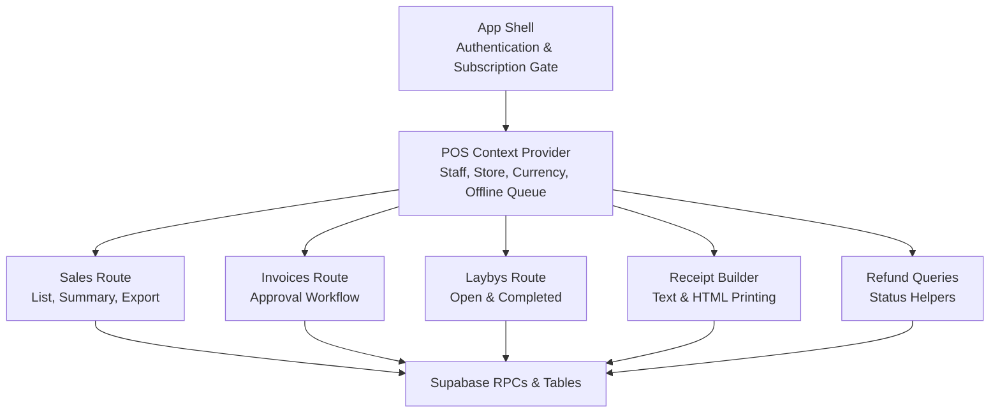
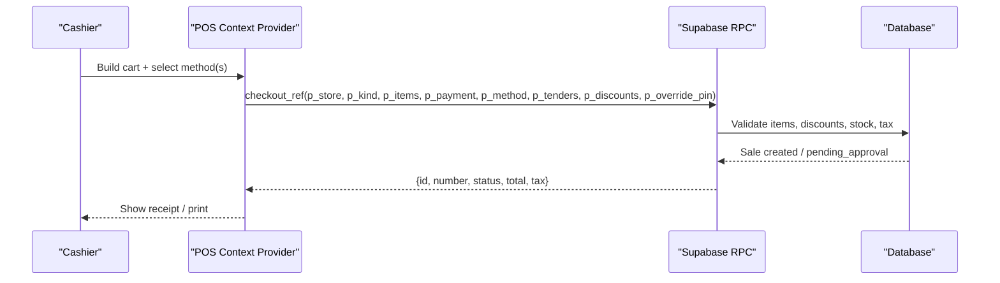
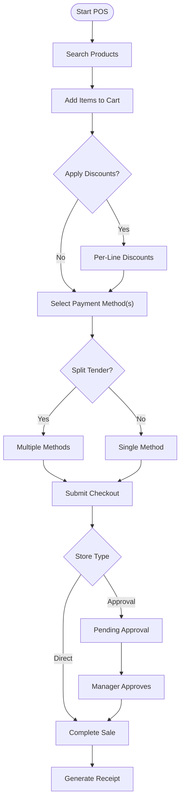
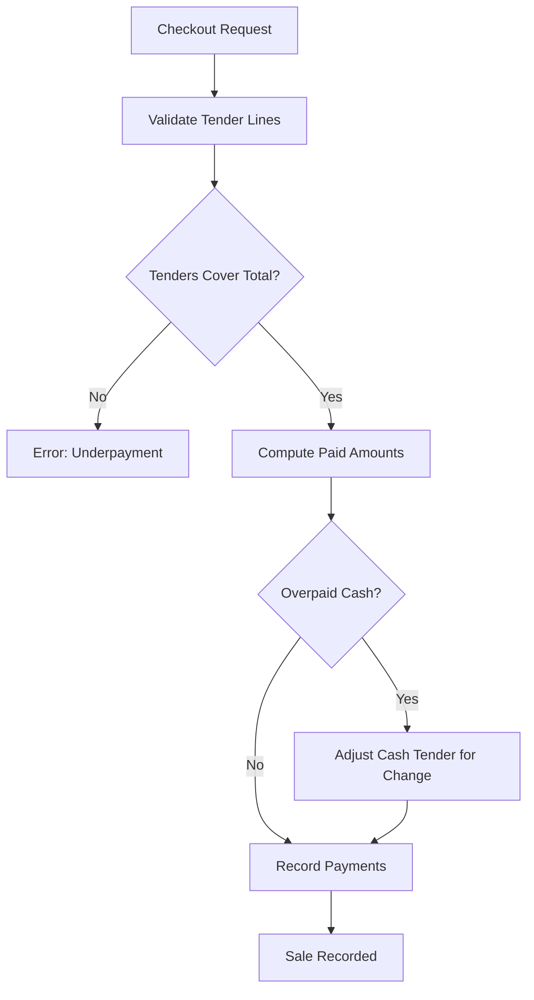
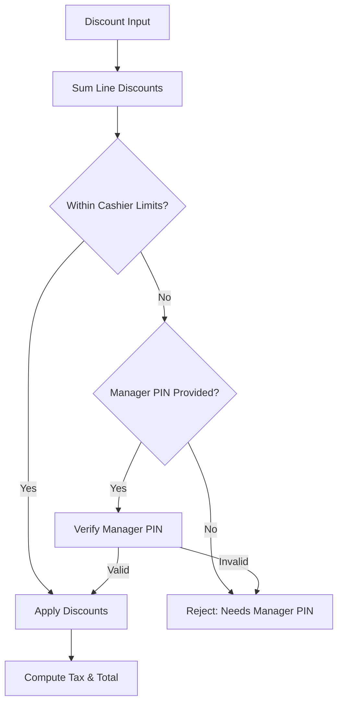
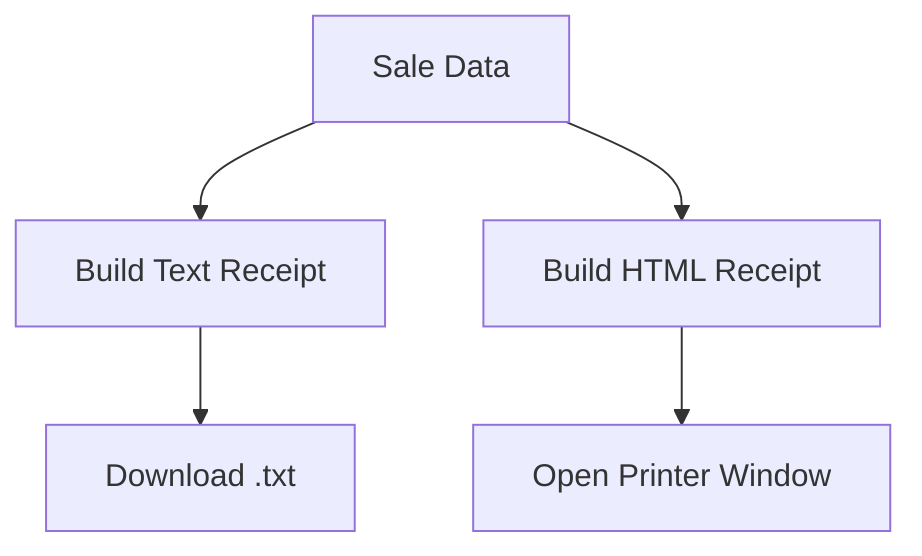
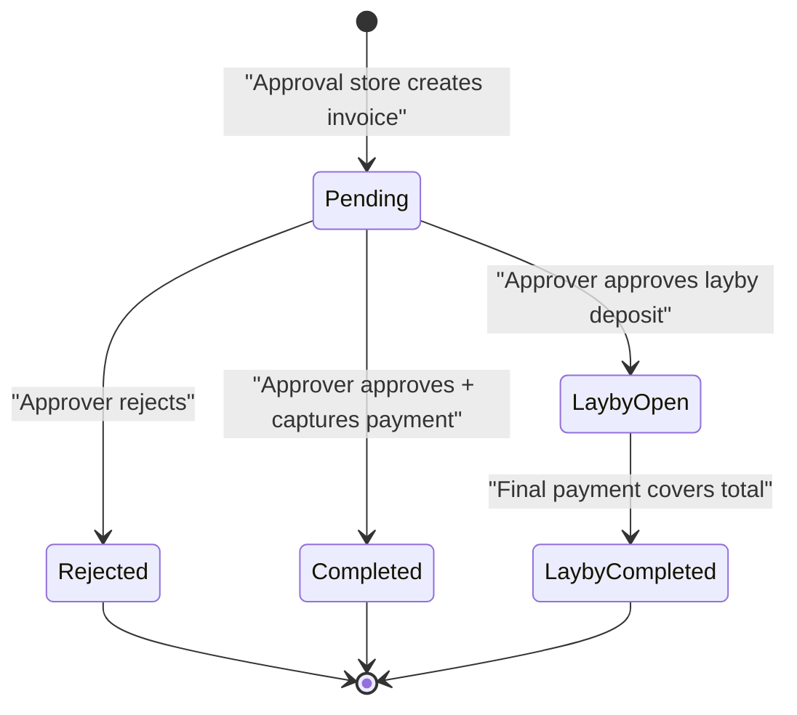
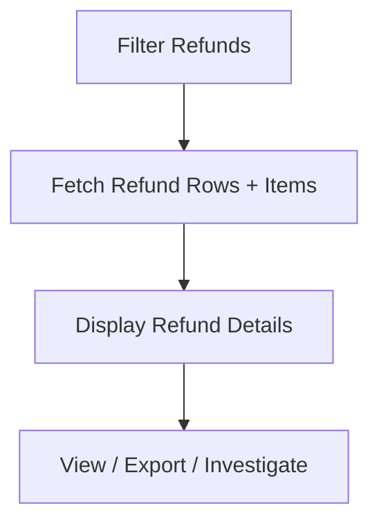
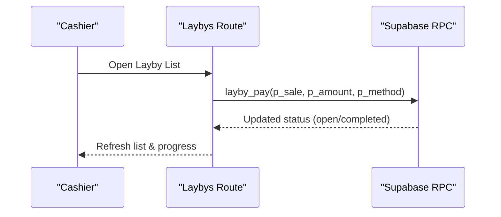
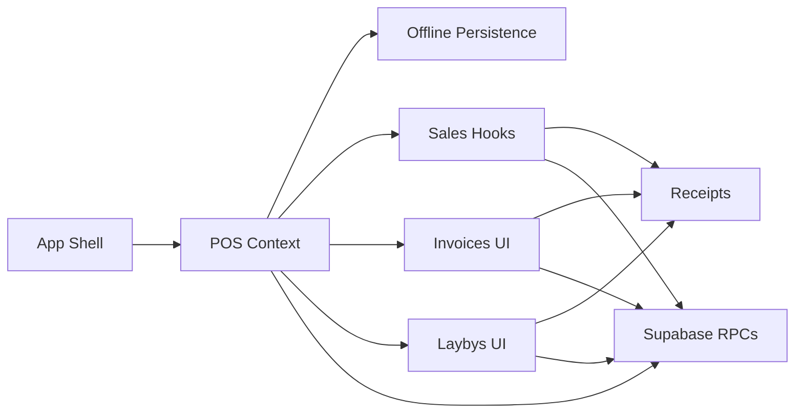

# Point of Sale System

<cite>
**Referenced Files in This Document**   
- [README.md](file://README.md)
- [app.tsx](file://src/routes/_authenticated/app.tsx)
- [pos.tsx](file://src/lib/pos.tsx)
- [offline.ts](file://src/lib/offline.ts)
- [sales.ts](file://src/lib/sales.ts)
- [app.sales.tsx](file://src/routes/_authenticated/app.sales.tsx)
- [app.invoices.tsx](file://src/routes/_authenticated/app.invoices.tsx)
- [app.laybys.tsx](file://src/routes/_authenticated/app.laybys.tsx)
- [receipts.ts](file://src/lib/receipts.ts)
- [refunds.ts](file://src/lib/refunds.ts)
- [20261009210500_retail_operations.sql](file://supabase/migrations/20261009210500_retail_operations.sql)
</cite>

## Table of Contents
1. [Introduction](#introduction)
2. [Project Structure](#project-structure)
3. [Core Components](#core-components)
4. [Architecture Overview](#architecture-overview)
5. [Detailed Component Analysis](#detailed-component-analysis)
6. [Dependency Analysis](#dependency-analysis)
7. [Performance Considerations](#performance-considerations)
8. [Troubleshooting Guide](#troubleshooting-guide)
9. [Conclusion](#conclusion)

## Introduction
This document explains the Point of Sale system with a focus on:
- The main POS interface workflow, including product search, cart management, and checkout.
- The billing system supporting multiple payment methods (cash, card, mobile) and split payments.
- The discount system allowing per-line and cart-level discounts with role-based limits.
- Receipt generation and printing functionality.
- Two store types: direct sales for immediate transactions and approval-based workflows where cashiers create invoices requiring manager approval.
- Practical examples for processing different transaction types, handling returns and refunds, and managing layby orders.
- Performance optimization for real-time inventory updates and offline transaction processing.

The project is a retail application designed to help business owners track stock, sales, and perform stock-taking across one or more stores, with support for PIN-based staff roles, layby orders, and two store modes: direct sale and approval-based.

**Section sources**
- [README.md:1-26](file://README.md#L1-L26)

## Project Structure
At a high level, the POS experience is composed of:
- Application shell and authentication gating that loads the POS context and enforces subscription status.
- A shared POS context provider that manages staff sessions, store selection, currency formatting, RPC calls, and offline queueing.
- Feature routes for Sales, Invoices (approval), and Laybys.
- Utilities for receipts, refunds, and offline persistence.
- Server-side SQL functions that enforce validation, inventory checks, discounts, split tenders, and approvals.

**Diagram sources**
- [app.tsx:73-129](file://src/routes/_authenticated/app.tsx#L73-L129)
- [pos.tsx:115-388](file://src/lib/pos.tsx#L115-L388)
- [app.sales.tsx:27-120](file://src/routes/_authenticated/app.sales.tsx#L27-L120)
- [app.invoices.tsx:13-66](file://src/routes/_authenticated/app.invoices.tsx#L13-L66)
- [app.laybys.tsx:14-37](file://src/routes/_authenticated/app.laybys.tsx#L14-L37)
- [receipts.ts:1-34](file://src/lib/receipts.ts#L1-L34)
- [refunds.ts:1-24](file://src/lib/refunds.ts#L1-L24)

**Section sources**
- [app.tsx:73-129](file://src/routes/_authenticated/app.tsx#L73-L129)
- [pos.tsx:115-388](file://src/lib/pos.tsx#L115-L388)

## Core Components
- POS Context Provider: Centralizes staff session lifecycle, store selection, currency formatting, RPC invocation, and offline sales queuing. It exposes helpers like `checkout`, `rpc`, `money`, and `can`.
- Sales Route: Displays KPIs, paginated sales, export options, and navigation into details.
- Invoices Route: Shows pending invoices for approval-only stores, with approve/reject actions and optional payment capture at approval time.
- Laybys Route: Lists open and completed laybys, supports partial/full payments, and cancellation by authorized roles.
- Receipts Module: Builds plain-text and thermal-printable HTML receipts; supports multi-tender breakdown and customer metadata.
- Refunds Module: Reads refund records and provides status sets used elsewhere in the UI.
- Retail Operations Migration: Defines server-side logic for checkout, discounts, split tenders, approvals, transfers, and low-stock queries.

**Section sources**
- [pos.tsx:28-84](file://src/lib/pos.tsx#L28-L84)
- [app.sales.tsx:93-120](file://src/routes/_authenticated/app.sales.tsx#L93-L120)
- [app.invoices.tsx:26-66](file://src/routes/_authenticated/app.invoices.tsx#L26-L66)
- [app.laybys.tsx:27-37](file://src/routes/_authenticated/app.laybys.tsx#L27-L37)
- [receipts.ts:1-34](file://src/lib/receipts.ts#L1-L34)
- [refunds.ts:1-24](file://src/lib/refunds.ts#L1-L24)
- [20261009210500_retail_operations.sql:102-320](file://supabase/migrations/20261009210500_retail_operations.sql#L102-L320)

## Architecture Overview
The POS architecture separates UI state from server enforcement:
- The client composes carts, applies discounts, and selects payment methods.
- The server validates inputs, enforces role-based discount caps, checks inventory, computes tax, records sales, and writes payment ledger entries.
- Approval-only stores transition sales to a pending state until an approver finalizes them.
- Offline mode queues sales locally and replays them when connectivity resumes.

**Diagram sources**
- [pos.tsx:275-307](file://src/lib/pos.tsx#L275-L307)
- [20261009210500_retail_operations.sql:108-320](file://supabase/migrations/20261009210500_retail_operations.sql#L108-L320)

## Detailed Component Analysis

### Main POS Interface Workflow
The POS interface centers around:
- Product search and catalog browsing.
- Cart building with quantities and optional per-line discounts.
- Checkout via single or split payment methods.
- Immediate completion for direct stores or pending approval for approval stores.

**Diagram sources**
- [pos.tsx:275-307](file://src/lib/pos.tsx#L275-L307)
- [20261009210500_retail_operations.sql:108-320](file://supabase/migrations/20261009210500_retail_operations.sql#L108-L320)

**Section sources**
- [pos.tsx:275-307](file://src/lib/pos.tsx#L275-L307)
- [20261009210500_retail_operations.sql:108-320](file://supabase/migrations/20261009210500_retail_operations.sql#L108-L320)

### Billing and Payment Methods
Payment methods supported include:
- Cash
- Card
- Mobile
- Split tender across multiple methods

The server enforces:
- Tender validation and maximum counts.
- Coverage rules (tenders must cover total).
- Change handling for overpaid cash.
- Method resolution to a primary method or “split”.

**Diagram sources**
- [20261009210500_retail_operations.sql:205-287](file://supabase/migrations/20261009210500_retail_operations.sql#L205-L287)

**Section sources**
- [20261009210500_retail_operations.sql:205-287](file://supabase/migrations/20261009210500_retail_operations.sql#L205-L287)

### Discount System
Discounts can be applied:
- Per line (per product).
- At the cart level (summed across lines).

Role-based constraints:
- Cashiers are limited to small discounts (e.g., up to 10% of cart or per-line thresholds).
- Larger discounts require a manager PIN override validated server-side.

**Diagram sources**
- [20261009210500_retail_operations.sql:128-186](file://supabase/migrations/20261009210500_retail_operations.sql#L128-L186)

**Section sources**
- [20261009210500_retail_operations.sql:128-186](file://supabase/migrations/20261009210500_retail_operations.sql#L128-L186)

### Receipt Generation and Printing
Receipts support:
- Plain text for download or sharing.
- Thermal-printable HTML for 80mm printers.
- Multi-tender breakdown and customer information.

**Diagram sources**
- [receipts.ts:84-125](file://src/lib/receipts.ts#L84-L125)
- [receipts.ts:128-227](file://src/lib/receipts.ts#L128-L227)

**Section sources**
- [receipts.ts:84-125](file://src/lib/receipts.ts#L84-L125)
- [receipts.ts:128-227](file://src/lib/receipts.ts#L128-L227)

### Direct Sales vs Approval-Based Workflows
Two store types:
- Direct sales: complete immediately if stock is available.
- Approval-based: create invoices in pending state; managers approve or reject.

**Diagram sources**
- [20261009210500_retail_operations.sql:192-203](file://supabase/migrations/20261009210500_retail_operations.sql#L192-L203)
- [20261009210500_retail_operations.sql:325-402](file://supabase/migrations/20261009210500_retail_operations.sql#L325-L402)

**Section sources**
- [20261009210500_retail_operations.sql:192-203](file://supabase/migrations/20261009210500_retail_operations.sql#L192-L203)
- [20261009210500_retail_operations.sql:325-402](file://supabase/migrations/20261009210500_retail_operations.sql#L325-L402)

### Returns and Refunds
Refunds are tracked with associated items and amounts. The system provides:
- Query hooks for filtering refunds by store, date range, or original sale.
- Status constants indicating refundable and counted states.

**Diagram sources**
- [refunds.ts:26-52](file://src/lib/refunds.ts#L26-L52)

**Section sources**
- [refunds.ts:26-52](file://src/lib/refunds.ts#L26-L52)

### Layby Orders
Layby flows allow:
- Opening a layby with customer details.
- Recording partial payments using supported methods.
- Completing when the balance is fully paid.
- Cancelling open laybys by authorized roles.

**Diagram sources**
- [app.laybys.tsx:142-200](file://src/routes/_authenticated/app.laybys.tsx#L142-L200)

**Section sources**
- [app.laybys.tsx:142-200](file://src/routes/_authenticated/app.laybys.tsx#L142-L200)

### Practical Examples

#### Example 1: Direct Sale with Split Tender
- Cashier adds items, applies per-line discounts within cashier limits.
- Chooses split tender (e.g., cash + mobile).
- Server validates coverage, adjusts change if needed, records payments, and completes the sale.

Key implementation references:
- [20261009210500_retail_operations.sql:205-287](file://supabase/migrations/20261009210500_retail_operations.sql#L205-L287)

#### Example 2: Approval-Based Invoice
- Cashier submits invoice; it becomes pending.
- Manager reviews invoice, optionally captures payment at approval time.
- Server validates stock, recomputes totals from stored item prices, and transitions to completed or layby_open.

Key implementation references:
- [20261009210500_retail_operations.sql:325-402](file://supabase/migrations/20261009210500_retail_operations.sql#L325-L402)

#### Example 3: Layby Partial Payment
- Cashier opens a layby with customer info.
- Records partial payment; status remains open until full amount is paid.
- Final payment transitions to completed.

Key implementation references:
- [app.laybys.tsx:142-200](file://src/routes/_authenticated/app.laybys.tsx#L142-L200)

#### Example 4: Refund Review
- Admin/manager filters refunds by store/date/sale.
- Reviews refund items and restock flags.

Key implementation references:
- [refunds.ts:26-52](file://src/lib/refunds.ts#L26-L52)

## Dependency Analysis
The following diagram shows how key modules depend on each other and on server operations.

**Diagram sources**
- [app.tsx:73-129](file://src/routes/_authenticated/app.tsx#L73-L129)
- [pos.tsx:115-388](file://src/lib/pos.tsx#L115-L388)
- [offline.ts:1-92](file://src/lib/offline.ts#L1-L92)
- [sales.ts:37-73](file://src/lib/sales.ts#L37-L73)
- [app.invoices.tsx:26-66](file://src/routes/_authenticated/app.invoices.tsx#L26-L66)
- [app.laybys.tsx:27-37](file://src/routes/_authenticated/app.laybys.tsx#L27-L37)
- [receipts.ts:1-34](file://src/lib/receipts.ts#L1-L34)

**Section sources**
- [app.tsx:73-129](file://src/routes/_authenticated/app.tsx#L73-L129)
- [pos.tsx:115-388](file://src/lib/pos.tsx#L115-L388)
- [offline.ts:1-92](file://src/lib/offline.ts#L1-L92)
- [sales.ts:37-73](file://src/lib/sales.ts#L37-L73)
- [app.invoices.tsx:26-66](file://src/routes/_authenticated/app.invoices.tsx#L26-L66)
- [app.laybys.tsx:27-37](file://src/routes/_authenticated/app.laybys.tsx#L27-L37)
- [receipts.ts:1-34](file://src/lib/receipts.ts#L1-L34)

## Performance Considerations
- Instant start with cached reference data: The POS hydrates local cache for business, stores, products, collections, stock, and staff names to render quickly before background refresh.
- Offline sales queue: When offline, sales are queued locally and replayed automatically when online, with retry and discard controls.
- Efficient data loading: Sales lists page server-side; summaries use server aggregates to avoid pulling large datasets into the browser.
- Stale-time tuning: Queries use short stale times to keep UI fresh while avoiding excessive refetches.

Recommendations:
- Keep reference data caches minimal and non-role-gated to reduce storage size.
- Batch expensive operations (e.g., exports) and limit result sizes.
- Monitor network errors and provide clear retry/discard UX for failed queued sales.

**Section sources**
- [offline.ts:15-55](file://src/lib/offline.ts#L15-L55)
- [pos.tsx:242-345](file://src/lib/pos.tsx#L242-L345)
- [sales.ts:126-180](file://src/lib/sales.ts#L126-L180)

## Troubleshooting Guide
Common issues and resolutions:
- Network errors during checkout: The POS masks raw server errors and surfaces user-friendly messages. If offline, sales are queued and retried automatically.
- Discount requires manager PIN: If cashier exceeds allowed discount thresholds, a manager PIN is required; otherwise the operation fails.
- Insufficient stock: For direct sales, insufficient stock raises an error; for approval stores, stock is checked at approval time.
- Tender underpayment or overpayment: Tenders must cover the total; overpaid cash is adjusted for change.

Operational tips:
- Use the offline banner to monitor queued sales and retry failed ones.
- For approval stores, ensure approvers review pending invoices promptly.
- For laybys, verify outstanding balances and record partial payments accurately.

**Section sources**
- [pos.tsx:93-104](file://src/lib/pos.tsx#L93-L104)
- [pos.tsx:275-345](file://src/lib/pos.tsx#L275-L345)
- [20261009210500_retail_operations.sql:171-186](file://supabase/migrations/20261009210500_retail_operations.sql#L171-L186)
- [20261009210500_retail_operations.sql:192-203](file://supabase/migrations/20261009210500_retail_operations.sql#L192-L203)
- [20261009210500_retail_operations.sql:222-231](file://supabase/migrations/20261009210500_retail_operations.sql#L222-L231)

## Conclusion
The POS system provides a robust, role-aware workflow for direct and approval-based stores, with strong server-side validation for discounts, tenders, and inventory. It supports flexible payment methods including split tenders, generates printable receipts, and handles layby orders and refunds. Offline resilience ensures continuity of operations, while efficient data loading keeps the interface responsive. By leveraging these components, businesses can manage day-to-day retail operations reliably and scale across multiple stores.