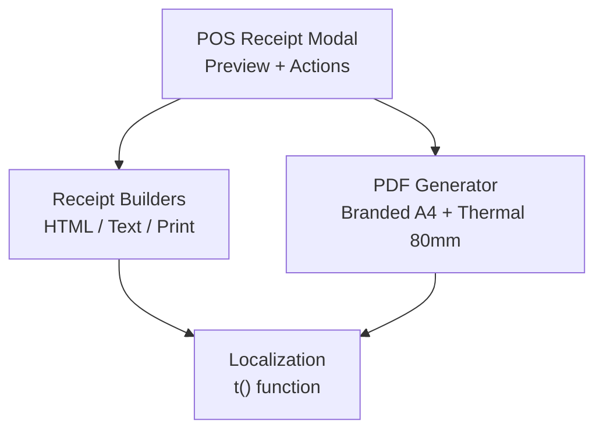
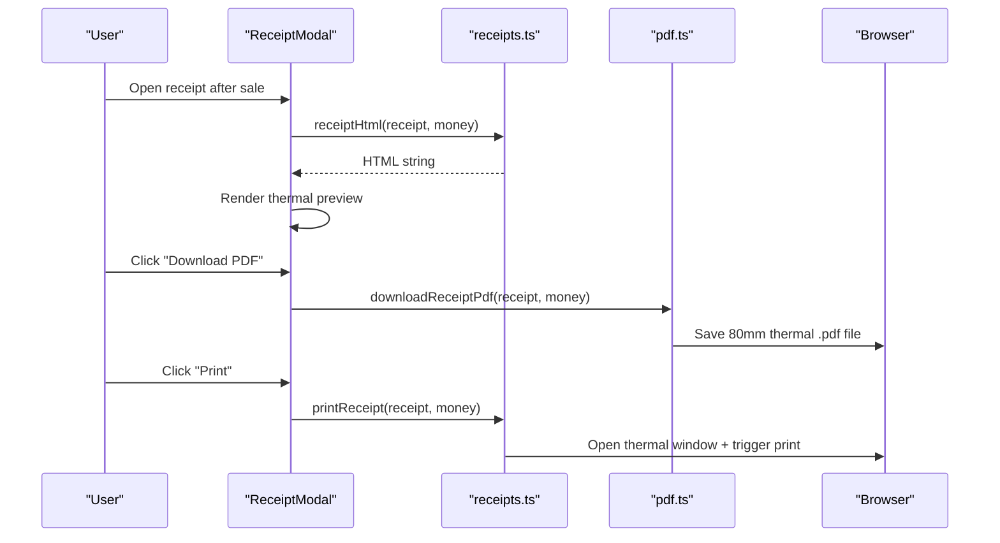
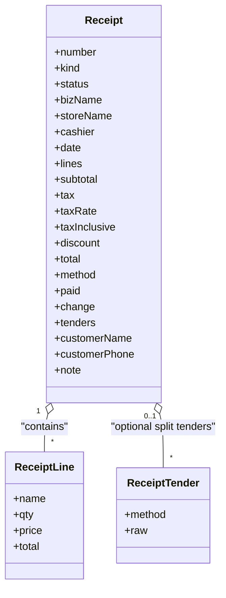
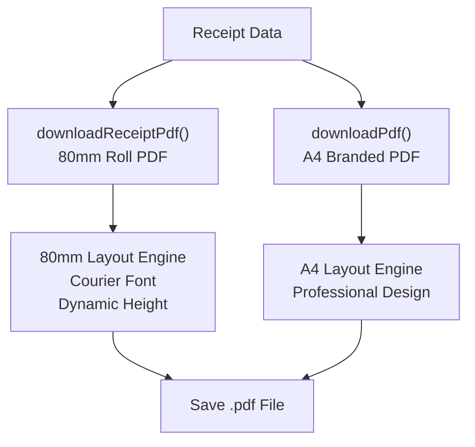
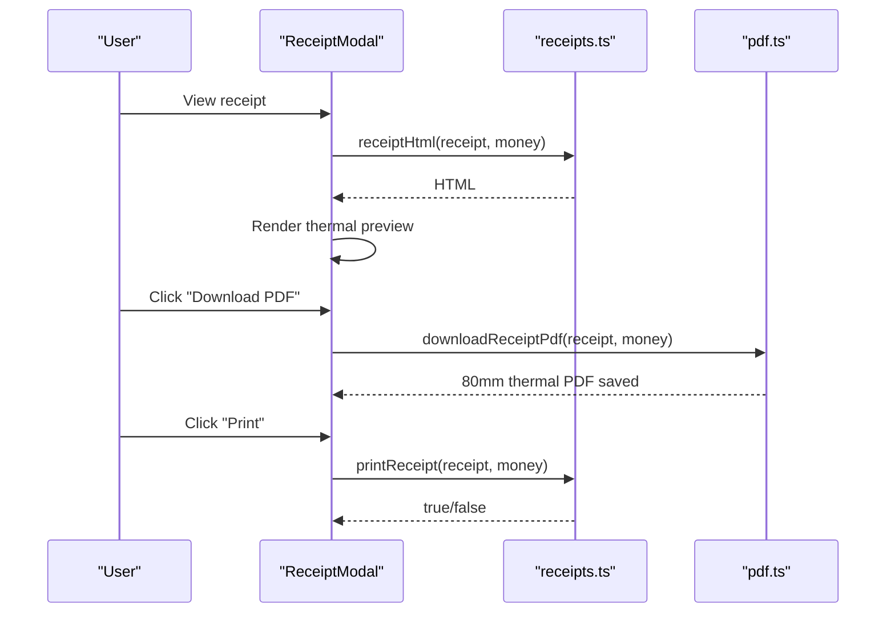
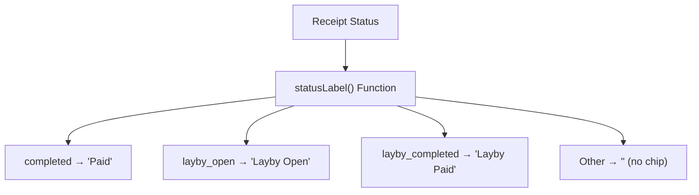
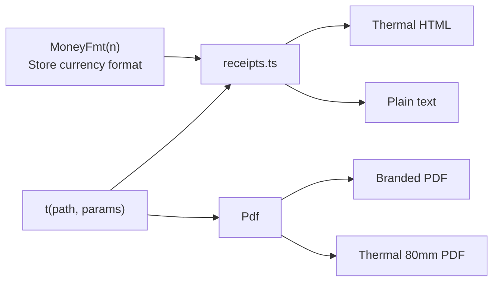
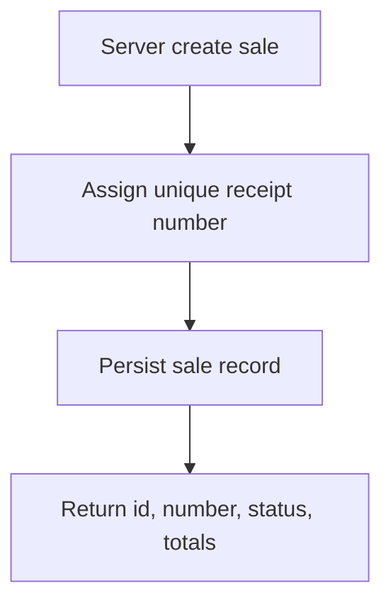
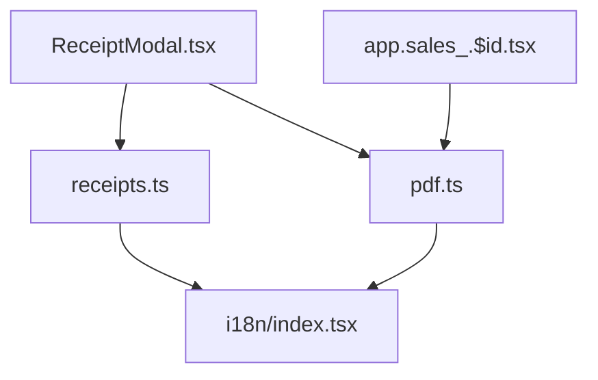

# Receipt Generation

<cite>
**Referenced Files in This Document**
- [ReceiptModal.tsx](file://src/components/pos/ReceiptModal.tsx)
- [receipts.ts](file://src/lib/receipts.ts)
- [pdf.ts](file://src/lib/pdf.ts)
- [i18n/index.tsx](file://src/lib/i18n/index.tsx)
- [app.sales_.$id.tsx](file://src/routes/_authenticated/app.sales_.$id.tsx)
</cite>

## Update Summary
**Changes Made**
- Added documentation for new thermal receipt PDF generator supporting 80mm roll-formatted receipts
- Updated status labeling functionality with enhanced `statusLabel()` function
- Simplified ReceiptModal component architecture using new `downloadReceiptPdf()` function
- Enhanced thermal receipt rendering capabilities and print formatting options

## Table of Contents
1. [Introduction](#introduction)
2. [Project Structure](#project-structure)
3. [Core Components](#core-components)
4. [Architecture Overview](#architecture-overview)
5. [Detailed Component Analysis](#detailed-component-analysis)
6. [Dependency Analysis](#dependency-analysis)
7. [Performance Considerations](#performance-considerations)
8. [Troubleshooting Guide](#troubleshooting-guide)
9. [Conclusion](#conclusion)

## Introduction
This document explains the receipt generation system used by the point-of-sale flow. It covers:
- Receipt data structure and how transaction details, items, taxes, discounts, payments, and customer information are represented.
- Template rendering for thermal-printer previews and print output.
- PDF generation for branded documents and archival, including new thermal receipt PDF support.
- The receipt modal interface for previewing, printing, and downloading receipts.
- Localization support and multi-currency formatting via a currency formatter passed into the receipt builders.
- Receipt numbering and duplicate prevention mechanisms as implemented in the backend.

## Project Structure
The receipt feature spans three main areas:
- UI layer: A dialog that previews the receipt and provides actions to download a thermal PDF or print it.
- Receipt rendering: Functions that build plain text, HTML, and print styles for an 80mm thermal roll.
- PDF export: A client-side PDF generator that produces both branded A4 documents and thermal 80mm roll-formatted receipts.

**Diagram sources**
- [ReceiptModal.tsx:36-109](file://src/components/pos/ReceiptModal.tsx#L36-L109)
- [receipts.ts:89-246](file://src/lib/receipts.ts#L89-L246)
- [pdf.ts:58-381](file://src/lib/pdf.ts#L58-L381)
- [i18n/index.tsx:101-109](file://src/lib/i18n/index.tsx#L101-L109)

**Section sources**
- [ReceiptModal.tsx:36-109](file://src/components/pos/ReceiptModal.tsx#L36-L109)
- [receipts.ts:89-246](file://src/lib/receipts.ts#L89-L246)
- [pdf.ts:58-381](file://src/lib/pdf.ts#L58-L381)
- [i18n/index.tsx:101-109](file://src/lib/i18n/index.tsx#L101-L109)

## Core Components
- Receipt data model: Defines all fields required to render a receipt, including identifiers, business/store metadata, line items, tax configuration, totals, payment method(s), change, customer info, and notes.
- Receipt builders:
  - Plain-text builder suitable for SMS/WhatsApp sharing or simple downloads.
  - Thermal HTML builder optimized for 80mm printers and on-screen preview.
  - Print helper that opens a thermal-sized window and triggers the browser print dialog.
- PDF generators:
  - Branded A4 PDF generator for professional documents and archival.
  - **New**: Thermal receipt PDF generator specifically designed for 80mm roll-formatted receipts.
- Receipt modal: Presents the thermal preview and offers "Download PDF" (thermal format) and "Print" actions.

Key responsibilities:
- Rendering: `receiptText`, `receiptHtml`, `printReceipt`
- Data shaping: `Receipt`, `ReceiptLine`, `ReceiptTender`, `MoneyFmt`
- PDF export: `downloadPdf`, **new** `downloadReceiptPdf`
- Status handling: **enhanced** `statusLabel` function
- UI orchestration: `ReceiptModal`

**Section sources**
- [receipts.ts:5-34](file://src/lib/receipts.ts#L5-L34)
- [receipts.ts:89-246](file://src/lib/receipts.ts#L89-L246)
- [pdf.ts:58-381](file://src/lib/pdf.ts#L58-L381)
- [ReceiptModal.tsx:36-109](file://src/components/pos/ReceiptModal.tsx#L36-L109)

## Architecture Overview
The receipt workflow connects the POS UI to rendering utilities and dual-format PDF export.

**Diagram sources**
- [ReceiptModal.tsx:76-99](file://src/components/pos/ReceiptModal.tsx#L76-L99)
- [receipts.ts:133-232](file://src/lib/receipts.ts#L133-L232)
- [pdf.ts:286-381](file://src/lib/pdf.ts#L286-L381)

## Detailed Component Analysis

### Receipt Data Model
The receipt object is the single source of truth for all receipt content. It includes:
- Identifiers and context: number, kind, status, bizName, storeName, cashier, date
- Line items: name, qty, price, total per item
- Financials: subtotal, discount, taxRate, taxInclusive, tax, total
- Payments: method, paid, change, optional tenders array for split payments
- Customer and notes: customerName, customerPhone, note

**Diagram sources**
- [receipts.ts:5-34](file://src/lib/receipts.ts#L5-L34)

**Section sources**
- [receipts.ts:5-34](file://src/lib/receipts.ts#L5-L34)

### Receipt Templates and Printing
- Plain-text template: Generates a monospaced layout suitable for sharing via messaging apps or saving as a text file. Includes header, invoice number, date, cashier, items, discount, subtotal, VAT, total, payment method(s), deposit/paid, change, customer info, note, and footer.
- Thermal HTML template: Produces an 80mm-friendly HTML layout with consistent spacing, dashed separators, and status chips. Used both for on-screen preview and print output.
- Print flow: Opens a new window sized for thermal paper, injects the HTML and print CSS, then triggers the print dialog automatically.

**Diagram sources**
- [receipts.ts:89-131](file://src/lib/receipts.ts#L89-L131)
- [receipts.ts:133-207](file://src/lib/receipts.ts#L133-L207)
- [receipts.ts:222-246](file://src/lib/receipts.ts#L222-L246)

**Section sources**
- [receipts.ts:89-131](file://src/lib/receipts.ts#L89-L131)
- [receipts.ts:133-207](file://src/lib/receipts.ts#L133-L207)
- [receipts.ts:222-246](file://src/lib/receipts.ts#L222-L246)

### PDF Generation and Archival
The PDF system now supports two distinct formats:

#### Branded A4 PDF Generator
Creates professional A4 documents with:
- Header with business name and optional badge
- Meta grid for key-value pairs (e.g., date, served by, payment method, customer)
- Optional KPI cards
- Sections supporting tables, pairs, and plain text
- Totals block with highlighted final row
- Footer with generated timestamp and page numbers

#### **New**: Thermal Receipt PDF Generator
Generates authentic 80mm roll-formatted receipts that match thermal printer output:
- Exact 80mm width matching thermal printer specifications
- Courier font for authentic monospace appearance
- Dynamic height calculation based on content
- Proper margin handling (4mm sides)
- Optimized for direct thermal printer compatibility

**Diagram sources**
- [pdf.ts:286-381](file://src/lib/pdf.ts#L286-L381)
- [pdf.ts:58-273](file://src/lib/pdf.ts#L58-L273)

Practical example: generating a thermal receipt PDF from the modal
- The modal calls `downloadReceiptPdf(receipt, money)` which creates an exact 80mm roll-formatted PDF
- Uses the same layout engine as thermal printing for consistency
- Automatically calculates optimal height based on content

**Section sources**
- [ReceiptModal.tsx:81-86](file://src/components/pos/ReceiptModal.tsx#L81-L86)
- [pdf.ts:286-381](file://src/lib/pdf.ts#L286-L381)
- [pdf.ts:58-273](file://src/lib/pdf.ts#L58-L273)

### Receipt Modal Interface
The modal has been simplified and now provides:
- A thermal-style preview using the same HTML produced for printing
- A "Download PDF" action that generates an 80mm thermal-formatted PDF using `downloadReceiptPdf()`
- A "Print" action that opens a thermal-sized window and triggers printing
- A "New Sale" action to return to the till flow

**Diagram sources**
- [ReceiptModal.tsx:53-109](file://src/components/pos/ReceiptModal.tsx#L53-L109)
- [receipts.ts:133-232](file://src/lib/receipts.ts#L133-L232)
- [pdf.ts:286-381](file://src/lib/pdf.ts#L286-L381)

**Section sources**
- [ReceiptModal.tsx:53-109](file://src/components/pos/ReceiptModal.tsx#L53-L109)

### Enhanced Status Labeling
The status labeling system has been improved with a dedicated `statusLabel()` function:
- Provides localized status chip labels for different receipt states
- Supports multiple statuses: completed, layby_open, layby_completed
- Returns empty string when no status chip is needed
- Integrates seamlessly with both thermal HTML and PDF generation

**Diagram sources**
- [receipts.ts:54-64](file://src/lib/receipts.ts#L54-L64)

**Section sources**
- [receipts.ts:54-64](file://src/lib/receipts.ts#L54-L64)

### Localization and Multi-Currency Formatting
- Localization: All user-facing labels come from a translation function that resolves keys against the active locale and falls back to English if missing. This ensures receipt titles, badges, and labels are localized consistently across templates and PDFs.
- Multi-currency: Amounts are formatted by a `MoneyFmt` function provided by the caller (typically the POS hook). This keeps amounts in the store's currency without hardcoding symbols or locales inside the receipt builders.

**Diagram sources**
- [receipts.ts:1-4](file://src/lib/receipts.ts#L1-L4)
- [receipts.ts:43-64](file://src/lib/receipts.ts#L43-L64)
- [i18n/index.tsx:101-109](file://src/lib/i18n/index.tsx#L101-L109)

**Section sources**
- [receipts.ts:1-4](file://src/lib/receipts.ts#L1-L4)
- [receipts.ts:43-64](file://src/lib/receipts.ts#L43-L64)
- [i18n/index.tsx:101-109](file://src/lib/i18n/index.tsx#L101-L109)

### Receipt Numbering and Duplicate Prevention
Receipt numbers are assigned server-side when creating sales. The database functions return the generated ID and number together with status and totals, ensuring a single authoritative source for numbering.

**Diagram sources**
- [supabase/migrations/20261009210500_retail_operations.sql:250-286](file://supabase/migrations/20261009210500_retail_operations.sql#L250-L286)

**Section sources**
- [supabase/migrations/20261009210500_retail_operations.sql:250-286](file://supabase/migrations/20261009210500_retail_operations.sql#L250-L286)

## Dependency Analysis
The following diagram shows how components depend on each other:

**Diagram sources**
- [ReceiptModal.tsx:14-22](file://src/components/pos/ReceiptModal.tsx#L14-L22)
- [receipts.ts:1-4](file://src/lib/receipts.ts#L1-L4)
- [pdf.ts:1-12](file://src/lib/pdf.ts#L1-L12)
- [app.sales_.$id.tsx:601-623](file://src/routes/_authenticated/app.sales_.$id.tsx#L601-L623)
- [i18n/index.tsx:101-109](file://src/lib/i18n/index.tsx#L101-L109)

**Section sources**
- [ReceiptModal.tsx:14-22](file://src/components/pos/ReceiptModal.tsx#L14-L22)
- [receipts.ts:1-4](file://src/lib/receipts.ts#L1-L4)
- [pdf.ts:1-12](file://src/lib/pdf.ts#L1-L12)
- [app.sales_.$id.tsx:601-623](file://src/routes/_authenticated/app.sales_.$id.tsx#L601-L623)
- [i18n/index.tsx:101-109](file://src/lib/i18n/index.tsx#L101-L109)

## Performance Considerations
- Lazy loading of PDF libraries: Both PDF generators dynamically import jsPDF only when needed, avoiding SSR bundle bloat.
- Efficient HTML construction: Receipt HTML is built via string concatenation; values are escaped once to prevent XSS and ensure safe innerHTML insertion.
- Thermal print optimization: Print CSS targets 80mm paper size and uses minimal DOM to reduce layout work during printing.
- **New**: Thermal PDF optimization: The thermal receipt PDF generator uses a two-pass approach - first measuring content height, then creating optimally-sized PDFs to minimize file size.
- Avoid redundant re-renders: The modal receives pre-formatted amounts via `MoneyFmt`, so currency formatting is not repeated unnecessarily.

## Troubleshooting Guide
Common issues and resolutions:
- PDF generation fails or hangs:
  - Ensure jsPDF can be imported at runtime. The generators load them lazily; network issues may delay availability.
  - Check that the browser allows saving files and that popups are not blocked.
- Print dialog does not open:
  - Some browsers block automatic prints from newly opened windows. Verify popup permissions and try triggering print manually.
- Incorrect currency symbol or formatting:
  - Confirm that the `MoneyFmt` function passed to receipt builders formats amounts according to the store's currency settings.
- Missing localization labels:
  - Verify that translation keys exist in the active locale; missing keys fall back to English but will show raw paths if entirely absent.
- Garbled characters in PDFs:
  - The PDF generators normalize certain typographic glyphs and strip unsupported characters. If custom fonts are added later, ensure they cover the required character sets.
- **New**: Thermal PDF formatting issues:
  - Ensure the thermal PDF generator is called with proper receipt data. The 80mm format requires specific layout calculations that differ from standard A4 PDFs.
  - Check that the receipt contains all required fields for proper thermal layout rendering.

**Section sources**
- [pdf.ts:58-62](file://src/lib/pdf.ts#L58-L62)
- [pdf.ts:286-287](file://src/lib/pdf.ts#L286-L287)
- [receipts.ts:60-80](file://src/lib/receipts.ts#L60-L80)
- [receipts.ts:222-232](file://src/lib/receipts.ts#L222-L232)
- [i18n/index.tsx:101-109](file://src/lib/i18n/index.tsx#L101-L109)

## Conclusion
The receipt system provides a robust, localized, and multi-currency-capable pipeline for generating receipts in multiple formats:
- Thermal HTML for accurate on-screen preview and printer output
- Plain text for sharing and lightweight archival
- **Enhanced**: Branded A4 PDFs for professional documentation and recordkeeping
- **New**: Thermal 80mm roll-formatted PDFs that exactly match thermal printer output

The design separates concerns cleanly:
- The modal orchestrates user actions with simplified PDF generation
- Receipt builders focus on rendering and escaping
- **Dual PDF generators** handle different use cases: professional A4 documents and authentic thermal receipts
- Enhanced status labeling provides consistent status chip display
- Localization and currency formatting are injected where appropriate

Receipt numbering is handled server-side to guarantee uniqueness and consistency. For further customization, extend the PDF document schema or add new receipt templates while preserving the existing data contract. The new thermal receipt PDF generator ensures perfect fidelity between digital receipts and physical thermal printer output.