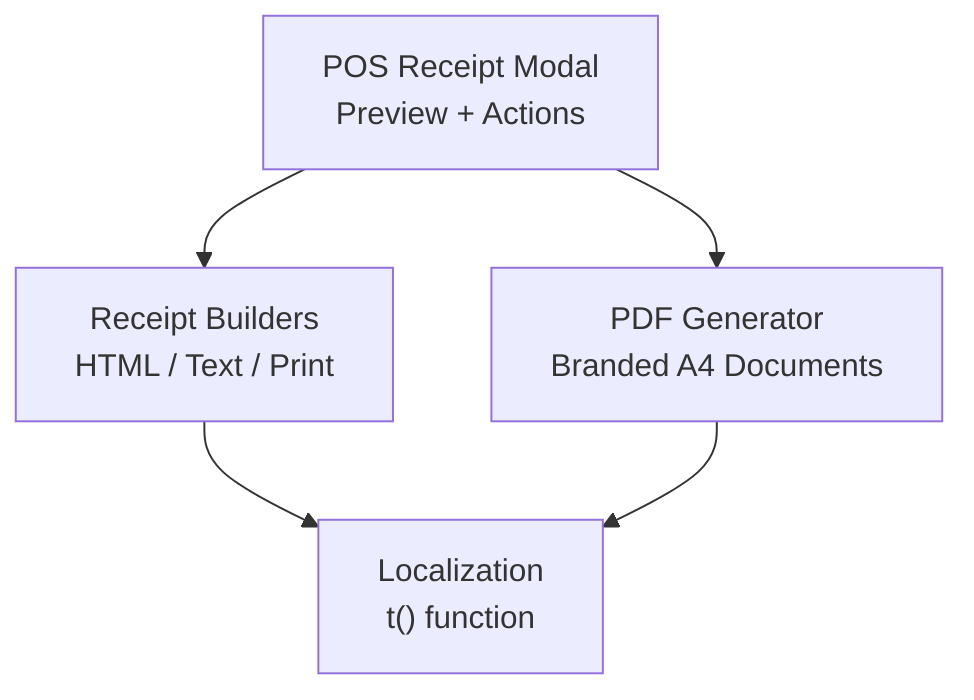
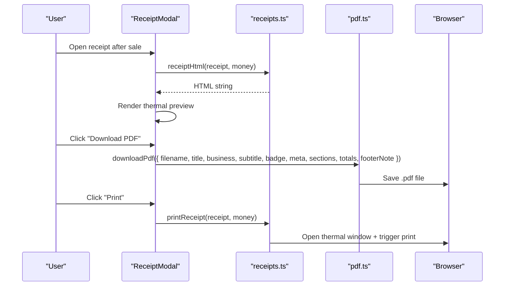
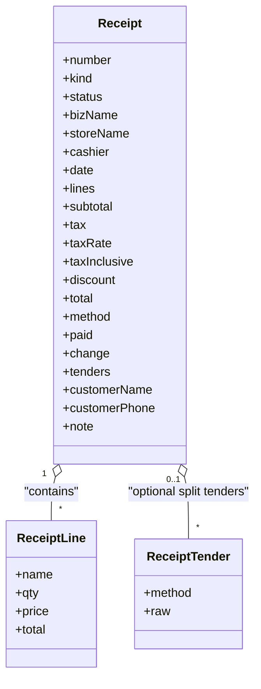
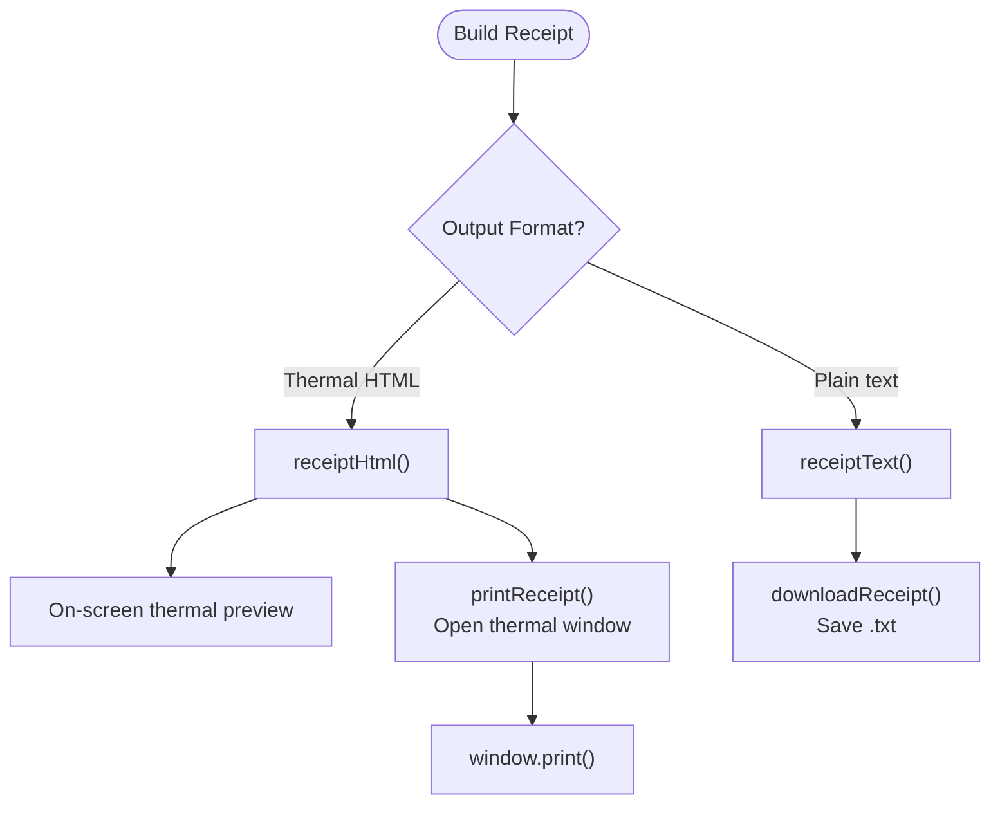
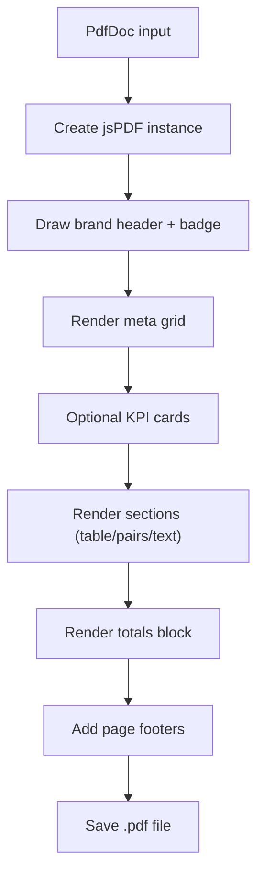
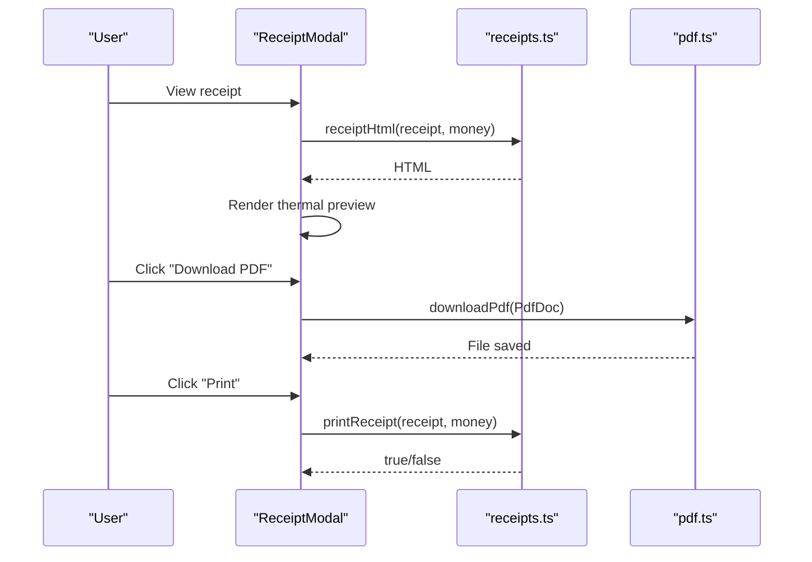
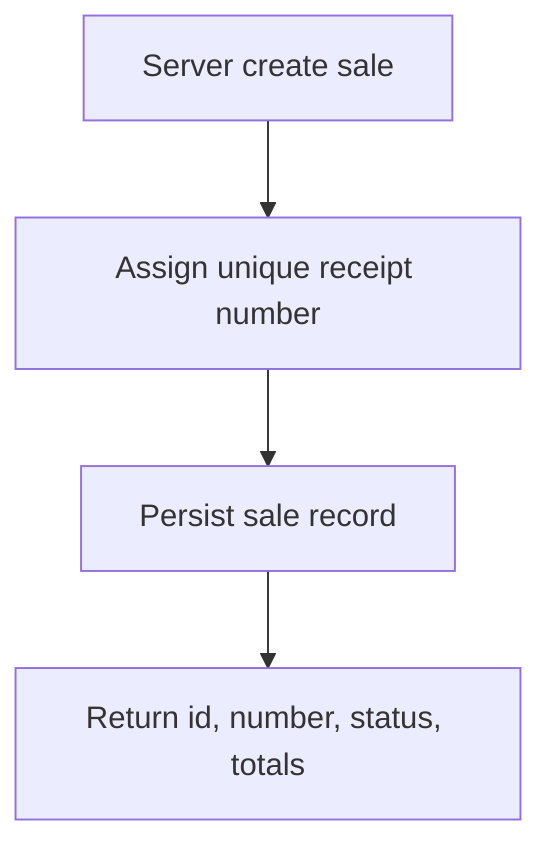
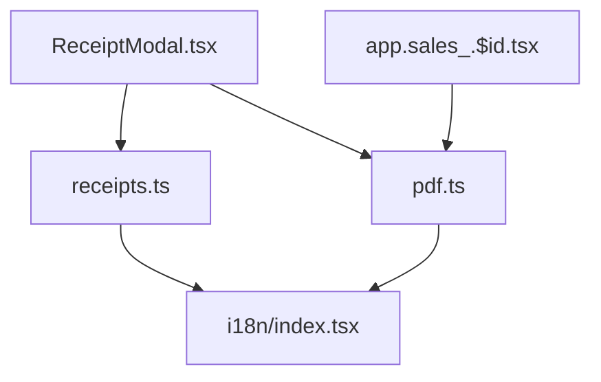

# Receipt Generation

<cite>
**Referenced Files in This Document**
- [ReceiptModal.tsx](file://src/components/pos/ReceiptModal.tsx)
- [receipts.ts](file://src/lib/receipts.ts)
- [pdf.ts](file://src/lib/pdf.ts)
- [i18n/index.tsx](file://src/lib/i18n/index.tsx)
- [app.sales_.$id.tsx](file://src/routes/_authenticated/app.sales_.$id.tsx)
</cite>

## Table of Contents
1. [Introduction](#introduction)
2. [Project Structure](#project-structure)
3. [Core Components](#core-components)
4. [Architecture Overview](#architecture-overview)
5. [Detailed Component Analysis](#detailed-component-analysis)
6. [Dependency Analysis](#dependency-analysis)
7. [Performance Considerations](#performance-considerations)
8. [Troubleshooting Guide](#troubleshooting-guide)
9. [Conclusion](#conclusion)

## Introduction
This document explains the receipt generation system used by the point-of-sale flow. It covers:
- Receipt data structure and how transaction details, items, taxes, discounts, payments, and customer information are represented.
- Template rendering for thermal-printer previews and print output.
- PDF generation for branded documents and archival.
- The receipt modal interface for previewing, printing, and downloading receipts.
- Localization support and multi-currency formatting via a currency formatter passed into the receipt builders.
- Receipt numbering and duplicate prevention mechanisms as implemented in the backend.

## Project Structure
The receipt feature spans three main areas:
- UI layer: A dialog that previews the receipt and provides actions to download a PDF or print it.
- Receipt rendering: Functions that build plain text, HTML, and print styles for an 80mm thermal roll.
- PDF export: A client-side PDF generator that produces branded A4 documents with tables, totals, and footers.

**Diagram sources**
- [ReceiptModal.tsx:37-148](file://src/components/pos/ReceiptModal.tsx#L37-L148)
- [receipts.ts:83-240](file://src/lib/receipts.ts#L83-L240)
- [pdf.ts:51-266](file://src/lib/pdf.ts#L51-L266)
- [i18n/index.tsx:101-109](file://src/lib/i18n/index.tsx#L101-L109)

**Section sources**
- [ReceiptModal.tsx:37-148](file://src/components/pos/ReceiptModal.tsx#L37-L148)
- [receipts.ts:83-240](file://src/lib/receipts.ts#L83-L240)
- [pdf.ts:51-266](file://src/lib/pdf.ts#L51-L266)
- [i18n/index.tsx:101-109](file://src/lib/i18n/index.tsx#L101-L109)

## Core Components
- Receipt data model: Defines all fields required to render a receipt, including identifiers, business/store metadata, line items, tax configuration, totals, payment method(s), change, customer info, and notes.
- Receipt builders:
  - Plain-text builder suitable for SMS/WhatsApp sharing or simple downloads.
  - Thermal HTML builder optimized for 80mm printers and on-screen preview.
  - Print helper that opens a thermal-sized window and triggers the browser print dialog.
- PDF generator: Builds branded A4 PDFs with header, badge, meta grid, KPI cards, sections (tables/pairs/text), totals, and page footers.
- Receipt modal: Presents the thermal preview and offers “Download PDF” and “Print” actions.

Key responsibilities:
- Rendering: `receiptText`, `receiptHtml`, `printReceipt`
- Data shaping: `Receipt`, `ReceiptLine`, `ReceiptTender`, `MoneyFmt`
- PDF export: `downloadPdf`
- UI orchestration: `ReceiptModal`

**Section sources**
- [receipts.ts:5-34](file://src/lib/receipts.ts#L5-L34)
- [receipts.ts:83-240](file://src/lib/receipts.ts#L83-L240)
- [pdf.ts:51-266](file://src/lib/pdf.ts#L51-L266)
- [ReceiptModal.tsx:37-148](file://src/components/pos/ReceiptModal.tsx#L37-L148)

## Architecture Overview
The receipt workflow connects the POS UI to rendering utilities and PDF export.

**Diagram sources**
- [ReceiptModal.tsx:77-138](file://src/components/pos/ReceiptModal.tsx#L77-L138)
- [receipts.ts:127-227](file://src/lib/receipts.ts#L127-L227)
- [pdf.ts:51-266](file://src/lib/pdf.ts#L51-L266)

## Detailed Component Analysis

### Receipt Data Model
The receipt object is the single source of truth for all receipt content. It includes:
- Identifiers and context: number, kind, status, bizName, storeName, cashier, date
- Line items: name, qty, price, total per item
- Financials: subtotal, discount, taxRate, taxInclusive, tax, total
- Payments: method, paid, change, optional tenders array for split payments
- Customer and notes: customerName, customerPhone, note

**Diagram sources**
- [receipts.ts:5-34](file://src/lib/receipts.ts#L5-L34)

**Section sources**
- [receipts.ts:5-34](file://src/lib/receipts.ts#L5-L34)

### Receipt Templates and Printing
- Plain-text template: Generates a monospaced layout suitable for sharing via messaging apps or saving as a text file. Includes header, invoice number, date, cashier, items, discount, subtotal, VAT, total, payment method(s), deposit/paid, change, customer info, note, and footer.
- Thermal HTML template: Produces an 80mm-friendly HTML layout with consistent spacing, dashed separators, and status chips. Used both for on-screen preview and print output.
- Print flow: Opens a new window sized for thermal paper, injects the HTML and print CSS, then triggers the print dialog automatically.

**Diagram sources**
- [receipts.ts:83-125](file://src/lib/receipts.ts#L83-L125)
- [receipts.ts:127-202](file://src/lib/receipts.ts#L127-L202)
- [receipts.ts:217-240](file://src/lib/receipts.ts#L217-L240)

**Section sources**
- [receipts.ts:83-125](file://src/lib/receipts.ts#L83-L125)
- [receipts.ts:127-202](file://src/lib/receipts.ts#L127-L202)
- [receipts.ts:217-240](file://src/lib/receipts.ts#L217-L240)

### PDF Generation and Archival
The PDF generator creates branded A4 documents with:
- Header with business name and optional badge
- Meta grid for key-value pairs (e.g., date, served by, payment method, customer)
- Optional KPI cards
- Sections supporting tables, pairs, and plain text
- Totals block with highlighted final row
- Footer with generated timestamp and page numbers

**Diagram sources**
- [pdf.ts:51-266](file://src/lib/pdf.ts#L51-L266)

Practical example: generating a receipt PDF from the modal
- The modal constructs a `PdfDoc` with:
  - filename, title, business, subtitle, badge
  - meta rows for date, cashier, payment method, and customer
  - a table section for line items
  - totals for subtotal, VAT (if any), paid, change, and total
  - a footer note including optional customer note and thank-you message

**Section sources**
- [ReceiptModal.tsx:82-124](file://src/components/pos/ReceiptModal.tsx#L82-L124)
- [pdf.ts:51-266](file://src/lib/pdf.ts#L51-L266)

### Receipt Modal Interface
The modal provides:
- A thermal-style preview using the same HTML produced for printing
- A “Download PDF” action that builds a branded PDF and saves it
- A “Print” action that opens a thermal-sized window and triggers printing
- A “New Sale” action to return to the till flow

**Diagram sources**
- [ReceiptModal.tsx:54-148](file://src/components/pos/ReceiptModal.tsx#L54-L148)
- [receipts.ts:127-227](file://src/lib/receipts.ts#L127-L227)
- [pdf.ts:51-266](file://src/lib/pdf.ts#L51-L266)

**Section sources**
- [ReceiptModal.tsx:54-148](file://src/components/pos/ReceiptModal.tsx#L54-L148)

### Localization and Multi-Currency Formatting
- Localization: All user-facing labels come from a translation function that resolves keys against the active locale and falls back to English if missing. This ensures receipt titles, badges, and labels are localized consistently across templates and PDFs.
- Multi-currency: Amounts are formatted by a `MoneyFmt` function provided by the caller (typically the POS hook). This keeps amounts in the store’s currency without hardcoding symbols or locales inside the receipt builders.

```mermaid
graph LR
MoneyFn["MoneyFmt(n)<br/>Store currency format"] --> Receipts["receipts.ts"]
I18n["t(path, params)"] --> Receipts
I18n --> Pdf
Receipts --> Html["Thermal HTML"]
Receipts --> Txt["Plain text"]
Pdf --> PdfDoc["Branded PDF"]
```

**Diagram sources**
- [receipts.ts:1-4](file://src/lib/receipts.ts#L1-L4)
- [receipts.ts:43-52](file://src/lib/receipts.ts#L43-L52)
- [i18n/index.tsx:101-109](file://src/lib/i18n/index.tsx#L101-L109)

**Section sources**
- [receipts.ts:1-4](file://src/lib/receipts.ts#L1-L4)
- [receipts.ts:43-52](file://src/lib/receipts.ts#L43-L52)
- [i18n/index.tsx:101-109](file://src/lib/i18n/index.tsx#L101-L109)

### Receipt Numbering and Duplicate Prevention
Receipt numbers are assigned server-side when creating sales. The database functions return the generated ID and number together with status and totals, ensuring a single authoritative source for numbering.

**Diagram sources**
- [supabase/migrations/20261009210500_retail_operations.sql:250-286](file://supabase/migrations/20261009210500_retail_operations.sql#L250-L286)

**Section sources**
- [supabase/migrations/20261009210500_retail_operations.sql:250-286](file://supabase/migrations/20261009210500_retail_operations.sql#L250-L286)

## Dependency Analysis
The following diagram shows how components depend on each other:

**Diagram sources**
- [ReceiptModal.tsx:14-23](file://src/components/pos/ReceiptModal.tsx#L14-L23)
- [receipts.ts:1-4](file://src/lib/receipts.ts#L1-L4)
- [pdf.ts:1-6](file://src/lib/pdf.ts#L1-L6)
- [app.sales_.$id.tsx:601-623](file://src/routes/_authenticated/app.sales_.$id.tsx#L601-L623)
- [i18n/index.tsx:101-109](file://src/lib/i18n/index.tsx#L101-L109)

**Section sources**
- [ReceiptModal.tsx:14-23](file://src/components/pos/ReceiptModal.tsx#L14-L23)
- [receipts.ts:1-4](file://src/lib/receipts.ts#L1-L4)
- [pdf.ts:1-6](file://src/lib/pdf.ts#L1-L6)
- [app.sales_.$id.tsx:601-623](file://src/routes/_authenticated/app.sales_.$id.tsx#L601-L623)
- [i18n/index.tsx:101-109](file://src/lib/i18n/index.tsx#L101-L109)

## Performance Considerations
- Lazy loading of PDF libraries: The PDF generator dynamically imports jsPDF and autoTable only when needed, avoiding SSR bundle bloat.
- Efficient HTML construction: Receipt HTML is built via string concatenation; values are escaped once to prevent XSS and ensure safe innerHTML insertion.
- Thermal print optimization: Print CSS targets 80mm paper size and uses minimal DOM to reduce layout work during printing.
- Avoid redundant re-renders: The modal receives pre-formatted amounts via `MoneyFmt`, so currency formatting is not repeated unnecessarily.

[No sources needed since this section provides general guidance]

## Troubleshooting Guide
Common issues and resolutions:
- PDF generation fails or hangs:
  - Ensure jsPDF and jspdf-autotable can be imported at runtime. The generator loads them lazily; network issues may delay availability.
  - Check that the browser allows saving files and that popups are not blocked.
- Print dialog does not open:
  - Some browsers block automatic prints from newly opened windows. Verify popup permissions and try triggering print manually.
- Incorrect currency symbol or formatting:
  - Confirm that the `MoneyFmt` function passed to receipt builders formats amounts according to the store’s currency settings.
- Missing localization labels:
  - Verify that translation keys exist in the active locale; missing keys fall back to English but will show raw paths if entirely absent.
- Garbled characters in PDFs:
  - The PDF generator normalizes certain typographic glyphs and strips unsupported characters. If custom fonts are added later, ensure they cover the required character sets.

**Section sources**
- [pdf.ts:51-56](file://src/lib/pdf.ts#L51-L56)
- [receipts.ts:60-74](file://src/lib/receipts.ts#L60-L74)
- [receipts.ts:217-227](file://src/lib/receipts.ts#L217-L227)
- [i18n/index.tsx:101-109](file://src/lib/i18n/index.tsx#L101-L109)

## Conclusion
The receipt system provides a robust, localized, and multi-currency-capable pipeline for generating receipts in multiple formats:
- Thermal HTML for accurate on-screen preview and printer output
- Plain text for sharing and lightweight archival
- Branded PDFs for professional documentation and recordkeeping

The design separates concerns cleanly:
- The modal orchestrates user actions
- Receipt builders focus on rendering and escaping
- The PDF generator handles complex layouts and branding
- Localization and currency formatting are injected where appropriate

Receipt numbering is handled server-side to guarantee uniqueness and consistency. For further customization, extend the PDF document schema or add new receipt templates while preserving the existing data contract.

[No sources needed since this section summarizes without analyzing specific files]