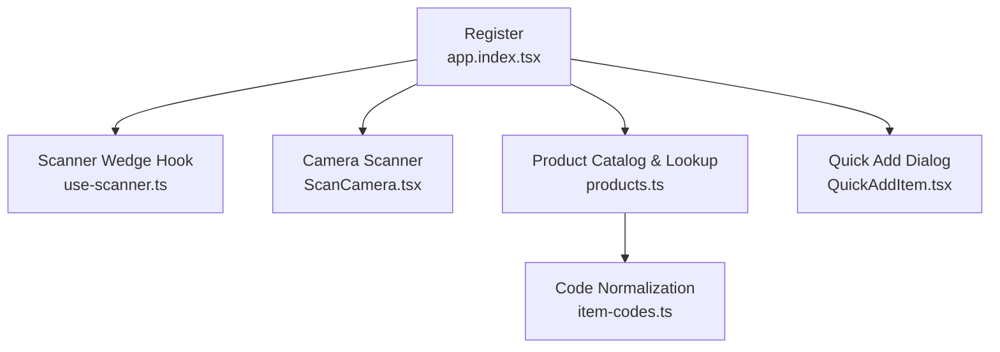
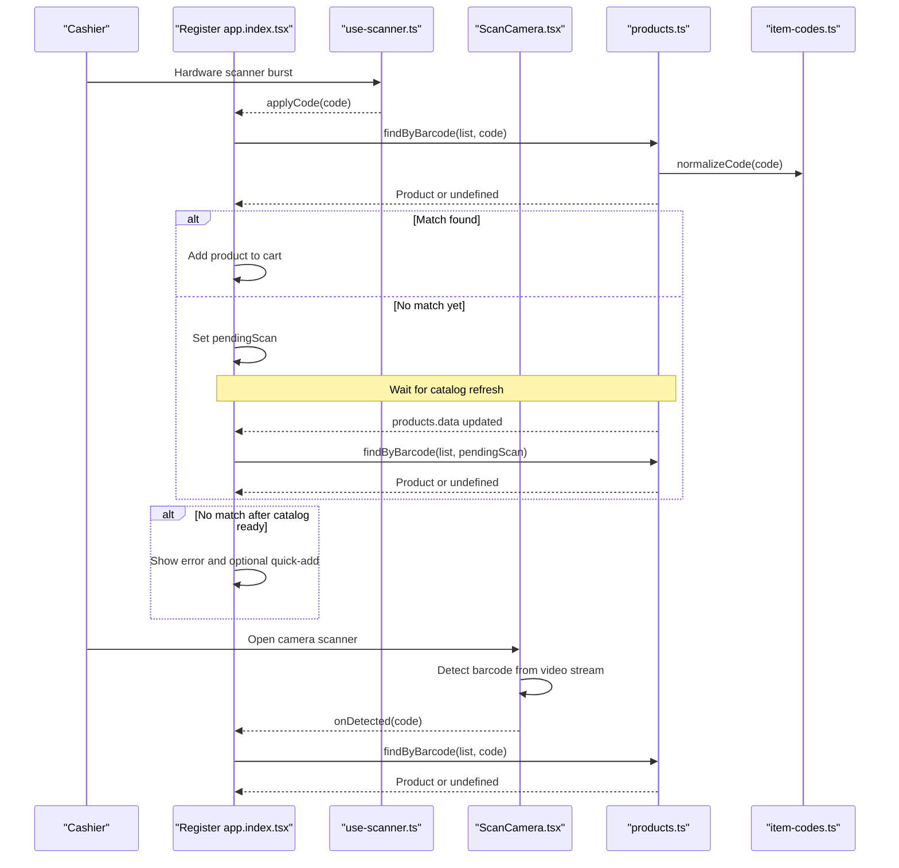
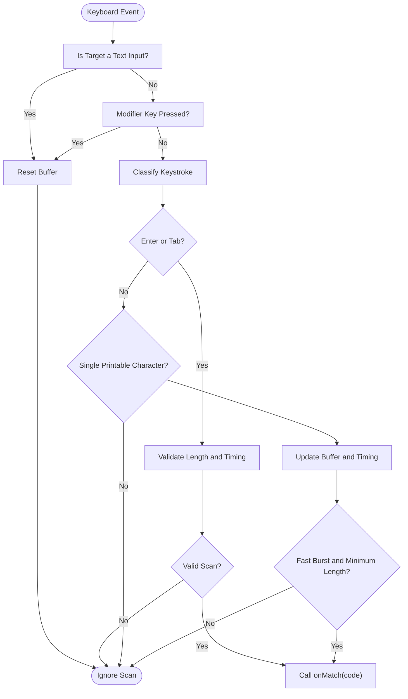
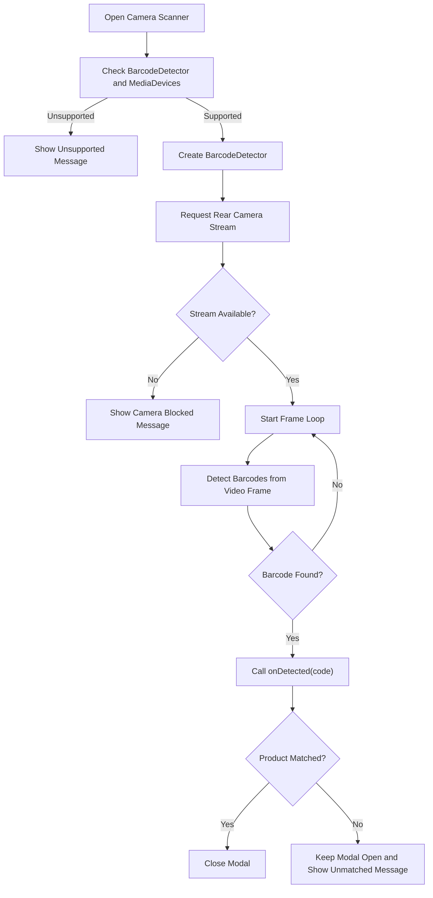
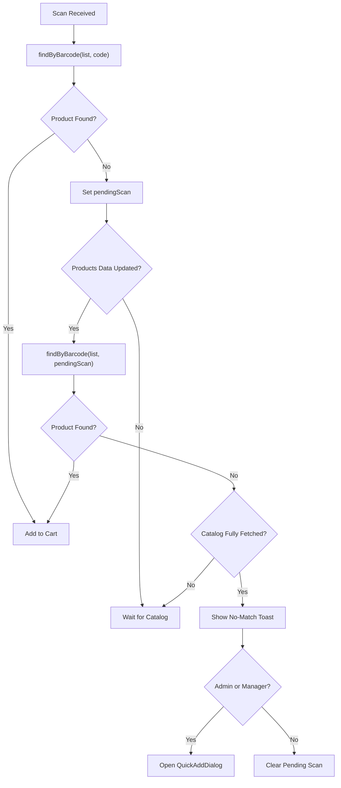
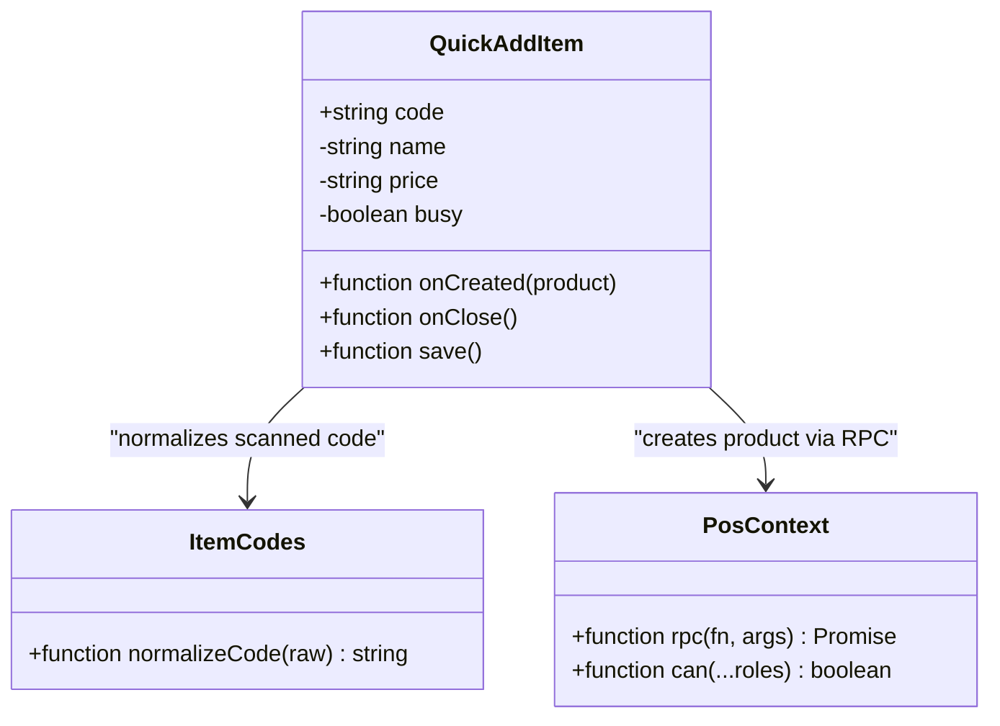
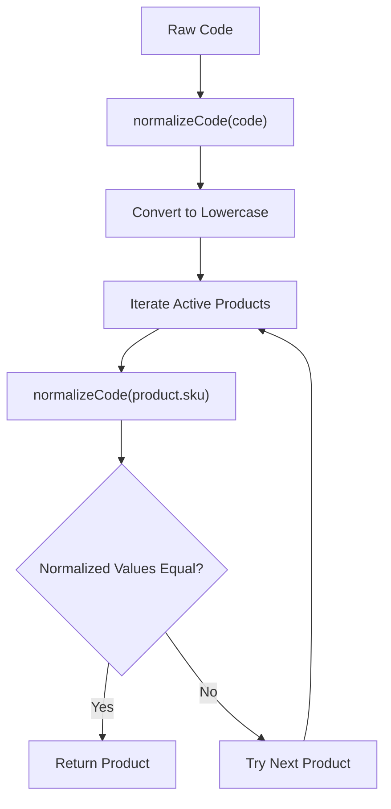
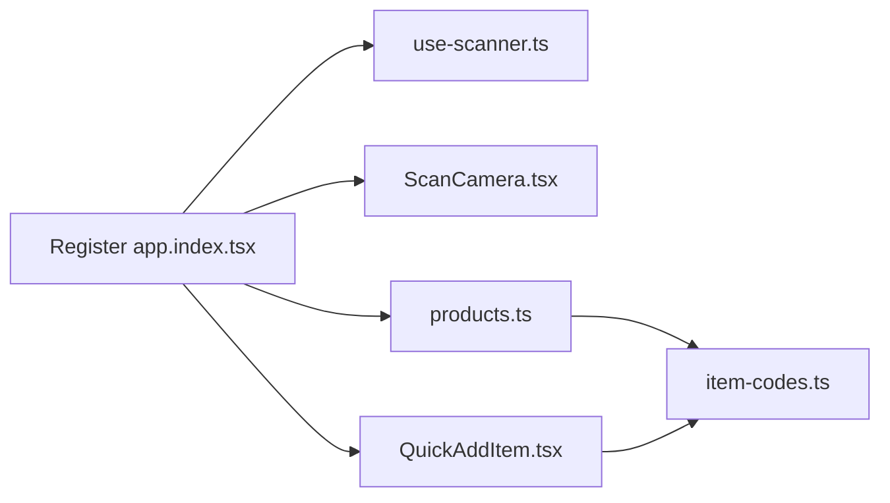

# Barcode Scanning Integration

<cite>
**Referenced Files in This Document**
- [app.index.tsx](file://src/routes/_authenticated/app.index.tsx)
- [use-scanner.ts](file://src/components/pos/use-scanner.ts)
- [ScanCamera.tsx](file://src/components/pos/ScanCamera.tsx)
- [QuickAddItem.tsx](file://src/components/pos/QuickAddItem.tsx)
- [products.ts](file://src/lib/products.ts)
- [item-codes.ts](file://src/lib/item-codes.ts)
</cite>

## Table of Contents
1. [Introduction](#introduction)
2. [Project Structure](#project-structure)
3. [Core Components](#core-components)
4. [Architecture Overview](#architecture-overview)
5. [Detailed Component Analysis](#detailed-component-analysis)
6. [Dependency Analysis](#dependency-analysis)
7. [Performance Considerations](#performance-considerations)
8. [Troubleshooting Guide](#troubleshooting-guide)
9. [Conclusion](#conclusion)

## Introduction
This document explains the barcode scanning integration used by the POS register. The system supports two complementary input paths:

- **Hardware scanner wedge**: A physical scanner behaves like a keyboard and emits a rapid burst of keystrokes ending with Enter or Tab. The register intercepts this burst, recognizes it as a scan, and adds the matching product to the cart without requiring focus on any field.
- **Camera-based scanning**: On supported browsers, the register can open a camera modal, detect barcodes in real time using `BarcodeDetector`, and add the first recognized retail code to the cart.

When a scanned code does not match an active product in the cached catalog, the register queues the lookup while the catalog refreshes. Once the catalog is ready, the pending code is resolved automatically. If no match exists after the catalog is loaded, the register shows user feedback and offers a quick-add flow for managers and admins to create the product directly from the register.

## Project Structure
The barcode scanning feature spans several focused files:

| Area | File | Responsibility |
| --- | --- | --- |
| Register orchestration | [app.index.tsx](file://src/routes/_authenticated/app.index.tsx) | Holds the cart, manages pending scans, connects scanner events to product lookup, opens camera scanning, and renders quick-add. |
| Scanner wedge hook | [use-scanner.ts](file://src/components/pos/use-scanner.ts) | Detects hardware scanner bursts and calls a callback with the normalized code. |
| Camera scanner UI | [ScanCamera.tsx](file://src/components/pos/ScanCamera.tsx) | Opens the rear camera, detects codes, and reports matches or errors. |
| Quick-add dialog | [QuickAddItem.tsx](file://src/components/pos/QuickAddItem.tsx) | Lets authorized users create a new product from an unknown scanned code. |
| Product catalog and lookup | [products.ts](file://src/lib/products.ts) | Loads the cached product list and performs exact barcode matching. |
| Code normalization | [item-codes.ts](file://src/lib/item-codes.ts) | Normalizes, generates, and compares SKU-like item codes. |

**Diagram sources**
- [app.index.tsx:111-248](file://src/routes/_authenticated/app.index.tsx#L111-L248)
- [use-scanner.ts:24-83](file://src/components/pos/use-scanner.ts#L24-L83)
- [ScanCamera.tsx:51-139](file://src/components/pos/ScanCamera.tsx#L51-L139)
- [products.ts:19-64](file://src/lib/products.ts#L19-L64)
- [item-codes.ts:21-24](file://src/lib/item-codes.ts#L21-L24)
- [QuickAddItem.tsx:30-101](file://src/components/pos/QuickAddItem.tsx#L30-L101)

**Section sources**
- [app.index.tsx:111-248](file://src/routes/_authenticated/app.index.tsx#L111-L248)
- [use-scanner.ts:24-83](file://src/components/pos/use-scanner.ts#L24-L83)
- [ScanCamera.tsx:51-139](file://src/components/pos/ScanCamera.tsx#L51-L139)
- [products.ts:19-64](file://src/lib/products.ts#L19-L64)
- [item-codes.ts:21-24](file://src/lib/item-codes.ts#L21-L24)
- [QuickAddItem.tsx:30-101](file://src/components/pos/QuickAddItem.tsx#L30-L101)

## Core Components
The barcode scanning capability is built around five core pieces:

1. **Scanner wedge detection**
   - Recognizes fast keystroke bursts typical of hardware scanners.
   - Ignores normal typing when a text input, textarea, select, or content-editable element is focused.
   - Supports both trailing-key scanners (Enter/Tab) and scanners that emit only the code.

2. **Camera scanner interface**
   - Uses the browser’s `BarcodeDetector` API when available.
   - Streams the rear camera into a video element.
   - Detects common retail formats such as EAN-13, UPC-A, Code 128, and QR codes.
   - Reports permission or device errors clearly and keeps the modal open for retry when no product matches.

3. **Pending scan queue**
   - Stores a single unresolved code while the product catalog is loading or refreshing.
   - Automatically applies the code once the catalog becomes available.
   - Falls back to error messaging and optional quick-add if no match exists after the catalog is fetched.

4. **Product lookup**
   - Matches against the locally cached product list rather than making a network request per scan.
   - Performs case-insensitive, trimmed, space-collapsed exact matching.

5. **Quick-add flow**
   - Available to administrators and managers.
   - Pre-fills the unknown code and requires a product name and selling price.
   - Creates the product through the shared RPC layer and immediately adds it to the cart.

**Section sources**
- [use-scanner.ts:24-83](file://src/components/pos/use-scanner.ts#L24-L83)
- [ScanCamera.tsx:51-139](file://src/components/pos/ScanCamera.tsx#L51-L139)
- [app.index.tsx:222-248](file://src/routes/_authenticated/app.index.tsx#L222-L248)
- [products.ts:54-64](file://src/lib/products.ts#L54-L64)
- [QuickAddItem.tsx:30-101](file://src/components/pos/QuickAddItem.tsx#L30-L101)

## Architecture Overview
At runtime, the register coordinates scanning inputs and product resolution as follows:

**Diagram sources**
- [app.index.tsx:222-248](file://src/routes/_authenticated/app.index.tsx#L222-L248)
- [use-scanner.ts:24-83](file://src/components/pos/use-scanner.ts#L24-L83)
- [ScanCamera.tsx:51-139](file://src/components/pos/ScanCamera.tsx#L51-L139)
- [products.ts:54-64](file://src/lib/products.ts#L54-L64)
- [item-codes.ts:21-24](file://src/lib/item-codes.ts#L21-L24)

## Detailed Component Analysis

### Scanner Wedge Integration
The scanner wedge hook treats rapid printable keystrokes as a potential barcode. It buffers characters until either:

- A terminating key such as Enter or Tab arrives.
- A short but fast burst reaches a minimum length threshold.

It deliberately avoids capturing normal typing by resetting its buffer whenever the event target is a text-oriented DOM element or modifier keys are pressed. This ensures that search boxes and other inputs remain usable while still allowing a scanner gun to work globally.

Key behaviors:

| Behavior | Implementation detail |
| --- | --- |
| Burst detection | Compares timing between keystrokes and uses a small millisecond threshold. |
| Minimum code length | Requires at least six characters for ambiguous bursts; shorter codes require faster timing. |
| Trailing key support | Resolves on Enter or Tab even if the scanner does not send a trailing key. |
| Early resolution | Allows very short fast bursts to resolve early so scanners configured differently still work. |
| Field protection | Resets the buffer when typing starts in a text input, textarea, select, or content-editable node. |

**Diagram sources**
- [use-scanner.ts:8-13](file://src/components/pos/use-scanner.ts#L8-L13)
- [use-scanner.ts:31-83](file://src/components/pos/use-scanner.ts#L31-L83)

**Section sources**
- [use-scanner.ts:8-13](file://src/components/pos/use-scanner.ts#L8-L13)
- [use-scanner.ts:24-83](file://src/components/pos/use-scanner.ts#L24-L83)

### Camera-Based Barcode Scanning
The camera scanner component is shown only when the browser supports both `BarcodeDetector` and media device access. When opened, it:

1. Attempts to construct a detector with preferred retail formats.
2. Requests the rear-facing camera.
3. Streams frames into a hidden video element.
4. Runs a frame loop using `requestAnimationFrame`.
5. Calls `detect` on each frame until a code with a raw value is found.
6. Delegates match resolution to the parent register via `onDetected`.

If no product matches, the modal stays open and displays a message containing the last detected code so the cashier can try again. If the camera is blocked or unsupported, a readable error is shown instead of failing silently.

**Diagram sources**
- [ScanCamera.tsx:15-21](file://src/components/pos/ScanCamera.tsx#L15-L21)
- [ScanCamera.tsx:51-139](file://src/components/pos/ScanCamera.tsx#L51-L139)

**Section sources**
- [ScanCamera.tsx:15-21](file://src/components/pos/ScanCamera.tsx#L15-L21)
- [ScanCamera.tsx:51-139](file://src/components/pos/ScanCamera.tsx#L51-L139)

### Pending Scan Handling During Catalog Refresh
The register maintains a `pendingScan` state for codes seen before the product catalog is fully available. The flow is:

1. A scan arrives and does not match the current catalog.
2. The code is stored in `pendingScan`.
3. When `products.data` changes, the effect checks whether the code now matches.
4. If it matches, the product is added to the cart and the pending state is cleared.
5. If the catalog has finished fetching and still no match exists, the register shows an error toast.
6. If the user has admin or manager permissions, the register opens the quick-add dialog with the unknown code pre-filled.

**Diagram sources**
- [app.index.tsx:127-131](file://src/routes/_authenticated/app.index.tsx#L127-L131)
- [app.index.tsx:222-248](file://src/routes/_authenticated/app.index.tsx#L222-L248)

**Section sources**
- [app.index.tsx:127-131](file://src/routes/_authenticated/app.index.tsx#L127-L131)
- [app.index.tsx:222-248](file://src/routes/_authenticated/app.index.tsx#L222-L248)

### Quick Add Functionality
The quick-add dialog is designed for situations where a scanned code is not present in the catalog. It is visible only to users with admin or manager roles. The dialog:

- Pre-populates the item code using the normalized scanned value.
- Requires a product name and selling price.
- Validates inputs using shared validation helpers.
- Calls the shared `save_product` RPC through the POS context.
- Invalidates relevant React Query caches so the catalog updates quickly.
- Adds the newly created product to the cart when creation succeeds.

**Diagram sources**
- [QuickAddItem.tsx:30-101](file://src/components/pos/QuickAddItem.tsx#L30-L101)
- [item-codes.ts:21-24](file://src/lib/item-codes.ts#L21-L24)

**Section sources**
- [QuickAddItem.tsx:30-101](file://src/components/pos/QuickAddItem.tsx#L30-L101)

### Product Lookup and Code Normalization
The product lookup function is intentionally simple and deterministic:

- It receives the active product list and a raw code.
- It normalizes both sides using the same trimming and space-collapsing logic.
- It compares lowercase normalized values.
- It returns only active products.

This design means that a scanner, a typed SKU, and a printed QR payload should all resolve to the same product as long as they carry the same normalized code.

**Diagram sources**
- [products.ts:54-64](file://src/lib/products.ts#L54-L64)
- [item-codes.ts:21-24](file://src/lib/item-codes.ts#L21-L24)

**Section sources**
- [products.ts:54-64](file://src/lib/products.ts#L54-L64)
- [item-codes.ts:21-24](file://src/lib/item-codes.ts#L21-L24)

## Dependency Analysis
The following diagram shows how the scanning components depend on shared utilities and the register orchestrator:

**Diagram sources**
- [app.index.tsx:16-27](file://src/routes/_authenticated/app.index.tsx#L16-L27)
- [app.index.tsx:61-63](file://src/routes/_authenticated/app.index.tsx#L61-L63)
- [products.ts:1-4](file://src/lib/products.ts#L1-L4)
- [QuickAddItem.tsx:1-10](file://src/components/pos/QuickAddItem.tsx#L1-L10)

Coupling observations:

- The register is the central coordinator for scanning workflows.
- The scanner wedge hook is decoupled from business logic and only invokes a callback.
- The camera scanner delegates match handling to the register.
- Product lookup depends on code normalization to ensure consistent matching.
- Quick-add depends on both code normalization and the shared POS RPC layer.

**Section sources**
- [app.index.tsx:16-27](file://src/routes/_authenticated/app.index.tsx#L16-L27)
- [app.index.tsx:61-63](file://src/routes/_authenticated/app.index.tsx#L61-L63)
- [products.ts:1-4](file://src/lib/products.ts#L1-L4)
- [QuickAddItem.tsx:1-10](file://src/components/pos/QuickAddItem.tsx#L1-L10)

## Performance Considerations
- **Local catalog caching**: Scans use the in-memory product list rather than issuing network requests per barcode. This keeps scanning responsive even under slow networks.
- **Deferred search**: The register defers search term processing so the UI remains responsive while tiles update.
- **Frame-loop scanning**: The camera scanner uses `requestAnimationFrame` and stops the media stream on cleanup, avoiding unnecessary work when the modal is closed.
- **Minimal re-renders**: The scanner hook stores callbacks and state in refs to avoid restarting expensive operations on every render.
- **Live stock polling**: Stock data is polled only on the live register screen to keep quantity badges accurate without overloading the backend.

[No sources needed since this section provides general guidance]

## Troubleshooting Guide

| Symptom | Likely Cause | Recommended Action |
| --- | --- | --- |
| Scanner input types into the search box | The scanner is being treated as normal typing because a text input is focused. | Ensure the scanner is configured to emit a trailing Enter or Tab, or temporarily unfocus the search box. |
| Short codes do not scan | The code is too short for the default fast-burst heuristic. | Try a longer code or configure the scanner to include a trailing key. |
| Camera scanner shows unsupported | Browser lacks `BarcodeDetector` or media device access. | Use a supported browser and allow camera permissions. |
| Camera modal shows blocked message | Camera permission denied or no camera available. | Grant camera permission or connect an external camera. |
| Scanned code does not match any product | The code is not present in the active catalog or differs in whitespace/case. | Verify the product SKU and check the pending-scan behavior during catalog refresh. |
| Unknown code appears repeatedly | The product was never created and the catalog did not change. | Use quick-add if authorized, or create the product in the inventory screen. |
| Quick-add fails to create product | Missing required fields or invalid price. | Fill in the product name and a valid selling price, then retry. |

**Section sources**
- [use-scanner.ts:31-83](file://src/components/pos/use-scanner.ts#L31-L83)
- [ScanCamera.tsx:75-139](file://src/components/pos/ScanCamera.tsx#L75-L139)
- [app.index.tsx:222-248](file://src/routes/_authenticated/app.index.tsx#L222-L248)
- [QuickAddItem.tsx:53-101](file://src/components/pos/QuickAddItem.tsx#L53-L101)

## Conclusion
The POS register implements a robust dual-path barcode scanning system. Hardware scanners are handled through a lightweight keystroke-burst detector, while camera-based scanning provides a fallback on supported devices. Both paths converge on the same product lookup pipeline, which relies on a cached catalog and strict code normalization. Pending scans ensure that barcodes scanned during catalog refresh are not lost, and the quick-add flow gives managers a fast recovery path for unknown codes. Together, these components deliver a reliable, low-friction scanning experience suitable for everyday retail operations.

[No sources needed since this section summarizes without analyzing specific files]