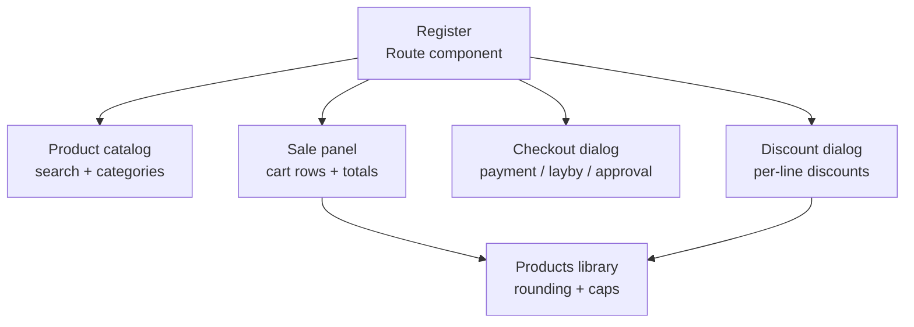
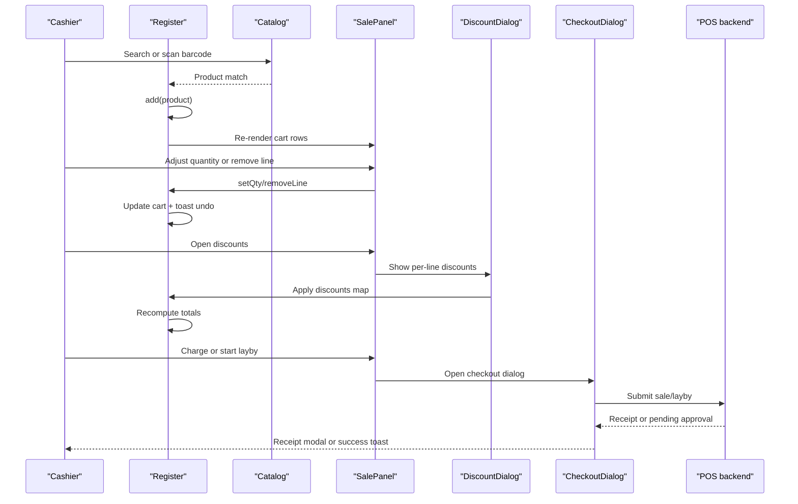
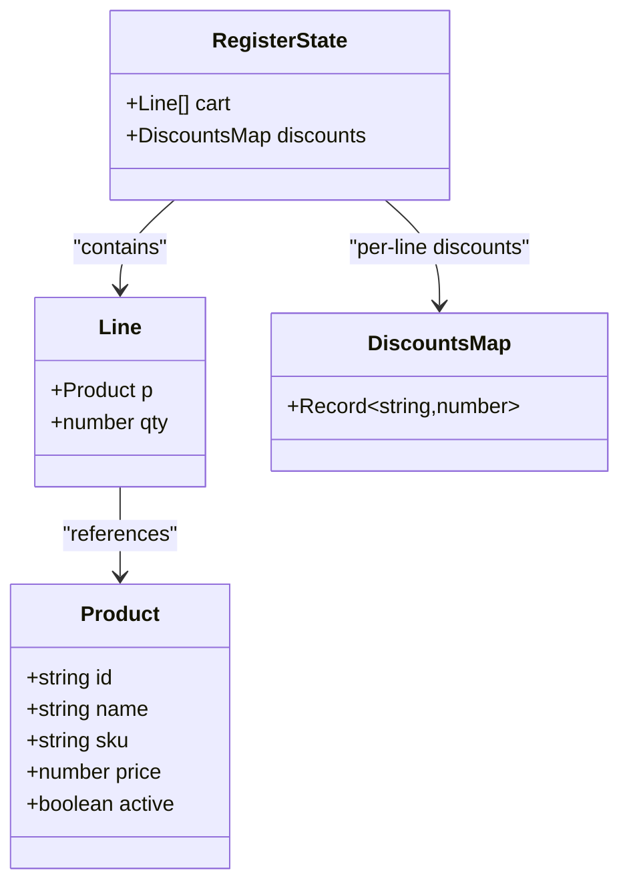
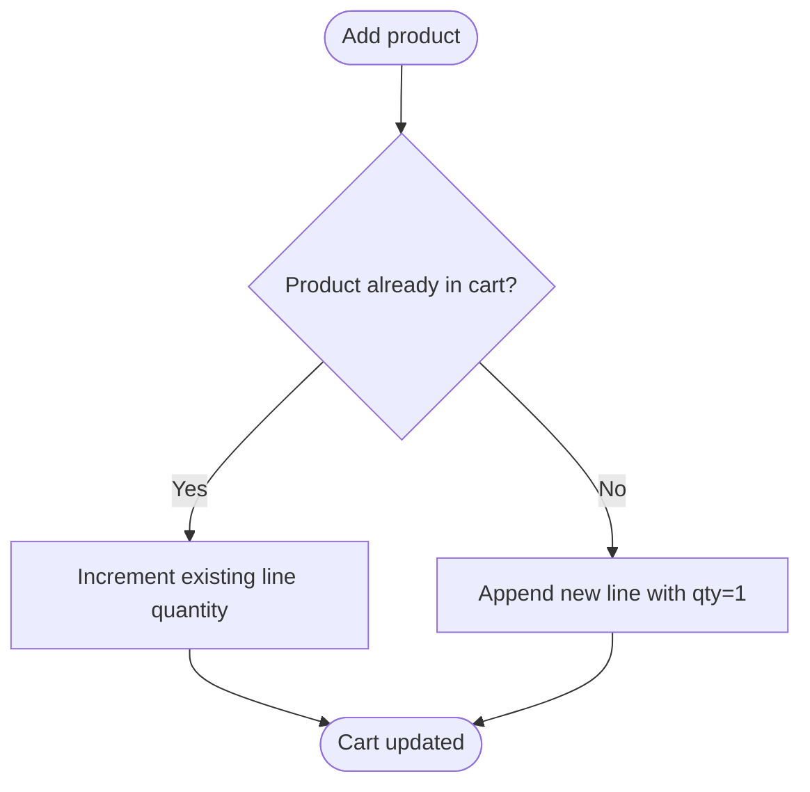
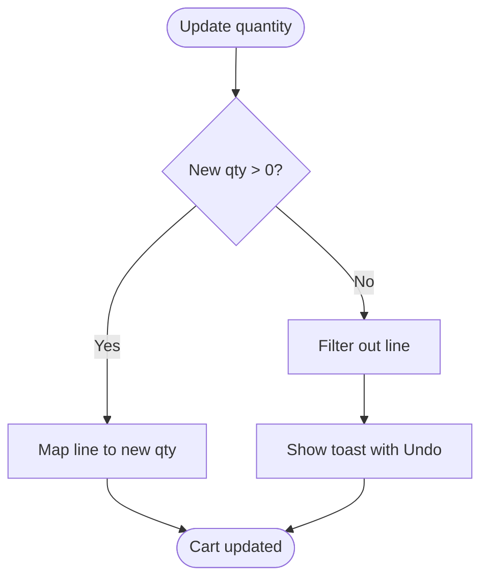
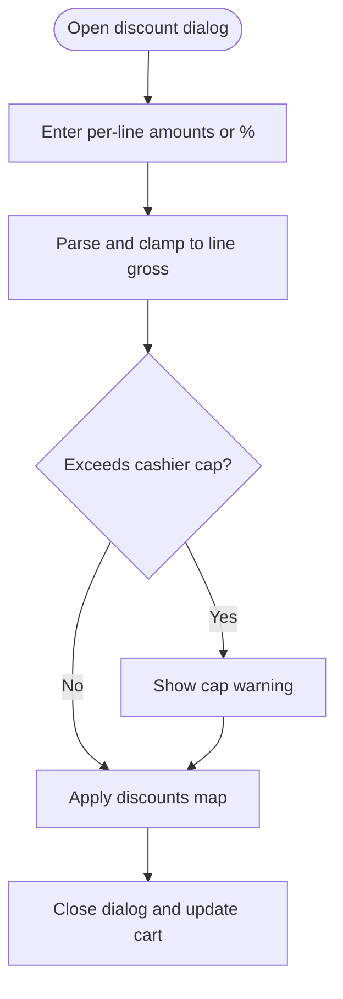
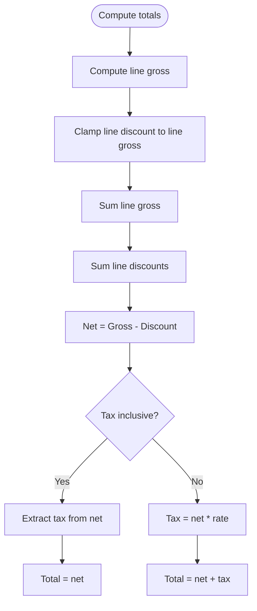
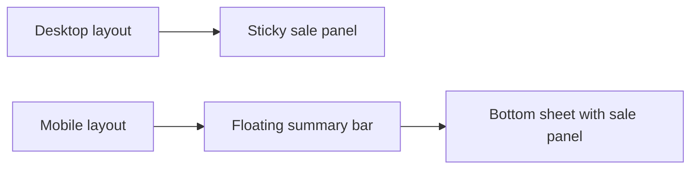
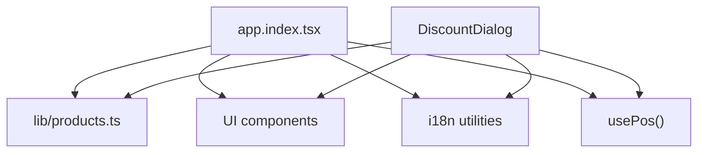

# Cart Management

<cite>
**Referenced Files in This Document**
- [app.index.tsx](file://src/routes/_authenticated/app.index.tsx)
- [DiscountDialog.tsx](file://src/components/pos/DiscountDialog.tsx)
- [products.ts](file://src/lib/products.ts)
</cite>

## Table of Contents
1. [Introduction](#introduction)
2. [Project Structure](#project-structure)
3. [Core Components](#core-components)
4. [Architecture Overview](#architecture-overview)
5. [Detailed Component Analysis](#detailed-component-analysis)
6. [Dependency Analysis](#dependency-analysis)
7. [Performance Considerations](#performance-considerations)
8. [Troubleshooting Guide](#troubleshooting-guide)
9. [Conclusion](#conclusion)

## Introduction
This document explains the POS register cart management implementation. It covers the cart state model, product addition and duplicate handling, quantity updates, line removal, full cart clearing, undo behavior with toast notifications, per-line discount application and validation, tax computation for inclusive and exclusive modes, final total calculation, and mobile-responsive presentation using a bottom sheet versus a desktop sticky panel. Practical examples illustrate state transitions, discount calculations, and error handling scenarios.

## Project Structure
The POS register is implemented as a single route component that owns the cart state and renders:
- A product catalog area with search and category filtering.
- A sale panel representing the current cart.
- A checkout dialog for payment or layby/invoice workflows.
- A discount dialog for per-line discounts.
- Mobile-specific bottom-sheet presentation of the sale panel.

**Diagram sources**
- [app.index.tsx:111-598](file://src/routes/_authenticated/app.index.tsx#L111-L598)
- [app.index.tsx:610-770](file://src/routes/_authenticated/app.index.tsx#L610-L770)
- [app.index.tsx:780-1075](file://src/routes/_authenticated/app.index.tsx#L780-L1075)
- [DiscountDialog.tsx:29-184](file://src/components/pos/DiscountDialog.tsx#L29-L184)
- [products.ts:66-80](file://src/lib/products.ts#L66-L80)

**Section sources**
- [app.index.tsx:71-85](file://src/routes/_authenticated/app.index.tsx#L71-L85)
- [app.index.tsx:111-150](file://src/routes/_authenticated/app.index.tsx#L111-L150)

## Core Components
- Register route component: owns cart state, discount state, UI orchestration, barcode scanning, checkout submission, and responsive layout.
- SalePanel: displays cart lines, quantities, per-line discounts, gross/net values, discount button, VAT summary, and totals.
- DiscountDialog: allows per-line flat discounts, percentage quick-fill, cap warnings, and applies validated amounts back to the cart.
- Products library: provides rounding, discount cap checks, product lookup by barcode, and stock queries.

Key responsibilities:
- Cart state: array of line items with product references and quantities.
- Discounts: per-line numeric discounts stored separately from the cart.
- Calculations: gross subtotal, discount total, net subtotal, tax, and final total.
- Validation: cashier discount caps enforced both in the discount dialog and at checkout.
- Undo: toast notifications with revert actions for accidental deletions and cart clears.
- Responsive display: sticky panel on desktop; bottom sheet on mobile/tablet.

**Section sources**
- [app.index.tsx:111-220](file://src/routes/_authenticated/app.index.tsx#L111-L220)
- [app.index.tsx:610-770](file://src/routes/_authenticated/app.index.tsx#L610-L770)
- [DiscountDialog.tsx:29-184](file://src/components/pos/DiscountDialog.tsx#L29-L184)
- [products.ts:60-80](file://src/lib/products.ts#L60-L80)

## Architecture Overview
The register composes several components around a central cart state. The flow below shows how adding a product, applying discounts, computing totals, and completing checkout interact.

**Diagram sources**
- [app.index.tsx:182-220](file://src/routes/_authenticated/app.index.tsx#L182-L220)
- [app.index.tsx:273-355](file://src/routes/_authenticated/app.index.tsx#L273-L355)
- [app.index.tsx:556-578](file://src/routes/_authenticated/app.index.tsx#L556-L578)
- [DiscountDialog.tsx:79-84](file://src/components/pos/DiscountDialog.tsx#L79-L84)

## Detailed Component Analysis

### Cart State Model
The cart is an array of line items where each line contains:
- A product reference object with identifiers and pricing metadata.
- A quantity field indicating how many units are being sold.

Discounts are not stored inside the cart lines but in a separate map keyed by product ID. This separation allows:
- Clear distinction between item quantities and discount amounts.
- Independent reset/clear operations for discounts.
- Per-line discount validation against gross amounts.

Complexity considerations:
- Adding a product scans the cart once to detect duplicates: O(n).
- Updating quantities filters/maps the cart once: O(n).
- Removing a line filters the cart once: O(n).
- Computing totals iterates over all lines: O(n).

**Diagram sources**
- [app.index.tsx:91-123](file://src/routes/_authenticated/app.index.tsx#L91-L123)
- [products.ts:8-17](file://src/lib/products.ts#L8-L17)

**Section sources**
- [app.index.tsx:91-123](file://src/routes/_authenticated/app.index.tsx#L91-L123)
- [products.ts:8-17](file://src/lib/products.ts#L8-L17)

### Adding Products and Duplicate Handling
Adding a product follows this logic:
- If the product already exists in the cart, increment its quantity by one.
- Otherwise, append a new line with quantity one.

Barcode scanning triggers the same add operation, ensuring consistent behavior whether the user taps a tile or scans a code.

**Diagram sources**
- [app.index.tsx:182-187](file://src/routes/_authenticated/app.index.tsx#L182-L187)
- [app.index.tsx:222-231](file://src/routes/_authenticated/app.index.tsx#L222-L231)

**Section sources**
- [app.index.tsx:182-187](file://src/routes/_authenticated/app.index.tsx#L182-L187)
- [app.index.tsx:222-231](file://src/routes/_authenticated/app.index.tsx#L222-L231)

### Updating Quantities and Removing Lines
Quantity updates:
- Increase or decrease quantity via stepper controls.
- When quantity reaches zero, the line is removed instead of keeping a zero-quantity entry.

Removal:
- Explicitly removing a line removes it from the cart immediately.
- A toast notification appears with an “Undo” action that restores the removed line if the user confirms.

Clearing the cart:
- Clears both the cart array and the discount map.
- Shows a toast with an “Undo” action that restores the previous cart snapshot and discount map.

**Diagram sources**
- [app.index.tsx:188-220](file://src/routes/_authenticated/app.index.tsx#L188-L220)

**Section sources**
- [app.index.tsx:188-220](file://src/routes/_authenticated/app.index.tsx#L188-L220)

### Discount Application System
Discounts are applied per line as flat amounts:
- The discount dialog accepts manual amounts per line and a percentage quick-fill option.
- Each line’s discount is clamped to its gross amount (unit price multiplied by quantity).
- For cashiers, discount caps apply:
  - Per-line discount cannot exceed a fixed ratio of the line gross.
  - Total cart discount cannot exceed a fixed ratio of the cart gross.
- If caps are exceeded, the dialog warns and requires manager PIN at checkout.

Validation rules:
- Non-positive or non-numeric inputs are treated as zero.
- Percentages must be positive and no more than 100.
- Applied discounts are rounded to two decimals.

**Diagram sources**
- [DiscountDialog.tsx:51-84](file://src/components/pos/DiscountDialog.tsx#L51-L84)
- [DiscountDialog.tsx:115-152](file://src/components/pos/DiscountDialog.tsx#L115-L152)
- [products.ts:66-80](file://src/lib/products.ts#L66-L80)

**Section sources**
- [DiscountDialog.tsx:29-184](file://src/components/pos/DiscountDialog.tsx#L29-L184)
- [products.ts:66-80](file://src/lib/products.ts#L66-L80)

### Cart Calculations: Gross, Discounts, Tax, and Final Total
Calculations are recomputed on every render based on the current cart and discounts:
- Line gross: quantity multiplied by effective product price.
- Line discount: minimum of configured discount and line gross.
- Gross subtotal: sum of all line gross values.
- Discount total: sum of all line discounts.
- Net subtotal: gross subtotal minus discount total.
- Tax rate and inclusive/exclusive mode come from business configuration.
- Tax computation:
  - Inclusive mode: extract tax from net subtotal using the configured rate.
  - Exclusive mode: compute tax as a percentage of net subtotal.
- Final total:
  - Inclusive mode: equals net subtotal.
  - Exclusive mode: net subtotal plus tax.

**Diagram sources**
- [app.index.tsx:161-172](file://src/routes/_authenticated/app.index.tsx#L161-L172)

**Section sources**
- [app.index.tsx:161-172](file://src/routes/_authenticated/app.index.tsx#L161-L172)

### Mobile-Responsive Cart Display
The register adapts its layout based on screen size:
- Desktop: the sale panel is rendered inline and made sticky so it remains visible while browsing products.
- Mobile/tablet: a floating summary bar shows item count and total; tapping it opens the sale panel in a bottom sheet.
- The sale panel element is reused across both surfaces to prevent drift between desktop and mobile views.

**Diagram sources**
- [app.index.tsx:516-554](file://src/routes/_authenticated/app.index.tsx#L516-L554)
- [app.index.tsx:610-770](file://src/routes/_authenticated/app.index.tsx#L610-L770)

**Section sources**
- [app.index.tsx:516-554](file://src/routes/_authenticated/app.index.tsx#L516-L554)
- [app.index.tsx:610-770](file://src/routes/_authenticated/app.index.tsx#L610-L770)

### Practical Examples

#### Example 1: Cart State Transitions
Scenario: Add two identical products, increase quantity, remove one line, clear cart, and undo.

- Initial state: empty cart, empty discounts.
- Add product A: cart becomes [{A, qty=1}].
- Add product A again: cart becomes [{A, qty=2}].
- Increase quantity: cart becomes [{A, qty=3}].
- Remove line A: cart becomes [].
- Toast shows “Undo”; clicking it restores line A with qty=3.
- Clear cart: cart remains empty; toast shows “Undo”.
- Clicking “Undo” restores the previous cart snapshot and discount map.

Relevant paths:
- Add/duplicate handling: [app.index.tsx:182-187](file://src/routes/_authenticated/app.index.tsx#L182-L187)
- Quantity update/removal: [app.index.tsx:188-220](file://src/routes/_authenticated/app.index.tsx#L188-L220)

#### Example 2: Discount Calculation
Scenario: One line with unit price 100 and quantity 2. Apply a 15% discount to all lines.

- Line gross: 100 × 2 = 200.
- Percentage discount: 15% of 200 = 30.
- Line discount clamped to line gross: min(30, 200) = 30.
- Gross subtotal: 200.
- Discount total: 30.
- Net subtotal: 200 − 30 = 170.
- With tax inclusive at 18%: tax = 170 − (170 / 1.18) ≈ 23.73; total = 170.
- With tax exclusive at 18%: tax = 170 × 0.18 = 30.60; total = 170 + 30.60 = 200.60.

Relevant paths:
- Percentage quick-fill and clamping: [DiscountDialog.tsx:66-77](file://src/components/pos/DiscountDialog.tsx#L66-L77)
- Totals including tax: [app.index.tsx:161-172](file://src/routes/_authenticated/app.index.tsx#L161-L172)

#### Example 3: Error Handling Scenarios
- Barcode not found: toast error with the scanned code; managers can quickly add the product.
- Cashier discount exceeds cap: dialog warns; checkout requires manager PIN.
- Payment short in split tender: checkout dialog shows remaining due and disables submit until covered.
- Offline sale: checkout returns offline result; cart is cleared and a success toast indicates offline status.

Relevant paths:
- Unknown barcode handling: [app.index.tsx:233-248](file://src/routes/_authenticated/app.index.tsx#L233-L248)
- Discount cap warning: [DiscountDialog.tsx:145-149](file://src/components/pos/DiscountDialog.tsx#L145-L149)
- Checkout validation and offline handling: [app.index.tsx:273-355](file://src/routes/_authenticated/app.index.tsx#L273-L355)

**Section sources**
- [app.index.tsx:182-220](file://src/routes/_authenticated/app.index.tsx#L182-L220)
- [app.index.tsx:233-248](file://src/routes/_authenticated/app.index.tsx#L233-L248)
- [app.index.tsx:273-355](file://src/routes/_authenticated/app.index.tsx#L273-L355)
- [DiscountDialog.tsx:66-77](file://src/components/pos/DiscountDialog.tsx#L66-L77)
- [DiscountDialog.tsx:145-149](file://src/components/pos/DiscountDialog.tsx#L145-L149)

## Dependency Analysis
The register depends on:
- Products library for product data, barcode lookup, rounding, and discount caps.
- UI components for dialogs, buttons, inputs, scroll areas, and sheets.
- i18n utilities for localized strings.
- POS context for store, business, money formatting, permissions, and checkout RPC.

**Diagram sources**
- [app.index.tsx:1-70](file://src/routes/_authenticated/app.index.tsx#L1-L70)
- [DiscountDialog.tsx:1-24](file://src/components/pos/DiscountDialog.tsx#L1-L24)
- [products.ts:1-5](file://src/lib/products.ts#L1-L5)

**Section sources**
- [app.index.tsx:1-70](file://src/routes/_authenticated/app.index.tsx#L1-L70)
- [DiscountDialog.tsx:1-24](file://src/components/pos/DiscountDialog.tsx#L1-L24)
- [products.ts:1-5](file://src/lib/products.ts#L1-L5)

## Performance Considerations
- Catalog caching: the product list is cached for a long period to avoid repeated network calls during register sessions.
- Deferred search: the search term is deferred so input remains responsive while filtered results recompute.
- Live stock polling: stock data is polled periodically on the register to reflect changes from other tills or imports.
- Cheap recalculations: gross, discount, and total computations iterate only over the current cart, which is typically small.
- Memoization: filtered product lists and derived values are memoized to reduce unnecessary re-renders.

[No sources needed since this section provides general guidance]

## Troubleshooting Guide
Common issues and resolutions:
- No matching barcode: verify the SKU normalization and ensure the product is active; managers can use quick-add to create the item.
- Discount blocked for cashier: reduce per-line or total discounts to stay within the allowed ratio, or provide a manager PIN.
- Payment incomplete: ensure cash tendered covers the total when not splitting payments; add additional tenders if splitting.
- Offline sale: confirm offline mode behavior and check that the receipt reflects offline status; inventory adjustments may lag until connectivity resumes.

**Section sources**
- [app.index.tsx:233-248](file://src/routes/_authenticated/app.index.tsx#L233-L248)
- [DiscountDialog.tsx:145-149](file://src/components/pos/DiscountDialog.tsx#L145-L149)
- [app.index.tsx:273-355](file://src/routes/_authenticated/app.index.tsx#L273-L355)

## Conclusion
The POS register implements robust cart management with clear state separation between line items and discounts. It supports safe duplication handling, reversible deletions, per-line discount application with strict validation, and flexible tax computation for inclusive and exclusive modes. The responsive design ensures a smooth experience on both desktop and mobile devices. By following the documented flows and constraints, operators can confidently manage sales, handle edge cases, and maintain accurate financial calculations.