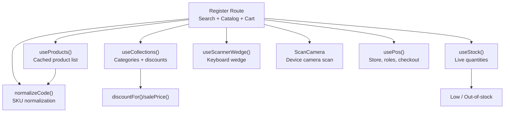
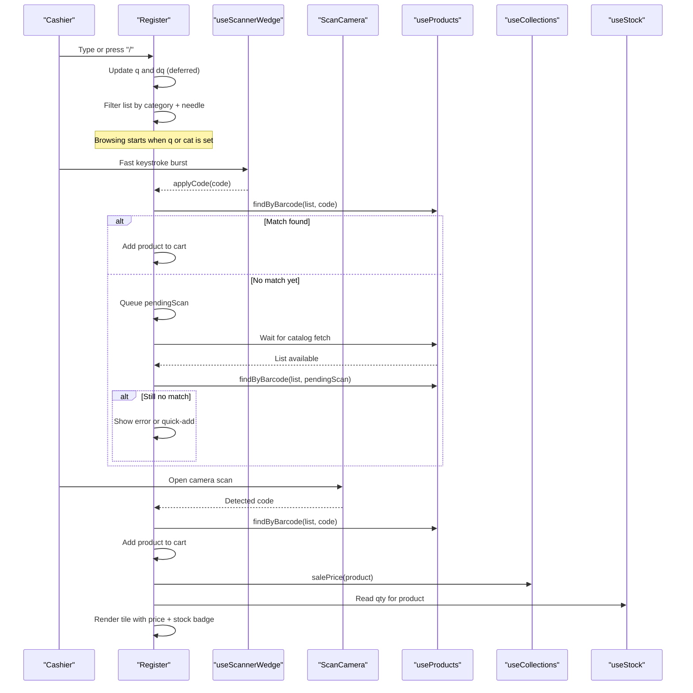
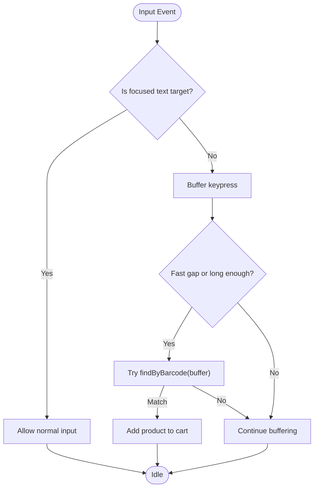
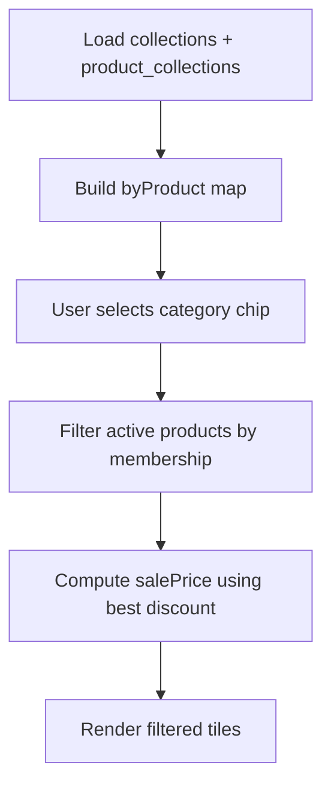
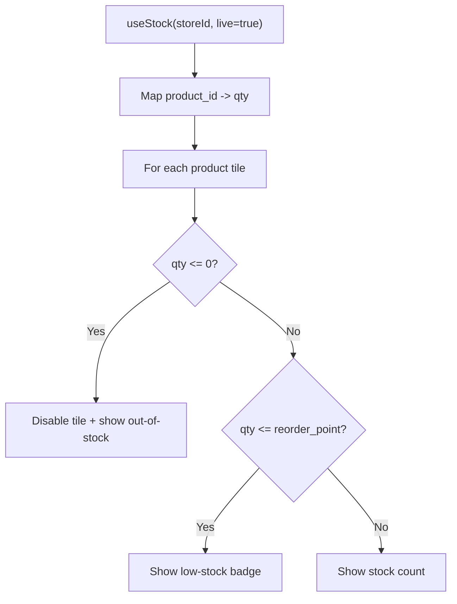
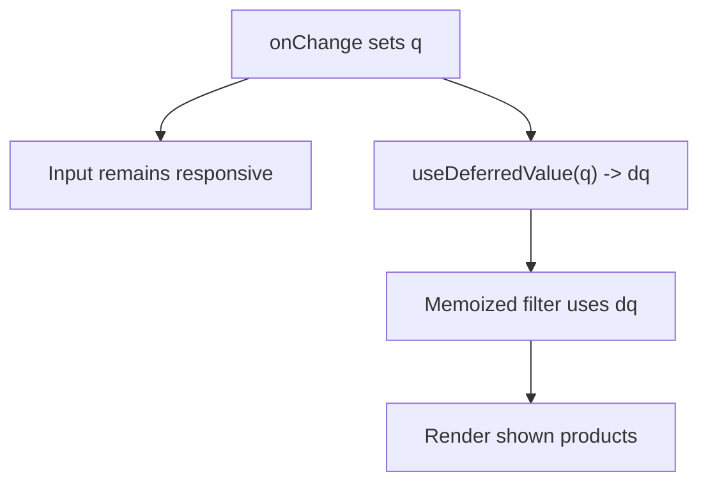
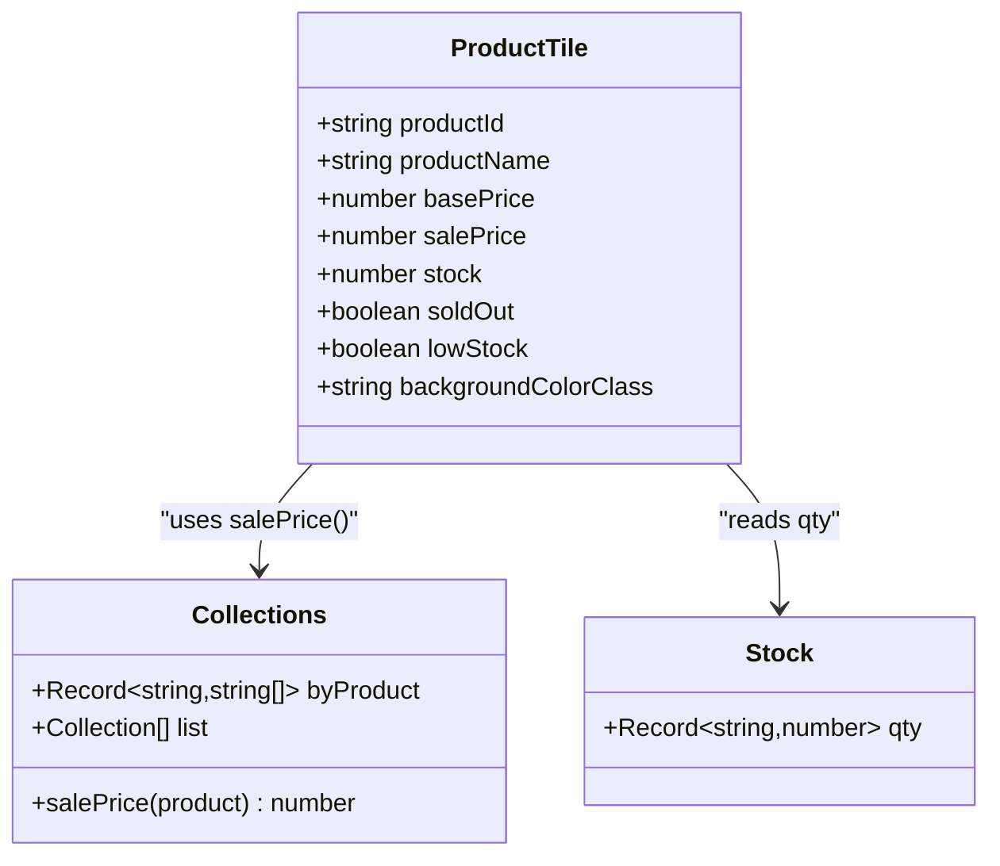
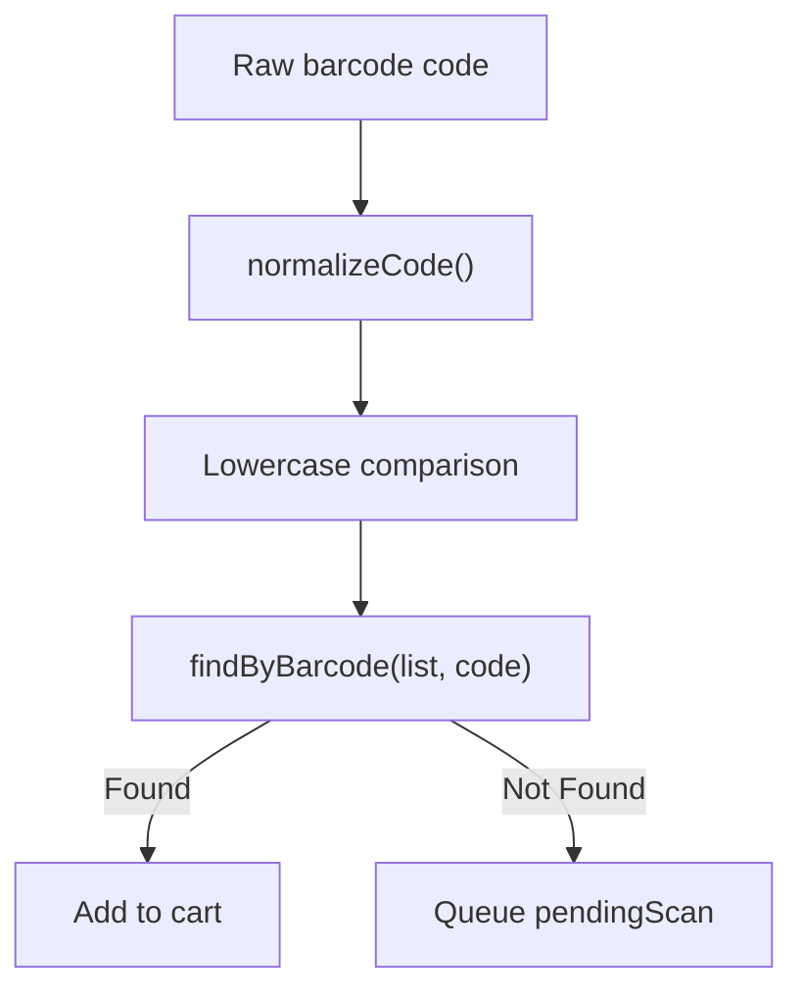
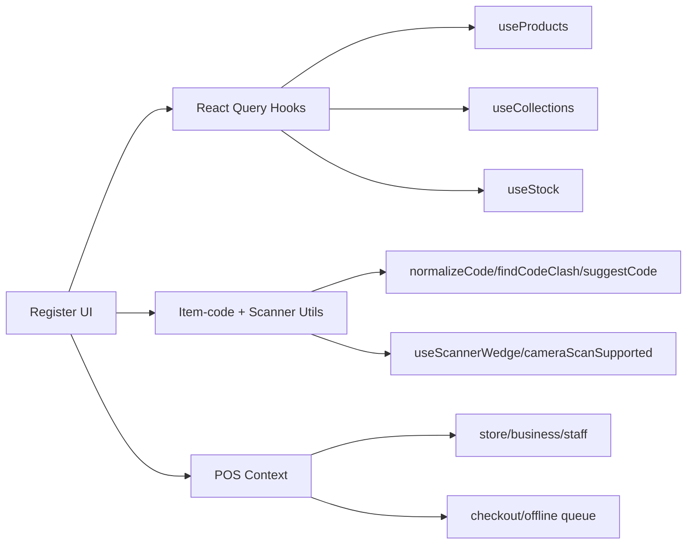

# Product Search & Catalog

<cite>
**Referenced Files in This Document**
- [app.index.tsx](file://src/routes/_authenticated/app.index.tsx)
- [products.ts](file://src/lib/products.ts)
- [collections.ts](file://src/lib/collections.ts)
- [item-codes.ts](file://src/lib/item-codes.ts)
- [use-scanner.ts](file://src/components/pos/use-scanner.ts)
- [ScanCamera.tsx](file://src/components/pos/ScanCamera.tsx)
- [pos.tsx](file://src/lib/pos.tsx)
</cite>

## Table of Contents
1. [Introduction](#introduction)
2. [Project Structure](#project-structure)
3. [Core Components](#core-components)
4. [Architecture Overview](#architecture-overview)
5. [Detailed Component Analysis](#detailed-component-analysis)
6. [Dependency Analysis](#dependency-analysis)
7. [Performance Considerations](#performance-considerations)
8. [Troubleshooting Guide](#troubleshooting-guide)
9. [Conclusion](#conclusion)

## Introduction
This document explains the product search and catalog experience in the POS register. It covers:
- Dual search input: text-based product name/SKU search plus barcode scanning through hardware keyboard wedges and device camera scanning.
- Category filtering by predefined collections, including sale pricing derived from collection discounts.
- Real-time inventory display with stock levels, low-stock warnings, and out-of-stock indicators.
- Deferred search optimization that keeps typing responsive while large catalogs are filtered.
- Product tile rendering with dynamic background colors, sale prices, and availability status.
- Barcode code normalization and performance strategies for large product datasets.

## Project Structure
The register page composes several modules:
- The register route renders the search bar, category chips, product tiles, cart panel, scanner UI, and checkout dialogs.
- Product data is loaded through a long-lived React Query hook.
- Collections provide category metadata and discount calculations.
- Item-code utilities normalize and validate SKU-like identifiers.
- Scanner helpers detect hardware wedge input and optional camera scanning.
- The POS context supplies store, role, money formatting, and offline checkout behavior.

**Diagram sources**
- [app.index.tsx:111-160](file://src/routes/_authenticated/app.index.tsx#L111-L160)
- [products.ts:22-64](file://src/lib/products.ts#L22-L64)
- [collections.ts:15-53](file://src/lib/collections.ts#L15-L53)
- [use-scanner.ts:31-83](file://src/components/pos/use-scanner.ts#L31-L83)
- [ScanCamera.tsx:5-25](file://src/components/pos/ScanCamera.tsx#L5-L25)
- [item-codes.ts:21-24](file://src/lib/item-codes.ts#L21-L24)
- [pos.tsx:115-184](file://src/lib/pos.tsx#L115-L184)

**Section sources**
- [app.index.tsx:71-160](file://src/routes/_authenticated/app.index.tsx#L71-L160)
- [products.ts:1-64](file://src/lib/products.ts#L1-L64)
- [collections.ts:1-53](file://src/lib/collections.ts#L1-L53)
- [use-scanner.ts:1-84](file://src/components/pos/use-scanner.ts#L1-L84)
- [item-codes.ts:1-84](file://src/lib/item-codes.ts#L1-L84)
- [pos.tsx:115-184](file://src/lib/pos.tsx#L115-L184)

## Core Components
- Register route: owns search state, category selection, deferred filtering, pending barcode handling, product tile rendering, and cart operations.
- Product hook: loads active products into a cached query; provides exact barcode lookup against the local catalog.
- Collection hook: loads categories and per-product membership, then computes the best discount and sale price.
- Scanner wedge: detects fast keystroke bursts as barcode input and optionally resolves codes before Enter/Tab.
- Camera scanner: optional Web BarcodeDetector path when supported.
- Item-code utilities: trim, collapse spaces, and case-fold SKUs consistently across search, QR, and matching.
- Stock hook: reads current store quantities, with live polling enabled on the register screen.

**Section sources**
- [app.index.tsx:111-160](file://src/routes/_authenticated/app.index.tsx#L111-L160)
- [products.ts:22-64](file://src/lib/products.ts#L22-L64)
- [collections.ts:15-53](file://src/lib/collections.ts#L15-L53)
- [use-scanner.ts:31-83](file://src/components/pos/use-scanner.ts#L31-L83)
- [item-codes.ts:21-24](file://src/lib/item-codes.ts#L21-L24)
- [products.ts:82-106](file://src/lib/products.ts#L82-L106)

## Architecture Overview
The register implements a dual-input catalog flow:
- Text search updates an immediate state value and a deferred value used to filter the catalog.
- Category chips restrict results to products belonging to selected collections.
- Barcode input is handled by both a keyboard-wedge listener and an optional camera scanner.
- Matching uses normalized SKUs against the cached product list.
- Tiles show dynamic backgrounds, sale prices, and stock status.

**Diagram sources**
- [app.index.tsx:119-160](file://src/routes/_authenticated/app.index.tsx#L119-L160)
- [app.index.tsx:222-248](file://src/routes/_authenticated/app.index.tsx#L222-L248)
- [app.index.tsx:456-513](file://src/routes/_authenticated/app.index.tsx#L456-L513)
- [products.ts:60-64](file://src/lib/products.ts#L60-L64)
- [collections.ts:42-53](file://src/lib/collections.ts#L42-L53)
- [use-scanner.ts:31-83](file://src/components/pos/use-scanner.ts#L31-L83)
- [ScanCamera.tsx:5-25](file://src/components/pos/ScanCamera.tsx#L5-L25)

## Detailed Component Analysis

### Dual Search Mechanism
- Text search:
  - The search input updates `q`. A separate `dq` value is created via `useDeferredValue`, so expensive filtering does not block input.
  - Filtering considers both product names and normalized SKUs.
  - Browsing mode activates only when there is a search term or a selected category, keeping the initial view uncluttered.
- Barcode scanning:
  - Hardware scanners act as keyboard wedges. The hook buffers printable keys and treats rapid bursts as barcode input.
  - Codes can be resolved immediately if they match the current catalog, or queued as `pendingScan` until the catalog finishes loading.
  - Device camera scanning is conditionally shown when the platform supports it.

**Diagram sources**
- [use-scanner.ts:31-83](file://src/components/pos/use-scanner.ts#L31-L83)
- [app.index.tsx:222-248](file://src/routes/_authenticated/app.index.tsx#L222-L248)
- [products.ts:60-64](file://src/lib/products.ts#L60-L64)

**Section sources**
- [app.index.tsx:119-160](file://src/routes/_authenticated/app.index.tsx#L119-L160)
- [app.index.tsx:222-248](file://src/routes/_authenticated/app.index.tsx#L222-L248)
- [use-scanner.ts:1-84](file://src/components/pos/use-scanner.ts#L1-L84)
- [ScanCamera.tsx:5-25](file://src/components/pos/ScanCamera.tsx#L5-L25)

### Category Filtering System
- Categories come from the collections query. Each product may belong to multiple collections.
- The register shows an “All” chip plus one chip per collection. Selecting a chip filters the catalog to products whose IDs appear under that collection’s membership map.
- Sale pricing is computed from the best discount among all collections that include the product.

**Diagram sources**
- [collections.ts:15-39](file://src/lib/collections.ts#L15-L39)
- [collections.ts:42-53](file://src/lib/collections.ts#L42-L53)
- [app.index.tsx:137-160](file://src/routes/_authenticated/app.index.tsx#L137-L160)
- [app.index.tsx:424-439](file://src/routes/_authenticated/app.index.tsx#L424-L439)

**Section sources**
- [collections.ts:15-53](file://src/lib/collections.ts#L15-L53)
- [app.index.tsx:137-160](file://src/routes/_authenticated/app.index.tsx#L137-L160)
- [app.index.tsx:424-439](file://src/routes/_authenticated/app.index.tsx#L424-L439)

### Real-Time Inventory Display
- The register enables live stock polling so badges reflect changes from other tills or imports.
- For each product tile:
  - If quantity is zero, the tile is disabled and shows an out-of-stock indicator.
  - If quantity is greater than zero but less than or equal to the reorder point, a low-stock badge appears.
  - Otherwise, the tile shows the current stock count.

**Diagram sources**
- [products.ts:82-106](file://src/lib/products.ts#L82-L106)
- [app.index.tsx:116-118](file://src/routes/_authenticated/app.index.tsx#L116-L118)
- [app.index.tsx:456-513](file://src/routes/_authenticated/app.index.tsx#L456-L513)

**Section sources**
- [products.ts:82-106](file://src/lib/products.ts#L82-L106)
- [app.index.tsx:116-118](file://src/routes/_authenticated/app.index.tsx#L116-L118)
- [app.index.tsx:456-513](file://src/routes/_authenticated/app.index.tsx#L456-L513)

### Deferred Search Optimization
- The raw search string `q` drives the input field instantly.
- `useDeferredValue(q)` produces `dq`, which is used for filtering. This prevents heavy filtering from blocking user input.
- The catalog is memoized once per render cycle, and filtering runs only when needed.
- Browsing mode is gated by whether the user has typed or selected a category, avoiding unnecessary work on first load.

**Diagram sources**
- [app.index.tsx:138-160](file://src/routes/_authenticated/app.index.tsx#L138-L160)

**Section sources**
- [app.index.tsx:138-160](file://src/routes/_authenticated/app.index.tsx#L138-L160)

### Product Tile Rendering
- Dynamic background color:
  - A deterministic hash of the product name maps to one of several tile background classes.
- Pricing:
  - The displayed unit price is the sale price from collections. If a sale applies, the original price is shown crossed out alongside the discounted price.
- Availability:
  - Sold-out tiles are visually dimmed and disabled.
  - Low-stock tiles show a warning badge.
  - Available tiles show the current stock count.

**Diagram sources**
- [app.index.tsx:87-89](file://src/routes/_authenticated/app.index.tsx#L87-L89)
- [app.index.tsx:456-513](file://src/routes/_authenticated/app.index.tsx#L456-L513)
- [collections.ts:42-53](file://src/lib/collections.ts#L42-L53)
- [products.ts:82-106](file://src/lib/products.ts#L82-L106)

**Section sources**
- [app.index.tsx:87-89](file://src/routes/_authenticated/app.index.tsx#L87-L89)
- [app.index.tsx:456-513](file://src/routes/_authenticated/app.index.tsx#L456-L513)
- [collections.ts:42-53](file://src/lib/collections.ts#L42-L53)

### Barcode Code Normalization
- All barcode-related comparisons use a shared normalization function that trims whitespace and collapses internal space runs.
- Exact matches compare normalized SKUs case-insensitively against the cached product list.
- Generated QR payloads also use the same normalization, ensuring camera scans and keyboard wedges resolve identically.

**Diagram sources**
- [item-codes.ts:21-24](file://src/lib/item-codes.ts#L21-L24)
- [products.ts:60-64](file://src/lib/products.ts#L60-L64)
- [item-codes.ts:76-83](file://src/lib/item-codes.ts#L76-L83)
- [app.index.tsx:222-248](file://src/routes/_authenticated/app.index.tsx#L222-L248)

**Section sources**
- [item-codes.ts:1-84](file://src/lib/item-codes.ts#L1-L84)
- [products.ts:60-64](file://src/lib/products.ts#L60-L64)
- [app.index.tsx:222-248](file://src/routes/_authenticated/app.index.tsx#L222-L248)

## Dependency Analysis
The register depends on several layers:
- UI layer: search input, category chips, product tiles, scanner buttons, and dialogs.
- Data layer: product catalog, collections, and stock queries.
- Utilities: item-code normalization and barcode matching.
- Context: store identity, staff roles, and checkout orchestration.

**Diagram sources**
- [app.index.tsx:111-160](file://src/routes/_authenticated/app.index.tsx#L111-L160)
- [products.ts:22-64](file://src/lib/products.ts#L22-L64)
- [collections.ts:15-53](file://src/lib/collections.ts#L15-L53)
- [use-scanner.ts:1-84](file://src/components/pos/use-scanner.ts#L1-L84)
- [item-codes.ts:1-84](file://src/lib/item-codes.ts#L1-L84)
- [pos.tsx:115-184](file://src/lib/pos.tsx#L115-L184)

**Section sources**
- [app.index.tsx:111-160](file://src/routes/_authenticated/app.index.tsx#L111-L160)
- [products.ts:22-64](file://src/lib/products.ts#L22-L64)
- [collections.ts:15-53](file://src/lib/collections.ts#L15-L53)
- [use-scanner.ts:1-84](file://src/components/pos/use-scanner.ts#L1-L84)
- [item-codes.ts:1-84](file://src/lib/item-codes.ts#L1-L84)
- [pos.tsx:115-184](file://src/lib/pos.tsx#L115-L184)

## Performance Considerations
- Cached catalog:
  - The product list is stored in React Query with a long stale time, so scanning and searching operate against local memory rather than repeatedly hitting the network.
- Deferred filtering:
  - `useDeferredValue` ensures typing remains responsive even when filtering thousands of products.
- Conditional browsing:
  - The full product grid is hidden until the user types or selects a category, reducing initial render cost.
- Live stock polling:
  - Stock is polled at a moderate interval only on the register screen, balancing freshness with network usage.
- Memoization:
  - Active product lists and computed totals are memoized where appropriate to avoid redundant recalculations.
- Barcode matching:
  - Exact matching uses normalized SKUs against the in-memory list, avoiding extra queries.

[No sources needed since this section provides general guidance]

## Troubleshooting Guide
- Barcode does not add items:
  - Verify the code matches a normalized SKU in the active catalog.
  - If the catalog is still loading, the code is queued as `pendingScan` and applied once the list arrives.
  - If no match exists after loading, the register shows an error and offers quick-add for managers.
- Camera scanner not visible:
  - Camera scanning requires platform support for the underlying detector and media devices.
- Tiles do not show stock:
  - Ensure the store is selected and stock query is enabled with live polling on the register.
- Sale price not reflected:
  - Confirm the product belongs to a collection with a discount; the best discount among all applicable collections determines the sale price.
- Search feels slow:
  - Confirm deferred filtering is active and that browsing is gated by search/category selection.
  - Large catalogs should rely on the cached product list rather than repeated network calls.

**Section sources**
- [app.index.tsx:222-248](file://src/routes/_authenticated/app.index.tsx#L222-L248)
- [ScanCamera.tsx:5-25](file://src/components/pos/ScanCamera.tsx#L5-L25)
- [products.ts:82-106](file://src/lib/products.ts#L82-L106)
- [collections.ts:42-53](file://src/lib/collections.ts#L42-L53)
- [app.index.tsx:138-160](file://src/routes/_authenticated/app.index.tsx#L138-L160)

## Conclusion
The POS register implements a robust, responsive product search and catalog system. It combines text search with barcode scanning, category-based browsing, real-time stock visibility, and deferred filtering to keep the interface smooth under large catalogs. Sale pricing from collections and consistent SKU normalization ensure accurate pricing and reliable scanning across hardware and camera inputs.

[No sources needed since this section summarizes without analyzing specific files]