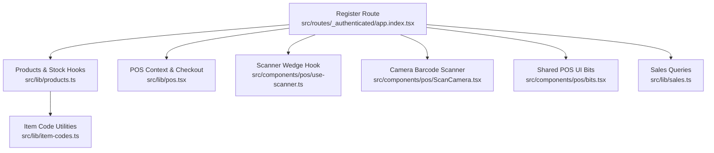
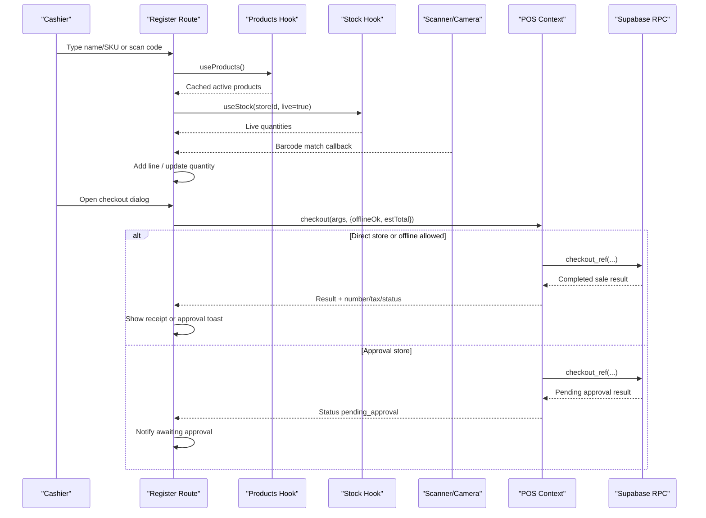
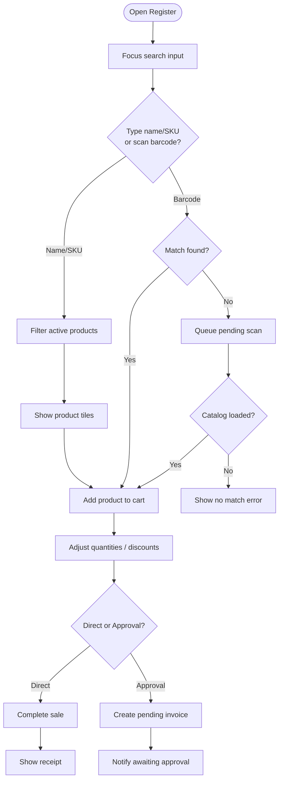
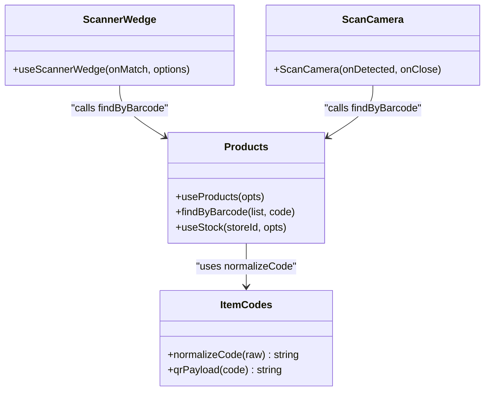
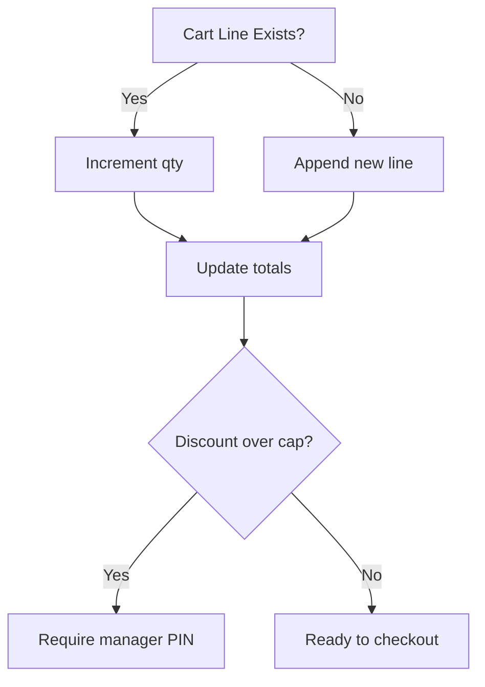
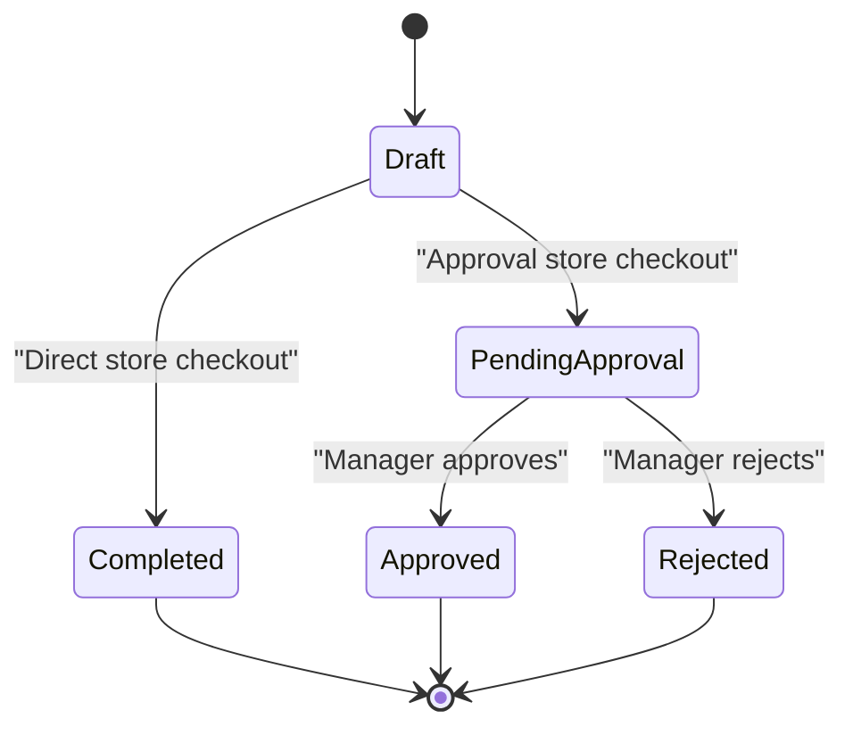
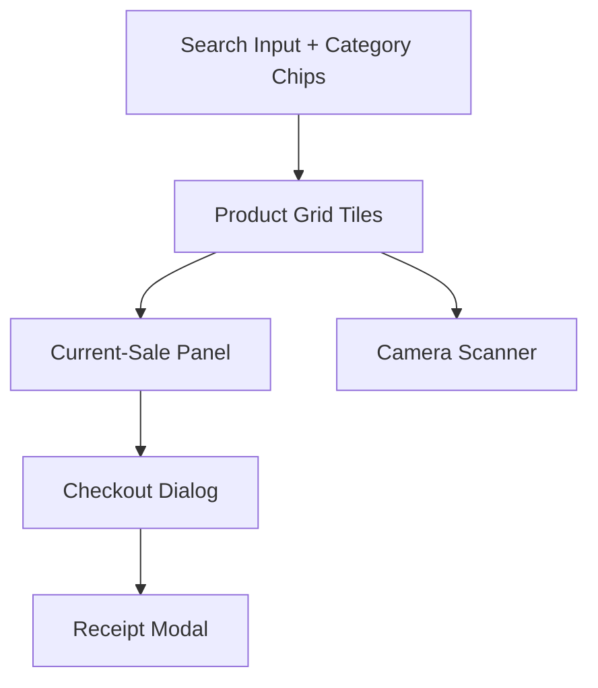
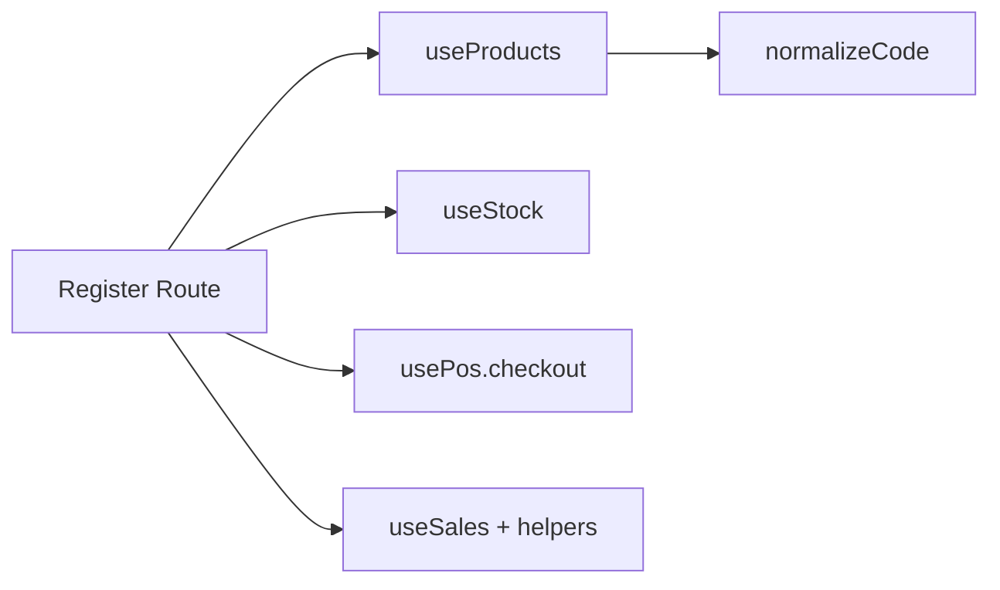

# Register Interface

<cite>
**Referenced Files in This Document**
- [app.index.tsx](file://src/routes/_authenticated/app.index.tsx)
- [Billing.tsx](file://src/components/pos/Billing.tsx)
- [bits.tsx](file://src/components/pos/bits.tsx)
- [ScanCamera.tsx](file://src/components/pos/ScanCamera.tsx)
- [use-scanner.ts](file://src/components/pos/use-scanner.ts)
- [pos.tsx](file://src/lib/pos.tsx)
- [products.ts](file://src/lib/products.ts)
- [sales.ts](file://src/lib/sales.ts)
- [item-codes.ts](file://src/lib/item-codes.ts)
</cite>

## Table of Contents
1. [Introduction](#introduction)
2. [Project Structure](#project-structure)
3. [Core Components](#core-components)
4. [Architecture Overview](#architecture-overview)
5. [Detailed Component Analysis](#detailed-component-analysis)
6. [Dependency Analysis](#dependency-analysis)
7. [Performance Considerations](#performance-considerations)
8. [Troubleshooting Guide](#troubleshooting-guide)
9. [Conclusion](#conclusion)

## Introduction
This document explains the POS register interface used by cashiers to process retail transactions. It covers the complete sales workflow, product search and barcode scanning, cart management, real-time inventory display, checkout flow, receipt handling, and the two store operation modes: direct sales and approval-based workflows. It also documents performance strategies for large catalogs and live stock updates, plus practical examples for common cashier tasks.

## Project Structure
The register is implemented as a single route component that composes UI tiles, a sticky sale panel, discount and checkout dialogs, camera scanning, and integration with the shared POS context. Supporting modules provide products, stock, item codes, sales queries, and role/offline behavior.

**Diagram sources**
- [app.index.tsx:111-597](file://src/routes/_authenticated/app.index.tsx#L111-L597)
- [products.ts:22-106](file://src/lib/products.ts#L22-L106)
- [pos.tsx:275-338](file://src/lib/pos.tsx#L275-L338)
- [use-scanner.ts:31-83](file://src/components/pos/use-scanner.ts#L31-L83)
- [ScanCamera.tsx:57-174](file://src/components/pos/ScanCamera.tsx#L57-L174)
- [bits.tsx:115-129](file://src/components/pos/bits.tsx#L115-L129)
- [sales.ts:37-73](file://src/lib/sales.ts#L37-L73)
- [item-codes.ts:21-24](file://src/lib/item-codes.ts#L21-L24)

**Section sources**
- [app.index.tsx:71-85](file://src/routes/_authenticated/app.index.tsx#L71-L85)
- [pos.tsx:46-84](file://src/lib/pos.tsx#L46-L84)

## Core Components
- Register route: main UI for searching products, scanning barcodes, managing the cart, applying discounts, and completing sales or layby invoices.
- POS context: provides business/store data, staff roles, currency formatting, online/offline status, queued offline sales, and the `checkout` RPC wrapper.
- Products and stock hooks: load an in-memory catalog and per-store stock levels; include barcode exact-match lookup and discount cap helpers.
- Scanner utilities: hardware scanner wedge detection and optional camera-based barcode scanning.
- Shared UI bits: reusable components such as status badges and store type tags.
- Sales queries: list, summary, paging, and export helpers for post-sale reporting.

Key responsibilities:
- Product search filters by name and normalized SKU.
- Cart add/remove/quantity change with undo support.
- Real-time stock badges and disabled out-of-stock tiles.
- Two-mode checkout: immediate payment (direct stores) or invoice creation requiring manager approval (approval stores).
- Receipt generation for completed sales and laybys.

**Section sources**
- [app.index.tsx:111-597](file://src/routes/_authenticated/app.index.tsx#L111-L597)
- [pos.tsx:115-247](file://src/lib/pos.tsx#L115-L247)
- [products.ts:22-106](file://src/lib/products.ts#L22-L106)
- [use-scanner.ts:31-83](file://src/components/pos/use-scanner.ts#L31-L83)
- [ScanCamera.tsx:57-174](file://src/components/pos/ScanCamera.tsx#L57-L174)
- [bits.tsx:115-129](file://src/components/pos/bits.tsx#L115-L129)
- [sales.ts:37-73](file://src/lib/sales.ts#L37-L73)

## Architecture Overview
The register composes several layers:

- Presentation layer: product grid, search input, category chips, current-sale panel, discount dialog, checkout dialog, receipt modal, camera scanner.
- State layer: React state for query, category filter, cart lines, discounts, pending scans, and dialog visibility.
- Data layer: TanStack Query hooks for products, stock, collections, and sales.
- Integration layer: Supabase RPC calls through `usePos().rpc` and `checkout`, with offline queuing and background sync.

**Diagram sources**
- [app.index.tsx:222-355](file://src/routes/_authenticated/app.index.tsx#L222-L355)
- [pos.tsx:275-338](file://src/lib/pos.tsx#L275-L338)
- [products.ts:22-106](file://src/lib/products.ts#L22-L106)
- [use-scanner.ts:31-83](file://src/components/pos/use-scanner.ts#L31-L83)
- [ScanCamera.tsx:57-174](file://src/components/pos/ScanCamera.tsx#L57-L174)

## Detailed Component Analysis

### Register Route and Main Sales Workflow
The register route implements the full cashier workflow:

- Search and browse:
  - Text input supports typing product names or SKUs.
  - Category chips filter by collection membership.
  - Browsing is lazy: product tiles appear only when there is a search term or selected category.
- Barcode scanning:
  - Hardware scanners are detected via a keystroke-burst heuristic and resolved against the cached catalog.
  - Camera scanning uses the browser BarcodeDetector API when available.
  - Unknown codes can be quickly added by managers/cashiers with permission.
- Cart management:
  - Add duplicates increment quantity.
  - Increase/decrease quantity or remove lines.
  - Clearing the cart shows an undo action.
  - Per-line discounts are capped at 10% for cashiers without manager PIN.
- Checkout:
  - For direct stores, completes immediately and shows a receipt.
  - For approval stores, creates an invoice with `pending_approval` status and notifies the cashier.
  - Layby invoices are supported similarly to sales.
  - Offline mode queues direct sales locally and retries automatically when back online.

**Diagram sources**
- [app.index.tsx:111-355](file://src/routes/_authenticated/app.index.tsx#L111-L355)
- [app.index.tsx:402-513](file://src/routes/_authenticated/app.index.tsx#L402-L513)
- [app.index.tsx:556-594](file://src/routes/_authenticated/app.index.tsx#L556-L594)

**Section sources**
- [app.index.tsx:111-355](file://src/routes/_authenticated/app.index.tsx#L111-L355)
- [app.index.tsx:402-513](file://src/routes/_authenticated/app.index.tsx#L402-L513)
- [app.index.tsx:556-594](file://src/routes/_authenticated/app.index.tsx#L556-L594)

### Product Search and Barcode Scanning
- Normalized matching:
  - SKUs are trimmed, space-collapsed, and case-insensitive.
  - Exact barcode lookup uses the same normalization to ensure scanner output matches stored codes.
- Scanner wedge:
  - Detects rapid keystroke bursts from hardware scanners.
  - Ignores input inside text fields so normal typing is unaffected.
- Camera scanner:
  - Opens a rear-camera preview and runs BarcodeDetector frames until a recognized code is found.
  - Handles unsupported browsers, missing permissions, and unmatched codes gracefully.

**Diagram sources**
- [item-codes.ts:21-24](file://src/lib/item-codes.ts#L21-L24)
- [products.ts:60-64](file://src/lib/products.ts#L60-L64)
- [use-scanner.ts:31-83](file://src/components/pos/use-scanner.ts#L31-L83)
- [ScanCamera.tsx:57-174](file://src/components/pos/ScanCamera.tsx#L57-L174)

**Section sources**
- [item-codes.ts:1-84](file://src/lib/item-codes.ts#L1-L84)
- [products.ts:60-64](file://src/lib/products.ts#L60-L64)
- [use-scanner.ts:1-84](file://src/components/pos/use-scanner.ts#L1-L84)
- [ScanCamera.tsx:1-175](file://src/components/pos/ScanCamera.tsx#L1-L175)

### Cart Management Operations
- Add product:
  - If already present, increments quantity.
  - Otherwise appends a new line.
- Modify quantity:
  - Decrease to zero removes the line.
  - Remove button explicitly deletes the line.
- Undo actions:
  - Removing a line or clearing the cart offers an undo toast to restore previous state.
- Discounts:
  - Per-line and cart-wide discounts are applied before tax calculation.
  - Cashiers are blocked beyond 10% unless a manager PIN is provided.

**Diagram sources**
- [app.index.tsx:182-220](file://src/routes/_authenticated/app.index.tsx#L182-L220)
- [products.ts:66-80](file://src/lib/products.ts#L66-L80)

**Section sources**
- [app.index.tsx:182-220](file://src/routes/_authenticated/app.index.tsx#L182-L220)
- [products.ts:66-80](file://src/lib/products.ts#L66-L80)

### Store Operation Modes: Direct Sales vs Approval-Based Workflows
- Direct sales:
  - Immediate payment completion.
  - Receipt shown after successful transaction.
  - Offline mode allowed: sales are queued and synced later.
- Approval-based workflows:
  - Cashiers create invoices that enter a `pending_approval` state.
  - Managers/approvers review and approve outside the register.
  - No immediate receipt; success message indicates awaiting approval.

**Diagram sources**
- [bits.tsx:78-129](file://src/components/pos/bits.tsx#L78-L129)
- [app.index.tsx:273-355](file://src/routes/_authenticated/app.index.tsx#L273-L355)

**Section sources**
- [bits.tsx:78-129](file://src/components/pos/bits.tsx#L78-L129)
- [app.index.tsx:273-355](file://src/routes/_authenticated/app.index.tsx#L273-L355)

### User Interface Components
- Product grid display:
  - Responsive tile grid showing product initials, price, and stock indicators.
  - Out-of-stock tiles are disabled; low-stock tiles show a badge.
- Search filters:
  - Free-text search across product names and normalized SKUs.
  - Category chips for quick filtering by collection.
- Current-sale panel:
  - Shows line items, unit prices, per-line discounts, subtotal, VAT, and total.
  - Buttons for adding discounts, charging, and starting layby.
- Checkout dialog:
  - Payment method selection, tendered amount, split payments, customer details, notes, and override PIN.
- Receipt modal:
  - Displays finalized sale or layby details for printing or sharing.

**Diagram sources**
- [app.index.tsx:402-513](file://src/routes/_authenticated/app.index.tsx#L402-L513)
- [app.index.tsx:613-769](file://src/routes/_authenticated/app.index.tsx#L613-L769)
- [app.index.tsx:780-800](file://src/routes/_authenticated/app.index.tsx#L780-L800)
- [ScanCamera.tsx:57-174](file://src/components/pos/ScanCamera.tsx#L57-L174)

**Section sources**
- [app.index.tsx:402-513](file://src/routes/_authenticated/app.index.tsx#L402-L513)
- [app.index.tsx:613-769](file://src/routes/_authenticated/app.index.tsx#L613-L769)
- [app.index.tsx:780-800](file://src/routes/_authenticated/app.index.tsx#L780-L800)
- [ScanCamera.tsx:57-174](file://src/components/pos/ScanCamera.tsx#L57-L174)

### Practical Examples
- Processing a direct sale:
  - Search for a product by name or scan its barcode.
  - Adjust quantity and apply any permitted discount.
  - Choose payment method and complete; receipt appears.
- Creating an approval invoice:
  - Same steps as above, but the store is configured as approval-based.
  - On completion, the system reports the invoice is awaiting approval.
- Handling product lookups:
  - Name search returns partial matches.
  - Barcode scan performs exact normalized SKU matching.
  - Unknown codes prompt a quick-add option for authorized users.
- Managing cart state:
  - Add duplicate items increases quantity.
  - Remove or clear operations offer undo via toast.
  - Discounts exceeding cashier caps require manager PIN.

**Section sources**
- [app.index.tsx:182-220](file://src/routes/_authenticated/app.index.tsx#L182-L220)
- [app.index.tsx:222-355](file://src/routes/_authenticated/app.index.tsx#L222-L355)
- [products.ts:60-80](file://src/lib/products.ts#L60-L80)

## Dependency Analysis
The register depends on several modules:

- `useProducts` loads the active product catalog and optionally buying costs for authorized roles.
- `useStock` fetches per-store stock levels; live polling is enabled on the register screen.
- `findByBarcode` relies on `normalizeCode` for consistent matching.
- `usePos.checkout` wraps RPC calls and handles offline queuing and background sync.
- `useSales` and related helpers power reporting and ledger views.

**Diagram sources**
- [app.index.tsx:111-141](file://src/routes/_authenticated/app.index.tsx#L111-L141)
- [products.ts:22-106](file://src/lib/products.ts#L22-L106)
- [pos.tsx:275-338](file://src/lib/pos.tsx#L275-L338)
- [sales.ts:37-73](file://src/lib/sales.ts#L37-L73)

**Section sources**
- [app.index.tsx:111-141](file://src/routes/_authenticated/app.index.tsx#L111-L141)
- [products.ts:22-106](file://src/lib/products.ts#L22-L106)
- [pos.tsx:275-338](file://src/lib/pos.tsx#L275-L338)
- [sales.ts:37-73](file://src/lib/sales.ts#L37-L73)

## Performance Considerations
- In-memory catalog:
  - The product list is cached for 30 minutes and invalidated explicitly by inventory screens, avoiding repeated network calls during a trading session.
- Lazy browsing:
  - Product tiles are only rendered when a search term or category is active, reducing initial render cost.
- Deferred search:
  - The search term is deferred so the input remains responsive while filtering runs.
- Live stock polling:
  - Stock levels are polled every 30 seconds on the register screen to reflect other tills and CSV imports.
- Discount caps:
  - Simple ratio checks prevent excessive discounts without server round-trips.
- Offline queue:
  - Direct sales are queued locally when offline and retried periodically, preventing lost revenue.

Recommendations:
- Keep the catalog small enough to fit comfortably in memory; pagination is not needed because the register reads all active products once.
- Avoid unnecessary re-renders by keeping cart operations minimal and relying on memoization already present.
- Use category filters to reduce visible tiles when the catalog grows large.
- Monitor stock polling frequency if battery life is a concern on mobile devices.

**Section sources**
- [products.ts:22-53](file://src/lib/products.ts#L22-L53)
- [products.ts:82-106](file://src/lib/products.ts#L82-L106)
- [app.index.tsx:137-160](file://src/routes/_authenticated/app.index.tsx#L137-L160)
- [pos.tsx:249-345](file://src/lib/pos.tsx#L249-L345)

## Troubleshooting Guide
Common issues and resolutions:

- Barcode does not match:
  - Ensure the scanned code matches the product’s normalized SKU exactly.
  - If unknown, managers can quickly add the item using the quick-add flow.
- Camera scanner unavailable:
  - Some browsers do not support BarcodeDetector or block camera access.
  - Fallback to hardware scanner or manual search.
- Out-of-stock items:
  - Tiles are disabled when stock is zero; wait for restock or choose another product.
- Low stock warnings:
  - Items below reorder point show a badge; verify availability before adding to cart.
- Discount blocked:
  - Cashiers cannot exceed 10% discount without a manager PIN.
- Offline sales:
  - Direct sales queue locally; reconnect and sync to finalize.
  - Approval invoices still require network connectivity to create.

**Section sources**
- [app.index.tsx:222-248](file://src/routes/_authenticated/app.index.tsx#L222-L248)
- [app.index.tsx:456-513](file://src/routes/_authenticated/app.index.tsx#L456-L513)
- [app.index.tsx:273-355](file://src/routes/_authenticated/app.index.tsx#L273-L355)
- [ScanCamera.tsx:75-139](file://src/components/pos/ScanCamera.tsx#L75-L139)

## Conclusion
The register interface provides a fast, reliable workflow for retail transactions. It combines a responsive product grid, robust barcode scanning, safe cart operations, and flexible checkout modes for both direct sales and approval-based invoicing. With an in-memory catalog, live stock polling, and offline queuing, it balances performance and resilience. Managers benefit from approval controls and discount safeguards, while cashiers get a streamlined experience optimized for speed and accuracy.