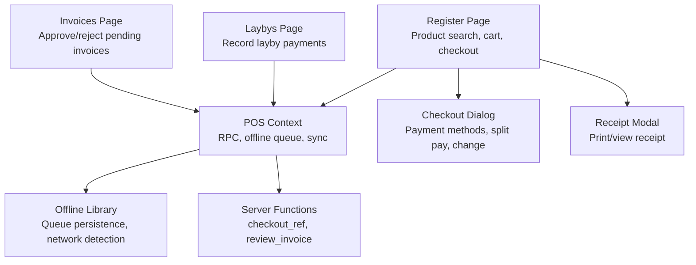
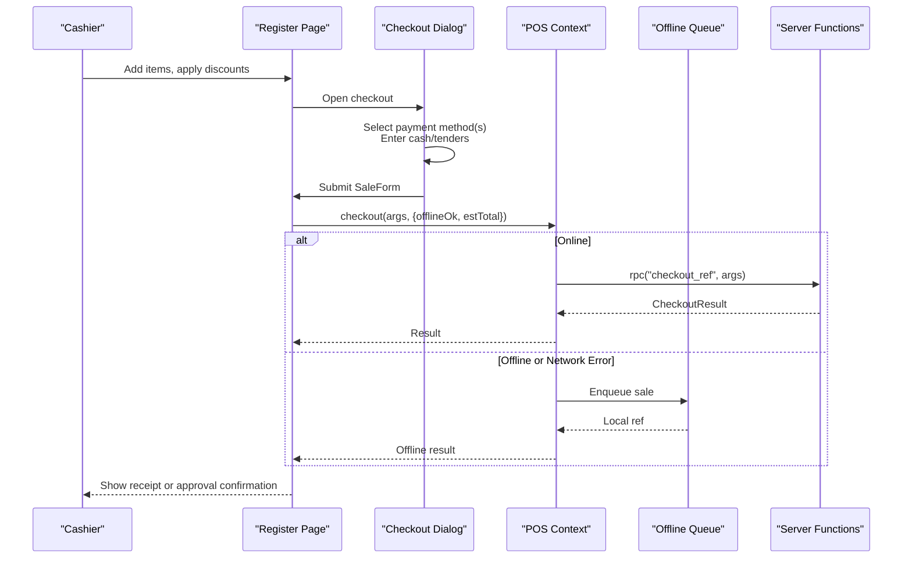
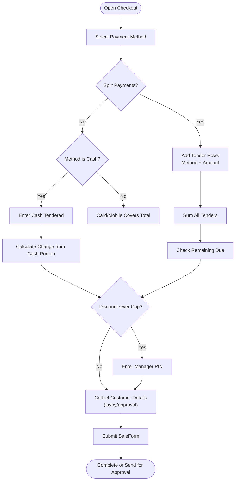
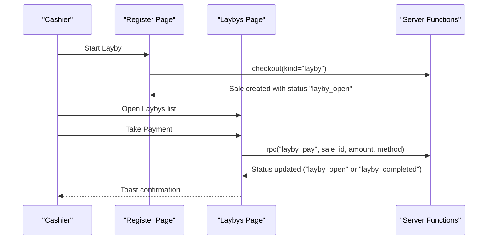
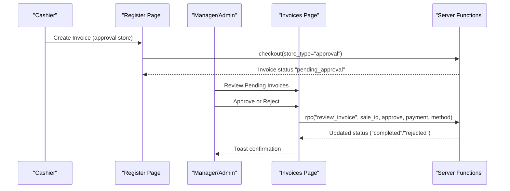
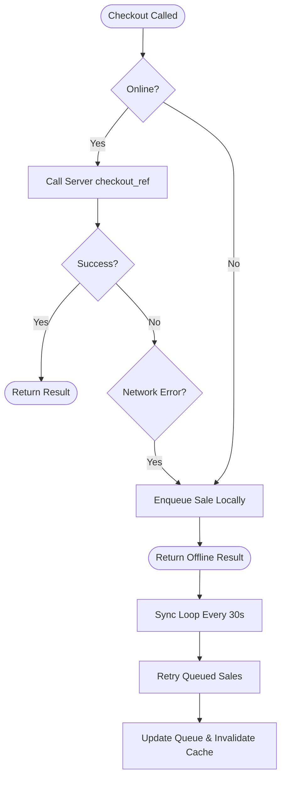
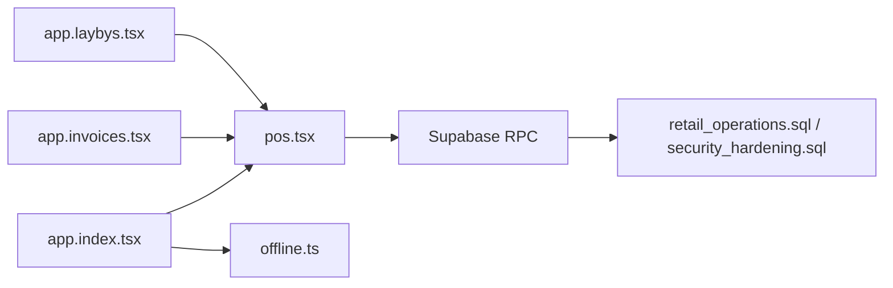

# Transaction Workflows

<cite>
**Referenced Files in This Document**
- [app.index.tsx](file://src/routes/_authenticated/app.index.tsx)
- [pos.tsx](file://src/lib/pos.tsx)
- [offline.ts](file://src/lib/offline.ts)
- [app.invoices.tsx](file://src/routes/_authenticated/app.invoices.tsx)
- [app.laybys.tsx](file://src/routes/_authenticated/app.laybys.tsx)
- [retail_operations.sql](file://supabase/migrations/20261009210500_retail_operations.sql)
- [security_hardening.sql](file://supabase/migrations/20261008090000_security_hardening.sql)
</cite>

## Table of Contents
1. [Introduction](#introduction)
2. [Project Structure](#project-structure)
3. [Core Components](#core-components)
4. [Architecture Overview](#architecture-overview)
5. [Detailed Component Analysis](#detailed-component-analysis)
6. [Dependency Analysis](#dependency-analysis)
7. [Performance Considerations](#performance-considerations)
8. [Troubleshooting Guide](#troubleshooting-guide)
9. [Conclusion](#conclusion)

## Introduction
This document explains the transaction workflows supported by the POS register. It covers:
- Two store operation modes: direct sales and approval-based invoices.
- The checkout flow, including payment method selection, split payments, and cash change calculation.
- Layby transactions for reserving items with partial payments.
- Staff role validation and manager PIN requirements for discounts exceeding caps.
- Offline transaction handling with local queueing and automatic synchronization when connectivity is restored.
- Practical examples for completing direct sales, approval workflows, and offline scenarios.

## Project Structure
The POS register is implemented as a React application with route-based pages and shared business logic:
- Register page handles product search, cart management, discount entry, and checkout dialogs.
- Shared POS context provides authentication, RPC calls, currency formatting, offline queueing, and sync behavior.
- Approval invoice and layby pages manage post-sale workflows.
- Database migrations implement server-side validation, discount caps, status transitions, and approval logic.

**Diagram sources**
- [app.index.tsx:71-85](file://src/routes/_authenticated/app.index.tsx#L71-L85)
- [app.index.tsx:780-1075](file://src/routes/_authenticated/app.index.tsx#L780-L1075)
- [pos.tsx:115-448](file://src/lib/pos.tsx#L115-L448)
- [offline.ts:1-92](file://src/lib/offline.ts#L1-L92)
- [app.invoices.tsx:13-24](file://src/routes/_authenticated/app.invoices.tsx#L13-L24)
- [app.laybys.tsx:14-25](file://src/routes/_authenticated/app.laybys.tsx#L14-L25)

**Section sources**
- [app.index.tsx:71-85](file://src/routes/_authenticated/app.index.tsx#L71-L85)
- [pos.tsx:115-448](file://src/lib/pos.tsx#L115-L448)

## Core Components
- Register page: Builds the cart, computes totals, applies discounts, and opens the checkout dialog. It also supports barcode scanning, quick item addition, and mobile bottom-sheet layout.
- Checkout dialog: Handles payment method selection (cash, card, mobile), split payments, cash tendered input, change display, manager PIN entry for over-cap discounts, and customer details for layby or approval invoices.
- POS context: Provides authenticated RPC calls, money formatting, online/offline state, and an offline queue that persists sales locally and retries them automatically.
- Invoices page: Lists pending invoices for managers/admins to approve or reject; on approval, it can record payment and finalize stock movement.
- Laybys page: Lists open and closed layby plans, allows recording partial payments, and cancels open laybys where permitted.

**Section sources**
- [app.index.tsx:111-355](file://src/routes/_authenticated/app.index.tsx#L111-L355)
- [app.index.tsx:780-1075](file://src/routes/_authenticated/app.index.tsx#L780-L1075)
- [pos.tsx:220-345](file://src/lib/pos.tsx#L220-L345)
- [app.invoices.tsx:26-171](file://src/routes/_authenticated/app.invoices.tsx#L26-L171)
- [app.laybys.tsx:27-201](file://src/routes/_authenticated/app.laybys.tsx#L27-L201)

## Architecture Overview
The system separates UI workflows from server-side enforcement:
- UI components orchestrate user interactions and present feedback.
- The POS context wraps RPC calls and adds offline resilience.
- Server functions enforce business rules such as discount caps, inventory checks, and approval constraints.

**Diagram sources**
- [app.index.tsx:273-355](file://src/routes/_authenticated/app.index.tsx#L273-L355)
- [pos.tsx:275-307](file://src/lib/pos.tsx#L275-L307)
- [offline.ts:71-92](file://src/lib/offline.ts#L71-L92)

## Detailed Component Analysis

### Store Operation Modes
- Direct sales: Immediate completion when the store type is not approval. Payment is recorded at checkout, and the sale status becomes completed.
- Approval-based invoices: When the store type is approval, the cashier creates an invoice that remains pending_approval until a manager or admin approves it. On approval, payment may be recorded and stock is committed.

Key behaviors:
- The register determines mode based on the selected store’s type.
- For approval stores, the “Charge” button sends the invoice for approval rather than completing payment immediately.
- The receipts are shown only for non-pending results; approval invoices show a toast with the invoice number.

**Section sources**
- [app.index.tsx:173-180](file://src/routes/_authenticated/app.index.tsx#L173-L180)
- [app.index.tsx:324-351](file://src/routes/_authenticated/app.index.tsx#L324-L351)
- [pos.tsx:46-53](file://src/lib/pos.tsx#L46-L53)

### Checkout Process Flow
The checkout dialog supports:
- Payment method selection: cash, card, mobile.
- Split payments: multiple tenders with individual amounts.
- Cash tendered input with suggested note amounts.
- Change calculation for cash transactions.
- Manager PIN entry when discounts exceed caps.
- Customer name and phone fields for layby and approval invoices.
- Optional notes for approvers in approval mode.

Change calculation:
- Only the cash portion beyond what other tenders cover contributes to change.
- Layby transactions do not return change; they record the deposit paid now.

Split payment validation:
- If splitting is used, the sum of all tenders must cover the total; otherwise, remaining due is shown and submission is disabled.

Manager PIN requirement:
- If any line discount or the overall cart discount exceeds configured caps for a cashier, a manager PIN is required before submission.

**Diagram sources**
- [app.index.tsx:780-1075](file://src/routes/_authenticated/app.index.tsx#L780-L1075)
- [app.index.tsx:103-109](file://src/routes/_authenticated/app.index.tsx#L103-L109)

**Section sources**
- [app.index.tsx:780-1075](file://src/routes/_authenticated/app.index.tsx#L780-L1075)
- [app.index.tsx:103-109](file://src/routes/_authenticated/app.index.tsx#L103-L109)

### Layby Transaction Workflow
Layby allows customers to reserve items with partial payments:
- From the register, the cashier starts a layby after adding items.
- The layby page lists open and closed laybys, shows progress bars, and allows taking additional payments.
- Payments can be recorded via cash, card, or mobile methods.
- When the accumulated payments reach the total, the layby becomes completed; otherwise, it remains open.

**Diagram sources**
- [app.index.tsx:273-355](file://src/routes/_authenticated/app.index.tsx#L273-L355)
- [app.laybys.tsx:142-201](file://src/routes/_authenticated/app.laybys.tsx#L142-L201)

**Section sources**
- [app.laybys.tsx:27-201](file://src/routes/_authenticated/app.laybys.tsx#L27-L201)

### Approval-Based Invoice Workflow
Approval workflows require a second person to review and approve invoices:
- Cashiers create invoices in approval stores; these remain pending_approval.
- Managers/admins view pending invoices, can reject or approve them.
- On approval, payment can be recorded and stock is validated before finalizing.

**Diagram sources**
- [app.index.tsx:324-351](file://src/routes/_authenticated/app.index.tsx#L324-L351)
- [app.invoices.tsx:26-171](file://src/routes/_authenticated/app.invoices.tsx#L26-L171)

**Section sources**
- [app.invoices.tsx:26-171](file://src/routes/_authenticated/app.invoices.tsx#L26-L171)

### Staff Role Validation and Discount Caps
Discount validation occurs both in the UI and on the server:
- UI detects whether a cashier has applied discounts exceeding per-line or cart caps and prompts for a manager PIN.
- Server enforces the same rules, requiring a valid manager PIN if caps are exceeded; otherwise, it raises an error.

Validation points:
- UI cap check uses helper functions to determine if any line or the entire cart exceeds 10% thresholds.
- Server function validates cashier role, discount amounts, and verifies manager PIN against hashed values.

**Section sources**
- [app.index.tsx:173-180](file://src/routes/_authenticated/app.index.tsx#L173-L180)
- [app.index.tsx:1015-1026](file://src/routes/_authenticated/app.index.tsx#L1015-L1026)
- [retail_operations.sql:174-185](file://supabase/migrations/20261009210500_retail_operations.sql#L174-L185)
- [security_hardening.sql:82-101](file://supabase/migrations/20261008090000_security_hardening.sql#L82-L101)

### Offline Transaction Handling
Offline handling ensures sales continue even without internet:
- The POS context tracks online/offline state and loads/persists a queue of queued sales.
- When offline or a network error occurs during checkout, the sale is enqueued locally with an estimated total.
- Once connectivity is restored, the system automatically retries queued sales; failed entries are marked with masked errors and can be retried or discarded.

**Diagram sources**
- [pos.tsx:249-345](file://src/lib/pos.tsx#L249-L345)
- [offline.ts:71-92](file://src/lib/offline.ts#L71-L92)

**Section sources**
- [pos.tsx:249-345](file://src/lib/pos.tsx#L249-L345)
- [offline.ts:1-92](file://src/lib/offline.ts#L1-L92)

## Dependency Analysis
The following diagram maps key dependencies between UI components, shared context, and server functions:

**Diagram sources**
- [app.index.tsx:1-1126](file://src/routes/_authenticated/app.index.tsx#L1-L1126)
- [pos.tsx:1-448](file://src/lib/pos.tsx#L1-L448)
- [offline.ts:1-92](file://src/lib/offline.ts#L1-L92)
- [app.invoices.tsx:1-171](file://src/routes/_authenticated/app.invoices.tsx#L1-L171)
- [app.laybys.tsx:1-201](file://src/routes/_authenticated/app.laybys.tsx#L1-L201)
- [retail_operations.sql:174-196](file://supabase/migrations/20261009210500_retail_operations.sql#L174-L196)
- [security_hardening.sql:521-540](file://supabase/migrations/20261008090000_security_hardening.sql#L521-L540)

**Section sources**
- [app.index.tsx:1-1126](file://src/routes/_authenticated/app.index.tsx#L1-L1126)
- [pos.tsx:1-448](file://src/lib/pos.tsx#L1-L448)
- [offline.ts:1-92](file://src/lib/offline.ts#L1-L92)
- [app.invoices.tsx:1-171](file://src/routes/_authenticated/app.invoices.tsx#L1-L171)
- [app.laybys.tsx:1-201](file://src/routes/_authenticated/app.laybys.tsx#L1-L201)
- [retail_operations.sql:174-196](file://supabase/migrations/20261009210500_retail_operations.sql#L174-L196)
- [security_hardening.sql:521-540](file://supabase/migrations/20261008090000_security_hardening.sql#L521-L540)

## Performance Considerations
- Catalog browsing is optimized by lazy loading tiles and deferring search filtering to avoid blocking the UI.
- Stock quantities are refreshed live to prevent overselling across devices.
- Money formatting and currency symbol usage are centralized to reduce redundant computations.
- Offline queue persistence is debounced to minimize localStorage writes.
- Auto-lock reduces idle session risks without interfering with active syncing.

[No sources needed since this section provides general guidance]

## Troubleshooting Guide
Common issues and resolutions:
- Wrong manager PIN for discounts: Ensure the entered PIN matches an active admin or manager account; the server validates the hash and rejects incorrect values.
- Not enough stock on approval: Approval requires sufficient inventory; resolve stock shortages before approving.
- Offline sales not syncing: Verify connectivity and ensure the staff session is unlocked; use the sync banner to retry manually.
- Failed queued sales: Inspect the error message in the offline banner; retry or discard as appropriate.

**Section sources**
- [retail_operations.sql:174-185](file://supabase/migrations/20261009210500_retail_operations.sql#L174-L185)
- [security_hardening.sql:521-540](file://supabase/migrations/20261008090000_security_hardening.sql#L521-L540)
- [pos.tsx:389-433](file://src/lib/pos.tsx#L389-L433)

## Conclusion
The POS register supports flexible transaction workflows tailored to different store models. Direct sales provide immediate completion, while approval-based workflows add managerial oversight. The checkout dialog accommodates multiple payment methods, split payments, and accurate change calculation. Layby transactions enable reservation with staged payments. Robust offline support ensures continuity, and server-side validations enforce discount caps and inventory integrity. Together, these features deliver a resilient, user-friendly retail experience.

[No sources needed since this section summarizes without analyzing specific files]