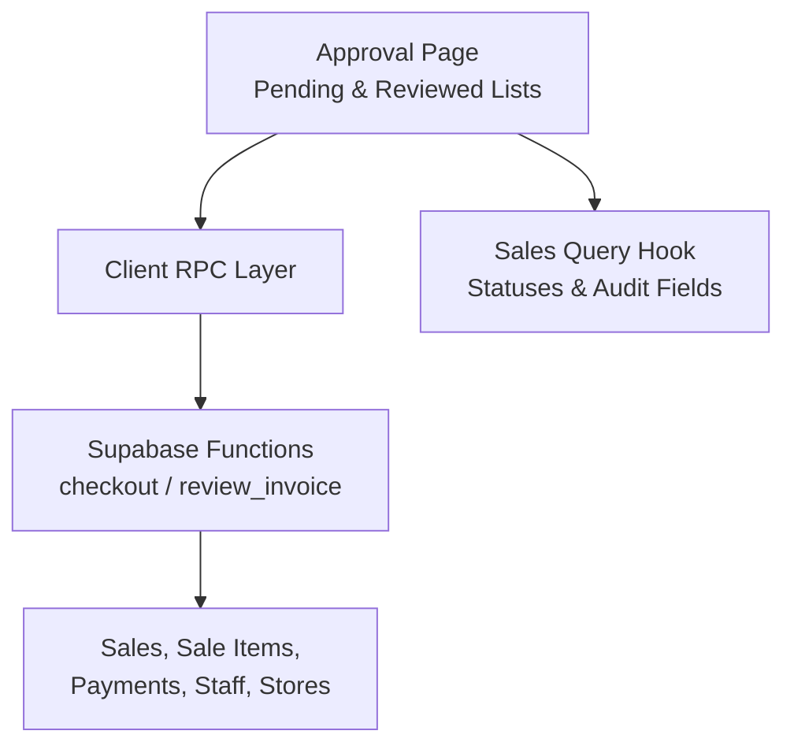
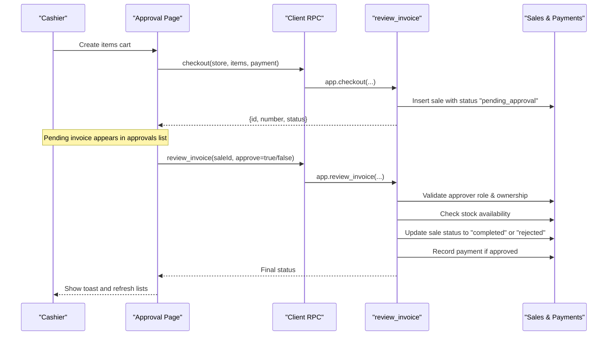
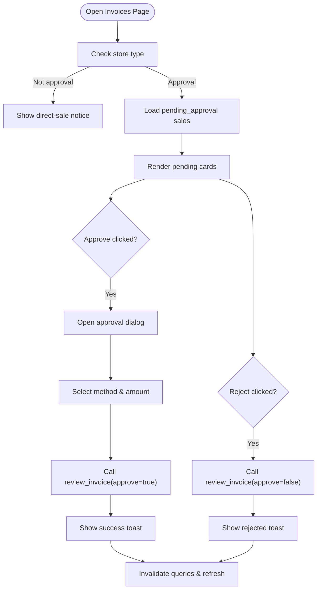
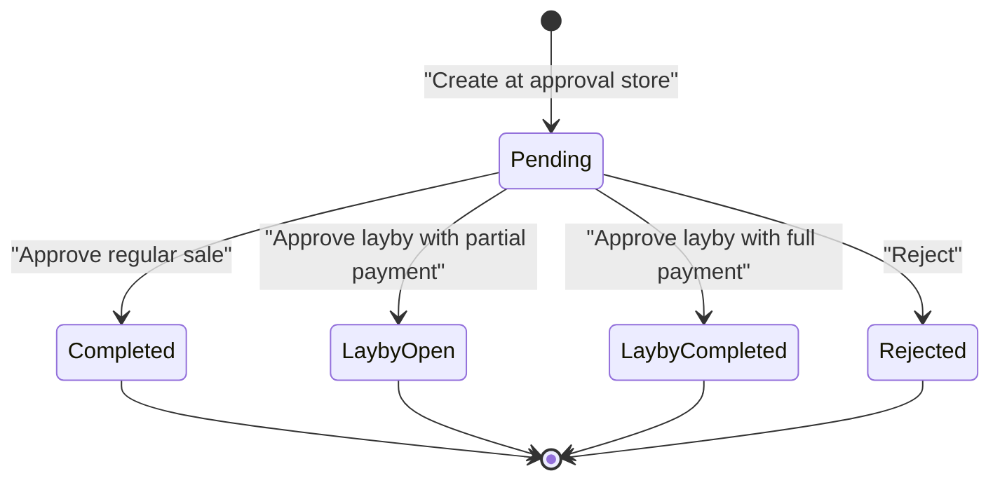
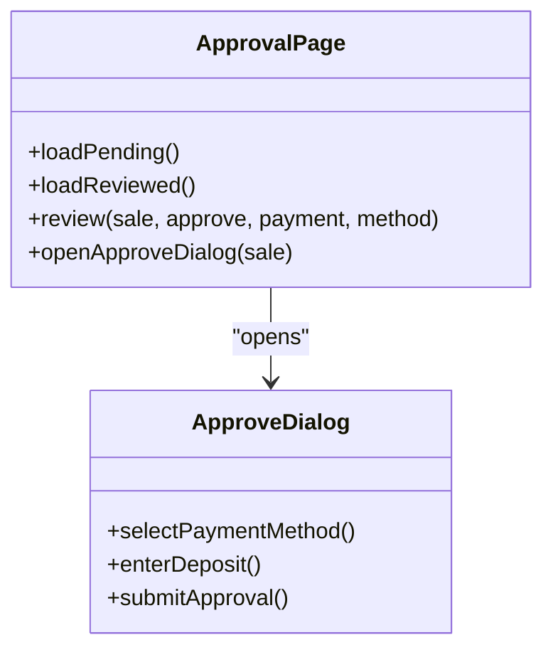
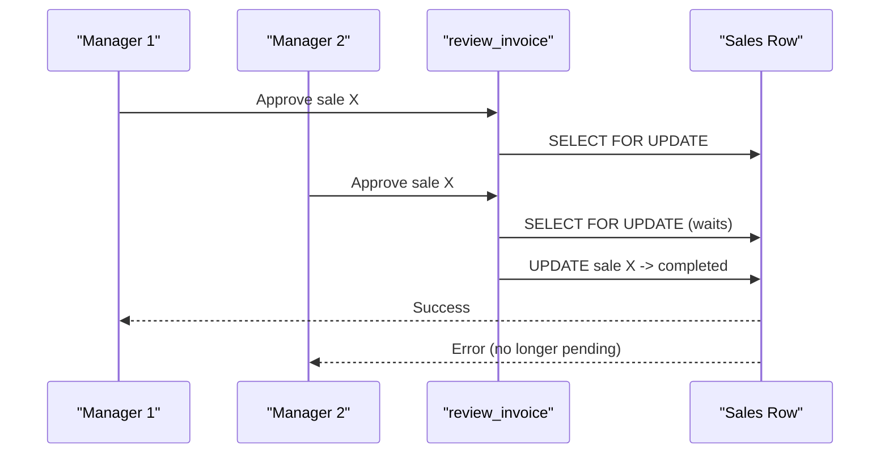
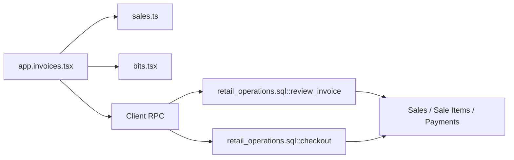

# Approval-Based Transactions

<cite>
**Referenced Files in This Document**   
- [README.md](file://README.md)
- [app.invoices.tsx](file://src/routes/_authenticated/app.invoices.tsx)
- [sales.ts](file://src/lib/sales.ts)
- [bits.tsx](file://src/components/pos/bits.tsx)
- [retail_operations.sql](file://supabase/migrations/20261009210500_retail_operations.sql)
</cite>

## Table of Contents
1. [Introduction](#introduction)
2. [Project Structure](#project-structure)
3. [Core Components](#core-components)
4. [Architecture Overview](#architecture-overview)
5. [Detailed Component Analysis](#detailed-component-analysis)
6. [Dependency Analysis](#dependency-analysis)
7. [Performance Considerations](#performance-considerations)
8. [Troubleshooting Guide](#troubleshooting-guide)
9. [Conclusion](#conclusion)

## Introduction
This document explains the approval-based transaction workflow where cashiers create invoices that require manager or admin approval before they become final. The system supports two store modes: direct sales and approval-based sales. In approval mode, a cashier creates a pending sale, and an approver reviews it and either approves or rejects it.

The project’s README confirms the business goal: stores can be direct-sale or approval-based, with cashiers creating invoices and other users approving them. The implementation uses a React frontend for the approval interface and Supabase server-side functions for secure state transitions, stock checks, payment recording, and audit fields.

**Section sources**
- [README.md:1-5](file://README.md#L1-L5)

## Project Structure
The approval workflow spans three main layers:

- Frontend approval page: renders pending invoices, shows recently reviewed transactions, and opens an approval dialog.
- Data layer: reads sales rows, including approval-related fields such as `approved_by` and `approved_at`.
- Backend RPCs: enforce permissions, validate stock, compute totals, record payments, and transition invoice states.

**Diagram sources**
- [app.invoices.tsx:26-171](file://src/routes/_authenticated/app.invoices.tsx#L26-L171)
- [sales.ts:5-35](file://src/lib/sales.ts#L5-L35)
- [retail_operations.sql:108-287](file://supabase/migrations/20261009210500_retail_operations.sql#L108-L287)
- [retail_operations.sql:322-406](file://supabase/migrations/20261009210500_retail_operations.sql#L322-L406)

**Section sources**
- [app.invoices.tsx:1-221](file://src/routes/_authenticated/app.invoices.tsx#L1-L221)
- [sales.ts:1-217](file://src/lib/sales.ts#L1-L217)
- [retail_operations.sql:108-287](file://supabase/migrations/20261009210500_retail_operations.sql#L108-L287)
- [retail_operations.sql:322-406](file://supabase/migrations/20261009210500_retail_operations.sql#L322-L406)

## Core Components
- Approval page component: loads pending and reviewed sales, exposes approve/reject actions, and renders an approval dialog.
- Sales query hook: defines the sale data model, including approval audit fields, and fetches filtered sales by status.
- Status helpers: provide visual badges and labels for statuses like “Awaiting approval” and “Rejected”.
- Backend checkout function: creates sales and sets initial status based on store configuration.
- Backend review function: enforces manager/admin-only approval, validates stock, records payment, and updates status.

Key responsibilities:
- Cashier role: allowed to create sales; in approval stores, sales are created with a pending state.
- Manager/admin role: allowed to review and finalize or reject pending sales.
- Store configuration: determines whether a sale is immediate or requires approval.

**Section sources**
- [app.invoices.tsx:26-171](file://src/routes/_authenticated/app.invoices.tsx#L26-L171)
- [sales.ts:5-35](file://src/lib/sales.ts#L5-L35)
- [bits.tsx:78-109](file://src/components/pos/bits.tsx#L78-L109)
- [retail_operations.sql:108-287](file://supabase/migrations/20261009210500_retail_operations.sql#L108-L287)
- [retail_operations.sql:322-406](file://supabase/migrations/20261009210500_retail_operations.sql#L322-L406)

## Architecture Overview
The approval workflow follows a clear two-step process:

1. Cashier creates a pending sale at an approval-type store.
2. Manager or admin reviews the pending sale and approves or rejects it.

**Diagram sources**
- [app.invoices.tsx:39-57](file://src/routes/_authenticated/app.invoices.tsx#L39-L57)
- [retail_operations.sql:108-287](file://supabase/migrations/20261009210500_retail_operations.sql#L108-L287)
- [retail_operations.sql:322-406](file://supabase/migrations/20261009210500_retail_operations.sql#L322-L406)

## Detailed Component Analysis

### Approval Page Workflow
The approval page:
- Loads pending sales with status `pending_approval`.
- Loads recently reviewed sales with statuses `rejected`, `completed`, `layby_open`, and `layby_completed`.
- Shows approve and reject buttons only for approvers (admin or manager).
- Prevents self-approval unless the approver is an admin.
- Opens an approval dialog to select payment method and amount.

**Diagram sources**
- [app.invoices.tsx:31-57](file://src/routes/_authenticated/app.invoices.tsx#L31-L57)
- [app.invoices.tsx:115-135](file://src/routes/_authenticated/app.invoices.tsx#L115-L135)
- [app.invoices.tsx:174-220](file://src/routes/_authenticated/app.invoices.tsx#L174-L220)

**Section sources**
- [app.invoices.tsx:26-171](file://src/routes/_authenticated/app.invoices.tsx#L26-L171)
- [app.invoices.tsx:174-220](file://src/routes/_authenticated/app.invoices.tsx#L174-L220)

### State Transitions
The core state machine for approval-based sales:

- Initial creation at an approval-type store: `pending_approval`.
- After manager/admin approval:
  - Regular sale: `completed`.
  - Layby sale with full payment: `layby_completed`.
  - Layby sale with partial payment: `layby_open`.
- After rejection: `rejected`.

**Diagram sources**
- [retail_operations.sql:192-193](file://supabase/migrations/20261009210500_retail_operations.sql#L192-L193)
- [retail_operations.sql:370-385](file://supabase/migrations/20261009210500_retail_operations.sql#L370-L385)

**Section sources**
- [retail_operations.sql:192-193](file://supabase/migrations/20261009210500_retail_operations.sql#L192-L193)
- [retail_operations.sql:370-385](file://supabase/migrations/20261009210500_retail_operations.sql#L370-L385)

### Permission Requirements
- Creating sales: allowed for admin, manager, and cashier roles.
- Reviewing invoices: restricted to admin and manager roles.
- Self-approval protection: a cashier cannot approve their own invoice unless they are also an admin.

These rules are enforced server-side in the checkout and review functions.

**Section sources**
- [retail_operations.sql:116-116](file://supabase/migrations/20261009210500_retail_operations.sql#L116-L116)
- [retail_operations.sql:330-333](file://supabase/migrations/20261009210500_retail_operations.sql#L330-L333)

### Approval Interface
The approval interface includes:
- A pending list showing invoice number, creator, timestamp, line items, customer info, note, and total.
- Approve and Reject buttons for approvers.
- An approval dialog allowing selection of payment method and deposit amount for layby sales.
- Toast notifications for success or error outcomes.

**Diagram sources**
- [app.invoices.tsx:31-57](file://src/routes/_authenticated/app.invoices.tsx#L31-L57)
- [app.invoices.tsx:174-220](file://src/routes/_authenticated/app.invoices.tsx#L174-L220)

**Section sources**
- [app.invoices.tsx:26-171](file://src/routes/_authenticated/app.invoices.tsx#L26-L171)
- [app.invoices.tsx:174-220](file://src/routes/_authenticated/app.invoices.tsx#L174-L220)

### Notification System
- On successful approval or rejection, the UI displays a success toast using localized messages.
- Errors from the backend are shown as error toasts.
- The UI invalidates cached sales queries after each review action to reflect updated statuses immediately.

**Section sources**
- [app.invoices.tsx:39-57](file://src/routes/_authenticated/app.invoices.tsx#L39-L57)

### Audit Trail
The system records who created and who approved each sale:
- `created_by`: staff ID of the cashier who created the sale.
- `approved_by`: staff ID of the manager/admin who approved or rejected the sale.
- `approved_at`: timestamp of the approval or rejection.

These fields are part of the sale row model and are displayed in the recently reviewed section.

**Section sources**
- [sales.ts:5-35](file://src/lib/sales.ts#L5-L35)
- [app.invoices.tsx:143-160](file://src/routes/_authenticated/app.invoices.tsx#L143-L160)
- [retail_operations.sql:384-385](file://supabase/migrations/20261009210500_retail_operations.sql#L384-L385)

### Conflict Resolution for Multiple Managers
- The review function locks the target sale row during processing to prevent concurrent modifications.
- Only one approver can successfully update a given pending sale because the function performs a locked read and then updates the same row.
- If multiple managers attempt to approve simultaneously, only one will succeed; others will receive an error indicating the invoice is no longer awaiting approval.

**Diagram sources**
- [retail_operations.sql:331-336](file://supabase/migrations/20261009210500_retail_operations.sql#L331-L336)

**Section sources**
- [retail_operations.sql:331-336](file://supabase/migrations/20261009210500_retail_operations.sql#L331-L336)

### Integration with Store Configuration
- Store type determines initial sale status:
  - Approval store: sale starts as `pending_approval`.
  - Direct store: sale completes immediately without approval.
- The approval page hides approval controls when the store is not an approval-type store.

**Section sources**
- [retail_operations.sql:192-193](file://supabase/migrations/20261009210500_retail_operations.sql#L192-L193)
- [app.invoices.tsx:59-65](file://src/routes/_authenticated/app.invoices.tsx#L59-L65)

## Dependency Analysis
The approval workflow depends on:
- Frontend components for rendering and user interaction.
- Sales query hooks for loading pending and reviewed sales.
- Backend RPCs for secure state transitions and validation.
- Database tables for sales, sale items, payments, staff, and stores.

**Diagram sources**
- [app.invoices.tsx:1-221](file://src/routes/_authenticated/app.invoices.tsx#L1-L221)
- [sales.ts:1-217](file://src/lib/sales.ts#L1-L217)
- [bits.tsx:1-140](file://src/components/pos/bits.tsx#L1-L140)
- [retail_operations.sql:108-287](file://supabase/migrations/20261009210500_retail_operations.sql#L108-L287)
- [retail_operations.sql:322-406](file://supabase/migrations/20261009210500_retail_operations.sql#L322-L406)

**Section sources**
- [app.invoices.tsx:1-221](file://src/routes/_authenticated/app.invoices.tsx#L1-L221)
- [sales.ts:1-217](file://src/lib/sales.ts#L1-L217)
- [bits.tsx:1-140](file://src/components/pos/bits.tsx#L1-L140)
- [retail_operations.sql:108-287](file://supabase/migrations/20261009210500_retail_operations.sql#L108-L287)
- [retail_operations.sql:322-406](file://supabase/migrations/20261009210500_retail_operations.sql#L322-L406)

## Performance Considerations
- The approval page loads up to 1,000 sales per query with optional filtering by store and status.
- Queries use a short stale time to reduce unnecessary refetches while keeping data reasonably fresh.
- Recently reviewed sales are limited to the most recent entries to avoid heavy rendering.
- Backend functions perform strict input validation and bounded operations (e.g., max tender lines, max item lines) to prevent excessive load.

[No sources needed since this section provides general guidance]

## Troubleshooting Guide
Common issues and resolutions:
- Invoice not awaiting approval:
  - Occurs when trying to review a sale that is not in `pending_approval` state.
  - Ensure the store is configured as approval-type and the sale was created via checkout.
- Another person must approve your invoice:
  - Cashiers cannot approve their own invoices unless they are admins.
  - Assign another manager/admin to review.
- Not enough stock:
  - Approval requires sufficient inventory at the store.
  - Restock products or adjust quantities before approving.
- Unknown payment method:
  - Only supported methods are accepted; verify method values.
- Tenders do not cover the invoice total:
  - For split tenders, ensure amounts sum to at least the invoice total.
  - Cash overpayment for change is allowed within bounds.

**Section sources**
- [retail_operations.sql:331-336](file://supabase/migrations/20261009210500_retail_operations.sql#L331-L336)
- [retail_operations.sql:338-343](file://supabase/migrations/20261009210500_retail_operations.sql#L338-L343)
- [retail_operations.sql:379-382](file://supabase/migrations/20261009210500_retail_operations.sql#L379-L382)
- [retail_operations.sql:366-367](file://supabase/migrations/20261009210500_retail_operations.sql#L366-L367)

## Conclusion
The approval-based transaction workflow provides a secure, auditable path from cashier-created pending sales to finalized or rejected outcomes. Permissions are enforced server-side, stock availability is validated, and audit fields capture who created and who approved each transaction. The approval interface offers clear controls for managers and admins, with toast notifications and refreshed views to keep operators informed. Store configuration drives whether sales require approval, ensuring flexibility across different retail environments.

[No sources needed since this section summarizes without analyzing specific files]