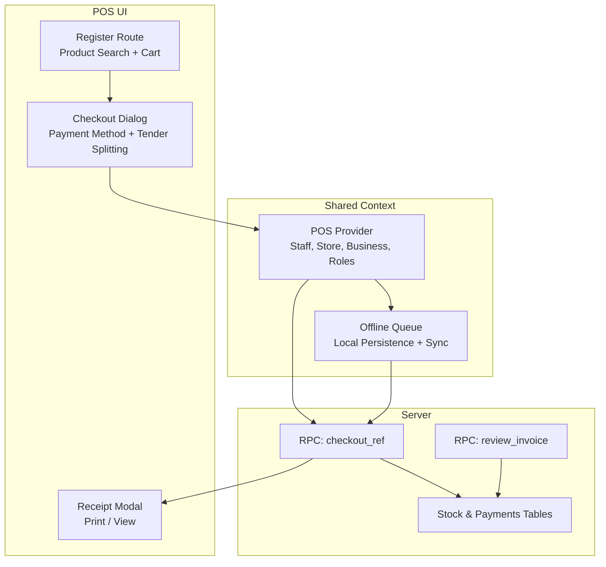
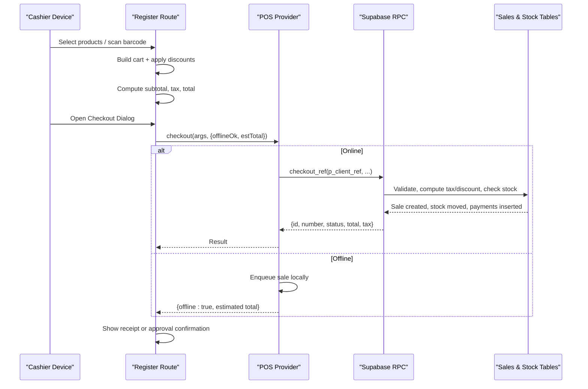
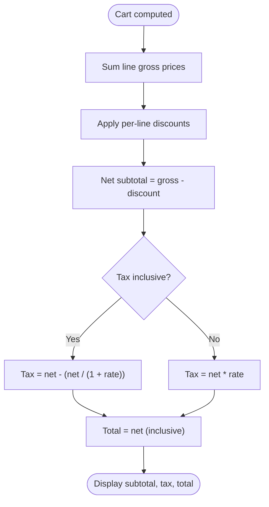
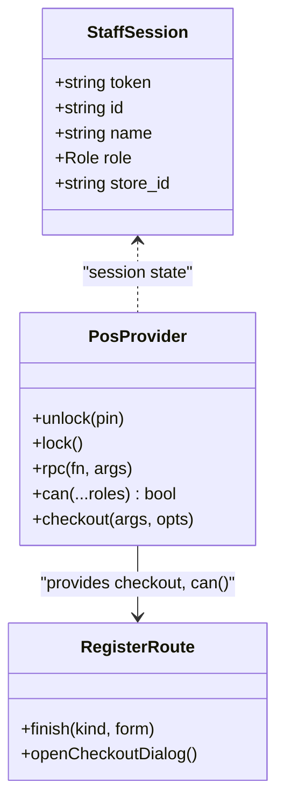
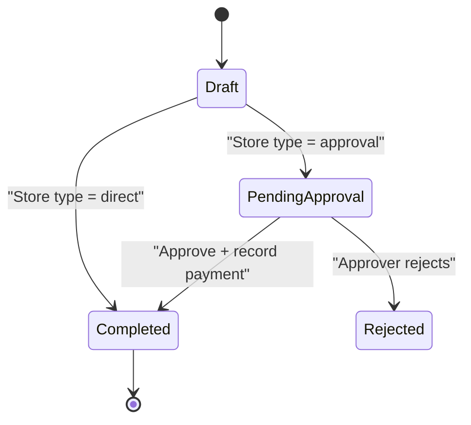
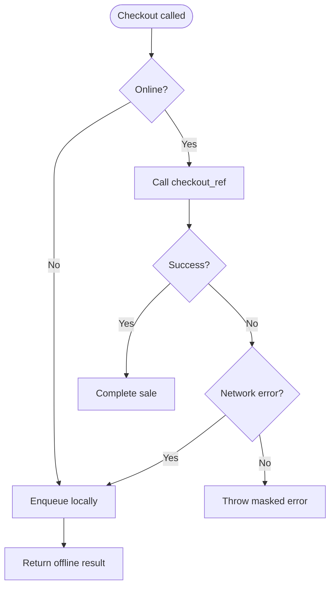
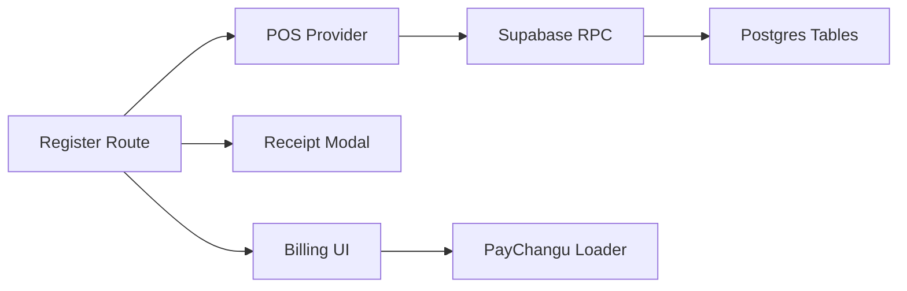

# Direct Sales Workflow

<cite>
**Referenced Files in This Document**   
- [app.index.tsx](file://src/routes/_authenticated/app.index.tsx)
- [pos.tsx](file://src/lib/pos.tsx)
- [billing.ts](file://src/lib/billing.ts)
- [sales.ts](file://src/lib/sales.ts)
- [Billing.tsx](file://src/components/pos/Billing.tsx)
- [retail_operations.sql](file://supabase/migrations/20261009210500_retail_operations.sql)
- [legacy_checkout.sql](file://supabase/migrations/20261007092354_1daf7bc8-d22a-46ae-a571-1e6c509ed166.sql)
</cite>

## Table of Contents
1. [Introduction](#introduction)
2. [Project Structure](#project-structure)
3. [Core Components](#core-components)
4. [Architecture Overview](#architecture-overview)
5. [Detailed Component Analysis](#detailed-component-analysis)
6. [Dependency Analysis](#dependency-analysis)
7. [Performance Considerations](#performance-considerations)
8. [Troubleshooting Guide](#troubleshooting-guide)
9. [Conclusion](#conclusion)

## Introduction
This document explains the direct sales workflow in the POS system, from product selection through payment completion. It covers cart management, discount application, tax calculation, payment method handling (cash, card, mobile), receipt generation, role-based permissions, store types (direct vs approval), and offline transaction queuing. The goal is to make the end-to-end flow clear for both technical and non-technical readers while grounding every claim in the actual codebase.

## Project Structure
The direct sales feature spans UI components, a shared POS context, business logic utilities, and server-side SQL functions:

- Register route (`app.index.tsx`): product search, barcode scanning, cart editing, checkout dialog, and receipt display.
- POS context (`pos.tsx`): staff session, roles, store/business data, RPC wrapper, offline queueing, and auto-lock hygiene.
- Billing integration (`billing.ts`, `Billing.tsx`): subscription status and external payment provider loading.
- Sales queries (`sales.ts`): read models for sales lists, summaries, and exports.
- Server operations (`retail_operations.sql`, legacy `checkout` migration): authoritative validation, stock movement, payments, discounts, taxes, and approval flows.

**Diagram sources**
- [app.index.tsx:111-355](file://src/routes/_authenticated/app.index.tsx#L111-L355)
- [app.index.tsx:780-1075](file://src/routes/_authenticated/app.index.tsx#L780-L1075)
- [pos.tsx:115-388](file://src/lib/pos.tsx#L115-L388)
- [pos.tsx:275-338](file://src/lib/pos.tsx#L275-L338)
- [retail_operations.sql:108-320](file://supabase/migrations/20261009210500_retail_operations.sql#L108-L320)
- [retail_operations.sql:325-406](file://supabase/migrations/20261009210500_retail_operations.sql#L325-L406)

**Section sources**
- [app.index.tsx:71-85](file://src/routes/_authenticated/app.index.tsx#L71-L85)
- [pos.tsx:46-84](file://src/lib/pos.tsx#L46-L84)

## Core Components
- Register route: builds the cart, applies per-line discounts, computes totals with inclusive or exclusive tax, and triggers checkout.
- Checkout dialog: collects payment method(s), optional split tenders, customer details, manager PIN override when needed, and submits the sale form.
- POS provider: authenticates staff via PIN, exposes roles and store/business configuration, wraps RPC calls, and queues offline sales.
- Server checkout function: validates inputs, enforces discount caps, calculates tax, checks inventory, records sale items, moves stock, and records payments.
- Approval flow: creates pending invoices that require an admin/manager to approve before stock is deducted and payment recorded.
- Offline queue: persists eligible direct-store sales locally and retries them when connectivity returns.

**Section sources**
- [app.index.tsx:111-355](file://src/routes/_authenticated/app.index.tsx#L111-L355)
- [app.index.tsx:780-1075](file://src/routes/_authenticated/app.index.tsx#L780-L1075)
- [pos.tsx:115-388](file://src/lib/pos.tsx#L115-L388)
- [retail_operations.sql:108-320](file://supabase/migrations/20261009210500_retail_operations.sql#L108-L320)

## Architecture Overview
The direct sales workflow follows a client-server pattern with strong server-side validation and RLS-guarded tables.

**Diagram sources**
- [app.index.tsx:273-355](file://src/routes/_authenticated/app.index.tsx#L273-L355)
- [pos.tsx:275-338](file://src/lib/pos.tsx#L275-L338)
- [retail_operations.sql:108-320](file://supabase/migrations/20261009210500_retail_operations.sql#L108-L320)

## Detailed Component Analysis

### Product Selection and Cart Management
- Product catalog is filtered by name/SKU and category; tiles show live stock levels and low-stock/out-of-stock indicators.
- Barcode scanner wedge and camera scanning add items directly to the cart.
- Cart supports quantity stepping, line removal with undo toast, and clearing with undo.
- Per-line discounts are applied through a dedicated dialog; discount totals reduce the gross subtotal before tax.

Key behaviors:
- Discount cap enforcement: cashiers can only apply up to 10% per line or 10% on the whole cart without a manager PIN.
- Price source: effective price may be adjusted by collections; totals reflect this.

**Section sources**
- [app.index.tsx:111-271](file://src/routes/_authenticated/app.index.tsx#L111-L271)
- [app.index.tsx:359-395](file://src/routes/_authenticated/app.index.tsx#L359-L395)

### Tax Calculation and Totals
- Tax rate and inclusivity come from the business profile.
- If tax-inclusive: net subtotal equals the billed subtotal; tax is back-calculated.
- If tax-exclusive: tax is added to the net subtotal.
- Total displayed to the cashier reflects these rules.

**Diagram sources**
- [app.index.tsx:161-173](file://src/routes/_authenticated/app.index.tsx#L161-L173)
- [retail_operations.sql:188-190](file://supabase/migrations/20261009210500_retail_operations.sql#L188-L190)

**Section sources**
- [app.index.tsx:161-173](file://src/routes/_authenticated/app.index.tsx#L161-L173)
- [retail_operations.sql:188-190](file://supabase/migrations/20261009210500_retail_operations.sql#L188-L190)

### Payment Handling: Cash, Card, Mobile, and Split Tenders
- Supported methods: cash, card, mobile.
- Single-method tender defaults to full amount unless split.
- Split tenders allow multiple lines (e.g., cash + card/mobile).
- For direct sales, cash overpayment is allowed for change but capped to prevent abuse.
- Layby accepts partial payments until fully paid.

Validation and behavior:
- Tender amounts must cover the total for completed sales; cash overpayment is limited.
- Invoice approvals also support split tenders at approval time.

**Section sources**
- [app.index.tsx:772-831](file://src/routes/_authenticated/app.index.tsx#L772-L831)
- [app.index.tsx:1054-1070](file://src/routes/_authenticated/app.index.tsx#L1054-L1070)
- [retail_operations.sql:205-243](file://supabase/migrations/20261009210500_retail_operations.sql#L205-L243)
- [retail_operations.sql:351-400](file://supabase/migrations/20261009210500_retail_operations.sql#L351-L400)

### Receipt Generation
- After successful checkout, a receipt object is built with lines, subtotal, discount, tax, total, payment method(s), tenders, paid amount, change, and customer info.
- The receipt modal renders and allows printing/download.

Approval invoices do not generate immediate receipts because no payment is recorded until approval.

**Section sources**
- [app.index.tsx:320-351](file://src/routes/_authenticated/app.index.tsx#L320-L351)

### Role-Based Permissions
Roles:
- Admin
- Manager
- Cashier

Relevant controls:
- Staff unlock/login uses a PIN; sessions expire and can be locked.
- Cashiers cannot sell outside their assigned store.
- Cashier discount cap requires manager PIN override when exceeded.
- Approval workflows require admin/manager.
- Subscription billing actions are restricted to admin/manager.

**Diagram sources**
- [pos.tsx:37-84](file://src/lib/pos.tsx#L37-L84)
- [pos.tsx:194-228](file://src/lib/pos.tsx#L194-L228)
- [app.index.tsx:111-180](file://src/routes/_authenticated/app.index.tsx#L111-L180)

**Section sources**
- [pos.tsx:194-228](file://src/lib/pos.tsx#L194-L228)
- [pos.tsx:366-388](file://src/lib/pos.tsx#L366-L388)
- [retail_operations.sql:116-149](file://supabase/migrations/20261009210500_retail_operations.sql#L116-L149)
- [retail_operations.sql:171-186](file://supabase/migrations/20261009210500_retail_operations.sql#L171-L186)
- [Billing.tsx:166-167](file://src/components/pos/Billing.tsx#L166-L167)

### Store Types: Direct vs Approval
- Direct stores: sales complete immediately, stock is decremented, and payments are recorded.
- Approval stores: sales create pending invoices; stock is reserved until approved; payment is recorded during approval.

**Diagram sources**
- [retail_operations.sql:192-203](file://supabase/migrations/20261009210500_retail_operations.sql#L192-L203)
- [retail_operations.sql:325-406](file://supabase/migrations/20261009210500_retail_operations.sql#L325-L406)

**Section sources**
- [app.index.tsx:173-180](file://src/routes/_authenticated/app.index.tsx#L173-L180)
- [retail_operations.sql:192-203](file://supabase/migrations/20261009210500_retail_operations.sql#L192-L203)
- [retail_operations.sql:325-406](file://supabase/migrations/20261009210500_retail_operations.sql#L325-L406)

### Inventory Updates During Sales
- Before completing a direct sale or approving an invoice, the server verifies available stock at the selected store.
- On success, `_move_stock` decrements inventory and logs movements.
- Low-stock indicators in the UI help prevent overselling.

**Section sources**
- [retail_operations.sql:195-203](file://supabase/migrations/20261009210500_retail_operations.sql#L195-L203)
- [retail_operations.sql:268-285](file://supabase/migrations/20261009210500_retail_operations.sql#L268-L285)
- [retail_operations.sql:338-343](file://supabase/migrations/20261009210500_retail_operations.sql#L338-L343)
- [retail_operations.sql:386](file://supabase/migrations/20261009210500_retail_operations.sql#L386)

### Offline Transaction Queuing
- Direct-store sales are eligible for offline queuing.
- When offline or network errors occur, the POS provider saves the sale locally with an estimated total and returns an offline result.
- Background sync retries queued sales when online; failed entries show retry/discard options.

**Diagram sources**
- [pos.tsx:275-338](file://src/lib/pos.tsx#L275-L338)

**Section sources**
- [pos.tsx:249-338](file://src/lib/pos.tsx#L249-L338)
- [app.index.tsx:292-319](file://src/routes/_authenticated/app.index.tsx#L292-L319)

### Practical Examples

#### Example 1: Direct Sale with Cash Change
- Cashier adds items, applies a small per-line discount within the cashier cap.
- Chooses cash, enters more than the total for change.
- Server validates tender coverage, limits cash overpayment, records sale, decrements stock, and inserts payment.
- Receipt shows subtotal, discount, tax, total, cash tender, and change.

**Section sources**
- [app.index.tsx:161-173](file://src/routes/_authenticated/app.index.tsx#L161-L173)
- [app.index.tsx:273-355](file://src/routes/_authenticated/app.index.tsx#L273-L355)
- [retail_operations.sql:205-243](file://supabase/migrations/20261009210500_retail_operations.sql#L205-L243)
- [retail_operations.sql:268-285](file://supabase/migrations/20261009210500_retail_operations.sql#L268-L285)

#### Example 2: Approval Invoice with Split Tender
- Cashier creates an invoice in an approval store.
- Approver reviews the invoice, selects card and mobile split tenders covering the total.
- Server recomputes totals from stored item prices, validates tenders, decrements stock, and records payments.

**Section sources**
- [retail_operations.sql:325-406](file://supabase/migrations/20261009210500_retail_operations.sql#L325-L406)

#### Example 3: Offline Direct Sale
- Device loses connectivity during checkout.
- POS provider queues the sale locally and returns an offline result with estimated total.
- Once online, background sync replays the sale; if successful, it invalidates cached sales data.

**Section sources**
- [pos.tsx:275-338](file://src/lib/pos.tsx#L275-L338)
- [app.index.tsx:292-319](file://src/routes/_authenticated/app.index.tsx#L292-L319)

### Error Handling Scenarios
- Unknown store or unassigned cashier: rejected by server.
- Empty cart or invalid quantities: rejected by server.
- Catalog mismatch or duplicate cart lines: rejected by server.
- Discounts exceeding gross or cashier cap without PIN: rejected by server.
- Tender underpayment or excessive overpayment: rejected by server.
- Insufficient stock: rejected by server.
- Network errors: masked and queued for later retry.
- RLS policy violations: generic user-facing message.

**Section sources**
- [retail_operations.sql:117-149](file://supabase/migrations/20261009210500_retail_operations.sql#L117-L149)
- [retail_operations.sql:152-186](file://supabase/migrations/20261009210500_retail_operations.sql#L152-L186)
- [retail_operations.sql:205-243](file://supabase/migrations/20261009210500_retail_operations.sql#L205-L243)
- [retail_operations.sql:195-203](file://supabase/migrations/20261009210500_retail_operations.sql#L195-L203)
- [pos.tsx:93-104](file://src/lib/pos.tsx#L93-L104)

## Dependency Analysis
- Register depends on POS context for staff/store/business, checkout, and money formatting.
- POS context depends on Supabase RPCs, offline persistence, and cache invalidation.
- Server functions depend on business/stores/products tables and enforce RLS via staff tokens.
- Billing UI depends on subscription policy and external payment script loader.

**Diagram sources**
- [app.index.tsx:111-355](file://src/routes/_authenticated/app.index.tsx#L111-L355)
- [pos.tsx:115-388](file://src/lib/pos.tsx#L115-L388)
- [billing.ts:41-55](file://src/lib/billing.ts#L41-L55)

**Section sources**
- [app.index.tsx:111-355](file://src/routes/_authenticated/app.index.tsx#L111-L355)
- [pos.tsx:115-388](file://src/lib/pos.tsx#L115-L388)
- [billing.ts:1-56](file://src/lib/billing.ts#L1-L56)

## Performance Considerations
- Live stock reads ensure accurate availability across devices.
- Deferred search input keeps the register responsive while catalog filters run.
- Query caching and stale times reduce unnecessary refetches.
- Server-side aggregation for sales summaries avoids heavy client computation.
- Offline queue prevents blocking the UI when connectivity is poor.

[No sources needed since this section provides general guidance]

## Troubleshooting Guide
Common issues and resolutions:
- “Unknown store” or “Not assigned to this store”: verify staff assignment and selected store.
- “Cart empty” or “Invalid items”: ensure valid product IDs and positive quantities.
- “Discount needs manager PIN”: provide a valid manager PIN when exceeding cashier discount caps.
- “Tenders do not cover the total” or “Too much overpayment”: adjust tender amounts to match policy.
- “Not enough stock”: wait for replenishment or use another store.
- Offline saved sale not syncing: unlock staff session and retry; check network connectivity.

**Section sources**
- [retail_operations.sql:117-149](file://supabase/migrations/20261009210500_retail_operations.sql#L117-L149)
- [retail_operations.sql:171-186](file://supabase/migrations/20261009210500_retail_operations.sql#L171-L186)
- [retail_operations.sql:205-243](file://supabase/migrations/20261009210500_retail_operations.sql#L205-L243)
- [pos.tsx:275-338](file://src/lib/pos.tsx#L275-L338)

## Conclusion
The direct sales workflow combines a fast, touch-friendly register interface with robust server-side validation. It supports flexible pricing, tax rules, per-line discounts, multi-method payments, and two store modes: direct completion and approval-gated invoicing. Role-based controls protect sensitive actions, while offline queuing ensures continuity even without connectivity. Together, these pieces deliver reliable, auditable transactions suitable for retail environments.

[No sources needed since this section summarizes without analyzing specific files]