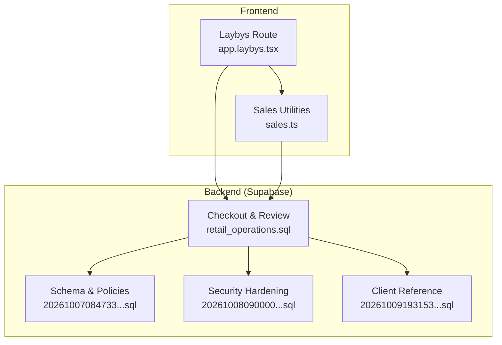
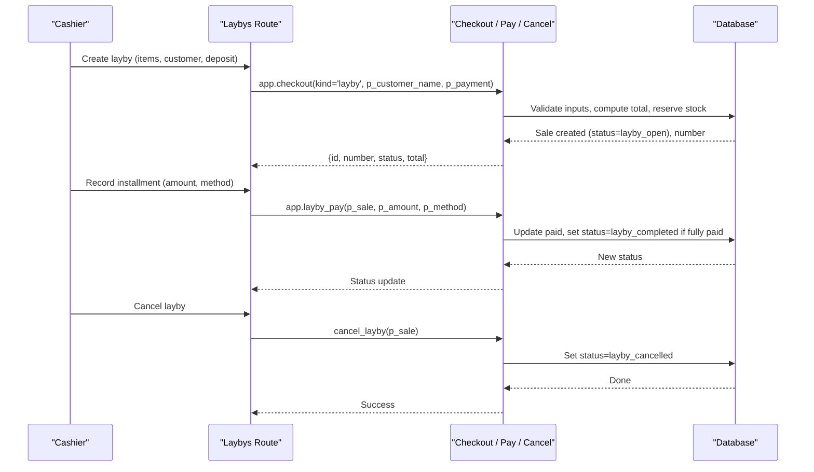
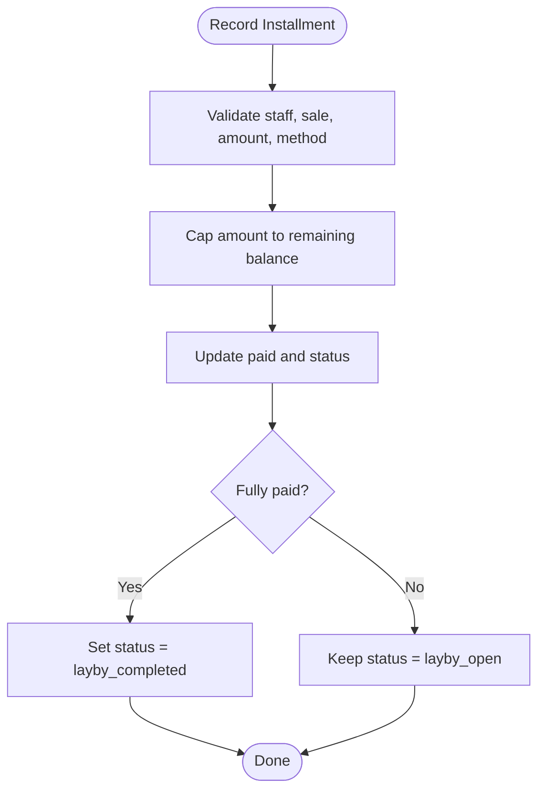
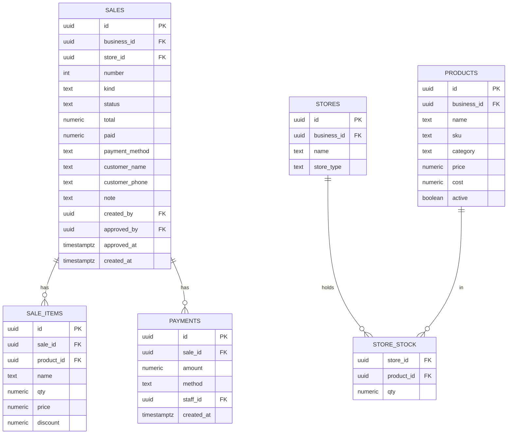
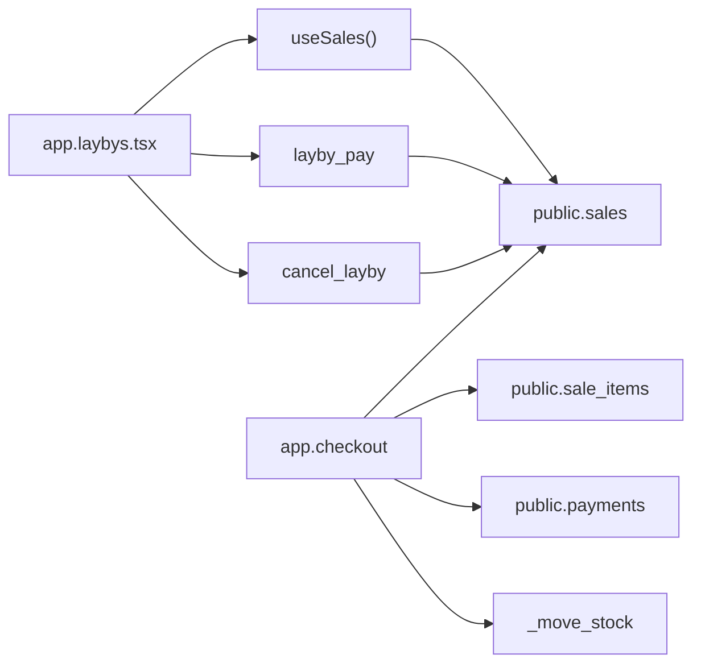

# Layby Order Management

<cite>
**Referenced Files in This Document**
- [app.laybys.tsx](file://src/routes/_authenticated/app.laybys.tsx)
- [sales.ts](file://src/lib/sales.ts)
- [20261007084733_2ed95314-f75e-4843-977b-23f9e6359a48.sql](file://supabase/migrations/20261007084733_2ed95314-f75e-4843-977b-23f9e6359a48.sql)
- [20261009210500_retail_operations.sql](file://supabase/migrations/20261009210500_retail_operations.sql)
- [20261008090000_security_hardening.sql](file://supabase/migrations/20261008090000_security_hardening.sql)
- [20261009193153_97dc4c9b-c64d-4f55-9cfe-e17b97fb71ec.sql](file://supabase/migrations/20261009193153_97dc4c9b-c64d-4f55-9cfe-e17b97fb71ec.sql)
</cite>

## Table of Contents
1. [Introduction](#introduction)
2. [Project Structure](#project-structure)
3. [Core Components](#core-components)
4. [Architecture Overview](#architecture-overview)
5. [Detailed Component Analysis](#detailed-component-analysis)
6. [Dependency Analysis](#dependency-analysis)
7. [Performance Considerations](#performance-considerations)
8. [Troubleshooting Guide](#troubleshooting-guide)
9. [Conclusion](#conclusion)

## Introduction
This document explains the layby order management functionality end-to-end: from creating a layby with an initial deposit through installment payments to completion or cancellation. It covers data models, business rules, user flows, stock reservation logic, refund constraints, and integration points with sales reporting. The goal is to make the system understandable for both technical and non-technical readers.

## Project Structure
Layby features span the UI route, shared sales utilities, and server-side database functions and schema:
- UI route for managing open and closed laybys and recording payments
- Sales query helpers used by the UI to list and filter laybys
- Database schema defining sales, items, payments, and related tables
- Server functions implementing checkout, payment, cancellation, and security constraints

**Diagram sources**
- [app.laybys.tsx:1-201](file://src/routes/_authenticated/app.laybys.tsx#L1-L201)
- [sales.ts:136-173](file://src/lib/sales.ts#L136-L173)
- [20261009210500_retail_operations.sql:130-400](file://supabase/migrations/20261009210500_retail_operations.sql#L130-L400)
- [20261007084733_2ed95314-f75e-4843-977b-23f9e6359a48.sql:49-82](file://supabase/migrations/20261007084733_2ed95314-f75e-4843-977b-23f9e6359a48.sql#L49-L82)
- [20261008090000_security_hardening.sql:620-638](file://supabase/migrations/20261008090000_security_hardening.sql#L620-L638)
- [20261009193153_97dc4c9b-c64d-4f55-9cfe-e17b97fb71ec.sql:1-32](file://supabase/migrations/20261009193153_97dc4c9b-c64d-4f55-9cfe-e17b97fb71ec.sql#L1-L32)

**Section sources**
- [app.laybys.tsx:1-201](file://src/routes/_authenticated/app.laybys.tsx#L1-L201)
- [sales.ts:136-173](file://src/lib/sales.ts#L136-L173)
- [20261007084733_2ed95314-f75e-4843-977b-23f9e6359a48.sql:49-82](file://supabase/migrations/20261007084733_2ed95314-f75e-4843-977b-23f9e6359a48.sql#L49-L82)
- [20261009210500_retail_operations.sql:130-400](file://supabase/migrations/20261009210500_retail_operations.sql#L130-L400)
- [20261008090000_security_hardening.sql:620-638](file://supabase/migrations/20261008090000_security_hardening.sql#L620-L638)
- [20261009193153_97dc4c9b-c64d-4f55-9cfe-e17b97fb71ec.sql:1-32](file://supabase/migrations/20261009193153_97dc4c9b-c64d-4f55-9cfe-e17b97fb71ec.sql#L1-L32)

## Core Components
- Laybys UI page: lists open and closed laybys, shows paid vs owing, allows partial payments and cancellations.
- Checkout function: creates layby orders, validates inputs, reserves stock, records initial payment(s), and sets status.
- Payment function: processes installment payments against open laybys and transitions to completed when fully paid.
- Cancellation function: marks open laybys as cancelled.
- Data model: sales, sale_items, payments, stores, products, staff sessions.

Key responsibilities:
- Customer capture: name and phone are required for laybys; validated on creation.
- Deposit calculation: initial payment amount is capped at total; can be zero if tenders are not provided.
- Installment tracking: paid accumulates; owing is total minus paid.
- Stock reservation: stock is reserved when a layby is created (not pending approval).
- Reporting: sales totals and tax are included in reports; refunds apply only to completed sales.

**Section sources**
- [app.laybys.tsx:27-140](file://src/routes/_authenticated/app.laybys.tsx#L27-L140)
- [20261009210500_retail_operations.sql:130-286](file://supabase/migrations/20261009210500_retail_operations.sql#L130-L286)
- [20261008090000_security_hardening.sql:628-638](file://supabase/migrations/20261008090000_security_hardening.sql#L628-L638)
- [20261007084733_2ed95314-f75e-4843-977b-23f9e6359a48.sql:49-82](file://supabase/migrations/20261007084733_2ed95314-f75e-4843-977b-23f9e6359a48.sql#L49-L82)

## Architecture Overview
The layby lifecycle spans UI interactions and server-side enforcement:

**Diagram sources**
- [app.laybys.tsx:45-54](file://src/routes/_authenticated/app.laybys.tsx#L45-L54)
- [app.laybys.tsx:156-168](file://src/routes/_authenticated/app.laybys.tsx#L156-L168)
- [20261009210500_retail_operations.sql:130-286](file://supabase/migrations/20261009210500_retail_operations.sql#L130-L286)
- [20261008090000_security_hardening.sql:628-638](file://supabase/migrations/20261008090000_security_hardening.sql#L628-L638)

## Detailed Component Analysis

### Layby Creation (Initial Deposit and Customer Capture)
- Inputs: store, items, optional tender lines, optional single payment amount, payment method, customer name, optional customer phone, optional note.
- Validation:
  - Store must exist and cashier must be assigned correctly.
  - Items must be active and present in catalogue; duplicates merged before discounting.
  - Discounts validated and capped appropriately; manager PIN required for large discounts by cashiers.
  - Customer name required for layby; phone format validated if provided.
  - Payment amount bounded.
- Totals:
  - Gross computed from effective product prices.
  - Discount subtracted to get subtotal; tax applied based on business settings.
  - Total includes tax when applicable.
- Status and payment:
  - For layby, status becomes layby_open.
  - If no tenders, payment is derived from p_payment; otherwise from tenders.
  - Payments recorded when amount > 0.
  - If paid >= total, status becomes layby_completed immediately.
- Stock reservation:
  - Stock is reserved via _move_stock when not pending approval.
  - Insufficient stock raises an error listing affected products.

Practical example:
- Create a layby with three items, collect a deposit of 30% of total, record customer name and phone, and choose card as payment method. The system reserves stock, records the deposit, and leaves the layby open until further installments.

**Section sources**
- [20261009210500_retail_operations.sql:130-286](file://supabase/migrations/20261009210500_retail_operations.sql#L130-L286)
- [20261007084733_2ed95314-f75e-4843-977b-23f9e6359a48.sql:49-82](file://supabase/migrations/20261007084733_2ed95314-f75e-4843-977b-23f9e6359a48.sql#L49-L82)

### Installment Payments (Partial Payments)
- UI flow:
  - Open laybys show paid progress bar and owing amount.
  - “Take Payment” opens a dialog to enter amount and method (cash, card, mobile).
  - On submit, calls layby_pay with sale id, amount, and method.
- Server logic:
  - Validates staff role and that the sale exists and is layby_open.
  - Validates amount range and method enum.
  - Caps payment to remaining balance (total - paid).
  - Updates paid and sets status to layby_completed if fully paid.

Practical example:
- A layby with total 10,000 has paid 3,000. Record a partial payment of 2,000 by card. Owing becomes 5,000. Repeat until paid equals total, then status becomes layby_completed.

**Diagram sources**
- [app.laybys.tsx:156-168](file://src/routes/_authenticated/app.laybys.tsx#L156-L168)
- [20261008090000_security_hardening.sql:628-638](file://supabase/migrations/20261008090000_security_hardening.sql#L628-L638)

**Section sources**
- [app.laybys.tsx:142-200](file://src/routes/_authenticated/app.laybys.tsx#L142-L200)
- [20261008090000_security_hardening.sql:628-638](file://supabase/migrations/20261008090000_security_hardening.sql#L628-L638)

### Cancellations
- UI flow:
  - Admin/manager can cancel an open layby after confirmation.
  - Calls cancel_layby RPC with sale id.
- Server behavior:
  - Marks the sale as layby_cancelled.
  - No automatic refund logic is implemented here; refunds follow separate rules.

Practical example:
- A customer decides not to proceed. Cancel the layby; it moves to the closed tab with status layby_cancelled.

**Section sources**
- [app.laybys.tsx:45-54](file://src/routes/_authenticated/app.laybys.tsx#L45-L54)

### Completion
- Automatic completion occurs when paid reaches or exceeds total during creation or installment payment.
- Completed laybys appear in the “done” tab and participate in standard sales reporting.

**Section sources**
- [20261009210500_retail_operations.sql:284-286](file://supabase/migrations/20261009210500_retail_operations.sql#L284-L286)
- [app.laybys.tsx:32-36](file://src/routes/_authenticated/app.laybys.tsx#L32-L36)

### Data Model and Relationships

**Diagram sources**
- [20261007084733_2ed95314-f75e-4843-977b-23f9e6359a48.sql:49-82](file://supabase/migrations/20261007084733_2ed95314-f75e-4843-977b-23f9e6359a48.sql#L49-L82)
- [20261009210500_retail_operations.sql:14-16](file://supabase/migrations/20261009210500_retail_operations.sql#L14-L16)

**Section sources**
- [20261007084733_2ed95314-f75e-4843-977b-23f9e6359a48.sql:49-82](file://supabase/migrations/20261007084733_2ed95314-f75e-4843-977b-23f9e6359a48.sql#L49-L82)
- [20261009210500_retail_operations.sql:14-16](file://supabase/migrations/20261009210500_retail_operations.sql#L14-L16)

### Stock Reservation Logic
- During checkout for layby (when not pending approval), the system checks available stock per product and store.
- If insufficient, it fails early with a message listing affected products.
- On successful creation, stock is decremented via _move_stock.

Practical example:
- Attempting to create a layby for 5 units of a product with only 2 in stock will fail before any sale is created.

**Section sources**
- [20261009210500_retail_operations.sql:194-203](file://supabase/migrations/20261009210500_retail_operations.sql#L194-L203)
- [20261009210500_retail_operations.sql:268-269](file://supabase/migrations/20261009210500_retail_operations.sql#L268-L269)

### Refund Policies
- Refunds are allowed only for completed sales (including layby_completed).
- Partial refunds are supported via partially_refunded status.
- There is no automatic refund upon layby cancellation; cancellation simply changes status to layby_cancelled.

Practical example:
- After completing a layby, you may issue a full or partial refund following the refund workflow. Cancelling an open layby does not trigger a refund.

**Section sources**
- [20261008090000_security_hardening.sql:565-565](file://supabase/migrations/20261008090000_security_hardening.sql#L565-L565)
- [20261007183338_b2173994-34a5-4c8e-b71e-7f98b51895af.sql:1-2](file://supabase/migrations/20261007183338_b2173994-34a5-4c8e-b71e-7f98b51895af.sql#L1-L2)

### Integration with Sales Reporting
- Sales rows include kind, status, total, tax, discount, and payment_method.
- Reports aggregate revenue, profit, tax, and refunds across all sales, including completed laybys.
- Layby-specific queries filter by statuses layby_open, layby_completed, and layby_cancelled.

Practical example:
- A completed layby contributes its total to monthly revenue and tax totals in reports. An open layby does not count as revenue until completed.

**Section sources**
- [sales.ts:136-173](file://src/lib/sales.ts#L136-L173)
- [app.reports.tsx:66-101](file://src/routes/_authenticated/app.reports.tsx#L66-L101)

### Client References and Idempotency
- A client reference column supports idempotent checkout attempts using advisory locks.
- Useful for retry-safe creation of laybys from external systems.

Practical example:
- If a network retry occurs while creating a layby, the same client_ref returns the existing sale rather than duplicating it.

**Section sources**
- [20261009193153_97dc4c9b-c64d-4f55-9cfe-e17b97fb71ec.sql:1-32](file://supabase/migrations/20261009193153_97dc4c9b-c64d-4f55-9cfe-e17b97fb71ec.sql#L1-L32)

## Dependency Analysis

**Diagram sources**
- [app.laybys.tsx:45-54](file://src/routes/_authenticated/app.laybys.tsx#L45-L54)
- [app.laybys.tsx:156-168](file://src/routes/_authenticated/app.laybys.tsx#L156-L168)
- [sales.ts:136-173](file://src/lib/sales.ts#L136-L173)
- [20261009210500_retail_operations.sql:130-286](file://supabase/migrations/20261009210500_retail_operations.sql#L130-L286)
- [20261008090000_security_hardening.sql:620-638](file://supabase/migrations/20261008090000_security_hardening.sql#L620-L638)

**Section sources**
- [app.laybys.tsx:1-201](file://src/routes/_authenticated/app.laybys.tsx#L1-L201)
- [sales.ts:136-173](file://src/lib/sales.ts#L136-L173)
- [20261009210500_retail_operations.sql:130-286](file://supabase/migrations/20261009210500_retail_operations.sql#L130-L286)
- [20261008090000_security_hardening.sql:620-638](file://supabase/migrations/20261008090000_security_hardening.sql#L620-L638)

## Performance Considerations
- Use paginated sales queries for large datasets; avoid loading entire periods into memory.
- Keep layby lists filtered by store and status to reduce payload size.
- Prefer tender arrays for multiple payment methods to minimize round-trips.
- Avoid duplicate cart lines before discounting to prevent validation errors.

[No sources needed since this section provides general guidance]

## Troubleshooting Guide
Common issues and resolutions:
- “Layby needs a customer name”: Ensure customer_name is provided for layby kind.
- “Unknown payment method”: Use one of cash, card, mobile.
- “Not enough stock”: Verify inventory levels before creating layby; adjust quantities or add stock.
- “Tenders exceed the invoice total” or “Tenders do not cover the total”: Adjust tender amounts to match or exceed total as appropriate.
- “Wrong manager PIN for this discount”: Provide correct manager PIN when cashier discount thresholds are exceeded.
- “Only completed sales can be refunded”: Complete the sale first; cancellations do not auto-refund.

Operational tips:
- Confirm cancellation details before calling cancel_layby.
- After recording a payment, refresh the list to see updated paid and owing values.
- Use client references for idempotent retries when integrating externally.

**Section sources**
- [20261009210500_retail_operations.sql:140-149](file://supabase/migrations/20261009210500_retail_operations.sql#L140-L149)
- [20261009210500_retail_operations.sql:171-186](file://supabase/migrations/20261009210500_retail_operations.sql#L171-L186)
- [20261009210500_retail_operations.sql:205-230](file://supabase/migrations/20261009210500_retail_operations.sql#L205-L230)
- [20261008090000_security_hardening.sql:565-565](file://supabase/migrations/20261008090000_security_hardening.sql#L565-L565)

## Conclusion
Layby order management in this system is built around a robust checkout process, strict input validation, secure server-side state transitions, and clear UI workflows. Deposits and installments are tracked accurately, stock is reserved at creation, and completed laybys integrate seamlessly into sales reporting. Cancellations are straightforward without automatic refunds, aligning with policy-driven refund handling. The design emphasizes safety, clarity, and auditability throughout the layby lifecycle.