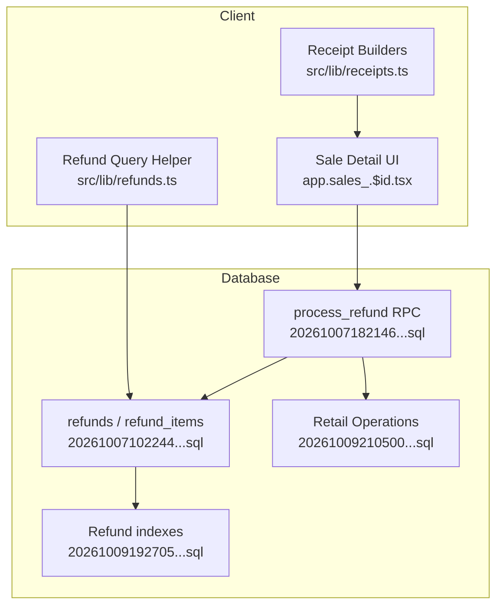
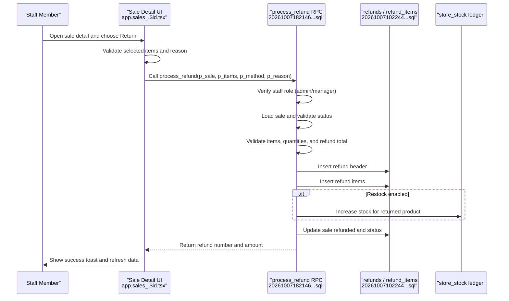
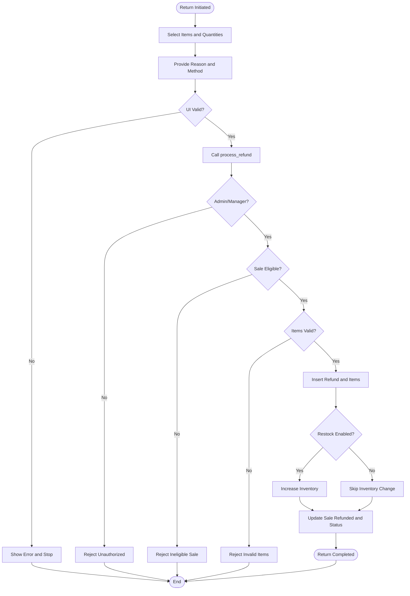
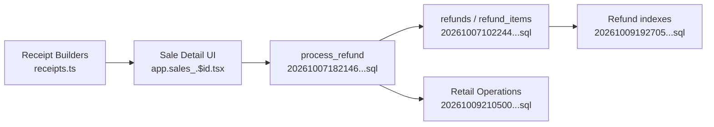

# Returns and Refunds Processing

<cite>
**Referenced Files in This Document**
- [refunds.ts](file://src/lib/refunds.ts)
- [receipts.ts](file://src/lib/receipts.ts)
- [app.sales_.$id.tsx](file://src/routes/_authenticated/app.sales_.$id.tsx)
- [20261007182146_48413f83-16ba-421f-b269-777201b5e8b1.sql](file://supabase/migrations/20261007182146_48413f83-16ba-421f-b269-777201b5e8b1.sql)
- [20261007102244_c10153f5-18b7-409c-8196-3337d3f296c4.sql](file://supabase/migrations/20261007102244_c10153f5-18b7-409c-8196-3337d3f296c4.sql)
- [20261009192705_c04f3a80-e05e-498f-ab87-694d79f3fe3f.sql](file://supabase/migrations/20261009192705_c04f3a80-e05e-498f-ab87-694d79f3fe3f.sql)
- [20261009210500_retail_operations.sql](file://supabase/migrations/20261009210500_retail_operations.sql)
</cite>

## Table of Contents
1. [Introduction](#introduction)
2. [Project Structure](#project-structure)
3. [Core Components](#core-components)
4. [Architecture Overview](#architecture-overview)
5. [Detailed Component Analysis](#detailed-component-analysis)
6. [Dependency Analysis](#dependency-analysis)
7. [Performance Considerations](#performance-considerations)
8. [Troubleshooting Guide](#troubleshooting-guide)
9. [Conclusion](#conclusion)

## Introduction
This document explains the complete returns and refunds processing workflow implemented in the project. It covers how a return is initiated, validated, authorized, recorded, and reconciled, including inventory restoration, tax handling, shift accounting, and receipt generation. It also documents supported refund types, authorization requirements, escalation behavior, and edge cases such as partial returns, already-refunded sales, multi-payment original transactions, and damaged goods where restocking is declined.

The system implements:
- Full and partial refunds against completed or partially refunded sales.
- Optional inventory restoration when items are returned in sellable condition.
- Tax-aware refund amount calculation based on sale totals and tax settings.
- Authorization through staff roles with admin/manager-only access to refunds.
- Integration with cash shifts for expected cash reconciliation.
- Receipt generation utilities for sales and layby receipts; refund receipts are represented by refund records rather than separate receipt objects.

## Project Structure
Returns and refunds span client-side UI, client-side data helpers, and server-side database functions and schema:

- Client-side refund query helper: `src/lib/refunds.ts`
- Client-side receipt builders: `src/lib/receipts.ts`
- Sale detail UI that triggers refunds: `src/routes/_authenticated/app.sales_.$id.tsx`
- Database schema and business logic:
  - Refund tables and policies: `supabase/migrations/20261007102244_c10153f5-18b7-409c-8196-3337d3f296c4.sql`
  - Refund function implementation: `supabase/migrations/20261007182146_48413f83-16ba-421f-b269-777201b5e8b1.sql`
  - Indexes for refund queries: `supabase/migrations/20261009192705_c04f3a80-e05e-498f-ab87-694d79f3fe3f.sql`
  - Retail operations including checkout, tenders, approvals, transfers, and related role checks: `supabase/migrations/20261009210500_retail_operations.sql`

**Diagram sources**
- [app.sales_.$id.tsx:359-486](file://src/routes/_authenticated/app.sales_.$id.tsx#L359-L486)
- [refunds.ts:1-56](file://src/lib/refunds.ts#L1-L56)
- [receipts.ts:1-241](file://src/lib/receipts.ts#L1-L241)
- [20261007182146_48413f83-16ba-421f-b269-777201b5e8b1.sql:1-48](file://supabase/migrations/20261007182146_48413f83-16ba-421f-b269-777201b5e8b1.sql#L1-L48)
- [20261007102244_c10153f5-18b7-409c-8196-3337d3f296c4.sql:157-192](file://supabase/migrations/20261007102244_c10153f5-18b7-409c-8196-3337d3f296c4.sql#L157-L192)
- [20261009192705_c04f3a80-e05e-498f-ab87-694d79f3fe3f.sql:7-10](file://supabase/migrations/20261009192705_c04f3a80-e05e-498f-ab87-694d79f3fe3f.sql#L7-L10)
- [20261009210500_retail_operations.sql:108-287](file://supabase/migrations/20261009210500_retail_operations.sql#L108-L287)

**Section sources**
- [refunds.ts:1-56](file://src/lib/refunds.ts#L1-L56)
- [receipts.ts:1-241](file://src/lib/receipts.ts#L1-L241)
- [app.sales_.$id.tsx:359-486](file://src/routes/_authenticated/app.sales_.$id.tsx#L359-L486)
- [20261007102244_c10153f5-18b7-409c-8196-3337d3f296c4.sql:157-192](file://supabase/migrations/20261007102244_c10153f5-18b7-409c-8196-3337d3f296c4.sql#L157-L192)
- [20261007182146_48413f83-16ba-421f-b269-777201b5e8b1.sql:1-48](file://supabase/migrations/20261007182146_48413f83-16ba-421f-b269-777201b5e8b1.sql#L1-L48)
- [20261009192705_c04f3a80-e05e-498f-ab87-694d79f3fe3f.sql:7-10](file://supabase/migrations/20261009192705_c04f3a80-e05e-498f-ab87-694d79f3fe3f.sql#L7-L10)
- [20261009210500_retail_operations.sql:108-287](file://supabase/migrations/20261009210500_retail_operations.sql#L108-L287)

## Core Components
- Refund query helper: Provides typed refund rows and a React Query hook to fetch recent refunds with optional filters by store, date range, or originating sale. It also exposes constants defining which sale statuses are considered refundable or counted in reporting.
- Receipt builder: Generates plain-text and HTML receipts for sales and layby receipts, including method labels, tender breakdowns, tax display, customer details, and print/download actions.
- Sale detail refund UI: Presents remaining quantities per sale item, calculates refundable amount, collects refund method and reason, and calls the server-side refund RPC.
- Server-side refund function: Validates authorization, sale eligibility, item selection, quantity limits, and refund totals; updates sale item refund tracking, inserts refund and refund item records, optionally restocks inventory, adjusts tax, and transitions sale status.
- Schema and policies: Defines refund tables, row-level security policies, and grants.
- Indexes: Optimizes refund queries by sale, store, business, and refund item relationships.
- Retail operations: Defines checkout, split tenders, approval workflows, and other retail controls that influence refund context such as payment methods and sale status.

**Section sources**
- [refunds.ts:1-56](file://src/lib/refunds.ts#L1-L56)
- [receipts.ts:1-241](file://src/lib/receipts.ts#L1-L241)
- [app.sales_.$id.tsx:359-486](file://src/routes/_authenticated/app.sales_.$id.tsx#L359-L486)
- [20261007102244_c10153f5-18b7-409c-8196-3337d3f296c4.sql:157-192](file://supabase/migrations/20261007102244_c10153f5-18b7-409c-8196-3337d3f296c4.sql#L157-L192)
- [20261007182146_48413f83-16ba-421f-b269-777201b5e8b1.sql:1-48](file://supabase/migrations/20261007182146_48413f83-16ba-421f-b269-777201b5e8b1.sql#L1-L48)
- [20261009192705_c04f3a80-e05e-498f-ab87-694d79f3fe3f.sql:7-10](file://supabase/migrations/20261009192705_c04f3a80-e05e-498f-ab87-694d79f3fe3f.sql#L7-L10)
- [20261009210500_retail_operations.sql:108-287](file://supabase/migrations/20261009210500_retail_operations.sql#L108-L287)

## Architecture Overview
The refund flow is a client-to-server transaction with strict validation and state transitions:

**Diagram sources**
- [app.sales_.$id.tsx:359-486](file://src/routes/_authenticated/app.sales_.$id.tsx#L359-L486)
- [20261007182146_48413f83-16ba-421f-b269-777201b5e8b1.sql:1-48](file://supabase/migrations/20261007182146_48413f83-16ba-421f-b269-777201b5e8b1.sql#L1-L48)
- [20261007102244_c10153f5-18b7-409c-8196-3337d3f296c4.sql:157-192](file://supabase/migrations/20261007102244_c10153f5-18b7-409c-8196-3337d3f296c4.sql#L157-L192)

## Detailed Component Analysis

### Refund Lifecycle
The lifecycle proceeds from initiation through verification to completion:

1. Initiation
   - Staff opens a completed sale and selects Return.
   - The UI shows each sale item with available quantity and allows selecting quantities to return.
   - Staff chooses refund method and provides a reason.

2. Validation
   - The UI ensures at least one item is selected and a reason is provided.
   - The server validates:
     - Staff role is admin or manager.
     - Sale exists and belongs to the current business.
     - Sale status permits refunding.
     - Selected items belong to the sale.
     - Quantities do not exceed unsold-unreturned amounts.
     - Total refund does not exceed sale total.

3. Recording
   - A refund record is inserted with method, reason, staff, and shift context.
   - Refund item records are inserted with name, quantity, amount, cost, and restock flag.
   - If restock is true and a product is linked, inventory is increased.

4. Financial Reconciliation
   - Refund amount is calculated proportionally to sale totals and tax settings.
   - Tax portion is computed and stored on the refund.
   - Sale’s cumulative refunded amount is updated.
   - Sale status transitions to partially refunded or fully refunded.

5. Completion
   - The UI displays a success message with refund number and amount.
   - Data is refreshed so the sale reflects new refund totals and status.

**Diagram sources**
- [app.sales_.$id.tsx:359-486](file://src/routes/_authenticated/app.sales_.$id.tsx#L359-L486)
- [20261007182146_48413f83-16ba-421f-b269-777201b5e8b1.sql:1-48](file://supabase/migrations/20261007182146_48413f83-16ba-421f-b269-777201b5e8b1.sql#L1-L48)

**Section sources**
- [app.sales_.$id.tsx:359-486](file://src/routes/_authenticated/app.sales_.$id.tsx#L359-L486)
- [20261007182146_48413f83-16ba-421f-b269-777201b5e8b1.sql:1-48](file://supabase/migrations/20261007182146_48413f83-16ba-421f-b269-777201b5e8b1.sql#L1-L48)

### Authorization Hierarchy
Authorization is enforced at the database layer:

- Only staff with admin or manager roles can process refunds.
- Cashiers cannot initiate refunds directly.
- There is no explicit amount-based escalation in the refund function itself; however, the broader retail operations include manager PIN overrides for discounts during checkout, illustrating the pattern used elsewhere for higher-risk operations.

Practical implications:
- Any refund attempt by an unauthorized role will be rejected by the server.
- For high-value or sensitive scenarios, organizations should enforce additional operational controls outside this codebase, such as requiring manager presence or dual approval in policy.

**Section sources**
- [20261007182146_48413f83-16ba-421f-b269-777201b5e8b1.sql:1-48](file://supabase/migrations/20261007182146_48413f83-16ba-421f-b269-777201b5e8b1.sql#L1-L48)
- [20261009210500_retail_operations.sql:108-287](file://supabase/migrations/20261009210500_retail_operations.sql#L108-L287)

### Refund Types Supported
The implementation supports:

- Full refunds: When the cumulative refunded amount equals the sale total, the sale status becomes fully refunded.
- Partial refunds: When only some items or quantities are returned, the sale status becomes partially refunded.
- Exchanges: Not implemented as a dedicated exchange type. An exchange would need to be modeled as a refund plus a new sale.
- Store credit: Not implemented as a dedicated store credit mechanism. The refund method field accepts values such as cash, card, mobile, or split, but there is no explicit store credit method in the refund function.

Note: The client-side constants define refundable and counted statuses, while the server enforces eligible sale statuses for refunding.

**Section sources**
- [refunds.ts:54-55](file://src/lib/refunds.ts#L54-L55)
- [20261007182146_48413f83-16ba-421f-b269-777201b5e8b1.sql:1-48](file://supabase/migrations/20261007182146_48413f83-16ba-421f-b269-777201b5e8b1.sql#L1-L48)

### Return Receipt Generation
Receipt generation utilities exist for sales and layby receipts:

- Plain-text receipts suitable for SMS or download.
- HTML receipts for thermal printers and preview.
- Support for split tenders, tax display, customer information, and notes.

Refunds themselves do not have a dedicated receipt generator in the referenced files. Refund outcomes are represented by refund records and can be viewed alongside the originating sale.

**Section sources**
- [receipts.ts:1-241](file://src/lib/receipts.ts#L1-L241)

### Inventory Restoration
Inventory restoration is controlled per refund item:

- Each refund item includes a restock flag.
- If restock is true and a product ID is present, the system increases store stock for that product at the sale’s store.
- If restock is false, typically representing damaged or non-sellable goods, inventory is not restored.

This behavior aligns with standard retail practice: good returns increase stock; damaged returns do not.

**Section sources**
- [20261007182146_48413f83-16ba-421f-b269-777201b5e8b1.sql:1-48](file://supabase/migrations/20261007182146_48413f83-16ba-421f-b269-777201b5e8b1.sql#L1-L48)

### Financial Reconciliation and Tax Adjustment
Financial reconciliation integrates with cash shifts and sale totals:

- Refunds are associated with the open cash shift at the sale’s store when possible.
- The refund amount is derived from selected items and sale totals.
- Tax is adjusted proportionally based on the sale’s tax configuration.
- The sale’s cumulative refunded amount is updated, and its status transitions accordingly.
- Shift summaries include cash refunds in expected cash calculations.

For multi-payment original transactions:
- The refund function uses sale totals and item proportions rather than reversing individual payment records.
- Original payments remain intact; refunds reduce the sale’s refunded balance and adjust financial reporting through refund records and shift summaries.

**Section sources**
- [20261007182146_48413f83-16ba-421f-b269-777201b5e8b1.sql:1-48](file://supabase/migrations/20261007182146_48413f83-16ba-421f-b269-777201b5e8b1.sql#L1-L48)
- [20261007102244_c10153f5-18b7-409c-8196-3337d3f296c4.sql:221-243](file://supabase/migrations/20261007102244_c10153f5-18b7-409c-8196-3337d3f296c4.sql#L221-L243)
- [20261009210500_retail_operations.sql:108-287](file://supabase/migrations/20261009210500_retail_operations.sql#L108-L287)

### Edge Cases
- Expired returns: No explicit expiration policy is implemented in the refund function. Returns can be processed against eligible sale statuses without a time limit.
- Damaged goods: Handled by setting restock to false; inventory is not restored.
- Multi-payment original transactions: Refunds use sale totals and item proportions; original payment records are not reversed individually.
- Already fully refunded sales: The server prevents additional refunds once the sale is fully refunded.
- Over-return attempts: The server prevents returning more quantity than was sold minus previously refunded quantities.

**Section sources**
- [20261007182146_48413f83-16ba-421f-b269-777201b5e8b1.sql:1-48](file://supabase/migrations/20261007182146_48413f83-16ba-421f-b269-777201b5e8b1.sql#L1-L48)

### Accounting System Integration
The current implementation stores refund data in the database and integrates with internal retail operations:

- Refund records include amount, cost, tax, method, reason, staff, and shift context.
- Refund items capture per-item details including whether stock was restocked.
- Shift summaries incorporate cash refunds into expected cash calculations.

There is no direct external accounting system integration visible in the referenced files. To integrate with external accounting systems, you would extend the refund recording process to emit events or write to accounting endpoints after successful refund completion.

**Section sources**
- [20261007102244_c10153f5-18b7-409c-8196-3337d3f296c4.sql:157-192](file://supabase/migrations/20261007102244_c10153f5-18b7-409c-8196-3337d3f296c4.sql#L157-L192)
- [20261007102244_c10153f5-18b7-409c-8196-3337d3f296c4.sql:221-243](file://supabase/migrations/20261007102244_c10153f5-18b7-409c-8196-3337d3f296c4.sql#L221-L243)
- [20261007182146_48413f83-16ba-421f-b269-777201b5e8b1.sql:1-48](file://supabase/migrations/20261007182146_48413f83-16ba-421f-b269-777201b5e8b1.sql#L1-L48)

## Dependency Analysis
Key dependencies and relationships:

- The sale detail UI depends on the refund RPC to create refunds and on query invalidation to refresh sale and refund data.
- The refund RPC depends on staff authentication, sale lookup, sale item lookup, business tax settings, and store stock updates.
- Refund data depends on the refund schema and benefits from indexes for performance.
- Receipt generation is independent of refund creation but useful for displaying original sale documentation.

**Diagram sources**
- [app.sales_.$id.tsx:359-486](file://src/routes/_authenticated/app.sales_.$id.tsx#L359-L486)
- [20261007182146_48413f83-16ba-421f-b269-777201b5e8b1.sql:1-48](file://supabase/migrations/20261007182146_48413f83-16ba-421f-b269-777201b5e8b1.sql#L1-L48)
- [20261007102244_c10153f5-18b7-409c-8196-3337d3f296c4.sql:157-192](file://supabase/migrations/20261007102244_c10153f5-18b7-409c-8196-3337d3f296c4.sql#L157-L192)
- [20261009192705_c04f3a80-e05e-498f-ab87-694d79f3fe3f.sql:7-10](file://supabase/migrations/20261009192705_c04f3a80-e05e-498f-ab87-694d79f3fe3f.sql#L7-L10)
- [20261009210500_retail_operations.sql:108-287](file://supabase/migrations/20261009210500_retail_operations.sql#L108-L287)
- [receipts.ts:1-241](file://src/lib/receipts.ts#L1-L241)

**Section sources**
- [app.sales_.$id.tsx:359-486](file://src/routes/_authenticated/app.sales_.$id.tsx#L359-L486)
- [20261007182146_48413f83-16ba-421f-b269-777201b5e8b1.sql:1-48](file://supabase/migrations/20261007182146_48413f83-16ba-421f-b269-777201b5e8b1.sql#L1-L48)
- [20261007102244_c10153f5-18b7-409c-8196-3337d3f296c4.sql:157-192](file://supabase/migrations/20261007102244_c10153f5-18b7-409c-8196-3337d3f296c4.sql#L157-L192)
- [20261009192705_c04f3a80-e05e-498f-ab87-694d79f3fe3f.sql:7-10](file://supabase/migrations/20261009192705_c04f3a80-e05e-498f-ab87-694d79f3fe3f.sql#L7-L10)
- [20261009210500_retail_operations.sql:108-287](file://supabase/migrations/20261009210500_retail_operations.sql#L108-L287)
- [receipts.ts:1-241](file://src/lib/receipts.ts#L1-L241)

## Performance Considerations
- Refund queries are limited to recent rows and benefit from indexes on sale_id, store_id, business_id, and refund_id.
- The refund hook uses a stale time to avoid excessive re-fetching across component remounts.
- Refund processing performs row-level locking on the sale and sale items to prevent race conditions during concurrent returns.
- Inventory updates are conditional and scoped to the sale’s store, minimizing unnecessary writes.

Recommendations:
- Monitor refund volume and consider pagination or filtering by date ranges for large datasets.
- Use existing indexes for reporting dashboards and audit trails.
- Avoid bulk refund operations without proper batching and error handling.

**Section sources**
- [refunds.ts:26-52](file://src/lib/refunds.ts#L26-L52)
- [20261009192705_c04f3a80-e05e-498f-ab87-694d79f3fe3f.sql:7-10](file://supabase/migrations/20261009192705_c04f3a80-e05e-498f-ab87-694d79f3fe3f.sql#L7-L10)
- [20261007182146_48413f83-16ba-421f-b269-777201b5e8b1.sql:1-48](file://supabase/migrations/20261007182146_48413f83-16ba-421f-b269-777201b5e8b1.sql#L1-L48)

## Troubleshooting Guide
Common issues and resolutions:

- Unauthorized refund attempt
  - Cause: Staff role is not admin or manager.
  - Resolution: Assign appropriate role or escalate to an authorized staff member.

- Ineligible sale status
  - Cause: Sale is not completed, layby-completed, or partially refunded.
  - Resolution: Ensure the sale has been finalized before attempting a refund.

- Missing or invalid items
  - Cause: No items selected or selected items do not belong to the sale.
  - Resolution: Select valid sale items and verify quantities.

- Quantity exceeds available
  - Cause: Attempting to return more than was sold minus previously refunded quantities.
  - Resolution: Adjust quantities to match available returnable units.

- Nothing to refund
  - Cause: All items already refunded or refund amount zero.
  - Resolution: Review prior refunds and select remaining quantities.

- Refund exceeds sale total
  - Cause: Cumulative refund would exceed sale total.
  - Resolution: Limit refund amount to remaining sale balance.

- No reason provided
  - Cause: Reason field is empty.
  - Resolution: Enter a reason for compliance and auditability.

**Section sources**
- [20261007182146_48413f83-16ba-421f-b269-777201b5e8b1.sql:1-48](file://supabase/migrations/20261007182146_48413f83-16ba-421f-b269-777201b5e8b1.sql#L1-L48)
- [app.sales_.$id.tsx:359-486](file://src/routes/_authenticated/app.sales_.$id.tsx#L359-L486)

## Conclusion
The returns and refunds workflow in this project provides a secure, auditable, and financially accurate mechanism for processing full and partial refunds. Authorization is restricted to admin and manager roles, inventory restoration is configurable per item, and tax adjustments are proportional to sale totals. While exchanges and store credit are not implemented as distinct refund types, the system supports the foundational data structures needed to model those processes externally. Receipt generation utilities support original sales documentation, and shift summaries integrate refund activity into cash reconciliation. For advanced needs such as external accounting integration, exchanges, store credit, or expiration policies, extensions beyond the current implementation are recommended.