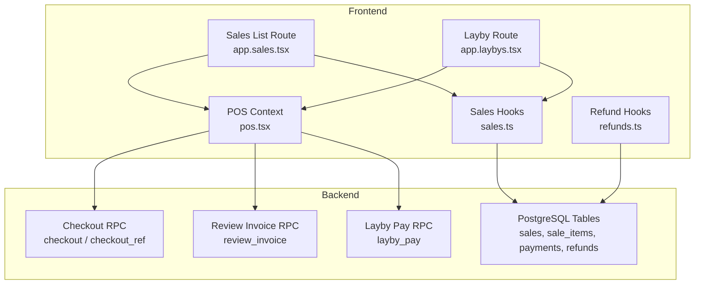
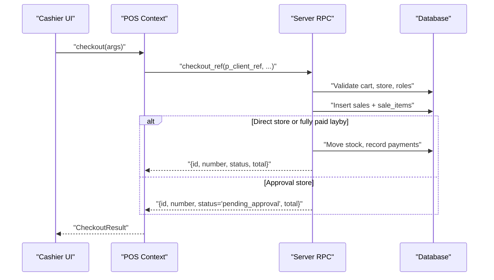
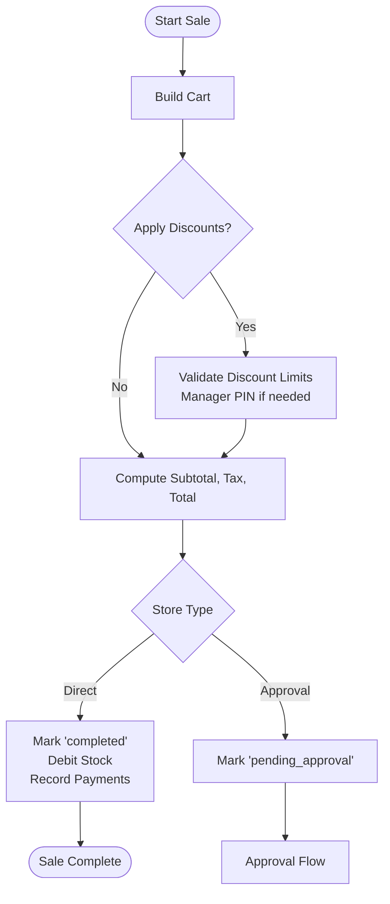
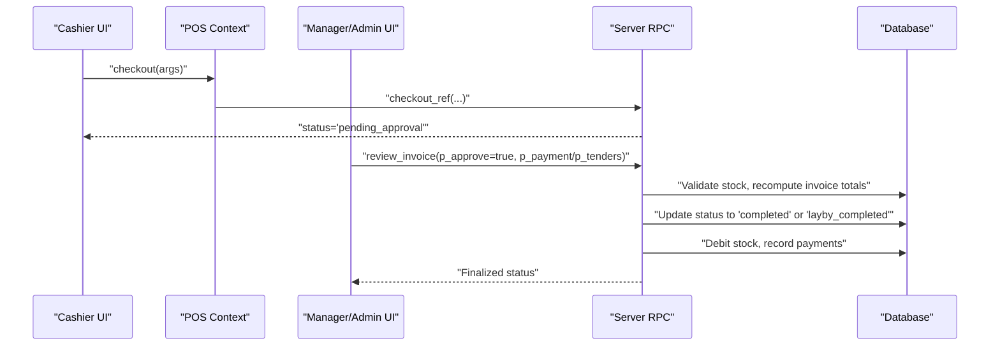
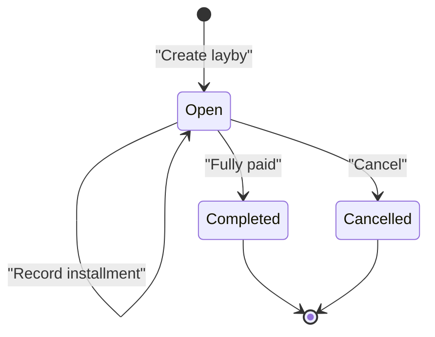
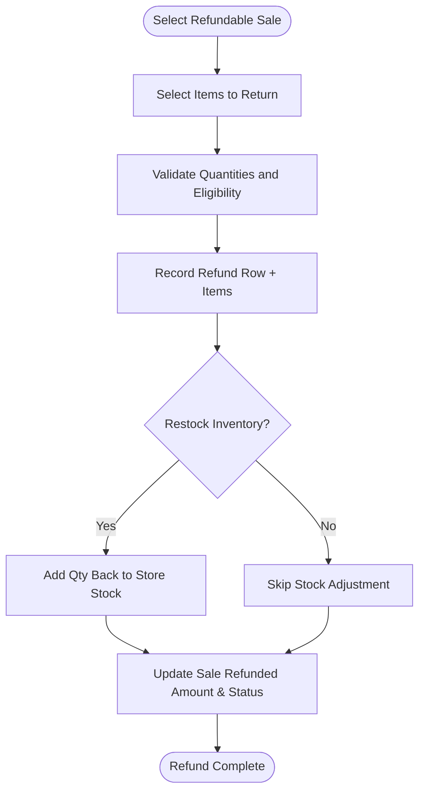
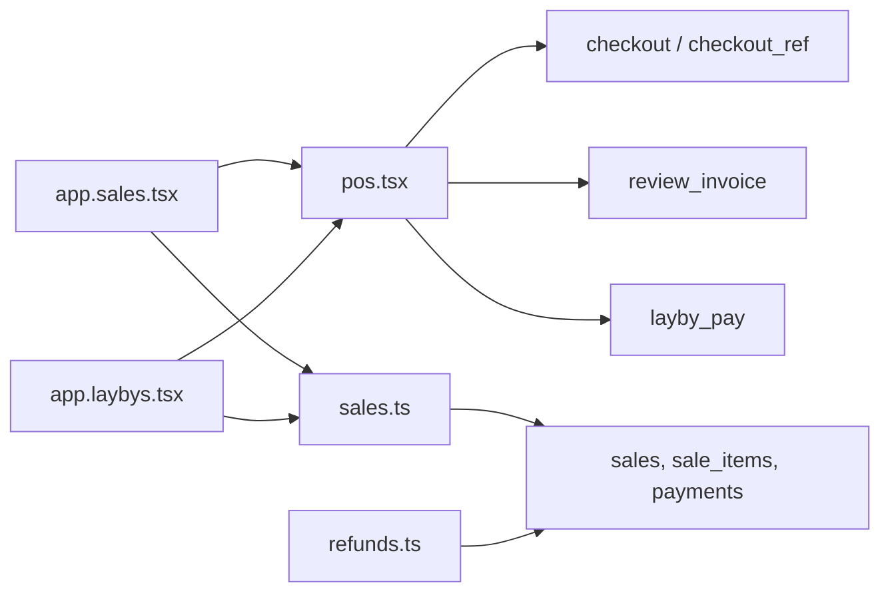

# Transaction Workflows

<cite>
**Referenced Files in This Document**
- [README.md](file://README.md)
- [pos.tsx](file://src/lib/pos.tsx)
- [sales.ts](file://src/lib/sales.ts)
- [app.sales.tsx](file://src/routes/_authenticated/app.sales.tsx)
- [app.laybys.tsx](file://src/routes/_authenticated/app.laybys.tsx)
- [refunds.ts](file://src/lib/refunds.ts)
- [20261007084733_2ed95314-f75e-4843-977b-23f9e6359a48.sql](file://supabase/migrations/20261007084733_2ed95314-f75e-4843-977b-23f9e6359a48.sql)
- [20261008090000_security_hardening.sql](file://supabase/migrations/20261008090000_security_hardening.sql)
- [20261009210500_retail_operations.sql](file://supabase/migrations/20261009210500_retail_operations.sql)
- [20261007183338_b2173994-433e-4727-8c60-bf0d6a8a7aca.sql](file://supabase/migrations/20261007183338_b2173994-433e-4727-8c60-bf0d6a8a7aca.sql)
</cite>

## Table of Contents
1. [Introduction](#introduction)
2. [Project Structure](#project-structure)
3. [Core Components](#core-components)
4. [Architecture Overview](#architecture-overview)
5. [Detailed Component Analysis](#detailed-component-analysis)
6. [Dependency Analysis](#dependency-analysis)
7. [Performance Considerations](#performance-considerations)
8. [Troubleshooting Guide](#troubleshooting-guide)
9. [Conclusion](#conclusion)

## Introduction
This document explains the transaction workflow patterns implemented in the POS system: direct sales, approval-based invoicing, layby order management, and return/refund processing. It maps user-facing screens to server-side RPCs, documents state transitions, authorization requirements, auditing fields, and customization options such as store type configuration, split tenders, discounts with manager PIN override, and offline checkout queuing.

The project supports two store modes:
- Direct sale stores where transactions complete immediately.
- Approval-based stores where cashiers create invoices that require manager/admin approval before stock moves and payment is finalized.

Layby orders support deposits, installment payments, completion, and cancellation. Refunds are restricted to eligible completed or partially refunded sales and are audited with staff, reason, tax, and restocking behavior.

**Section sources**
- [README.md:1-5](file://README.md#L1-L5)

## Project Structure
Transaction workflows span UI routes, shared POS context, data access hooks, and server-side SQL functions:

- UI routes:
  - Sales list and history: `src/routes/_authenticated/app.sales.tsx`
  - Layby management: `src/routes/_authenticated/app.laybys.tsx`
- Shared context:
  - POS provider, role checks, RPC wrapper, offline queue: `src/lib/pos.tsx`
- Data access:
  - Sales queries and export helpers: `src/lib/sales.ts`
  - Refund query helpers and refundable status constants: `src/lib/refunds.ts`
- Server-side business logic:
  - Store creation, staff sessions, RLS policies, checkout, review invoice, refunds, layby pay: `supabase/migrations/20261008090000_security_hardening.sql`, `supabase/migrations/20261009210500_retail_operations.sql`, `supabase/migrations/20261007084733_2ed95314-f75e-4843-977b-23f9e6359a48.sql`

**Diagram sources**
- [app.sales.tsx:93-361](file://src/routes/_authenticated/app.sales.tsx#L93-L361)
- [app.laybys.tsx:27-201](file://src/routes/_authenticated/app.laybys.tsx#L27-L201)
- [pos.tsx:115-448](file://src/lib/pos.tsx#L115-L448)
- [sales.ts:37-217](file://src/lib/sales.ts#L37-L217)
- [refunds.ts:26-56](file://src/lib/refunds.ts#L26-L56)
- [20261009210500_retail_operations.sql:108-320](file://supabase/migrations/20261009210500_retail_operations.sql#L108-L320)
- [20261009210500_retail_operations.sql:322-406](file://supabase/migrations/20261009210500_retail_operations.sql#L322-L406)
- [20261008090000_security_hardening.sql:547-605](file://supabase/migrations/20261008090000_security_hardening.sql#L547-L605)
- [20261008090000_security_hardening.sql:628-642](file://supabase/migrations/20261008090000_security_hardening.sql#L628-L642)

**Section sources**
- [app.sales.tsx:93-361](file://src/routes/_authenticated/app.sales.tsx#L93-L361)
- [app.laybys.tsx:27-201](file://src/routes/_authenticated/app.laybys.tsx#L27-L201)
- [pos.tsx:115-448](file://src/lib/pos.tsx#L115-L448)
- [sales.ts:37-217](file://src/lib/sales.ts#L37-L217)
- [refunds.ts:26-56](file://src/lib/refunds.ts#L26-L56)
- [20261009210500_retail_operations.sql:108-320](file://supabase/migrations/20261009210500_retail_operations.sql#L108-L320)
- [20261009210500_retail_operations.sql:322-406](file://supabase/migrations/20261009210500_retail_operations.sql#L322-L406)
- [20261008090000_security_hardening.sql:547-605](file://supabase/migrations/20261008090000_security_hardening.sql#L547-L605)
- [20261008090000_security_hardening.sql:628-642](file://supabase/migrations/20261008090000_security_hardening.sql#L628-L642)

## Core Components
- POS Context (`pos.tsx`): Provides authentication via PIN, role resolution, store selection, RPC invocation, currency formatting, offline queueing, and auto-lock hygiene. It exposes `can(...roles)` for UI gating and `checkout(args, opts)` for resilient checkout.
- Sales Hooks (`sales.ts`): Reads paginated sales, summaries, item costs, and export rows; invalidates on write events.
- Refund Hooks (`refunds.ts`): Lists refunds and defines which sale statuses allow refunds.
- Sales Route (`app.sales.tsx`): Displays KPIs, pending approvals (for approval stores), and a paged ledger with export options.
- Layby Route (`app.laybys.tsx`): Manages open and closed laybys, records installments, cancels laybys, and shows progress bars.

Key responsibilities:
- Role and session enforcement: `pos.tsx` validates PIN sessions and masks RPC errors.
- Store mode routing: Checkout sets initial status based on store type and sale kind.
- Auditability: Created/approved by timestamps and staff IDs are persisted.

**Section sources**
- [pos.tsx:37-84](file://src/lib/pos.tsx#L37-L84)
- [pos.tsx:194-228](file://src/lib/pos.tsx#L194-L228)
- [pos.tsx:275-338](file://src/lib/pos.tsx#L275-L338)
- [sales.ts:37-73](file://src/lib/sales.ts#L37-L73)
- [sales.ts:126-148](file://src/lib/sales.ts#L126-L148)
- [refunds.ts:26-56](file://src/lib/refunds.ts#L26-L56)
- [app.sales.tsx:93-124](file://src/routes/_authenticated/app.sales.tsx#L93-L124)
- [app.laybys.tsx:27-54](file://src/routes/_authenticated/app.laybys.tsx#L27-L54)

## Architecture Overview
The transaction architecture separates UI orchestration from server-side validation and state mutation:

- Frontend calls RPCs through `usePos().rpc`.
- Backend functions enforce input bounds, role checks, stock availability, and business rules.
- State changes are recorded in `sales`, `sale_items`, `payments`, and `refunds`.
- Auditing fields include `created_by`, `approved_by`, `approved_at`, and shift linkage.

**Diagram sources**
- [pos.tsx:275-338](file://src/lib/pos.tsx#L275-L338)
- [20261009210500_retail_operations.sql:108-320](file://supabase/migrations/20261009210500_retail_operations.sql#L108-L320)
- [20261007084733_2ed95314-f75e-4843-977b-23f9e6359a48.sql:263-283](file://supabase/migrations/20261007084733_2ed95314-f75e-4843-977b-23f9e6359a48.sql#L263-L283)

## Detailed Component Analysis

### Direct Sales Workflow
Direct sales occur in stores configured as direct mode. The cashier builds a cart, optionally applies per-line discounts (with manager PIN override if exceeding limits), selects payment method(s), and completes the sale. Stock is decremented and payments are recorded immediately.

Key behaviors:
- Status becomes `completed`.
- Payment can be single or split across cash/card/mobile.
- Discounts capped at 10% per line/cart unless a manager PIN overrides.
- Offline-safe: queued locally and replayed when online.

**Diagram sources**
- [20261009210500_retail_operations.sql:108-320](file://supabase/migrations/20261009210500_retail_operations.sql#L108-L320)
- [20261007084733_2ed95314-f75e-4843-977b-23f9e6359a48.sql:263-283](file://supabase/migrations/20261007084733_2ed95314-f75e-4843-977b-23f9e6359a48.sql#L263-L283)

Practical example:
- A cashier scans items, applies a 5% discount on one product, pays with card, and the sale completes instantly in a direct store.

Role permissions:
- Cashier, manager, admin can execute checkout.
- Manager PIN required for discounts beyond allowed thresholds.

Status tracking:
- `completed` indicates immediate finalization.

Auditing:
- `created_by`, `store_id`, `payment_method`, optional `shift_id`.

Customization:
- Split tenders supported.
- Per-line discounts supported.
- Tax inclusive/exclusive modes handled server-side.

**Section sources**
- [20261009210500_retail_operations.sql:108-320](file://supabase/migrations/20261009210500_retail_operations.sql#L108-L320)
- [pos.tsx:275-338](file://src/lib/pos.tsx#L275-L338)

### Approval-Based Workflow
In approval stores, cashiers create invoices that remain pending until approved by another admin or manager. On approval, stock is debited and payment is finalized. Self-approval is blocked unless the approver is an admin.

**Diagram sources**
- [20261009210500_retail_operations.sql:322-406](file://supabase/migrations/20261009210500_retail_operations.sql#L322-L406)
- [20261008090000_security_hardening.sql:517-545](file://supabase/migrations/20261008090000_security_hardening.sql#L517-L545)

Transition states:
- Initial: `pending_approval`
- Approved: `completed` or `layby_completed`
- Rejected: `rejected`

Authorization:
- Only admin or manager can approve/reject.
- The same person who created the invoice cannot approve it unless they are an admin.

Audit fields:
- `approved_by`, `approved_at` populated on decision.

UI visibility:
- Sales list highlights pending approvals and includes a pending count when any store is approval-based.

**Section sources**
- [20261009210500_retail_operations.sql:322-406](file://supabase/migrations/20261009210500_retail_operations.sql#L322-L406)
- [app.sales.tsx:215-225](file://src/routes/_authenticated/app.sales.tsx#L215-L225)

### Layby Order Management
Layby orders track customer pre-orders with deposit and installment payments. They start as `layby_open`, transition to `layby_completed` when fully paid, and can be cancelled.

**Diagram sources**
- [20261008090000_security_hardening.sql:628-642](file://supabase/migrations/20261008090000_security_hardening.sql#L628-L642)
- [app.laybys.tsx:27-54](file://src/routes/_authenticated/app.laybys.tsx#L27-L54)

Deposit collection and installment tracking:
- Initial layby creation may include partial payment; if fully paid, it completes immediately.
- Installments are recorded via `layby_pay`, updating `paid` and recalculating remaining balance.
- UI shows progress bar and owing amount.

Completion process:
- When cumulative payments reach total, status becomes `layby_completed`.

Cancellation:
- Laybys can be cancelled by authorized users; UI confirms before cancelling.

Role permissions:
- Cashier, manager, admin can record layby payments.
- Cancellation typically requires higher privileges depending on UI gating.

**Section sources**
- [app.laybys.tsx:27-54](file://src/routes/_authenticated/app.laybys.tsx#L27-L54)
- [app.laybys.tsx:142-201](file://src/routes/_authenticated/app.laybys.tsx#L142-L201)
- [20261008090000_security_hardening.sql:628-642](file://supabase/migrations/20261008090000_security_hardening.sql#L628-L642)

### Return and Refund Processing
Refunds apply only to eligible sales: `completed`, `layby_completed`, or `partially_refunded`. Refunds update sale-level refunded amounts, set status to `refunded` or `partially_refunded`, and optionally restock inventory.

**Diagram sources**
- [refunds.ts:26-56](file://src/lib/refunds.ts#L26-L56)
- [20261008090000_security_hardening.sql:547-605](file://supabase/migrations/20261008090000_security_hardening.sql#L547-L605)

Authorization:
- Refunds are restricted to admin and manager roles.

Audit requirements:
- Reason is mandatory.
- Staff ID, shift linkage, tax allocation, and cost capture are recorded.

Eligible statuses:
- `completed`, `layby_completed`, `partially_refunded`.

Partial refunds:
- Allowed; sale status becomes `partially_refunded` until fully refunded.

**Section sources**
- [refunds.ts:26-56](file://src/lib/refunds.ts#L26-L56)
- [20261008090000_security_hardening.sql:547-605](file://supabase/migrations/20261008090000_security_hardening.sql#L547-L605)

### Practical Examples and Transition States

- Direct sale example:
  - Cashier adds items, pays with card, sale status becomes `completed`, stock decreases, payment recorded.
- Approval example:
  - Cashier creates invoice in approval store, status becomes `pending_approval`; manager approves, status becomes `completed`, stock decreases, payment recorded.
- Layby example:
  - Create layby with deposit, status `layby_open`; record installments; when fully paid, status becomes `layby_completed`.
- Refund example:
  - Select completed sale, choose items, provide reason, record refund; sale status becomes `refunded` or `partially_refunded`.

Approval chains:
- Single approver step: admin or manager reviews and approves/rejects.
- Self-approval prevention enforced unless approver is admin.

**Section sources**
- [20261009210500_retail_operations.sql:108-320](file://supabase/migrations/20261009210500_retail_operations.sql#L108-L320)
- [20261009210500_retail_operations.sql:322-406](file://supabase/migrations/20261009210500_retail_operations.sql#L322-L406)
- [20261008090000_security_hardening.sql:547-605](file://supabase/migrations/20261008090000_security_hardening.sql#L547-L605)
- [20261008090000_security_hardening.sql:628-642](file://supabase/migrations/20261008090000_security_hardening.sql#L628-L642)

### Transaction Auditing, Status Tracking, and Customization

Auditing:
- `created_by`, `approved_by`, `approved_at` track lifecycle actors and timestamps.
- Shift linkage supports till reconciliation.
- Refund entries include reason, staff, tax, and cost.

Status tracking:
- Valid statuses include `completed`, `pending_approval`, `rejected`, `layby_open`, `layby_completed`, `layby_cancelled`, `refunded`, `partially_refunded`.

Customization options:
- Store type: direct vs approval.
- Split tenders and per-line discounts with manager PIN override.
- Offline checkout queuing with retry and error masking.
- Auto-lock after idle time for till hygiene.

Role permissions summary:
- Cashier: checkout, layby payments, limited operations.
- Manager/Admin: approve/reject invoices, manage discounts beyond caps, process refunds, configure stores/staff.

**Section sources**
- [sales.ts:5-35](file://src/lib/sales.ts#L5-L35)
- [20261007183338_b2173994-433e-4727-8c60-bf0d6a8a7aca.sql:1-2](file://supabase/migrations/20261007183338_b2173994-433e-4727-8c60-bf0d6a8a7aca.sql#L1-L2)
- [pos.tsx:347-364](file://src/lib/pos.tsx#L347-L364)
- [20261009210500_retail_operations.sql:108-320](file://supabase/migrations/20261009210500_retail_operations.sql#L108-L320)

## Dependency Analysis
The following diagram shows how frontend components depend on backend RPCs and data models:

**Diagram sources**
- [app.sales.tsx:93-361](file://src/routes/_authenticated/app.sales.tsx#L93-L361)
- [app.laybys.tsx:27-201](file://src/routes/_authenticated/app.laybys.tsx#L27-L201)
- [pos.tsx:115-448](file://src/lib/pos.tsx#L115-L448)
- [sales.ts:37-217](file://src/lib/sales.ts#L37-L217)
- [refunds.ts:26-56](file://src/lib/refunds.ts#L26-L56)
- [20261009210500_retail_operations.sql:108-320](file://supabase/migrations/20261009210500_retail_operations.sql#L108-L320)
- [20261009210500_retail_operations.sql:322-406](file://supabase/migrations/20261009210500_retail_operations.sql#L322-L406)
- [20261008090000_security_hardening.sql:547-605](file://supabase/migrations/20261008090000_security_hardening.sql#L547-L605)
- [20261008090000_security_hardening.sql:628-642](file://supabase/migrations/20261008090000_security_hardening.sql#L628-L642)

**Section sources**
- [app.sales.tsx:93-361](file://src/routes/_authenticated/app.sales.tsx#L93-L361)
- [app.laybys.tsx:27-201](file://src/routes/_authenticated/app.laybys.tsx#L27-L201)
- [pos.tsx:115-448](file://src/lib/pos.tsx#L115-L448)
- [sales.ts:37-217](file://src/lib/sales.ts#L37-L217)
- [refunds.ts:26-56](file://src/lib/refunds.ts#L26-L56)

## Performance Considerations
- Server-side aggregation: Sales summary uses SQL aggregates to compute revenue, collected, refunds, and counts without loading all rows into memory.
- Pagination: Sales list pages directly from the database with exact counts.
- Stale-time tuning: Queries use short stale times to keep multi-device views fresh while avoiding excessive refetches.
- Export laziness: CSV/PDF exports fetch full periods only on demand, bounded for safety.

[No sources needed since this section provides general guidance]

## Troubleshooting Guide
Common issues and resolutions:
- Network errors during checkout:
  - The POS queues offline sales and retries automatically; failed attempts show actionable messages with retry/discard options.
- Locked sessions:
  - If a session expires or is locked, the client clears local state and prompts for PIN unlock again.
- Insufficient stock:
  - Direct sales and approvals validate stock before moving units; errors list short-stocked products.
- Unauthorized actions:
  - Role checks prevent unauthorized discount overrides, refunds, and approvals; errors are masked to avoid leaking internals.

Operational tips:
- Use the Sales list to identify pending approvals and filter by date ranges.
- Use Laybys to track outstanding balances and record installments.
- For refunds, ensure the sale is eligible and provide a reason.

**Section sources**
- [pos.tsx:275-338](file://src/lib/pos.tsx#L275-L338)
- [pos.tsx:347-364](file://src/lib/pos.tsx#L347-L364)
- [20261009210500_retail_operations.sql:108-320](file://supabase/migrations/20261009210500_retail_operations.sql#L108-L320)
- [20261009210500_retail_operations.sql:322-406](file://supabase/migrations/20261009210500_retail_operations.sql#L322-L406)
- [20261008090000_security_hardening.sql:547-605](file://supabase/migrations/20261008090000_security_hardening.sql#L547-L605)

## Conclusion
The POS system implements robust transaction workflows tailored for both direct and approval-based retail environments. Direct sales finalize immediately, while approval stores introduce a controlled review step before stock movement and payment finalization. Layby orders support flexible deposit and installment tracking, and refunds are securely gated with comprehensive auditing. Role-based permissions, store-type configuration, split tenders, discount controls, and offline resilience make the system adaptable to varied operational needs.

[No sources needed since this section summarizes without analyzing specific files]