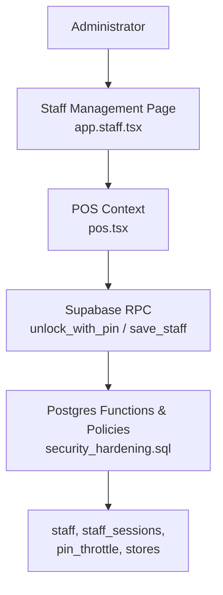
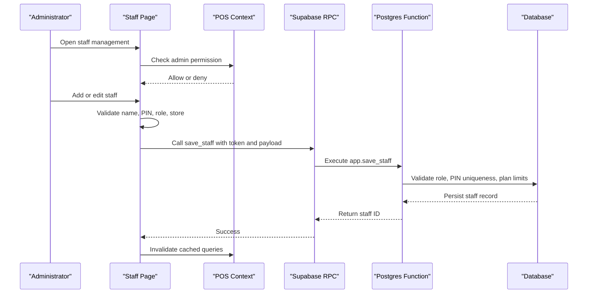
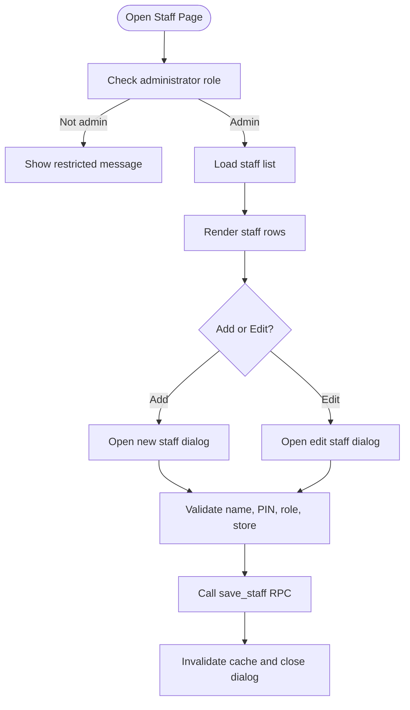
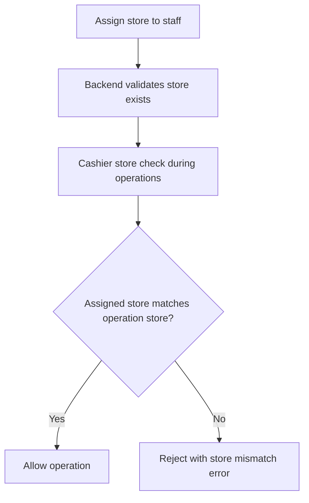
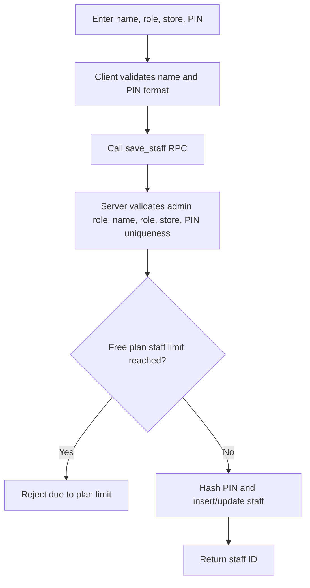
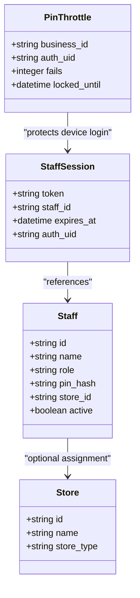
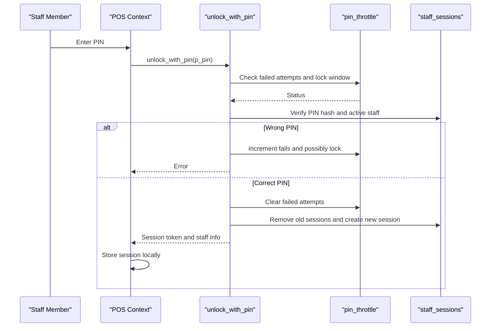
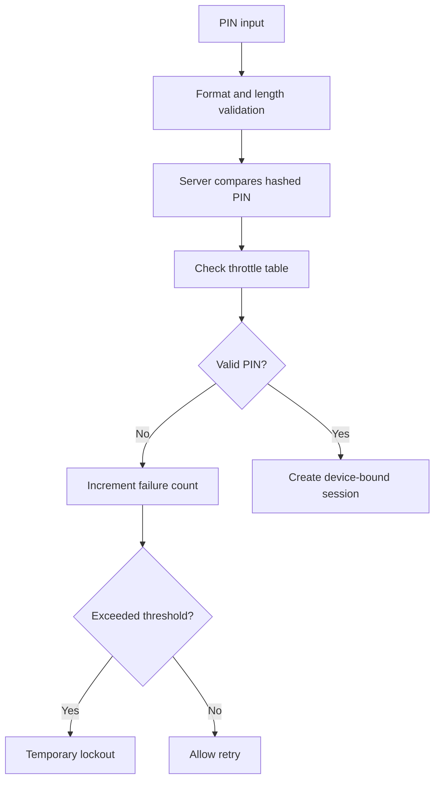
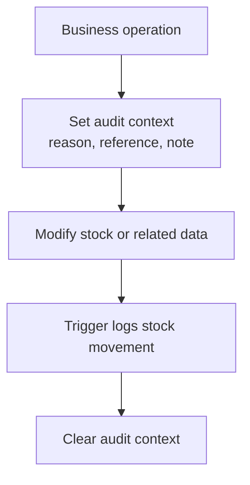
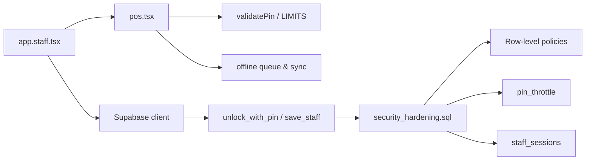

# Staff Management

<cite>
**Referenced Files in This Document**
- [app.staff.tsx](file://src/routes/_authenticated/app.staff.tsx)
- [pos.tsx](file://src/lib/pos.tsx)
- [workspace-navigation.ts](file://src/lib/workspace-navigation.ts)
- [20261007084733_2ed95314-f75e-4843-977b-23f9e6359a48.sql](file://supabase/migrations/20261007084733_2ed95314-f75e-4843-977b-23f9e6359a48.sql)
- [20261008090000_security_hardening.sql](file://supabase/migrations/20261008090000_security_hardening.sql)
- [20261007102244_c10153f5-18b7-41d2-8c8e-b71e-7f98b51895af.sql](file://supabase/migrations/20261007102244_c10153f5-18b7-41d2-8c8e-b71e-7f98b51895af.sql)
</cite>

## Table of Contents
1. [Introduction](#introduction)
2. [Project Structure](#project-structure)
3. [Core Components](#core-components)
4. [Architecture Overview](#architecture-overview)
5. [Detailed Component Analysis](#detailed-component-analysis)
6. [Dependency Analysis](#dependency-analysis)
7. [Performance Considerations](#performance-considerations)
8. [Troubleshooting Guide](#troubleshooting-guide)
9. [Conclusion](#conclusion)

## Introduction
This document explains the staff management system used by the application. It covers how administrators create staff accounts, assign PIN codes, define roles, and control store access. It also documents the staff dashboard, role-based permissions, location-based access controls, security implications of PIN handling, authentication flows, and audit-related mechanisms for tracking stock movements and operational context.

The system separates:
- **Frontend staff administration**: a protected route where only administrators can manage staff records.
- **Server-side security**: Postgres functions that validate inputs, enforce roles, limit PIN usage, bind sessions to devices, and gate data access through row-level policies.
- **POS runtime context**: a shared provider that stores the active staff session, enforces idle locking, and routes business operations through secure RPC calls.

## Project Structure
The staff feature spans three main layers:

| Layer | Responsibility | Key Files |
|---|---|---|
| Frontend staff UI | Lists staff, adds/edit staff, assigns roles, stores, PINs, and auto-lock settings | `src/routes/_authenticated/app.staff.tsx` |
| POS runtime | Manages staff session, unlock/lock, role checks, store selection, and RPC invocation | `src/lib/pos.tsx` |
| Database security | Defines staff schema, PIN hashing, session binding, throttling, RLS policies, and server-side validation | `supabase/migrations/20261007084733_2ed95314-f75e-4843-977b-23f9e6359a48.sql`, `supabase/migrations/20261008090000_security_hardening.sql` |

**Diagram sources**
- [app.staff.tsx:54-147](file://src/routes/_authenticated/app.staff.tsx#L54-L147)
- [pos.tsx:115-228](file://src/lib/pos.tsx#L115-L228)
- [20261008090000_security_hardening.sql:218-291](file://supabase/migrations/20261008090000_security_hardening.sql#L218-L291)

**Section sources**
- [app.staff.tsx:26-37](file://src/routes/_authenticated/app.staff.tsx#L26-L37)
- [pos.tsx:37-84](file://src/lib/pos.tsx#L37-L84)
- [20261007084733_2ed95314-f75e-4843-977b-23f9e6359a48.sql:17-31](file://supabase/migrations/20261007084733_2ed95314-f75e-4843-977b-23f9e6359a48.sql#L17-L31)

## Core Components
The staff system is built around these core components:

| Component | Purpose | Important Behaviors |
|---|---|---|
| Staff management page | Create, edit, and list staff members | Only visible to administrators; validates names, PINs, roles, and store assignments |
| POS context | Holds current user’s business, stores, and active staff session | Provides `unlock`, `lock`, `rpc`, and `can(role)` helpers |
| Server-side staff functions | Validate and persist staff records | Enforce admin-only creation, unique PINs, plan limits, and safe updates |
| PIN unlock flow | Authenticate a staff member on a device | Validates PIN shape, throttles failures, binds session to device login, sets expiry |
| Row-level policies | Restrict data access based on business and role | Require an active PIN session and allowed role for sensitive tables |
| Store management | Manage locations and store types | Admin-only; supports direct and approval store modes |

**Section sources**
- [app.staff.tsx:54-147](file://src/routes/_authenticated/app.staff.tsx#L54-L147)
- [pos.tsx:194-228](file://src/lib/pos.tsx#L194-L228)
- [20261008090000_security_hardening.sql:329-371](file://supabase/migrations/20261008090000_security_hardening.sql#L329-L371)
- [20261008090000_security_hardening.sql:218-291](file://supabase/migrations/20261008090000_security_hardening.sql#L218-L291)

## Architecture Overview
The staff architecture combines frontend state, server-side validation, and database security.

**Diagram sources**
- [app.staff.tsx:149-188](file://src/routes/_authenticated/app.staff.tsx#L149-L188)
- [20261008090000_security_hardening.sql:329-371](file://supabase/migrations/20261008090000_security_hardening.sql#L329-L371)

## Detailed Component Analysis

### Staff Management Dashboard
The staff dashboard is the administrative interface for managing team members.

Key responsibilities:
- Restrict access to administrators.
- Display staff roster with name, role, assigned store, and active status.
- Provide add/edit dialogs for creating or updating staff accounts.
- Support optional store assignment and PIN entry.
- Configure till auto-lock duration.

**Diagram sources**
- [app.staff.tsx:54-147](file://src/routes/_authenticated/app.staff.tsx#L54-L147)
- [app.staff.tsx:149-188](file://src/routes/_authenticated/app.staff.tsx#L149-L188)

#### Role-Based Permissions
Roles are stored as codes and mapped to display labels:
- `cashier`
- `manager`
- `admin`

Only administrators can open the staff management page. The navigation also marks the staff route as admin-only.

**Section sources**
- [app.staff.tsx:41-52](file://src/routes/_authenticated/app.staff.tsx#L41-L52)
- [app.staff.tsx:72-75](file://src/routes/_authenticated/app.staff.tsx#L72-L75)
- [workspace-navigation.ts:114-114](file://src/lib/workspace-navigation.ts#L114-L114)

#### Store Assignments and Location-Based Access Controls
Each staff record may have:
- A `store_id` reference to a specific store.
- A null `store_id`, meaning the staff member is not limited to one store.

The UI lets administrators choose between “all stores” and a specific store when assigning a staff member. On the backend, cashier operations check whether a cashier is assigned to the selected store before allowing checkout or expense recording.

**Diagram sources**
- [app.staff.tsx:221-237](file://src/routes/_authenticated/app.staff.tsx#L221-L237)
- [20261008090000_security_hardening.sql:447-449](file://supabase/migrations/20261008090000_security_hardening.sql#L447-L449)
- [20261008090000_security_hardening.sql:649-650](file://supabase/migrations/20261008090000_security_hardening.sql#L649-L650)

**Section sources**
- [app.staff.tsx:121-142](file://src/routes/_authenticated/app.staff.tsx#L121-L142)
- [app.staff.tsx:221-237](file://src/routes/_authenticated/app.staff.tsx#L221-L237)
- [20261008090000_security_hardening.sql:447-449](file://supabase/migrations/20261008090000_security_hardening.sql#L447-L449)

### Staff Account Creation and PIN Assignment
Creating or editing a staff account involves:
- Validating the staff name length and content.
- Optionally validating and sanitizing the PIN.
- Selecting a role from the allowed set.
- Choosing either all stores or a specific store.
- Toggling active status for existing staff.
- Calling the server-side `save_staff` function.

PIN rules enforced by the backend include:
- PIN must be numeric.
- PIN length must be between 4 and 8 digits.
- PIN must be unique among active staff in the same business.
- Creating a new staff record requires a PIN.
- Free-plan limits restrict the number of active staff PINs.

**Diagram sources**
- [app.staff.tsx:149-188](file://src/routes/_authenticated/app.staff.tsx#L149-L188)
- [20261008090000_security_hardening.sql:329-371](file://supabase/migrations/20261008090000_security_hardening.sql#L329-L371)

**Section sources**
- [app.staff.tsx:149-188](file://src/routes/_authenticated/app.staff.tsx#L149-L188)
- [20261008090000_security_hardening.sql:329-371](file://supabase/migrations/20261008090000_security_hardening.sql#L329-L371)

### Relationship Between Staff Accounts, PIN Codes, and Access Permissions
The relationship is layered:

| Concept | Meaning |
|---|---|
| Staff account | Represents a person within a business, including name, role, optional store assignment, and active status |
| PIN code | Used to authenticate a staff member on a device; stored as a hash |
| Staff session | A short-lived, device-bound token created after successful PIN unlock |
| Role | Determines which operations the staff member can perform |
| Store assignment | Limits a cashier to a specific store when present |

**Diagram sources**
- [20261007084733_2ed95314-f75e-4843-977b-23f9e6359a48.sql:17-31](file://supabase/migrations/20261007084733_2ed95314-f75e-4843-977b-23f9e6359a48.sql#L17-L31)
- [20261008090000_security_hardening.sql:27-46](file://supabase/migrations/20261008090000_security_hardening.sql#L27-L46)

**Section sources**
- [20261007084733_2ed95314-f75e-4843-977b-23f9e6359a48.sql:17-31](file://supabase/migrations/20261007084733_2ed95314-f75e-4843-977b-23f9e6359a48.sql#L17-L31)
- [20261008090000_security_hardening.sql:27-46](file://supabase/migrations/20261008090000_security_hardening.sql#L27-L46)

### Staff Authentication Flow
When a staff member unlocks the POS with a PIN:

1. The client validates the PIN format.
2. The client calls `unlock_with_pin`.
3. The server checks the signed-in user’s business.
4. The server checks PIN attempt throttling per device login.
5. The server verifies the PIN against the hashed value.
6. On success, the server clears failed attempts, removes expired sessions, and creates a new session bound to the device login.
7. The client stores the session locally and refreshes queries.

**Diagram sources**
- [pos.tsx:194-203](file://src/lib/pos.tsx#L194-L203)
- [20261008090000_security_hardening.sql:218-256](file://supabase/migrations/20261008090000_security_hardening.sql#L218-L256)

**Section sources**
- [pos.tsx:194-203](file://src/lib/pos.tsx#L194-L203)
- [20261008090000_security_hardening.sql:218-256](file://supabase/migrations/20261008090000_security_hardening.sql#L218-L256)

### Security Implications of PIN Management
PIN management has several important security properties:

| Area | Implementation |
|---|---|
| Storage | PINs are never stored in plain text; they are hashed using a cryptographic salt |
| Validation | Both frontend and backend validate PIN format and length |
| Uniqueness | Active PINs must be unique within a business |
| Brute-force protection | Failed attempts are tracked per business and device login; repeated failures can temporarily lock PIN entry |
| Session binding | Staff sessions are tied to the authenticated device login and expire after a fixed period |
| Role enforcement | Sensitive operations require a valid staff session and an allowed role |
| Data access | Row-level policies require an active PIN session and appropriate role for most business data |

**Diagram sources**
- [20261008090000_security_hardening.sql:27-40](file://supabase/migrations/20261008090000_security_hardening.sql#L27-L40)
- [20261008090000_security_hardening.sql:218-256](file://supabase/migrations/20261008090000_security_hardening.sql#L218-L256)
- [20261008090000_security_hardening.sql:329-371](file://supabase/migrations/20261008090000_security_hardening.sql#L329-L371)

**Section sources**
- [20261008090000_security_hardening.sql:27-40](file://supabase/migrations/20261008090000_security_hardening.sql#L27-L40)
- [20261008090000_security_hardening.sql:218-256](file://supabase/migrations/20261008090000_security_hardening.sql#L218-L256)
- [20261008090000_security_hardening.sql:329-371](file://supabase/migrations/20261008090000_security_hardening.sql#L329-L371)

### Audit Logging for Staff Activities and Access Tracking
The repository implements operational auditing primarily through stock movement logging and contextual metadata rather than a dedicated general-purpose staff activity log.

Key audit-related behaviors:
- Stock movements are logged through a trigger function.
- Business operations set contextual information such as reason, reference, and note before modifying stock.
- The context is cleared after the operation completes.
- Sales, refunds, adjustments, and stock takes use this mechanism to associate changes with their business reason.

This means:
- You can trace why stock changed.
- You can correlate stock changes with sales, refunds, adjustments, or stocktakes.
- There is no explicit general-purpose audit table for every staff action such as opening the staff page or changing auto-lock settings.

**Diagram sources**
- [20261007102244_c10153f5-18b7-41d2-8c8e-b71e-7f98b51895af.sql:29-54](file://supabase/migrations/20261007102244_c10153f5-18b7-41d2-8c8e-b71e-7f98b51895af.sql#L29-L54)
- [20261008090000_security_hardening.sql:607-626](file://supabase/migrations/20261008090000_security_hardening.sql#L607-L626)

**Section sources**
- [20261007102244_c10153f5-18b7-41d2-8c8e-b71e-7f98b51895af.sql:29-54](file://supabase/migrations/20261007102244_c10153f5-18b7-41d2-8c8e-b71e-7f98b51895af.sql#L29-L54)
- [20261008090000_security_hardening.sql:607-626](file://supabase/migrations/20261008090000_security_hardening.sql#L607-L626)

## Dependency Analysis
The following diagram shows how the frontend, runtime, and database layers depend on each other for staff management.

**Diagram sources**
- [app.staff.tsx:1-11](file://src/routes/_authenticated/app.staff.tsx#L1-L11)
- [pos.tsx:1-26](file://src/lib/pos.tsx#L1-L26)
- [pos.tsx:194-228](file://src/lib/pos.tsx#L194-L228)
- [20261008090000_security_hardening.sql:218-291](file://supabase/migrations/20261008090000_security_hardening.sql#L218-L291)

**Section sources**
- [app.staff.tsx:1-11](file://src/routes/_authenticated/app.staff.tsx#L1-L11)
- [pos.tsx:194-228](file://src/lib/pos.tsx#L194-L228)
- [20261008090000_security_hardening.sql:218-291](file://supabase/migrations/20261008090000_security_hardening.sql#L218-L291)

## Performance Considerations
- The staff list query uses a long stale time so it stays resident while administrators work on the roster.
- The POS context caches business and store data with long stale times because those values rarely change during a trading session.
- Staff sessions expire after a fixed period, reducing the risk of long-lived tokens.
- Idle locking is configurable and can be disabled, but enabling it improves till hygiene.
- Offline sales are queued locally and synced later, preventing lost transactions when connectivity is unavailable.

[No sources needed since this section provides general guidance]

## Troubleshooting Guide

| Problem | Likely Cause | Recommended Action |
|---|---|---|
| Cannot open staff management page | Current user is not an administrator | Sign in as an administrator |
| PIN rejected | Invalid format, wrong PIN, or temporary lockout | Verify PIN length and try again; wait if locked out |
| Cannot create staff | Missing PIN, invalid role, unknown store, or free-plan limit | Provide a valid PIN, select an allowed role, choose a valid store, or upgrade plan |
| Cashier cannot operate at a store | Cashier is assigned to another store | Update the cashier’s store assignment or select the correct store |
| Operations fail with locked message | Staff session expired or was invalidated | Re-enter PIN to unlock |
| Data appears empty after unlocking | No active PIN session or insufficient role | Ensure PIN unlock succeeded and the role allows access |
| Stock changes cannot be traced | Missing or unclear audit context | Review the operation’s reason, reference, and notes set during the business process |

**Section sources**
- [app.staff.tsx:72-75](file://src/routes/_authenticated/app.staff.tsx#L72-L75)
- [20261008090000_security_hardening.sql:218-256](file://supabase/migrations/20261008090000_security_hardening.sql#L218-L256)
- [20261008090000_security_hardening.sql:329-371](file://supabase/migrations/20261008090000_security_hardening.sql#L329-L371)
- [20261008090000_security_hardening.sql:447-449](file://supabase/migrations/20261008090000_security_hardening.sql#L447-L449)

## Conclusion
The staff management system provides a secure, role-aware way to manage retail operations. Administrators create staff accounts, assign roles, and optionally restrict cashiers to specific stores. PINs are validated, hashed, and protected against brute-force attempts, while staff sessions are short-lived and bound to the device login. Row-level policies ensure that only authenticated staff with appropriate roles can access business data. Operational changes are audited through stock movement logging and contextual metadata, making it possible to trace inventory changes back to their business reasons.

[No sources needed since this section summarizes without analyzing specific files]