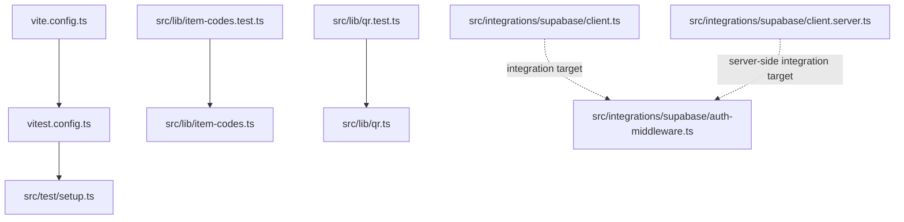
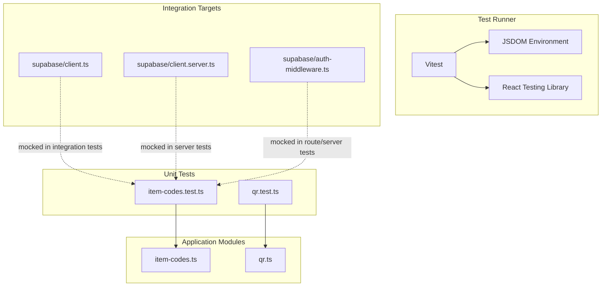
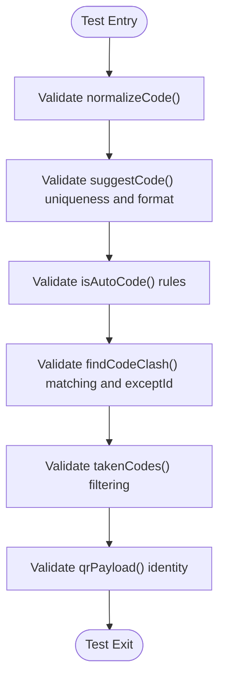
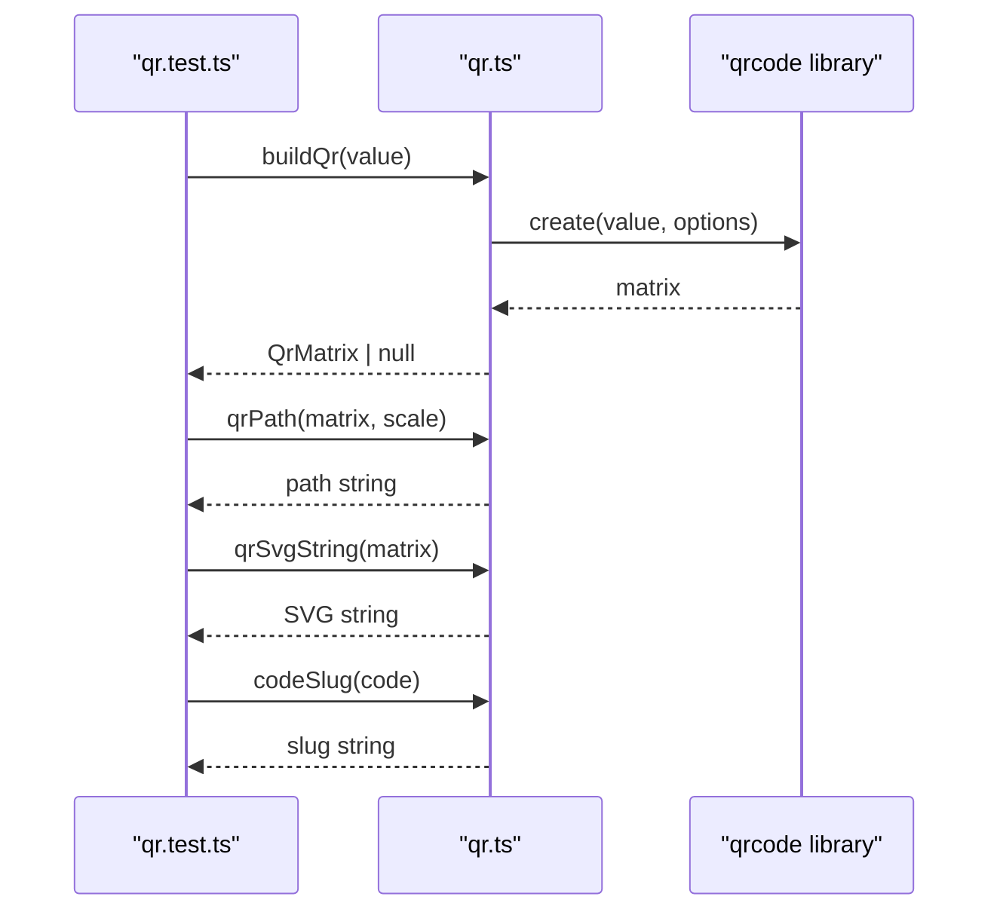
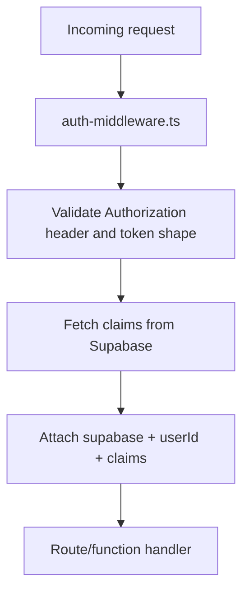
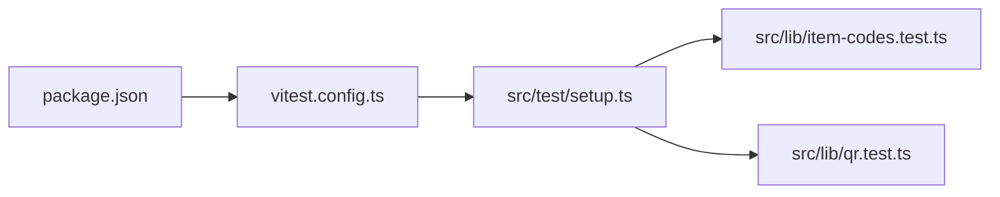

# Testing Strategy

<cite>
**Referenced Files in This Document**
- [vitest.config.ts](file://vitest.config.ts)
- [setup.ts](file://src/test/setup.ts)
- [package.json](file://package.json)
- [vite.config.ts](file://vite.config.ts)
- [item-codes.test.ts](file://src/lib/item-codes.test.ts)
- [qr.test.ts](file://src/lib/qr.test.ts)
- [item-codes.ts](file://src/lib/item-codes.ts)
- [qr.ts](file://src/lib/qr.ts)
- [client.ts](file://src/integrations/supabase/client.ts)
- [client.server.ts](file://src/integrations/supabase/client.server.ts)
- [auth-middleware.ts](file://src/integrations/supabase/auth-middleware.ts)
</cite>

## Table of Contents
1. [Introduction](#introduction)
2. [Project Structure](#project-structure)
3. [Core Components](#core-components)
4. [Architecture Overview](#architecture-overview)
5. [Detailed Component Analysis](#detailed-component-analysis)
6. [Dependency Analysis](#dependency-analysis)
7. [Performance Considerations](#performance-considerations)
8. [Troubleshooting Guide](#troubleshooting-guide)
9. [Conclusion](#conclusion)
10. [Appendices](#appendices)

## Introduction
This document explains the testing strategy and implementation for the project. It covers the Vitest framework setup, test utilities, unit testing patterns for business logic and utility functions, component testing approach, integration testing considerations for Supabase and external services, asynchronous and offline testing strategies, authentication flow testing, test data management, continuous integration guidance, and performance testing considerations.

The repository currently includes:
- A Vitest configuration with a JSDOM environment and React support.
- A small test setup that enables DOM matchers and cleans up mounted components between tests.
- Two existing unit test files validating item code generation/matching and QR code matrix/SVG behavior.
- Supabase client modules used by the application, which are relevant when designing integration and mocking strategies.

## Project Structure
Testing-related files live under `src/test` for shared setup, while individual feature tests are colocated next to their source modules using the `.test.ts` naming convention. The test discovery pattern is configured to include both `.test.*` and `.spec.*` files under `src`.

**Diagram sources**
- [vitest.config.ts:5-15](file://vitest.config.ts#L5-L15)
- [setup.ts:1-7](file://src/test/setup.ts#L1-L7)
- [item-codes.test.ts:1-10](file://src/lib/item-codes.test.ts#L1-L10)
- [qr.test.ts:1-3](file://src/lib/qr.test.ts#L1-L3)
- [client.ts:1-96](file://src/integrations/supabase/client.ts#L1-L96)
- [client.server.ts:1-73](file://src/integrations/supabase/client.server.ts#L1-L73)
- [auth-middleware.ts:1-106](file://src/integrations/supabase/auth-middleware.ts#L1-L106)

**Section sources**
- [vitest.config.ts:5-15](file://vitest.config.ts#L5-L15)
- [setup.ts:1-7](file://src/test/setup.ts#L1-L7)
- [package.json:6-14](file://package.json#L6-L14)

## Core Components
This section documents the testing framework setup and the current test utilities.

### Vitest Configuration
Vitest is configured with:
- React plugin enabled for JSX/TSX support.
- JSDOM environment for browser-like APIs.
- Global test helpers enabled.
- A setup file at `src/test/setup.ts`.
- Test discovery including `src/**/*.{test,spec}.{ts,tsx}`.
- An `@` path alias pointing to `src`.

These settings make it straightforward to write unit tests for pure modules and component tests that mount into a virtual DOM.

**Section sources**
- [vitest.config.ts:5-15](file://vitest.config.ts#L5-L15)

### Test Setup Utilities
The test setup file:
- Enables DOM assertions via `@testing-library/jest-dom/vitest`.
- Imports React Testing Library cleanup.
- Registers an `afterEach` hook to clean up any mounted components between tests.

This ensures UI state does not leak across tests and provides convenient matchers such as `toBeInTheDocument`, `toHaveTextContent`, etc.

**Section sources**
- [setup.ts:1-7](file://src/test/setup.ts#L1-L7)

### Scripts and Tooling
The package scripts expose:
- `npm test` to run all tests once.
- `npm run test:watch` to run tests in watch mode.

Relevant dev dependencies include Vitest, jsdom, React Testing Library, and Jest DOM matchers.

**Section sources**
- [package.json:6-14](file://package.json#L6-L14)
- [package.json:81-104](file://package.json#L81-L104)

## Architecture Overview
The testing architecture centers on Vitest running against JSDOM, with React Testing Library available for component tests. Business logic modules are tested directly, while integration points (Supabase clients and middleware) should be isolated or mocked during tests.

**Diagram sources**
- [vitest.config.ts:5-15](file://vitest.config.ts#L5-L15)
- [setup.ts:1-7](file://src/test/setup.ts#L1-L7)
- [item-codes.test.ts:1-10](file://src/lib/item-codes.test.ts#L1-L10)
- [qr.test.ts:1-3](file://src/lib/qr.test.ts#L1-L3)
- [client.ts:1-96](file://src/integrations/supabase/client.ts#L1-L96)
- [client.server.ts:1-73](file://src/integrations/supabase/client.server.ts#L1-L73)
- [auth-middleware.ts:1-106](file://src/integrations/supabase/auth-middleware.ts#L1-L106)

## Detailed Component Analysis

### Unit Testing Patterns for Business Logic Modules
The project demonstrates clear unit testing patterns in two modules:

#### Item Codes Module
The module defines code normalization, auto-code detection, suggestion, collision detection, taken-code extraction, and QR payload formatting. The corresponding test file validates:
- Normalization behavior for whitespace and null/undefined inputs.
- Auto-code shape and character set constraints.
- Collision avoidance over a taken pool.
- Case-insensitive matching and exclusion of the edited row.
- Empty code handling.
- QR payload identity guarantees.

**Diagram sources**
- [item-codes.test.ts:19-94](file://src/lib/item-codes.test.ts#L19-L94)
- [item-codes.ts:21-83](file://src/lib/item-codes.ts#L21-L83)

**Section sources**
- [item-codes.test.ts:1-95](file://src/lib/item-codes.test.ts#L1-L95)
- [item-codes.ts:15-83](file://src/lib/item-codes.ts#L15-L83)

#### QR Code Module
The module builds QR matrices, computes SVG paths, generates standalone SVG strings, creates PNG data URLs, and produces file-safe slugs. The test file validates:
- Path generation and quiet zone scaling.
- Matrix construction and finder pattern presence.
- Deterministic output for identical inputs.
- SVG document structure and dimensions.
- Slug sanitization.

**Diagram sources**
- [qr.test.ts:38-97](file://src/lib/qr.test.ts#L38-L97)
- [qr.ts:35-115](file://src/lib/qr.ts#L35-L115)

**Section sources**
- [qr.test.ts:1-99](file://src/lib/qr.test.ts#L1-L99)
- [qr.ts:8-115](file://src/lib/qr.ts#L8-L115)

### Component Testing Approach
Component tests can leverage:
- JSDOM environment for DOM APIs.
- React Testing Library for rendering and querying.
- Jest DOM matchers for assertions.
- Automatic cleanup after each test to prevent cross-test state leakage.

Recommended patterns:
- Render components with minimal required props.
- Use semantic queries (`getByRole`, `getByText`) where possible.
- Mock external dependencies (e.g., Supabase client) to isolate UI behavior.
- Assert user interactions and resulting UI changes.

No component tests exist yet; this guidance applies to future additions.

[No sources needed since this section provides general guidance]

### Integration Testing Strategies for Supabase Interactions
The application uses three Supabase-related modules:
- Client module for browser-side usage with preview storage and environment-based URL/key resolution.
- Server-side admin client with service role key.
- Authentication middleware that validates Bearer tokens and attaches claims to context.

For integration tests:
- Prefer mocking the Supabase client rather than hitting the real database.
- For server-side routes/functions, mock the auth middleware’s token validation and context injection.
- Validate error paths when environment variables are missing or tokens are invalid.

**Diagram sources**
- [auth-middleware.ts:34-104](file://src/integrations/supabase/auth-middleware.ts#L34-L104)

**Section sources**
- [client.ts:1-96](file://src/integrations/supabase/client.ts#L1-L96)
- [client.server.ts:1-73](file://src/integrations/supabase/client.server.ts#L1-L73)
- [auth-middleware.ts:1-106](file://src/integrations/supabase/auth-middleware.ts#L1-L106)

### External Service Mocking
When testing modules that depend on external libraries:
- For QR generation, the module dynamically imports `qrcode`; tests assert behavior without needing a real scanner.
- For Supabase calls, replace the client methods with spies or stubs returning controlled data.
- For network fetch, intercept requests if necessary, but prefer higher-level mocks for clarity.

[No sources needed since this section provides general guidance]

### Testing Asynchronous Operations
Asynchronous operations appear in:
- QR matrix building and PNG generation.
- Supabase client calls and middleware token validation.

Recommended patterns:
- Use async/await in tests.
- Assert resolved values and rejections.
- For timers or intervals, consider mocking time where applicable.

**Section sources**
- [qr.ts:35-95](file://src/lib/qr.ts#L35-L95)
- [auth-middleware.ts:34-104](file://src/integrations/supabase/auth-middleware.ts#L34-L104)

### Offline Functionality Testing
Offline behavior typically depends on caching, local storage, or service workers. While no explicit offline tests exist, recommended approaches include:
- Mocking storage APIs to simulate offline states.
- Verifying fallback flows when network calls fail.
- Ensuring UI reflects offline status correctly.

[No sources needed since this section provides general guidance]

### Authentication Flow Testing
Authentication flows involve:
- Browser-side session persistence via Supabase client.
- Server-side token validation and claim extraction.

Recommended tests:
- Verify middleware rejects missing or malformed tokens.
- Verify successful middleware passes claims to handlers.
- For UI flows, mock Supabase auth methods to simulate login/logout states.

**Section sources**
- [client.ts:57-84](file://src/integrations/supabase/client.ts#L57-L84)
- [auth-middleware.ts:34-104](file://src/integrations/supabase/auth-middleware.ts#L34-L104)

### Test Data Management and Fixture Strategies
Current tests use inline fixtures:
- Small arrays representing catalog items for code collision tests.
- Hand-built QR matrices for deterministic path assertions.

Best practices:
- Centralize reusable fixtures in a dedicated folder or module.
- Keep fixtures close to the behavior they validate.
- Avoid coupling fixtures to internal implementation details unless necessary.

**Section sources**
- [item-codes.test.ts:12-17](file://src/lib/item-codes.test.ts#L12-L17)
- [qr.test.ts:4-8](file://src/lib/qr.test.ts#L4-L8)

## Dependency Analysis
The test suite depends on:
- Vitest for test execution and assertions.
- JSDOM for DOM APIs.
- React Testing Library for component rendering and queries.
- Jest DOM matchers for enhanced assertions.

**Diagram sources**
- [package.json:81-104](file://package.json#L81-L104)
- [vitest.config.ts:5-15](file://vitest.config.ts#L5-L15)
- [setup.ts:1-7](file://src/test/setup.ts#L1-L7)
- [item-codes.test.ts:1-10](file://src/lib/item-codes.test.ts#L1-L10)
- [qr.test.ts:1-3](file://src/lib/qr.test.ts#L1-L3)

**Section sources**
- [package.json:81-104](file://package.json#L81-L104)
- [vitest.config.ts:5-15](file://vitest.config.ts#L5-L15)

## Performance Considerations
Testing performance tips:
- Keep unit tests fast and deterministic; avoid heavy I/O.
- Use minimal fixtures and avoid unnecessary renders in component tests.
- Prefer mocking expensive external calls (network, crypto-heavy operations).
- Run tests in parallel where possible; Vitest supports concurrent test execution.

For production load testing:
- Use dedicated load testing tools outside the unit test suite.
- Simulate realistic traffic patterns against staging environments.
- Monitor latency, error rates, and resource utilization.

[No sources needed since this section provides general guidance]

## Troubleshooting Guide
Common issues and resolutions:
- Missing environment variables for Supabase:
  - The client and middleware throw errors when required variables are absent. Ensure variables are provided in test environments or mock them appropriately.
- Token validation failures:
  - Middleware expects a valid Bearer token with three segments. Provide well-formed tokens in integration tests or mock the middleware.
- Component test interference:
  - The setup already cleans up after each test. If UI state persists, ensure you are not retaining references to mounted nodes.

**Section sources**
- [client.ts:57-72](file://src/integrations/supabase/client.ts#L57-L72)
- [client.server.ts:35-47](file://src/integrations/supabase/client.server.ts#L35-L47)
- [auth-middleware.ts:34-72](file://src/integrations/supabase/auth-middleware.ts#L34-L72)
- [setup.ts:5-7](file://src/test/setup.ts#L5-L7)

## Conclusion
The project has a solid foundation for testing with Vitest, JSDOM, and React Testing Library. Existing unit tests demonstrate clear patterns for validating business logic and utility functions. Future work should expand coverage to:
- Component tests for critical UI flows.
- Integration tests for Supabase interactions using mocks.
- Authentication flow tests for both client and server sides.
- Robust fixture management and CI automation.

[No sources needed since this section summarizes without analyzing specific files]

## Appendices

### Continuous Integration Setup and Automated Testing Pipelines
Recommended steps:
- Add a CI job that installs dependencies and runs `npm test`.
- Cache node modules to speed up builds.
- Fail the pipeline on test failures.
- Optionally generate test reports and upload artifacts.

Example conceptual pipeline stages:
- Install dependencies
- Lint and type-check
- Run unit tests
- Run component tests
- Run integration tests (with mocked services)
- Upload coverage reports

[No sources needed since this section provides general guidance]