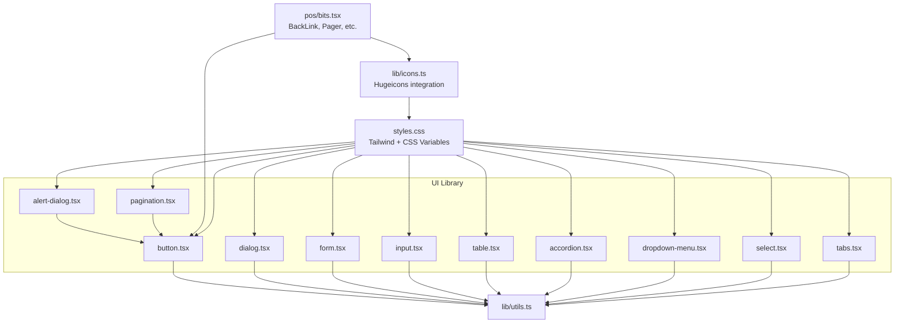
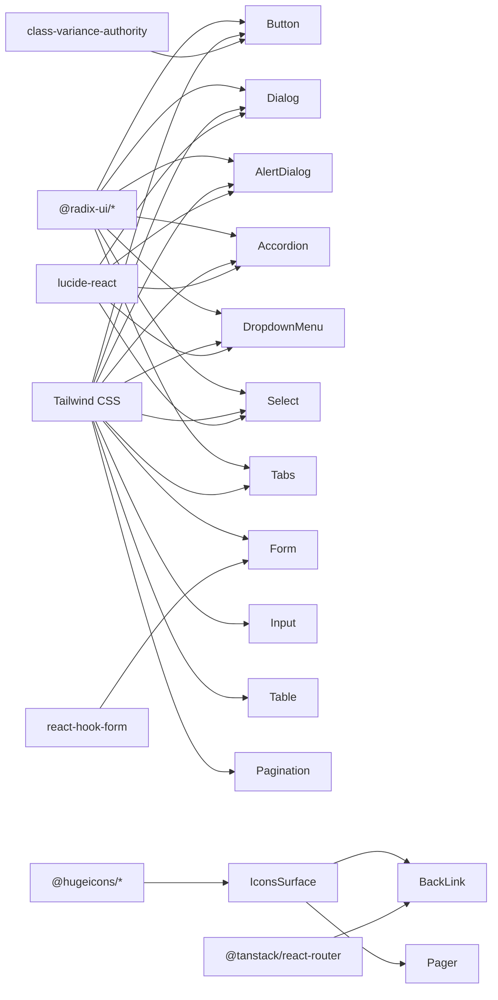

# UI Component Library

<cite>
**Referenced Files in This Document**
- [README.md](file://README.md)
- [package.json](file://package.json)
- [components.json](file://components.json)
- [src/styles.css](file://src/styles.css)
- [src/lib/utils.ts](file://src/lib/utils.ts)
- [src/components/ui/button.tsx](file://src/components/ui/button.tsx)
- [src/components/ui/dialog.tsx](file://src/components/ui/dialog.tsx)
- [src/components/ui/alert-dialog.tsx](file://src/components/ui/alert-dialog.tsx)
- [src/components/ui/form.tsx](file://src/components/ui/form.tsx)
- [src/components/ui/input.tsx](file://src/components/ui/input.tsx)
- [src/components/ui/table.tsx](file://src/components/ui/table.tsx)
- [src/components/ui/accordion.tsx](file://src/components/ui/accordion.tsx)
- [src/components/ui/dropdown-menu.tsx](file://src/components/ui/dropdown-menu.tsx)
- [src/components/ui/select.tsx](file://src/components/ui/select.tsx)
- [src/components/ui/tabs.tsx](file://src/components/ui/tabs.tsx)
- [src/components/ui/pagination.tsx](file://src/components/ui/pagination.tsx)
- [src/components/pos/bits.tsx](file://src/components/pos/bits.tsx)
- [src/lib/icons.ts](file://src/lib/icons.ts)
- [src/lib/paging.ts](file://src/lib/paging.ts)
</cite>

## Update Summary
**Changes Made**
- Added new Pager component for pagination controls in POS screens
- Enhanced dropdown menu system with improved styling and accessibility
- Introduced BackLink component for navigation patterns
- Improved icon integration throughout the interface using Hugeicons library
- Updated dependency management for better performance

## Table of Contents
1. [Introduction](#introduction)
2. [Project Structure](#project-structure)
3. [Core Components](#core-components)
4. [Architecture Overview](#architecture-overview)
5. [Detailed Component Analysis](#detailed-component-analysis)
6. [New Components](#new-components)
7. [Icon Integration System](#icon-integration-system)
8. [Dependency Analysis](#dependency-analysis)
9. [Performance Considerations](#performance-considerations)
10. [Troubleshooting Guide](#troubleshooting-guide)
11. [Conclusion](#conclusion)
12. [Appendices](#appendices)

## Introduction
This document describes the UI component library built on Radix UI primitives, styled with Tailwind CSS and organized under src/components/ui. It explains the design system principles, available components (buttons, forms, dialogs, tables, layout/navigation), props and events, customization via Tailwind and theme variables, accessibility features, responsive patterns, testing strategies, performance considerations, and guidelines for extending or creating new components.

The application is a POS system; the UI layer provides accessible, composable primitives that can be composed into complex screens. Recent updates include enhanced pagination controls, improved navigation patterns, and optimized icon integration.

**Section sources**
- [README.md:1-26](file://README.md#L1-L26)

## Project Structure
The UI library follows a feature-based organization under src/components/ui, where each file represents a single component or a small group of related components. Styling uses Tailwind CSS classes and CSS variables defined by the theme configuration. Utility functions are centralized in src/lib/utils.ts to merge class names and common helpers.



**Diagram sources**
- [src/components/ui/button.tsx:1-55](file://src/components/ui/button.tsx#L1-L55)
- [src/components/ui/dialog.tsx:1-105](file://src/components/ui/dialog.tsx#L1-L105)
- [src/components/ui/alert-dialog.tsx:1-116](file://src/components/ui/alert-dialog.tsx#L1-L116)
- [src/components/ui/form.tsx:1-172](file://src/components/ui/form.tsx#L1-L172)
- [src/components/ui/input.tsx:1-23](file://src/components/ui/input.tsx#L1-L23)
- [src/components/ui/table.tsx:1-95](file://src/components/ui/table.tsx#L1-L95)
- [src/components/ui/accordion.tsx:1-52](file://src/components/ui/accordion.tsx#L1-L52)
- [src/components/ui/dropdown-menu.tsx:1-188](file://src/components/ui/dropdown-menu.tsx#L1-L188)
- [src/components/ui/select.tsx:1-153](file://src/components/ui/select.tsx#L1-L153)
- [src/components/ui/tabs.tsx:1-54](file://src/components/ui/tabs.tsx#L1-L54)
- [src/components/ui/pagination.tsx:1-98](file://src/components/ui/pagination.tsx#L1-L98)
- [src/components/pos/bits.tsx:1-200](file://src/components/pos/bits.tsx#L1-L200)
- [src/lib/icons.ts:1-63](file://src/lib/icons.ts#L1-L63)

**Section sources**
- [components.json:1-23](file://components.json#L1-L23)
- [package.json:1-106](file://package.json#L1-L106)

## Core Components
This section summarizes the primary building blocks and their responsibilities.

- Button: A versatile button with variants and sizes, supporting asChild composition.
- Dialog/Alert Dialog: Accessible overlays for content and confirmations, with portal management and keyboard handling.
- Form: A form system integrating react-hook-form with accessible labels, descriptions, and messages.
- Input: A styled input with focus states and disabled behavior.
- Table: A responsive table with sticky headers and selection-friendly cells.
- Accordion: Expandable sections with animated content.
- Dropdown Menu: Rich menu interactions with keyboard navigation and nested submenus.
- Select: Accessible select with virtualized viewport and scroll buttons.
- Tabs: Tabbed interface with accessible triggers and content panels.
- **Pagination**: New comprehensive pagination system with page navigation controls.

These components share consistent styling through Tailwind utilities and CSS variables, and they expose standard React props plus Radix-specific behaviors.

**Section sources**
- [src/components/ui/button.tsx:1-55](file://src/components/ui/button.tsx#L1-L55)
- [src/components/ui/dialog.tsx:1-105](file://src/components/ui/dialog.tsx#L1-L105)
- [src/components/ui/alert-dialog.tsx:1-116](file://src/components/ui/alert-dialog.tsx#L1-L116)
- [src/components/ui/form.tsx:1-172](file://src/components/ui/form.tsx#L1-L172)
- [src/components/ui/input.tsx:1-23](file://src/components/ui/input.tsx#L1-L23)
- [src/components/ui/table.tsx:1-95](file://src/components/ui/table.tsx#L1-L95)
- [src/components/ui/accordion.tsx:1-52](file://src/components/ui/accordion.tsx#L1-L52)
- [src/components/ui/dropdown-menu.tsx:1-188](file://src/components/ui/dropdown-menu.tsx#L1-L188)
- [src/components/ui/select.tsx:1-153](file://src/components/ui/select.tsx#L1-L153)
- [src/components/ui/tabs.tsx:1-54](file://src/components/ui/tabs.tsx#L1-L54)
- [src/components/ui/pagination.tsx:1-98](file://src/components/ui/pagination.tsx#L1-L98)

## Architecture Overview
The UI architecture layers Radix UI primitives with Tailwind CSS and a shared utility function for class merging. Each component encapsulates its own structure and styles while exposing a stable API. Composition is encouraged via asChild and slot patterns where applicable.

```mermaid
classDiagram
class Button {
+variant
+size
+asChild
+onClick()
}
class Dialog {
+open
+onOpenChange()
+Trigger
+Content
+Overlay
+Close
}
class AlertDialog {
+Action
+Cancel
+Title
+Description
}
class Form {
+FormProvider
+FormField
+FormItem
+FormLabel
+FormControl
+FormDescription
+FormMessage
}
class Input {
+type
+onChange()
+onFocus()
+disabled
}
class Table {
+Header
+Body
+Footer
+Row
+Head
+Cell
+Caption
}
class Accordion {
+Item
+Trigger
+Content
}
class DropdownMenu {
+Trigger
+Content
+Item
+CheckboxItem
+RadioItem
+Separator
}
class Select {
+Trigger
+Content
+Item
+Label
+Separator
}
class Tabs {
+List
+Trigger
+Content
}
class Pagination {
+Content
+Link
+Item
+Previous
+Next
+Ellipsis
}
Button --> "uses" : "cva + Slot"
Dialog --> "wraps" : "@radix-ui/react-dialog"
AlertDialog --> "wraps" : "@radix-ui/react-alert-dialog"
Form --> "wraps" : "react-hook-form"
Table --> "semantic HTML"
Accordion --> "wraps" : "@radix-ui/react-accordion"
DropdownMenu --> "wraps" : "@radix-ui/react-dropdown-menu"
Select --> "wraps" : "@radix-ui/react-select"
Tabs --> "wraps" : "@radix-ui/react-tabs"
Pagination --> "wraps" : "Button + lucide-react"
```

**Diagram sources**
- [src/components/ui/button.tsx:1-55](file://src/components/ui/button.tsx#L1-L55)
- [src/components/ui/dialog.tsx:1-105](file://src/components/ui/dialog.tsx#L1-L105)
- [src/components/ui/alert-dialog.tsx:1-116](file://src/components/ui/alert-dialog.tsx#L1-L116)
- [src/components/ui/form.tsx:1-172](file://src/components/ui/form.tsx#L1-L172)
- [src/components/ui/table.tsx:1-95](file://src/components/ui/table.tsx#L1-L95)
- [src/components/ui/accordion.tsx:1-52](file://src/components/ui/accordion.tsx#L1-L52)
- [src/components/ui/dropdown-menu.tsx:1-188](file://src/components/ui/dropdown-menu.tsx#L1-L188)
- [src/components/ui/select.tsx:1-153](file://src/components/ui/select.tsx#L1-L153)
- [src/components/ui/tabs.tsx:1-54](file://src/components/ui/tabs.tsx#L1-L54)
- [src/components/ui/pagination.tsx:1-98](file://src/components/ui/pagination.tsx#L1-L98)

## Detailed Component Analysis

### Button
- Purpose: Primary interactive element with multiple visual variants and sizes.
- Props: variant, size, asChild, and all native button attributes.
- Events: onClick and other standard DOM events forwarded to the underlying element.
- Customization: Use cva variants and Tailwind classes; extend variants by modifying the component's variant map.
- Accessibility: Focus ring and disabled state handled; supports keyboard activation.

Usage example path: [Button usage:1-55](file://src/components/ui/button.tsx#L1-L55)

**Section sources**
- [src/components/ui/button.tsx:1-55](file://src/components/ui/button.tsx#L1-L55)

### Dialog
- Purpose: Modal overlay for focused tasks and confirmations.
- Props: open, onOpenChange, and child components Trigger, Content, Overlay, Close, Header, Footer, Title, Description.
- Events: Controlled open state via onOpenChange; close via Close or Escape key.
- Customization: Tailwind classes for positioning, animations, and typography; overlay opacity and z-index managed.
- Accessibility: Focus trap, role attributes, and screen reader text provided.

Usage example path: [Dialog implementation:1-105](file://src/components/ui/dialog.tsx#L1-L105)

**Section sources**
- [src/components/ui/dialog.tsx:1-105](file://src/components/ui/dialog.tsx#L1-L105)

### Alert Dialog
- Purpose: Confirmation dialog with action and cancel buttons.
- Props: Action and Cancel styled using Button variants; Title and Description for context.
- Events: Controlled via primitive APIs; actions trigger callbacks.
- Customization: Reuse Button variants for consistent CTAs.
- Accessibility: Keyboard navigation and focus management inherited from primitives.

Usage example path: [Alert Dialog implementation:1-116](file://src/components/ui/alert-dialog.tsx#L1-L116)

**Section sources**
- [src/components/ui/alert-dialog.tsx:1-116](file://src/components/ui/alert-dialog.tsx#L1-L116)

### Form System
- Purpose: Declarative form building with validation and accessible labeling.
- Props: FormProvider, FormField, FormItem, FormLabel, FormControl, FormDescription, FormMessage.
- Events: Integrates with react-hook-form controllers; exposes field state and errors.
- Customization: Label color adapts to error state; description/message styling via Tailwind.
- Accessibility: aria-describedby and aria-invalid wired to fields; proper label associations.

Usage example path: [Form system:1-172](file://src/components/ui/form.tsx#L1-L172)

**Section sources**
- [src/components/ui/form.tsx:1-172](file://src/components/ui/form.tsx#L1-L172)

### Input
- Purpose: Styled text input with focus and disabled states.
- Props: type, onChange, onFocus, onBlur, disabled, and all native input attributes.
- Events: Standard input events forwarded.
- Customization: Border, padding, and focus ring via Tailwind; placeholder and file input styling included.
- Accessibility: Native semantics preserved; focus-visible ring for keyboard users.

Usage example path: [Input implementation:1-23](file://src/components/ui/input.tsx#L1-L23)

**Section sources**
- [src/components/ui/input.tsx:1-23](file://src/components/ui/input.tsx#L1-L23)

### Table
- Purpose: Responsive data table with sticky header and selection-friendly rows/cells.
- Props: Header, Body, Footer, Row, Head, Cell, Caption; accepts standard table attributes.
- Events: None intrinsic; compose with your own row interactions.
- Customization: Hover and selected states via Tailwind; caption and footer styling.
- Accessibility: Semantic table elements; cell spacing and alignment optimized.

Usage example path: [Table implementation:1-95](file://src/components/ui/table.tsx#L1-L95)

**Section sources**
- [src/components/ui/table.tsx:1-95](file://src/components/ui/table.tsx#L1-L95)

### Accordion
- Purpose: Collapsible sections with animated content.
- Props: Item, Trigger, Content; controlled state via primitives.
- Events: Toggle via Trigger; animation states exposed by primitives.
- Customization: Chevron icon rotation and content animation classes.
- Accessibility: Keyboard navigation and expanded state announcements.

Usage example path: [Accordion implementation:1-52](file://src/components/ui/accordion.tsx#L1-L52)

**Section sources**
- [src/components/ui/accordion.tsx:1-52](file://src/components/ui/accordion.tsx#L1-L52)

### Dropdown Menu
- Purpose: Contextual menus with items, checkboxes, radio groups, separators, and shortcuts.
- Props: Trigger, Content, Item, CheckboxItem, RadioItem, Label, Separator, Shortcut, Group, Portal, Sub, SubContent, SubTrigger, RadioGroup.
- Events: Selection and toggle events via primitives; inset prop for indentation.
- Customization: Popover-like animations and positioning; focus and disabled states.
- Accessibility: Full keyboard support and ARIA roles.

Usage example path: [Dropdown Menu implementation:1-188](file://src/components/ui/dropdown-menu.tsx#L1-L188)

**Section sources**
- [src/components/ui/dropdown-menu.tsx:1-188](file://src/components/ui/dropdown-menu.tsx#L1-L188)

### Select
- Purpose: Accessible select dropdown with scroll buttons and viewport sizing.
- Props: Trigger, Content, Item, Label, Separator, ScrollUpButton, ScrollDownButton; position prop for popper mode.
- Events: Value change and open/close via primitives.
- Customization: Viewport width matching trigger in popper mode; item indicators.
- Accessibility: ARIA attributes and keyboard navigation.

Usage example path: [Select implementation:1-153](file://src/components/ui/select.tsx#L1-L153)

**Section sources**
- [src/components/ui/select.tsx:1-153](file://src/components/ui/select.tsx#L1-L153)

### Tabs
- Purpose: Tabbed interface for switching between content panels.
- Props: List, Trigger, Content; active state managed by primitives.
- Events: Switching tabs updates active panel automatically.
- Customization: Active tab background and text color; focus rings.
- Accessibility: Role attributes and keyboard navigation.

Usage example path: [Tabs implementation:1-54](file://src/components/ui/tabs.tsx#L1-L54)

**Section sources**
- [src/components/ui/tabs.tsx:1-54](file://src/components/ui/tabs.tsx#L1-L54)

## New Components

### Pagination Component
- Purpose: Comprehensive pagination system for large datasets with accessible navigation controls.
- Components: Pagination, PaginationContent, PaginationItem, PaginationLink, PaginationPrevious, PaginationNext, PaginationEllipsis.
- Props: isActive for current page indication, size variants inherited from Button, and standard anchor attributes.
- Events: Navigation events handled through Link components; accessibility attributes for screen readers.
- Customization: Uses Button variants for consistent styling; supports different sizes and states.
- Accessibility: Proper ARIA attributes including aria-current="page" for active pages and descriptive labels for navigation.

Usage example path: [Pagination implementation:1-98](file://src/components/ui/pagination.tsx#L1-L98)

**Section sources**
- [src/components/ui/pagination.tsx:1-98](file://src/components/ui/pagination.tsx#L1-L98)

### BackLink Component
- Purpose: Parent-page link for screens whose group no longer renders a shell tab row, providing consistent navigation patterns.
- Props: to (WorkspacePath), label (ReactNode).
- Features: Integrated with TanStack Router for navigation, includes arrow icon for visual feedback.
- Styling: Consistent with application's muted foreground colors and hover states.
- Usage: Used in collections, stocktake, and transfers screens for parent navigation.

Usage example path: [BackLink implementation:48-57](file://src/components/pos/bits.tsx#L48-L57)

**Section sources**
- [src/components/pos/bits.tsx:48-57](file://src/components/pos/bits.tsx#L48-L57)

### Pager Component
- Purpose: Simple pagination control for inventory lists with ten rows per page, providing intuitive prev/next navigation.
- Props: page (current page number), pageCount (total pages), total (total items count), onPage (page change handler).
- Features: Shows "X of Y" counter, disabled state management for first/last pages, internationalization support.
- Integration: Works with pageSlice utility for data slicing and i18n for localized text.
- Styling: Compact design suitable for POS environments with appropriate spacing and typography.

Usage example path: [Pager implementation:60-96](file://src/components/pos/bits.tsx#L60-L96)

**Section sources**
- [src/components/pos/bits.tsx:60-96](file://src/components/pos/bits.tsx#L60-L96)

## Icon Integration System
The application has implemented an optimized icon integration system using Hugeicons library with strategic tree-shaking to improve development performance.

### Icon Surface Architecture
- Centralized icon exports in src/lib/icons.ts provide individual module imports for each glyph.
- Avoids Vite pre-bundling issues that would load 7.4 MB of unmangled JavaScript in development.
- Supports ~6,000 glyphs from @hugeicons/core-free-icons with production tree-shaking.
- Provides both direct icon imports and alias support for barrel-only icons.

### Icon Usage Patterns
- Direct imports from "@/lib/icons" for optimal bundle size and development performance.
- Integration with @hugeicons/react for React component rendering.
- Consistent sizing and styling across all icon implementations.
- Support for both functional icons and decorative icons with proper accessibility.

**Section sources**
- [src/lib/icons.ts:1-63](file://src/lib/icons.ts#L1-L63)

## Dependency Analysis
The UI components depend on:
- Radix UI primitives for behavior and accessibility.
- Tailwind CSS for styling and responsive utilities.
- class-variance-authority for variant composition (e.g., Button).
- lucide-react for icons used within components.
- react-hook-form integration for the Form system.
- **@hugeicons/core-free-icons and @hugeicons/react for optimized icon integration**.
- **TanStack Router for navigation components like BackLink**.



**Diagram sources**
- [package.json:19-79](file://package.json#L19-L79)
- [src/components/ui/button.tsx:1-55](file://src/components/ui/button.tsx#L1-L55)
- [src/components/ui/dialog.tsx:1-105](file://src/components/ui/dialog.tsx#L1-L105)
- [src/components/ui/alert-dialog.tsx:1-116](file://src/components/ui/alert-dialog.tsx#L1-L116)
- [src/components/ui/form.tsx:1-172](file://src/components/ui/form.tsx#L1-L172)
- [src/components/ui/accordion.tsx:1-52](file://src/components/ui/accordion.tsx#L1-L52)
- [src/components/ui/dropdown-menu.tsx:1-188](file://src/components/ui/dropdown-menu.tsx#L1-L188)
- [src/components/ui/select.tsx:1-153](file://src/components/ui/select.tsx#L1-L153)
- [src/components/ui/tabs.tsx:1-54](file://src/components/ui/tabs.tsx#L1-L54)
- [src/components/ui/pagination.tsx:1-98](file://src/components/ui/pagination.tsx#L1-L98)
- [src/components/pos/bits.tsx:1-200](file://src/components/pos/bits.tsx#L1-L200)
- [src/lib/icons.ts:1-63](file://src/lib/icons.ts#L1-L63)

**Section sources**
- [package.json:19-79](file://package.json#L19-L79)

## Performance Considerations
- Prefer controlled state for overlays (Dialog, Dropdown, Select) to avoid unnecessary re-renders.
- Use asChild sparingly; it changes the rendered element and may affect performance if overused.
- Avoid heavy computations inside render paths; memoize derived values when composing complex forms.
- Keep table rows lightweight; virtualize large datasets externally if needed.
- Leverage Tailwind's utility-first approach to minimize custom CSS and reduce bundle size.
- **Use individual icon imports from "@/lib/icons" instead of barrel imports to avoid 7.4 MB dev server overhead**.
- **Implement pagination for large datasets using the Pager component to reduce initial render time**.
- **Utilize pageSlice utility for efficient data slicing in list components**.

[No sources needed since this section provides general guidance]

## Troubleshooting Guide
- Form validation not showing: Ensure FormControl is wrapped with FormField and use the provided IDs for aria-describedby and aria-invalid.
- Dialog not closing: Verify Close button or Escape key behavior; ensure the overlay is not intercepting clicks unintentionally.
- Dropdown/Select positioning issues: Adjust sideOffset or position props; check container overflow settings.
- Button not clickable: Confirm asChild usage does not override pointer-events; verify disabled state.
- Table header not sticky: Ensure parent containers do not clip overflow; verify z-index stacking contexts.
- **Pagination not working correctly: Ensure page state is properly managed and passed to Pager component**.
- **BackLink navigation not working: Verify WorkspacePath types and router configuration**.
- **Icon display issues: Check that icons are imported from "@/lib/icons" rather than directly from the barrel**.

**Section sources**
- [src/components/ui/form.tsx:40-65](file://src/components/ui/form.tsx#L40-L65)
- [src/components/ui/dialog.tsx:17-54](file://src/components/ui/dialog.tsx#L17-L54)
- [src/components/ui/dropdown-menu.tsx:57-74](file://src/components/ui/dropdown-menu.tsx#L57-L74)
- [src/components/ui/select.tsx:63-93](file://src/components/ui/select.tsx#L63-L93)
- [src/components/ui/table.tsx:5-11](file://src/components/ui/table.tsx#L5-L11)
- [src/components/pos/bits.tsx:60-96](file://src/components/pos/bits.tsx#L60-L96)
- [src/lib/icons.ts:1-13](file://src/lib/icons.ts#L1-L13)

## Conclusion
This UI component library provides a cohesive set of accessible, customizable primitives built on Radix UI and styled with Tailwind CSS. Recent enhancements include comprehensive pagination controls, improved navigation patterns with BackLink, and optimized icon integration using Hugeicons. By following the established patterns—composing components, leveraging variants, and adhering to accessibility best practices—you can build consistent, maintainable interfaces across the application.

[No sources needed since this section summarizes without analyzing specific files]

## Appendices

### Styling and Theme Customization
- Tailwind configuration and CSS variables are managed via the project's Tailwind setup and src/styles.css.
- The base color palette and CSS variables are configured in components.json.
- Use Tailwind utilities consistently across components; extend themes by updating CSS variables and Tailwind config.

**Section sources**
- [components.json:1-23](file://components.json#L1-L23)
- [src/styles.css](file://src/styles.css)

### Testing Strategies
- Unit tests: Validate component rendering and event handling using React Testing Library.
- Accessibility tests: Assert ARIA attributes and keyboard navigation for overlays and form fields.
- Integration tests: Compose components (e.g., Form + Input + Button) to validate workflows.
- Snapshot tests: Use cautiously; prefer behavioral assertions over snapshots for UI stability.
- **Test pagination components with various page counts and edge cases**.
- **Verify BackLink navigation works with different route configurations**.

[No sources needed since this section provides general guidance]

### Extending and Creating New Components
- Follow the existing pattern: wrap Radix primitives, apply Tailwind classes, and export a forwardRef component.
- Use class-variance-authority for variant-driven components like Button.
- Provide sensible defaults and allow className overrides for flexibility.
- Maintain accessibility by preserving Radix roles and adding sr-only text where needed.
- Centralize shared logic and styles via src/lib/utils.ts and theme variables.
- **For navigation components, integrate with TanStack Router and use WorkspacePath types**.
- **For icon usage, import from "@/lib/icons" to maintain optimal bundle performance**.

**Section sources**
- [src/components/ui/button.tsx:1-55](file://src/components/ui/button.tsx#L1-L55)
- [src/lib/utils.ts](file://src/lib/utils.ts)
- [src/lib/icons.ts:1-13](file://src/lib/icons.ts#L1-L13)

### Data Management Utilities
- **pageSlice utility**: Efficiently slices arrays for pagination with automatic page clamping.
- **LIST_PAGE_SIZE constant**: Defines default page size (10 items) for consistent pagination across the application.
- Integration with Pager component for seamless data presentation.

**Section sources**
- [src/lib/paging.ts:1-16](file://src/lib/paging.ts#L1-L16)